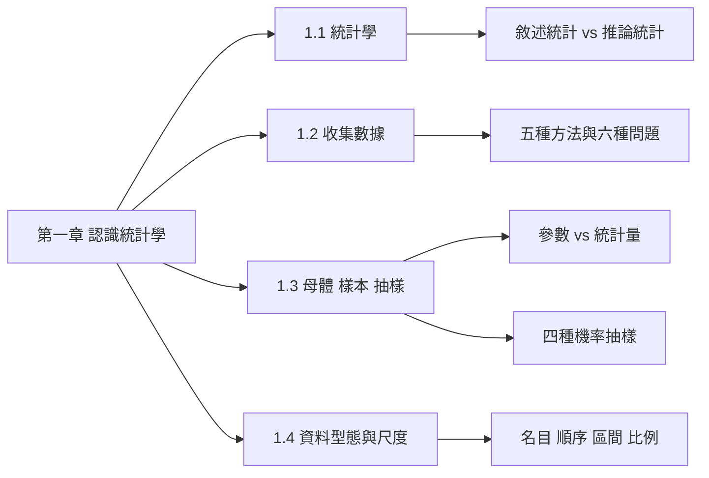
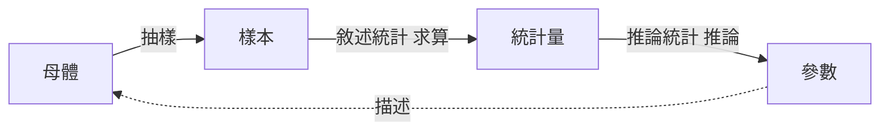

import SamplingDemo from "../_components/SamplingDemo.tsx";

## 名詞表 {#glossary}

本章出現的名詞，詳細說明見對應區塊。

| 中文 | English | 描述 |
|---|---|---|
| 統計學 | Statistics | 用數學與機率分析資料的變異，以數據為基礎做出更好的判斷與決策 |
| 敘述統計學 | Descriptive Statistics | 用圖表、圖形與數值測度呈現並彙整資料 |
| 推論統計學 | Inferential Statistics | 根據樣本資料推測母體特性：估計與假設檢定 |
| 估計 | Estimation | 用樣本推算母體參數的值或區間 |
| 假設檢定 | Hypothesis Testing | 用樣本資料判斷對母體的某個主張是否成立 |
| 母體 | Population | 想研究的某一現象的**全部**個體 |
| 樣本 | Sample | 從母體中抽出、實際調查的**部分**個體 |
| 參數 | Parameter | 描述母體特徵的值（如母體平均數 $\mu$），通常未知 |
| 統計量 | Statistic | 由樣本算出的值（如樣本平均數 $\bar x$），用來推論參數 |
| 實驗設計 | Experimental Design | 控制有興趣的變數來進行實驗的計畫（實驗組 vs 控制組） |
| 書面調查／問卷 | Written Survey / Questionnaire | 寄送或當面填寫的問卷，最便宜的收集方法 |
| 直接觀察 | Direct Observation | 觀察並記錄發生的現象與地點 |
| 結構化訪談 | Structured Interview | 在指定問題下進行的訪談 |
| 非結構化訪談 | Unstructured Interview | 從廣泛問題開始，後續問題隨回答調整 |
| 選擇偏誤 | Selection Bias | 調查對象選得不對而產生的偏誤 |
| 觀察偏誤 | Observer Bias | 個人觀察帶入主觀而產生的偏誤 |
| 內部效度 | Internal Validity | 實驗是否在控制之中、結論是否可信 |
| 外部效度 | External Validity | 實驗結果能否推廣到實驗環境之外 |
| 無回應偏誤 | Nonresponse Bias | 沒回應的人與有回應的人不同而產生的偏誤 |
| 統計抽樣（機率抽樣） | Statistical / Probability Sampling | 依已知機率選出樣本，每個單位被抽中的機率可知 |
| 非統計抽樣 | Nonstatistical Sampling | 依方便、判斷等非機率過程選樣本 |
| 簡單隨機抽樣 | Simple Random Sampling | 每個單位（每一種樣本組合）被抽中的機會相同 |
| 分層抽樣 | Stratified Sampling | 依特徵分層，各層內再簡單隨機抽樣 |
| 系統抽樣 | Systematic Sampling | 排序後隨機選起點，每隔 $k=N/n$ 個抽一個 |
| 群集抽樣 | Cluster Sampling | 母體分成群集，隨機抽出整群來調查 |
| 亂數表 | Random Number Table | 0～9 隨機排列、出現機率相等的數字表 |
| 時間序列資料 | Time-Series Data | 同一對象在不同時間點的資料 |
| 橫斷面資料 | Cross-Sectional Data | 同一時間點、不同對象的資料 |
| 屬性資料 | Qualitative / Categorical Data | 類別資料，例如性別、品牌 |
| 屬量資料 | Quantitative Data | 數值資料，例如身高、價格 |
| 名目尺度 | Nominal | 只能分類、比較相不相等 |
| 順序尺度 | Ordinal | 可以排序，但間隔不等距 |
| 區間尺度 | Interval | 有順序、差距有意義，但 0 不代表「沒有」 |
| 比例尺度 | Ratio | 區間尺度再加上有意義的絕對零點 |
| 資料探勘 | Data Mining | 從數據中找出隱藏的重要關係 |
| 大數據 | Big Data | 傳統軟體處理不了的大量、複雜（結構化與非結構化）資料 |

## 本章地圖 {#ch1-map}

第一章建立整門課的語言：統計在做什麼、資料從哪裡來、怎麼抽樣、資料分成哪幾種。原始講義：[[統計CH1參考講義.pdf|第一章講義]]。

## 統計學是什麼 {#what-is-statistics}

面對生活中的不確定性：

- **數學**提供處理資料的方法；
- **機率**描述資料的隨機變化；
- **統計**運用數學與機率，分析與預測資料的變異，以數據為基礎做出更好的判斷與決策。

### 統計分析與大數據分析 {#stats-vs-big-data .fold}

| | 統計分析 | 大數據分析 |
|---|---|---|
| 著重 | 推論 | 預測 |
| 典型問題 | 同年齡下，台灣人和外國人的薪水是否有顯著差異？ | 如何用國籍與年齡預測一個人的薪水？ |
| 要求 | 重視因果關係與推論的合理性 | 預測得「準」就是好模型 |
| 資料 | 必須乾淨 | 資料多變 |
| 特色 | 先推論母體的運作機制，再用它預測 | 只知如此，不知為何如此 |

大數據時代，傳統統計學依然是數據分析的靈魂。

## 敘述統計與推論統計 {#descriptive-inferential}

商用統計學的兩大分析程序：

| | 敘述統計學 Descriptive | 推論統計學 Inferential |
|---|---|---|
| 做什麼 | 把資料**呈現與彙整**出來 | 用**樣本**推測**母體**的特性 |
| 工具 | 圖表、圖形、數值測度（平均數、標準差…） | 估計（含區間估計）、假設檢定 |
| 對應章節 | [[ch2-charts#ch2-map\|第二章]]、[[ch3-descriptive#ch3-map\|第三章]] | 第四章之後的機率是它的基礎 |

兩者的關係：先從母體**抽樣**得到樣本，用敘述統計**算出統計量**，再用推論統計**由統計量推回母體參數**。

## 母體與樣本 {#population-sample}

- **母體（population）**：欲研究某一現象的**全部**個體。
- **樣本（sample）**：從母體中抽取**部分**個體，作為實際調查的對象。

判斷母體要先問「我想了解的是誰」。例如想了解雲科大學生對教學的滿意度，母體是雲科大所有學生；從 8000 位學生中抽 100 位填問卷，這 100 位是樣本。

### 例子：總統大選民調 {#ex-election-poll .fold}

- 母體：全國有投票權的公民。
- 樣本：被抽到做問卷調查的那部分公民。

### 練習：說出母體 {#ex-population .fold}

a. 保險商品的滿意度調查；b. 研究全國未成年人口的抽菸比例；c. 網站使用者的滿意度調查。

#### 解答 {#ex-population-solution .fold}

a. 購買（使用）該保險商品的所有保戶；b. 全國所有未成年人；c. 該網站的所有使用者。母體永遠是「想下結論的那一整群」，不是「實際問到的人」。

## 參數與統計量 {#parameter-statistic}

| | 參數 Parameter | 統計量 Statistic |
|---|---|---|
| 描述誰 | 母體 | 樣本 |
| 例子 | 母體平均數 $\mu$、母體變異數 $\sigma^2$ | 樣本平均數 $\bar x$、樣本變異數 $s^2$ |
| 個數符號 | $N$ | $n$ |
| 性質 | 母體不變，參數就是固定值，但通常未知 | 會隨抽到的樣本不同而改變 |
| 用途 | 研究者真正想知道的值 | 用來**推論**母體參數 |

記法：**P**opulation 配 **P**arameter，**S**ample 配 **S**tatistic。符號上，母體多用希臘字母（$\mu,\sigma$），樣本多用英文字母（$\bar x, s$）。

### 練習：統計學基本名詞填空 {#ex-ch1-fill .fold}

1. ＿＿指某一現象的全部個體。
2. ＿＿指從全部個體中抽取部分個體作為研究調查的對象。
3. ＿＿＿＿＿對資料作呈現與彙整，像統計圖表與統計量數均屬之。
4. ＿＿＿＿＿根據樣本資料推測母體之某一特性，或作區間估計與假設檢定。
5. 利用樣本資料來決定母體的參數，稱為＿＿＿（＿＿）統計分析。
6. 運用機率來決定某一特定樣本的發生機會，稱為＿＿＿（＿＿）統計分析。

#### 解答 {#ex-ch1-fill-solution .fold}

1. 母體；2. 樣本；3. 敘述統計學；4. 推論統計學。
5. 歸納式（推論）：方向是「樣本 → 母體」。
6. 演繹式（機率）：方向是「已知母體 → 樣本出現的機會」，也就是第四章以後的機率計算。

第 5、6 題講義為空白，這裡依「方向」推得答案，以老師上課給的用詞為準。

## 收集數據的五種方法 {#data-collection}

| 方法 | 做法 | 優點 | 缺點 |
|---|---|---|---|
| 實驗 | 依實驗設計控制有興趣的變數，比較實驗組與控制組 | 可控制、可預先計畫 | 昂貴、耗時 |
| 電話調查 | 打電話詢問 | 即時、便宜 | 可信度差、範圍有限 |
| 書面調查（問卷） | 郵寄、線上或當面填寫問卷；收集大眾意見最常用 | 最便宜、可擴展 | 回復率低 |
| 直接觀察 | 觀察並記錄發生的現象與地點；研究人類行為最基本的方式 | 沒有受訪者偏誤 | 研究者偏見、成本高 |
| 個人訪談 | 結構化（指定問題）或非結構化（由廣泛問題展開） | 同上 | 同上 |

## 收集數據的六項問題 {#data-collection-issues}

1. **選擇偏誤**：收集的數據因選擇的調查對象而偏。例：只在大學附近發問卷，結果偏向年輕人。
2. **觀察偏誤**：靠個人觀察收集數據，會帶入觀察者的主觀。
3. **數據的精確性**：先查有沒有現成、已收集過的數據，通常比自己收集快又便宜，但要確認它夠精確。
4. **測量誤差**：**內部效度**是實驗本身是否在控制中；**外部效度**是結果能否推廣到實驗環境之外。
5. **訪問偏誤**：訪問者的措辭、態度造成的潛在偏誤（bias）。
6. **無回應偏誤**：沒有回應的人可能和有回應的人想法不同，樣本因此失真。

## 統計抽樣與非統計抽樣 {#sampling-types}

決定用抽樣收集資料後，有兩大類方法：

| | 統計（機率）抽樣 | 非統計（非隨機）抽樣 |
|---|---|---|
| 選樣依據 | 已知的機率過程，每個單位被抽中的機率可知 | 方便、判斷或其他非機率過程 |
| 方法 | 簡單隨機、分層、系統、群集 | 任意（便利）抽樣、判斷抽樣、比例抽樣 |
| 能否推論母體 | 可以，誤差可用機率衡量 | 不適合做統計推論 |

## 簡單隨機抽樣 {#simple-random}

母體中每一個單位（每一種同樣大小的樣本組合）被抽中的機會**相同**，而且某個單位被抽中與否，不影響其他單位。

- 優點：節省時間、財力與人力。
- 缺點：只能估計，有誤差；母體太龐大時不易編號執行。

實務上常用**亂數表**：0～9 隨機生成、每個位置出現哪個數字機率相等的數字表，保證每個個體被抽中的機率相等。

### 例子：亂數表抽 6 位員工 {#ex-random-table .fold}

公司 50 位員工編號 01～50，要抽 6 位參加運動會。從亂數表第一列兩位兩位讀：

03 47 43 73 86 36 96 47 36 61 46 98 63 71 24

規則是「只收 01～50、重複的只收一次」，邊讀邊篩：

| 讀到 | 處理 | 已選 |
|---|---|---|
| 03、47、43 | 都在 01～50 | 03, 47, 43 |
| 73、86 | 大於 50，沒有這個員工，跳過 | |
| 36 | 收 | 03, 47, 43, 36 |
| 96、47、36 | 96 超過；47、36 已選過，跳過 | |
| 61 | 超過，跳過 | |
| 46 | 收 | 03, 47, 43, 36, 46 |
| 98、63、71 | 超過，跳過 | |
| 24 | 收，滿 6 個 | 03, 47, 43, 36, 46, 24 |

## 分層抽樣 {#stratified}

依某個特徵把母體分成幾**層**（每個單位只屬於一層），在每一層內做簡單隨機抽樣。各層抽多少，通常按該層占母體的比例分配：

$$
n_h = n\times\frac{N_h}{N}
$$

$N_h$ 是第 $h$ 層的單位數，$n_h$ 是該層要抽的數量。

- 優點：研究的族群中某一類很少時，先分層就**保證**抽得到這一類。
- 缺點：母體太小時無法使用；要求**層間差異大、層內同質性高**。

### 例子：醫院員工身高調查 {#ex-stratified-hospital .fold}

醫院 2700 位員工（男 1620、女 1080），抽 120 位調查平均身高。男女身高差異大，簡單隨機可能剛好抽到太多女生而低估平均，所以按性別分層。

1. 算各層比例：男 $1620/2700=0.6$，女 $1080/2700=0.4$（即 3 : 2）。
2. 按比例分配樣本：男 $120\times0.6=72$ 位，女 $120\times0.4=48$ 位。
3. 在男、女兩層內各自簡單隨機抽出 72 人與 48 人，合起來就是 120 人的樣本。

同理，工會成員收入調查可依職務（生產、行政、服務）分層，先知道各職務人數才能換算比例。

## 系統抽樣 {#systematic}

把母體排序編號後，先算**抽樣距離**：

$$
k=\frac{N}{n}
$$

從第一段 $1\sim k$ 隨機選出起點 $a$，之後每隔 $k$ 個抽一個：$a,\ a+k,\ a+2k,\dots$，直到抽滿 $n$ 個。

和簡單隨機抽樣相比，系統抽樣讓樣本**均勻散布**在整個母體中；被研究的特徵變異很大、又不能抽更多樣本時特別有效，是市場調查中很常用的方法。

### 例子：600 名高中生抽 50 名 {#ex-systematic-students .fold}

1. 用學校名冊依序編號 001～600。
2. 抽樣距離 $k=600/50=12$。
3. 在 1～12 中隨機抽出起點，例如 8 號。
4. 每隔 12 個抽一個：8, 20, 32, 44, …，最後一個是 $8+49\times12=596$，剛好 50 人。

## 群集抽樣 {#cluster}

把母體分成幾個**群集**（例如依地理位置或行政區），每個群集像一個小母體；先用簡單隨機抽出 $m$ 個群集，再對抽中的群集全查或再抽樣。

- 優點：經濟、快速，成本比簡單隨機低（不必跑遍全部地區）。
- 缺點：如果群集彼此不相似（群內不像整個母體），會產生較大的誤差。

### 例子：宜蘭市 A 產品支出調查 {#ex-cluster-yilan .fold}

宜蘭市 11 個行政區中隨機抽出 4 區，每區再隨機抽一條街，普查該街所有住戶（跨區的街只調查屬於該區的住戶）。「區」與「街」都是群集，抽中後整群調查。

## 四種抽樣方法比較 {#sampling-compare}

同一個 20 個單位的母體，切換四種方法看抽中的樣本長什麼樣子：

<SamplingDemo />

分層與群集最容易混淆，關鍵在「組內」與「組間」的差異：

| | 分層抽樣 | 群集抽樣 |
|---|---|---|
| 組內 | 同質（差異小、特徵相近） | 異質（差異大，像一個小母體） |
| 組間 | 異質（層與層差異明顯） | 同質（各群整體結構相似） |
| 怎麼抽 | **每一層**都抽一部分 | 只抽**部分群集**，再全查或抽樣 |
| 例子 | 所得分層調查、能力分班抽樣 | 按學校或行政區抽整班、整區 |

## 資料型態 {#data-types}

資料可以從兩個角度分類：

| 角度 | 類型 | 例子 |
|---|---|---|
| 時間 | **時間序列**：同一對象、不同時間點 | 某公司 10 年的年銷售額 |
| 時間 | **橫斷面**：同一時間點、不同對象 | 今年各縣市的失業率 |
| 型態 | **屬性（類別）資料** | 性別、血型、品牌 |
| 型態 | **屬量（數值）資料** | 身高、價格、溫度 |

屬量資料還分**離散**（可計數，如購買件數）與**連續**（經測量，如身高），見 [[ch2-charts#discrete-continuous|離散與連續數據]]。

## 四種測量尺度 {#measurement-scales}

數據依測量尺度由低到高分四級。等級越高，能做的分析越精密（高等級可以用低等級的方法，反之不行）：

| 尺度 | 順序 | 精確差異 | 絕對原點 | 例子 |
|---|---|---|---|---|
| 名目 Nominal | 無 | 無 | 無 | 性別、血型、職業、品牌 |
| 順序 Ordinal | 有 | 無 | 無 | 名次、等級、教育程度 |
| 區間 Interval | 有 | 有 | 無 | 溫度、智商、年份 |
| 比例 Ratio | 有 | 有 | 有 | 長度、重量、距離、價格 |

判斷時依序問三個問題：能排順序嗎？兩筆的差距有意義嗎？0 代表「沒有」嗎？

- **名目**：數字只是代碼（男 = 1、女 = 2），只能比較相不相等。
- **順序**：可以排大小先後，但間隔不等距（第 1 名和第 2 名的差距不一定等於第 2 和第 3 名）。
- **區間**：差距有意義（35 度比 30 度高 5 度），但 0 度不代表「沒有溫度」，所以不能說 30 度是 15 度的兩倍熱。
- **比例**：有真正的原點（0 公斤 = 沒有重量），可以說 10 公斤是 5 公斤的兩倍。

尺度決定能用哪些中心測度，見 [[ch3-descriptive#center-summary|三種中心測度的比較]]。

## 資料探勘與大數據 {#data-mining}

- **資料探勘（數據挖掘）**：尋找隱藏在數據之間的重要關係，讓決策依據統計分析，而不是只憑管理直覺與經驗。
- **大數據**：傳統資料處理軟體不足以處理的龐大或複雜資料集，來源多樣，包含結構化與非結構化資料。

## 自我測驗 {#self-check}

### 題目 {#self-check-questions}

1. 民調公司從全國選民中抽 1,068 人，算出某候選人支持率 38%。母體、樣本、參數、統計量各是什麼？
2. 公司想調查員工滿意度，員工分成工程、業務、行政三個部門，且部門間看法差異很大。該用分層還是群集抽樣？
3. 「顧客滿意度：非常滿意、滿意、普通、不滿意」是哪一種尺度？
4. 從 1,000 張發票中用系統抽樣抽 40 張，抽樣距離是多少？若起點是 17，第三張是第幾號？

### 解答 {#self-check-answers .fold}

1. 母體：全國選民；樣本：被抽中的 1,068 人；參數：全國選民真正的支持率（未知）；統計量：樣本支持率 38%。
2. 分層抽樣：部門之間差異大（層間異質），按部門分層才能保證每個部門都有代表。
3. 順序尺度：可以排序，但「非常滿意」到「滿意」的距離不一定等於「滿意」到「普通」。
4. $k=1000/40=25$；第三張是 $17+2\times25=67$ 號。
