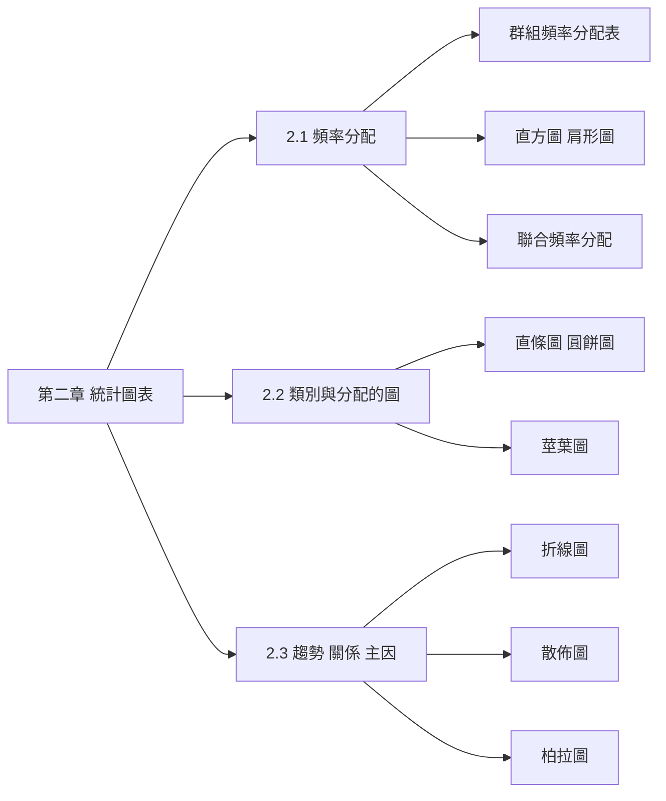
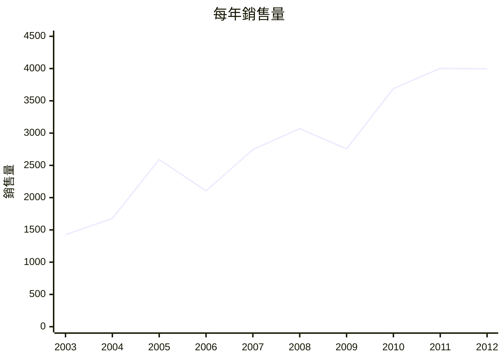
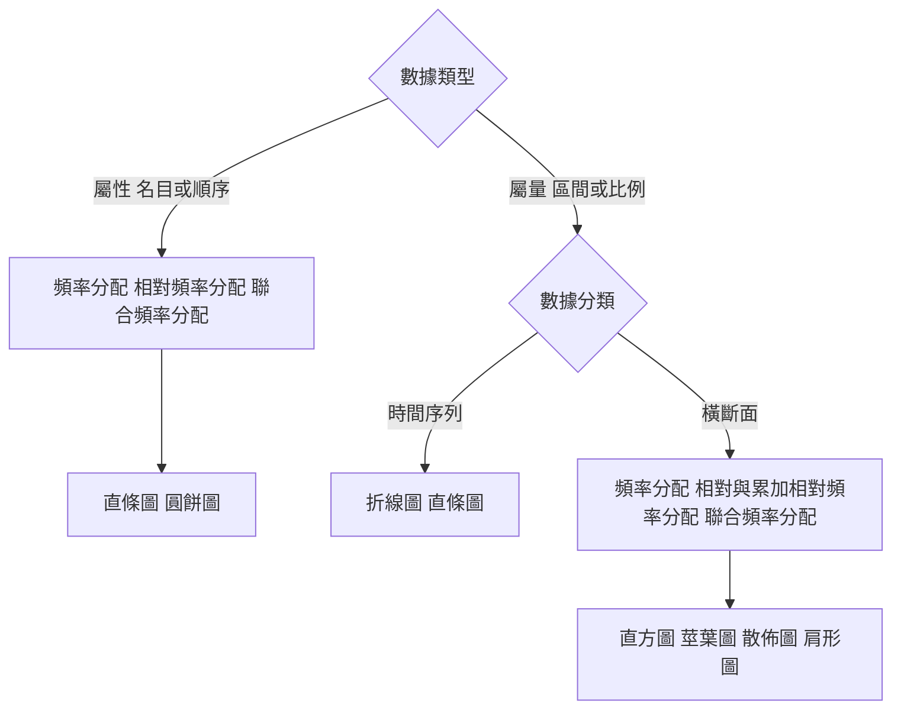

import HistogramBuilder from "../_components/HistogramBuilder.tsx";
import ContingencyTable from "../_components/ContingencyTable.tsx";
import CategoryChart from "../_components/CategoryChart.tsx";
import StemLeaf from "../_components/StemLeaf.tsx";
import ScatterPatterns from "../_components/ScatterPatterns.tsx";
import ParetoChart from "../_components/ParetoChart.tsx";

## 名詞表 {#glossary}

本章出現的名詞，詳細說明見對應區塊。

| 中文 | English | 描述 |
|---|---|---|
| 離散數據 | Discrete Data | 可能值可以一個一個數（計數），通常是整數 |
| 連續數據 | Continuous Data | 經測量取得，某區間內任何數值都可能，含小數 |
| 頻率（次數）分配 | Frequency Distribution | 列出每個可能值、類別或組別出現幾次的摘要表 |
| 群組頻率分配 | Grouped Frequency Distribution | 屬量資料先分組再計數的頻率分配表 |
| 全距 | Range | 最大值 − 最小值 |
| 組數 | Number of Classes, $k$ | 分成幾組，常用 $2^k\ge n$ 決定 |
| 組距 | Class Width, $W$ | 每一組的寬度 |
| 組界 | Class Boundaries | 每一組的上下界 |
| 互斥組別 | Mutually Exclusive Classes | 組別不重疊，一筆資料只屬於一組 |
| 涵蓋全部的組別 | All-Inclusive Classes | 所有組別合起來包含全部數據 |
| 等距組別 | Equal-Width Classes | 每組的寬度相同 |
| 直方圖 | Histogram | 群組頻率分配的圖：x 軸組別、y 軸頻率，長條相連 |
| 相對頻率 | Relative Frequency | 組頻率 ÷ 總數 |
| 累加相對頻率 | Cumulative Relative Frequency | 從第一組累加到該組的相對頻率 |
| 肩形圖（累積頻率曲線） | Ogive | 在各組上組界標出累加相對頻率並連線的圖 |
| 聯合頻率分配 | Joint Frequency Distribution | 同時依兩個變數交叉計數的表 |
| 直條圖（長條圖） | Bar Chart | 每個類別一條長條，高度是次數或測量值，長條間留空 |
| 圓餅圖 | Pie Chart | 依各類別占全部的比例把圓切成扇形 |
| 莖葉圖 | Stem-and-Leaf Diagram | 莖 = 主要位數、葉 = 末位數，保留原始數值的分配圖 |
| 折線圖 | Line Chart | x 軸時間、y 軸變數，畫點並連線，看時間序列趨勢 |
| 散佈圖 | Scatter Diagram | 成對的兩個屬量變數 $(x,y)$ 畫成點，看兩者關係 |
| 依變數（反應變數） | Dependent / Response Variable | 被觀察、受其他因素影響的變數，放 y 軸 |
| 獨立變數（解釋變數） | Independent / Explanatory Variable | 被認為會影響依變數、決策者可控制的變數，放 x 軸 |
| 正相關／負相關 | Positive / Negative Relationship | $x$ 增加時 $y$ 傾向增加／減少 |
| 柏拉圖 | Pareto Diagram | 由大到小排列的長條圖 + 累積百分比折線 |
| 80/20 法則 | Pareto Principle | 80% 的問題來自 20% 的主要原因 |
| 關鍵少數 | Vital Few | 造成大部分問題的少數幾項原因 |

## 本章地圖 {#ch2-map}

第二章把一堆原始數字整理成表格與圖：2.1 頻率分配與直方圖，2.2 直條圖、圓餅圖與莖葉圖，2.3 折線圖、散佈圖與柏拉圖。原始講義：[[CH2 統計學(一)參考講義.pdf|第二章講義]]。要先分清楚資料是哪一種（[[ch1-intro#data-types|資料型態]]），才知道該畫哪種圖，見 [[#chart-chooser|如何選擇統計圖表]]。

## 離散與連續數據 {#discrete-continuous}

屬量資料（數值資料）分兩種：

| | 離散數據 Discrete | 連續數據 Continuous |
|---|---|---|
| 怎麼得到 | **計數**（count） | **測量**（measure） |
| 可能值 | 可以一個一個數，通常是整數 | 某區間內任何數值，含小數 |
| 例子 | 顧客購買的商品種類數：1 個、5 個，不會有 0.3 個 | 身高：170 和 171 公分之間還有 170.5、170.333… |

這個區分在第五章會再出現：[[ch5-discrete#random-variable|離散與連續隨機變數]]。

## 頻率分配 {#frequency-distribution}

頻率（次數）分配是一個數據集的摘要，列出觀察值落在每個可能值（或類別、組別）的次數。Excel 的 `FREQUENCY` 函數可以直接做。

### 例子：450 位顧客購買的商品種類數 {#ex-frequency-450 .fold}

每位顧客購買的商品種類數是離散數據，可能值本身就能當組別，直接計數：

| 種類數 | 1 | 2 | 3 | 4 | 5 | 6 | 7 | 8 | 9 | 10 | 11 | 總和 |
|---|---|---|---|---|---|---|---|---|---|---|---|---|
| 顧客數 | 25 | 29 | 42 | 92 | 83 | 71 | 35 | 19 | 29 | 18 | 7 | 450 |

一眼可見大多數顧客買 4 到 6 種商品。

## 群組頻率分配的步驟 {#grouped-steps}

屬量資料（尤其是連續數據）的可能值太多，要先**分組**再計數，得到群組頻率分配表，才能畫直方圖：

1. **資料排序**：由小到大，找出最小值與最大值。
2. **求全距**：最大值 − 最小值。
3. **決定組數 $k$**：通常介於 5 到 20 組。常用 $2^k\ge n$ 規則：找最小的 $k$ 使 $2^k$ 不小於資料筆數 $n$。
4. **設定組距**：

$$
W=\frac{\text{最大值}-\text{最小值}}{k}
$$

  算出來通常不是整數，**往上進位**到方便的數字（進位才能保證 $k$ 組涵蓋全部資料）。
5. **決定組界**：從不大於最小值的方便數字開始，每組寫成「下界 ≤ x ＜ 上界」，上界不含在內。
6. **計算組頻率**：數每一組有幾筆。

### 分組的四項準則 {#class-rules}

1. **互斥**：組別不可重疊，一筆資料只屬於一組（所以上界不含在內）。
2. **涵蓋全部**：所有組別要包含所有數據。
3. **等寬**：盡可能每組的寬度相同。
4. **避免空組**：盡可能不要有沒有數據的組別。

## 例子：緊急應變通訊系統 {#ex-emergency}

國土安全部測試 72 個城市的緊急應變通訊系統，記錄聯繫成功前花了幾秒（連續數據）。最小值 35 秒、最大值 1,492 秒。

1. **組數**：$n=72$，$2^6=64<72$、$2^7=128\ge 72$，所以 $k=7$ 組。
2. **組距**：$W=(1492-35)/7=208.14$，往上進位到方便的 225 秒。
3. **組界**：第一組從 0 開始，$0\le x<225$，之後每組加 225：225、450、675、900、1125、1350，最後一組 $1350\le x<1575$ 涵蓋最大值 1,492。
4. **組頻率**：逐組計數得 9、6、12、13、14、11、7，總和 72。

大部分城市需要 450 到 1,350 秒（7.5 到 22.5 分鐘）才聯繫成功。換其他組距比較看看：

<HistogramBuilder title="72 個城市緊急應變通訊系統聯繫成功前所花的秒數" data={[35, 38, 48, 53, 70, 99, 138, 164, 220, 265, 272, 312, 339, 340, 395, 457, 478, 501, 521, 556, 583, 595, 596, 604, 650, 655, 669, 703, 730, 763, 788, 789, 789, 802, 822, 851, 864, 883, 883, 890, 934, 951, 969, 985, 993, 997, 999, 1018, 1025, 1028, 1036, 1044, 1087, 1091, 1126, 1176, 1199, 1199, 1237, 1242, 1261, 1280, 1290, 1312, 1341, 1355, 1357, 1360, 1414, 1436, 1479, 1492]} start={0} widths={[225, 100, 300, 500]} />

## 直方圖 {#histogram}

直方圖（頻率直方圖）是群組頻率分配的圖：

- x 軸放組別，y 軸放頻率；
- 每組一個長方形，寬度是組距（等寬），高度是組頻率；
- 因為資料是連續的，長方形之間**不留空隙**。

把頻率換成相對頻率，形狀不變，只有 y 軸刻度變成比例。

## 相對頻率與累加相對頻率 {#relative-cumulative}

$$
\text{相對頻率}=\frac{\text{組頻率}}{n},\qquad \text{累加相對頻率}=\text{從第一組加到這一組的相對頻率}
$$

累加相對頻率回答「小於某個上界的資料占多少」，最後一組一定是 1。

### 例子：緊急應變的相對頻率 {#ex-emergency-relative .fold}

每組頻率除以 72，再逐組往下加：

| 聯繫時間（秒） | 頻率 | 相對頻率 | 累加相對頻率 |
|---|---|---|---|
| $0\le x<225$ | 9 | $9/72=0.1250$ | 0.1250 |
| $225\le x<450$ | 6 | $6/72=0.0833$ | 0.2083 |
| $450\le x<675$ | 12 | $12/72=0.1667$ | 0.3750 |
| $675\le x<900$ | 13 | $13/72=0.1806$ | 0.5556 |
| $900\le x<1125$ | 14 | $14/72=0.1944$ | 0.7500 |
| $1125\le x<1350$ | 11 | $11/72=0.1528$ | 0.9028 |
| $1350\le x<1575$ | 7 | $7/72=0.0972$ | 1.0000 |

讀法：累加到 900 秒是 0.5556，代表約 56% 的城市在 15 分鐘內聯繫成功。

## 肩形圖 {#ogive}

肩形圖（累積頻率曲線，ogive）：在每一組的**上組界**標出累加相對頻率的點，再用直線連起來。曲線從 0 一路爬升到 1，越陡的地方代表那段區間資料越密集。上面的直方圖元件按「加上肩形圖」就能看到。

## 練習：早餐消費金額 {#ex-breakfast}

早餐店抽樣 60 位顧客，記錄早餐消費金額（元）。以組距 10 元、起點 20 元，製作群組頻率分配表與直方圖，並回答：

- a. 消費金額最常落在哪個區間？
- b. 消費 50 元以上的比例？
- c. 消費 40 元以上可享加購優惠，推估有多少顧客能享用？

<HistogramBuilder title="60 位顧客的早餐消費金額（元）" data={[25, 32, 40, 38, 42, 35, 50, 55, 60, 28, 33, 37, 41, 47, 53, 48, 45, 39, 31, 36, 29, 34, 52, 58, 62, 46, 40, 44, 30, 27, 49, 51, 54, 43, 59, 61, 26, 34, 37, 32, 33, 38, 47, 55, 60, 42, 29, 35, 36, 40, 31, 39, 44, 41, 50, 56, 63, 28, 30, 27]} start={20} widths={[10, 5, 15]} />

### 解答 {#ex-breakfast-solution .fold}

| 組距 | 次數 | 相對頻率 | 百分比 |
|---|---|---|---|
| 20–29 | 8 | 0.13 | 13.33% |
| 30–39 | 20 | 0.33 | 33.33% |
| 40–49 | 16 | 0.27 | 26.67% |
| 50–59 | 11 | 0.18 | 18.33% |
| 60–69 | 5 | 0.08 | 8.33% |
| 合計 | 60 | 1.00 | 100% |

- a. 最常見的是 30–39 元（20 人，33.33%）。
- b. 50 元以上是最後兩組相加：$18.33\%+8.33\%=26.66\%\approx27\%$。
- c. 40 元以上（含 40）是後三組：$16+11+5=32$ 人，占 $32/60=53.33\%$，超過半數顧客能享用加購優惠。講義寫成「41 元以上」，但 40–49 這一組包含 40 元，算的其實是 40 元以上。

## 聯合頻率分配 {#joint-frequency}

用**一個以上的變數**同時描述研究對象，對兩個變數交叉計數。屬量或屬性變數都可以用。步驟：

1. 取得每個對象在兩個變數上的數據；
2. 一個變數當列、另一個當欄，建表；
3. 逐筆把資料計入對應的格子；
4. 計算各列、各欄的總和（邊際總和）。

### 例子：墾丁停車場的付費習慣 {#ex-parking}

12 位顧客的付款方式（付現或刷卡）與使用的車庫（1、2、3 號）。原始資料：

| 顧客 | 1 | 2 | 3 | 4 | 5 | 6 | 7 | 8 | 9 | 10 | 11 | 12 |
|---|---|---|---|---|---|---|---|---|---|---|---|---|
| 付款 | 刷卡 | 刷卡 | 付現 | 刷卡 | 刷卡 | 付現 | 付現 | 刷卡 | 刷卡 | 付現 | 付現 | 刷卡 |
| 車庫 | 2 | 1 | 2 | 2 | 1 | 1 | 3 | 1 | 3 | 2 | 1 | 1 |

逐筆計入「付款方式 × 車庫」的格子後，從總和可以讀出：刷卡共 7 人；1 號車庫最多人用（6 人）；同時刷卡又用 1 號車庫的有 4 人。

<ContingencyTable title="12 位顧客依付款方式與車庫分類" rowTitle="付款方式" colTitle="車庫" rows={["刷卡", "付現"]} cols={["1 號", "2 號", "3 號"]} counts={[[4, 2, 1], [2, 2, 1]]} initialRow={0} initialCol={0} focus="union" />

這張表在第四章就是算[[ch4-probability#rule-6|條件機率]]用的列聯表：把次數除以總數 12 就是機率。

### 例子：咖啡館消費習慣 {#ex-coffee .fold}

12 位顧客的飲品（美式、拿鐵）與消費方式（內用、外帶）交叉計數：

| 飲品＼消費方式 | 內用 | 外帶 | 總和 |
|---|---|---|---|
| 美式 | 3 | 3 | 6 |
| 拿鐵 | 3 | 3 | 6 |
| 總和 | 6 | 6 | 12 |

邊際分配：內用、外帶、美式、拿鐵都是 6 人（50%），而且每一格都是 3，代表飲品與消費方式之間看不出關聯，顧客沒有特定偏好。

## 直條圖 {#bar-chart}

直條圖（長條圖）用一條長方形代表一個**類別**：

1. 長條的高度（或長度）代表該類別的次數、百分比，或該類別在某個屬量變數上的測量值；
2. 可以直向或橫向；
3. 長條之間**留空隙**，因為類別之間沒有連續性；
4. 多個類別變數可以畫在同一張圖（例如 2011 與 2012 年各品牌銷量並排）。

主要用於屬性資料，也可用於離散資料，例如血型分布（A 型 10、B 型 21、O 型 60、AB 型 9 位）：x 軸血型、y 軸人數。

### 例子：成長與收益型股票的本益比 {#ex-pe-ratio .fold}

財富月刊把 8 家「成長與收益型」公司列為好的投資對象，想比較它們的本益比（股價 ÷ 每股盈餘）。

1. **類別變數**：公司（8 個類別）。
2. **測量變數**：本益比。
3. **建圖**：橫軸公司、縱軸本益比。

| 公司 | 亞培 | 奧馳亞 | 可口可樂 | 太古 | 通用磨坊 | 輝瑞 | 寶僑 | 惠氏 |
|---|---|---|---|---|---|---|---|---|
| 本益比 | 21 | 14 | 21 | 20 | 17 | 13 | 21 | 15 |

4. **解釋**：奧馳亞、輝瑞與惠氏的本益比比較低。

這裡長條高度不是次數，而是每個類別的測量值，直條圖一樣適用。

## 圓餅圖 {#pie-chart}

依每個類別占全部的**比例**把圓切成幾塊。主要用於屬性資料，也可用於離散資料。只要想表達「某類別占全部多少」，圓餅圖最合適。畫圖時要定義每塊的顏色與對應品項，並標出每塊的百分比。

每塊的角度：

$$
\text{角度}=\frac{\text{該類別次數}}{\text{總數}}\times360^\circ
$$

### 例子：早餐選項的直條圖與圓餅圖 {#ex-breakfast-choice}

調查 60 位員工的早餐選擇。同一份資料，直條圖適合看「哪一項最多」，圓餅圖適合看「占多少」：

<CategoryChart title="60 位員工的早餐選擇" items={[{ label: "飯糰", count: 14 }, { label: "三明治", count: 14 }, { label: "蛋餅", count: 10 }, { label: "燒餅油條", count: 6 }, { label: "麥片牛奶", count: 7 }, { label: "水果", count: 5 }, { label: "未購買", count: 4 }]} />

- 最受歡迎：飯糰與三明治並列（各 14 人）。
- 三明治占 $14/60\times100\%=23.3\%$。
- 優先備貨前三名：三明治（23.3%）、飯糰（23.3%）、蛋餅（16.7%）。

## 直條圖與直方圖的差別 {#bar-vs-histogram}

| | 直條圖 | 直方圖 |
|---|---|---|
| 資料 | 類別資料（或離散） | 屬量資料，特別是連續資料 |
| x 軸 | 類別，順序可以調換 | 數值組別，順序固定 |
| 長條間 | 留空隙 | 相連不留空隙 |
| 寬度 | 沒有意義 | 代表組距 |

## 莖葉圖 {#stem-leaf}

莖葉圖用來顯示屬量變數的分配，**同時保留每一筆原始數值**。把每個數拆成「莖」（主要位數）與「葉」（最後一位）：

1. 數據由小到大排序；
2. 拆成莖與葉，例如 113 的莖是 11、葉是 3；
3. 由小到大列出所有可能的莖（中間沒有資料的莖也要列出）；
4. 把葉寫在對應的莖後面。

把莖葉圖轉 90 度看，每一列的長度就像直方圖的長條。

範例：15, 27, 8, 17, 13, 22, 24, 25, 13, 36, 32, 32, 32, 28, 43, 7。個位數的 8 和 7 莖是 0（$08$、$07$），28 的莖是 2、葉是 8：

<StemLeaf title="16 筆資料" data={[15, 27, 8, 17, 13, 22, 24, 25, 13, 36, 32, 32, 32, 28, 43, 7]} />

### 例子：風景區每日觀光人數 {#ex-stem-leaf-visitors .fold}

200 天的每日觀光人數，最少 44 人、最多 198 人。莖 = 十位以上（4 到 19），葉 = 個位數。畫出莖葉圖後，莖 11 那一列最長：

- 觀光人數大多介於 80 到 159 人；
- 110 到 119 人是發生次數最多的區間。

## 折線圖 {#line-chart}

折線圖是二維圖形：**時間放 x 軸**、感興趣的變數放 y 軸，畫出每個時間點的實點並用直線連接。適合時間序列資料，看趨勢。步驟：

1. 確定時間序列變數，找出最大值；
2. 建橫軸（等間隔的時間）與縱軸（從 0 到超過最大值的方便刻度）；
3. 描點並連線。

### 例子：起重機具公司的年銷售量 {#ex-line-chart}

業主想向銀行說明公司 10 年間的成長。最大值 4,003，所以縱軸刻度取到 4,500、每格 500：

| 年 | 2003 | 2004 | 2005 | 2006 | 2007 | 2008 | 2009 | 2010 | 2011 | 2012 |
|---|---|---|---|---|---|---|---|---|---|---|
| 銷售量 | 1,426 | 1,678 | 2,591 | 2,105 | 2,744 | 3,068 | 2,755 | 3,689 | 4,003 | 3,997 |

雖然 2006、2009 年有下滑，整體是明顯的成長趨勢。

## 散佈圖 {#scatter}

散佈圖也是二維圖形，用來看**兩個屬量變數之間的關係**：把成對數據 $(x,y)$ 逐點畫在平面上。

| 變數 | 放哪 | 意思 | 別名 |
|---|---|---|---|
| 獨立變數 | x 軸 | 被認為會影響依變數；決策者可控制 | 解釋變數 |
| 依變數 | y 軸 | 被觀察、記錄，值隨其他因素變化 | 反應變數 |

判讀方法：描點後看整體形狀是「上升」「下降」還是「隨機分散」。

<ScatterPatterns />

### 例子：自習時間與考試成績 {#ex-scatter-positive .fold}

調查 30 位大學生每週投入課程複習的時間（$x$，小時）與課程總成績（$y$）。點大致由左下往右上，自習時間越長、成績通常越高，是**正相關**。點不會完全落在線上，因為成績還受理解力、睡眠、課堂參與度等因素影響。

反過來，運動時間（$x$）與體脂率（$y$）的點由左上往右下，越常運動的人體脂率普遍越低，是**負相關**。

## 柏拉圖 {#pareto}

柏拉圖是**長條圖 + 折線圖**的組合，用來找出造成問題的主要原因：

- 橫軸：各項目或原因，依發生次數**由大到小**排列；
- 左縱軸：各項目的次數或百分比（長條）；
- 右縱軸：累積百分比（折線）。

核心精神是 **80/20 法則**：80% 的問題往往來自 20% 的主要原因。累積百分比先衝到約 80% 的那幾項就是「關鍵少數」，資源有限時優先處理它們，改善效益最大。常見於品質管制、顧客抱怨分析、學習困難點排序、醫院抱怨類型分析。

製作步驟：

1. 決定分類方法（問題、原因、不良品型態…）；
2. 決定用金額還是次數區分等級；
3. 在適當期間內收集資料；
4. 彙整並由大到小排序；
5. 計算累積百分比；
6. 畫圖，找出重要的少數。

比較對策前後的柏拉圖時，收集期間與對象要一樣，要考慮季節變化，也要注意解決主因時其他原因是否突然增加。

### 例子：產品缺陷原因 {#ex-pareto-defects}

工廠紀錄 120 次產品缺陷的原因。先排序，再算每項百分比（次數 ÷ 120），最後逐項累加：

<ParetoChart title="120 次產品缺陷的原因" items={[{ label: "刮傷", count: 45 }, { label: "尺寸不符", count: 30 }, { label: "顏色瑕疵", count: 18 }, { label: "零件缺失", count: 12 }, { label: "表面氣泡", count: 8 }, { label: "包裝不良", count: 7 }]} />

「刮傷 + 尺寸不符」兩項就占了 $37.5\%+25.0\%=62.5\%$ 的缺陷，是最優先改善的目標。

### 例子：不良品分析 {#ex-pareto-rejects .fold}

| 原因 | 缺陷 | 表面損傷 | 破裂 | 其他 | 變形 |
|---|---|---|---|---|---|
| 次數 | 51 | 39 | 29 | 7 | 5 |
| 百分比 | 38.9 | 29.8 | 22.1 | 5.3 | 3.8 |
| 累加百分比 | 38.9 | 68.7 | 90.8 | 96.2 | 100.0 |

百分比是次數 ÷ 131。前三項累加到 90.8%，處理缺陷、表面損傷與破裂就能解決九成問題。

## 如何選擇統計圖表 {#chart-chooser}

先問資料是屬量還是屬性，屬量再問是時間序列還是橫斷面：

## 自我測驗 {#self-check}

### 題目 {#self-check-questions}

1. 有 150 筆資料，用 $2^k\ge n$ 規則該分幾組？最小值 12、最大值 95，組距約多少？
2. 某組的累加相對頻率是 0.62，下一組的相對頻率是 0.15，下一組的累加相對頻率是多少？
3. 要呈現「各部門人數占全公司的比例」，用什麼圖？要呈現「過去 12 個月的營收變化」呢？
4. 廣告費（$x$）與銷售額（$y$）的散佈圖點由左下往右上，代表什麼？

### 解答 {#self-check-answers .fold}

1. $2^7=128<150$、$2^8=256\ge150$，所以 $k=8$；$W=(95-12)/8=10.375$，進位取 11（或更方便的 15）。
2. $0.62+0.15=0.77$。
3. 比例用圓餅圖；時間序列的變化用折線圖。
4. 正相關：廣告費越高，銷售額通常越高。
