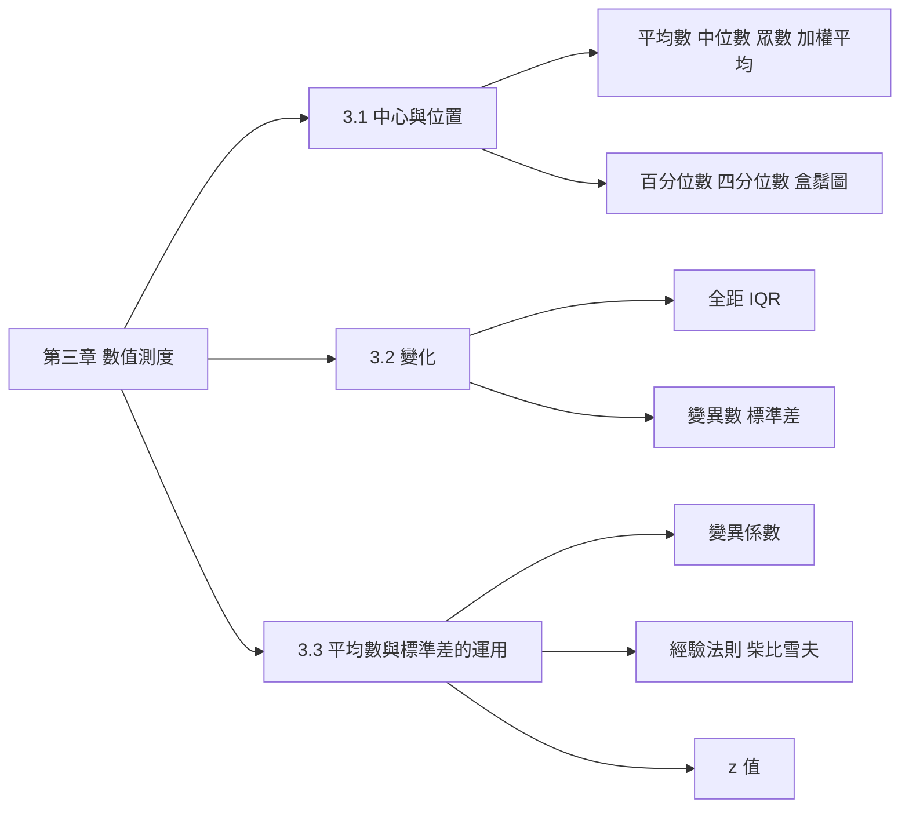

import MeanMedianOutlier from "../_components/MeanMedianOutlier.tsx";
import BoxPlotBuilder from "../_components/BoxPlotBuilder.tsx";
import VarianceSteps from "../_components/VarianceSteps.tsx";
import SpreadRules from "../_components/SpreadRules.tsx";
import ZScoreCompare from "../_components/ZScoreCompare.tsx";

## 名詞表 {#glossary}

本章出現的名詞與符號，詳細說明見對應區塊。

| 中文 | English | 描述 |
|---|---|---|
| 中心測度 | Measures of Center | 描述資料「中心」在哪裡的數值 |
| 平均數 | Mean | 總和 ÷ 個數；母體 $\mu$，樣本 $\bar x$（讀作 x-bar） |
| 中位數 | Median, $M_d$ | 排序後位於正中間的值 |
| 眾數 | Mode | 出現次數最多的值，可能不存在或不只一個 |
| 數據序列 | Data Array | 由小排到大的數據 |
| 極端值 | Extreme Value | 遠大於或遠小於其他資料的值 |
| 對稱分配 | Symmetric Data | 資料在中心兩側對稱分布，平均數 = 中位數 |
| 偏態（右偏） | Skewed (Right-Skewed) | 尾巴拖向一側；右偏時平均數 > 中位數 |
| 加權平均數 | Weighted Mean | 每個值乘上權重後加總，再除以權重總和 |
| 位置測度 | Measures of Position | 描述某值在資料中位置的數值 |
| 百分位數 | Percentile | 有 $p\%$ 的資料小於或等於它的值 |
| 四分位數 | Quartiles, $Q_1,Q_2,Q_3$ | 第 25、50、75 百分位數 |
| 四分位數間距 | Interquartile Range, IQR | $Q_3-Q_1$，中間 50% 資料的範圍 |
| 離群值 | Outlier | 落在 $Q_1-1.5\,\text{IQR}$ 以下或 $Q_3+1.5\,\text{IQR}$ 以上的值 |
| 盒鬚圖（箱型圖） | Box and Whisker Plot / Boxplot | 用 $Q_1$、中位數、$Q_3$、鬚與離群點畫出的圖 |
| 變化測度 | Measures of Variation | 描述資料分散程度的數值 |
| 全距 | Range, $R$ | 最大值 − 最小值 |
| 離差 | Deviation | 每筆資料 − 平均數 |
| 變異數 | Variance | 離差平方的平均；母體 $\sigma^2$，樣本 $s^2$ |
| 標準差 | Standard Deviation | 變異數開根號；母體 $\sigma$，樣本 $s$ |
| 不偏估計 | Unbiased Estimate | 平均而言等於母體參數的估計；樣本變異數除以 $n-1$ 的原因 |
| 變異係數 | Coefficient of Variation, CV | $s/\bar x\times100\%$，比較不同尺度的相對分散 |
| 經驗法則 | Empirical Rule | 鐘形分配：±1、2、3 個標準差內約 68%、95%、99.7% |
| 柴比雪夫定理 | Chebyshev's (Tchebysheff's) Theorem | 任何分配：±$k$ 個標準差內至少 $1-1/k^2$ |
| 標準化 z 值 | Standardized Value, z-Score | $(x-\text{平均})/\text{標準差}$，離平均幾個標準差 |

## 本章地圖 {#ch3-map}

第二章用圖看資料，第三章用**數字**描述資料：中心在哪（3.1）、散得多開（3.2）、怎麼用平均數和標準差下結論（3.3）。原始講義：[[CH3 統計學(一)參考講義(4).pdf|第三章講義]]。

## 平均數 {#mean}

平均數（算術平均數）是把一組數字加總後除以個數，是資料在數值上的**平衡點**。母體和樣本的公式一樣，只差在符號與個數：

$$
\mu=\frac{\sum_{i=1}^{N}x_i}{N}\quad(3.1)\qquad\qquad \bar x=\frac{\sum_{i=1}^{n}x_i}{n}\quad(3.2)
$$

$N$ 是母體個數、$n$ 是樣本個數，$x_i$ 是第 $i$ 筆數值。各筆資料與平均數的離差加總一定是 0，這就是「平衡點」的意思。

### 例子：17 架飛機的平均燃油消耗率 {#ex-airline-mean .fold}

航空公司要從 17 架機型中選擇擴充機隊，蒐集每架飛機在芝加哥與紐約間每小時耗油量（加侖）：

| 機型 | 油耗 | 機型 | 油耗 | 機型 | 油耗 |
|---|---|---|---|---|---|
| B747-400 | 3,529 | B767-200 | 1,377 | B727-100 | 806 |
| L-1011 | 2,215 | B757-200 | 985 | B737-100/200 | 1,104 |
| DC-10-10 | 2,174 | B727-200 | 1,249 | F-100 | 631 |
| A300-B4 | 1,482 | MD-80 | 882 | DC-9-30 | 804 |
| A310-300 | 1,574 | B737-300 | 732 | DC-9-10 | 764 |
| B767-300 | 1,503 | DC-9-50 | 848 | | |

這 17 架是公司要比較的全部機型，所以是母體，用 $\mu$：

1. 加總：$\sum x=3529+2215+\cdots+764=22659$。
2. 除以母體個數：$\mu=22659/17=1332.9$ 加侖／小時。

### 例子：7 位教授的平均年薪 {#ex-salary-mean .fold}

記者抽了 7 位教授的年薪（美元）當樣本：144,000、98,000、204,000、177,000、155,000、316,000、100,000。

$$
\bar x=\frac{\sum x}{n}=\frac{1{,}194{,}000}{7}=170{,}571.43
$$

如果其中 316,000 其實是 1,000,000，總和變成 1,878,000，$\bar x=1{,}878{,}000/7=268{,}285.71$。只改一筆，平均數就大到比其他 6 位教授的年薪都高，這就是平均數**容易受極端值影響**。

## 中位數 {#median}

中位數是把數據由小到大排好（數據序列）後，位於正中間的值。先算位置指標：

$$
i=\frac{1}{2}n\qquad(3.3)
$$

- $i$ **不是整數**：進位到下一個整數，該位置的值就是中位數。
- $i$ **是整數**：中位數是第 $i$ 個與第 $i+1$ 個的平均。

中位數只看「排在中間的是誰」，不管兩端的數有多大，所以**不受極端值影響**。

以教授年薪為例：排序後 98,000、100,000、144,000、**155,000**、177,000、204,000、316,000，$i=7/2=3.5$ 進位到 4，中位數是第 4 個 155,000。把 316,000 改成 1,000,000 後，它仍排在最後，第 4 個還是 155,000。拖動下面最大那筆試試：

<MeanMedianOutlier title="7 位教授的年薪" data={[144000, 98000, 204000, 177000, 155000, 316000, 100000]} moveIndex={5} maxValue={1000000} unit="美元" />

## 偏態與對稱 {#skewness}

資料在中心點兩側怎麼散布，決定它是對稱還是偏態：

| 形狀 | 平均數與中位數 | 原因 |
|---|---|---|
| 對稱 | 平均數 = 中位數 | 兩側一樣 |
| 右偏 | 平均數 > 中位數 | 右邊有少數很大的值把平均數往右拉 |
| 左偏 | 平均數 < 中位數 | 左邊有少數很小的值把平均數往左拉 |

教授年薪的 $\bar x=170{,}571.43>M_d=155{,}000$，是右偏資料。薪資、房價常是右偏，所以報導「典型薪資」時中位數比平均數恰當。

## 眾數 {#mode}

眾數是資料中**出現頻率最高**的值。它可能不存在（每個值都只出現一次），也可能有好幾個。眾數是唯一能用在名目資料的中心測度。

### 例子：比薩店的顧客群人數 {#ex-pizza-mode .fold}

大煙山比薩想擴建露天庭院，要知道最常上門的顧客群是幾人一組，以安排座位。隨機挑 20 組顧客，把人數歸類成頻率分配：

| 每組人數 | 1 | 2 | 3 | 4 | 5 | 6 | 7 | 8 |
|---|---|---|---|---|---|---|---|---|
| 組數 | 2 | 6 | 3 | 6 | 0 | 1 | 1 | 1 |

2 人與 4 人都出現 6 次（最多），所以有**兩個眾數**：2 與 4。座位應以 2 人桌與 4 人桌為主。

## 三種中心測度的比較 {#center-summary}

| 測度 | 計算 | 適用尺度 | 優點 | 缺點 |
|---|---|---|---|---|
| 平均數 | 總和 ÷ 個數 | 比例、區間 | 用到所有數值；離差總和為 0 | 對極端值敏感 |
| 中位數 | 排序後取中間 | 比例、區間、順序 | 對極端值不敏感 | 只用到中間位置的值，沒充分利用所有資訊 |
| 眾數 | 出現最多次的值 | 比例、區間、順序、名目 | 反映最常見的情況 | 可能反映不出中心；可能不存在或有多個 |

選擇原則：無極端值、分布對稱 → 平均數；有極端值或偏態 → 中位數；想找最常見的狀況或偏好 → 眾數。尺度的定義見 [[ch1-intro#measurement-scales|四種測量尺度]]。

### 練習：哪個數字代表「典型」營業額 {#ex-typical-revenue .fold}

10 天營業額（萬元）：25, 28, 30, 30, 32, 35, 36, 40, 100, 120。

#### 解答 {#ex-typical-revenue-solution .fold}

- **平均數**：$(25+28+\cdots+120)/10=476/10=47.6$ 萬元。被 100 與 120 兩個極端值拉高，10 天中有 8 天低於它，不像「典型的一天」。
- **中位數**：$i=10/2=5$ 是整數，取第 5 與第 6 筆平均：$(32+35)/2=33.5$ 萬元。最能反映典型的一天。
- **眾數**：30 出現兩次，其餘都只出現一次，眾數 30 萬元，代表最常見的營業額水準。

## 加權平均數 {#weighted-mean}

當每個數值的重要性不同時，給每個值一個權重 $w_i$：

$$
\mu_w=\frac{\sum w_ix_i}{\sum w_i}\quad(3.4)\qquad\qquad \bar x_w=\frac{\sum w_ix_i}{\sum w_i}\quad(3.5)
$$

分子是「每個值 × 自己的權重」加總，分母是權重總和。所有權重都相等時，就退回一般的平均數。

### 例子：業務員的加權平均銷售額 {#ex-weighted-sales .fold}

公司認為大客戶訂單比小客戶重要，小客戶權重 1、大客戶權重 2：

| 業務員 | 小客戶（萬元） | 大客戶（萬元） | 加權平均 |
|---|---|---|---|
| A | 50 | 100 | $(50\times1+100\times2)/3=250/3=83.3$ |
| B | 60 | 80 | $(60\times1+80\times2)/3=220/3=73.3$ |
| C | 70 | 150 | $(70\times1+150\times2)/3=370/3=123.3$ |

分母都是權重總和 $1+2=3$。B 的小客戶表現不錯，但大客戶金額低，大客戶又占兩倍權重，所以加權後最低；C 在大客戶特別強，加權後明顯領先。單純平均會低估大客戶的重要性。

## 百分位數 {#percentiles}

把資料由小到大排序後分成 100 等分；**第 $p$ 百分位數**是有 $p\%$ 的資料小於或等於它的值。例如成績在第 85 百分位，代表比 85% 的同學高。常用在成績排名、醫學檢驗對照常模。

位置指標：

$$
i=\frac{p}{100}\,n\qquad(3.6)
$$

和中位數同一套規則：$i$ 不是整數就進位、取該位置的值；$i$ 是整數就取第 $i$ 與第 $i+1$ 個的平均。中位數就是 $p=50$ 的特例。

### 例子：第 70 百分位數 {#ex-percentile-70 .fold}

10 筆小考成績：55, 60, 65, 70, 72, 75, 80, 85, 90, 95（已排序）。

1. $i=\frac{70}{100}\times10=7$。
2. $i$ 是整數，取第 7 與第 8 筆的平均：$(80+85)/2=82.5$ 分。

## 四分位數 {#quartiles}

四分位數把資料分成四等分，是最常用的位置測度：

| 符號 | 意思 | 百分位 |
|---|---|---|
| $Q_1$ | 第一四分位數 | 第 25 百分位 |
| $Q_2$ | 第二四分位數 = 中位數 | 第 50 百分位 |
| $Q_3$ | 第三四分位數 | 第 75 百分位 |

計算就是 $p=25,50,75$ 代入百分位數的位置指標。薪資統計常用四分位數，比平均數更能反映收入分布。

## 用 1.5×IQR 找離群值 {#outlier-iqr}

四分位數間距 $\text{IQR}=Q_3-Q_1$ 是中間 50% 資料的範圍，很穩定。以它為尺，往兩端各放 1.5 倍的安全距離：

$$
\text{下界}=Q_1-1.5\times\text{IQR},\qquad \text{上界}=Q_3+1.5\times\text{IQR}
$$

小於下界或大於上界的資料就是**離群值**。

### 例子：數學成績有沒有離群值 {#ex-outlier-math .fold}

9 筆成績：40, 55, 60, 65, 70, 75, 80, 90, 100。

1. $Q_1$：$i=0.25\times9=2.25$，進位取第 3 筆 = 60；$Q_3$：$i=0.75\times9=6.75$，進位取第 7 筆 = 80。
2. $\text{IQR}=80-60=20$。
3. 下界 $=60-1.5\times20=30$，上界 $=80+1.5\times20=110$。
4. 所有分數都在 30～110 之間，沒有離群值。

## 盒鬚圖 {#boxplot}

盒鬚圖（箱型圖）用中位數與四分位數畫出資料的分布，也用來找離群值：

- **盒子**：從 $Q_1$ 到 $Q_3$，裝著中間 50% 的資料；盒內的線是中位數 $Q_2$。
- **鬚**：從盒子往外延伸到 1.5×IQR 界限內最遠的資料點。
- **離群值**：超過上下界的點，畫成獨立的點。

切換資料，看四分位數、界限與離群值一步步怎麼算：

<BoxPlotBuilder datasets={[{ label: "10 位業務員月銷售額（萬元）", data: [25, 28, 30, 32, 35, 36, 40, 42, 50, 80] }, { label: "9 筆數學成績", data: [40, 55, 60, 65, 70, 75, 80, 90, 100] }]} />

### 例子：業務員銷售額的盒鬚圖 {#ex-boxplot-sales .fold}

10 位業務員月銷售額（萬元）：25, 28, 30, 32, 35, 36, 40, 42, 50, 80。

1. 已排序，$n=10$。
2. $Q_1$：$i=2.5$ 進位取第 3 筆 = 30；$Q_2$：$i=5$ 是整數，取第 5、6 筆平均 $(35+36)/2=35.5$；$Q_3$：$i=7.5$ 進位取第 8 筆 = 42。
3. $\text{IQR}=42-30=12$。
4. 下界 $=30-18=12$，上界 $=42+18=60$。
5. 80 大於上界 60，是離群值；其他都在 12～60 之間。
6. 畫圖：盒子 30 到 42，中線 35.5，鬚延伸到界限內最遠的資料 25 與 50，80 畫成獨立點。

講義的圖把鬚畫到上下界 12 與 60（並在一處把上界誤寫為 56）；一般慣例是鬚只畫到界內實際的資料點，考試以老師的畫法為準。

### 例子：兩個部門的績效比較 {#ex-boxplot-departments .fold}

並排兩個部門的盒鬚圖：部門 A 的盒子和鬚都比較長，還有一筆 80 的極端高值；部門 B 的盒子短、沒有離群值。解讀：A 可能有明星業務員，但整體差距大；B 表現平均、較穩定。公司可以考慮提升 A 的中位數員工績效，或讓 A 向 B 學習均衡策略。

## 全距與四分位數間距 {#range-iqr}

最簡單的變化測度：

$$
R=\text{最大值}-\text{最小值}\quad(3.7)\qquad\qquad \text{IQR}=Q_3-Q_1\quad(3.8)
$$

全距只看兩個最極端的值，一個極端值就能讓它暴增；IQR 只看中間 50%，不受兩端影響。

### 例子：客戶一週發送的貼圖數 {#ex-sticker-range .fold}

隨機抽 100 位 25 歲以下的客戶，記錄一週內發的貼圖數。排序後最小 33、最大 479。

- 全距 $=479-33=446$：被 479 這種極端用戶撐大，看不出大多數人的分散程度。
- $Q_1$：$i=0.25\times100=25$ 是整數，取第 25、26 筆平均 $(178+178)/2=178$。
- $Q_3$：$i=75$，取第 75、76 筆平均 $(219+222)/2=220.5$。
- $\text{IQR}=220.5-178=42.5$：中間一半的客戶，貼圖數差距在 42.5 張之內。

## 變異數 {#variance}

變異數是「每個數字與平均數的距離」**平方後取平均**。分數都在平均附近，變異數就小；有人考 20、有人考 100，變異數就大。先平方是因為離差有正有負，直接相加一定是 0。

母體變異數：

$$
\sigma^2=\frac{\sum_{i=1}^{N}(x_i-\mu)^2}{N}\quad(3.9)\qquad\qquad \sigma^2=\frac{\sum x^2-\frac{(\sum x)^2}{N}}{N}\quad(3.10)
$$

(3.10) 是快速公式：不用先算每個離差，只要 $\sum x^2$ 與 $\sum x$，結果相同。

## 標準差 {#standard-deviation}

標準差是變異數開根號：

$$
\sigma=\sqrt{\sigma^2}=\sqrt{\frac{\sum(x_i-\mu)^2}{N}}
$$

開根號讓單位回到原資料的單位（變異數的單位是「分²」，標準差是「分」），可以直接解讀：平均 70 分、標準差 5 分，大部分人落在 65 到 75 分附近。標準差越大，資料越分散，結果越不確定。

## 樣本變異數與樣本標準差 {#sample-variance}

用樣本算時，分母改成 $n-1$：

$$
s^2=\frac{\sum(x_i-\bar x)^2}{n-1}=\frac{\sum x^2-\frac{(\sum x)^2}{n}}{n-1}\quad(3.13)\qquad\qquad s=\sqrt{s^2}\quad(3.14)
$$

原因：樣本資料離「樣本自己的平均 $\bar x$」比離真正的 $\mu$ 近，直接除以 $n$ 會系統性地低估；除以 $n-1$ 修正後，$s^2$ 是母體變異數的**不偏估計**。

### 例子：煮拉麵的時間 {#ex-noodle-variance}

理想煮麵時間是 3 分鐘。連續煮 5 碗，時間（分鐘）：2.8、3.0、3.2、2.9、3.1。

1. **平均**：$\bar x=15.0/5=3.0$。
2. **離差**：$-0.2,\ 0,\ 0.2,\ -0.1,\ 0.1$（加總為 0）。
3. **平方再加總**：$0.04+0+0.04+0.01+0.01=0.10$。
4. **除以 $n-1$**：$s^2=0.10/4=0.025$。
5. **開根號**：$s=\sqrt{0.025}=0.158$ 分鐘。

結論：煮麵時間非常穩定，大多落在 3 分鐘 ± 0.158 分鐘。標準差越小，品質越穩定，顧客越滿意。對照組是自編的較不穩定學徒，平均同樣 3.0，標準差卻是 3 倍：

<VarianceSteps unit="分鐘" datasets={[{ label: "老師傅", data: [2.8, 3.0, 3.2, 2.9, 3.1] }, { label: "學徒（自編對照）", data: [2.4, 3.0, 3.6, 2.7, 3.3] }]} />

## 變異係數 {#cv}

兩組資料平均數差很多時，不能直接比標準差。變異係數把標準差換成「占平均數的百分比」：

$$
CV=\frac{s}{\bar x}\times100\%
$$

### 例子：三種藥品的穩定性 {#ex-cv-drugs .fold}

| 藥品 | 平均 | 標準差 | CV | 評價 |
|---|---|---|---|---|
| A | 50 | 5 | $5/50=10\%$ | 最穩定 |
| B | 120 | 18 | $18/120=15\%$ | |
| C | 200 | 50 | $50/200=25\%$ | 最不穩定 |

C 的標準差 50 看起來極大，部分原因是它的平均數基數也大；換成 CV 後才能公平比較相對風險。

## 經驗法則 {#empirical-rule}

資料**近似常態（鐘形）分配**時：

| 範圍 | 約有多少資料 |
|---|---|
| $\mu\pm1\sigma$ | 68% |
| $\mu\pm2\sigma$ | 95% |
| $\mu\pm3\sigma$ | 99.7% |

### 例子：50 到 90 分之間的比例 {#ex-empirical .fold}

成績近似常態，平均 70、標準差 10。50 到 90 分有多少比例？(A) 68% (B) 95% (C) 99.7% (D) 50%

先把分數換成「離平均幾個標準差」：$50=70-2\times10=\mu-2\sigma$，$90=70+2\times10=\mu+2\sigma$。範圍是 $\mu\pm2\sigma$，經驗法則給約 95%，答案 (B)。

## 柴比雪夫定理 {#chebyshev}

許多資料不是鐘形（例如偏態），經驗法則不能用。柴比雪夫定理適用**任何分配**，但比較保守，只給「至少」：

$$
\text{落在 }\mu\pm k\sigma\text{ 內的比例}\ \ge\ 1-\frac{1}{k^2}\qquad(k>1)
$$

| $k$ | $1-1/k^2$ | 至少 |
|---|---|---|
| 2 | $1-1/4=3/4$ | 75% |
| 3 | $1-1/9=8/9$ | 88.89% |

同樣是 $\pm2\sigma$，鐘形資料約有 95%，任意分配只能保證至少 75%。切換 $k$ 與情境比較兩條法則：

<SpreadRules />

### 例子：員工工時 {#ex-chebyshev .fold}

員工每週工時平均 40 小時、標準差 5 小時，分配未知。至少多少比例落在 30 到 50 小時？(A) 50% (B) 75% (C) 84% (D) 95%

1. 30～50 是 $40\pm10$；
2. 10 小時 = 2 個標準差，$k=2$；
3. 分配未知，用柴比雪夫：$1-1/2^2=0.75$。

答案 (B)，至少 75%。

## 標準化 z 值 {#z-score}

不同考試的平均與標準差不同，原始分數不能直接比。z 值表示一筆資料**離平均數幾個標準差**：

$$
z=\frac{x-\mu}{\sigma}\quad(3.17)\qquad\qquad z=\frac{x-\bar x}{s}\quad(3.18)
$$

z 為正 = 高於平均，為負 = 低於平均；絕對值越大越極端。標準化消除了不同測驗平均數與標準差的影響，讓我們比較「相對表現」而不是「絕對分數」。

### 例子：Jun 的成績是進步還是退步 {#ex-z-jun}

Jun 期中考 65 分（全班平均 62、標準差 5）；期末考 76 分（全班平均 80、標準差 3）。76 分高於 65 分，但要看相對位置：

- 期中：$z=(65-62)/5=0.6$，高於平均 0.6 個標準差；
- 期末：$z=(76-80)/3=-1.33$，低於平均 1.33 個標準差。

以全班而言，Jun 退步了。

<ZScoreCompare scores={[{ label: "期中", x: 65, mean: 62, sd: 5 }, { label: "期末", x: 76, mean: 80, sd: 3 }]} />

### 例子：由 z 值反推平均 {#ex-z-reverse .fold}

Jun 期中考 90 分，全班標準差 5，z 值為 2，全班平均是多少？把已知代入公式解 $\mu$：

$$
2=\frac{90-\mu}{5}\ \Rightarrow\ 90-\mu=10\ \Rightarrow\ \mu=80
$$

## 該用哪個工具 {#decision-matrix}

| 資料層級 | 中心測度 | 變化測度 |
|---|---|---|
| 名目（性別、品牌） | 眾數 | 無 |
| 順序（滿意度排名） | 中位數、眾數 | 百分位數、四分位數 |
| 區間／比例，無極端值 | 平均數 | 變異數、標準差、CV、z 值 |
| 區間／比例，有極端值 | 中位數 | IQR、盒鬚圖 |

## 自我測驗 {#self-check}

### 題目 {#self-check-questions}

1. 資料 4, 8, 6, 5, 3, 7, 100。平均數與中位數各是多少？哪個比較能代表這組資料？
2. 用 5, 7, 9, 11, 13 計算樣本變異數與樣本標準差。
3. 某資料近似鐘形，平均 500、標準差 40。約有多少資料落在 460 到 540 之間？若不知道分配形狀，落在 420 到 580 至少有多少？
4. A 股平均報酬 8%、標準差 4%；B 股平均報酬 20%、標準差 6%。哪支的相對風險較高？

### 解答 {#self-check-answers .fold}

1. 平均 $=133/7=19$；排序 3, 4, 5, 6, 7, 8, 100，$i=3.5$ 進位取第 4 個，中位數 6。100 是極端值，中位數較有代表性。
2. $\bar x=45/5=9$；離差 $-4,-2,0,2,4$，平方和 $16+4+0+4+16=40$；$s^2=40/4=10$，$s=\sqrt{10}\approx3.16$。
3. 460～540 是 $\mu\pm1\sigma$，約 68%；420～580 是 $\pm2\sigma$，柴比雪夫至少 75%。
4. $CV_A=4/8=50\%$，$CV_B=6/20=30\%$，A 股相對風險較高。
