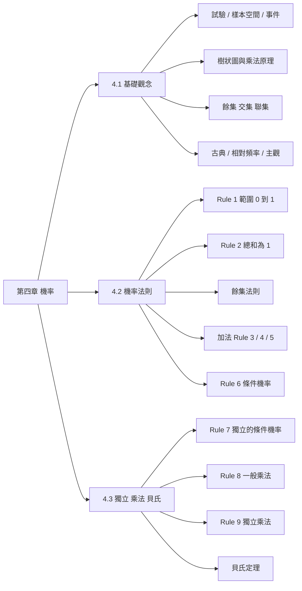
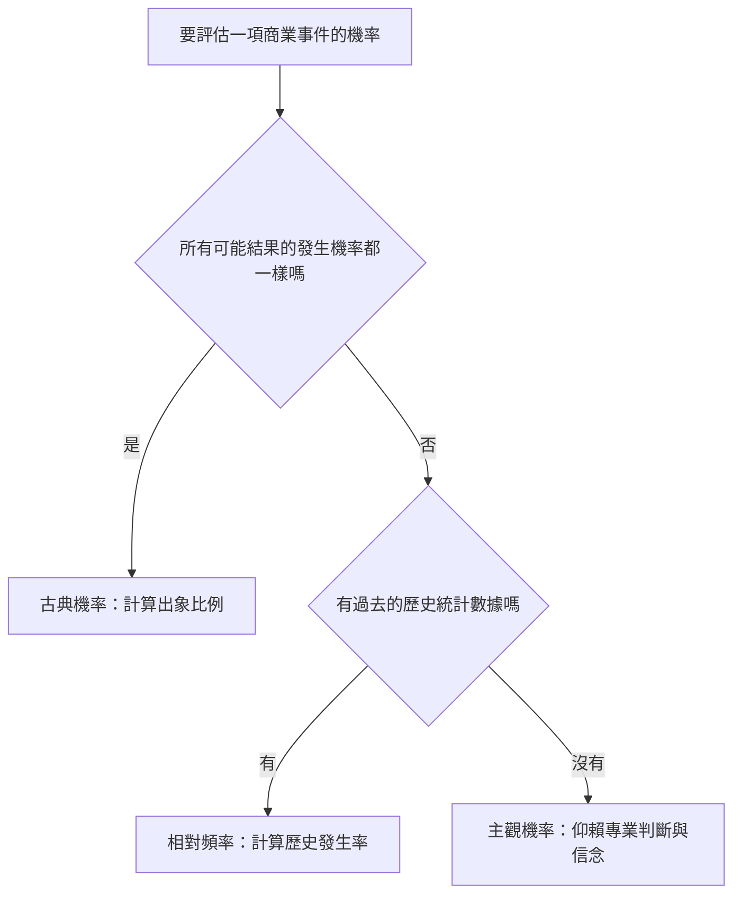
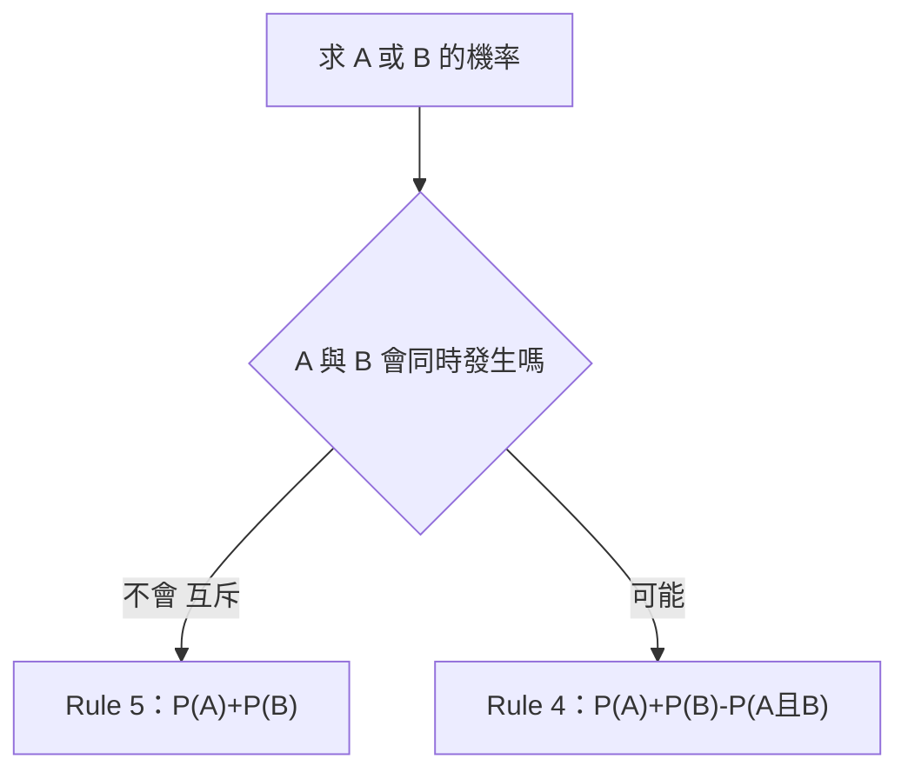
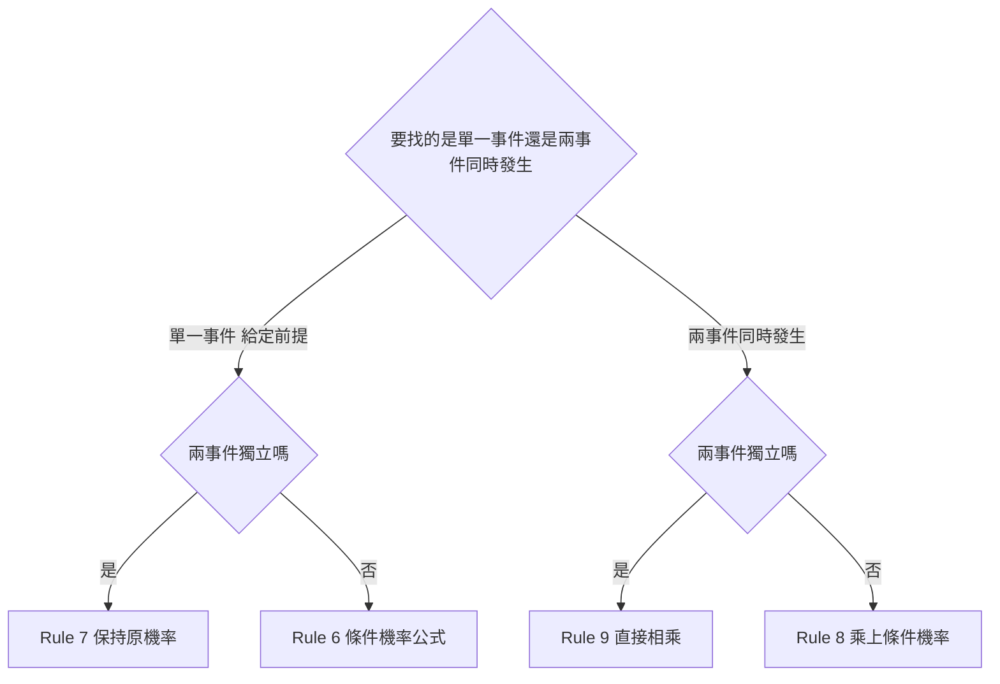

import SetOpsVenn from "../_components/SetOpsVenn.tsx";
import TreeDiagram from "../_components/TreeDiagram.tsx";
import MultiplicationCounter from "../_components/MultiplicationCounter.tsx";
import ProbabilityScale from "../_components/ProbabilityScale.tsx";
import DonutRemainder from "../_components/DonutRemainder.tsx";
import AdditionRule from "../_components/AdditionRule.tsx";
import ContingencyTable from "../_components/ContingencyTable.tsx";
import Funnel from "../_components/Funnel.tsx";
import BagDraw from "../_components/BagDraw.tsx";
import ChainProbability from "../_components/ChainProbability.tsx";
import BayesUpdate from "../_components/BayesUpdate.tsx";
import PopulationSteps from "../_components/PopulationSteps.tsx";

## 代號意思表 {#symbol-table}

本章用到的符號。每個符號的詳細說明見對應區塊。

| 代號 | 讀法 | 意思 |
|---|---|---|
| $S$ | 樣本空間 | 一次試驗所有可能結果的集合 |
| $e_i$ | 出象（樣本點） | 單次試驗的單一結果，$i$ 是編號 |
| $E$、$E_i$、$A$、$B$ | 事件 | $S$ 的子集合，是我們關注的結果 |
| $P(E)$ | 事件 $E$ 的機率 | $E$ 發生的機會，介於 0 到 1 |
| $E^c$、$\bar E$ | $E$ 的餘集 | $E$ **不**發生的所有可能 |
| $A\cap B$ | $A$ 交集 $B$ | $A$ **且** $B$ 同時發生 |
| $A\cup B$ | $A$ 聯集 $B$ | $A$ **或** $B$（或兩者）發生 |
| $P(A\cap B)$ | 聯合機率 | $A$、$B$ 同時發生的機率；互斥時為 0 |
| $P(A)$、$P(B)$ | 邊際機率 | 只看單一事件的機率（列聯表的總計欄列） |
| $P(E_1\mid E_2)$ | 在 $E_2$ 發生下 $E_1$ 的機率 | 條件機率；豎線 $\mid$ 後面是已知條件 |
| $\sum P(e_i)$ | 機率總和 | 把所有出象的機率加起來，結果為 1 |
| $N$ | 總數 | 出象或資料的總數（古典機率、相對頻率的分母） |
| $P(A)$（貝氏） | 先驗機率 | 看到新證據之前，對 $A$ 的原本估計 |
| $P(B\mid A)$（貝氏） | 概似度 | 在 $A$ 成立時，觀察到證據 $B$ 的機率 |
| $P(A\mid B)$（貝氏） | 事後機率 | 看到證據 $B$ 之後，修正過的 $A$ 的機率 |
| $Se$、$Sp$ | 敏感度、特異度 | 有病被驗出陽性的比例、沒病被驗出陰性的比例 |

## 名詞表 {#glossary}

本章出現的名詞，詳細說明見對應區塊。

| 中文 | English | 描述 |
|---|---|---|
| 機率 | Probability | 事件發生的機會，介於 0 到 1，用來量化不確定性 |
| 隨機試驗 | Random Experiment | 知道有哪些可能結果，但無法預知單次會出現哪一個 |
| 樣本空間 | Sample Space | 所有可能結果的集合 $S$ |
| 出象（樣本點） | Outcome | 單次試驗的單一結果 |
| 事件 | Event | 樣本空間的子集合 |
| 樹狀圖 | Tree Diagram | 用分支列出多步驟試驗所有結果的圖 |
| 乘法原理 | Multiplication Principle | 多步驟的總結果數 = 各步驟結果數相乘 |
| 餘集 | Complement | 事件**不**發生的部分 |
| 交集 | Intersection | 兩事件**同時**發生 |
| 聯集 | Union | 兩事件**至少一個**發生 |
| 互斥事件 | Mutually Exclusive Events | 不可能同時發生，交集機率為 0 |
| 獨立事件 | Independent Events | 一事件發生不改變另一事件的機率 |
| 相依事件 | Dependent Events | 一事件發生會改變另一事件的機率 |
| 古典機率 | Classical Probability | 各結果可能性相等時，用出象數比例算機率 |
| 相對頻率 | Relative Frequency | 用歷史資料中事件出現的比例當機率 |
| 主觀機率 | Subjective Probability | 缺乏資料時，依專業經驗與信念給出的機率 |
| 邊際機率 | Marginal Probability | 只看單一事件的機率（列聯表的總計列、欄） |
| 聯合機率 | Joint Probability | 兩事件同時發生的機率（列聯表的交叉格） |
| 條件機率 | Conditional Probability | 已知某事件發生下，另一事件的機率 |
| 列聯表 | Contingency Table | 依兩個變數交叉分類計數的表 |
| 轉換率 | Conversion Rate | 點擊者中最後成交的比例，是一種條件機率 |
| 乘法規則 | Multiplication Rule | 用乘法算聯合機率：$P(E_1)\times P(E_2\mid E_1)$ |
| 不放回抽樣 | Sampling without Replacement | 抽出後不放回，下一次的樣本空間會改變 |
| 貝氏定理 | Bayes' Theorem | 用新證據把先驗機率修正成事後機率 |
| 先驗機率 | Prior Probability | 看到證據前的機率 $P(A)$ |
| 概似度 | Likelihood | 假設成立下看到證據的機率 $P(B\mid A)$ |
| 事後（修正）機率 | Posterior / Revised Probability | 看到證據後的機率 $P(A\mid B)$ |
| 全機率公式 | Law of Total Probability | $P(B)=\sum P(A_j)P(B\mid A_j)$，把各路徑的聯合機率加總 |
| 盛行率 | Prevalence | 母體中真的有病的比例 $P(D)$ |
| 敏感度 | Sensitivity, $Se$ | 有病者被驗出陽性的比例 $P(T^+\mid D)$ |
| 特異度 | Specificity, $Sp$ | 沒病者被驗出陰性的比例 $P(T^-\mid\bar D)$ |
| 偽陽性／偽陰性 | False Positive / False Negative | 沒病卻驗出陽性／有病卻被漏抓 |
| 陽性預測值 | Positive Predictive Value, PPV | 驗出陽性者中真的有病的比例 $P(D\mid T^+)$ |
| 陰性預測值 | Negative Predictive Value, NPV | 驗出陰性者中真的沒病的比例 $P(\bar D\mid T^-)$ |

## 本章地圖 {#ch4-map}

第四章把「不確定性」變成可以計算的數字。4.1 先建立語言（試驗、樣本空間、事件、機率怎麼來），4.2 給出加法與條件機率的六條法則，4.3 再補上獨立與乘法規則（Rule 7～9）和貝氏定理。原始講義：[[CH4(1)_參考講義.pdf|4.1 講義]]、[[CH 4 (2) 參考講義.pdf|4.2 講義]]、[[CH 4 (3) 參考講義_NEW(1).pdf|4.3 講義]]。

## 機率的本質 {#probability-meaning}

機率（Probability）是特定事件發生的機會，用來**量化不確定性**。它的值永遠在 0 到 1 之間：

- $0$：絕對不會發生
- $1$：絕對會發生
- 中間的數值：反映不確定的程度，越接近 1 越可能發生

## 隨機試驗、樣本空間與事件 {#experiment-space-event}

機率的層次結構由外到內：

| 名詞 | 英文 | 意思 |
|---|---|---|
| 隨機試驗 | Random Experiment | 結果已知有哪些可能，但無法預知單次會發生哪一種（例：丟硬幣） |
| 樣本空間 | Sample Space, $S$ | 所有可能結果的完整集合 |
| 樣本點／出象 | Outcome | 單次試驗出現的單一結果，最小單位 |
| 事件 | Event | 樣本空間的**子集合**，是我們特別關注的結果集合 |

例如擲一顆骰子，$S=\{1,2,3,4,5,6\}$，「點數為偶數」是事件 $E=\{2,4,6\}$。

### 例子：把情境轉成樣本空間 {#ex-sample-space .fold}

| 隨機試驗 | 樣本點 | 樣本空間 $S$ |
|---|---|---|
| 擲銅板 | 正面、反面 | $\{\text{正面},\text{反面}\}$ |
| 擲骰子 | 點數 1～6 | $\{1,2,3,4,5,6\}$ |
| 猜拳比賽 | 贏、輸、平手 | $\{\text{贏},\text{輸},\text{平手}\}$ |
| 參加面試 | 錄取、未錄取 | $\{\text{錄取},\text{未錄取}\}$ |

## 樹狀圖：窮舉多步驟試驗 {#tree-diagram}

試驗有多個步驟時，用樹狀圖（Tree Diagram）以線段畫出所有可能結果。每一層是一個步驟，每條從根到末端的路徑就是一個樣本點。切換步數看看樣本點怎麼倍增：

<TreeDiagram />

## 多步驟乘法原理 {#multiplication-principle}

步驟變多時樹狀圖會太大，改用**各步驟可能結果數相乘**直接算出總樣本點數。

$$
\text{總結果數} = n_1 \times n_2 \times \cdots \times n_k
$$

### 例子：服裝搭配 {#ex-multiplication .fold}

9 件 T-shirt、6 件牛仔褲、2 雙襪子、5 頂帽子，共 $9\times 6\times 2\times 5=540$ 種搭配。推銷電話打給 3 位客人，每位買或不買，共 $2\times2\times2=8$ 種結果。

為什麼是相乘：每選定一件 T-shirt，後面都能接 6 種褲子，所以「T-shirt＋褲子」是 $9\times6=54$ 種；每一種再接 2 種襪子、5 種帽子，分支數一層層乘上去，就是樹狀圖末端的路徑數。

<MultiplicationCounter />

## 餘集、交集、聯集 {#set-operations}

事件之間的三種基本運算（大方框是樣本空間 $S$）：

| 運算 | 符號 | 意思 |
|---|---|---|
| 餘集 Complement | $A^c$ | 發生事件 A 以外的所有可能性 |
| 交集 Intersection | $A\cap B$ | 事件 A 與事件 B **同時**發生的部分 |
| 聯集 Union | $A\cup B$ | 發生 A 或發生 B，或兩者皆發生（重疊部分不重複計算） |

<SetOpsVenn />

## 互斥事件 {#mutually-exclusive}

兩事件**不可能同時發生**，文氏圖上沒有交集，$P(A\cap B)=0$。

- 擲一枚硬幣，同時得到正面與反面：不可能。
- 擲一顆骰子，同時出現點數 1 與點數 4：不可能。

互斥事件適用簡單的加法（見 [[#rule-5|Rule 5]]）。

## 獨立與相依事件 {#independent-dependent}

- **獨立事件（Independent）**：一個事件發生，完全不影響另一個事件的機率。例：A 擲骰子、B 擲骰子。
- **相依事件（Dependent）**：一個事件發生，會改變總樣本空間，進而影響下一個事件的機率。例：從袋中取球**不放回**，第二次的機率會變（見 [[#rule-6-example-balls|不放回抽球]]）。

用公式判斷獨立見 [[#rule-7|Rule 7]]，兩種情況怎麼算「同時發生」見 [[#rule-8|Rule 8]] 與 [[#rule-9|Rule 9]]。

### 互斥不等於獨立 {#mutual-vs-independent .fold}

若兩事件機率都大於 0 且互斥，知道 A 發生就保證 B 不會發生，所以它們其實是**相依**的。「互斥」談的是能不能同時發生；「獨立」談的是會不會影響彼此的機率。

## 三種解讀機率的方式 {#three-interpretations}

在商業世界，如何給「不確定性」一個精確的數值？有三種方式：[[#classical-probability|古典機率]]、[[#relative-frequency|相對頻率]]、[[#subjective-probability|主觀機率]]。怎麼選見 [[#choose-model|如何選擇機率模型]]。

## 古典機率 {#classical-probability}

核心前提：每一種結果出現的可能性**完全相等**。

$$
P(E_i)=\frac{E_i\text{ 事件擁有的出象數}}{\text{樣本空間中所有出象數}}
$$

### 例子：撲克牌與骰子 {#ex-classical .fold}

- 從一副 52 張撲克牌抽一張：總樣本點 $N=52$，每張被抽中機率相等，抽到任一張特定牌的機率為 $1/52$。
- 擲一顆正常的骰子：因為正常，假設每個結果可能性相等，所以 $1,2,\dots,6$ 每個機率都是 $1/6$。

算法就是數兩個數字：分子數「事件包含幾個出象」，分母數「樣本空間共有幾個出象」。例如抽到紅心的事件有 13 個出象，機率 $13/52$。前提是每個出象機會相等，否則只能改用相對頻率或主觀機率。

## 相對頻率 {#relative-frequency}

核心前提：各結果機率**不相等**，必須依賴「大量歷史數據」來提煉經驗法則。

$$
P(E_i)=\frac{E_i\text{ 事件出現的次數}}{\text{實驗的總樣本數}}=\frac{E_i}{N}
$$

### 例子：手搖茶飲含糖選擇 {#ex-relative-frequency .fold}

店長想知道一位顧客選含糖茶飲的機率，依過去一週的銷售紀錄推算：

1. 定義機率實驗：隨機選一名顧客，他選含糖茶飲或無糖茶飲。
2. 定義有興趣的集合：$E_1$＝選擇含糖茶飲的顧客。
3. 決定所有的發生數：過去一週有 3,850 位顧客，總樣本數 $N=3850$。
4. 決定有興趣集合的發生數：2,900 位顧客買含糖茶飲。
5. 套公式：

$$
P(\text{含糖})=\frac{2900}{3850}\approx 0.7532=75.32\%
$$

結論：顧客購買含糖茶飲的機率大約 75%。成功與失敗的機率極少是 50/50，所以要靠真實的銷售紀錄。

## 主觀機率 {#subjective-probability}

核心前提：缺乏歷史數據，或面臨全新變數時，仰賴決策者的「專業經驗與信念」。

主觀機率不是瞎猜，而是決策者在無法取得充分客觀數據時，根據過去有限經驗加上市場新變數，對事件發生信心的量化測度。

## 如何選擇機率模型 {#choose-model}

## 機率法則總覽 {#rules-overview}

| 法則 | 核心概念 | 適用條件 | 公式 |
|---|---|---|---|
| Rule 1 | 機率絕對範圍 | 所有事件 | $0\le P(E)\le 1$ |
| Rule 2 | 樣本空間總和 | 完整樣本 | $\sum P(e_i)=1$ |
| Rule 3 | 個別出象加法 | 事件由多個出象組成 | $P(E)=P(e_1)+P(e_2)+\cdots$ |
| 餘集法則 | 反向／未發生 | 任何事件 | $1-P(E)$ |
| Rule 4 | 一般加法 | 非互斥（有交集） | $P(A)+P(B)-P(A\cap B)$ |
| Rule 5 | 互斥加法 | 互斥（無交集） | $P(A)+P(B)$ |
| Rule 6 | 條件機率 | 已知另一事件發生 | $P(E_1\mid E_2)=\dfrac{P(E_1\cap E_2)}{P(E_2)}$ |
| Rule 7 | 獨立事件的條件機率 | 兩事件獨立 | $P(E_1\mid E_2)=P(E_1)$ |
| Rule 8 | 一般乘法（聯合機率） | 任何兩事件（相依） | $P(E_1\cap E_2)=P(E_1)\,P(E_2\mid E_1)$ |
| Rule 9 | 獨立事件的乘法 | 兩事件獨立 | $P(E_1\cap E_2)=P(E_1)\,P(E_2)$ |
| 貝氏定理 | 用證據修正機率 | 已知 $P(B\mid A)$，求 $P(A\mid B)$ | $P(A\mid B)=\dfrac{P(B\mid A)P(A)}{P(B)}$ |

## 機率的絕對範圍（Rule 1） {#rule-1}

對任何事件 $E_i$：

$$
0\le P(E_i)\le 1
$$

0 是不可能事件，1 是必然事件。

### 例子：哪些機率不合理 {#ex-rule-1 .fold}

基金報酬率機率為 1.2（超出範圍）、APP 推播點擊率估為 $-0.02$（不可為負）都不合理；點單成功率 0.85、失敗率 0.15 合理。

<ProbabilityScale />

## 樣本空間的總和（Rule 2） {#rule-2}

樣本空間內所有出象的機率相加必為 1：

$$
\sum_{i=1}^{k}P(e_i)=1
$$

其中 $k$ 是樣本空間的出象數，$e_i$ 是第 $i$ 個出象。

### 例子：用總和補出缺的機率 {#ex-rule-2 .fold}

客服來電：技術 40%、物流 20%、帳單 30%，「其他」必為 $1-0.9=10\%$。

算法：先把已知的出象加起來 $0.4+0.2+0.3=0.9$；所有出象合計必須是 1，所以缺的那一塊就是 $1$ 減去已知合計。

<DonutRemainder title="客服來電分析" parts={[{ label: "技術", p: 0.4 }, { label: "物流", p: 0.2 }, { label: "帳單", p: 0.3 }]} restLabel="其他" />

產品顏色：藍色 50%、紅色 20%，剩餘顏色必為 $1-0.7=30\%$。

<DonutRemainder title="產品顏色分佈" parts={[{ label: "藍色", p: 0.5 }, { label: "紅色", p: 0.2 }]} restLabel="剩餘顏色" />

## 個別出象加法（Rule 3） {#rule-3}

事件 $E$ 若由互斥的個別出象組成，$E$ 的機率就是這些出象機率的總和。例如 $E=\{e_1,e_2,e_3\}$：

$$
P(E)=P(e_1)+P(e_2)+P(e_3)
$$

### 例子：電商滿額抽獎 {#ex-rule-3 .fold}

抽中獎項 A 的機率 0.05，抽中獎項 B 的機率 0.07，兩者互斥，抽中任一獎項的機率為 $0.05+0.07=0.12$。

能直接相加，是因為一次抽獎只會抽中一個獎項：「抽中任一獎項」這個事件由兩個不重疊的出象組成，沒有重複計算的部分。

### 例子：社群媒體使用次數 {#ex-addition-social .fold}

調查 5000 位手機用戶每天使用某社交媒體的次數，用相對頻率得到各出象機率：

| 使用次數 | 人數 | 比例 |
|---|---|---|
| $e_1$：10 次以上 | 400 | 0.08 |
| $e_2$：3 至 9 次 | 1900 | 0.38 |
| $e_3$：1 至 2 次 | 1500 | 0.30 |
| $e_4$：0 次 | 1200 | 0.24 |
| 總數 | 5000 | 1.00 |

求「每天使用 1 至 9 次」的機率。1 至 9 次剛好由「3 至 9 次」與「1 至 2 次」兩個出象拼成，所以事件 $E=\{e_2,e_3\}$；每個比例是人數 ÷ 5000（例如 $1900/5000=0.38$），再把兩個出象的機率相加：

$$
P(E)=P(e_2)+P(e_3)=0.38+0.30=0.68
$$

即 68% 是高潛力用戶。

## 餘集法則 {#complement-rule}

事件不發生（餘集 $\bar E$ 或 $E^c$）的機率，等於 1 減去該事件發生的機率：

$$
P(\bar E)=1-P(E),\qquad P(E)+P(\bar E)=1
$$

樣本空間總機率為 1，$E$ 和 $E^c$ 剛好把它分成兩塊。商業上，「不發生風險事件」的機率常是決策者最關心的指標。

### 例子：從風險到可靠度 {#ex-complement-business .fold}

- 零售退貨率 $P(\text{退貨})=0.08$，則交易完成率 $1-0.08=0.92$（92%）。
- 雲端系統故障率 $P(\text{故障})=0.02$，則正常運作保證度 $1-0.02=0.98$（98%）。

### 例子：至少使用一次 {#ex-complement-social .fold}

社群媒體調查中，每天使用 0 次的比例為 0.24。使用次數大於 0 的機率為

$$
P(\text{使用次數}>0)=1-P(\text{使用 0 次})=1-0.24=0.76
$$

代表公司有 76% 的用戶使用過這個社交媒體。「至少一次」問題用餘集法則通常比逐項相加快。

## 任意兩事件的加法（Rule 4） {#rule-4}

兩事件**可能同時發生**（非互斥）時，必須扣除重複計算的交集部分：

$$
P(A\cup B)=P(A)+P(B)-P(A\cap B)
$$

下圖把 A、B 畫成樣本空間（長度 1）中的區段：交集被 $P(A)$ 與 $P(B)$ 各算了一次，所以要減一次。把 $P(A\cap B)$ 拉到 0 就變成互斥（Rule 5）。

<AdditionRule />

### 例子：木材倉庫 {#ex-rule-4-wood .fold}

倉庫木材依長度（$E_1,E_2,E_3$）與截面（$E_4=2''\times4''$、$E_5=2''\times5''$、$E_6=2''\times8''$）分類，共 18000 根。隨機抽一根，長 8 英呎**或**截面為 $2''\times5''$ 的機率？兩者可能同時發生（8 呎且 2×5），所以用 Rule 4：

$$
P(E_1\cup E_5)=\frac{4000}{18000}+\frac{7000}{18000}-\frac{1500}{18000}=0.222+0.389-0.083=0.528\approx 53\%
$$

其中 $P(E_1)$、$P(E_5)$ 是**邊際機率**（看總計欄列），$P(E_1\cap E_5)$ 是**聯合機率**（看交叉格）。三個數字從表中讀：4000 是「8 呎」那一列的總計（$1400+1500+1100$），7000 是「2×5」那一欄的總計（$1500+3500+2000$），1500 是兩者交叉的那一格。那一格同時被列總計和欄總計算到，所以減一次。點表格的列名、欄名換別的組合試試：

<ContingencyTable title="倉庫 18000 根木材依長度與截面分類" rowTitle="長度" colTitle="截面" rows={["E1 = 8 feet", "E2 = 10 feet", "E3 = 12 feet"]} cols={["E4 = 2×4", "E5 = 2×5", "E6 = 2×8"]} counts={[[1400, 1500, 1100], [2000, 3500, 2500], [1600, 2000, 2400]]} initialRow={0} initialCol={1} focus="union" />

### 例子：商業情境實測 {#ex-rule-4-business .fold}

| 情境 | 算式 | 結果 |
|---|---|---|
| 買牛奶 0.4、買麵包 0.3、兩者皆買 0.1 | $0.4+0.3-0.1$ | 買任一產品 0.6 |
| 聽流行 0.6、聽嘻哈 0.25、兩者皆聽 0.15 | $0.6+0.25-0.15$ | 聽至少其一 0.7 |
| 參加講座 0.5、參加社團 0.3、兩者皆參加 0.2 | $0.5+0.3-0.2$ | 參加任一活動 0.6 |

## 互斥事件的加法（Rule 5） {#rule-5}

兩事件互斥（絕對不會同時發生）時，$P(E_1\cap E_2)=0$，Rule 4 簡化成直接相加：

$$
P(E_1\cup E_2)=P(E_1)+P(E_2)
$$

### 例子：紅心或黑桃 {#ex-rule-5-cards .fold}

抽一張撲克牌，紅心（13 張）或黑桃（13 張）的機率：

$$
\frac{13}{52}+\frac{13}{52}=\frac{26}{52}
$$

### 例子：投籃進球或犯規 {#ex-rule-5-basketball .fold}

投籃一次，進球（0.4）或被犯規（0.1），視為互斥：$0.4+0.1=0.5$。

## 判斷用 Rule 4 還是 Rule 5 {#rule-4-vs-5}

先問一個問題：**兩個事件會同時發生嗎？**

| | Rule 5（互斥） | Rule 4（非互斥） |
|---|---|---|
| 核心提問 | 絕對不會同時發生 | 有可能同時發生 |
| 公式 | $P(A)+P(B)$ | $P(A)+P(B)-P(A\cap B)$ |
| 實務範例 | 週末（週六或週日） | 醫護人員（護士或男性） |

### 例子：週六或週日 {#ex-weekend .fold}

挑一天是週末，求 $P(\text{週六或週日})$。週六和週日不可能同時存在，互斥，用 Rule 5：$\tfrac17+\tfrac17=\tfrac27$。

### 例子：護士或男性 {#ex-nurse-male .fold}

某醫院有 8 位護士、5 位醫生，共 13 位醫護人員，其中 7 位護士和 3 位醫生是女性。隨機挑一位，求護士**或**男性。男護士同時屬於兩者，非互斥，用 Rule 4。先數三個數：護士 8 位；男性 = 男護士 $8-7=1$ 位加男醫生 $5-3=2$ 位，共 3 位；既是護士又是男性的只有那 1 位男護士。

$$
P(N)+P(M)-P(N\cap M)=\frac{8}{13}+\frac{3}{13}-\frac{1}{13}=\frac{10}{13}
$$

<ContingencyTable title="醫院 13 位醫護人員依職務與性別分類" rowTitle="職務" colTitle="性別" rows={["Nurse", "Doctor"]} cols={["F", "M"]} counts={[[7, 1], [3, 2]]} initialRow={0} initialCol={1} focus="union" />

### 例子：A 或黑色牌 {#ex-ace-or-black .fold}

從一副撲克牌抽一張，求「A 或黑色牌」。4 張 A 中有 2 張是黑色，所以兩事件重疊，用 Rule 4：A 有 4 張、黑色牌有 26 張（黑桃與梅花各 13），黑桃 A 和梅花 A 在兩邊都被算到，扣掉這 2 張：

$$
\frac{4}{52}+\frac{26}{52}-\frac{2}{52}=\frac{28}{52}\approx 0.5385\approx 54\%
$$

## 條件機率（Rule 6） {#rule-6}

在給定事件 $E_2$ **已經發生**的條件下，事件 $E_1$ 發生的機率：

$$
P(E_1\mid E_2)=\frac{P(E_1\cap E_2)}{P(E_2)},\qquad P(E_2)>0
$$

- 分子 $P(E_1\cap E_2)$：**聯合機率**，兩者同時發生的機率。
- 分母 $P(E_2)$：**邊際機率**，條件本身發生的總機率。

直覺：已知條件發生後，樣本空間縮小為 $E_2$，在這個小空間裡算 $E_1$ 佔多少。把條件機率移項就得到聯合機率：$P(E_1\cap E_2)=P(E_2)\times P(E_1\mid E_2)$。

### 例子：網路使用時數與性別 {#ex-rule-6-gender .fold}

2500 位用戶依每月上網時數與性別分類。已知用戶是女性（$E_4$，850 人，$P=0.34$），她每月上網 20 到 40 小時（$E_2$）的機率：

$$
P(E_2\mid E_4)=\frac{P(E_2\cap E_4)}{P(E_4)}=\frac{0.12}{0.34}=\frac{300}{850}\approx 0.35
$$

分子 0.12 是「女性且 20 到 40 小時」那一格 $300/2500$，分母 0.34 是女性那一欄的總計 $850/2500$。兩個都除以 2500，相除時 2500 消掉，所以也可以直接在女性那一欄裡算 $300/850$：條件就是把樣本空間縮小成那一欄。

選「給定」模式，點「Female」欄就是以女性為條件；換成 Male 比較看看：

<ContingencyTable title="2500 位用戶依每月上網時數與性別分類" rowTitle="上網時數" colTitle="性別" rows={["E1 少於 20 小時", "E2 20 到 40 小時", "E3 超過 40 小時"]} cols={["E4 Female", "E5 Male"]} counts={[[450, 500], [300, 800], [100, 350]]} initialRow={1} initialCol={0} focus="given" />

### 例子：電商點擊與購買 {#ex-rule-6-ecommerce .fold}

20% 的用戶點擊促銷廣告（$E_2$），5% 的用戶點擊**並且**購買（$E_1\cap E_2$）。點擊廣告的用戶中最終購買的機率：

$$
P(E_1\mid E_2)=\frac{0.05}{0.20}=0.25
$$

0.05 是「點擊且購買」占**全體**用戶的比例，不是答案；題目問的是點擊者之中的比例，所以除以點擊者占全體的 0.20，把分母從全體換成點擊者。想成 100 位用戶：20 位點擊，其中 5 位購買，$5/20=0.25$。

<Funnel condition="點擊廣告" joint="點擊且購買" pCondition={0.2} pJoint={0.05} />

### 例子：夜班產品瑕疵 {#ex-rule-6-defect .fold}

10% 的產品在夜班製造（$E_2$），3% 的產品是夜班製造**並且**有瑕疵（$E_1\cap E_2$）。夜班產品有瑕疵的機率：

$$
P(E_1\mid E_2)=\frac{0.03}{0.10}=0.30
$$

<Funnel condition="夜班製造" joint="夜班且瑕疵" pCondition={0.1} pJoint={0.03} />

### 例子：行銷活動轉換率 {#ex-rule-6-conversion .fold}

旅遊訂房平台的促銷郵件：30% 的用戶點擊連結（$E_2$），9% 的用戶點擊並在 48 小時內完成訂房（$E_1\cap E_2$）。點擊者最終訂房的機率：

$$
P(E_1\mid E_2)=\frac{0.09}{0.30}=0.30
$$

這個條件機率在行銷上叫**轉換率**（Conversion Rate），衡量點擊後有多少比例的潛在客戶成功轉為付費客戶。

<Funnel condition="點擊郵件連結" joint="點擊且訂房" pCondition={0.3} pJoint={0.09} name="轉換率" />

### 例子：不放回抽球 {#rule-6-example-balls .fold}

袋中有紅 5、藍 5，**不放回**抽 2 球皆紅的機率。第二次的機率受第一次影響（相依事件）：

$$
P(\text{兩次皆紅})=P(\text{紅}_1)\times P(\text{紅}_2\mid\text{紅}_1)=\frac{5}{10}\times\frac{4}{9}=\frac{2}{9}\approx 0.222
$$

第二個分數是 $4/9$ 而不是 $5/10$：第一次已經拿走一顆紅球且沒放回，袋子剩 9 顆、其中紅球 4 顆。這個「先發生、再算下一步的條件機率、相乘」的算法就是 [[#rule-8|Rule 8 乘法規則]]。

<BagDraw />

## 習題 4-33：磁碟機供應商 {#exercise-4-33}

Dell 品管經理檢驗 700 個磁碟機，依供應商分類：

| Supplier | Working | Defective | Total |
|---|---|---|---|
| Company A | 120 | 10 | 130 |
| Company B | 180 | 15 | 195 |
| Company C | 50 | 5 | 55 |
| Company D | 300 | 20 | 320 |
| Total | 650 | 50 | 700 |

問題：

- a. 隨機抽一個磁碟機，來自 B 公司的機率？
- b. 收到瑕疵磁碟機的機率？
- c. 已知由 B 公司供應，是瑕疵品的機率？

#### 解答 a：邊際機率 {#ex-4-33-a-solution .fold}

$P(B)=195/700=0.2786$

只問「來自 B 公司」，不管好壞，所以取 B 公司那一列的總計 195，除以全部 700。

#### 解答 b：邊際機率 {#ex-4-33-b-solution .fold}

$P(\text{Defect})=50/700=0.0714$

只問「瑕疵」，不管哪家公司，所以取 Defective 那一欄的總計 50，除以全部 700。

#### 解答 c：條件機率 {#ex-4-33-c-solution .fold}

「已知 B 公司」是條件，所以分母用 $P(B)$：

$$
P(D\mid B)=\frac{P(D\cap B)}{P(B)}=\frac{15/700}{195/700}=\frac{15}{195}\approx 0.0769
$$

投影片以四捨五入的 $0.021/0.2786$ 得到 0.0768，差異只是捨入。直接在 B 公司那一欄算 $15/195$ 最快。下表把供應商放在欄，方便以公司為條件：

<ContingencyTable title="700 個磁碟機依狀態與供應商分類" rowTitle="狀態" colTitle="供應商" rows={["Working", "Defective"]} cols={["Company A", "Company B", "Company C", "Company D"]} counts={[[120, 180, 50, 300], [10, 15, 5, 20]]} initialRow={1} initialCol={1} focus="given" />

## 獨立事件的條件機率（Rule 7） {#rule-7}

如果一件事的發生，完全不影響另一件事發生的機率，兩事件就是**獨立**的。例：丟硬幣（$E_1$）與昨天的午餐（$E_2$）毫無關聯，知道 $E_2$ 不提供任何關於 $E_1$ 的新資訊。對獨立事件：

$$
P(E_1\mid E_2)=P(E_1),\quad P(E_2)>0\qquad\text{且}\qquad P(E_2\mid E_1)=P(E_2),\quad P(E_1)>0\qquad(4.10)
$$

在 $E_2$ 發生之後，$E_1$ 的機率仍然等於它本來的機率。反過來，這也是**檢驗獨立**的方法：用 [[#rule-6|Rule 6]] 算出 $P(E_1\mid E_2)$，若等於 $P(E_1)$ 就獨立，不等就相依。

### 例子：軟體更新與硬體故障 {#ex-rule-7-update .fold}

用戶電腦的硬體故障基線機率是 2%。軟體公司發布例行版本更新（$E_2$）不會改變電腦本來就會壞掉的機率，所以

$$
P(\text{硬體故障}\mid\text{軟體更新})=P(\text{硬體故障})=0.02
$$

商業洞察：如果實際算出更新後的故障率明顯大於 2%，代表兩者**不**獨立，應立即啟動調查。

### 例子：競爭對手降價與新機上市 {#ex-rule-7-launch .fold}

競爭對手決定降價的機率 $P(E_2)=0.60$，新機成功上市的機率 $P(E_1)=0.85$。若兩者獨立：$P(E_1\mid E_2)=P(E_1)=0.85$。即使對手降價，新機成功的機率仍是 85%，公司應略過雜音，專注在產品品質、行銷策略等核心成功因素。

## 一般乘法規則（Rule 8） {#rule-8}

Rule 7 回答「已知一事件，另一事件的機率」；如果要知道兩事件**同時發生**的機率（聯合機率），把 [[#rule-6|Rule 6]] 的條件機率公式移項：

$$
P(E_1\cap E_2)=P(E_1)\times P(E_2\mid E_1)\qquad(4.11)
$$

讀法是三步：① $E_1$ 先發生，機率 $P(E_1)$；② 狀態改變，產生條件前提；③ 在 $E_1$ 已發生的前提下，$E_2$ 發生的機率 $P(E_2\mid E_1)$。兩者相乘，就是「先過第一關，再在剩下的人裡過第二關」。適用於第一個事件的結果會影響第二個事件的情況，例如**不放回抽樣**、連續審核。關鍵字「且（and）」代表聯合機率。

### 例子：煙火原料 MATX {#ex-rule-8-matx}

香港煙火公司倉庫有 80 單位原料：30 單位 MATX、50 單位 Quinex。不放回隨機取 2 單位組裝產品，兩件都用 MATX 的機率？

1. 命名事件：$E_1$＝第一件是 MATX，$E_2$＝第二件是 MATX。
2. 第一件：$P(E_1)=30/80=0.375$。
3. 第二件：第一件已拿走一個 MATX 且不放回，剩 79 單位、其中 MATX 29 單位，$P(E_2\mid E_1)=29/79=0.3671$。
4. 相乘：

$$
P(E_1\cap E_2)=P(E_1)\times P(E_2\mid E_1)=0.375\times0.3671=0.1377
$$

### 例子：銀行信貸的連續審核 {#ex-rule-8-loan .fold}

100% 的申請者中，80% 通過初步文件審核（$E_1$）；在這 80% 之中，90% 通過信用分數審核（$P(E_2\mid E_1)=0.9$）。兩關都通過：$0.8\times0.9=0.72$，即 72% 最終核卡。你必須先通過第一關，才有機會面對第二關的機率。

### 例子：供應鏈連續抽兩個良品 {#ex-rule-8-parts .fold}

一箱 20 個零件（16 良品、4 瑕疵），不放回連抽 2 個都是良品：第一個 $16/20=0.80$；拿走一個良品後剩 19 個、其中 15 個良品，第二個 $15/19=0.7895$。

$$
P(\text{連續兩個良品})=0.80\times0.7895=0.6316
$$

若放回，第二次仍是 0.80，答案會是 $0.64$。第一次抽樣改變了第二次的樣本空間，乘法規則把這個「數量改變」納入了計算。

<ChainProbability />

## 獨立事件的乘法規則（Rule 9） {#rule-9}

如果 $E_1$ 的發生不影響 $E_2$，Rule 8 中的 $P(E_2\mid E_1)$ 就等於 $P(E_2)$（這正是 Rule 7），聯合機率簡化成直接相乘：

$$
P(E_1\cap E_2)=P(E_1)\times P(E_2)\qquad(4.12)
$$

### 例子：兩家門市同時達標 {#ex-rule-9-stores .fold}

A 門市達標機率 70%，B 門市 60%，兩家表現互相獨立：$0.7\times0.6=0.42$。A 達標的那 70% 情況中，只有 60% 的機會 B 也同時達標。

### 例子：雲端系統的穩定性 {#ex-rule-9-cloud .fold}

核心運算系統正常的機率 99%，數據備份系統 98%，兩者獨立運作：$0.99\times0.98=0.9702$。即使單一系統可靠度極高，「兩者同時正常」的聯合可靠度總是低於任一單一系統。

## Rule 7 與 Rule 9 的對照 {#rule-7-vs-9}

| | Rule 7（條件機率） | Rule 9（聯合機率） |
|---|---|---|
| 公式 | $P(E_2\mid E_1)=P(E_2)$ | $P(E_1\cap E_2)=P(E_1)\times P(E_2)$ |
| 目的 | 在 $E_1$ 發生的條件下，$E_2$ 的機率 | $E_1$ 與 $E_2$ 同時發生的機率 |
| 簡單說 | 「$E_1$ 發生後 $E_2$ 會改變嗎？」不會，仍是 $P(E_2)$ | 「兩件事都發生？」兩者相乘 |
| 結論 | 機率保持不變，因為 $E_1$ 對 $E_2$ 沒影響 | 聯合機率通常變小，因為兩件事都要成功 |

選規則的決策樹：

## 用樹狀圖算聯合與條件機率 {#tree-joint}

樹狀圖是組織隨機試驗的另一種視覺工具：第一層分支標邊際機率，第二層標條件機率，沿著一條路徑**相乘**（Rule 8）得到該路徑的聯合機率。

以 R.C. Minch 網路服務為例（2500 位用戶依性別與每月上網時數分類）：第一層男性 $P(E_5)=0.66$、女性 $P(E_4)=0.34$；第二層是各性別內的時數比例，例如 $P(E_3\mid E_5)=0.2121$。路徑「男性 → 超過 40 小時」的聯合機率是 $0.66\times0.2121=0.14$。

反過來，已知聯合機率 $P(E_3\cap E_5)=0.14$ 與邊際機率 $P(E_5)=0.66$，用 Rule 6 求「男性客戶每月上網超過 40 小時」：

$$
P(E_3\mid E_5)=\frac{P(E_3\cap E_5)}{P(E_5)}=\frac{0.14}{0.66}=0.2121
$$

## 貝氏定理 {#bayes}

貝氏定理是條件機率的特殊應用：把**新資訊**正式納入機率評估。簡單說，它是一種「**根據證據修正信念**」的機制：

$$
\underbrace{P(A)}_{\text{先驗：過去的經驗或原本的信念}}\ +\ \underbrace{P(B\mid A)}_{\text{條件：觀察到的新證據}}\ \longrightarrow\ \underbrace{P(A\mid B)}_{\text{事後：結合證據後更新的現實}}
$$

先驗機率可以來自相對頻率，也可以是主觀機率。

### 從條件機率推出貝氏定理 {#bayes-derivation}

從 [[#rule-6|Rule 6]] 出發，$P(A\mid B)=P(A\cap B)/P(B)$。分子是聯合機率，用 [[#rule-8|Rule 8]] 換成 $P(A)\,P(B\mid A)$：

$$
P(A\mid B)=\frac{P(B\mid A)\cdot P(A)}{P(B)}
$$

| 符號 | 名稱 | 意思 | 篩檢例 |
|---|---|---|---|
| $P(A)$ | 先驗機率 Prior | 標的事件的基礎機率 | 盛行率 |
| $P(B\mid A)$ | 概似度 Likelihood | $A$ 成立時看到證據 $B$ 的機率 | 敏感度 |
| $P(B)$ | 證據的整體機率 | 看到證據 $B$ 的總機率 | 驗出陽性的總比例 |
| $P(A\mid B)$ | 事後機率 Posterior | 證據已知下 $A$ 的修正後機率 | 陽性者真的有病的機率 |

貝氏定理的用處：$P(B\mid A)$ 通常容易取得（檢驗的敏感度、歷史資料），而我們真正想知道的是反方向的 $P(A\mid B)$。

### 分母：全機率公式 {#total-probability}

分母 $P(B)$ 通常沒有直接給，要用樹狀圖拆開：樣本空間被互斥的 $A_1,A_2,\dots,A_k$ 分割，每條通往 $B$ 的路徑機率是 $P(A_j)\,P(B\mid A_j)$（Rule 8），把所有路徑加起來（加法）：

$$
P(B)=\sum_{j=1}^{k}P(A_j)\,P(B\mid A_j)=P(A_1)P(B\mid A_1)+\cdots+P(A_k)P(B\mid A_k)
$$

只有兩種情況時就是 $P(B)=P(A)P(B\mid A)+P(\bar A)P(B\mid\bar A)$。

### 解題 SOP {#bayes-sop}

1. **命名事件**：誰是假設 $A$（有病、成交、某工廠），誰是證據 $B$（陽性、警報、瑕疵）。
2. **畫樹狀圖**：第一層先驗 $P(A_j)$，第二層條件 $P(B\mid A_j)$。
3. **算每條路徑的聯合機率**：先驗 × 條件。
4. **加總得 $P(B)$**：所有通往 $B$ 的聯合機率相加。
5. **相除得事後機率**：目標路徑的聯合機率 ÷ $P(B)$。

課本用表格整理同樣的步驟：事件｜先驗｜條件｜聯合 = 先驗 × 條件｜事後 = 聯合 ÷ 聯合總和。

## 例子：點擊郵件後的購買率 {#ex-bayes-email}

初始購買率 $P(A)=10\%$；會購買的人中 60% 會先點擊行銷郵件，$P(B\mid A)=0.6$；總體點擊率 $P(B)=20\%$。點擊郵件後，客戶實際的購買率是多少？

1. 聯合機率：$P(A\cap B)=0.10\times0.6=0.06$，即 6% 的人「會買且有點擊」。
2. 總點擊率題目已給 $P(B)=0.20$（另外 14% 是「不買但有點擊」）。
3. 事後機率：

$$
P(A\mid B)=\frac{P(A\cap B)}{P(B)}=\frac{0.06}{0.20}=0.30
$$

一旦觀察到「點擊」這個新證據，顧客的購買率從 10% 提升到 30%（3 倍）。這就是精準行銷、名單分眾與再行銷（Retargeting）的數學基礎。

## 醫療篩檢的四種結果與指標 {#screening-metrics}

| 檢驗＼實際 | 患病 $D$ | 未患病 $\bar D$ |
|---|---|---|
| 陽性 $T^+$ | a：真陽性 | b：偽陽性（沒病卻被驗出有病） |
| 陰性 $T^-$ | c：偽陰性（有病卻被漏抓） | d：真陰性 |

| 指標 | 定義 | 公式 |
|---|---|---|
| 盛行率 | 母體中感染者的比例 | $P(D)$ |
| 敏感度 $Se$ | 有病的人被驗出陽性的比例 | $P(T^+\mid D)=\dfrac{a}{a+c}$ |
| 特異度 $Sp$ | 沒病的人被驗出陰性的比例 | $P(T^-\mid\bar D)=\dfrac{d}{b+d}$ |
| 陽性預測值 PPV | 驗出陽性者中真的有病 | $P(D\mid T^+)=\dfrac{a}{a+b}$ |
| 陰性預測值 NPV | 驗出陰性者中真的沒病 | $P(\bar D\mid T^-)=\dfrac{d}{c+d}$ |

$Se$、$Sp$ 是檢驗工具本身的性質（條件是「實際狀況」）；PPV 是拿到報告的人最關心的（條件是「檢驗結果」），要用貝氏定理把方向反過來，而且它**強烈受盛行率影響**。

COVID-19 的例子：快篩敏感度 75%、特異度 99%，以台灣當時的盛行率（約萬分之 18）每檢驗 1 萬人，18 位真感染者約 14 位驗出陽性，9,982 位未感染者卻約有 100 位偽陽性，114 位陽性中只有約 14 位真的感染。指揮中心因此不實施入境全面篩檢：大量偽陽性浪費醫療資源、勞民傷財；偽陰性又可能讓帶原者因檢驗陰性而降低遵從度，增加社區傳播。

## 例子：入境旅客普篩 {#ex-bayes-border}

入境旅客 250,000 人，盛行率 0.2%（$P(D)=0.002$），敏感度 90%，未感染者有 5% 會驗出陽性（$Sp=95\%$）。驗出陽性的人真的感染的機率？

1. 第一層：感染 $250000\times0.002=500$ 人，未感染 249,500 人。
2. 第二層：感染者中真陽性 $500\times0.9=450$ 人、偽陰性 50 人；未感染者中偽陽性 $249500\times0.05=12{,}475$ 人、真陰性 237,025 人。
3. 驗出陽性共 $450+12475=12{,}925$ 人。
4. 事後機率：

$$
P(D\mid T^+)=\frac{P(D\cap T^+)}{P(T^+)}=\frac{0.002\times0.90}{0.002\times0.90+0.998\times0.05}=\frac{450}{12925}\approx3.48\%
$$

這題容易亂的地方是：四個數字的**母體各不相同**。條件機率直線 $\mid$ 後面的事件就是母體（分母）：

| 數字 | 寫成機率 | 母體 |
|---|---|---|
| 盛行率 0.2% | $P(D)$ | 全部入境旅客 |
| 敏感度 90% | $P(T^+\mid D)$ | 只有感染者 |
| 偽陽性率 5% | $P(T^+\mid\bar D)$ | 只有未感染者 |
| 要求的答案 | $P(D\mid T^+)$ | 只有驗出陽性的人 |

一步一步看母體怎麼換（粗框是當下的母體，填色是要數的那群人）：

<PopulationSteps title="入境旅客普篩" base={250000} hypotheses={[{ label: "感染", prior: 0.002, likelihood: 0.9 }, { label: "未感染", prior: 0.998, likelihood: 0.05 }]} pos="陽性" neg="陰性" />

即使檢驗呈陽性，實際感染的機率只有約 3.48%。原因是盛行率太低：未感染的人數太多，5% 的偽陽性在人數上就壓過了真正的感染者。拉動盛行率看看事後機率怎麼變：

<BayesUpdate title="入境旅客普篩" evidence="驗出陽性" hypotheses={[{ label: "感染", prior: 0.002, likelihood: 0.9 }, { label: "未感染", prior: 0.998, likelihood: 0.05 }]} base={250000} />

### 例子：某族群的快篩 {#ex-bayes-population .fold}

某傳染病在特定族群的盛行率 0.1%。快篩敏感度 95%（$P(T^+\mid D)=0.95$）、特異度 95%（$P(T^-\mid\bar D)=0.95$，即未患病者 5% 呈偽陽性）。隨機一人驗出陽性，真的患病的機率？

1. 真陽性路徑：$P(D)\times Se=0.001\times0.95=0.00095$。
2. 偽陽性路徑：$P(\bar D)\times(1-Sp)=0.999\times0.05=0.04995$。
3. $P(T^+)=0.00095+0.04995=0.0509$。
4. $P(D\mid T^+)=0.00095/0.0509\approx0.01866$，約 **1.866%**。

以 100,000 人為基準逐步看母體怎麼換：

<PopulationSteps title="某族群的快篩" base={100000} hypotheses={[{ label: "患病", prior: 0.001, likelihood: 0.95 }, { label: "未患病", prior: 0.999, likelihood: 0.05 }]} pos="陽性" neg="陰性" />

### 例子：零件與 AI 檢測 {#ex-bayes-ai .fold}

零件不良率 0.1%，AI 檢測準確率 99%（不良品 99% 會響警報；良品只有 1% 誤響）。系統響警報時，零件真的壞掉的機率？

解題關鍵：① 令事件名稱；② 畫樹狀圖。以 1,000 個零件為基準：

1. 不良品 1 個，其中 0.99 個響警報（真陽性）、0.01 個不響（漏報）。
2. 良品 999 個，其中 9.99 個誤響警報（偽陽性）、989.01 個正確排除。
3. 響警報共 $0.99+9.99=10.98$ 個。

$$
P(D\mid A)=\frac{P(A\cap D)}{P(A)}=\frac{0.99}{10.98}\approx0.0902
$$

99% 的準確率聽起來很高，但警報響起時零件真的壞掉的機率只有約 9%。

<PopulationSteps title="零件與 AI 檢測" base={1000} hypotheses={[{ label: "不良品", prior: 0.001, likelihood: 0.99 }, { label: "良品", prior: 0.999, likelihood: 0.01 }]} pos="響警報" neg="沒響" />

### 例子：乳房攝影 {#ex-bayes-mammogram .fold}

40 歲女性的乳癌盛行率 1.4%，乳房攝影敏感度 75%，未罹癌者的偽陽性率 10%。檢驗結果呈陽性，真的罹癌的機率？（四捨五入至小數第四位）

| 事件 | 先驗 | 條件 $P(MP\mid\cdot)$ | 聯合 | 事後 |
|---|---|---|---|---|
| C 罹乳癌 | 0.014 | 0.75 | $0.014\times0.75=0.0105$ | $0.0105/0.1091=0.0962$ |
| NC 未罹癌 | 0.986 | 0.10 | $0.986\times0.10=0.0986$ | $0.0986/0.1091=0.9038$ |
| 合計 | 1.000 | | $P(MP)=0.1091$ | 1 |

陽性女性實際罹癌的機率僅 0.0962（約 9.62%）。以 1,000 位為基準：罹癌 14 位中 10.5 位陽性，未罹癌 986 位中 98.6 位陽性，陽性的 109.1 位中只有 10.5 位真的罹癌。

<PopulationSteps title="乳房攝影" base={1000} hypotheses={[{ label: "罹乳癌", prior: 0.014, likelihood: 0.75 }, { label: "未罹癌", prior: 0.986, likelihood: 0.1 }]} pos="陽性" neg="陰性" />

<BayesUpdate title="乳房攝影" evidence="檢驗陽性" hypotheses={[{ label: "罹乳癌", prior: 0.014, likelihood: 0.75 }, { label: "未罹癌", prior: 0.986, likelihood: 0.1 }]} base={1000} />

## 例子：瑕疵瓷磚來自哪間工廠 {#ex-bayes-tiles}

Glerum 瓷磚公司在倉庫發現一塊有缺陷的瓷磚。俄亥俄廠產量 60%、不良率 5%；維吉尼亞廠產量 40%、不良率 10%。它最可能來自哪一廠？

1. 命名：$O$＝俄亥俄、$V$＝維吉尼亞、$D$＝有缺陷。先驗 $P(O)=0.6$、$P(V)=0.4$，條件 $P(D\mid O)=0.05$、$P(D\mid V)=0.10$。
2. 聯合：$P(D\cap O)=0.6\times0.05=0.03$，$P(D\cap V)=0.4\times0.10=0.04$。
3. 全機率：$P(D)=0.03+0.04=0.07$。
4. 事後：

$$
P(O\mid D)=\frac{0.03}{0.07}\approx42.86\%,\qquad P(V\mid D)=\frac{0.04}{0.07}\approx57.14\%
$$

雖然俄亥俄廠產量較大，維吉尼亞廠的不良率是兩倍，乘起來它貢獻的瑕疵品比較多，所以應負較大責任。事後機率比的其實就是各路徑的聯合機率大小。

以 1,000 塊瓷磚為基準逐步看：

<PopulationSteps title="瑕疵瓷磚的來源工廠" base={1000} hypotheses={[{ label: "Ohio", prior: 0.6, likelihood: 0.05 }, { label: "Virginia", prior: 0.4, likelihood: 0.1 }]} pos="有缺陷" neg="沒缺陷" compare />

<BayesUpdate title="瑕疵瓷磚的來源工廠" evidence="有缺陷" hypotheses={[{ label: "Virginia", prior: 0.4, likelihood: 0.1 }, { label: "Ohio", prior: 0.6, likelihood: 0.05 }]} base={1000} />

### 例子：第二次簡報 {#ex-bayes-presentation .fold}

甲公司向乙公司提案，業務原本評估成交機率 60%。乙公司要求做第二次簡報（$R$）。歷史資料：最終成交的公司中 70% 曾被要求二次簡報；最終失敗的公司中 50% 也曾被要求。已知被要求二次簡報，成交的修正機率？

1. 先驗：成交 $P(S)=0.6$，失敗 $P(F)=0.4$。
2. 聯合：$P(S\cap R)=0.6\times0.7=0.42$，$P(F\cap R)=0.4\times0.5=0.20$。
3. $P(R)=0.42+0.20=0.62$（以 100 家為基準，62 家被要求二次簡報）。
4. $P(S\mid R)=0.42/0.62\approx0.6774$。

被要求二次簡報這個新證據，把成交機率從 60% 提升到 67.74%（提升 7.74 個百分點），是正面訊號，值得投入更多資源準備。

<PopulationSteps title="第二次簡報" base={100} hypotheses={[{ label: "成交", prior: 0.6, likelihood: 0.7 }, { label: "失敗", prior: 0.4, likelihood: 0.5 }]} pos="要二次簡報" neg="沒要求" />

### 例子：瑕疵巧克力是誰包裝的 {#ex-bayes-chocolate .fold}

三位員工負責包裝：員工 1 負責 40%、瑕疵率 2.0%；員工 2 負責 30%、瑕疵率 2.5%；員工 3 負責 30%、瑕疵率 1.5%。顧客投訴一盒瑕疵巧克力，最可能是誰包的？

| 員工 | 先驗 | 條件 | 聯合 | 事後 |
|---|---|---|---|---|
| 1 | 0.40 | 0.020 | 0.0080 | $0.0080/0.0200=0.400$ |
| 2 | 0.30 | 0.025 | 0.0075 | $0.0075/0.0200=0.375$ |
| 3 | 0.30 | 0.015 | 0.0045 | $0.0045/0.0200=0.225$ |
| 合計 | 1 | | $P(D)=0.0200$ | 1 |

員工 1 最有可能（40%）。雖然員工 2 的個人瑕疵率最高，員工 1 的包裝量最大，以 10,000 盒為基準，員工 1 造成 80 盒瑕疵、員工 2 只有 75 盒。

<PopulationSteps title="瑕疵巧克力的包裝員工" base={10000} hypotheses={[{ label: "員工 1", prior: 0.4, likelihood: 0.02 }, { label: "員工 2", prior: 0.3, likelihood: 0.025 }, { label: "員工 3", prior: 0.3, likelihood: 0.015 }]} pos="瑕疵" neg="正常" compare />

<BayesUpdate title="瑕疵巧克力的包裝員工" evidence="有瑕疵" hypotheses={[{ label: "員工 1", prior: 0.4, likelihood: 0.02 }, { label: "員工 2", prior: 0.3, likelihood: 0.025 }, { label: "員工 3", prior: 0.3, likelihood: 0.015 }]} base={10000} />

## 各法則的商業用途 {#rules-takeaway}

- **Rule 5（互斥加法）**：用於資源配置，評估基礎總額。
- **Rule 4（非互斥加法）**：精準去重，避免重疊區域被重複計算而高估。
- **Rule 6（條件機率）**：排除外在雜訊，發掘變數間的關聯性，計算真實轉換率與風險。
- **Rule 7（獨立的條件機率）**：判斷外部事件是否真的影響核心指標；若獨立就略過雜音。
- **Rule 8／9（乘法）**：評估連續流程（審核、抽樣、多系統）全部成功的聯合機率。
- **貝氏定理**：看到新證據（點擊、陽性、警報、瑕疵）後修正判斷，避免忽略基礎機率而高估。

## 自我測驗 {#self-check}

### 題目 {#self-check-questions}

1. $P(A)=0.5$、$P(B)=0.4$、$P(A\cap B)=0.2$，求 $P(A\cup B)$。
2. 明天下雨的機率是 0.3，不下雨的機率？
3. 100 位用戶中 40 位是女性，全體有 25 位購買，其中 10 位是女性。已知用戶是女性，購買的機率？
4. 骰子擲一次，點數為 1 或 6 的機率？該用 Rule 4 還是 Rule 5？
5. 題 3 中，「購買」與「女性」獨立嗎？
6. 一盒 12 顆蛋有 3 顆破的，不放回拿 2 顆，兩顆都是好蛋的機率？
7. 某病盛行率 1%，檢驗敏感度 90%、偽陽性率 9%。驗出陽性時真的有病的機率？

### 解答 {#self-check-answers .fold}

1. Rule 4：$0.5+0.4-0.2=0.7$。
2. 餘集法則：$1-0.3=0.7$。
3. $P(\text{買}\mid\text{女})=\dfrac{10/100}{40/100}=0.25$。
4. 點數 1 與 6 不可能同時出現，互斥，Rule 5：$\tfrac16+\tfrac16=\tfrac13$。
5. $P(\text{買})=25/100=0.25=P(\text{買}\mid\text{女})$，依 Rule 7 是獨立的：知道是女性不改變購買機率。
6. Rule 8：$\dfrac{9}{12}\times\dfrac{8}{11}=\dfrac{72}{132}\approx0.5455$。
7. 聯合：$0.01\times0.9=0.009$、$0.99\times0.09=0.0891$；$P(+)=0.0981$；$P(D\mid+)=0.009/0.0981\approx0.0917$，約 9%。
