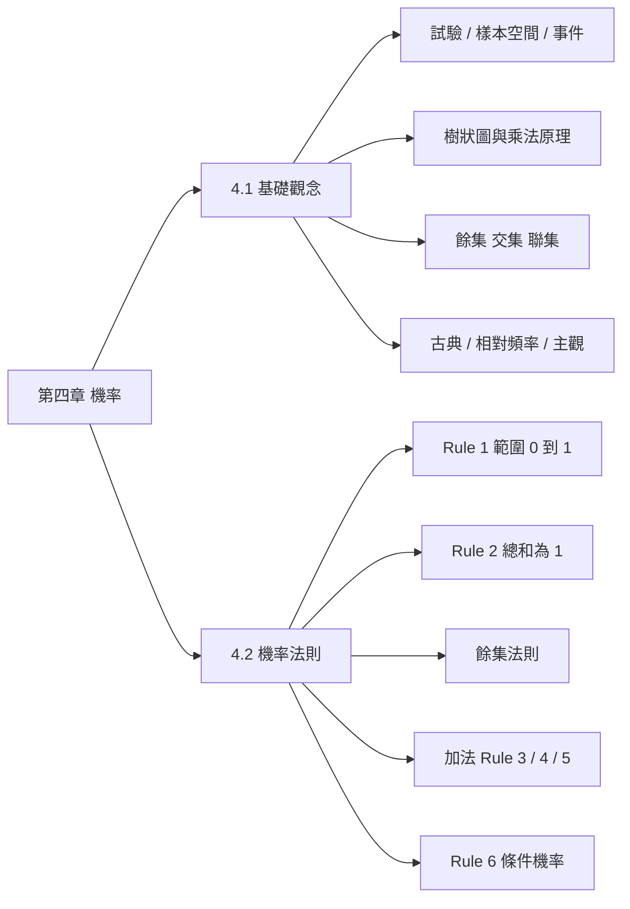
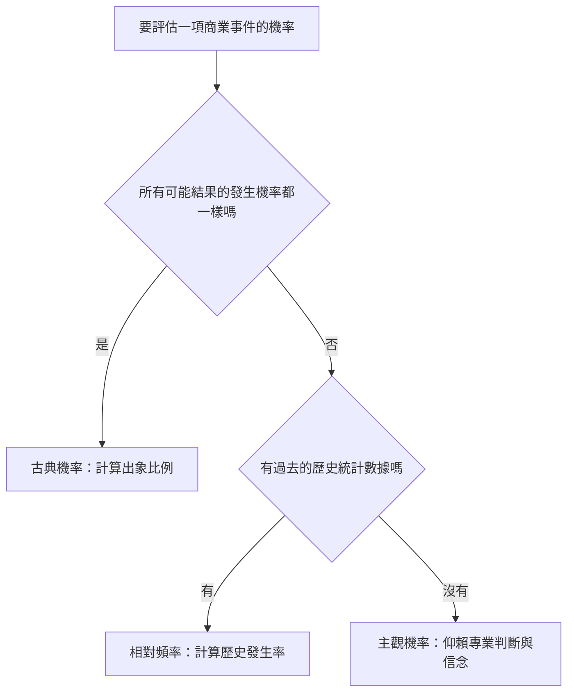
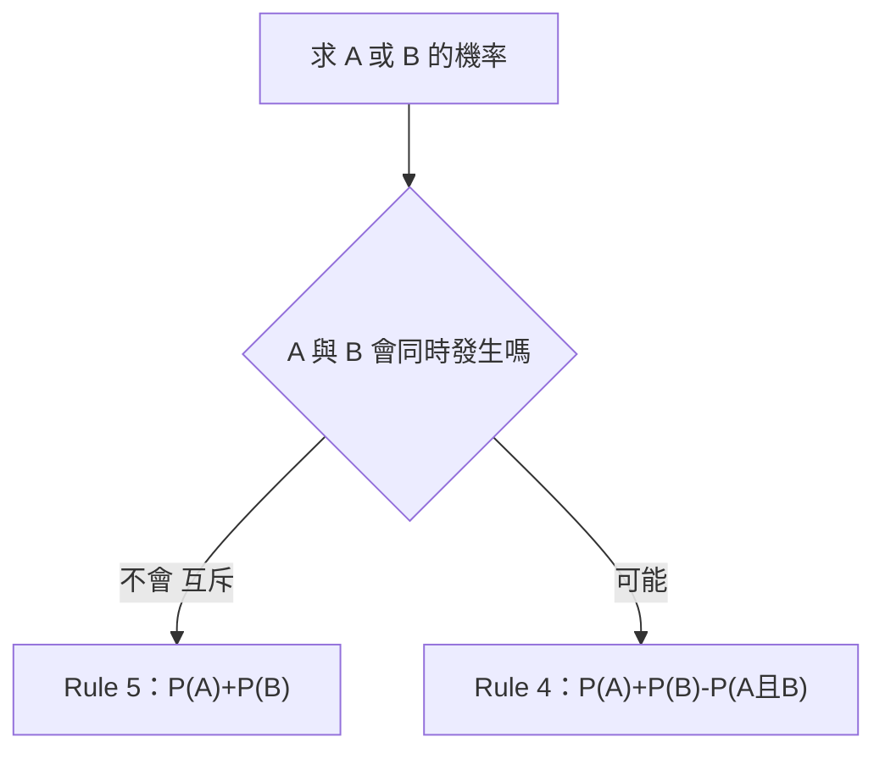

import SetOpsVenn from "../_components/SetOpsVenn.tsx";
import TreeDiagram from "../_components/TreeDiagram.tsx";
import MultiplicationCounter from "../_components/MultiplicationCounter.tsx";
import ProbabilityScale from "../_components/ProbabilityScale.tsx";
import DonutRemainder from "../_components/DonutRemainder.tsx";
import AdditionRule from "../_components/AdditionRule.tsx";
import ContingencyTable from "../_components/ContingencyTable.tsx";
import Funnel from "../_components/Funnel.tsx";
import BagDraw from "../_components/BagDraw.tsx";

## 本章地圖 {#ch4-map}

第四章把「不確定性」變成可以計算的數字。4.1 先建立語言（試驗、樣本空間、事件、機率怎麼來），4.2 再給出計算的六條法則。原始講義：[[CH4(1)_參考講義.pdf|4.1 講義]]、[[CH 4 (2) 參考講義.pdf|4.2 講義]]。

## 機率的本質 {#probability-meaning}

機率（Probability）是特定事件發生的機會，用來**量化不確定性**。它的值永遠在 0 到 1 之間：

- $0$：絕對不會發生
- $1$：絕對會發生
- 中間的數值：反映不確定的程度，越接近 1 越可能發生

## 隨機試驗、樣本空間與事件 {#experiment-space-event}

機率的層次結構由外到內：

| 名詞 | 英文 | 意思 |
|---|---|---|
| 隨機試驗 | Random Experiment | 結果已知有哪些可能，但無法預知單次會發生哪一種（例：丟硬幣） |
| 樣本空間 | Sample Space, $S$ | 所有可能結果的完整集合 |
| 樣本點／出象 | Outcome | 單次試驗出現的單一結果，最小單位 |
| 事件 | Event | 樣本空間的**子集合**，是我們特別關注的結果集合 |

例如擲一顆骰子，$S=\{1,2,3,4,5,6\}$，「點數為偶數」是事件 $E=\{2,4,6\}$。

### 例子：把情境轉成樣本空間 {#ex-sample-space .fold}

| 隨機試驗 | 樣本點 | 樣本空間 $S$ |
|---|---|---|
| 擲銅板 | 正面、反面 | $\{\text{正面},\text{反面}\}$ |
| 擲骰子 | 點數 1～6 | $\{1,2,3,4,5,6\}$ |
| 猜拳比賽 | 贏、輸、平手 | $\{\text{贏},\text{輸},\text{平手}\}$ |
| 參加面試 | 錄取、未錄取 | $\{\text{錄取},\text{未錄取}\}$ |

## 樹狀圖：窮舉多步驟試驗 {#tree-diagram}

試驗有多個步驟時，用樹狀圖（Tree Diagram）以線段畫出所有可能結果。每一層是一個步驟，每條從根到末端的路徑就是一個樣本點。切換步數看看樣本點怎麼倍增：

<TreeDiagram />

## 多步驟乘法原理 {#multiplication-principle}

步驟變多時樹狀圖會太大，改用**各步驟可能結果數相乘**直接算出總樣本點數。

$$
\text{總結果數} = n_1 \times n_2 \times \cdots \times n_k
$$

### 例子：服裝搭配 {#ex-multiplication .fold}

9 件 T-shirt、6 件牛仔褲、2 雙襪子、5 頂帽子，共 $9\times 6\times 2\times 5=540$ 種搭配。推銷電話打給 3 位客人，每位買或不買，共 $2\times2\times2=8$ 種結果。

<MultiplicationCounter />

## 餘集、交集、聯集 {#set-operations}

事件之間的三種基本運算（大方框是樣本空間 $S$）：

| 運算 | 符號 | 意思 |
|---|---|---|
| 餘集 Complement | $A^c$ | 發生事件 A 以外的所有可能性 |
| 交集 Intersection | $A\cap B$ | 事件 A 與事件 B **同時**發生的部分 |
| 聯集 Union | $A\cup B$ | 發生 A 或發生 B，或兩者皆發生（重疊部分不重複計算） |

<SetOpsVenn />

## 互斥事件 {#mutually-exclusive}

兩事件**不可能同時發生**，文氏圖上沒有交集，$P(A\cap B)=0$。

- 擲一枚硬幣，同時得到正面與反面：不可能。
- 擲一顆骰子，同時出現點數 1 與點數 4：不可能。

互斥事件適用簡單的加法（見 [[#rule-5|Rule 5]]）。

## 獨立與相依事件 {#independent-dependent}

- **獨立事件（Independent）**：一個事件發生，完全不影響另一個事件的機率。例：A 擲骰子、B 擲骰子。
- **相依事件（Dependent）**：一個事件發生，會改變總樣本空間，進而影響下一個事件的機率。例：從袋中取球**不放回**，第二次的機率會變（見 [[#rule-6-example-balls|不放回抽球]]）。

### 互斥不等於獨立 {#mutual-vs-independent .fold}

若兩事件機率都大於 0 且互斥，知道 A 發生就保證 B 不會發生，所以它們其實是**相依**的。「互斥」談的是能不能同時發生；「獨立」談的是會不會影響彼此的機率。

## 三種解讀機率的方式 {#three-interpretations}

在商業世界，如何給「不確定性」一個精確的數值？有三種方式：[[#classical-probability|古典機率]]、[[#relative-frequency|相對頻率]]、[[#subjective-probability|主觀機率]]。怎麼選見 [[#choose-model|如何選擇機率模型]]。

## 古典機率 {#classical-probability}

核心前提：每一種結果出現的可能性**完全相等**。

$$
P(E_i)=\frac{E_i\text{ 事件擁有的出象數}}{\text{樣本空間中所有出象數}}
$$

### 例子：撲克牌與骰子 {#ex-classical .fold}

- 從一副 52 張撲克牌抽一張：總樣本點 $N=52$，每張被抽中機率相等，抽到任一張特定牌的機率為 $1/52$。
- 擲一顆正常的骰子：因為正常，假設每個結果可能性相等，所以 $1,2,\dots,6$ 每個機率都是 $1/6$。

## 相對頻率 {#relative-frequency}

核心前提：各結果機率**不相等**，必須依賴「大量歷史數據」來提煉經驗法則。

$$
P(E_i)=\frac{E_i\text{ 事件出現的次數}}{\text{實驗的總樣本數}}=\frac{E_i}{N}
$$

### 例子：手搖茶飲含糖選擇 {#ex-relative-frequency .fold}

店長想知道一位顧客選含糖茶飲的機率，依過去一週的銷售紀錄推算：

1. 定義機率實驗：隨機選一名顧客，他選含糖茶飲或無糖茶飲。
2. 定義有興趣的集合：$E_1$＝選擇含糖茶飲的顧客。
3. 決定所有的發生數：過去一週有 3,850 位顧客，總樣本數 $N=3850$。
4. 決定有興趣集合的發生數：2,900 位顧客買含糖茶飲。
5. 套公式：

$$
P(\text{含糖})=\frac{2900}{3850}\approx 0.7532=75.32\%
$$

結論：顧客購買含糖茶飲的機率大約 75%。成功與失敗的機率極少是 50/50，所以要靠真實的銷售紀錄。

## 主觀機率 {#subjective-probability}

核心前提：缺乏歷史數據，或面臨全新變數時，仰賴決策者的「專業經驗與信念」。

主觀機率不是瞎猜，而是決策者在無法取得充分客觀數據時，根據過去有限經驗加上市場新變數，對事件發生信心的量化測度。

## 如何選擇機率模型 {#choose-model}

## 機率法則總覽 {#rules-overview}

| 法則 | 核心概念 | 適用條件 | 公式 |
|---|---|---|---|
| Rule 1 | 機率絕對範圍 | 所有事件 | $0\le P(E)\le 1$ |
| Rule 2 | 樣本空間總和 | 完整樣本 | $\sum P(e_i)=1$ |
| Rule 3 | 個別出象加法 | 事件由多個出象組成 | $P(E)=P(e_1)+P(e_2)+\cdots$ |
| 餘集法則 | 反向／未發生 | 任何事件 | $1-P(E)$ |
| Rule 4 | 一般加法 | 非互斥（有交集） | $P(A)+P(B)-P(A\cap B)$ |
| Rule 5 | 互斥加法 | 互斥（無交集） | $P(A)+P(B)$ |
| Rule 6 | 條件機率 | 已知另一事件發生 | $P(E_1\mid E_2)=\dfrac{P(E_1\cap E_2)}{P(E_2)}$ |

## 機率的絕對範圍（Rule 1） {#rule-1}

對任何事件 $E_i$：

$$
0\le P(E_i)\le 1
$$

0 是不可能事件，1 是必然事件。

### 例子：哪些機率不合理 {#ex-rule-1 .fold}

基金報酬率機率為 1.2（超出範圍）、APP 推播點擊率估為 $-0.02$（不可為負）都不合理；點單成功率 0.85、失敗率 0.15 合理。

<ProbabilityScale />

## 樣本空間的總和（Rule 2） {#rule-2}

樣本空間內所有出象的機率相加必為 1：

$$
\sum_{i=1}^{k}P(e_i)=1
$$

其中 $k$ 是樣本空間的出象數，$e_i$ 是第 $i$ 個出象。

### 例子：用總和補出缺的機率 {#ex-rule-2 .fold}

客服來電：技術 40%、物流 20%、帳單 30%，「其他」必為 $1-0.9=10\%$。

<DonutRemainder title="客服來電分析" parts={[{ label: "技術", p: 0.4 }, { label: "物流", p: 0.2 }, { label: "帳單", p: 0.3 }]} restLabel="其他" />

產品顏色：藍色 50%、紅色 20%，剩餘顏色必為 $1-0.7=30\%$。

<DonutRemainder title="產品顏色分佈" parts={[{ label: "藍色", p: 0.5 }, { label: "紅色", p: 0.2 }]} restLabel="剩餘顏色" />

## 個別出象加法（Rule 3） {#rule-3}

事件 $E$ 若由互斥的個別出象組成，$E$ 的機率就是這些出象機率的總和。例如 $E=\{e_1,e_2,e_3\}$：

$$
P(E)=P(e_1)+P(e_2)+P(e_3)
$$

### 例子：電商滿額抽獎 {#ex-rule-3 .fold}

抽中獎項 A 的機率 0.05，抽中獎項 B 的機率 0.07，兩者互斥，抽中任一獎項的機率為 $0.05+0.07=0.12$。

### 例子：社群媒體使用次數 {#ex-addition-social .fold}

調查 5000 位手機用戶每天使用某社交媒體的次數，用相對頻率得到各出象機率：

| 使用次數 | 人數 | 比例 |
|---|---|---|
| $e_1$：10 次以上 | 400 | 0.08 |
| $e_2$：3 至 9 次 | 1900 | 0.38 |
| $e_3$：1 至 2 次 | 1500 | 0.30 |
| $e_4$：0 次 | 1200 | 0.24 |
| 總數 | 5000 | 1.00 |

求「每天使用 1 至 9 次」的機率：事件 $E=\{e_2,e_3\}$，

$$
P(E)=P(e_2)+P(e_3)=0.38+0.30=0.68
$$

即 68% 是高潛力用戶。

## 餘集法則 {#complement-rule}

事件不發生（餘集 $\bar E$ 或 $E^c$）的機率，等於 1 減去該事件發生的機率：

$$
P(\bar E)=1-P(E),\qquad P(E)+P(\bar E)=1
$$

樣本空間總機率為 1，$E$ 和 $E^c$ 剛好把它分成兩塊。商業上，「不發生風險事件」的機率常是決策者最關心的指標。

### 例子：從風險到可靠度 {#ex-complement-business .fold}

- 零售退貨率 $P(\text{退貨})=0.08$，則交易完成率 $1-0.08=0.92$（92%）。
- 雲端系統故障率 $P(\text{故障})=0.02$，則正常運作保證度 $1-0.02=0.98$（98%）。

### 例子：至少使用一次 {#ex-complement-social .fold}

社群媒體調查中，每天使用 0 次的比例為 0.24。使用次數大於 0 的機率為

$$
P(\text{使用次數}>0)=1-P(\text{使用 0 次})=1-0.24=0.76
$$

代表公司有 76% 的用戶使用過這個社交媒體。「至少一次」問題用餘集法則通常比逐項相加快。

## 任意兩事件的加法（Rule 4） {#rule-4}

兩事件**可能同時發生**（非互斥）時，必須扣除重複計算的交集部分：

$$
P(A\cup B)=P(A)+P(B)-P(A\cap B)
$$

下圖把 A、B 畫成樣本空間（長度 1）中的區段：交集被 $P(A)$ 與 $P(B)$ 各算了一次，所以要減一次。把 $P(A\cap B)$ 拉到 0 就變成互斥（Rule 5）。

<AdditionRule />

### 例子：木材倉庫 {#ex-rule-4-wood .fold}

倉庫木材依長度（$E_1,E_2,E_3$）與截面（$E_4=2''\times4''$、$E_5=2''\times5''$、$E_6=2''\times8''$）分類，共 18000 根。隨機抽一根，長 8 英呎**或**截面為 $2''\times5''$ 的機率？兩者可能同時發生（8 呎且 2×5），所以用 Rule 4：

$$
P(E_1\cup E_5)=\frac{4000}{18000}+\frac{7000}{18000}-\frac{1500}{18000}=0.222+0.389-0.083=0.528\approx 53\%
$$

其中 $P(E_1)$、$P(E_5)$ 是**邊際機率**（看總計欄列），$P(E_1\cap E_5)$ 是**聯合機率**（看交叉格）。點表格的列名、欄名換別的組合試試：

<ContingencyTable title="倉庫 18000 根木材依長度與截面分類" rowTitle="長度" colTitle="截面" rows={["E1 = 8 feet", "E2 = 10 feet", "E3 = 12 feet"]} cols={["E4 = 2×4", "E5 = 2×5", "E6 = 2×8"]} counts={[[1400, 1500, 1100], [2000, 3500, 2500], [1600, 2000, 2400]]} initialRow={0} initialCol={1} focus="union" />

### 例子：商業情境實測 {#ex-rule-4-business .fold}

| 情境 | 算式 | 結果 |
|---|---|---|
| 買牛奶 0.4、買麵包 0.3、兩者皆買 0.1 | $0.4+0.3-0.1$ | 買任一產品 0.6 |
| 聽流行 0.6、聽嘻哈 0.25、兩者皆聽 0.15 | $0.6+0.25-0.15$ | 聽至少其一 0.7 |
| 參加講座 0.5、參加社團 0.3、兩者皆參加 0.2 | $0.5+0.3-0.2$ | 參加任一活動 0.6 |

## 互斥事件的加法（Rule 5） {#rule-5}

兩事件互斥（絕對不會同時發生）時，$P(E_1\cap E_2)=0$，Rule 4 簡化成直接相加：

$$
P(E_1\cup E_2)=P(E_1)+P(E_2)
$$

### 例子：紅心或黑桃 {#ex-rule-5-cards .fold}

抽一張撲克牌，紅心（13 張）或黑桃（13 張）的機率：

$$
\frac{13}{52}+\frac{13}{52}=\frac{26}{52}
$$

### 例子：投籃進球或犯規 {#ex-rule-5-basketball .fold}

投籃一次，進球（0.4）或被犯規（0.1），視為互斥：$0.4+0.1=0.5$。

## 判斷用 Rule 4 還是 Rule 5 {#rule-4-vs-5}

先問一個問題：**兩個事件會同時發生嗎？**

| | Rule 5（互斥） | Rule 4（非互斥） |
|---|---|---|
| 核心提問 | 絕對不會同時發生 | 有可能同時發生 |
| 公式 | $P(A)+P(B)$ | $P(A)+P(B)-P(A\cap B)$ |
| 實務範例 | 週末（週六或週日） | 醫護人員（護士或男性） |

### 例子：週六或週日 {#ex-weekend .fold}

挑一天是週末，求 $P(\text{週六或週日})$。週六和週日不可能同時存在，互斥，用 Rule 5：$\tfrac17+\tfrac17=\tfrac27$。

### 例子：護士或男性 {#ex-nurse-male .fold}

某醫院有 8 位護士、5 位醫生，共 13 位醫護人員，其中 7 位護士和 3 位醫生是女性。隨機挑一位，求護士**或**男性。男護士同時屬於兩者，非互斥，用 Rule 4：

$$
P(N)+P(M)-P(N\cap M)=\frac{8}{13}+\frac{3}{13}-\frac{1}{13}=\frac{10}{13}
$$

<ContingencyTable title="醫院 13 位醫護人員依職務與性別分類" rowTitle="職務" colTitle="性別" rows={["Nurse", "Doctor"]} cols={["F", "M"]} counts={[[7, 1], [3, 2]]} initialRow={0} initialCol={1} focus="union" />

### 例子：A 或黑色牌 {#ex-ace-or-black .fold}

從一副撲克牌抽一張，求「A 或黑色牌」。4 張 A 中有 2 張是黑色，所以兩事件重疊，用 Rule 4：

$$
\frac{4}{52}+\frac{26}{52}-\frac{2}{52}=\frac{28}{52}\approx 0.5385\approx 54\%
$$

## 條件機率（Rule 6） {#rule-6}

在給定事件 $E_2$ **已經發生**的條件下，事件 $E_1$ 發生的機率：

$$
P(E_1\mid E_2)=\frac{P(E_1\cap E_2)}{P(E_2)},\qquad P(E_2)>0
$$

- 分子 $P(E_1\cap E_2)$：**聯合機率**，兩者同時發生的機率。
- 分母 $P(E_2)$：**邊際機率**，條件本身發生的總機率。

直覺：已知條件發生後，樣本空間縮小為 $E_2$，在這個小空間裡算 $E_1$ 佔多少。把條件機率移項就得到聯合機率：$P(E_1\cap E_2)=P(E_2)\times P(E_1\mid E_2)$。

### 例子：網路使用時數與性別 {#ex-rule-6-gender .fold}

2500 位用戶依每月上網時數與性別分類。已知用戶是女性（$E_4$，850 人，$P=0.34$），她每月上網 20 到 40 小時（$E_2$）的機率：

$$
P(E_2\mid E_4)=\frac{P(E_2\cap E_4)}{P(E_4)}=\frac{0.12}{0.34}=\frac{300}{850}\approx 0.35
$$

選「給定」模式，點「Female」欄就是以女性為條件；換成 Male 比較看看：

<ContingencyTable title="2500 位用戶依每月上網時數與性別分類" rowTitle="上網時數" colTitle="性別" rows={["E1 少於 20 小時", "E2 20 到 40 小時", "E3 超過 40 小時"]} cols={["E4 Female", "E5 Male"]} counts={[[450, 500], [300, 800], [100, 350]]} initialRow={1} initialCol={0} focus="given" />

### 例子：電商點擊與購買 {#ex-rule-6-ecommerce .fold}

20% 的用戶點擊促銷廣告（$E_2$），5% 的用戶點擊**並且**購買（$E_1\cap E_2$）。點擊廣告的用戶中最終購買的機率：

$$
P(E_1\mid E_2)=\frac{0.05}{0.20}=0.25
$$

<Funnel condition="點擊廣告" joint="點擊且購買" pCondition={0.2} pJoint={0.05} />

### 例子：夜班產品瑕疵 {#ex-rule-6-defect .fold}

10% 的產品在夜班製造（$E_2$），3% 的產品是夜班製造**並且**有瑕疵（$E_1\cap E_2$）。夜班產品有瑕疵的機率：

$$
P(E_1\mid E_2)=\frac{0.03}{0.10}=0.30
$$

<Funnel condition="夜班製造" joint="夜班且瑕疵" pCondition={0.1} pJoint={0.03} />

### 例子：行銷活動轉換率 {#ex-rule-6-conversion .fold}

旅遊訂房平台的促銷郵件：30% 的用戶點擊連結（$E_2$），9% 的用戶點擊並在 48 小時內完成訂房（$E_1\cap E_2$）。點擊者最終訂房的機率：

$$
P(E_1\mid E_2)=\frac{0.09}{0.30}=0.30
$$

這個條件機率在行銷上叫**轉換率**（Conversion Rate），衡量點擊後有多少比例的潛在客戶成功轉為付費客戶。

<Funnel condition="點擊郵件連結" joint="點擊且訂房" pCondition={0.3} pJoint={0.09} name="轉換率" />

### 例子：不放回抽球 {#rule-6-example-balls .fold}

袋中有紅 5、藍 5，**不放回**抽 2 球皆紅的機率。第二次的機率受第一次影響（相依事件）：

$$
P(\text{兩次皆紅})=P(\text{紅}_1)\times P(\text{紅}_2\mid\text{紅}_1)=\frac{5}{10}\times\frac{4}{9}=\frac{2}{9}\approx 0.222
$$

<BagDraw />

## 習題 4-33：磁碟機供應商 {#exercise-4-33}

Dell 品管經理檢驗 700 個磁碟機，依供應商分類：

| Supplier | Working | Defective | Total |
|---|---|---|---|
| Company A | 120 | 10 | 130 |
| Company B | 180 | 15 | 195 |
| Company C | 50 | 5 | 55 |
| Company D | 300 | 20 | 320 |
| Total | 650 | 50 | 700 |

問題：

- a. 隨機抽一個磁碟機，來自 B 公司的機率？
- b. 收到瑕疵磁碟機的機率？
- c. 已知由 B 公司供應，是瑕疵品的機率？

#### 解答 a：邊際機率 {#ex-4-33-a-solution .fold}

$P(B)=195/700=0.2786$

#### 解答 b：邊際機率 {#ex-4-33-b-solution .fold}

$P(\text{Defect})=50/700=0.0714$

#### 解答 c：條件機率 {#ex-4-33-c-solution .fold}

「已知 B 公司」是條件，所以分母用 $P(B)$：

$$
P(D\mid B)=\frac{P(D\cap B)}{P(B)}=\frac{15/700}{195/700}=\frac{15}{195}\approx 0.0769
$$

投影片以四捨五入的 $0.021/0.2786$ 得到 0.0768，差異只是捨入。直接在 B 公司那一欄算 $15/195$ 最快。下表把供應商放在欄，方便以公司為條件：

<ContingencyTable title="700 個磁碟機依狀態與供應商分類" rowTitle="狀態" colTitle="供應商" rows={["Working", "Defective"]} cols={["Company A", "Company B", "Company C", "Company D"]} counts={[[120, 180, 50, 300], [10, 15, 5, 20]]} initialRow={1} initialCol={1} focus="given" />

## 加法與條件機率的用途 {#rules-takeaway}

- **Rule 5（互斥加法）**：用於資源配置，評估基礎總額。
- **Rule 4（非互斥加法）**：精準去重，避免重疊區域被重複計算而高估。
- **Rule 6（條件機率）**：排除外在雜訊，發掘變數間的關聯性，計算真實轉換率與風險。

## 自我測驗 {#self-check}

### 題目 {#self-check-questions}

1. $P(A)=0.5$、$P(B)=0.4$、$P(A\cap B)=0.2$，求 $P(A\cup B)$。
2. 明天下雨的機率是 0.3，不下雨的機率？
3. 100 位用戶中 40 位是女性，全體有 25 位購買，其中 10 位是女性。已知用戶是女性，購買的機率？
4. 骰子擲一次，點數為 1 或 6 的機率？該用 Rule 4 還是 Rule 5？

### 解答 {#self-check-answers .fold}

1. Rule 4：$0.5+0.4-0.2=0.7$。
2. 餘集法則：$1-0.3=0.7$。
3. $P(\text{買}\mid\text{女})=\dfrac{10/100}{40/100}=0.25$。
4. 點數 1 與 6 不可能同時出現，互斥，Rule 5：$\tfrac16+\tfrac16=\tfrac13$。
