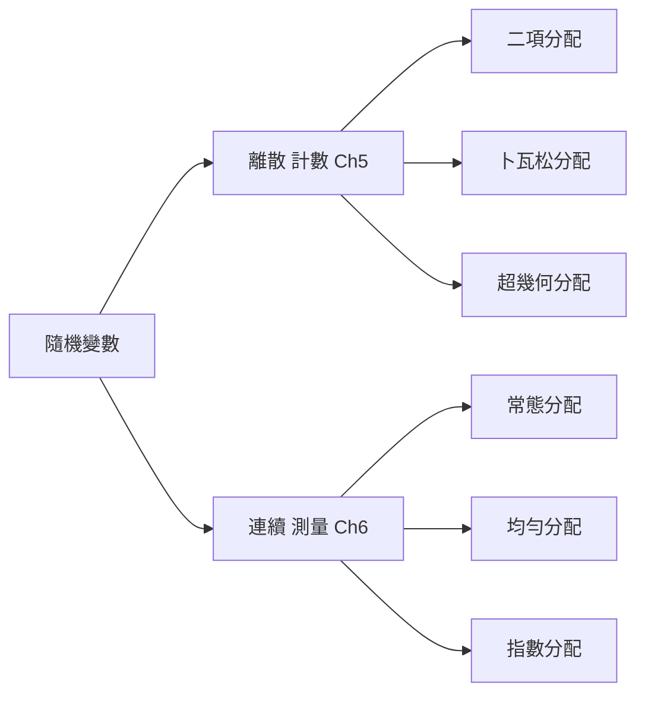
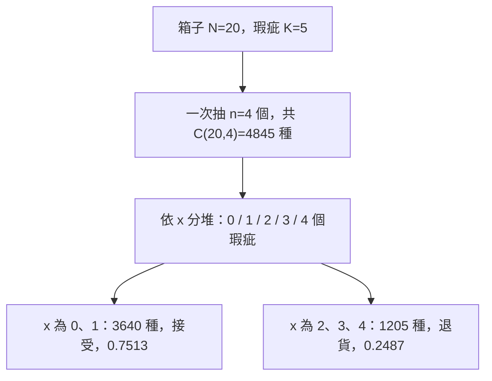
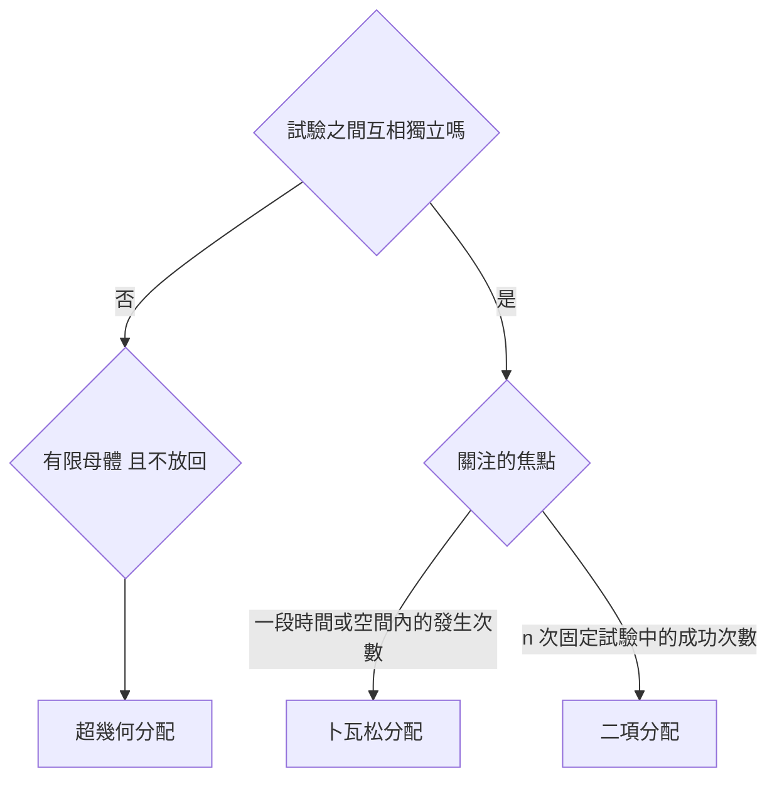

import ExpectationTable from "../_components/ExpectationTable.tsx";
import DiscreteDistExplorer from "../_components/DiscreteDistExplorer.tsx";
import DrawSteps from "../_components/DrawSteps.tsx";
import RvVarianceWalk from "../_components/RvVarianceWalk.tsx";

## 代號意思表 {#symbol-table}

本章公式裡的每個符號。看到公式看不懂時先回來查這張表。

| 代號 | 讀法 | 意思 | 例子 |
|---|---|---|---|
| $X$ | 大寫 X | 隨機變數：「還不知道結果」的那個數 | $X$＝4 輛車裡需要重修的車數 |
| $x$ | 小寫 x | $X$ 的某一個可能值，題目問的那個數 | 問「剛好 2 輛」，$x=2$ |
| $P(x)$、$P(X=x)$ | X 等於 x 的機率 | $X$ 剛好是 $x$ 的機率 | $P(X=2)=0.0486$ |
| $P(X\le x)$ | 累加機率 | $X$ 是 $x$ **或更小**的機率，附錄表給的就是這個 | $P(X\le2)=P(0)+P(1)+P(2)$ |
| $\sum$ | sigma，加總 | 把後面那串東西，對每個可能值算一次再全部加起來 | $\sum xP(x)$ |
| $E(X)$、$\mu$ | 期望值、mu | 長期平均下來 $X$ 會是多少 | 平均每個安裝點 1.2 個錯誤 |
| $Var(X)$、$\sigma^2$ | 變異數 | $X$ 偏離平均有多遠（平方後的平均） | 1.36 |
| $\sigma$ | sigma，標準差 | 變異數開根號，單位和 $X$ 相同 | 1.17 個 |
| $n$ | 試驗次數／樣本數 | 二項：做幾次；超幾何：抽幾個 | 抽 4 輛車，$n=4$ |
| $p$ | 成功機率 | 每一次「成功」的機率 | 每輛車需重修的機率 0.1 |
| $q$ | 失敗機率 | $1-p$ | 0.9 |
| $n!$ | n 階乘 | $n\times(n-1)\times\cdots\times1$，$0!=1$ | $4!=24$ |
| $C(n,x)$ | n 取 x | 從 $n$ 個裡挑 $x$ 個有幾種挑法（計算機 nCr 鍵） | $C(4,2)=6$ |
| $\lambda$ | lambda | 卜瓦松：**每一個單位**（每小時、每頁）平均發生幾次 | 每頁 1.5 個錯字 |
| $t$ | 單位數 | 題目問的範圍有幾個單位 | 檢查 3 頁，$t=3$ |
| $\lambda t$ | lambda t | 題目問的整個範圍內，平均發生幾次 | $1.5\times3=4.5$ |
| $e$ | 自然常數 | 約 2.71828，計算機的 $e^x$ 鍵 | $e^{-4}\approx0.0183$ |
| $N$ | 母體總數 | 超幾何：袋子裡一共有幾個 | 15 名員工 |
| $K$ | 目標總數 | 超幾何：袋子裡有幾個「我們關心的」（講義也寫 $X$） | 其中 5 名女性 |

## 名詞表 {#glossary}

本章出現的名詞與符號，詳細說明見對應區塊。

| 中文 | English | 描述 |
|---|---|---|
| 隨機變數 | Random Variable, $X$ | 把隨機試驗的每個結果對應到一個數值 |
| 離散隨機變數 | Discrete Random Variable | 可能值可數（有限個，或 0、1、2… 無限但可數），靠**計數**產生 |
| 連續隨機變數 | Continuous Random Variable | 可能值是一個區間，靠**測量**產生（時間、重量） |
| 機率分配 | Probability Distribution | 列出隨機變數每個可能值與其機率 $P(x)$ |
| 期望值 | Expected Value, $E(X)$ | $\sum xP(x)$，長期重複試驗的平均，即母體平均數 $\mu$ |
| 變異數 | Variance, $Var(X)$ | $\sum(x-\mu)^2P(x)$，分配的分散程度 |
| 標準差 | Standard Deviation, $\sigma_x$ | $\sqrt{Var(X)}$，衡量風險（結果的不確定性） |
| 大數法則 | Law of Large Numbers | 試驗重複越多次，平均結果越接近期望值 |
| 二項分配 | Binomial Distribution | $n$ 次獨立試驗中恰好 $x$ 次成功的機率分配 |
| 成功／失敗 | Success / Failure | 每次試驗的兩種結果；「成功」只是我們關注的事件，不一定是好事 |
| 成功機率 | $p$ | 每次試驗成功的機率，固定不變 |
| 失敗機率 | $q=1-p$ | 每次試驗失敗的機率 |
| 組合數 | Combinations, $C(n,x)$ | 從 $n$ 個中選出 $x$ 個的方法數 $\frac{n!}{x!(n-x)!}$ |
| 階乘 | Factorial, $n!$ | $n\times(n-1)\times\cdots\times1$，規定 $0!=1$ |
| 累加機率 | Cumulative Probability | $P(X\le x)$，附錄表直接給的值 |
| 餘補法則 | Complement Rule | $P(X\ge x)=1-P(X\le x-1)$ |
| 卜瓦松分配 | Poisson Distribution | 一段時間或空間內，稀有事件發生次數的分配 |
| 平均發生率 | $\lambda$ (lambda) | 單位區段內的平均發生次數 |
| 區段數 | $t$ | 感興趣的區段長度（幾個單位） |
| 預期次數 | $\lambda t$ | 整個區段的期望發生次數，也是變異數 |
| 超幾何分配 | Hypergeometric Distribution | 有限母體**不放回**抽樣時，抽中 $x$ 個目標的分配 |
| 母體總數 | $N$ | 有限母體的大小 |
| 目標總數 | $K$（講義也寫 $X$） | 母體中具有目標特徵的數量 |
| 樣本數 | $n$ | 抽出的數量 |
| 多元超幾何分配 | Multivariate Hypergeometric | 母體分成 $k$ 類、不放回抽樣時，各類抽中數量的聯合機率 |

## 本章地圖 {#ch5-map}

第四章算單一事件的機率；第五章把「結果」變成數字（隨機變數），一次描述所有可能值的機率。原始講義：[[CH5 (1) 參考講義(1).pdf|5.1–5.2 講義]]、[[CH5 (2) 參考講義(1).pdf|卜瓦松講義]]、[[CH5 (3) 參考講義(1).pdf|超幾何講義]]。



## 這一章到底在做什麼 {#ch5-big-picture}

第五章的題目幾乎都長這樣：**「某件事會發生幾次？剛好（或至少、最多）發生某個次數的機率是多少？」**

- 抽 4 輛修好的車，有幾輛要重修？剛好 2 輛的機率？
- 客服中心一小時接到幾通電話？至少 12 通的機率？
- 15 名員工抽 6 人，裡面有幾名女性？剛好 3 名的機率？

用第四章的方法也能算，但要把每一種情況一個一個列出來，數字一大就做不完。統計學家發現這類問題只有幾種常見「情境」，每種情境都有一條**現成公式**，這些公式就叫**機率分配**：

| 情境 | 用哪個分配 | 一句話認出它 |
|---|---|---|
| 同一件事做 $n$ 次，每次成功機率一樣，數成功幾次 | [[#binomial\|二項分配]] | 「抽 $n$ 個，每個有 $p$ 的機率…」 |
| 一段時間（或長度、面積）裡，某事件發生幾次 | [[#poisson\|卜瓦松分配]] | 「平均每小時（每頁、每公里）有 …次」 |
| 從一小堆東西裡抽，抽了不放回，數抽到幾個目標 | [[#hypergeometric\|超幾何分配]] | 「$N$ 個裡有 $K$ 個…，抽 $n$ 個」 |

每一題的做法都是同樣四步：

1. **認情境**：讀題目，決定是哪一種分配（[[#choose-distribution|如何選擇分配]]）。
2. **找數字**：把題目的數字對應到公式的符號（二項找 $n,p,x$；卜瓦松找 $\lambda,t,x$；超幾何找 $N,K,n,x$）。
3. **算機率**：代公式，或查附錄表。問「至少／最多」時要先轉換（[[#binomial-table|查表與餘補]]）。
4. **解讀**：這個機率代表什麼？太小（例如低於 5%）通常代表「原本的說法可疑」。

另外兩個工具（期望值、標準差）回答的是：**平均會發生幾次、實際上會上下差多少**。

## 隨機變數 {#random-variable}

隨機變數是把「隨機試驗的結果」對應到「數值」的橋樑。為什麼要這樣做？因為「正面、反面」不能加減，但「正面次數 2」可以算平均、算標準差。例如擲兩次硬幣，令 $X$＝正面次數：

| 結果 | (正, 正) | (正, 反) | (反, 正) | (反, 反) |
|---|---|---|---|---|
| $X$ | 2 | 1 | 1 | 0 |

四種結果被壓縮成三個數字 0、1、2。**大寫 $X$** 是那個「還沒擲之前不知道是多少」的數；**小寫 $x$** 是它某一個具體的值。

兩大類：

| | 離散 Discrete | 連續 Continuous |
|---|---|---|
| 可能值 | 有限個，或 0、1、2… 可數的序列 | 無限多、不可數（一個區間） |
| 怎麼產生 | **計數**（數幾個、幾次） | **測量**（時間、重量、長度） |
| 例子 | 檢查 5 個產品的不良品數：0～5 | 手搖飲杯的容量：$500\le x\le700$ cc |

| 隨機試驗 | 隨機變數 $X$ | 可能值 |
|---|---|---|
| 一個銅板丟三次 | 出現正面次數 | 0, 1, 2, 3 |
| 檢查 5 個產品 | 不良品個數 | 0, 1, 2, 3, 4, 5 |
| 一小時內來店客人 | 到達的客人數 | 0, 1, 2, 3, …（無限但可數） |

本章只處理**離散**的（答案都是 0、1、2… 這種整數個數），連續的在第六章。離散與連續數據的區分見 [[ch2-charts#discrete-continuous|第二章]]。

## 機率分配 {#probability-distribution}

機率分配就是一張表（或一條公式），列出隨機變數**每一個可能值**和**它的機率**。擲兩次硬幣、$X$＝正面次數：

| $x$ | 0 | 1 | 2 |
|---|---|---|---|
| $P(x)$ | 1/4 = 0.25 | 2/4 = 0.50 | 1/4 = 0.25 |

$P(1)=0.5$ 是因為四種結果裡有兩種（正反、反正）是 1 次正面。

任何離散機率分配都必須滿足兩條規則（就是第四章的機率規則）：

1. 每個機率都在 0 到 1 之間：$0\le P(x)\le1$。
2. 所有機率加起來等於 1：$\sum P(x)=1$（$0.25+0.5+0.25=1$）。

機率分配有三種來源：

- **列舉**：像上面把所有結果數出來（古典機率）。
- **歷史資料**：用相對頻率當機率，例如 [[#ex-security-errors|保全系統的安裝錯誤數]]。
- **公式**：二項、卜瓦松、超幾何分配。本章後半就是在學這三條公式。

## 期望值 {#expected-value}

**在算什麼**：如果同一件事重複做非常多次，$X$ 平均下來會是多少。

$$
E(X)=\mu=\sum xP(x)
$$

**怎麼讀**：對每一個可能值 $x$，算「$x$ 乘上它的機率 $P(x)$」，再把全部加起來。

**怎麼用**：列一張表，加一欄 $xP(x)$，最後把這欄加總。用擲兩次硬幣的分配：

| $x$ | $P(x)$ | $xP(x)$ |
|---|---|---|
| 0 | 0.25 | 0 |
| 1 | 0.50 | 0.50 |
| 2 | 0.25 | 0.50 |
| 合計 | 1 | **1.00** |

$E(X)=1$：擲兩次硬幣，平均出現 1 次正面，符合直覺。

**為什麼乘機率**：這就是 [[ch3-descriptive#weighted-mean|加權平均數]]，權重是機率。比較常出現的值（機率大）對平均的影響比較大。想像擲 100 回：約 25 回是 0、50 回是 1、25 回是 2，平均是 $(0\times25+1\times50+2\times25)/100=1$，和上面一樣。依大數法則，次數越多，實際平均越接近期望值，所以 $E(X)$ 就是母體平均數 $\mu$。

**注意**：期望值不一定是真的會出現的值。平均每個安裝點 1.2 個錯誤，但任何一個安裝點的錯誤數都是整數。它是「長期平均」，不是「下一次的預測」。

## 隨機變數的變異數與標準差 {#rv-variance}

**在算什麼**：$X$ 的實際值通常離期望值多遠，也就是結果有多「不穩定」。期望值相同的兩件事，風險可能差很多：

- 投資 A：報酬率一定是 5%。
- 投資 B：一半機率賠 10%、一半機率賺 20%。期望值 $(-10)(0.5)+20(0.5)=5\%$，跟 A 一樣。

兩者平均一樣，但 B 的結果一定離 5% 差 15 個百分點，風險大得多。變異數和標準差就是把這個「差多少」變成數字（A 的 $\sigma=0$，B 的 $\sigma=15\%$）。

$$
Var(X)=\sigma^2=\sum(x-\mu)^2P(x),\qquad \sigma=\sqrt{Var(X)}
$$

**怎麼讀**：每個可能值先減掉期望值 $\mu$（離平均多遠），平方（讓負的也變正，不會互相抵消），乘上機率，全部加起來。最後開根號得到標準差，單位就回到和 $X$ 一樣。

**怎麼用**：在期望值的表後面多加三欄。擲兩次硬幣，$\mu=1$：

| $x$ | $P(x)$ | $x-\mu$ | $(x-\mu)^2$ | $(x-\mu)^2P(x)$ |
|---|---|---|---|---|
| 0 | 0.25 | $-1$ | 1 | 0.25 |
| 1 | 0.50 | 0 | 0 | 0 |
| 2 | 0.25 | 1 | 1 | 0.25 |
| 合計 | | | | **0.50** |

$Var(X)=0.5$，$\sigma=\sqrt{0.5}\approx0.71$ 次。

### 圖解逐步算變異數 {#rv-variance-walk}

看不懂上面那張表時，照順序按六個步驟：每一欄都對應圖上的一個動作（找平衡點、畫離差箭頭、畫正方形、乘機率、加總）。第一組是上面的擲兩次硬幣，第二組是投資 B（一半機率賠 10%、一半機率賺 20%）。

<RvVarianceWalk datasets={[{ label: "擲兩次硬幣", xs: [0, 1, 2], ps: [0.25, 0.5, 0.25], unit: "次" }, { label: "投資 B", xs: [-10, 20], ps: [0.5, 0.5], unit: "%" }]} />

**簡便公式**：先算 $E(X^2)=\sum x^2P(x)$（每個 $x$ 平方再乘機率加總），再減掉期望值的平方：

$$
Var(X)=E(X^2)-[E(X)]^2
$$

上例：$E(X^2)=0^2(0.25)+1^2(0.5)+2^2(0.25)=1.5$，$Var(X)=1.5-1^2=0.5$，答案相同。數字不整齊時這條比較不容易算錯。

和 [[ch3-descriptive#variance|第三章的變異數]] 是同一個概念（離差平方的平均），只是「平均」改成以機率加權。決策時，標準差就是**風險**：越大代表結果越不確定。

## 例子：保全系統的安裝錯誤數 {#ex-security-errors}

保全公司抽檢 400 個安裝點，$X$＝每次檢查發現的錯誤數（0～3）。0 個錯誤 150 次、1 個 110 次、2 個 50 次、3 個 90 次。

**第一步：把次數變成機率**（相對頻率，$P(x)=$ 次數 ÷ 400）。

**第二步：算期望值**，加一欄 $xP(x)$。

**第三步：算變異數**，再加三欄。

| $x$ | 次數 | $P(x)$ | $xP(x)$ | $x-\mu$ | $(x-\mu)^2$ | $(x-\mu)^2P(x)$ |
|---|---|---|---|---|---|---|
| 0 | 150 | 0.375 | 0 | $-1.2$ | 1.44 | 0.540 |
| 1 | 110 | 0.275 | 0.275 | $-0.2$ | 0.04 | 0.011 |
| 2 | 50 | 0.125 | 0.250 | 0.8 | 0.64 | 0.080 |
| 3 | 90 | 0.225 | 0.675 | 1.8 | 3.24 | 0.729 |
| 合計 | 400 | 1 | **1.20** | | | **1.36** |

- $E(X)=1.20$：長期下來，每個安裝點平均有 1.2 個錯誤。
- $Var(X)=1.36$，$\sigma=\sqrt{1.36}\approx1.17$ 個：個別安裝點的錯誤數，通常在平均上下 1 個多一點的範圍內變動。

用簡便公式驗算：$E(X^2)=0+1(0.275)+4(0.125)+9(0.225)=2.8$，$2.8-1.2^2=1.36$。

<ExpectationTable datasets={[{ label: "保全安裝錯誤數", xs: [0, 1, 2, 3], weights: [150, 110, 50, 90], frequencies: true, unit: "個" }, { label: "B 供應商不良率", xs: [0.01, 0.05, 0.1, 0.15], weights: [0.3, 0.4, 0.2, 0.1], unit: "" }]} />

### 例子：燈具供應商的成本決策 {#ex-lamp-supplier .fold}

燈具貿易公司要進口 10 萬組燈具，每個不良品會增加 9.50 美元成本：

- **A 供應商**：每組比 B 便宜 1.20 美元，不良率固定 10%。
- **B 供應商**：較貴，不良率 $x$ 呈機率分配：0.01（0.3）、0.05（0.4）、0.10（0.2）、0.15（0.1）。

1. **B 的期望不良率**：$E(x)=0.01(0.3)+0.05(0.4)+0.10(0.2)+0.15(0.1)=0.058$（5.8%）。
2. **A 的總額外成本**（以 B 的單價為基準）：不良品 $100000\times0.10\times9.50=95{,}000$ 美元。
3. **B 的總額外成本**：不良品 $100000\times0.058\times9.50=55{,}100$，加上每組貴 1.20 的 $120{,}000$，共 $175{,}100$ 美元。

雖然 B 的期望不良率只有 5.8%，算上單價差後，選 A 能省下約 80,100 美元。期望值讓「不確定的不良率」可以換算成可比較的金額。

## 二項分配 {#binomial}

**在算什麼**：同一件事做 $n$ 次，每次「成功」的機率都是 $p$，**剛好成功 $x$ 次**的機率。

**生活中的樣子**：

- 推銷 5 位顧客（$n=5$），每位買的機率 30%（$p=0.3$），剛好 2 位買（$x=2$）？
- 檢查 10 個產品（$n=10$），不良率 5%（$p=0.05$），剛好 1 個不良（$x=1$）？
- 擲 10 次硬幣（$n=10$），正面機率 0.5，剛好 7 次正面（$x=7$）？

每次試驗只有兩種結果：**成功**（機率 $p$）與**失敗**（機率 $q=1-p$）。「成功」只代表**我們在數的那件事**，不一定是好事：問「幾輛車需要重修」時，「需要重修」就是成功。

### 使用二項分配的五個條件 {#binomial-conditions}

1. **兩種結果**：每次只有成功或失敗，互斥。
2. **固定次數**：試驗總次數 $n$ 事先已知且固定。
3. **互相獨立**：每次結果不影響其他次（例如抽出後放回）。
4. **機率一致**：每次成功的機率 $p$ 都相同。
5. **機率互補**：$p+q=1$。

不放回抽樣違反「獨立」與「機率一致」，但若樣本相對母體很小（例如每週 300 輛車抽 4 輛，$4/300=1.33\%$），機率幾乎不變，仍可用二項分配近似。母體小時要改用 [[#hypergeometric|超幾何分配]]。

## 組合數 {#combinations}

**在算什麼**：從 $n$ 個位置中，挑出 $x$ 個位置放「成功」，有幾種挑法。

湖城汽車每週修 300 輛車的變速箱，10% 需要重新維修（D），90% 不需要（G）。抽 4 輛，列出所有結果，依「需重修的車數」分組：

| $x$ | 組合數 | 結果 |
|---|---|---|
| 0 | 1 | GGGG |
| 1 | 4 | DGGG, GDGG, GGDG, GGGD |
| 2 | 6 | GGDD, GDGD, DGGD, GDDG, DGDG, DDGG |
| 3 | 4 | DDDG, DDGD, DGDD, GDDD |
| 4 | 1 | DDDD |

「4 輛中 2 輛要重修」有 6 種排法：可能是第 1、2 輛，也可能是第 1、3 輛……。$n=4$ 還能窮舉；$n=100$ 就不可能了，所以用公式直接算：

$$
C(n,x)=\frac{n!}{x!(n-x)!},\qquad C(4,2)=\frac{4!}{2!\,2!}=\frac{24}{2\times2}=6
$$

**階乘** $n!$ 是從 $n$ 一路乘到 1：$4!=4\times3\times2\times1=24$。規定 $0!=1$。

**手算的捷徑**：分子只乘 $x$ 個數（從 $n$ 往下），分母是 $x!$。

$$
C(5,2)=\frac{5\times4}{2\times1}=10,\qquad C(10,3)=\frac{10\times9\times8}{3\times2\times1}=120
$$

**三個好記的性質**：

- $C(n,0)=C(n,n)=1$：全部失敗或全部成功都只有一種排法。
- $C(n,1)=n$：只有一個成功，它可以在 $n$ 個位置中的任一個。
- $C(n,x)=C(n,n-x)$：挑出 2 個成功＝挑出 2 個失敗以外的位置，所以 $C(6,4)=C(6,2)=15$。

**計算機**：工程計算機的 **nCr** 鍵，按 `6 nCr 4 =` 得 15。

## 二項機率公式 {#binomial-formula}

**在算什麼**：$n$ 次獨立試驗、每次成功機率 $p$，剛好成功 $x$ 次的機率。

$$
P(X=x)=\underbrace{\frac{n!}{x!(n-x)!}}_{\text{有幾種排法}}\times\underbrace{p^x\,q^{\,n-x}}_{\text{每一種排法的機率}}
$$

**符號對照**：

| 符號 | 意思 | 從題目哪裡找 |
|---|---|---|
| $n$ | 總共做幾次 | 「抽 4 輛」「拜訪 5 位」「調查 20 戶」 |
| $x$ | 想要剛好成功幾次 | 「其中 2 輛」「恰好 2 次」 |
| $p$ | 每次成功的機率 | 「10% 需要重修」「成功率 30%」 |
| $q$ | 每次失敗的機率 | $1-p$ |

**公式怎麼來的**（以 4 輛車中 2 輛要重修為例，$p=0.1$）：

1. **先算一種特定排法**，例如 DDGG（第 1、2 輛要重修，第 3、4 輛不用）。各輛獨立，所以用乘法：$0.1\times0.1\times0.9\times0.9=(0.1)^2(0.9)^2=0.0081$。這就是 $p^xq^{n-x}$：成功幾次就乘幾個 $p$，失敗幾次就乘幾個 $q$。
2. **其他排法的機率都一樣**：GDGD 是 $0.9\times0.1\times0.9\times0.1$，一樣是 0.0081，只是順序不同。
3. **一共有 $C(4,2)=6$ 種排法**，所以總機率 $=6\times0.0081=0.0486$。

所以公式只是「一種排法的機率 × 排法數」。

**使用步驟**：

1. 確認是二項情境（[[#binomial-conditions|五個條件]]）。
2. 寫出 $n$、$p$、$q$、$x$。
3. 分三塊算：$C(n,x)$、$p^x$、$q^{n-x}$。
4. 三塊相乘。

**常見錯誤**：$q$ 的次方是 $n-x$（失敗的次數），不是 $n$；$p$ 和 $q$ 對調（先想清楚題目在「數」什麼，那個就是成功）。

### 例子：湖城汽車 4 輛中 2 輛需重修 {#ex-lake-city}

1. 定義變數：$n=4$、$x=2$、$p=0.10$、$q=0.90$。
2. 三塊：$C(4,2)=6$；$(0.10)^2=0.01$；$(0.90)^{4-2}=0.81$。
3. 相乘：$6\times0.01\times0.81=0.0486$。

4 輛車中有 2 輛需要重修的機率為 4.86%。把 $x=0$ 到 4 全部算出來就是完整的機率分配：

| $x$ | 算式 | $P(x)$ |
|---|---|---|
| 0 | $1\times(0.1)^0(0.9)^4$ | 0.6561 |
| 1 | $4\times(0.1)^1(0.9)^3$ | 0.2916 |
| 2 | $6\times(0.1)^2(0.9)^2$ | 0.0486 |
| 3 | $4\times(0.1)^3(0.9)^1$ | 0.0036 |
| 4 | $1\times(0.1)^4(0.9)^0$ | 0.0001 |
| 合計 | | 1 |

最可能的是 0 輛要重修（65.61%）；「至少 1 輛要重修」$=1-P(0)=1-0.6561=0.3439$。

### 例子：業務推銷 {#ex-binomial-sales .fold}

推銷成功率 30%，拜訪 5 位顧客，恰好成功 2 次的機率？

1. $n=5$、$p=0.3$、$q=0.7$、$x=2$。
2. $C(5,2)=\dfrac{5\times4}{2\times1}=10$；$(0.3)^2=0.09$；$(0.7)^{3}=0.343$。
3. 相乘：

$$
P(2)=10\times0.09\times0.343=0.3087
$$

約 30.87%。

### 例子：美容美髮店的退款 {#ex-binomial-refund .fold}

每位顧客要求退款的機率 20%，隨機觀察 6 位，恰好 4 位要求退款？

1. $n=6$、$p=0.2$、$q=0.8$、$x=4$（在數「要求退款」，所以它是成功）。
2. $C(6,4)=C(6,2)=15$；$(0.2)^4=0.0016$；$(0.8)^2=0.64$。
3. 相乘：

$$
P(4)=15\times0.0016\times0.64=0.0154
$$

僅 1.54%，屬於極端少見的情況；真的發生時值得檢查服務是否出了問題。

## 二項分配的平均數與標準差 {#binomial-mean-sd}

**在算什麼**：做 $n$ 次，平均會成功幾次、實際次數通常上下差多少。不必把整張分配表列出來，直接代公式。

$$
E(X)=\mu=np,\qquad Var(X)=npq,\qquad \sigma=\sqrt{npq}
$$

$np$ 很直觀：做 $n$ 次、每次成功機率 $p$，平均就成功 $np$ 次（擲 10 次硬幣平均 $10\times0.5=5$ 次正面）。用期望值的定義驗算湖城汽車：$\sum xP(x)=0+0.2916+2(0.0486)+3(0.0036)+4(0.0001)=0.4$，正好是 $np=4\times0.1$。

### 例子：洗衣機馬達維修 {#ex-washer .fold}

每週 50 部洗衣機進廠，馬達需重修的機率 10%。$n=50$、$p=0.1$、$q=0.9$：

- $E(X)=50\times0.1=5$ 部；
- $Var(X)=50\times0.1\times0.9=4.5$；
- $\sigma=\sqrt{4.5}=2.12$ 部。

廠長可以依期望值 5 部準備常規備品，再用標準差 2.12 抓安全庫存。

## 查二項分配表 {#binomial-table}

**為什麼要查表**：題目常問「最多 2 次」「至少 8 次」，這要把好幾個 $P(x)$ 加起來。例如 $n=20$ 問「最多 12 次」，要算 13 次公式。附錄的二項分配表已經幫你加好了。

**表裡是什麼**：**累加機率** $P(X\le x)$，也就是「$x$ 次**或更少**」的機率：

$$
P(X\le2)=P(0)+P(1)+P(2)
$$

湖城汽車（$n=4$、$p=0.1$）：$P(X\le1)=0.6561+0.2916=0.9477$。

**怎麼查**：找到 $n$ 那一塊 → $p$ 那一欄 → $x$ 那一列，交叉的數字就是 $P(X\le x)$。

**題目文字 → 數學 → 怎麼查**：表只能直接給「$\le$」，其他問法都要轉換。

| 題目說 | 數學 | 做法 |
|---|---|---|
| 恰好、剛好 $x$ | $P(X=x)$ | 公式；或查表 $P(X\le x)-P(X\le x-1)$ |
| 最多、不超過、至多 $x$ | $P(X\le x)$ | 直接查表 |
| 少於、不到 $x$ | $P(X<x)=P(X\le x-1)$ | 查 $x-1$ |
| 至少、不少於 $x$ | $P(X\ge x)$ | **餘補法則** $1-P(X\le x-1)$ |
| 超過、多於 $x$ | $P(X>x)$ | $1-P(X\le x)$ |

**餘補法則為什麼成立**：所有可能值的機率加起來是 1。把 0 到 $n$ 排成一排，「至少 8」是右邊那段，它的反面就是左邊那段「最多 7」：

```
x:   0  1  2  3  4  5  6  7 | 8  9  10  11
     └──── 最多 7（查表）─────┘ └── 至少 8 ──┘
```

所以 $P(X\ge8)=1-P(X\le7)$。最容易錯的就是這條線畫在哪：「至少 8」的反面是「最多 **7**」，查 $x=7$，不是 $x=8$。

**「恰好」為什麼是相減**：$P(X\le6)$ 包含 0～6，$P(X\le5)$ 包含 0～5，兩者相減只剩下 6。

### 例子：至少 8 次成功 {#ex-binomial-at-least .fold}

$n=11$、$p=0.45$，求 $P(X\ge8)$。

1. 「至少 8」＝8、9、10、11。表只有 $\le$，用反面「最多 7」。
2. 查表 $n=11$、$p=0.45$、$x=7$：0.9390。
3. 相減：

$$
P(X\ge8)=1-P(X\le7)=1-0.9390=0.0610
$$

### 例子：電視收視率 {#ex-binomial-rating .fold}

某球賽宣稱有 40% 收視率。隨機抽 20 戶，只有 2 戶（含）以下在看，機率多少？

1. 定義：$n=20$、$p=0.40$，「2 戶（含）以下」＝最多 2，求 $P(X\le2)$。
2. 查表：$n=20$、$p=0.40$、$x=2$，得 0.0036。
3. 結論：如果收視率真的是 40%，這種結果只有 0.36% 的機會，宣稱的收視率很可疑。

### 例子：航空公司訂位系統 {#ex-binomial-airline .fold}

航空公司預估 80% 的乘客喜歡新的訂位系統。第三方隨機抽 20 位乘客，只有 12 位喜歡。

1. 假設成立時：$n=20$、$p=0.80$，期望 $\mu=20\times0.8=16$ 人喜歡，$\sigma=\sqrt{20\times0.8\times0.2}=\sqrt{3.2}\approx1.79$。
2. 查表：$P(X\le12)=0.0321$。
3. 結論：若 80% 的估計正確，觀察到 12 人或更少的機率只有 3.21%，實際結果（12）比期望（16）低了兩個多標準差。航空公司需要重新考慮這項計畫。

### 例子：五位醫生有三位推薦？ {#ex-binomial-surgery .fold}

報告聲稱「五位醫生中就有三位推薦達文西手術」（$p=0.6$）。隨機問 20 位，只有 2 位推薦。

- 若主張為真，期望 $E(X)=20\times0.6=12$ 位推薦。
- 觀察到 2 位以下的機率：$P(X\le2)=P(0)+P(1)+P(2)\approx0.000005$。

機率趨近於 0，觀察值（2）與期望值（12）落差極大，證明原報告的主張極不可靠。

## 用機率檢驗一個說法 {#rare-event-logic}

本章很多例子（收視率、航空訂位、醫生推薦、裁員）都用同一套邏輯，這是第二學期「假設檢定」的雛形：

1. **先假設對方說的是真的**（收視率真的 40%）。
2. **在這個假設下，算觀察到的結果有多罕見**（20 戶只有 2 戶以下在看：0.36%）。
3. **太罕見就懷疑原本的說法**。一般以 5% 為界：機率比 5% 小，就說「如果主張為真，這種結果幾乎不會發生，所以主張可疑」。

注意第 2 步算的是「這麼極端**或更極端**」的機率（$\le2$，不是 $=2$），因為單一個值的機率本來就可能很小。

## 二項分配的形狀 {#binomial-shape}

- $p=0.5$：不論 $n$ 多少，分配都**對稱**、呈鐘形，中心在 $np$。
- $p$ 很小（例如 0.05）：$n$ 小時嚴重右偏；$n$ 增大後越來越接近對稱的鐘形（$n=50$ 時已很像常態）。

樣本越大，分配越接近常態，預測也越穩定。拉動 $n$、$p$ 觀察形狀，並切換「恰好／最多／至少」看深色部分怎麼變：

<DiscreteDistExplorer kind="binomial" presets={[{ label: "湖城汽車", params: { n: 4, p: 0.1 }, x: 2, mode: "eq" }, { label: "業務推銷", params: { n: 5, p: 0.3 }, x: 2, mode: "eq" }, { label: "收視率", params: { n: 20, p: 0.4 }, x: 2, mode: "le" }, { label: "航空訂位", params: { n: 20, p: 0.8 }, x: 12, mode: "le" }, { label: "至少 8 次", params: { n: 11, p: 0.45 }, x: 8, mode: "ge" }]} />

## 卜瓦松分配 {#poisson}

**在算什麼**：在**一段時間或一塊空間**裡（一小時、一公里、一頁、一平方公尺），某件事**剛好發生 $x$ 次**的機率。

**生活中的樣子**：

- 客服中心平均每小時 8 通電話，下一小時剛好 5 通？
- 每頁平均 1.5 個錯字，3 頁裡超過 3 個錯字？
- 小吃攤每小時平均賣 10 份，下一小時至少賣 12 份？

**和二項分配的差別**：二項分配有「做幾次」$n$，所以能數成功也能數失敗；卜瓦松**沒有 $n$**，只知道「平均發生幾次」。例如高速公路的坑洞：數得出有幾個坑洞，卻沒辦法數「沒有坑洞」發生了幾次。所以題目只給「平均每 ___ 有 ___ 次」、沒有總次數時，就是卜瓦松。

### 卜瓦松的三個條件 {#poisson-conditions}

1. **平均率固定**：一個區段內的平均發生次數 $\lambda$ 固定（例：每小時平均 6 通電話）。
2. **機率均勻**：相同長度的區段，發生特定次數的機率相同（客服中心任何一小時的來電分配都一樣）。
3. **互不影響**：不重疊的區段之間，事件的發生互相獨立（上午的電話量不影響下午）。

## 卜瓦松公式與 λt {#poisson-formula}

**在算什麼**：已知平均發生次數，求某一段範圍內剛好發生 $x$ 次的機率。

$$
P(X=x)=\frac{(\lambda t)^x\,e^{-\lambda t}}{x!}
$$

**符號對照**：

| 符號 | 意思 | 從題目哪裡找 |
|---|---|---|
| $\lambda$ | **每一個單位**平均發生幾次 | 「平均每小時 8 通」「每頁 1.5 個」 |
| $t$ | 題目問的範圍有**幾個單位** | 「3 頁」→ 3；「半小時」→ 0.5 |
| $\lambda t$ | 題目問的範圍內，平均發生幾次 | 兩者相乘 |
| $x$ | 想要剛好發生幾次 | 「恰好 6 封」 |
| $e$ | 固定常數 2.71828，不用找 | 計算機 $e^x$ 鍵 |

**第一件事永遠是算 $\lambda t$**：題目給的「平均」和題目問的「範圍」常常不一樣大，要先換算。

| 題目 | $\lambda$ | $t$ | $\lambda t$ |
|---|---|---|---|
| 每頁平均 1.5 個錯字，檢查 3 頁 | 1.5（每頁） | 3 | 4.5 |
| 每小時平均 6 通電話，問半小時 | 6（每小時） | 0.5 | 3 |
| 每平方呎平均 5 個缺點，檢驗 3 平方呎 | 5（每平方呎） | 3 | 15 |
| 每小時 8 通電話，問 1 秒內 | 8（每小時） | 1/3600 | 0.0022 |
| 每天平均 4 封客訴，問一天 | 4（每天） | 1 | 4 |

常見錯誤是直接拿 $\lambda$ 代公式，忘了乘 $t$。

**公式的三塊**：

- $(\lambda t)^x$：$\lambda t$ 自乘 $x$ 次。
- $e^{-\lambda t}$：**一次都沒發生**的機率（$x=0$ 時整條公式就剩這一項）。計算機按 `e^x`，輸入 $-\lambda t$。
- $x!$：$x$ 的階乘，放在分母。

**使用步驟**：

1. 算 $\lambda t$（單位要對齊）。
2. 算 $e^{-\lambda t}$。
3. 算 $(\lambda t)^x$ 和 $x!$。
4. 代入：$(\lambda t)^x\times e^{-\lambda t}\div x!$。

**入門例子**：店裡平均每小時來 2 位客人（$\lambda=2$），

- 一小時剛好來 3 位：$\lambda t=2$，$P(3)=\dfrac{2^3e^{-2}}{3!}=\dfrac{8\times0.1353}{6}\approx0.1804$。
- 半小時都沒有客人：$\lambda t=2\times0.5=1$，$P(0)=\dfrac{1^0e^{-1}}{0!}=e^{-1}\approx0.3679$。

**期望值與標準差**：卜瓦松最獨特的性質是期望值與變異數相等，都是 $\lambda t$：

$$
E(X)=Var(X)=\lambda t,\qquad \sigma=\sqrt{\lambda t}
$$

### 例子：每天恰好 6 封客訴 {#ex-poisson-complaints}

每天平均 4 封客訴信，某天恰好收到 6 封的機率？

1. $\lambda=4$（每天），問一天，$t=1$，$\lambda t=4$；$x=6$。
2. $e^{-4}\approx0.018316$。
3. $4^6=4096$；$6!=720$。
4. 代入：

$$
P(6)=\frac{4^6e^{-4}}{6!}=\frac{4096\times0.018316}{720}=\frac{75.02}{720}\approx0.1042
$$

約 10.42%。查累加表也一樣：$P(X\le6)-P(X\le5)=0.8893-0.7851=0.1042$。

## 查卜瓦松表 {#poisson-table}

跟 [[#binomial-table|二項分配表]] 一樣，附錄 C 的卜瓦松表是**累加**的 $P(X\le x)$，只是用 $\lambda t$ 找欄而不是 $n,p$：在表頂找 $\lambda t$ 那一欄，再找左側 $x$ 那一列。

| 問法 | 做法 |
|---|---|
| 恰好 $x$ | $P(X\le x)-P(X\le x-1)$（相減法） |
| 最多 $x$ | 直接查表 |
| 少於 $x$ | 查 $x-1$ |
| 至少 $x$ | $1-P(X\le x-1)$（餘補法） |
| 超過 $x$ | $1-P(X\le x)$ |

卜瓦松沒有上限（理論上可以發生無限多次），所以「至少」**一定**要用餘補，不可能一項一項加完。

### 例子：客服中心全解析 {#ex-poisson-call-center .fold}

每小時平均 8 通電話（$\lambda t=8$）。

- **恰好 5 通**：公式 $\dfrac{8^5e^{-8}}{5!}=\dfrac{32768\times0.000335}{120}\approx0.0916$；查表 $0.1912-0.0906=0.0916$。兩種方法相同，9.16%。
- **最多 2 通**：$P(0)+P(1)+P(2)$。$P(0)=e^{-8}\approx0.000335$，$P(1)=8\times0.000335\approx0.00268$，$P(2)=64\times0.000335/2\approx0.0107$，合計約 0.0137；查表直接得 0.0138（差異是捨入）。
- **沒有電話**：$P(0)=8^0e^{-8}/0!=e^{-8}\approx0.000335$，約 0.0335%。

### 例子：小吃攤至少賣出 12 份 {#ex-poisson-at-least .fold}

每小時平均賣 10 份（$\lambda t=10$），一小時內至少賣 12 份？表只給 $\le$，用反面「最多 11 份」：

$$
P(X\ge12)=1-P(X\le11)=1-0.6968=0.3032
$$

### 例子：打字錯誤超過 3 個 {#ex-poisson-typo .fold}

每頁平均 1.5 個錯誤，檢查 3 頁，超過 3 個錯誤的機率？

1. $\lambda t=1.5\times3=4.5$。
2. 「超過 3」＝4、5、6…，反面是「最多 3」，查表 $P(X\le3)=0.3423$。
3. $P(X>3)=1-0.3423=0.6577$。

### 例子：皮革缺點的品質管理 {#ex-poisson-leather .fold}

標準是每平方呎平均缺點不超過 5 個。檢驗 3 平方呎發現 18 個缺點，這種情況的發生機率？

1. 單位區段：1 平方呎。
2. $\lambda=5$。
3. $t=3$，預期缺點 $\lambda t=15$。
4. 「發現 18 個」要問「18 個或更多」有多常見：$P(X\ge18)=1-P(X\le17)=1-0.7489=0.2511$。

25% 的機率不算罕見，單憑這次檢驗不能斷定品質變差（見 [[#rare-event-logic|用機率檢驗一個說法]]）。

### 例子：超市結帳恰好 12 人 {#ex-poisson-checkout .fold}

$\lambda t=16$，恰好 12 人：$P(X=12)=P(X\le12)-P(X\le11)=0.1931-0.1270=0.0661$。

<DiscreteDistExplorer kind="poisson" presets={[{ label: "客訴 6 封", params: { lambda: 4, t: 1 }, x: 6, mode: "eq" }, { label: "小吃至少 12 份", params: { lambda: 10, t: 1 }, x: 12, mode: "ge" }, { label: "客服恰好 5 通", params: { lambda: 8, t: 1 }, x: 5, mode: "eq" }, { label: "打字超過 3 個", params: { lambda: 1.5, t: 3 }, x: 4, mode: "ge" }, { label: "皮革至少 18", params: { lambda: 5, t: 3 }, x: 18, mode: "ge" }]} />

## 卜瓦松與二項的關係 {#poisson-binomial}

把一段時間切成很多微小區段：每個微小區段發生超過 1 次的機率可忽略（稀有）、各區段獨立、每段發生 1 次的機率是 $\lambda t$ 除以區段數。這就變成「做很多次、每次成功機率很小」的二項分配。所以當二項分配的 $n$ 很大、$p$ 很小，令 $np=\lambda t$，二項分配可以用卜瓦松近似。$\lambda$ 越大，卜瓦松的形狀也越接近常態。

### 例子：咖啡店尖峰人力 {#ex-poisson-coffee .fold}

尖峰 8:00～9:00（$t=60$ 分鐘），平均每分鐘 2 人（$\lambda=2$）：

- $E(X)=\lambda t=120$ 人；
- $\sigma=\sqrt{120}\approx10.95$，約 11 人。

迷思是「期望 120 人，就安排剛好應付 120 人的人力」。現實中一小時的顧客數大多在 $120\pm11$，也就是 109 到 131 人之間；人力剛好只能應付 120 人時，顧客潮一來服務就崩潰。期望值給產能基準，標準差給彈性緩衝。

## 超幾何分配 {#hypergeometric}

**在算什麼**：從一小堆東西（$N$ 個，其中 $K$ 個是目標）裡**抽出不放回**，抽 $n$ 個，剛好抽到 $x$ 個目標的機率。

**生活中的樣子**：

- 15 名員工裡 5 名女性，隨機挑 6 人，剛好 3 名女性？
- 100 件產品裡 20 件瑕疵，抽 15 件檢驗，最多 2 件瑕疵？
- 10 張彩券裡 3 張中獎，抽 2 張，剛好 1 張中獎？

**為什麼不能用二項**：二項要求每次成功機率都一樣。不放回時，每抽一次，袋子裡的東西就變了。10 顆球中 3 顆橘色，第一次抽中橘球的機率是 $3/10$；抽出一顆橘球不放回後，下一次只剩 $2/9$。母體越小，這個變化越明顯，二項的答案就越不準。

| | 超幾何 | 二項 |
|---|---|---|
| 抽樣方式 | 不放回 | 放回（或 $n$ 次相同試驗） |
| 獨立性 | 每次彼此不獨立 | 每次互相獨立 |
| 成功機率 | 每次會變（例如 $K/N$ 之後變 $(K-1)/(N-1)$） | 固定 $p$ |
| 題目給的 | $N$、$K$（「幾個裡有幾個」） | $p$（「百分之幾」） |
| 適用 | 有限母體、不放回 | 無限母體或放回 |

**一眼認出**：題目給的是「**幾個裡有幾個**」（15 人中 5 名女性），而不是「百分之幾」，而且抽了不放回，就是超幾何。

## 超幾何公式 {#hypergeometric-formula}

**在算什麼**：剛好抽到 $x$ 個目標的機率＝「剛好抽到 $x$ 個目標的抽法數」÷「全部的抽法數」。這就是第四章的 [[ch4-probability#classical-probability|古典機率]]，只是用組合數去數。

$$
P(X=x)=\frac{C(K,x)\cdot C(N-K,\ n-x)}{C(N,n)}
$$

**符號對照**：

| 符號 | 意思 | 員工例子 |
|---|---|---|
| $N$ | 母體一共幾個 | 15 名員工 |
| $K$ | 母體裡有幾個目標 | 5 名女性 |
| $N-K$ | 母體裡有幾個非目標 | 10 名男性 |
| $n$ | 抽幾個 | 挑 6 人 |
| $x$ | 想要抽到幾個目標 | 3 名女性 |
| $n-x$ | 剩下的名額給非目標 | 3 名男性 |

大寫是**母體**（袋子裡），小寫是**樣本**（抽出來的）。分子左右兩塊正好對應：目標「$K$ 個裡挑 $x$ 個」，非目標「$N-K$ 個裡挑 $n-x$ 個」。

- **分母** $C(N,n)$：不管抽到什麼，從 $N$ 個中抽 $n$ 個的所有抽法。
- **分子** $C(K,x)\times C(N-K,n-x)$：先從目標中挑 $x$ 個，再從非目標中挑 $n-x$ 個補滿，兩步的方法數相乘（乘法原理）。

**用小例子看懂**：5 個產品裡 2 個瑕疵（D1、D2）、3 個良品（G1、G2、G3），抽 2 個，剛好 1 個瑕疵的機率？

全部抽法 $C(5,2)=10$ 種：

| 0 個瑕疵 | 1 個瑕疵 | 2 個瑕疵 |
|---|---|---|
| G1G2、G1G3、G2G3 | D1G1、D1G2、D1G3、D2G1、D2G2、D2G3 | D1D2 |
| 3 種 | **6 種** | 1 種 |

剛好 1 個瑕疵有 6 種，機率 $6/10=0.6$。用公式：$N=5$、$K=2$、$n=2$、$x=1$，

$$
P(1)=\frac{C(2,1)\,C(3,1)}{C(5,2)}=\frac{2\times3}{10}=0.6
$$

分子 $2\times3$ 正是「2 個瑕疵挑 1 個 × 3 個良品挑 1 個」。如果錯用二項（$p=2/5=0.4$）：$C(2,1)(0.4)(0.6)=0.48$，和正確答案 0.6 差很多，因為母體只有 5 個。

**期望值**：$E(X)=n\dfrac{K}{N}$，抽 $n$ 個、目標佔 $K/N$，平均抽到 $nK/N$ 個。

### 四步驟 SOP {#hypergeometric-sop}

1. **母體與樣本**：找出 $N$ 與 $n$。
2. **感興趣的事件**：是「恰好」、「至少」還是「最多」？要不要用餘補？
3. **成功數**：母體中的目標總數 $K$，以及樣本中要的 $x$。
4. **代入公式**計算（或累加）。

超幾何沒有附錄表，「至少／最多」只能一項一項加，所以用 [[#binomial-table|餘補]] 挑項數少的那一邊算。

### 例子：抽 6 名員工恰好 3 名女性 {#ex-hyper-women}

公司 15 名員工中 5 名女性、10 名男性，隨機挑 6 人。

1. $N=15$、$n=6$。
2. 事件：恰好 3 名女性。
3. $K=5$（女性），$x=3$；非目標 $N-K=10$，要補 $n-x=3$ 名男性。
4. 分三塊算：$C(5,3)=\dfrac{5\times4\times3}{3\times2\times1}=10$；$C(10,3)=120$；$C(15,6)=5005$。

$$
P(X=3)=\frac{C(5,3)\,C(10,3)}{C(15,6)}=\frac{10\times120}{5005}\approx0.2398
$$

逐步看大寫（母體）與小寫（樣本）各是什麼：

<DrawSteps title="15 名員工抽 6 名，恰好 3 名女性" unit="人" categories={[{ label: "女性", total: 5, pick: 3 }, { label: "男性", total: 10, pick: 3 }]} symbols={[["K", "x"], ["N−K", "n−x"]]} />

若改問「至少 2 名女性」，要算 $x=2,\dots,5$ 共 4 項；改用餘補只要算 2 項：

$$
P(X\ge2)=1-P(0)-P(1)=1-\frac{C(10,6)}{5005}-\frac{5\times C(10,5)}{5005}=1-0.0420-0.2517=0.7063
$$

期望值 $6\times5/15=2$ 名女性。

### 例子：扣件抽檢（一步步看樣本怎麼抽） {#ex-hyper-fastener}

一箱 20 個扣件，其中 5 個瑕疵。**一次**抽 4 個測試，若 2 個以上瑕疵就整箱退貨。(a) 抽到 2 個以上瑕疵的機率？(b) 這箱被接受的機率？

**第 1 步：認出母體與樣本**

- 母體（箱子）$N=20$，目標（瑕疵）$K=5$，良品 $N-K=15$
- 樣本 $n=4$，一次抽 4 個，**4 個一定是不同的扣件**，這就是「不放回」

**第 2 步：分母，全部抽法**

不管抽到什麼，從 20 個選 4 個的組合：

$$
C(20,4)=\frac{20\times19\times18\times17}{4\times3\times2\times1}=4845
$$

這 4845 種組合每一種被抽中的機率都一樣，所以分母就是 4845。

**第 3 步：分子，依「抽到幾個瑕疵」把 4845 種分堆**

每一堆的做法都是兩塊相乘：先從 5 個瑕疵挑 $x$ 個，再從 15 個良品補滿 $4-x$ 個。

| 抽到瑕疵數 $x$ | 瑕疵挑 $x$ 個 | 良品補 $4-x$ 個 | 抽法數 | 機率 |
|---|---|---|---|---|
| 0 | $C(5,0)=1$ | $C(15,4)=1365$ | 1365 | 0.2817 |
| 1 | $C(5,1)=5$ | $C(15,3)=455$ | 2275 | 0.4696 |
| 2 | $C(5,2)=10$ | $C(15,2)=105$ | 1050 | 0.2167 |
| 3 | $C(5,3)=10$ | $C(15,1)=15$ | 150 | 0.0310 |
| 4 | $C(5,4)=5$ | $C(15,0)=1$ | 5 | 0.0010 |
| 合計 | | | 4845 | 1.0000 |

合計剛好等於分母 4845，可以用來檢查有沒有算錯。

<DrawSteps title="20 個扣件抽 4 個，恰好 2 個瑕疵（表中 x=2 那一列）" unit="個" categories={[{ label: "瑕疵", total: 5, pick: 2 }, { label: "良品", total: 15, pick: 2 }]} symbols={[["K", "x"], ["N−K", "n−x"]]} />

**第 4 步：看題目要哪幾堆，加起來**

(a) 至少 2 個瑕疵，就是 $x=2,3,4$ 三堆：

$$
P(X\ge2)=\frac{1050+150+5}{4845}=\frac{1205}{4845}=0.2487
$$

或用餘補 $1-P(0)-P(1)=1-0.2817-0.4696=0.2487$，兩種算法答案要一樣。

(b) 接受代表少於 2 個瑕疵，就是 $x=0,1$ 兩堆：

$$
P(X\le1)=\frac{1365+2275}{4845}=0.7513
$$

(a)(b) 互為餘補：$0.2487+0.7513=1$。



**常見疑問：二項也有 $C$，差在哪？**

| | 二項的 $C(n,x)$ | 超幾何的 $C(K,x)$、$C(N-K,n-x)$ |
|---|---|---|
| 在數什麼 | 4 次試驗裡**哪幾次**成功（排列位置） | 箱子裡**哪幾個**扣件被選中（挑實體） |
| 每次成功機率 | 固定 $p=5/20=0.25$ | 抽走一個後，剩下的比例會變 |
| 同一個扣件 | 可能重複被抽到（等於放回） | 不會重複，每個只能被選一次 |
| 本題 $x=2$ | $6\times0.25^2\times0.75^2=0.2109$ | $\dfrac{10\times105}{4845}=0.2167$ |

兩個答案不一樣，本題是從有限的箱子一次抽 4 個不同的扣件，用超幾何。

### 例子：品管抽檢 {#ex-hyper-qc .fold}

100 件產品中有 20 件瑕疵（良品 80），隨機抽 15 件檢驗。$N=100$、$K=20$、$n=15$：

| 問題 | 算法 | 答案 |
|---|---|---|
| 恰好 3 件瑕疵 | $C(20,3)\,C(80,12)/C(100,15)$ | 0.2711 |
| 最多 2 件瑕疵 | $P(0)+P(1)+P(2)=0.0262+0.1191+0.2363$ | 0.3816 |
| 至少 1 件瑕疵 | $1-P(0)=1-0.0262$ | 0.9738 |

講義列的中間兩項是 0.1046、0.2508，重算應為 0.1191、0.2363，總和 0.3816 相同。抽 15 件幾乎必定（97.38%）抓到瑕疵品，抽檢的偵測力很高；若允收標準是「最多 2 件」，這批貨只有約 38% 的機率被允收。

### 例子：裁員是否真的隨機 {#ex-hyper-layoff .fold}

紡織廠 30 名員工（12 女、18 男），宣稱隨機裁員 10 人，結果裁了 8 名女性。

1. $N=30$、$n=10$。
2. 事件：8 名或更多女性，$P(X\ge8)$。
3. $K=12$，$x=8,9,10$。
4. $P(8)+P(9)+P(10)=0.0025+0.0001+0.0000=0.0026$。

若真的隨機，這種結果的機率只有千分之 2.6，是極罕見的事件，勞工有很強的統計證據質疑裁員不是隨機的。

### 例子：至少 2 件 D 型樣品 {#ex-hyper-type-d .fold}

100 件樣品中 D 型 10 件，抽 15 件，至少 2 件 D 型？只關心「D 型 vs 非 D 型」，當成一般超幾何：$N=100$、$K=10$、$n=15$。

$$
P(X\ge2)=1-P(0)-P(1)=1-0.1808-0.3568=0.4625
$$

切換「對照二項」比較不放回與放回的差別：母體越小、抽樣比例越大，兩者差越多。

<DiscreteDistExplorer kind="hypergeometric" presets={[{ label: "6 人中 3 名女性", params: { N: 15, K: 5, n: 6 }, x: 3, mode: "eq" }, { label: "至少 2 名女性", params: { N: 15, K: 5, n: 6 }, x: 2, mode: "ge" }, { label: "品管最多 2 件", params: { N: 100, K: 20, n: 15 }, x: 2, mode: "le" }, { label: "裁員 8 女以上", params: { N: 30, K: 12, n: 10 }, x: 8, mode: "ge" }, { label: "D 型至少 2 件", params: { N: 100, K: 10, n: 15 }, x: 2, mode: "ge" }]} />

## 多元超幾何分配 {#multivariate-hypergeometric}

**在算什麼**：和超幾何一樣是不放回抽樣，但母體分成**三類以上**（不只「目標／非目標」），問每一類各抽到幾個的機率。例如車商有福特、通用、豐田三種車，選 5 輛，剛好 3 福特、2 通用、0 豐田。

$$
P(x_1,x_2,\dots,x_k)=\frac{C(X_1,x_1)\cdot C(X_2,x_2)\cdots C(X_k,x_k)}{C(N,n)}
$$

**怎麼讀**：分母一樣是「全部抽法」；分子是**每一類各自**「從 $X_i$ 個中挑 $x_i$ 個」，再全部相乘。$X_i$（大寫）是母體中第 $i$ 類有幾個，$x_i$（小寫）是樣本中要第 $i$ 類幾個。

下手前先檢查兩個加總對得上，對不上就是數字抓錯了：

$$
\sum X_i=N\ (\text{各類總數加起來是母體}),\qquad \sum x_i=n\ (\text{各類抽出數加起來是樣本})
$$

超幾何是只有兩類（$k=2$）的特例：目標 $C(K,x)$、非目標 $C(N-K,n-x)$。

### 例子：二手車商 {#ex-mhyper-cars}

二手車商有 5 輛福特、4 輛通用、5 輛豐田，隨機選 5 輛，恰好 3 輛福特、2 輛通用？

1. 範圍：$N=5+4+5=14$，$n=5$。
2. 事件：$P(3,2,0)$，即福特 3、通用 2、豐田 0（題目沒提豐田，但 $3+2=5$ 已經選滿，所以豐田是 0）。
3. 對應：福特 $X_1=5,x_1=3$；通用 $X_2=4,x_2=2$；豐田 $X_3=5,x_3=0$。檢查 $3+2+0=5=n$。
4. 計算：$C(5,3)=10$、$C(4,2)=6$、$C(5,0)=1$、$C(14,5)=2002$。

$$
P(3,2,0)=\frac{C(5,3)\,C(4,2)\,C(5,0)}{C(14,5)}=\frac{10\times6\times1}{2002}\approx0.0300
$$

<DrawSteps title="二手車商選 5 輛：3 福特、2 通用、0 豐田" unit="輛" categories={[{ label: "福特", total: 5, pick: 3 }, { label: "通用", total: 4, pick: 2 }, { label: "豐田", total: 5, pick: 0 }]} />

### 例子：新產品樣品 {#ex-mhyper-samples .fold}

100 件樣品：A 型 40、B 型 30、C 型 20、D 型 10。抽 15 件，恰好 5 A、4 B、3 C、3 D？檢查 $5+4+3+3=15$、$40+30+20+10=100$。

$$
P=\frac{C(40,5)\,C(30,4)\,C(20,3)\,C(10,3)}{C(100,15)}=\frac{658008\times27405\times1140\times120}{2.5334\times10^{17}}\approx0.00974
$$

<DrawSteps title="100 件樣品抽 15 件：5 A、4 B、3 C、3 D" unit="件" categories={[{ label: "A 型", total: 40, pick: 5 }, { label: "B 型", total: 30, pick: 4 }, { label: "C 型", total: 20, pick: 3 }, { label: "D 型", total: 10, pick: 3 }]} />

### 例子：飲品偏好調查 {#ex-mhyper-drinks .fold}

籃子裡有 A 品牌 5 罐、B 4 罐、C 6 罐、D 4 罐（$N=19$）。6 位顧客不放回各拿一罐：B 3 位、D 2 位、C 1 位、A 0 位。

$$
P(0,3,1,2)=\frac{C(5,0)\,C(4,3)\,C(6,1)\,C(4,2)}{C(19,6)}=\frac{1\times4\times6\times6}{27132}=\frac{144}{27132}\approx0.0053
$$

隨機選擇下 1,000 次大約只發生 5 次。如果市調中頻繁出現這種模式，代表顧客對 B 與 D 有明顯偏好。

### 例子：創意生菜餐盒 {#ex-mhyper-salad .fold}

冷藏櫃有 10 顆蘿蔓、8 顆波士頓、14 顆美生菜（$N=32$），4 位料理員各隨機拿 1 顆（$n=4$），選出 0 蘿蔓、2 波士頓、2 美生菜？

$$
P(0,2,2)=\frac{C(10,0)\,C(8,2)\,C(14,2)}{C(32,4)}=\frac{1\times28\times91}{35960}=\frac{2548}{35960}\approx0.0709
$$

## 如何選擇分配 {#choose-distribution}

拿到題目先問兩個問題：**抽樣會不會改變下一次的機率？** 和 **題目給的是「做幾次」還是「平均每段時間幾次」？**



**看題目給了什麼數字**：

| 題目給的數字 | 分配 | 例 |
|---|---|---|
| 次數 $n$ ＋ 機率／百分比 $p$ | 二項 | 「抽 20 戶，收視率 40%」 |
| 「平均每 ___ 有 ___ 次」，沒有總次數 | 卜瓦松 | 「平均每小時 8 通電話」 |
| 「$N$ 個中有 $K$ 個」＋ 抽 $n$ 個不放回 | 超幾何 | 「15 人中 5 名女性，挑 6 人」 |
| 母體分成三類以上，各有幾個 | 多元超幾何 | 「5 福特、4 通用、5 豐田」 |

**三個分配總整理**：

| 分配 | 公式 | 期望值 | 標準差 | 要找的數字 |
|---|---|---|---|---|
| 二項 | $C(n,x)p^xq^{n-x}$ | $np$ | $\sqrt{npq}$ | $n$、$p$、$x$ |
| 卜瓦松 | $\dfrac{(\lambda t)^xe^{-\lambda t}}{x!}$ | $\lambda t$ | $\sqrt{\lambda t}$ | $\lambda$、$t$、$x$ |
| 超幾何 | $\dfrac{C(K,x)C(N-K,n-x)}{C(N,n)}$ | $nK/N$ | | $N$、$K$、$n$、$x$ |

## 自我測驗 {#self-check}

### 題目 {#self-check-questions}

1. 隨機變數 $X$ 的分配：$P(0)=0.2$、$P(1)=0.5$、$P(2)=0.3$。求 $E(X)$ 與 $Var(X)$。
2. 某產品不良率 5%，抽 10 個，恰好 1 個不良的機率？期望不良數與標準差？
3. 網站每分鐘平均 3 次點擊，求 2 分鐘內恰好 4 次點擊的機率。
4. 10 張彩券中 3 張中獎，不放回抽 2 張，恰好 1 張中獎的機率？為什麼不能用二項分配？
5. 下列各用哪個分配？(a) 每公里平均 0.5 個坑洞，5 公里內的坑洞數；(b) 擲骰子 12 次，出現 6 點的次數；(c) 52 張撲克牌抽 5 張，拿到紅心的張數。
6. $n=10$、$p=0.3$，用累加表寫出「至少 4 次」與「少於 4 次」各要查哪個值。

### 解答 {#self-check-answers .fold}

1. $E(X)=0(0.2)+1(0.5)+2(0.3)=1.1$；$Var(X)=(0-1.1)^2(0.2)+(1-1.1)^2(0.5)+(2-1.1)^2(0.3)=0.242+0.005+0.243=0.49$。
2. $P(1)=C(10,1)(0.05)(0.95)^9=10\times0.05\times0.6302=0.3151$；$\mu=10\times0.05=0.5$，$\sigma=\sqrt{10\times0.05\times0.95}=\sqrt{0.475}\approx0.689$。
3. $\lambda t=3\times2=6$；$P(4)=\dfrac{6^4e^{-6}}{4!}=\dfrac{1296\times0.002479}{24}\approx0.1339$。
4. $\dfrac{C(3,1)\,C(7,1)}{C(10,2)}=\dfrac{3\times7}{45}\approx0.4667$。母體只有 10 張、不放回，第二張的中獎機率會隨第一張改變，試驗不獨立。
5. (a) 卜瓦松，$\lambda t=0.5\times5=2.5$；(b) 二項，$n=12$、$p=1/6$；(c) 超幾何，$N=52$、$K=13$、$n=5$。
6. 至少 4 次：$1-P(X\le3)$，查 $x=3$；少於 4 次：$P(X\le3)$，也是查 $x=3$。兩者相加剛好是 1。
