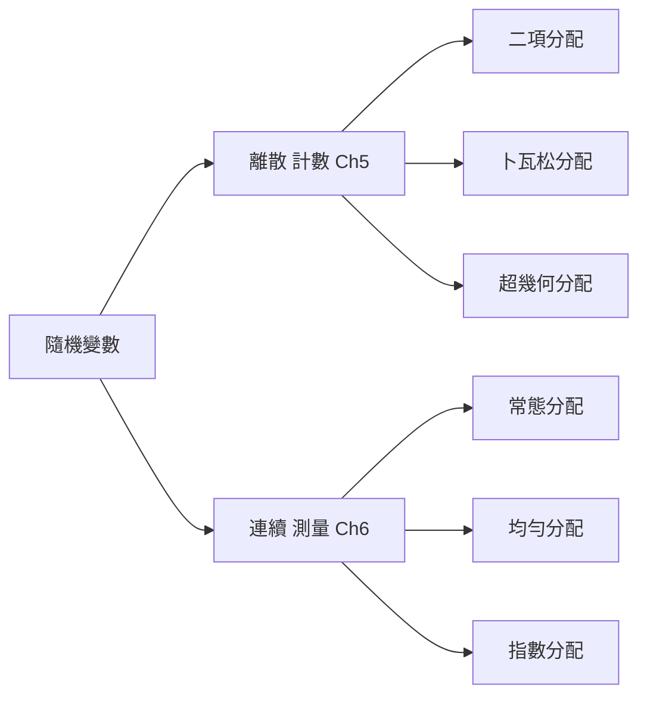
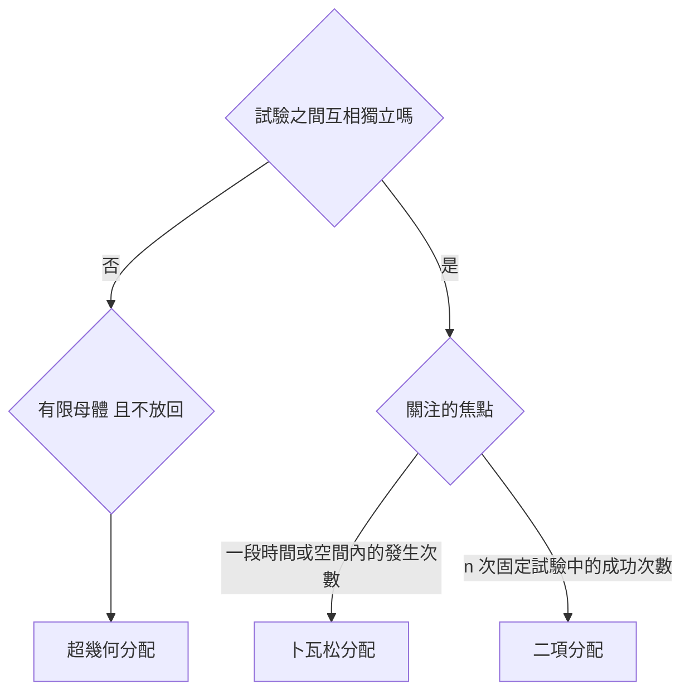

import ExpectationTable from "../_components/ExpectationTable.tsx";
import DiscreteDistExplorer from "../_components/DiscreteDistExplorer.tsx";
import DrawSteps from "../_components/DrawSteps.tsx";

## 名詞表 {#glossary}

本章出現的名詞與符號，詳細說明見對應區塊。

| 中文 | English | 描述 |
|---|---|---|
| 隨機變數 | Random Variable, $X$ | 把隨機試驗的每個結果對應到一個數值 |
| 離散隨機變數 | Discrete Random Variable | 可能值可數（有限個，或 0、1、2… 無限但可數），靠**計數**產生 |
| 連續隨機變數 | Continuous Random Variable | 可能值是一個區間，靠**測量**產生（時間、重量） |
| 機率分配 | Probability Distribution | 列出隨機變數每個可能值與其機率 $P(x)$ |
| 期望值 | Expected Value, $E(X)$ | $\sum xP(x)$，長期重複試驗的平均，即母體平均數 $\mu$ |
| 變異數 | Variance, $Var(X)$ | $\sum(x-\mu)^2P(x)$，分配的分散程度 |
| 標準差 | Standard Deviation, $\sigma_x$ | $\sqrt{Var(X)}$，衡量風險（結果的不確定性） |
| 大數法則 | Law of Large Numbers | 試驗重複越多次，平均結果越接近期望值 |
| 二項分配 | Binomial Distribution | $n$ 次獨立試驗中恰好 $x$ 次成功的機率分配 |
| 成功／失敗 | Success / Failure | 每次試驗的兩種結果；「成功」只是我們關注的事件，不一定是好事 |
| 成功機率 | $p$ | 每次試驗成功的機率，固定不變 |
| 失敗機率 | $q=1-p$ | 每次試驗失敗的機率 |
| 組合數 | Combinations, $C(n,x)$ | 從 $n$ 個中選出 $x$ 個的方法數 $\frac{n!}{x!(n-x)!}$ |
| 階乘 | Factorial, $n!$ | $n\times(n-1)\times\cdots\times1$，規定 $0!=1$ |
| 累加機率 | Cumulative Probability | $P(X\le x)$，附錄表直接給的值 |
| 餘補法則 | Complement Rule | $P(X\ge x)=1-P(X\le x-1)$ |
| 卜瓦松分配 | Poisson Distribution | 一段時間或空間內，稀有事件發生次數的分配 |
| 平均發生率 | $\lambda$ (lambda) | 單位區段內的平均發生次數 |
| 區段數 | $t$ | 感興趣的區段長度（幾個單位） |
| 預期次數 | $\lambda t$ | 整個區段的期望發生次數，也是變異數 |
| 超幾何分配 | Hypergeometric Distribution | 有限母體**不放回**抽樣時，抽中 $x$ 個目標的分配 |
| 母體總數 | $N$ | 有限母體的大小 |
| 目標總數 | $K$（講義也寫 $X$） | 母體中具有目標特徵的數量 |
| 樣本數 | $n$ | 抽出的數量 |
| 多元超幾何分配 | Multivariate Hypergeometric | 母體分成 $k$ 類、不放回抽樣時，各類抽中數量的聯合機率 |

## 本章地圖 {#ch5-map}

第四章算單一事件的機率；第五章把「結果」變成數字（隨機變數），一次描述所有可能值的機率。原始講義：[[CH5 (1) 參考講義(1).pdf|5.1–5.2 講義]]、[[CH5 (2) 參考講義(1).pdf|卜瓦松講義]]、[[CH5 (3) 參考講義(1).pdf|超幾何講義]]。

## 隨機變數 {#random-variable}

隨機變數是把「隨機試驗的結果」對應到「數值」的橋樑。例如擲兩次硬幣，令 $X$＝正面次數：

| 結果 | (正, 正) | (正, 反) | (反, 正) | (反, 反) |
|---|---|---|---|---|
| $X$ | 2 | 1 | 1 | 0 |

兩大類：

| | 離散 Discrete | 連續 Continuous |
|---|---|---|
| 可能值 | 有限個，或 0、1、2… 可數的序列 | 無限多、不可數（一個區間） |
| 怎麼產生 | **計數** | **測量**（時間、重量、長度） |
| 例子 | 檢查 5 個產品的不良品數：0～5 | 手搖飲杯的容量：$500\le x\le700$ cc |

| 隨機試驗 | 隨機變數 $X$ | 可能值 |
|---|---|---|
| 一個銅板丟三次 | 出現正面次數 | 0, 1, 2, 3 |
| 檢查 5 個產品 | 不良品個數 | 0, 1, 2, 3, 4, 5 |
| 一小時內來店客人 | 到達的客人數 | 0, 1, 2, 3, …（無限但可數） |

離散與連續數據的區分見 [[ch2-charts#discrete-continuous|第二章]]。

## 期望值 {#expected-value}

期望值是機率分配的平均數：

$$
E(X)=\sum xP(x)
$$

每個可能值 $x$ 乘上它發生的機率 $P(x)$（當作權重）再相加，也就是**以機率加權的平均**（對照 [[ch3-descriptive#weighted-mean|加權平均數]]）。依大數法則，長期重複同一個試驗，所有結果的平均會趨近期望值，所以 $E(X)$ 就是母體平均數 $\mu$。

## 隨機變數的變異數與標準差 {#rv-variance}

$$
Var(X)=E[(X-\mu)^2]=\sum(x-\mu)^2P(x)=E(X^2)-[E(X)]^2,\qquad \sigma_x=\sqrt{Var(X)}
$$

和第三章的變異數同一個概念：離差平方的平均，只是「平均」改成以機率加權。標準差是決策中衡量**風險**的指標，越大代表結果越不確定。

## 例子：保全系統的安裝錯誤數 {#ex-security-errors}

保全公司抽檢 400 個安裝點，$X$＝每次檢查發現的錯誤數（0～3）。三步：

1. **原始頻率**：0 個錯誤 150 次、1 個 110 次、2 個 50 次、3 個 90 次。
2. **轉成機率**：用相對頻率，$P(x)=$ 次數 ÷ 400，得 0.375、0.275、0.125、0.225。
3. **算期望值**：$E(X)=0(0.375)+1(0.275)+2(0.125)+3(0.225)=1.20$。

長期下來，每個安裝點平均有 1.20 個錯誤。再算波動度：每個 $x$ 減 1.20 後平方、乘上 $P(x)$ 再相加得 1.36，$\sigma_x=\sqrt{1.36}=1.17$ 個。

<ExpectationTable datasets={[{ label: "保全安裝錯誤數", xs: [0, 1, 2, 3], weights: [150, 110, 50, 90], frequencies: true, unit: "個" }, { label: "B 供應商不良率", xs: [0.01, 0.05, 0.1, 0.15], weights: [0.3, 0.4, 0.2, 0.1], unit: "" }]} />

### 例子：燈具供應商的成本決策 {#ex-lamp-supplier .fold}

燈具貿易公司要進口 10 萬組燈具，每個不良品會增加 9.50 美元成本：

- **A 供應商**：每組比 B 便宜 1.20 美元，不良率固定 10%。
- **B 供應商**：較貴，不良率 $x$ 呈機率分配：0.01（0.3）、0.05（0.4）、0.10（0.2）、0.15（0.1）。

1. **B 的期望不良率**：$E(x)=0.01(0.3)+0.05(0.4)+0.10(0.2)+0.15(0.1)=0.058$（5.8%）。
2. **A 的總額外成本**（以 B 的單價為基準）：不良品 $100000\times0.10\times9.50=95{,}000$ 美元。
3. **B 的總額外成本**：不良品 $100000\times0.058\times9.50=55{,}100$，加上每組貴 1.20 的 $120{,}000$，共 $175{,}100$ 美元。

雖然 B 的期望不良率只有 5.8%，算上單價差後，選 A 能省下約 80,100 美元。期望值讓「不確定的不良率」可以換算成可比較的金額。

## 二項分配 {#binomial}

在 $n$ 次相同的試驗中，衡量「恰好發生 $x$ 次成功」的機率。每次試驗只有兩種結果：**成功**（機率 $p$，例如顧客購買、硬幣正面）與**失敗**（機率 $q=1-p$）。「成功」只代表我們關注的事件，例如「車子需要重新維修」也可以是成功。

### 使用二項分配的五個條件 {#binomial-conditions}

1. **兩種結果**：每次只有成功或失敗，互斥。
2. **固定次數**：試驗總次數 $n$ 事先已知且固定。
3. **互相獨立**：每次結果不影響其他次（例如抽出後放回）。
4. **機率一致**：每次成功的機率 $p$ 都相同。
5. **機率互補**：$p+q=1$。

不放回抽樣違反「獨立」與「機率一致」，但若樣本相對母體很小（例如每週 300 輛車抽 4 輛，$4/300=1.33\%$），機率幾乎不變，仍可用二項分配近似。母體小時要改用 [[#hypergeometric|超幾何分配]]。

## 組合數 {#combinations}

湖城汽車每週修 300 輛車的變速箱，10% 需要重新維修（D），90% 不需要（G）。抽 4 輛，列出所有結果，依「需重修的車數」分組：

| $x$ | 組合數 | 結果 |
|---|---|---|
| 0 | 1 | GGGG |
| 1 | 4 | DGGG, GDGG, GGDG, GGGD |
| 2 | 6 | GGDD, GDGD, DGGD, GDDG, DGDG, DDGG |
| 3 | 4 | DDDG, DDGD, DGDD, GDDD |
| 4 | 1 | DDDD |

$n=4$ 還能窮舉；$n=100$ 就不可能了，所以用組合公式直接算「從 $n$ 次中選出 $x$ 次成功」有幾種排法：

$$
C(n,x)=\frac{n!}{x!(n-x)!},\qquad C(4,2)=\frac{4!}{2!\,2!}=\frac{24}{4}=6
$$

## 二項機率公式 {#binomial-formula}

$$
P(X=x)=\underbrace{\frac{n!}{x!(n-x)!}}_{\text{組合數}}\ \underbrace{p^x\,q^{\,n-x}}_{\text{單一排法的機率}}
$$

- $p^xq^{n-x}$：**某一種**特定排法（例如 DDGG）的機率。因為各次獨立，用乘法：$x$ 次成功各乘 $p$，$n-x$ 次失敗各乘 $q$。
- $C(n,x)$：這樣的排法有幾種。每種排法機率都一樣，所以直接乘上種數。

### 例子：湖城汽車 4 輛中 2 輛需重修 {#ex-lake-city}

1. 定義變數：$n=4$、$x=2$、$p=0.10$、$q=0.90$。
2. 代入：$P(X=2)=C(4,2)(0.10)^2(0.90)^2$。
3. 展開：$6\times0.01\times0.81=0.0486$。

4 輛車中有 2 輛需要重修的機率為 4.86%。完整分配是 $P(0)=0.6561$、$P(1)=0.2916$、$P(2)=0.0486$、$P(3)=0.0036$、$P(4)=0.0001$，加起來是 1。

### 例子：業務推銷 {#ex-binomial-sales .fold}

推銷成功率 30%，拜訪 5 位顧客，恰好成功 2 次的機率？$n=5$、$p=0.3$、$q=0.7$、$x=2$：

$$
P(2)=\frac{5!}{2!\,3!}(0.3)^2(0.7)^3=10\times0.09\times0.343=0.3087
$$

約 30.87%。

### 例子：美容美髮店的退款 {#ex-binomial-refund .fold}

每位顧客要求退款的機率 20%，隨機觀察 6 位，恰好 4 位要求退款？$n=6$、$p=0.2$、$q=0.8$、$x=4$：

$$
P(4)=C(6,4)(0.2)^4(0.8)^2=15\times0.0016\times0.64=0.0154
$$

僅 1.54%，屬於極端少見的情況；真的發生時值得檢查服務是否出了問題。

## 二項分配的平均數與標準差 {#binomial-mean-sd}

$$
E(X)=\mu=np,\qquad Var(X)=npq,\qquad \sigma=\sqrt{npq}
$$

$np$ 很直觀：做 $n$ 次、每次成功機率 $p$，平均就成功 $np$ 次。

### 例子：洗衣機馬達維修 {#ex-washer .fold}

每週 50 部洗衣機進廠，馬達需重修的機率 10%。$n=50$、$p=0.1$、$q=0.9$：

- $E(X)=50\times0.1=5$ 部；
- $Var(X)=50\times0.1\times0.9=4.5$；
- $\sigma=\sqrt{4.5}=2.12$ 部。

廠長可以依期望值 5 部準備常規備品，再用標準差 2.12 抓安全庫存。

## 查二項分配表 {#binomial-table}

要算「最多幾次」（$\le$）或「至少幾次」（$\ge$）時，公式要一項一項加，很耗時。附錄的二項分配表直接給**累加機率** $P(X\le x)$：找到 $n$ 那一塊、$p$ 那一欄、$x$ 那一列。

| 問法 | 數學 | 做法 |
|---|---|---|
| 恰好、等於 | $P(X=x)$ | 公式；或查表 $P(X\le x)-P(X\le x-1)$ |
| 最多、不超過 | $P(X\le x)$ | 直接查表 |
| 至少、大於等於 | $P(X\ge x)$ | **餘補法則** $1-P(X\le x-1)$ |
| 超過、大於 | $P(X>x)$ | $1-P(X\le x)$ |

「至少」和「最多」的分界要小心：「至少 8 次」的反面是「最多 7 次」，所以查 $x=7$，不是 $x=8$。

### 例子：至少 8 次成功 {#ex-binomial-at-least .fold}

$n=11$、$p=0.45$，求 $P(X\ge8)$。表只有 $\le$，所以用反面：

$$
P(X\ge8)=1-P(X\le7)=1-0.9390=0.0610
$$

### 例子：電視收視率 {#ex-binomial-rating .fold}

某球賽宣稱有 40% 收視率。隨機抽 20 戶，只有 2 戶（含）以下在看，機率多少？

1. 定義：$n=20$、$p=0.40$，求 $P(X\le2)$。
2. 查表：$n=20$、$p=0.40$、$x=2$，得 0.0036。
3. 結論：如果收視率真的是 40%，這種結果只有 0.36% 的機會，宣稱的收視率很可疑。

### 例子：航空公司訂位系統 {#ex-binomial-airline .fold}

航空公司預估 80% 的乘客喜歡新的訂位系統。第三方隨機抽 20 位乘客，只有 12 位喜歡。

1. 假設成立時：$n=20$、$p=0.80$，期望 $\mu=20\times0.8=16$ 人喜歡，$\sigma=\sqrt{20\times0.8\times0.2}=\sqrt{3.2}\approx1.79$。
2. 查表：$P(X\le12)=0.0321$。
3. 結論：若 80% 的估計正確，觀察到 12 人或更少的機率只有 3.21%，實際結果（12）比期望（16）低了兩個多標準差。航空公司需要重新考慮這項計畫。

### 例子：五位醫生有三位推薦？ {#ex-binomial-surgery .fold}

報告聲稱「五位醫生中就有三位推薦達文西手術」（$p=0.6$）。隨機問 20 位，只有 2 位推薦。

- 若主張為真，期望 $E(X)=20\times0.6=12$ 位推薦。
- 觀察到 2 位以下的機率：$P(X\le2)=P(0)+P(1)+P(2)\approx0.000005$。

機率趨近於 0，觀察值（2）與期望值（12）落差極大，證明原報告的主張極不可靠。這就是用二項分配檢驗商業假設的邏輯：先假設主張成立，算出觀察結果有多罕見。

## 二項分配的形狀 {#binomial-shape}

- $p=0.5$：不論 $n$ 多少，分配都**對稱**、呈鐘形，中心在 $np$。
- $p$ 很小（例如 0.05）：$n$ 小時嚴重右偏；$n$ 增大後越來越接近對稱的鐘形（$n=50$ 時已很像常態）。

樣本越大，分配越接近常態，預測也越穩定。拉動 $n$、$p$ 觀察形狀，並切換「恰好／最多／至少」看深色部分怎麼變：

<DiscreteDistExplorer kind="binomial" presets={[{ label: "湖城汽車", params: { n: 4, p: 0.1 }, x: 2, mode: "eq" }, { label: "業務推銷", params: { n: 5, p: 0.3 }, x: 2, mode: "eq" }, { label: "收視率", params: { n: 20, p: 0.4 }, x: 2, mode: "le" }, { label: "航空訂位", params: { n: 20, p: 0.8 }, x: 12, mode: "le" }, { label: "至少 8 次", params: { n: 11, p: 0.45 }, x: 8, mode: "ge" }]} />

## 卜瓦松分配 {#poisson}

描述**一段時間或空間內**（一小時、一公里、一平方公尺），隨機事件**發生幾次**的分配，例如客服中心每分鐘的來電數、書店每天進門的人數。

和二項分配的關鍵差別：二項知道「試驗總數 $n$」，能數成功也能數失敗；卜瓦松**不知道試驗總數**，只能數「發生了幾次」，無法數「沒發生幾次」。例如高速公路每公里的坑洞數：我們數得出有幾個坑洞，卻沒辦法數「沒有坑洞」的次數。

### 卜瓦松的三個條件 {#poisson-conditions}

1. **平均率固定**：一個區段內的平均發生次數 $\lambda$ 固定（例：每小時平均 6 通電話）。
2. **機率均勻**：相同長度的區段，發生特定次數的機率相同（客服中心任何一小時的來電分配都一樣）。
3. **互不影響**：不重疊的區段之間，事件的發生互相獨立（上午的電話量不影響下午）。

## 卜瓦松公式與 λt {#poisson-formula}

$$
P(X=x)=\frac{(\lambda t)^x\,e^{-\lambda t}}{x!}
$$

- $\lambda$：**單位區段**的平均發生次數；$t$：感興趣的區段有幾個單位；
- $\lambda t$：整個區段的**預期發生次數**；
- $e\approx2.71828$；$x$：想求機率的發生次數。

$\lambda t$ 是先把「每單位的平均」換算到「題目問的區段」。例：每頁平均 1.5 個打字錯誤，檢查 3 頁，$\lambda t=1.5\times3=4.5$。單位要對齊：每小時 8 通電話問「1 秒內」，$t=1/3600$ 小時，$\lambda t=8/3600\approx0.0022$。

卜瓦松最獨特的性質是期望值與變異數相等：

$$
E(X)=Var(X)=\lambda t,\qquad \sigma=\sqrt{\lambda t}
$$

### 例子：每天恰好 6 封客訴 {#ex-poisson-complaints}

每天平均 4 封客訴信，某天恰好收到 6 封的機率？$\lambda t=4$、$x=6$：

$$
P(6)=\frac{4^6e^{-4}}{6!}=\frac{4096\times0.018316}{720}=\frac{75.02}{720}\approx0.1042
$$

約 10.42%。查累加表也一樣：$P(X\le6)-P(X\le5)=0.8893-0.7851=0.1042$。

## 查卜瓦松表 {#poisson-table}

附錄 C 的卜瓦松表是**累加**的 $P(X\le x)$：在表頂找 $\lambda t$ 那一欄，再找左側 $x$ 那一列。

| 問法 | 做法 |
|---|---|
| 恰好 $x$ | $P(X\le x)-P(X\le x-1)$（相減法） |
| 最多 $x$ | 直接查表 |
| 至少 $x$ | $1-P(X\le x-1)$（餘補法） |
| 超過 $x$ | $1-P(X\le x)$ |

### 例子：客服中心全解析 {#ex-poisson-call-center .fold}

每小時平均 8 通電話（$\lambda t=8$）。

- **恰好 5 通**：公式 $\dfrac{8^5e^{-8}}{5!}=\dfrac{32768\times0.000335}{120}\approx0.0916$；查表 $0.1912-0.0906=0.0916$。兩種方法相同，9.16%。
- **最多 2 通**：$P(0)+P(1)+P(2)$。$P(0)=e^{-8}\approx0.000335$，$P(1)=8\times0.000335\approx0.00268$，$P(2)=64\times0.000335/2\approx0.0107$，合計約 0.0137；查表直接得 0.0138（差異是捨入）。
- **沒有電話**：$P(0)=8^0e^{-8}/0!=e^{-8}\approx0.000335$，約 0.0335%。

### 例子：小吃攤至少賣出 12 份 {#ex-poisson-at-least .fold}

每小時平均賣 10 份（$\lambda t=10$），一小時內至少賣 12 份？表只給 $\le$，用反面「最多 11 份」：

$$
P(X\ge12)=1-P(X\le11)=1-0.6968=0.3032
$$

### 例子：打字錯誤超過 3 個 {#ex-poisson-typo .fold}

每頁平均 1.5 個錯誤，檢查 3 頁，超過 3 個錯誤的機率？

1. $\lambda t=1.5\times3=4.5$。
2. 「超過 3」的反面是「最多 3」，查表 $P(X\le3)=0.3423$。
3. $P(X>3)=1-0.3423=0.6577$。

### 例子：皮革缺點的品質管理 {#ex-poisson-leather .fold}

標準是每平方呎平均缺點不超過 5 個。檢驗 3 平方呎發現 18 個缺點，這種情況的發生機率？

1. 單位區段：1 平方呎。
2. $\lambda=5$。
3. $t=3$，預期缺點 $\lambda t=15$。
4. $P(X\ge18)=1-P(X\le17)=1-0.7489=0.2511$。

25% 的機率不算罕見，單憑這次檢驗不能斷定品質變差。

### 例子：超市結帳恰好 12 人 {#ex-poisson-checkout .fold}

$\lambda t=16$，恰好 12 人：$P(X=12)=P(X\le12)-P(X\le11)=0.1931-0.1270=0.0661$。

<DiscreteDistExplorer kind="poisson" presets={[{ label: "客訴 6 封", params: { lambda: 4, t: 1 }, x: 6, mode: "eq" }, { label: "小吃至少 12 份", params: { lambda: 10, t: 1 }, x: 12, mode: "ge" }, { label: "客服恰好 5 通", params: { lambda: 8, t: 1 }, x: 5, mode: "eq" }, { label: "打字超過 3 個", params: { lambda: 1.5, t: 3 }, x: 4, mode: "ge" }, { label: "皮革至少 18", params: { lambda: 5, t: 3 }, x: 18, mode: "ge" }]} />

## 卜瓦松與二項的關係 {#poisson-binomial}

把一段時間切成很多微小區段：每個微小區段發生超過 1 次的機率可忽略（稀有）、各區段獨立、每段發生 1 次的機率是 $\lambda t$ 除以區段數。所以當二項分配的 $n$ 很大、$p$ 很小，令 $np=\lambda t$，二項分配 $B(n,p)$ 可以用卜瓦松近似。$\lambda$ 越大，卜瓦松的形狀也越接近常態。

### 例子：咖啡店尖峰人力 {#ex-poisson-coffee .fold}

尖峰 8:00～9:00（$t=60$ 分鐘），平均每分鐘 2 人（$\lambda=2$）：

- $E(X)=\lambda t=120$ 人；
- $\sigma=\sqrt{120}\approx10.95$，約 11 人。

迷思是「期望 120 人，就安排剛好應付 120 人的人力」。現實中一小時的顧客數大多在 $120\pm11$，也就是 109 到 131 人之間；人力剛好只能應付 120 人時，顧客潮一來服務就崩潰。期望值給產能基準，標準差給彈性緩衝。

## 超幾何分配 {#hypergeometric}

二項與卜瓦松都要求**試驗互相獨立**。從**有限、較小的母體不放回**抽樣時，每抽一次，袋子裡的總數與目標比例都會改變，獨立不再成立，要改用超幾何分配。

例：10 顆球中 3 顆橘色，第一次抽中橘球的機率是 $3/10$；抽出一顆橘球不放回後，下一次只剩 $2/9$。

| | 超幾何 | 二項 |
|---|---|---|
| 抽樣方式 | 不放回 | 放回（或 $n$ 次相同試驗） |
| 獨立性 | 每次彼此不獨立 | 每次互相獨立 |
| 成功機率 | 每次會變（例如 $K/N$ 之後變 $(K-1)/(N-1)$） | 固定 $p$ |
| 適用 | 有限母體、不放回 | 無限母體或放回 |

## 超幾何公式 {#hypergeometric-formula}

$$
P(X=x)=\frac{C(K,x)\cdot C(N-K,\ n-x)}{C(N,n)}
$$

- **分母** $C(N,n)$：不分條件，從母體 $N$ 個中抽出 $n$ 個的所有方法數。
- **分子** $C(K,x)$：從 $K$ 個目標中挑出 $x$ 個的方法數；$C(N-K,n-x)$：從其餘 $N-K$ 個非目標中補滿剩下 $n-x$ 個的方法數。兩者相乘就是「恰好 $x$ 個目標」的方法數。

每一種抽法機率相等，所以「符合條件的方法數 ÷ 全部方法數」就是機率，等同第四章的 [[ch4-probability#classical-probability|古典機率]]。

### 四步驟 SOP {#hypergeometric-sop}

1. **母體與樣本**：找出 $N$ 與 $n$。
2. **感興趣的事件**：是「恰好」、「至少」還是「最多」？要不要用餘補？
3. **成功數**：母體中的目標總數 $K$，以及樣本中要的 $x$。
4. **代入公式**計算（或累加）。

### 例子：抽 6 名員工恰好 3 名女性 {#ex-hyper-women}

公司 15 名員工中 5 名女性、10 名男性，隨機挑 6 人。

1. $N=15$、$n=6$。
2. 事件：恰好 3 名女性。
3. $K=5$（女性），$x=3$；非目標 $N-K=10$，要補 $n-x=3$ 名男性。
4. 代入：

$$
P(X=3)=\frac{C(5,3)\,C(10,3)}{C(15,6)}=\frac{10\times120}{5005}\approx0.2398
$$

逐步看大寫（母體）與小寫（樣本）各是什麼：

<DrawSteps title="15 名員工抽 6 名，恰好 3 名女性" unit="人" categories={[{ label: "女性", total: 5, pick: 3 }, { label: "男性", total: 10, pick: 3 }]} symbols={[["K", "x"], ["N−K", "n−x"]]} />

若改問「至少 2 名女性」，要算 $x=2,\dots,5$ 共 4 項；改用餘補只要算 2 項：

$$
P(X\ge2)=1-P(0)-P(1)=1-\frac{C(10,6)}{5005}-\frac{5\times C(10,5)}{5005}=1-0.0420-0.2517=0.7063
$$

### 例子：品管抽檢 {#ex-hyper-qc .fold}

100 件產品中有 20 件瑕疵（良品 80），隨機抽 15 件檢驗。$N=100$、$K=20$、$n=15$：

| 問題 | 算法 | 答案 |
|---|---|---|
| 恰好 3 件瑕疵 | $C(20,3)\,C(80,12)/C(100,15)$ | 0.2711 |
| 最多 2 件瑕疵 | $P(0)+P(1)+P(2)=0.0262+0.1191+0.2363$ | 0.3816 |
| 至少 1 件瑕疵 | $1-P(0)=1-0.0262$ | 0.9738 |

講義列的中間兩項是 0.1046、0.2508，重算應為 0.1191、0.2363，總和 0.3816 相同。抽 15 件幾乎必定（97.38%）抓到瑕疵品，抽檢的偵測力很高；若允收標準是「最多 2 件」，這批貨只有約 38% 的機率被允收。

### 例子：裁員是否真的隨機 {#ex-hyper-layoff .fold}

紡織廠 30 名員工（12 女、18 男），宣稱隨機裁員 10 人，結果裁了 8 名女性。

1. $N=30$、$n=10$。
2. 事件：8 名或更多女性，$P(X\ge8)$。
3. $K=12$，$x=8,9,10$。
4. $P(8)+P(9)+P(10)=0.0025+0.0001+0.0000=0.0026$。

若真的隨機，這種結果的機率只有千分之 2.6，是極罕見的事件，勞工有很強的統計證據質疑裁員不是隨機的。

### 例子：至少 2 件 D 型樣品 {#ex-hyper-type-d .fold}

100 件樣品中 D 型 10 件，抽 15 件，至少 2 件 D 型？只關心「D 型 vs 非 D 型」，當成一般超幾何：$N=100$、$K=10$、$n=15$。

$$
P(X\ge2)=1-P(0)-P(1)=1-0.1808-0.3568=0.4625
$$

切換「對照二項」比較不放回與放回的差別：母體越小、抽樣比例越大，兩者差越多。

<DiscreteDistExplorer kind="hypergeometric" presets={[{ label: "6 人中 3 名女性", params: { N: 15, K: 5, n: 6 }, x: 3, mode: "eq" }, { label: "至少 2 名女性", params: { N: 15, K: 5, n: 6 }, x: 2, mode: "ge" }, { label: "品管最多 2 件", params: { N: 100, K: 20, n: 15 }, x: 2, mode: "le" }, { label: "裁員 8 女以上", params: { N: 30, K: 12, n: 10 }, x: 8, mode: "ge" }, { label: "D 型至少 2 件", params: { N: 100, K: 10, n: 15 }, x: 2, mode: "ge" }]} />

## 多元超幾何分配 {#multivariate-hypergeometric}

母體分成 $k$ 類（不只「目標／非目標」兩類），不放回抽 $n$ 個，求各類分別抽到 $x_1,x_2,\dots,x_k$ 個的機率：

$$
P(x_1,x_2,\dots,x_k)=\frac{C(X_1,x_1)\cdot C(X_2,x_2)\cdots C(X_k,x_k)}{C(N,n)}
$$

$X_i$ 是母體中第 $i$ 類的數量，$x_i$ 是樣本中第 $i$ 類的數量。條件是兩個加總要對上：

$$
\sum X_i=N\ (\text{各類總數加起來是母體}),\qquad \sum x_i=n\ (\text{各類抽出數加起來是樣本})
$$

分子就是每一類各自「從 $X_i$ 個中選 $x_i$ 個」再相乘。超幾何是 $k=2$ 的特例。

### 例子：二手車商 {#ex-mhyper-cars}

二手車商有 5 輛福特、4 輛通用、5 輛豐田，隨機選 5 輛，恰好 3 輛福特、2 輛通用？

1. 範圍：$N=5+4+5=14$，$n=5$。
2. 事件：$P(3,2,0)$，即福特 3、通用 2、豐田 0。
3. 對應：福特 $X_1=5,x_1=3$；通用 $X_2=4,x_2=2$；豐田 $X_3=5,x_3=0$。檢查 $3+2+0=5=n$。
4. 計算：

$$
P(3,2,0)=\frac{C(5,3)\,C(4,2)\,C(5,0)}{C(14,5)}=\frac{10\times6\times1}{2002}\approx0.0300
$$

<DrawSteps title="二手車商選 5 輛：3 福特、2 通用、0 豐田" unit="輛" categories={[{ label: "福特", total: 5, pick: 3 }, { label: "通用", total: 4, pick: 2 }, { label: "豐田", total: 5, pick: 0 }]} />

### 例子：新產品樣品 {#ex-mhyper-samples .fold}

100 件樣品：A 型 40、B 型 30、C 型 20、D 型 10。抽 15 件，恰好 5 A、4 B、3 C、3 D？檢查 $5+4+3+3=15$、$40+30+20+10=100$。

$$
P=\frac{C(40,5)\,C(30,4)\,C(20,3)\,C(10,3)}{C(100,15)}=\frac{658008\times27405\times1140\times120}{2.5334\times10^{17}}\approx0.00974
$$

<DrawSteps title="100 件樣品抽 15 件：5 A、4 B、3 C、3 D" unit="件" categories={[{ label: "A 型", total: 40, pick: 5 }, { label: "B 型", total: 30, pick: 4 }, { label: "C 型", total: 20, pick: 3 }, { label: "D 型", total: 10, pick: 3 }]} />

### 例子：飲品偏好調查 {#ex-mhyper-drinks .fold}

籃子裡有 A 品牌 5 罐、B 4 罐、C 6 罐、D 4 罐（$N=19$）。6 位顧客不放回各拿一罐：B 3 位、D 2 位、C 1 位、A 0 位。

$$
P(0,3,1,2)=\frac{C(5,0)\,C(4,3)\,C(6,1)\,C(4,2)}{C(19,6)}=\frac{1\times4\times6\times6}{27132}=\frac{144}{27132}\approx0.0053
$$

隨機選擇下 1,000 次大約只發生 5 次。如果市調中頻繁出現這種模式，代表顧客對 B 與 D 有明顯偏好。

### 例子：創意生菜餐盒 {#ex-mhyper-salad .fold}

冷藏櫃有 10 顆蘿蔓、8 顆波士頓、14 顆美生菜（$N=32$），4 位料理員各隨機拿 1 顆（$n=4$），選出 0 蘿蔓、2 波士頓、2 美生菜？

$$
P(0,2,2)=\frac{C(10,0)\,C(8,2)\,C(14,2)}{C(32,4)}=\frac{1\times28\times91}{35960}=\frac{2548}{35960}\approx0.0709
$$

## 如何選擇分配 {#choose-distribution}

| 分配 | 公式 | 期望值 | 標準差 | 關鍵字 |
|---|---|---|---|---|
| 二項 | $C(n,x)p^xq^{n-x}$ | $np$ | $\sqrt{npq}$ | 固定 $n$ 次、成功率固定、獨立 |
| 卜瓦松 | $\dfrac{(\lambda t)^xe^{-\lambda t}}{x!}$ | $\lambda t$ | $\sqrt{\lambda t}$ | 每小時、每公里、每頁的「平均次數」 |
| 超幾何 | $\dfrac{C(K,x)C(N-K,n-x)}{C(N,n)}$ | $nK/N$ | | 有限母體、不放回 |

## 自我測驗 {#self-check}

### 題目 {#self-check-questions}

1. 隨機變數 $X$ 的分配：$P(0)=0.2$、$P(1)=0.5$、$P(2)=0.3$。求 $E(X)$ 與 $Var(X)$。
2. 某產品不良率 5%，抽 10 個，恰好 1 個不良的機率？期望不良數與標準差？
3. 網站每分鐘平均 3 次點擊，求 2 分鐘內恰好 4 次點擊的機率。
4. 10 張彩券中 3 張中獎，不放回抽 2 張，恰好 1 張中獎的機率？為什麼不能用二項分配？

### 解答 {#self-check-answers .fold}

1. $E(X)=0(0.2)+1(0.5)+2(0.3)=1.1$；$Var(X)=(0-1.1)^2(0.2)+(1-1.1)^2(0.5)+(2-1.1)^2(0.3)=0.242+0.005+0.243=0.49$。
2. $P(1)=C(10,1)(0.05)(0.95)^9=10\times0.05\times0.6302=0.3151$；$\mu=10\times0.05=0.5$，$\sigma=\sqrt{10\times0.05\times0.95}=\sqrt{0.475}\approx0.689$。
3. $\lambda t=3\times2=6$；$P(4)=\dfrac{6^4e^{-6}}{4!}=\dfrac{1296\times0.002479}{24}\approx0.1339$。
4. $\dfrac{C(3,1)\,C(7,1)}{C(10,2)}=\dfrac{3\times7}{45}\approx0.4667$。母體只有 10 張、不放回，第二張的中獎機率會隨第一張改變，試驗不獨立。
