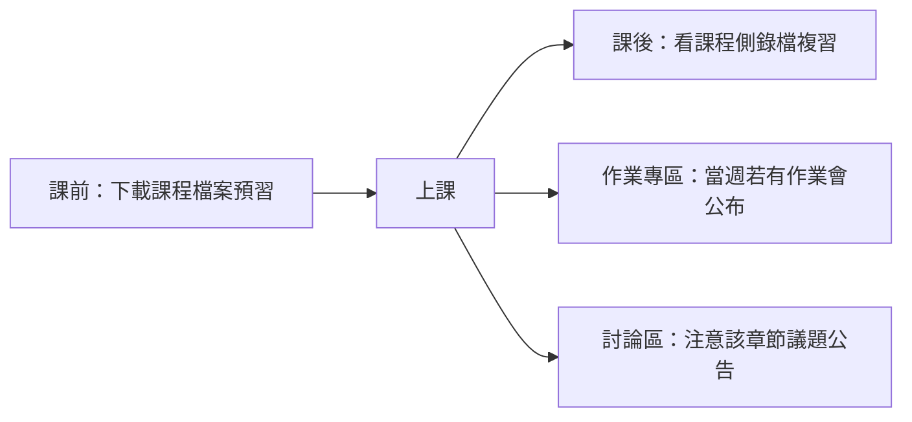

本頁集中放課程相關的行政資訊；各章筆記只放知識內容。

## 上課流程 {#workflow}

## 課程進度 {#syllabus}

| 章 | 主題 | 小節 | 筆記 |
|---|---|---|---|
| 1 | 基礎概念 | 前言、演算法、演算法的效率評估、資料表示法 | [[ch1-intro#ch1-map|第 1 章]] |
| 2 | 陣列 | 前言、宣告陣列、陣列的表示法、一維陣列的應用、二維陣列的應用 | [[ch2-array#ch2-map|第 2 章]] |
| 3 | 鏈結串列 | 前言、單向鏈結串列、雙向鏈結串列、環狀串列、多項式表示法 | [[ch3-linked-list#ch3-map|第 3 章]] |
| 4 | 堆疊與佇列 | 前言、堆疊、堆疊的應用、佇列、陣列／鏈結串列實作比較、堆疊和佇列的變形 | [[ch4-stack-queue#ch4-map|第 4 章]] |
| 5 | 遞迴 | 前言、遞迴函數的運作原理、撰寫遞迴函數的訣竅、遞迴的應用 | [[ch5-recursion#ch5-map|第 5 章]] |
| 6 | 樹狀結構 | 基本概念、樹的表示法、二元樹、二元樹的表示法、追蹤和應用、引線二元樹、二元搜尋樹／平衡樹／B 樹 | [[ch6-tree#ch6-map|第 6 章]] |

## 檔案清單 {#files}

| 章 | 投影片 | 習題解答 |
|---|---|---|
| 1 | [[_pdf/Chap01-資料結構簡介.pdf|Chap01 資料結構簡介]] | [[_pdf/習題解答-ch01.pdf|習題解答 ch01]] |
| 2 | [[_pdf/Chap02-陣列結構.pdf|Chap02 陣列結構]] | [[_pdf/習題解答-ch02(更新).pdf|習題解答 ch02]] |
| 3 | [[_pdf/Chap03-鏈結串列結構.pdf|Chap03 鏈結串列結構]] | [[_pdf/習題解答-ch03(更新).pdf|習題解答 ch03]] |
| 4 | [[_pdf/Chap04-堆疊和佇列.pdf|Chap04 堆疊和佇列]] | [[_pdf/習題解答-ch04.pdf|習題解答 ch04]] |
| 5 | [[_pdf/Chap05-遞迴.pdf|Chap05 遞迴]] | [[_pdf/習題解答-ch05.pdf|習題解答 ch05]] |
| 6 | [[_pdf/Chap06-樹狀結構.pdf|Chap06 樹狀結構]] | [[_pdf/習題解答-ch06(更新).pdf|習題解答 ch06]] |

教材程式碼以 C 語言撰寫。
