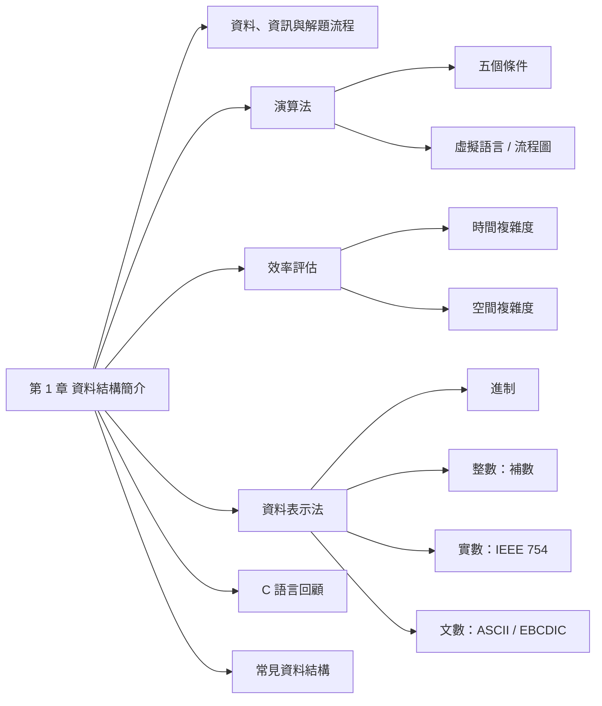
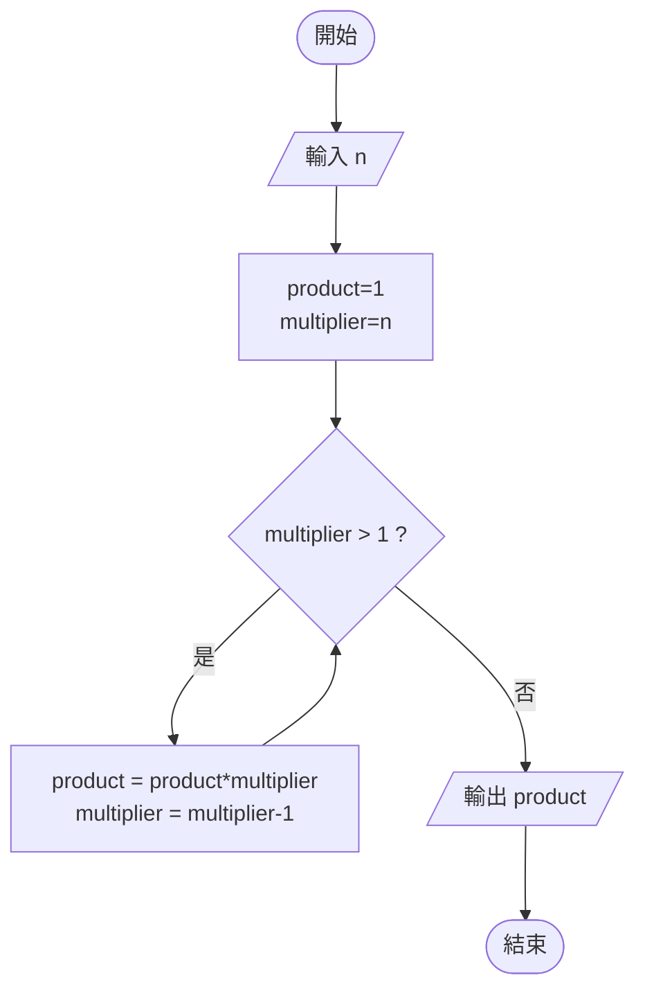
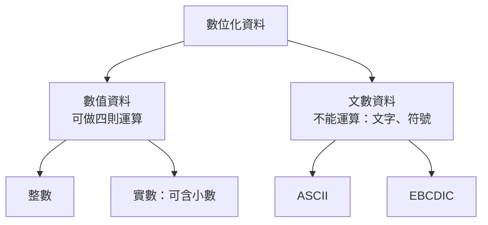

## 名詞表 {#glossary}

| 中文 | English | 描述 |
|---|---|---|
| 資料 | Data | 要讓電腦處理的原始內容 |
| 資訊 | Information | 資料經處理後產生的有意義訊息 |
| 資料結構 | Data Structure | 在程式中表示、組織資料的方法 |
| 演算法 | Algorithm | 解決問題的一系列明確、有限步驟 |
| 虛擬語言 | Pseudo Language | 接近英文、描述演算法用的非正式語法 |
| 時間複雜度 | Time Complexity | 程式需執行的指令數隨輸入量 $n$ 的成長 |
| 空間複雜度 | Space Complexity | 程式需要的記憶體空間 |
| 活動紀錄 | Activation Record | 函數呼叫時存在執行時堆疊上的資料 |
| 假數 | Mantissa | 浮點數科學記號中小數點後的部分 |

## 本章地圖 {#ch1-map}



## 資料與資訊 {#data-information}


例：全班 60 人的身高是**資料**，算出來的平均身高是**資訊**。

用電腦處理資料的兩種角色：

| 角色 | 做法 |
|---|---|
| 應用程式使用者 Application User | 用現成套裝軟體（如 Word）處理資料 |
| 程式撰寫者 Programmer | 針對問題自行寫程式解決 |

## 解題流程 {#problem-solving}


**資料結構**就是在「把演算法寫成程式」時用來表示資料的方法。同一份資料有多種表示法，選得好可以讓程式跑得更快或更省記憶體。

## 演算法的五個條件 {#algorithm-criteria}

**演算法**是解決給定問題的一系列解題程序，必須滿足：

| 條件 | 意義 |
|---|---|
| 輸入 | 可有可無（0 個以上） |
| 輸出 | **至少 1 個** |
| 有限性 | 在有限步驟內結束 |
| 明確性 | 每一步意義清楚、不含糊 |
| 有效性 | 執行完能真正解決問題、產生對應資訊 |

## 演算法的描述方式 {#algorithm-notation}

兩種常見方式：**虛擬語言**（Pseudo Language，接近英文的描述語法）與**流程圖**（Flow Chart，用預先定義的圖形表示流程）。

| 虛擬語言元素 | 意義 | 範例 |
|---|---|---|
| `INPUT` | 從使用者輸入 | `INPUT radius` |
| `OUTPUT` | 輸出給使用者 | `OUTPUT area` |
| `=` | 把右邊結果指定給左邊變數 | `area = PI*radius*radius` |
| `STOP` | 結束 | `STOP` |
| `IF … ELSE` | 條件成立做第一段，否則做第二段 | `IF grade<60 OUTPUT fail ELSE OUTPUT success` |
| `LOOP` | 重複固定次數 | `LOOP num times …` |
| `WHILE` | 條件成立時重複 | `WHILE classno<0 …` |

### 例子：計算 n! {#ex-factorial-pseudo .fold}

$n! = n\times(n-1)\times\cdots\times 1$，$0! = 1$。

```
STEP 1: INPUT n
STEP 2: product = 1
STEP 3: multiplier = n
STEP 4: WHILE (multiplier > 1)
          a. product = product * multiplier
          b. multiplier = multiplier - 1
STEP 5: OUTPUT product
STEP 6: STOP
```



### 例子：三數取最大值 {#ex-max-of-three .fold}

```
IF (A > B)
   IF (A > C) MAX = A ELSE MAX = C
ELSE
   IF (B > C) MAX = B ELSE MAX = C
OUTPUT MAX
```

## 時間複雜度 {#time-complexity}

程式實際執行時間受**CPU 速度、機器指令集（RISC／CISC）、編譯器**影響，所以分析時只數「**要執行的指令個數**」，記為 $T(P)$，表示它隨輸入量 $n$ 的成長速率。

**步驟計數**：每行可執行敘述的「執行次數」相加（宣告、大括號不算）。

| 程式 | 次數 |
|---|---|
| `int tempsum = 0;` | 1 |
| `for (i=0; i<n; i++)` | $n+1$（最後一次判斷失敗也算） |
| `tempsum += grades[i];` | $n$ |
| `return tempsum;` | 1 |
| **合計** | $T(P) = 2n+3$ |

## 成長速率 {#growth-rate}

常見的 $T(P)$ 形式：常數 $c$、對數 $a\log n+b$、線性 $an+b$、二次 $an^2+\cdots$、三次 $an^3+\cdots$、指數 $a^n$。$n$ 夠大時：

$$
\log n < n < n\log n < n^2 < n^3 < 2^n
$$

| $n$ | $\log n$ | $n\log n$ | $n^2$ | $n^3$ | $2^n$ |
|---|---|---|---|---|---|
| 10 | 1 | 10 | 100 | 1000 | 1024 |
| 50 | 1.70 | 84.9 | 2500 | 125000 | $1.13\times10^{15}$ |
| 100 | 2 | 200 | 10000 | $10^6$ | $1.27\times10^{30}$ |

（表中 $\log$ 以 10 為底。）指數成長在 $n$ 稍大時就無法計算完畢。

## 空間複雜度 {#space-complexity}

$$
S(P) = c + S_P(I)
$$

| 部分 | 內容 |
|---|---|
| 固定需求 $c$ | 編譯時期就決定的空間（程式碼、簡單變數、常數） |
| 變動需求 $S_P(I)$ | 依輸入實例 $I$ 而變：動態記憶體配置、遞迴時存放**活動紀錄**的執行時堆疊 |

## 資料的分類 {#data-types}



## 進制對照 {#number-bases}

| 十進制 | 二進制 | 八進制 | 十六進制 |
|---|---|---|---|
| 0–7 | 0–111 | 0–7 | 0–7 |
| 8 | 1000 | 10 | 8 |
| 9 | 1001 | 11 | 9 |
| 10 | 1010 | 12 | A |
| 11 | 1011 | 13 | B |
| 12 | 1100 | 14 | C |
| 13 | 1101 | 15 | D |
| 14 | 1110 | 16 | E |
| 15 | 1111 | 17 | F |
| 16 | 10000 | 20 | 10 |

二進制每 3 位一組轉八進制、每 4 位一組轉十六進制，例：$10101_2 = 21_{10} = 25_8 = 15_{16}$。

## 整數表示法 {#integer-representation}

| 表示法 | 負數怎麼得到 | 零的表示 |
|---|---|---|
| 符號帶大小 Sign-Magnitude | 最高位元設 1，其餘為絕對值 | 兩個（+0、−0） |
| 1 的補數 1's Complement | 正數每個位元 0↔1 反轉 | 兩個（全 0、全 1） |
| 2 的補數 2's Complement | 1 的補數再 **+1** | **一個**（全 0） |

電腦內部用 **2 的補數**：只有一種零、加減法電路最簡單、還能多表示一個負數。

| 十進制 | 符號帶大小 | 1 的補數 | 2 的補數 |
|---|---|---|---|
| +7 | 0111 | 0111 | 0111 |
| +1 | 0001 | 0001 | 0001 |
| +0 | 0000 | 0000 | 0000 |
| −0 | 1000 | 1111 | — |
| −1 | 1001 | 1110 | 1111 |
| −7 | 1111 | 1000 | 1001 |
| −8 | — | — | 1000 |

## 整數的範圍 {#integer-range}

$n$ 位元 2 的補數可表示 $-2^{n-1}$ 到 $2^{n-1}-1$；無正負號可表示 $0$ 到 $2^n-1$。

| 種類 | 位元 | 範圍 |
|---|---|---|
| 短無正負號整數 `unsigned short` | 16 | $0 \sim 2^{16}-1$ |
| 長無正負號整數 `unsigned long` | 32 | $0 \sim 2^{32}-1$ |
| 短整數 `short` | 16 | $-2^{15} \sim 2^{15}-1$ |
| 長整數 `long` | 32 | $-2^{31} \sim 2^{31}-1$ |

C 語言用 `sizeof(型態)` 查看各型態佔幾個位元組。

## 實數表示法 {#floating-point}

實數先轉成二進制科學記號 $(-1)^s \times 1.m \times 2^e$，再拆成三欄存放：

| 格式 | 符號 $s$ | 指數 $e$ | 假數 $m$ |
|---|---|---|---|
| 短浮點（32 位元） | 1 位元（b31） | 8 位元（b30–b23） | 23 位元（b22–b0） |
| 長浮點（64 位元） | 1 位元（b63） | 11 位元（b62–b52） | 52 位元（b51–b0） |

- **符號**：正 0、負 1。
- **指數**：要能表示負指數，所以存「平移（偏移）後」的值。課本用 $e + 2^{t-1}$（$t$ 為指數位元數，8 位元時加 128）；正式 IEEE 754 標準加的是 $2^{t-1}-1$（127）。**考題照課本算法**。
- **假數**：只存 $1.m$ 小數點**後**的位元，前面的 1 省略。

### 例子：−23.75 轉短浮點 {#ex-float-encode .fold}

1. $23.75 = 10111.11_2 = 1.011111_2 \times 2^4$
2. 符號：負 → **1**
3. 指數：$4 + 128 = 132 = $ **10000100**
4. 假數：小數點後 **0111110…0**（補滿 23 位）

結果：`1 10000100 01111100000000000000000`

反向解碼 `1 10000101 1101110…`：符號負；指數 $133-128=5$；值 $-1.110111_2\times2^5 = -111011.1_2 = -59.5$。

## 文數資料表示法 {#character-codes}

| 編碼 | 位元 | 字元數 | 使用場合 |
|---|---|---|---|
| ASCII（美國標準資訊交換碼，ANSI 制定） | 7（後擴充為 8） | 128（8 位元 256） | 個人電腦 |
| EBCDIC | 8 | 256 | IBM、UNIVAC 等大型電腦 |

7 位元 ASCII 分成 3 個**區域位元**（b6–b4）與 4 個**數字位元**（b3–b0）。

| 字元 | ASCII（十六進制） | EBCDIC（十六進制） |
|---|---|---|
| 空白 | 20 | 40 |
| `0`–`9` | 30–39 | F0–F9 |
| `A`–`Z` | 41–5A | C1–C9、D1–D9、E2–E9 |
| `a`–`z` | 61–7A | 81–89、91–99、A2–A9 |

相鄰字母的 ASCII 碼連續：`A` = 1000001，則 `B` = 1000010。

## C 語言迴圈 {#c-loops}

| 迴圈 | 語法 | 特性 |
|---|---|---|
| `for` | `for(初值; 條件; 更新) { … }` | 次數已知時最方便 |
| `while` | `while(條件) { … }` | 先判斷再執行，可能 0 次 |
| `do while` | `do { … } while(條件);` | 先執行再判斷，**至少 1 次** |

```c
int sum = 0;
for (int i = 1; i <= 100; i++) sum += i;   /* 1+2+…+100 = 5050 */
```

## C 語言條件判斷 {#c-conditionals}

| 結構 | 用途 |
|---|---|
| `if` | 條件成立才執行 |
| `if … else` | 成立、不成立各有一段 |
| 巢狀 `if` | `if` 裡再包 `if` |
| `switch … case` | 依一個值分很多路；判斷值必須是**整數或字元**，每個 `case` 通常以 `break` 結尾，`default` 處理其他情況 |

```c
switch (ch) {
  case '0': case '1': /* … */ case '9': digits++; break;
  case ' ': case '\n': case '\t':       spaces++; break;
  default:                              others++; break;
}
```

## 常見資料結構 {#common-structures}

| 資料結構 | 生活例子 | 本課程 |
|---|---|---|
| 陣列 Array | 電影院排列整齊的座位 | [[ch2-array#ch2-map|第 2 章]] |
| 鏈結串列 Linked List | 一節節車廂串起來的火車 | [[ch3-linked-list#ch3-map|第 3 章]] |
| 堆疊 Stack | 自助餐由下往上疊的餐盤 | [[ch4-stack-queue#stack|第 4 章]] |
| 佇列 Queue | 排隊買午餐的人潮 | [[ch4-stack-queue#queue|第 4 章]] |
| 樹 Tree | 檔案目錄、族譜、賽程表 | [[ch6-tree#ch6-map|第 6 章]] |
| 圖形 Graph | 公路、鐵路、航線圖 | — |
| 排序 Sorting | 依字母排序的字典 | — |
| 雜湊 Hashing | 輸入學號直接查到電話地址 | — |
| 檔案系統 File System | 檔案室裡的學籍資料表 | — |

## 挑選資料結構的考量 {#choosing-structure}

1. 資料量大或小
2. 資料是**靜態**還是**動態**（是否常增刪、更新）
3. 資料被存取的頻率
4. 可用的記憶體大小
5. 可接受的存取時間
6. 程式是否容易撰寫
