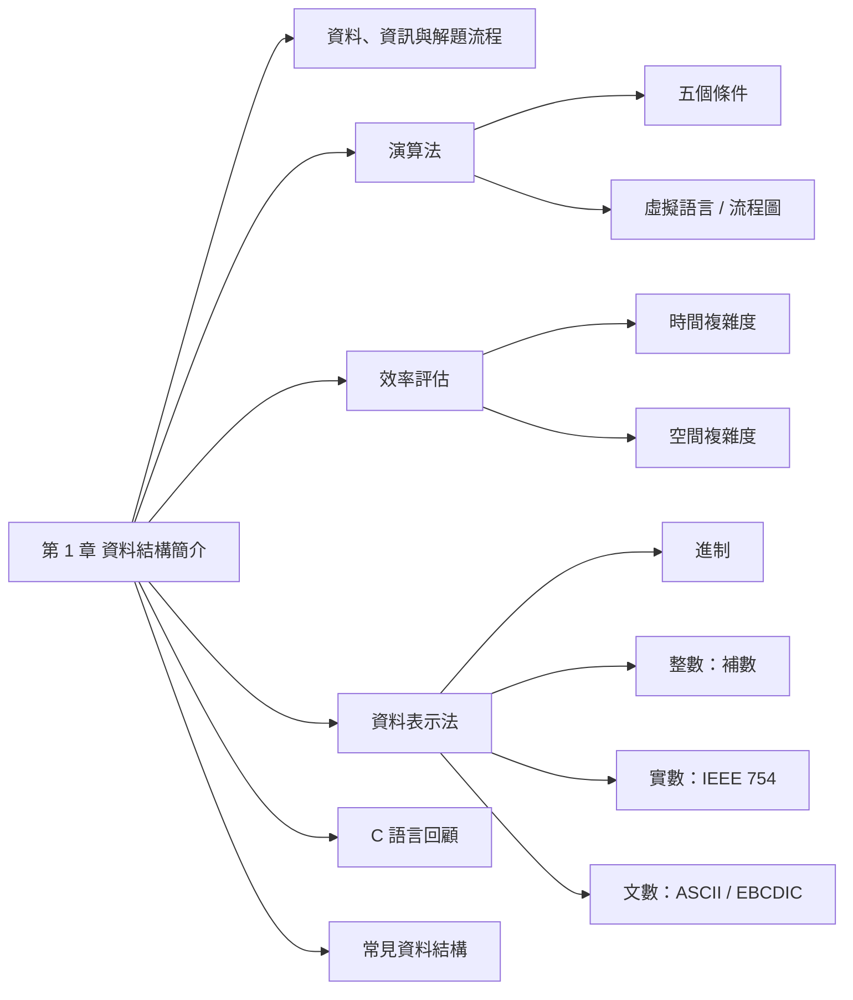
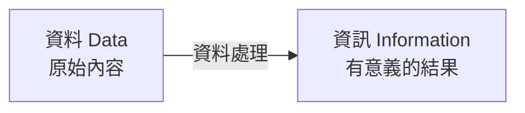
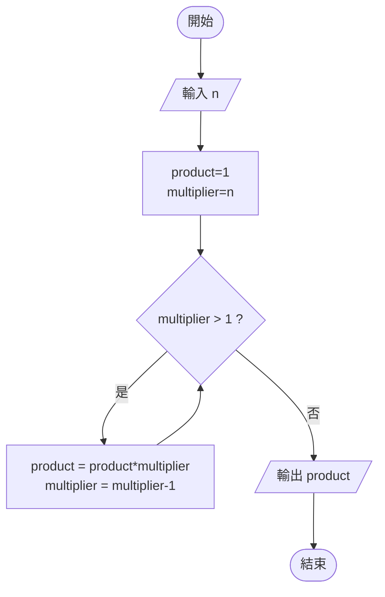
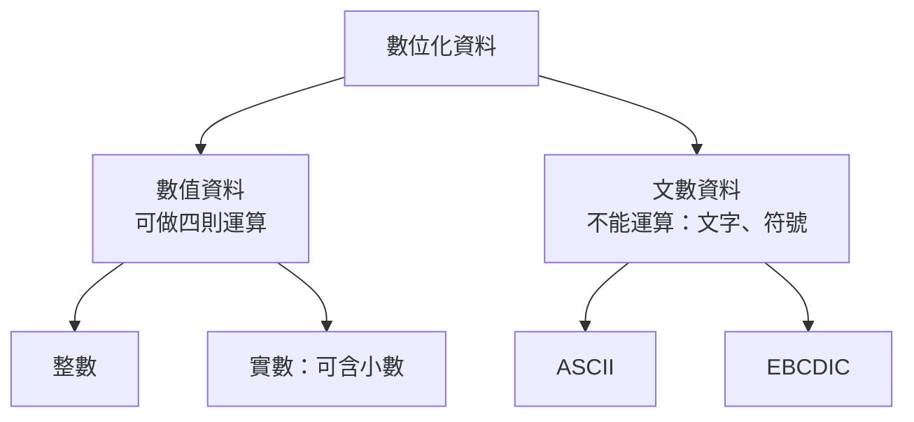

import { GrowthRace, IntBits, FloatSteps } from "./_Ch1Widgets.tsx";

## 代號意思表 {#symbol-table}

本章用到的符號。每個符號的詳細說明見對應區塊。

| 代號 | 意思 |
|---|---|
| $n$ | 輸入資料量（例如要處理幾筆資料） |
| $T(P)$ | 程式 $P$ 要執行的指令個數（時間複雜度） |
| $S(P)$ | 程式 $P$ 需要的記憶體空間（空間複雜度） |
| $c$ | 固定的空間需求（不隨輸入改變） |
| $S_P(I)$ | 隨輸入 $I$ 改變的空間需求 |
| $O(\cdot)$ | 成長速率的寫法，例 $O(n)$ 表示「跟 $n$ 成正比」 |
| $s$、$e$、$m$ | 浮點數的符號、指數、假數 |
| $x_2$、$x_8$、$x_{16}$ | 數字 $x$ 是二、八、十六進制 |

## 名詞表 {#glossary}

| 中文 | English | 描述 |
|---|---|---|
| 資料 | Data | 要讓電腦處理的原始內容 |
| 資訊 | Information | 資料經處理後產生的有意義訊息 |
| 資料結構 | Data Structure | 在程式中表示、組織資料的方法 |
| 演算法 | Algorithm | 解決問題的一系列明確、有限步驟 |
| 虛擬語言 | Pseudo Language | 接近英文、描述演算法用的非正式語法 |
| 時間複雜度 | Time Complexity | 程式需執行的指令數隨輸入量 $n$ 的成長 |
| 空間複雜度 | Space Complexity | 程式需要的記憶體空間 |
| 活動紀錄 | Activation Record | 函數呼叫時存在執行時堆疊上的資料 |
| 假數 | Mantissa | 浮點數科學記號中小數點後的部分 |

## 本章地圖 {#ch1-map}

這章是整門課的暖身：先搞清楚「資料結構」在寫程式時扮演什麼角色，再學怎麼描述一個演算法、怎麼評估它快不快，最後看電腦內部怎麼用 0 和 1 存整數、小數和文字。



## 資料與資訊 {#data-information}

**資料**是原始的內容，**資訊**是資料經過處理後得到、對人有意義的結果。

例：全班 60 人的身高是**資料**；算出來的「平均身高 168 公分」是**資訊**。



用電腦處理資料有兩種角色：

| 角色 | 做法 | 例子 |
|---|---|---|
| 應用程式使用者 Application User | 用現成的套裝軟體處理資料 | 用 Excel 算平均 |
| 程式撰寫者 Programmer | 針對問題自己寫程式解決 | 寫 C 程式讀入身高算平均 |

這門課是站在**程式撰寫者**的角度。

## 解題流程 {#problem-solving}

寫程式解決問題的流程：


**資料結構**出現在「把演算法寫成程式」這一步：資料要怎麼放進程式裡。同一份資料可以有很多種放法，例如一班的成績可以放在陣列，也可以放在鏈結串列。放法選得好，程式可以跑得更快或更省記憶體。

## 演算法的五個條件 {#algorithm-criteria}

**演算法**就是解決問題的步驟，像食譜一樣。但不是隨便寫幾個步驟都算，必須滿足五個條件：

| 條件 | 意義 | 食譜比喻 |
|---|---|---|
| 輸入 | 可有可無（0 個以上） | 食材（有的料理不用食材也行，例如燒開水只要水龍頭） |
| 輸出 | **至少 1 個** | 一定要做出一道菜 |
| 有限性 | 在有限步驟內結束 | 不能「一直攪拌」沒有停止的時候 |
| 明確性 | 每一步意義清楚、不含糊 | 不能寫「鹽加適量」，要寫「鹽 5 克」 |
| 有效性 | 每一步都做得到，做完能真正解決問題 | 不能寫「把蛋變回生的」 |

**最常考**：輸入可以是 0 個，輸出至少要 1 個。

## 演算法的描述方式 {#algorithm-notation}

寫好演算法要記錄下來，常見兩種：

- **虛擬語言**（Pseudo Language）：用接近英文的語法寫，不用管任何程式語言的細節。
- **流程圖**（Flow Chart）：用規定好的圖形（菱形是判斷、平行四邊形是輸入輸出）畫出流程。

虛擬語言常用的元素：

| 元素 | 意義 | 範例 |
|---|---|---|
| `INPUT` | 從使用者輸入 | `INPUT radius` |
| `OUTPUT` | 輸出給使用者 | `OUTPUT area` |
| `=` | 把右邊結果指定給左邊變數 | `area = PI*radius*radius` |
| `STOP` | 結束 | `STOP` |
| `IF … ELSE` | 條件成立做第一段，否則做第二段 | `IF grade<60 OUTPUT fail ELSE OUTPUT success` |
| `LOOP` | 重複固定次數 | `LOOP num times …` |
| `WHILE` | 條件成立時重複 | `WHILE classno<0 …` |

### 例子：計算 n! {#ex-factorial-pseudo .fold}

$n!$ 是 1 乘到 $n$，例 $4! = 4\times3\times2\times1 = 24$，規定 $0! = 1$。

```
STEP 1: INPUT n
STEP 2: product = 1
STEP 3: multiplier = n
STEP 4: WHILE (multiplier > 1)
          a. product = product * multiplier
          b. multiplier = multiplier - 1
STEP 5: OUTPUT product
STEP 6: STOP
```



### 例子：三數取最大值 {#ex-max-of-three .fold}

```
IF (A > B)
   IF (A > C) MAX = A ELSE MAX = C
ELSE
   IF (B > C) MAX = B ELSE MAX = C
OUTPUT MAX
```

## 時間複雜度 {#time-complexity}

**問題**：怎麼比較兩個程式誰比較快？直接計時不公平，因為同一個程式在快的電腦上就跑得快，還會受 CPU、指令集（RISC／CISC）、編譯器影響。

**做法**：不計時，改**數程式要執行幾個指令**，記為 $T(P)$。重點不是確切的數字，而是**資料量 $n$ 變大時，指令數怎麼跟著變大**。

**步驟計數**：把每一行可執行敘述的「執行次數」加起來（宣告、大括號不算）。以「加總 $n$ 個成績」為例：

| 程式 | 次數 | 為什麼 |
|---|---|---|
| `int tempsum = 0;` | 1 | 只做一次 |
| `for (i=0; i<n; i++)` | $n+1$ | 判斷 $n$ 次成立，加上最後一次不成立而離開 |
| `tempsum += grades[i];` | $n$ | 迴圈裡做 $n$ 次 |
| `return tempsum;` | 1 | 只做一次 |
| **合計** | $T(P) = 2n+3$ | |

$n$ 很大時，$+3$ 和係數 2 都不重要，重要的是「跟 $n$ 成正比」，記成 $O(n)$。

## 成長速率 {#growth-rate}

不同演算法的 $T(P)$ 有不同的「形狀」：

| 形狀 | 寫法 | 白話 | 例子 |
|---|---|---|---|
| 常數 | $c$ | 不管資料多少都一樣快 | 用索引取陣列元素 |
| 對數 | $\log n$ | 資料變 2 倍，只多 1 步 | 二元搜尋 |
| 線性 | $n$ | 資料變 2 倍，時間變 2 倍 | 循序搜尋 |
| | $n\log n$ | 比線性慢一點 | 快速的排序法 |
| 二次 | $n^2$ | 資料變 2 倍，時間變 4 倍 | 氣泡排序 |
| 三次 | $n^3$ | 資料變 2 倍，時間變 8 倍 | 矩陣相乘 |
| 指數 | $2^n$ | 資料**多 1 筆**，時間就變 2 倍 | 列出所有子集合 |

$n$ 夠大時：

$$
\log n < n < n\log n < n^2 < n^3 < 2^n
$$

拖動 $n$ 看看差距有多大（假設電腦每秒做 100 萬步）：

<GrowthRace />

課本的表（$\log$ 以 10 為底）：

| $n$ | $\log n$ | $n\log n$ | $n^2$ | $n^3$ | $2^n$ |
|---|---|---|---|---|---|
| 10 | 1 | 10 | 100 | 1000 | 1024 |
| 50 | 1.70 | 84.9 | 2500 | 125000 | $1.13\times10^{15}$ |
| 100 | 2 | 200 | 10000 | $10^6$ | $1.27\times10^{30}$ |

結論：指數成長在 $n$ 稍大時就算不完，換再快的電腦也沒用。所以挑演算法時先看成長速率。

## 空間複雜度 {#space-complexity}

除了時間，也要看程式**佔多少記憶體**，記為 $S(P)$，分成兩部分：

$$
S(P) = c + S_P(I)
$$

| 部分 | 白話 | 內容 |
|---|---|---|
| 固定需求 $c$ | 不管輸入什麼都要這麼多 | 程式碼本身、簡單變數、常數，編譯時就決定 |
| 變動需求 $S_P(I)$ | 會隨輸入 $I$ 改變 | 執行時動態要的記憶體；遞迴時堆疊上存的**活動紀錄**（遞迴越深，用越多） |

分析時主要看變動的那部分。

## 資料的分類 {#data-types}

電腦裡的資料分兩大類：能做加減乘除的**數值資料**，和只是符號、不能運算的**文數資料**（例如學號 "A123" 不會拿來相加）。



## 進制對照 {#number-bases}

電腦只認得 0 和 1（二進制）。二進制寫起來太長，所以常用八進制、十六進制當縮寫。十六進制不夠用的數字用 A–F 表示 10–15。

| 十進制 | 二進制 | 八進制 | 十六進制 |
|---|---|---|---|
| 0–7 | 0–111 | 0–7 | 0–7 |
| 8 | 1000 | 10 | 8 |
| 9 | 1001 | 11 | 9 |
| 10 | 1010 | 12 | A |
| 11 | 1011 | 13 | B |
| 12 | 1100 | 14 | C |
| 13 | 1101 | 15 | D |
| 14 | 1110 | 16 | E |
| 15 | 1111 | 17 | F |
| 16 | 10000 | 20 | 10 |

**快速轉換**：二進制從右邊開始，**每 3 位一組**轉八進制、**每 4 位一組**轉十六進制（因為 $2^3 = 8$、$2^4 = 16$）。

例：$10101_2$

- 十進制：$16 + 4 + 1 = 21$
- 八進制：分成 10 | 101 → 2 | 5 → $25_8$
- 十六進制：分成 1 | 0101 → 1 | 5 → $15_{16}$

## 整數表示法 {#integer-representation}

**問題**：電腦只有 0 和 1，沒有負號，負數要怎麼存？三種做法都用**最左邊的位元當符號**（0 正、1 負）。正數三種寫法都一樣，差別只在負數：

| 表示法 | 負數怎麼得到 | 例：−5（4 位元） | 零的表示 |
|---|---|---|---|
| 符號帶大小 Sign-Magnitude | 最左位設 1，其餘照抄絕對值 | 1101 | 兩個（+0、−0） |
| 1 的補數 1's Complement | 正數每個位元 0↔1 反轉 | 1010 | 兩個（全 0、全 1） |
| 2 的補數 2's Complement | 1 的補數再 **+1** | 1011 | **一個**（全 0） |

**讀負數**時反過來做：2 的補數看到最左位是 1，就「反轉再 +1」得到絕對值。

點位元看同一串 0/1 在不同表示法下代表多少：

<IntBits />

電腦內部用 **2 的補數**，理由：只有一種零、加減法可以用同一個電路、還能多表示一個負數。

| 十進制 | 符號帶大小 | 1 的補數 | 2 的補數 |
|---|---|---|---|
| +7 | 0111 | 0111 | 0111 |
| +1 | 0001 | 0001 | 0001 |
| +0 | 0000 | 0000 | 0000 |
| −0 | 1000 | 1111 | — |
| −1 | 1001 | 1110 | 1111 |
| −7 | 1111 | 1000 | 1001 |
| −8 | — | — | 1000 |

## 整數的範圍 {#integer-range}

$n$ 個位元共有 $2^n$ 種組合：

- **無正負號**：全部拿來表示 0 以上的數，範圍 $0$ 到 $2^n-1$。
- **2 的補數**：一半給負數、一半給 0 和正數，範圍 $-2^{n-1}$ 到 $2^{n-1}-1$（負數多一個，因為 0 佔了正數那邊的一個位置）。

例：4 位元無正負號 0 到 15；2 的補數 −8 到 7。

| 種類 | 位元 | 範圍 |
|---|---|---|
| 短無正負號整數 `unsigned short` | 16 | $0 \sim 2^{16}-1$（0 到 65535） |
| 長無正負號整數 `unsigned long` | 32 | $0 \sim 2^{32}-1$ |
| 短整數 `short` | 16 | $-2^{15} \sim 2^{15}-1$（−32768 到 32767） |
| 長整數 `long` | 32 | $-2^{31} \sim 2^{31}-1$ |

C 語言用 `sizeof(型態)` 查看各型態佔幾個位元組。

## 實數表示法 {#floating-point}

**想法**：和科學記號一樣。$6{,}020{,}000$ 可以寫成 $6.02\times10^6$，只要記「6.02」和「6」。二進制也一樣，把數字寫成 $1.\text{某某}\times2^{\text{幾次方}}$，再把三個部分分開存：

| 部分 | 存什麼 | 短浮點（32 位元） | 長浮點（64 位元） |
|---|---|---|---|
| 符號 $s$ | 正 0、負 1 | 1 位元 | 1 位元 |
| 指數 $e$ | 2 的幾次方 | 8 位元 | 11 位元 |
| 假數 $m$ | 「1.」後面的部分 | 23 位元 | 52 位元 |

兩個細節：

- **假數**：二進制科學記號的開頭一定是「1.」，每個數都一樣，所以 1 省略不存，只存小數點後面。
- **指數**：指數可能是負的（很小的數），為了只用正數存，先加上一個固定值再存。課本加 $2^{t-1}$（$t$ 為指數位元數，8 位元就是加 128）；正式 IEEE 754 標準加 $2^{t-1}-1$（127）。**考題照課本加 128**。

選一個數字看它怎麼一步步變成 32 個位元：

<FloatSteps />

### 例子：−23.75 轉短浮點 {#ex-float-encode .fold}

1. $23.75 = 10111.11_2 = 1.011111_2 \times 2^4$
2. 符號：負 → **1**
3. 指數：$4 + 128 = 132 = $ **10000100**
4. 假數：小數點後 **0111110…0**（補滿 23 位）

結果：`1 10000100 01111100000000000000000`

反向解碼 `1 10000101 1101110…`：符號負；指數 $133-128=5$；值 $-1.110111_2\times2^5 = -111011.1_2 = -59.5$。

## 文數資料表示法 {#character-codes}

文字沒辦法直接存，所以給每個字元一個編號（編碼），存的是編號。

| 編碼 | 位元 | 字元數 | 使用場合 |
|---|---|---|---|
| ASCII（美國標準資訊交換碼，ANSI 制定） | 7（後擴充為 8） | 128（8 位元 256） | 個人電腦 |
| EBCDIC | 8 | 256 | IBM、UNIVAC 等大型電腦 |

7 位元 ASCII 分成 3 個**區域位元**（b6–b4，分辨是數字、大寫還是小寫）與 4 個**數字位元**（b3–b0，同一區內的第幾個）。

| 字元 | ASCII（十六進制） | EBCDIC（十六進制） |
|---|---|---|
| 空白 | 20 | 40 |
| `0`–`9` | 30–39 | F0–F9 |
| `A`–`Z` | 41–5A | C1–C9、D1–D9、E2–E9 |
| `a`–`z` | 61–7A | 81–89、91–99、A2–A9 |

ASCII 中相鄰字母的編碼連續：`A` = 1000001（65），則 `B` = 1000010（66）。大小寫差 $20_{16}$ = 32：`a` = 97。

## C 語言迴圈 {#c-loops}

| 迴圈 | 語法 | 特性 | 適合 |
|---|---|---|---|
| `for` | `for(初值; 條件; 更新) { … }` | 三件事寫在一起 | 次數已知 |
| `while` | `while(條件) { … }` | 先判斷再執行，可能 0 次 | 次數未知 |
| `do while` | `do { … } while(條件);` | 先執行再判斷，**至少 1 次** | 至少要做一次（例：先讀輸入再檢查） |

```c
int sum = 0;
for (int i = 1; i <= 100; i++) sum += i;   /* 1+2+…+100 = 5050 */
```

## C 語言條件判斷 {#c-conditionals}

| 結構 | 用途 |
|---|---|
| `if` | 條件成立才執行 |
| `if … else` | 成立、不成立各有一段 |
| 巢狀 `if` | `if` 裡再包 `if` |
| `switch … case` | 依一個值分很多路；判斷值必須是**整數或字元**，每個 `case` 通常以 `break` 結尾（不寫會繼續執行下一個 case），`default` 處理其他情況 |

```c
switch (ch) {
  case '0': case '1': /* … */ case '9': digits++; break;
  case ' ': case '\n': case '\t':       spaces++; break;
  default:                              others++; break;
}
```

## 常見資料結構 {#common-structures}

| 資料結構 | 生活例子 | 特色 | 本課程 |
|---|---|---|---|
| 陣列 Array | 電影院排列整齊的座位 | 有編號，直接跳到第幾個 | [[ch2-array#ch2-map\|第 2 章]] |
| 鏈結串列 Linked List | 一節節車廂串起來的火車 | 插入刪除只改連結 | [[ch3-linked-list#ch3-map\|第 3 章]] |
| 堆疊 Stack | 自助餐由下往上疊的餐盤 | 後進先出 | [[ch4-stack-queue#stack\|第 4 章]] |
| 佇列 Queue | 排隊買午餐的人潮 | 先進先出 | [[ch4-stack-queue#queue\|第 4 章]] |
| 樹 Tree | 檔案目錄、族譜、賽程表 | 上下從屬、分岔 | [[ch6-tree#ch6-map\|第 6 章]] |
| 圖形 Graph | 公路、鐵路、航線圖 | 任意連接的網路 | — |
| 排序 Sorting | 依字母排序的字典 | 排好才好找 | — |
| 雜湊 Hashing | 輸入學號直接查到電話地址 | 用算的直接找到位置 | — |
| 檔案系統 File System | 檔案室裡的學籍資料表 | 存在硬碟上的大量資料 | — |

## 挑選資料結構的考量 {#choosing-structure}

沒有一種資料結構永遠最好，要看情況選：

1. 資料量大或小
2. 資料是**靜態**還是**動態**（是否常增刪、更新）：常增刪 → 鏈結串列；很少變 → 陣列
3. 資料被存取的頻率
4. 可用的記憶體大小
5. 可接受的存取時間
6. 程式是否容易撰寫
