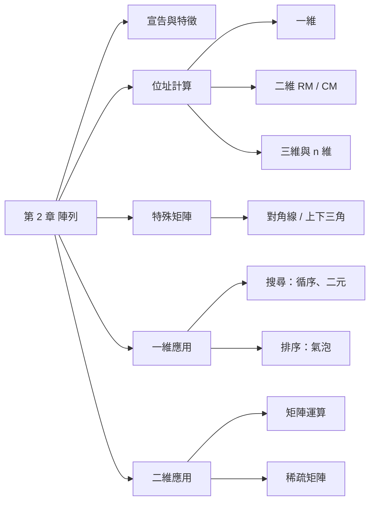
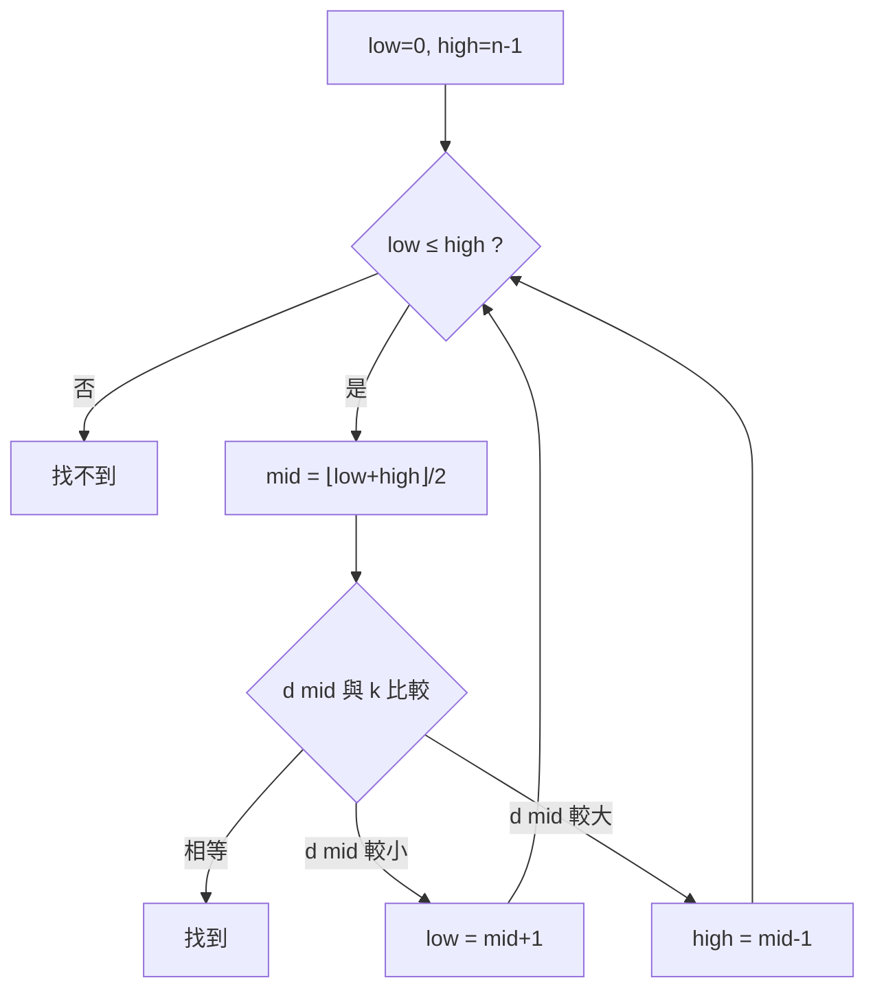

## 名詞表 {#glossary}

| 中文 | English | 描述 |
|---|---|---|
| 索引 | Index | 存取陣列元素用的編號，C 從 0 開始 |
| 以列為主 | Row Major | 一列存完再存下一列（C 語言） |
| 以行為主 | Column Major | 一行存完再存下一行（FORTRAN） |
| 下三角矩陣 | Lower Triangular Matrix | 對角線以上（不含）皆為 0 的方陣 |
| 上三角矩陣 | Upper Triangular Matrix | 對角線以下（不含）皆為 0 的方陣 |
| 稀疏矩陣 | Sparse Matrix | 大部分元素為 0（或沒有資料）的矩陣 |
| 鍵 | Key | 排序或搜尋時用來比較的資料項 |

## 本章地圖 {#ch2-map}



## 陣列的特徵 {#array-features}

- 多個**相同資料型態**的元素，元素個數即陣列大小。
- 可以是一維、二維、三維……多維。
- 配置在**連續**記憶體，所以用位址公式就能算出任一元素位置，透過**索引**可直接存取（隨機存取）。

宣告時要定義：資料型態、名稱、維度（`[]` 個數）、各維大小、初值（可省略）。

```c
int grades[6] = {83, 75, 92, 74, 88, 93};   /* 一維 */
int grades2[50][6];                          /* 二維：50 人 × 6 次成績 */
```

## 一維陣列位址 {#address-1d}

起始位址 $\alpha$、每個元素 $z$ 位元組：

$$
\text{Loc}(A[i]) = \alpha + i\cdot z
$$

索引範圍是 $A[f:t]$（下界 $f$ 不是 0）時：

$$
\text{Loc}(A[i]) = \alpha + (i-f)\cdot z
$$

已知某元素 $A[k]$ 的位址時，直接以它為基準：$\text{Loc}(A[i]) = \text{Loc}(A[k]) + (i-k)z$。

### 例子：一維位址 {#ex-address-1d .fold}

1. $A$ 起始 1000、每元素 2 bytes：$\text{Loc}(A[7]) = 1000 + 7\times2 = 1014$
2. $d[10]$ 在 2000、每元素 4 bytes：$\text{Loc}(d[88]) = 2000 + (88-10)\times4 = 2312$
3. $A[-15:25]$ 起始 123、每元素 4 bytes：$\text{Loc}(A[3]) = 123 + (3-(-15))\times4 = 195$

## 以列為主與以行為主 {#row-column-major}

二維陣列 $B[m][n]$（$m$ 列、$n$ 行）要攤平成一維存放，有兩種順序。以 $B[2][3]$ 為例：

| 存放順序 | 1 | 2 | 3 | 4 | 5 | 6 |
|---|---|---|---|---|---|---|
| 以列為主 RM | $B_{00}$ | $B_{01}$ | $B_{02}$ | $B_{10}$ | $B_{11}$ | $B_{12}$ |
| 以行為主 CM | $B_{00}$ | $B_{10}$ | $B_{01}$ | $B_{11}$ | $B_{02}$ | $B_{12}$ |

$$
\text{Loc}_{RM}(B[i][j]) = \alpha + (i\cdot n + j)\,z
\qquad
\text{Loc}_{CM}(B[i][j]) = \alpha + (j\cdot m + i)\,z
$$

記法：RM 前面有 $i$ 整列（每列 $n$ 個）；CM 前面有 $j$ 整行（每行 $m$ 個）。

**判斷是哪一種**：比較 $A[a][b]$ 與 $A[b][a]$（$a<b$）的位址。$A[a][b]$ 較小 → 以列為主；$A[b][a]$ 較小 → 以行為主。

## 任意上下界的二維陣列 {#address-2d-bounds}

$A[f_1:t_1][f_2:t_2]$：列數 $m = t_1-f_1+1$，行數 $n = t_2-f_2+1$，$\alpha$ 為 $A[f_1][f_2]$ 的位址。

$$
\text{Loc}_{RM}(A[i][j]) = \alpha + \big((i-f_1)\,n + (j-f_2)\big)\,z
$$
$$
\text{Loc}_{CM}(A[i][j]) = \alpha + \big((j-f_2)\,m + (i-f_1)\big)\,z
$$

### 例子：由已知位址反推 {#ex-address-2d-solve .fold}

已知 $A[1][2]$ 在 22，$A[2][4]$ 在 30，$A[4][2]$ 在 40，求 $A[5][5]$。

1. $A[2][4] < A[4][2]$ → **以列為主**。
2. 以 $A[1][2]$ 為基準：
   - $A[2][4]$：$22 + (1\cdot n + 2)z = 30 \Rightarrow nz + 2z = 8$
   - $A[4][2]$：$22 + (3n + 0)z = 40 \Rightarrow nz = 6$
   - 得 $z = 1$，$n = 6$。
3. $A[5][5] = 22 + (4\times6 + 3)\times1 = $ **49**

## 三維與 n 維陣列位址 {#address-nd}

$C[l][m][n]$（$l$ 個平面、每平面 $m$ 列 $n$ 行）：

$$
\text{Loc}_{RM}(C[i][j][k]) = \alpha + (i\,mn + j\,n + k)\,z
$$
$$
\text{Loc}_{CM}(C[i][j][k]) = \alpha + (k\,lm + j\,l + i)\,z
$$

推廣到 $D[s_1][s_2]\cdots[s_n]$：

- **RM**：第 $r$ 個索引乘上「它**右邊**所有維度大小的乘積」，$\alpha + \big(\sum_{r=1}^{n} i_r \prod_{q>r} s_q\big)z$
- **CM**：第 $r$ 個索引乘上「它**左邊**所有維度大小的乘積」，$\alpha + \big(\sum_{r=1}^{n} i_r \prod_{q<r} s_q\big)z$

## 對角線矩陣 {#diagonal-matrix}

方陣，且 $i\ne j$ 時 $v_{ij}=0$。$m\times m$ 只有 $m$ 個非零元素，用一維陣列 $X[m]$ 存：$X[i] = DM[i][i]$。

## 下三角矩陣 {#lower-triangular}

方陣，**對角線以上**（不含）全為 0。$n\times n$ 共有 $1+2+\cdots+n = \dfrac{n(n+1)}{2}$ 個可能非零元素，所以一維陣列至少要這麼大。

以列為主存放（索引從 0）：第 $i$ 列之前有 $1+2+\cdots+i = \frac{i(i+1)}{2}$ 個元素：

$$
\text{Loc}_{RM}(X_{ij}) = \alpha + \left(\frac{i(i+1)}{2} + j\right)z \qquad (i\ge j)
$$

## 上三角矩陣 {#upper-triangular}

方陣，**對角線以下**（不含）全為 0。以行為主存放時，第 $j$ 行之前有 $\frac{j(j+1)}{2}$ 個元素：

$$
\text{Loc}_{CM}(X_{ij}) = \alpha + \left(\frac{j(j+1)}{2} + i\right)z \qquad (i\le j)
$$

上三角以行為主，和下三角以列為主的公式形式相同（行列互換）。

## 一維陣列的基本應用 {#array-1d-uses}

| 用法 | 做法 |
|---|---|
| 計數器 Counter | `count[i]++` 統計第 $i$ 類出現次數 |
| 暫存 Temporary Store | 把算過的結果存起來重複使用，例：把找到的質數存進 `prime[]`，判斷新數 $x$ 時只除以已找到的質數 |
| 取代 Substitution | 用陣列存對照值取代分支，例：`suit[] = {"♠","♥","♦","♣"}` 依編號印花色 |
| 索引 Indexing | 用一個陣列的值當另一個陣列的索引，例：`count[x[i]]++` 求眾數 |

## 循序搜尋 {#sequential-search}

從第一筆比到最後一筆。資料**不需排序**；$n$ 筆最多比較 $n$ 次，平均約 $n/2$ 次，時間 $O(n)$。也適合「大於 70 的所有資料」這種找多筆的條件。

## 二元搜尋 {#binary-search}

資料**必須先排序**。每次拿中間那筆與鍵值 $k$ 比較，一次捨去一半：



最多比較約 $\lfloor\log_2 n\rfloor + 1$ 次，時間 $O(\log n)$。

### 例子：二元搜尋 120 {#ex-binary-search .fold}

$d = [12, 25, 37, 48, 62, 75, 98, 120, 146]$

| 次 | low | high | mid | d[mid] | 動作 |
|---|---|---|---|---|---|
| 1 | 0 | 8 | 4 | 62 | 62 < 120 → low = 5 |
| 2 | 5 | 8 | 6 | 98 | 98 < 120 → low = 7 |
| 3 | 7 | 8 | 7 | 120 | 找到 |

## 氣泡排序 {#bubble-sort}

由左到右比較**相鄰**兩筆，前者較大就交換。每一回合把目前最大的值「浮」到最後面：

- 第 1 回合比較 $d[0..n-1]$，最大值到 $d[n-1]$
- 第 2 回合比較 $d[0..n-2]$，次大值到 $d[n-2]$
- 共 $n-1$ 回合，比較次數 $\frac{n(n-1)}{2}$，時間 $O(n^2)$

```c
for (i = n-1; i > 0; i--)          /* 回合 */
    for (j = 0; j < i; j++)
        if (d[j] > d[j+1]) { t = d[j]; d[j] = d[j+1]; d[j+1] = t; }
```

### 例子：排序 8, 3, 5, 1 {#ex-bubble-sort .fold}

| 回合 | 過程 | 結果 |
|---|---|---|
| 1 | (8,3)換、(8,5)換、(8,1)換 | 3, 5, 1, **8** |
| 2 | (3,5)不換、(5,1)換 | 3, 1, **5, 8** |
| 3 | (3,1)換 | **1, 3, 5, 8** |

## 矩陣運算 {#matrix-ops}

| 運算 | 定義 | 條件 |
|---|---|---|
| 轉置 $M^T$ | $TM[j][i] = M[i][j]$ | $m\times n$ 變 $n\times m$ |
| 對稱矩陣 | $v_{ij} = v_{ji}$，即 $M = M^T$ | 方陣 |
| 反射（水平鏡射） | $RM[i][j] = M[i][n-1-j]$ | 每列左右顛倒 |
| 加 / 減 | $c_{ij} = a_{ij} \pm b_{ij}$ | 兩矩陣大小相同 |
| 乘積 | $c_{ij} = \sum_{k=0}^{n-1} a_{ik}\,b_{kj}$ | $A_{m\times n}\cdot B_{n\times p} = C_{m\times p}$ |

乘積需要三層迴圈，共做 $m\cdot n\cdot p$ 次乘法。

## 稀疏矩陣 {#sparse-matrix}

大多數元素為 0（或為虛值，沒有資料）。用二維陣列存很浪費，改用**三行式（3-tuple）**：每個非零元素存一列 (列, 行, 值)，第 0 列存 (總列數, 總行數, 非零個數)。

$$
M = \begin{bmatrix}
0&0&0&0&41&0\\
11&0&0&23&0&0\\
0&0&0&0&0&0\\
0&0&15&0&56&0\\
0&0&0&45&0&0
\end{bmatrix}
$$

| | 列 | 行 | 值 |
|---|---|---|---|
| 0 | 5 | 6 | 6 |
| 1 | 0 | 4 | 41 |
| 2 | 1 | 0 | 11 |
| 3 | 1 | 3 | 23 |
| 4 | 3 | 2 | 15 |
| 5 | 3 | 4 | 56 |
| 6 | 4 | 3 | 45 |

非零元素依「先列後行」排序。$p$ 個非零元素只需 $3(p+1)$ 格。三維稀疏矩陣 $m\times n\times o$ 同理改用四行式 (平面, 列, 行, 值)，第 0 列存 $(m, n, o, p)$。

鏈結版本見 [[ch3-linked-list#sparse-circular|用環狀串列表示稀疏矩陣]]。
