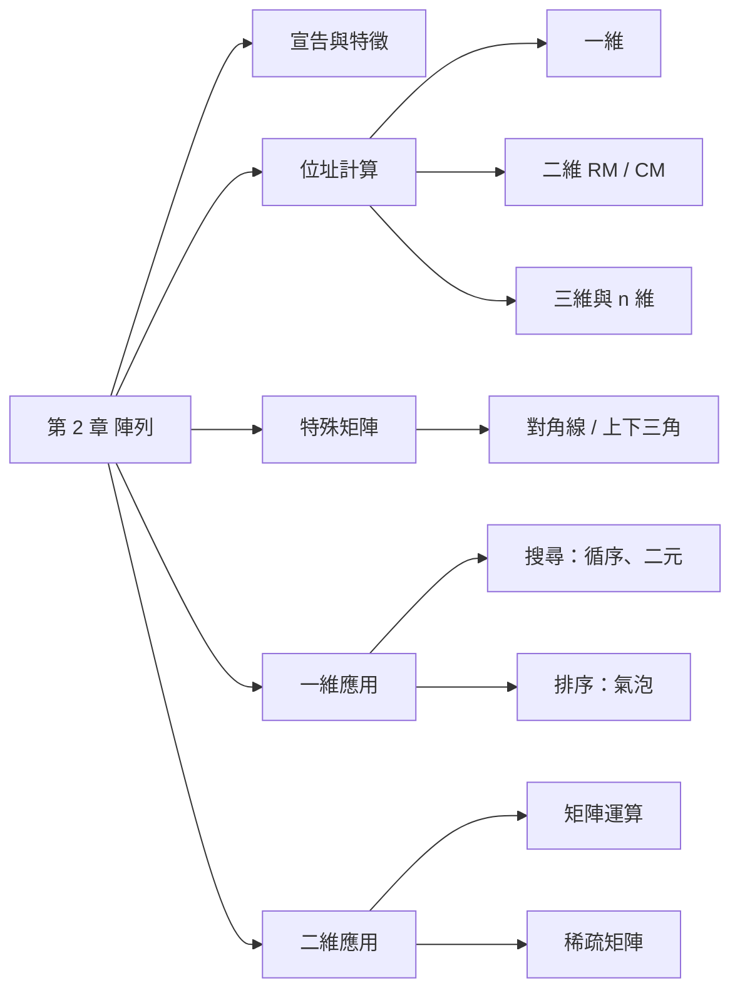
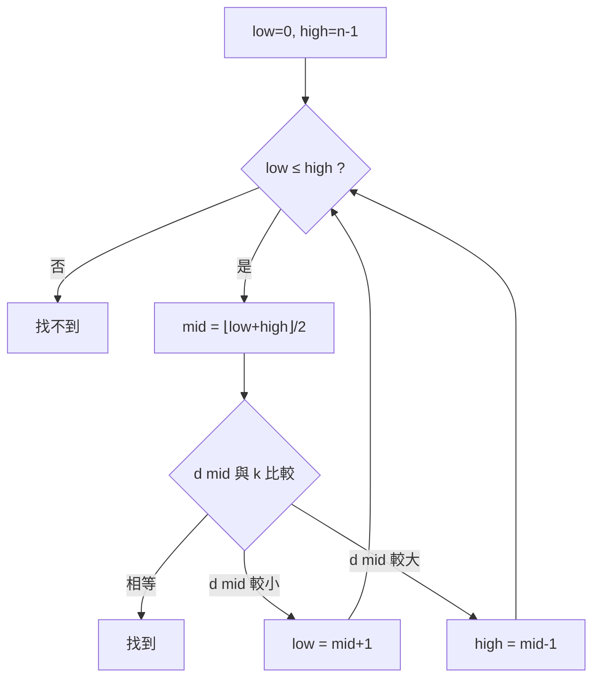

import ArrayAddress from "./_components/ArrayAddress.tsx";
import { BinarySearch, BubbleSort, TriangularPack } from "./_components/SearchSort.tsx";

## 代號意思表 {#symbol-table}

本章的位址公式都用這些符號。每個符號的詳細說明見對應區塊。

| 代號 | 意思 |
|---|---|
| $\alpha$ | 起始位址：陣列第一個元素存在記憶體的哪裡 |
| $z$ | 每個元素佔幾個位元組（bytes） |
| $i$、$j$、$k$ | 要找的元素的索引（第幾列、第幾行、第幾個平面） |
| $m$、$n$ | 二維陣列的列數、行數 |
| $f$、$t$ | 索引的下界（from）、上界（to），例 $A[f:t]$ |
| $\text{Loc}(A[i])$ | 元素 $A[i]$ 的記憶體位址 |
| RM、CM | 以列為主（Row Major）、以行為主（Column Major） |
| $p$ | 稀疏矩陣的非零元素個數 |

## 名詞表 {#glossary}

| 中文 | English | 描述 |
|---|---|---|
| 索引 | Index | 存取陣列元素用的編號，C 從 0 開始 |
| 以列為主 | Row Major | 一列存完再存下一列（C 語言） |
| 以行為主 | Column Major | 一行存完再存下一行（FORTRAN） |
| 下三角矩陣 | Lower Triangular Matrix | 對角線以上（不含）皆為 0 的方陣 |
| 上三角矩陣 | Upper Triangular Matrix | 對角線以下（不含）皆為 0 的方陣 |
| 稀疏矩陣 | Sparse Matrix | 大部分元素為 0（或沒有資料）的矩陣 |
| 鍵 | Key | 排序或搜尋時用來比較的資料項 |

## 本章地圖 {#ch2-map}

陣列是最基本的資料結構：一排連在一起的格子。這章最常考的是**位址計算**，其實所有公式都是同一個想法：「**前面排了幾個元素 × 每個元素的大小 + 起點**」。後半章是陣列的應用：搜尋、排序、矩陣。



## 陣列的特徵 {#array-features}

**比喻**：陣列像一排置物櫃，每格一樣大、緊緊排在一起，櫃子上有編號（索引）。知道第一格在哪、每格多寬，就能直接算出第 $i$ 格在哪，不用一格一格找。

- 存的是多個**相同資料型態**的元素，元素個數就是陣列大小。
- 可以是一維（一排）、二維（表格）、三維（好幾張表格疊起來）……
- 配置在**連續**記憶體，所以用位址公式就能算出任一元素的位置，透過**索引**直接存取（叫隨機存取）。

宣告時要定義：資料型態、名稱、維度（`[]` 的個數）、各維大小、初值（可省略）。

```c
int grades[6] = {83, 75, 92, 74, 88, 93};   /* 一維 */
int grades2[50][6];                          /* 二維：50 人 × 6 次成績 */
```

## 一維陣列位址 {#address-1d}

**想法**：第 $i$ 個元素前面有 $i$ 個元素（索引從 0 開始），每個佔 $z$ 個位元組，所以從起點往後跳 $i \times z$ 就到了。

例：陣列從位址 1000 開始，每個元素 2 bytes。$A[0]$ 在 1000、$A[1]$ 在 1002、$A[2]$ 在 1004……$A[7]$ 前面有 7 個，在 $1000 + 7\times2 = 1014$。

$$
\text{Loc}(A[i]) = \alpha + i\cdot z
$$

**索引不是從 0 開始時**（例 $A[f:t]$，第一個是 $A[f]$）：$A[i]$ 前面有 $i-f$ 個元素。

$$
\text{Loc}(A[i]) = \alpha + (i-f)\cdot z
$$

**已知某個元素 $A[k]$ 的位址**時，直接以它為起點：$A[i]$ 和 $A[k]$ 差 $i-k$ 個元素，$\text{Loc}(A[i]) = \text{Loc}(A[k]) + (i-k)z$。

### 例子：一維位址 {#ex-address-1d .fold}

1. $A$ 起始 1000、每元素 2 bytes：$\text{Loc}(A[7]) = 1000 + 7\times2 = 1014$
2. $d[10]$ 在 2000、每元素 4 bytes：$\text{Loc}(d[88]) = 2000 + (88-10)\times4 = 2312$
3. $A[-15:25]$ 起始 123、每元素 4 bytes：$\text{Loc}(A[3]) = 123 + (3-(-15))\times4 = 195$

## 以列為主與以行為主 {#row-column-major}

記憶體只有一排，二維的表格要先**攤平成一排**才能存。攤平有兩種順序：

- **以列為主（RM）**：像讀書一樣，第 0 列從左到右存完，再存第 1 列。C 語言用這種。
- **以行為主（CM）**：一行（直的）從上到下存完，再存下一行。FORTRAN 用這種。

以 $B[2][3]$（2 列 3 行）為例：

| 存放順序 | 1 | 2 | 3 | 4 | 5 | 6 |
|---|---|---|---|---|---|---|
| 以列為主 RM | $B_{00}$ | $B_{01}$ | $B_{02}$ | $B_{10}$ | $B_{11}$ | $B_{12}$ |
| 以行為主 CM | $B_{00}$ | $B_{10}$ | $B_{01}$ | $B_{11}$ | $B_{02}$ | $B_{12}$ |

**算位址還是同一個想法：數前面有幾個**。$B[m][n]$ 有 $m$ 列 $n$ 行：

- **RM**：$B[i][j]$ 前面有 $i$ 整列（每列 $n$ 個），再加同一列左邊的 $j$ 個，共 $i\cdot n + j$ 個。
- **CM**：$B[i][j]$ 前面有 $j$ 整行（每行 $m$ 個），再加同一行上面的 $i$ 個，共 $j\cdot m + i$ 個。

$$
\text{Loc}_{RM}(B[i][j]) = \alpha + (i\cdot n + j)\,z
\qquad
\text{Loc}_{CM}(B[i][j]) = \alpha + (j\cdot m + i)\,z
$$

點格子，看它在兩種存法中排第幾個、位址怎麼算：

<ArrayAddress />

**考題常見：判斷是哪一種**。比較 $A[a][b]$ 與 $A[b][a]$（$a<b$）的位址：$A[a][b]$ 比較前面（位址較小）→ 以列為主；$A[b][a]$ 比較前面 → 以行為主。理由：RM 先存完小的列，所以列號小的 $A[a][b]$ 先存。

## 任意上下界的二維陣列 {#address-2d-bounds}

索引不從 0 開始時，例如 $A[f_1:t_1][f_2:t_2]$（列號從 $f_1$ 到 $t_1$、行號從 $f_2$ 到 $t_2$），做法和一維一樣：**先把索引減掉下界，變成從 0 數**，再套公式。

- 列數 $m = t_1-f_1+1$，行數 $n = t_2-f_2+1$（例：2 到 5 有 4 個）。
- $\alpha$ 是第一個元素 $A[f_1][f_2]$ 的位址。
- $A[i][j]$ 換算後是第 $i-f_1$ 列、第 $j-f_2$ 行。

$$
\text{Loc}_{RM}(A[i][j]) = \alpha + \big((i-f_1)\,n + (j-f_2)\big)\,z
$$
$$
\text{Loc}_{CM}(A[i][j]) = \alpha + \big((j-f_2)\,m + (i-f_1)\big)\,z
$$

### 例子：由已知位址反推 {#ex-address-2d-solve .fold}

已知 $A[1][2]$ 在 22，$A[2][4]$ 在 30，$A[4][2]$ 在 40，求 $A[5][5]$。

1. $A[2][4]$（30）比 $A[4][2]$（40）前面 → **以列為主**。
2. 以 $A[1][2]$ 為起點，數「差幾個元素」：
   - $A[2][4]$：往下 1 列、往右 2 行，差 $1\cdot n + 2$ 個 → $(n + 2)z = 30 - 22 = 8$
   - $A[4][2]$：往下 3 列、同一行，差 $3n$ 個 → $3nz = 40 - 22 = 18$，所以 $nz = 6$
   - 代回第一式：$6 + 2z = 8$，得 $z = 1$，$n = 6$。
3. $A[5][5]$：往下 4 列、往右 3 行，差 $4\times6 + 3 = 27$ 個 → $22 + 27\times1 = $ **49**

## 三維與 n 維陣列位址 {#address-nd}

三維陣列 $C[l][m][n]$ 想成 $l$ 張表格疊起來，每張 $m$ 列 $n$ 行。

**以列為主**：先存完第 0 張表，再存第 1 張……$C[i][j][k]$ 前面有：

- $i$ 整張表，每張 $m\cdot n$ 個；
- 同一張表裡上面 $j$ 整列，每列 $n$ 個；
- 同一列左邊 $k$ 個。

$$
\text{Loc}_{RM}(C[i][j][k]) = \alpha + (i\,mn + j\,n + k)\,z
$$

**以行為主**剛好反過來，從最後一個索引開始當「最大的單位」：

$$
\text{Loc}_{CM}(C[i][j][k]) = \alpha + (k\,lm + j\,l + i)\,z
$$

**規律**：RM 是左邊的索引變化最慢（最外層），每個索引要乘上「它**右邊**所有維度大小的乘積」；CM 是右邊的索引變化最慢，每個索引乘上「它**左邊**所有維度大小的乘積」。

### n 維的一般公式 {#address-nd-general .fold}

$D[s_1][s_2]\cdots[s_n]$，要找 $D[i_1][i_2]\cdots[i_n]$：

- **RM**：$\alpha + \big(\sum_{r=1}^{n} i_r \prod_{q>r} s_q\big)z$
- **CM**：$\alpha + \big(\sum_{r=1}^{n} i_r \prod_{q<r} s_q\big)z$

$\sum$ 是全部加起來，$\prod$ 是全部乘起來。例：四維 $D[2][3][4][5]$ 以列為主，$D[1][2][3][4]$ 前面有 $1\times(3\cdot4\cdot5) + 2\times(4\cdot5) + 3\times5 + 4 = 60+40+15+4 = 119$ 個。

## 對角線矩陣 {#diagonal-matrix}

**對角線矩陣**：方陣中只有對角線（左上到右下那條，$i = j$）有值，其他全是 0。

$m\times m$ 的對角線矩陣只有 $m$ 個可能非零的元素，存成整個二維陣列太浪費，改用一維陣列 $X[m]$ 只存對角線：$X[i] = DM[i][i]$。例：$5\times5$ 只要 5 格，不用 25 格。

## 下三角矩陣 {#lower-triangular}

**下三角矩陣**：方陣中**對角線以上**（右上角那半）全是 0，只有對角線和左下角有值。

**省空間的存法**：0 的部分不存，只把左下三角形（含對角線）一列一列存進一維陣列。

**要幾格**：第 0 列有 1 個、第 1 列有 2 個……第 $n-1$ 列有 $n$ 個，總共 $1+2+\cdots+n = \dfrac{n(n+1)}{2}$ 個。例：$5\times5$ 存 15 格就好。

**$X_{ij}$ 存在第幾格**：還是數「前面有幾個」。第 $i$ 列前面有第 0 到第 $i-1$ 列，共 $1+2+\cdots+i = \frac{i(i+1)}{2}$ 個；再加上同一列左邊的 $j$ 個。

$$
\text{Loc}_{RM}(X_{ij}) = \alpha + \left(\frac{i(i+1)}{2} + j\right)z \qquad (i\ge j)
$$

點格子看它被存到一維陣列的哪一格：

<TriangularPack />

## 上三角矩陣 {#upper-triangular}

**上三角矩陣**：方陣中**對角線以下**（左下角那半）全是 0，只有對角線和右上角有值。

把下三角矩陣沿對角線翻過來就是上三角，所以存法也跟著「行列互換」：用**以行為主**一行一行存，第 $j$ 行前面有 $1+2+\cdots+j = \frac{j(j+1)}{2}$ 個，再加上同一行上面的 $i$ 個。

$$
\text{Loc}_{CM}(X_{ij}) = \alpha + \left(\frac{j(j+1)}{2} + i\right)z \qquad (i\le j)
$$

上三角以行為主，和下三角以列為主的公式形式一樣，只是 $i$、$j$ 對調。

## 一維陣列的基本應用 {#array-1d-uses}

| 用法 | 做法 | 例子 |
|---|---|---|
| 計數器 Counter | `count[i]++` 統計第 $i$ 類出現次數 | 統計 0–9 分各有幾人 |
| 暫存 Temporary Store | 把算過的結果存起來重複用 | 把找到的質數存進 `prime[]`，判斷新數時只除以已找到的質數 |
| 取代 Substitution | 用陣列存對照值，取代一長串 `if` | `suit[] = {"♠","♥","♦","♣"}`，依編號直接印花色 |
| 索引 Indexing | 用一個陣列的值當另一個陣列的索引 | `count[x[i]]++` 統計每個值出現幾次，求眾數 |

## 循序搜尋 {#sequential-search}

**最直覺的找法**：從第一筆開始一筆一筆比，直到找到或比完。

- 資料**不需要排序**。
- $n$ 筆最多比 $n$ 次，平均約 $n/2$ 次。資料變 2 倍，時間也變 2 倍，記為 $O(n)$。
- 也適合找「所有大於 70 的資料」這種要找出多筆的條件。

## 二元搜尋 {#binary-search}

**像猜數字遊戲**：1 到 100 猜一個數，最聰明的猜法是先猜 50，對方說「太大」就只剩 1–49，再猜 25……每猜一次就排除一半。

二元搜尋就是這樣：資料**必須先由小到大排好**，每次拿**中間那筆**和要找的鍵值 $k$ 比：

- 相等 → 找到了。
- 中間那筆比 $k$ 小 → 答案只可能在右半邊，左半邊丟掉。
- 中間那筆比 $k$ 大 → 答案只可能在左半邊，右半邊丟掉。

用 `low`、`high` 記住目前範圍的兩端，`mid = (low + high) / 2`（捨去小數）。範圍變空（`low` 大於 `high`）就是找不到。

<BinarySearch />

**有多快**：每比一次範圍砍半，$n$ 筆最多比約 $\lfloor\log_2 n\rfloor + 1$ 次。1000 筆最多 10 次、100 萬筆最多 20 次，記為 $O(\log n)$。



### 例子：二元搜尋 120 {#ex-binary-search .fold}

$d = [12, 25, 37, 48, 62, 75, 98, 120, 146]$

| 次 | low | high | mid | d[mid] | 動作 |
|---|---|---|---|---|---|
| 1 | 0 | 8 | 4 | 62 | 62 小於 120 → low = 5 |
| 2 | 5 | 8 | 6 | 98 | 98 小於 120 → low = 7 |
| 3 | 7 | 8 | 7 | 120 | 找到 |

## 氣泡排序 {#bubble-sort}

**想法**：由左到右比較**相鄰兩個**，左邊比較大就交換。這樣一路比過去，最大的數會像氣泡一樣一路被推到最右邊。

- 第 1 回合比完，最大的到了最後一格。
- 第 2 回合不用再管最後一格，比到倒數第二格，次大的到位。
- 共 $n-1$ 回合。

**比較次數**：第 1 回合比 $n-1$ 次、第 2 回合 $n-2$ 次……最後 1 次，總共 $\frac{n(n-1)}{2}$ 次。資料變 2 倍，時間約變 4 倍，記為 $O(n^2)$。

<BubbleSort />

```c
for (i = n-1; i > 0; i--)          /* 回合 */
    for (j = 0; j < i; j++)
        if (d[j] > d[j+1]) { t = d[j]; d[j] = d[j+1]; d[j+1] = t; }
```

### 例子：排序 8, 3, 5, 1 {#ex-bubble-sort .fold}

| 回合 | 過程 | 結果 |
|---|---|---|
| 1 | (8,3)換、(8,5)換、(8,1)換 | 3, 5, 1, **8** |
| 2 | (3,5)不換、(5,1)換 | 3, 1, **5, 8** |
| 3 | (3,1)換 | **1, 3, 5, 8** |

## 矩陣運算 {#matrix-ops}

二維陣列最常用來存矩陣。常見運算：

| 運算 | 白話 | 定義 | 條件 |
|---|---|---|---|
| 轉置 $M^T$ | 沿對角線翻過來，列變行 | $TM[j][i] = M[i][j]$ | $m\times n$ 變 $n\times m$ |
| 對稱矩陣 | 轉置後跟原本一樣 | $v_{ij} = v_{ji}$ | 方陣 |
| 反射（水平鏡射） | 每列左右顛倒 | $RM[i][j] = M[i][n-1-j]$ | |
| 加 / 減 | 同位置的數相加減 | $c_{ij} = a_{ij} \pm b_{ij}$ | 兩矩陣大小相同 |
| 乘積 | 左邊的第 $i$ 列和右邊的第 $j$ 行對應相乘再加總 | $c_{ij} = \sum_{k=0}^{n-1} a_{ik}\,b_{kj}$ | $A_{m\times n}\cdot B_{n\times p} = C_{m\times p}$ |

乘積：答案有 $m\times p$ 格，每格要做 $n$ 次乘法，所以需要三層迴圈，共 $m\cdot n\cdot p$ 次乘法。例：$\begin{bmatrix}1&2\end{bmatrix}\cdot\begin{bmatrix}3\\4\end{bmatrix} = 1\times3 + 2\times4 = 11$。

## 稀疏矩陣 {#sparse-matrix}

**稀疏矩陣**：大部分元素都是 0（或沒有資料）。例如 1000×1000 的矩陣只有 50 個非零，用二維陣列存要 100 萬格，幾乎全是 0。

**三行式（3-tuple）**：只記非零元素，每個非零元素存一列（列, 行, 值）。第 0 列放整體資訊（總列數, 總行數, 非零個數）。

$$
M = \begin{bmatrix}
0&0&0&0&41&0\\
11&0&0&23&0&0\\
0&0&0&0&0&0\\
0&0&15&0&56&0\\
0&0&0&45&0&0
\end{bmatrix}
$$

| | 列 | 行 | 值 | 讀法 |
|---|---|---|---|---|
| 0 | 5 | 6 | 6 | 5 列 6 行，6 個非零 |
| 1 | 0 | 4 | 41 | 第 0 列第 4 行是 41 |
| 2 | 1 | 0 | 11 | |
| 3 | 1 | 3 | 23 | |
| 4 | 3 | 2 | 15 | |
| 5 | 3 | 4 | 56 | |
| 6 | 4 | 3 | 45 | |

非零元素依「先列後行」排序。$p$ 個非零元素只需 $3(p+1)$ 格；上例原本 30 格，三行式 21 格，矩陣越大越稀疏就越划算。三維稀疏矩陣同理改用四行式（平面, 列, 行, 值），第 0 列存（$m, n, o, p$）。

鏈結版本見 [[ch3-linked-list#sparse-circular|用環狀串列表示稀疏矩陣]]。
