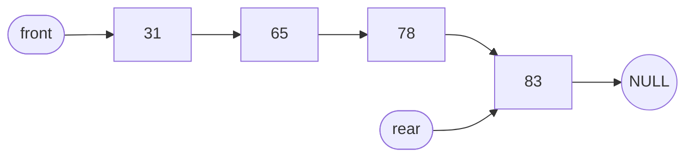

題目來源：[[_pdf/習題解答-ch03(更新).pdf|習題解答 ch03]]。概念說明見 [[ch3-linked-list#ch3-map|第 3 章 鏈結串列結構]]。

改指標的題目都用同一個口訣：**先接後面，再接前面**（先讓新節點抓住後半段，再把前面接過來，後半段才不會弄丟）。

## 陣列與單向串列處理有序資料 {#q-array-vs-list}

比較用陣列與單向鏈結串列處理有序資料的優缺點；已排序的資料存在單向串列中，適合用哪種搜尋法？

### 詳解 {#q-array-vs-list-solution .fold}

**陣列**（像一排連號座位）：

- 事先不知道資料有多少時，要先保留很大的空間，用不完就浪費。
- 插入、刪除時要把後面的資料全部往後或往前搬，費時間。

**單向串列**（像火車車廂）：

- 需要時才跟系統要一個節點（動態記憶體配置），用多少拿多少。
- 插入、刪除只要改指標，不用搬資料。

**搜尋法**：只能用**循序搜尋**，從頭一個一個往後比，比到資料值 ≥ $k$ 就可以停（因為已排序，後面只會更大）。二元搜尋不行，因為串列沒有索引，沒辦法直接跳到中間那一筆。

見 [[ch3-linked-list#array-vs-list|陣列與鏈結串列]]。

## 單向串列插入 {#q-singly-insert}

串列 `front → 10(first) → 20(second) → NULL`，`rear` 指向 20。

1. 插入 15，要改哪些指標？
2. 接著插入 5，要改哪些指標？

### 詳解 {#q-singly-insert-solution .fold}

**1. 插入 15**：資料要保持排序，15 在 10 和 20 之間，插在 first 後面。

1. `new_node->link` 指向 second（20）：先接後面，抓住 20。
2. first（10）的 link 指向 `new_node`：再接前面。

順序反了的話，first 的 link 一改，就沒有人記得 20 在哪了。

**2. 插入 5**：5 最小，要變成**第一個節點**。前面沒有節點可改，要改的是 `front`。

1. `new_node2->link` 指向 first（10）：先接後面。
2. `front` 指向 `new_node2`：再接前面。

結果：


兩次都沒插在最後面，所以 `rear` 不用動。見 [[ch3-linked-list#singly-insert|單向串列的插入]]。

## 單向串列刪除 {#q-singly-delete}

串列 `5(a) → 31(b) → 65(c) → 78(d) → 83(e) → 98(f) → NULL`，`front` 指向 a、`rear` 指向 f。

1. 刪除 98，要改哪些指標？
2. 接著刪除 5，要改哪些指標？

### 詳解 {#q-singly-delete-solution .fold}

**1. 刪除 98（最後一個）**：

- node e（83）的 link 設為 `NULL`：83 變成新的結尾。
- `rear` 改指向 node e：`rear` 原本指的 98 不見了，要跟著移。
- 釋放 node f。

**2. 刪除 5（第一個）**：

- 只要把 `front` 改指向 node b（31），31 就變成第一個。
- 釋放 node a。

結果：



見 [[ch3-linked-list#singly-delete|單向串列的刪除]]。

## 走訪單向串列 {#q-traversal}

以 C 撰寫走訪單向鏈結串列的函數 `list_traversal`（`front_` 為開端節點）。

### 詳解 {#q-traversal-solution .fold}

**思路**：用一個指標 `p` 從第一個節點出發，印出資料後沿 `link` 往下一個走，走到 `NULL` 就停。順便用 `count` 數節點個數。

`front_` 是開端節點（不存資料），所以第一個真正的節點是 `front_->link`。

```c
void list_traversal(struct node *front_) {
    int count = 0;
    struct node *p = front_->link;         /* 第一個資料節點 */
    if (p == NULL) { printf("空串列\n"); return; }
    while (p != NULL) {
        printf("第 %d 個節點：%d\n", ++count, p->data);
        p = p->link;                       /* 往下一個走 */
    }
    printf("串列長度為 %d\n", count);
}
```

## 串列合併 {#q-concatenate}

$x$：20 → 50 → 70，$y$：40 → 60 → 80，畫出合併後的 $z$。

### 詳解 {#q-concatenate-solution .fold}

**思路**：合併就是把 $y$ 整串接在 $x$ 的尾巴。

1. 從 $x$ 的第一個走到最後一個節點（70）。
2. 把 70 的 link 改指向 $y$ 的第一個節點（40）。
3. $z$ 的開頭就是 $x$ 的開頭（20），結尾是 $y$ 的結尾（80）。


注意：合併只是接起來，**不會排序**，所以 70 後面接 40。見 [[ch3-linked-list#singly-utils|串列長度、合併與釋放]]。

## 雙向串列插入與刪除 {#q-doubly}

雙向串列 `front ⇄ 5(a) ⇄ 31(b) ⇄ 65(c) ⇄ 78(d) ⇄ 83(e) ⇄ 98(f)`。

1. 插入 15，要改哪些指標？
2. 刪除 98，要改哪些指標？
3. 刪除 5，要改哪些指標？

### 詳解 {#q-doubly-solution .fold}

雙向串列每個節點有前後兩條線，所以要改的指標是單向的兩倍。

**1. 插入 15**（插在 a 和 b 之間，共 4 個指標）：

先讓新節點接上兩邊：

- `new_node` 的左鏈結 → node a
- `new_node` 的右鏈結 → node b

再讓兩邊接回新節點：

- node b 的左鏈結 → `new_node`
- node a 的右鏈結 → `new_node`（最後改，因為改了之後就不能再透過 a 找到 b）

**2. 刪除 98（最後一個）**：node e 的右鏈結設為 `NULL`，釋放 node f。98 後面沒有節點，所以不用改別人的左鏈結。

**3. 刪除 5（第一個）**：讓 a 的前後兩邊直接互相接：

- `front` 的右鏈結 → node b
- node b 的左鏈結 → `front`
- 釋放 node a

見 [[ch3-linked-list#doubly-ops|雙向串列的插入與刪除]]。

## 單向與雙向比較 {#q-singly-vs-doubly}

比較單向與雙向鏈結串列。

### 詳解 {#q-singly-vs-doubly-solution .fold}

一句話：雙向用**多一個指標的空間**，換來**前後都能走**、**斷線可以修**。

| | 單向 | 雙向 |
|---|---|---|
| 節點 | data + link | data + l_link + r_link |
| 優點 | 較省空間 | 容易找前一個和後一個節點；一個方向的鏈結斷了，可以從另一個方向走回來修復 |
| 缺點 | 鏈結斷掉時，後面的資料全部找不到、無法修復 | 較佔空間；插入刪除要改的鏈結較多 |

## 環狀單向串列插入與刪除 {#q-circular-singly}

環狀單向串列 `5(a) → 31(b) → 65(c) → 78(d) → 83(e) → 98(f) → 回到 a`，`front` 指向 a。

1. 依序插入 99，要改哪些指標？
2. 接著刪除 5，要改哪些指標？

### 詳解 {#q-circular-singly-solution .fold}

**關鍵**：環狀串列的最後一個節點指著第一個。所以動到「最後一個」或「第一個」時，都要記得這條繞回去的線。

**1. 插入 99**（最大，接在 98 後面）：

1. `new_node` 的 link → node a（先接後面：最後一個要繞回第一個）
2. node f 的 link → `new_node`（再接前面）

**2. 刪除 5（第一個）**：

1. 最後一個節點（現在是 99）的 link → node b：原本繞回 a，a 要刪了，改繞回 b。
2. `front` → node b
3. 釋放 node a


見 [[ch3-linked-list#circular-list|環狀串列]]。

## 環狀雙向串列插入與刪除 {#q-circular-doubly}

環狀雙向串列 `5(a) ⇄ … ⇄ 98(f)`，f 的右鏈結指向 a、a 的左鏈結指向 f。

1. 插入 99，要改哪些指標？
2. 接著刪除 5，要改哪些指標？

### 詳解 {#q-circular-doubly-solution .fold}

**關鍵**：環狀雙向有兩條繞回去的線（f 往右繞到 a、a 往左繞到 f），插入或刪除頭尾時兩條都要改。

**1. 插入 99**（插在 f 和 a 之間，4 個指標）：

- `new_node` 的左鏈結 → node f
- `new_node` 的右鏈結 → node a
- node f 的右鏈結 → `new_node`
- node a 的左鏈結 → `new_node`（課本解答漏列這一步）

**2. 刪除 5**（a 夾在 99 和 b 之間）：

- `new_node`（99）的右鏈結 → node b
- node b 的左鏈結 → `new_node`（課本解答漏列這一步）
- `front` → node b；釋放 node a

## 串列與陣列實作堆疊佇列 {#q-stack-impl-compare}

比較用鏈結串列與陣列實作堆疊（或佇列）的優缺點。

### 詳解 {#q-stack-impl-compare-solution .fold}

差別來自「什麼時候拿記憶體」：陣列一開始就拿好一整塊，串列每次要用才拿一格。

| | 鏈結串列 | 陣列 |
|---|---|---|
| 優點 | 不用事先決定大小，不容易滿 | 加入、刪除速度較快，程式好寫 |
| 缺點 | 每次加入、刪除都要配置／歸還記憶體，較慢 | 必須事先宣告大小，宣告太大浪費、太小會滿 |

見 [[ch4-stack-queue#array-vs-linked|陣列與鏈結串列實作比較]]。

## 稀疏矩陣三行式 {#q-sparse-3tuple}

用三行式表示下列 $5\times6$ 稀疏矩陣：

$$
\begin{bmatrix}
0&1&0&0&0&0\\
0&0&0&0&1&0\\
0&0&2&0&0&0\\
4&0&0&0&0&0\\
0&0&0&1&0&1
\end{bmatrix}
$$

### 詳解 {#q-sparse-3tuple-solution .fold}

**思路**：只記不是 0 的格子，每個記一列（列, 行, 值），從第 0 列開始由上往下、由左往右找。第一列先放整體資訊。

1. 數非零元素：第 0 列 1 個、第 1 列 1 個、第 2 列 1 個、第 3 列 1 個、第 4 列 2 個，共 6 個。
2. 第一列：（總列數 5, 總行數 6, 非零個數 6）。
3. 依序寫出每個非零元素的位置（列、行都從 0 數）：

| 列 | 行 | 值 | 說明 |
|---|---|---|---|
| 5 | 6 | 6 | 整體資訊 |
| 0 | 1 | 1 | 第 0 列第 1 行 |
| 1 | 4 | 1 | |
| 2 | 2 | 2 | |
| 3 | 0 | 4 | |
| 4 | 3 | 1 | |
| 4 | 5 | 1 | |

見 [[ch2-array#sparse-matrix|稀疏矩陣]]。

## 稀疏矩陣環狀串列 {#q-sparse-circular}

用環狀串列表示 $5\times4$ 矩陣，非零元素為 $(0,0)=1$、$(2,2)=2$、$(3,0)=5$、$(4,3)=3$；並比較三行式與環狀串列的優缺點。

### 詳解 {#q-sparse-circular-solution .fold}

**思路**：每個非零元素一個節點，同時掛在「同一列」和「同一行」兩條環狀串列上。

1. **總開頭節點**存（5, 4），並有 5 個列開頭節點、4 個行開頭節點。
2. **非零節點** 4 個：`(0,0,1)`、`(2,2,2)`、`(3,0,5)`、`(4,3,3)`。
3. **`right`（橫向）**：接到同一列的下一個非零元素。這題每列最多只有一個，所以都指回該列的開頭節點。
4. **`down`（縱向）**：接到同一行的下一個非零元素。
   - 行 0 有兩個：`(0,0,1)` → `(3,0,5)` → 回行 0 開頭。
   - 行 2、行 3 各一個：直接指回該行開頭。

| | 優點 | 缺點 |
|---|---|---|
| 三行式 | 省空間、不需指標 | 非零元素增減時要大量搬移 |
| 環狀串列 | 非零元素增減時只改指標 | 指標佔額外空間 |

見 [[ch3-linked-list#sparse-circular|用環狀串列表示稀疏矩陣]]。
