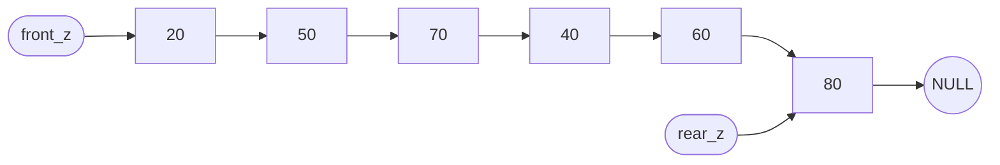
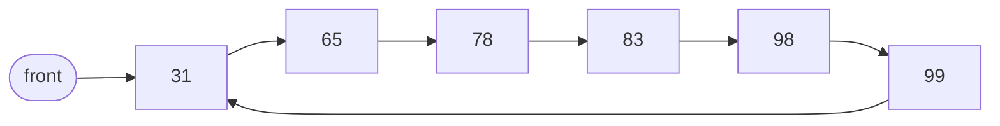

題目來源：[[_pdf/習題解答-ch03(更新).pdf|習題解答 ch03]]。概念說明見 [[ch3-linked-list#ch3-map|第 3 章 鏈結串列結構]]。

## 陣列與單向串列處理有序資料 {#q-array-vs-list}

比較用陣列與單向鏈結串列處理有序資料的優缺點；已排序的資料存在單向串列中，適合用哪種搜尋法？

### 詳解 {#q-array-vs-list-solution .fold}

- 陣列：事先不知資料量時要保留很大的空間，插入刪除還要搬資料，浪費空間與時間。
- 單向串列：配合動態記憶體配置，插入刪除只改指標，空間用多少拿多少。
- 搜尋：串列無法用索引跳到中間，只能**循序搜尋**，從頭走到資料值 ≥ $k$ 為止。

見 [[ch3-linked-list#array-vs-list|陣列與鏈結串列]]。

## 單向串列插入 {#q-singly-insert}

串列 `front → 10(first) → 20(second) → NULL`，`rear` 指向 20。

1. 插入 15，要改哪些指標？
2. 接著插入 5，要改哪些指標？

### 詳解 {#q-singly-insert-solution .fold}


1. 插 15（新節點 `new_node`）：
   - `new_node->link` 指向 second（20）
   - first（10）的 link 指向 `new_node`
2. 插 5（新節點 `new_node2`，成為第一個節點）：
   - `new_node2->link` 指向 first（10）
   - `front` 指向 `new_node2`

見 [[ch3-linked-list#singly-insert|單向串列的插入]]。

## 單向串列刪除 {#q-singly-delete}

串列 `5(a) → 31(b) → 65(c) → 78(d) → 83(e) → 98(f) → NULL`，`front` 指向 a、`rear` 指向 f。

1. 刪除 98，要改哪些指標？
2. 接著刪除 5，要改哪些指標？

### 詳解 {#q-singly-delete-solution .fold}


1. 刪 98（最後一個）：node e 的 link 設為 NULL；`rear` 指向 node e。
2. 刪 5（第一個）：只改 `front`，指向 node b。

## 走訪單向串列 {#q-traversal}

以 C 撰寫走訪單向鏈結串列的函數 `list_traversal`（`front_` 為開端節點）。

### 詳解 {#q-traversal-solution .fold}

```c
void list_traversal(struct node *front_) {
    int count = 0;
    struct node *p = front_->link;
    if (p == NULL) { printf("空串列\n"); return; }
    while (p != NULL) {
        printf("第 %d 個節點：%d\n", ++count, p->data);
        p = p->link;
    }
    printf("串列長度為 %d\n", count);
}
```

## 串列合併 {#q-concatenate}

$x$：20 → 50 → 70，$y$：40 → 60 → 80，畫出合併後的 $z$。

### 詳解 {#q-concatenate-solution .fold}

把 $x$ 的最後一個節點（70）的 link 指向 $y$ 的第一個節點（40）：



合併只是串接，不排序。見 [[ch3-linked-list#singly-utils|串列長度、合併與釋放]]。

## 雙向串列插入與刪除 {#q-doubly}

雙向串列 `front ⇄ 5(a) ⇄ 31(b) ⇄ 65(c) ⇄ 78(d) ⇄ 83(e) ⇄ 98(f)`。

1. 插入 15，要改哪些指標？
2. 刪除 98，要改哪些指標？
3. 刪除 5，要改哪些指標？

### 詳解 {#q-doubly-solution .fold}

1. 15 插在 a 與 b 之間（4 個指標）：
   - `new_node` 的左鏈結 → node a
   - `new_node` 的右鏈結 → node b
   - node b 的左鏈結 → `new_node`
   - node a 的右鏈結 → `new_node`
2. 98 是最後一個：node e 的右鏈結設為 NULL，釋放 node f。
3. 5 是第一個：`front` 的右鏈結 → node b；node b 的左鏈結 → `front`。

見 [[ch3-linked-list#doubly-ops|雙向串列的插入與刪除]]。

## 單向與雙向比較 {#q-singly-vs-doubly}

比較單向與雙向鏈結串列。

### 詳解 {#q-singly-vs-doubly-solution .fold}

| | 單向 | 雙向 |
|---|---|---|
| 節點 | data + link | data + l_link + r_link |
| 優點 | 較省空間 | 易找前後節點；一方向斷掉可用另一方向修復 |
| 缺點 | 鏈結斷落時資料遺失、無法修復 | 較浪費空間；插入刪除要改的鏈結較多 |

## 環狀單向串列插入與刪除 {#q-circular-singly}

環狀單向串列 `5(a) → 31(b) → 65(c) → 78(d) → 83(e) → 98(f) → 回到 a`，`front` 指向 a。

1. 依序插入 99，要改哪些指標？
2. 接著刪除 5，要改哪些指標？

### 詳解 {#q-circular-singly-solution .fold}

1. 99 接在 98 之後：`new_node` 的 link → node a；node f 的 link → `new_node`。
2. 刪 5（第一個）：`new_node`（現在的最後一個）的 link → node b；`front` → node b；釋放 node a。



## 環狀雙向串列插入與刪除 {#q-circular-doubly}

環狀雙向串列 `5(a) ⇄ … ⇄ 98(f)`，f 的右鏈結指向 a、a 的左鏈結指向 f。

1. 插入 99，要改哪些指標？
2. 接著刪除 5，要改哪些指標？

### 詳解 {#q-circular-doubly-solution .fold}

1. 99 插在 f 與 a 之間：
   - `new_node` 的左鏈結 → node f
   - `new_node` 的右鏈結 → node a
   - node f 的右鏈結 → `new_node`
   - node a 的左鏈結 → `new_node`（課本解答漏列這一步）
2. 刪 5：
   - `new_node` 的右鏈結 → node b
   - node b 的左鏈結 → `new_node`（課本解答漏列這一步）
   - `front` → node b；釋放 node a

## 串列與陣列實作堆疊佇列 {#q-stack-impl-compare}

比較用鏈結串列與陣列實作堆疊（或佇列）的優缺點。

### 詳解 {#q-stack-impl-compare-solution .fold}

| | 鏈結串列 | 陣列 |
|---|---|---|
| 優點 | 不用事先宣告大小 | 加入、刪除速度較快 |
| 缺點 | 加入、刪除要配置／歸還記憶體，較慢 | 必須事先宣告大小 |

見 [[ch4-stack-queue#array-vs-linked|陣列與鏈結串列實作比較]]。

## 稀疏矩陣三行式 {#q-sparse-3tuple}

用三行式表示下列 $5\times6$ 稀疏矩陣：

$$
\begin{bmatrix}
0&1&0&0&0&0\\
0&0&0&0&1&0\\
0&0&2&0&0&0\\
4&0&0&0&0&0\\
0&0&0&1&0&1
\end{bmatrix}
$$

### 詳解 {#q-sparse-3tuple-solution .fold}

| 列 | 行 | 值 |
|---|---|---|
| 5 | 6 | 6 |
| 0 | 1 | 1 |
| 1 | 4 | 1 |
| 2 | 2 | 2 |
| 3 | 0 | 4 |
| 4 | 3 | 1 |
| 4 | 5 | 1 |

第一列是 (總列數, 總行數, 非零個數)。見 [[ch2-array#sparse-matrix|稀疏矩陣]]。

## 稀疏矩陣環狀串列 {#q-sparse-circular}

用環狀串列表示 $5\times4$ 矩陣，非零元素為 $(0,0)=1$、$(2,2)=2$、$(3,0)=5$、$(4,3)=3$；並比較三行式與環狀串列的優缺點。

### 詳解 {#q-sparse-circular-solution .fold}

- 總開頭節點存 (5, 4)，並有 5 個列開頭、4 個行開頭節點。
- 每個非零元素一個節點：`(0,0,1)`、`(2,2,2)`、`(3,0,5)`、`(4,3,3)`。
- 每個節點的 `right` 接到同列下一個（同列只有一個時指回該列開頭），`down` 接到同行下一個：行 0 為 `(0,0,1) → (3,0,5) → 回行 0 開頭`。

| | 優點 | 缺點 |
|---|---|---|
| 三行式 | 省空間、不需指標 | 非零元素變動時要大量更動 |
| 環狀串列 | 非零元素變動時不必大量更動 | 指標佔額外空間 |

見 [[ch3-linked-list#sparse-circular|用環狀串列表示稀疏矩陣]]。
