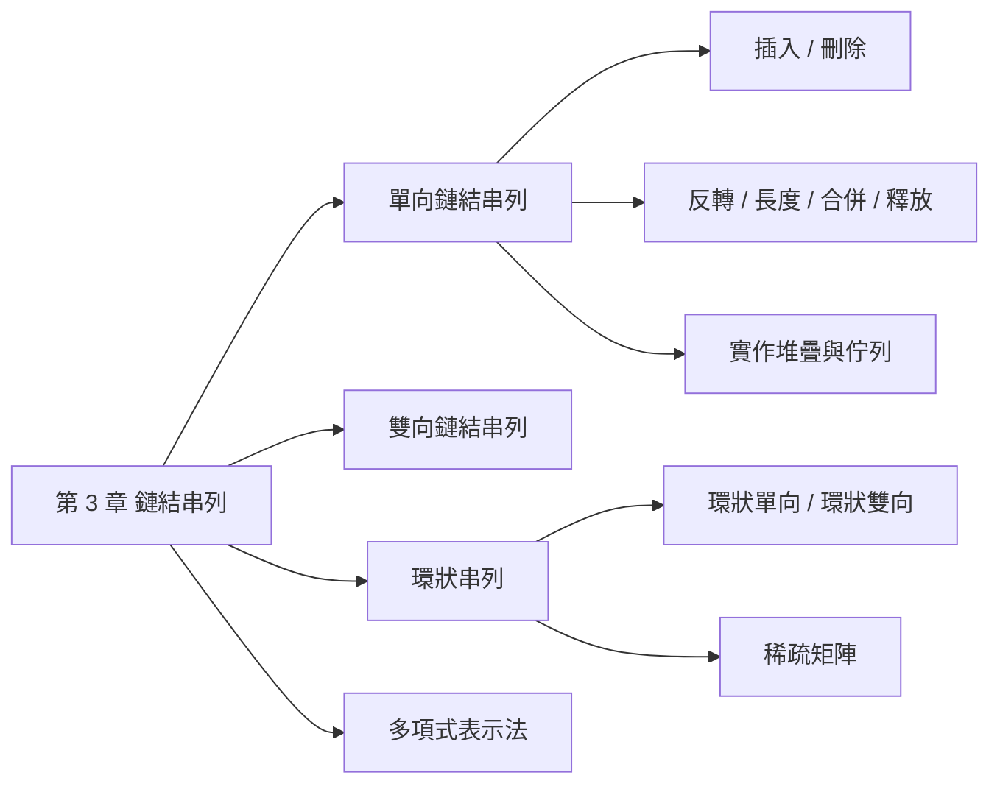
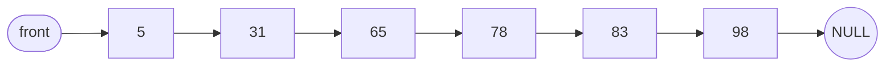
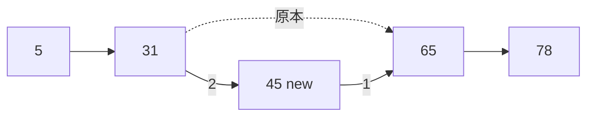
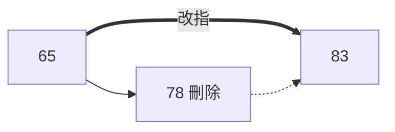
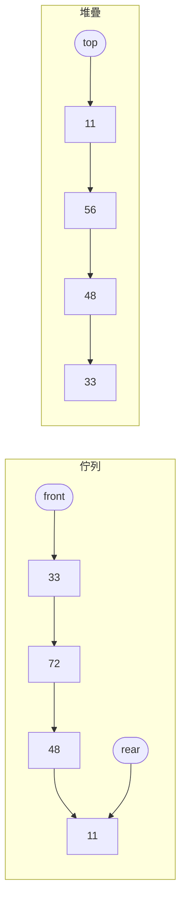
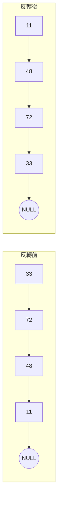
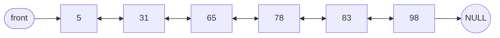
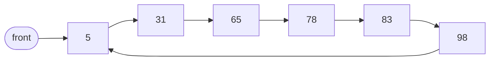
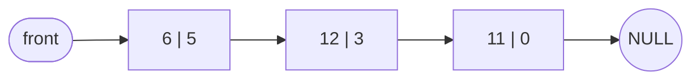

## 名詞表 {#glossary}

| 中文 | English | 描述 |
|---|---|---|
| 節點 | Node | 串列的單位，含資料欄與鏈結欄 |
| 鏈結 | Link / Pointer | 指向另一個節點的指標 |
| 單向鏈結串列 | Singly Linked List | 每個節點只指向下一個節點 |
| 雙向鏈結串列 | Doubly Linked List | 節點有 LLINK（前）與 RLINK（後）兩個鏈結 |
| 環狀串列 | Circular Linked List | 最後一個節點指回第一個節點 |
| 動態記憶體配置 | Dynamic Memory Allocation | 執行時用 `malloc` 要空間、`free` 歸還 |

## 本章地圖 {#ch3-map}



## 陣列與鏈結串列 {#array-vs-list}

有序資料 `5, 31, 65, 78, 83, 98` 存在陣列中，插入 45 要把 65 之後全部往後搬；刪除 31 要把後面全部往前搬。鏈結串列只要改指標。

| | 陣列 | 鏈結串列 |
|---|---|---|
| 記憶體 | 連續，宣告時一次配置 | 不連續，需要時才配置 |
| 存取第 $i$ 筆 | 直接用索引，$O(1)$ | 從頭走，$O(n)$ |
| 插入 / 刪除 | 要搬移資料，$O(n)$ | 只改指標，$O(1)$（已知位置時） |
| 空間 | 要預留夠大，可能浪費 | 每節點多一個指標欄 |
| 可用搜尋法 | 循序、二元 | 只能**循序** |

## 單向鏈結串列的節點 {#singly-node}

```c
struct node {
    int data;            /* 資料欄 */
    struct node *link;   /* 指向下一個節點 */
};
```



## 單向串列的插入 {#singly-insert}

把新節點 `new` 插在節點 `p` 之後：**先接後面，再接前面**（順序反了會弄丟後半段）。

```c
new->link = p->link;   /* 1. 新節點指向 p 原本的下一個 */
p->link   = new;       /* 2. p 改指向新節點 */
```



插在**第一個節點之前**時，改的是 `front`：`new->link = front; front = new;`

## 單向串列的刪除 {#singly-delete}

刪除 `p` 的下一個節點 `q`：

```c
q = p->link;
p->link = q->link;   /* 跳過 q */
free(q);             /* 歸還空間 */
```



刪第一個節點只要 `front = front->link`；刪最後一個節點要把前一個節點的 link 設為 NULL（若有 `rear` 也要改指向它）。

## 用串列實作堆疊與佇列 {#list-stack-queue}

| | 堆疊 Stack | 佇列 Queue |
|---|---|---|
| 特性 | 後進先出 LIFO | 先進先出 FIFO |
| 指標 | `top` | `front`（刪除端）、`rear`（加入端） |
| 加入 | 新節點插在 `top` 前面 | 新節點接在 `rear` 後面 |
| 刪除 | 移除 `top` 節點 | 移除 `front` 節點 |



詳細操作見 [[ch4-stack-queue#stack-linked|以鏈結串列實作堆疊]]、[[ch4-stack-queue#queue-linked|以鏈結串列實作佇列]]。

## 反轉單向串列 {#singly-invert}

用三個指標一路往後走，把每個節點的 link 改指向前一個：

```c
struct node *invert(struct node *head) {
    struct node *mid = NULL, *last;
    while (head != NULL) {
        last = mid;          /* last 跟上 mid */
        mid  = head;         /* mid 跟上 head */
        head = head->link;   /* head 往前一步 */
        mid->link = last;    /* 反轉 mid 的方向 */
    }
    return mid;              /* 新的開頭 */
}
```



## 串列長度、合併與釋放 {#singly-utils}

- **長度**：從第一個節點走到 NULL，數節點個數（不含 front／rear 這類開端節點）。
- **合併** $x$ 與 $y$ 成 $z$：
  - $x$ 空 → $z = y$；$y$ 空 → $z = x$
  - 都不空 → $z$ 指向 $x$ 的第一個節點，走到 $x$ 的**最後一個節點**，把它的 link 指向 $y$ 的第一個節點。
- **釋放**：邊走邊 `free`，要先用暫存指標記住目前節點再往前走。

```c
while (p != NULL) { tmp = p; p = p->link; free(tmp); }
```

## 雙向鏈結串列 {#doubly-linked}

節點有三欄：**LLINK**（指向前一個）、**DATA**、**RLINK**（指向下一個）。

```c
struct dnode {
    int data;
    struct dnode *l_link, *r_link;
};
```



## 雙向串列的插入與刪除 {#doubly-ops}

在節點 `p` 之後插入 `new`（`q = p->r_link`），要改 **4 個指標**：

```c
new->l_link = p;
new->r_link = q;
q->l_link   = new;
p->r_link   = new;
```

刪除節點 `x`（中間節點），改 **2 個指標**後釋放：

```c
x->l_link->r_link = x->r_link;
x->r_link->l_link = x->l_link;
free(x);
```

刪最後一個節點：前一個節點的 r_link 設為 NULL。刪第一個節點：front 改指向第二個，第二個的 l_link 指回 front。

## 單向與雙向比較 {#singly-vs-doubly}

| | 單向 | 雙向 |
|---|---|---|
| 節點 | data + 1 個 link | data + 2 個 link |
| 優點 | 較省空間 | 容易找前後節點；一個方向的鏈結斷了可用另一方向修復 |
| 缺點 | 鏈結斷了後面資料全部遺失 | 較耗空間；插入刪除要改的指標較多 |

## 環狀串列 {#circular-list}

把最後一個節點的鏈結（雙向則是 RLINK）指回**第一個節點**，不再指向 NULL。從任一節點出發都能走遍整個串列，開端指標被破壞時資料不會全部流失。



| 操作（環狀單向） | 要改的指標 |
|---|---|
| 在最前面插入 `new` | `new->link = 第一個`；**最後一個**的 link 指向 `new`；`front = new` |
| 刪除第一個節點 | 最後一個的 link 指向第二個；`front` 指向第二個 |
| 在最後面插入 `new` | `new->link = 第一個`；原最後一個的 link 指向 `new` |

**環狀雙向串列**：最後一個節點的 RLINK 指向第一個，第一個節點的 LLINK 指向最後一個。

## 用環狀串列表示稀疏矩陣 {#sparse-circular}

每個非零元素是一個節點，五個欄位：

| down | row | col | right |
|---|---|---|---|
| | data | | |

- `right`：同一**列**的下一個非零元素（環狀）
- `down`：同一**行**的下一個非零元素（環狀）
- 另有每列、每行的開頭節點，以及一個總開頭節點存 (總列數, 總行數)

```c
struct node {
    int row, col, data;
    struct node *right, *down;
};
```

| | 優點 | 缺點 |
|---|---|---|
| 三行式陣列 | 省空間、不用指標 | 非零元素變動時要大量搬移 |
| 環狀串列 | 非零元素變動時不用大量搬移 | 指標佔額外空間 |

三行式見 [[ch2-array#sparse-matrix|稀疏矩陣]]。

## 多項式的陣列表示法 {#poly-array}

$f(x) = 6x^5 + 12x^3 + 11$

**法一**：存最高次方 $n$，再依次方由高到低存**所有**係數（含 0）。

| DATA | 5 | 6 | 0 | 12 | 0 | 0 | 11 |
|---|---|---|---|---|---|---|---|
| 意義 | $n$ | $x^5$ | $x^4$ | $x^3$ | $x^2$ | $x^1$ | $x^0$ |

**法二**：存非零項個數，再存每一項的 (係數, 指數)。

| DATA | 3 | 6 | 5 | 12 | 3 | 11 | 0 |
|---|---|---|---|---|---|---|---|
| 意義 | 項數 | 係數 | 指數 | 係數 | 指數 | 係數 | 指數 |

法一在項數少、次方高時很浪費；法二只存非零項。

## 多項式的鏈結表示法 {#poly-linked}

每個非零項一個節點 `coef | exp | link`，依指數遞減串接。



多變數多項式每項存所有變數的指數，例 $f(x,y,z) = 6x^5y^4z^3 + 4x^3y^2z + 3xy$：節點為 `coef | expx | expy | expz | link`。

**多項式相加**：兩串列各用一個指標由高次往低次走，指數相同就係數相加（和為 0 則不產生節點），不同就把指數較大的那項複製到結果並只移動那一邊，直到兩邊都走完。
