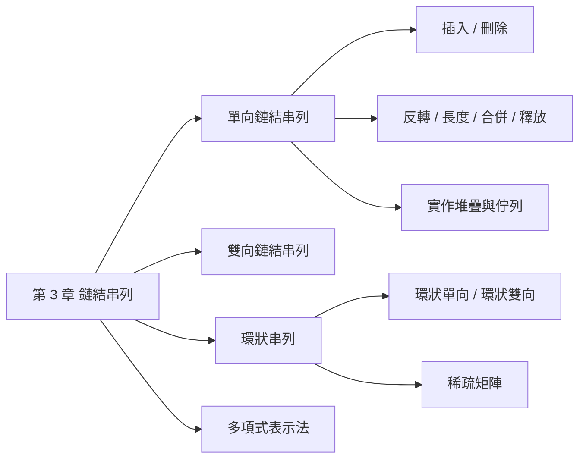
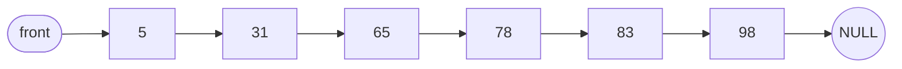
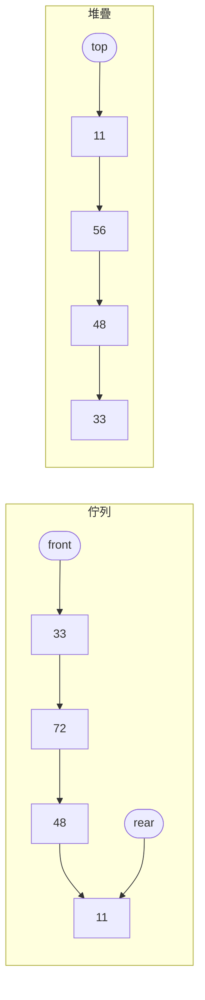
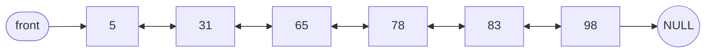
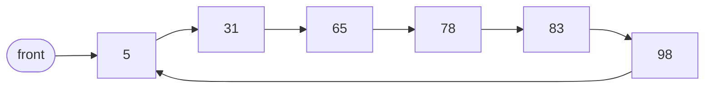
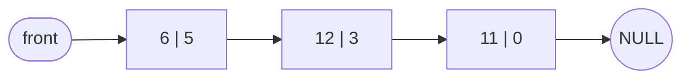

import ListOps from "./_components/ListOps.tsx";
import ListReverse from "./_components/ListReverse.tsx";

## 名詞表 {#glossary}

| 中文 | English | 描述 |
|---|---|---|
| 節點 | Node | 串列的單位，含資料欄與鏈結欄 |
| 鏈結 | Link / Pointer | 指向另一個節點的指標 |
| 單向鏈結串列 | Singly Linked List | 每個節點只指向下一個節點 |
| 雙向鏈結串列 | Doubly Linked List | 節點有 LLINK（前）與 RLINK（後）兩個鏈結 |
| 環狀串列 | Circular Linked List | 最後一個節點指回第一個節點 |
| 動態記憶體配置 | Dynamic Memory Allocation | 執行時用 `malloc` 要空間、`free` 歸還 |

## 本章地圖 {#ch3-map}

陣列的缺點是插入、刪除要搬一大堆資料。鏈結串列換個做法：資料散放在記憶體各處，每筆資料旁邊記著「下一筆在哪」，插入刪除只要改這個記號。這章先把**單向串列**的各種操作學熟，再看兩種變形（**雙向**、**環狀**），最後用串列表示稀疏矩陣和多項式。



## 陣列與鏈結串列 {#array-vs-list}

**比喻**：陣列像電影院的一整排座位，大家坐在一起、有座號，要找第 5 號直接走過去。可是要在中間插一個人，後面每個人都得往後挪一格。

鏈結串列像**火車**：每節車廂可以停在不同地方，靠掛鉤連到下一節。要在中間加一節車廂，只要拆開一個掛鉤、接上新車廂，其他車廂都不用動。可是想找第 5 節，只能從車頭一節一節數過去。

例：有序資料 `5, 31, 65, 78, 83, 98`。

- 存在**陣列**：插入 45 要把 65 之後全部往後搬一格；刪除 31 要把後面全部往前搬一格。
- 存在**鏈結串列**：只要改一兩個指標。

| | 陣列 | 鏈結串列 |
|---|---|---|
| 記憶體 | 連續，宣告時一次配置 | 不連續，需要時才配置 |
| 存取第 $i$ 筆 | 直接用索引，$O(1)$ | 從頭走，$O(n)$ |
| 插入 / 刪除 | 要搬移資料，$O(n)$ | 只改指標，$O(1)$（已知位置時） |
| 空間 | 要預留夠大，可能浪費 | 每節點多一個指標欄 |
| 可用搜尋法 | 循序、二元 | 只能**循序** |

**為什麼串列不能用二元搜尋**：二元搜尋要直接跳到「中間那筆」，但串列沒有座號，要找中間那筆只能從頭數，就失去了二元搜尋快的意義。

$O(1)$ 是「不管資料多少，花的時間都一樣」，$O(n)$ 是「資料多幾倍，時間就多幾倍」。

## 單向鏈結串列的節點 {#singly-node}

每個**節點**分兩格：左邊存**資料**，右邊存**下一個節點的位址**（鏈結，也就是指標）。最後一個節點後面沒有東西了，鏈結存 `NULL`。另外用一個指標 `front` 記住第一個節點在哪，整條串列就從這裡開始走。

```c
struct node {
    int data;            /* 資料欄 */
    struct node *link;   /* 指向下一個節點 */
};
```



**走訪**整條串列的固定寫法：從 `front` 開始，沿著 `link` 一直走到 `NULL`。

```c
for (p = front; p != NULL; p = p->link) printf("%d ", p->data);
```

## 單向串列的插入 {#singly-insert}

把新節點 `new` 插在節點 `p` 之後，要改兩個指標。**口訣：先接後面，再接前面。**

```c
new->link = p->link;   /* 1. 新節點指向 p 原本的下一個 */
p->link   = new;       /* 2. p 改指向新節點 */
```

**為什麼順序不能反**：`p->link` 是唯一記得「後半段在哪」的地方。如果先改 `p->link = new`，後半段的位址就被蓋掉，再也找不到了。

點「插入（順序弄反）」看看反過來會發生什麼：

<ListOps start="insert" />

插在**第一個節點之前**時，前面沒有節點可以改，要改的是 `front` 本身：`new->link = front; front = new;`（一樣是先接後面再接前面）。

## 單向串列的刪除 {#singly-delete}

要刪除某個節點，得站在它的**前一個節點** `p`，因為要改的是 `p` 的指標。刪除 `p` 的下一個節點 `q`：

```c
q = p->link;         /* 記住要刪的節點 */
p->link = q->link;   /* 跳過 q */
free(q);             /* 歸還空間 */
```

第 2 行讓 `p` 直接指向 `q` 的下一個，走訪時就不會再經過 `q`。第 3 行把 `q` 的記憶體還給系統；如果沒有先用 `q` 記住它，就找不到它來釋放了。

<ListOps start="delete" />

兩種特殊位置：

- **刪第一個節點**：`front = front->link`（`front` 直接指向第二個）。
- **刪最後一個節點**：把前一個節點的 link 設為 `NULL`；若有 `rear` 指標，也要改指向那個前一個節點。

## 用串列實作堆疊與佇列 {#list-stack-queue}

堆疊和佇列只在「端點」加入刪除，正好是串列最擅長的（不用走訪，直接改頭尾的指標）。

| | 堆疊 Stack | 佇列 Queue |
|---|---|---|
| 特性 | 後進先出 LIFO | 先進先出 FIFO |
| 指標 | `top` | `front`（刪除端）、`rear`（加入端） |
| 加入 | 新節點插在 `top` 前面 | 新節點接在 `rear` 後面 |
| 刪除 | 移除 `top` 節點 | 移除 `front` 節點 |



詳細操作見 [[ch4-stack-queue#stack-linked|以鏈結串列實作堆疊]]、[[ch4-stack-queue#queue-linked|以鏈結串列實作佇列]]。

## 反轉單向串列 {#singly-invert}

**目標**：把 33 → 72 → 48 → 11 變成 11 → 48 → 72 → 33，不另外配置新節點，只把每個箭頭的方向反過來。

**難處**：單向串列只能往後走。一旦把某個節點的箭頭改成指向前面，就失去了往後走的路。所以要用**三個指標**接力：

- `head`：先往前探路，記住「後面還沒處理的部分」。
- `mid`：正在處理（要把箭頭轉向）的節點。
- `last`：`mid` 的前一個節點，也就是 `mid` 的箭頭要改指的地方。

每一輪三個指標各往前一步，然後把 `mid` 的箭頭轉向 `last`：

```c
struct node *invert(struct node *head) {
    struct node *mid = NULL, *last;
    while (head != NULL) {
        last = mid;          /* last 跟上 mid */
        mid  = head;         /* mid 跟上 head */
        head = head->link;   /* head 往前一步 */
        mid->link = last;    /* 反轉 mid 的方向 */
    }
    return mid;              /* 新的開頭 */
}
```

<ListReverse />

## 串列長度、合併與釋放 {#singly-utils}

三個都是「從頭走到尾」的變化：

- **長度**：從第一個節點走到 `NULL`，邊走邊數（`front`、`rear` 這類開端指標不算節點）。
- **合併**串列 $x$ 與 $y$ 成 $z$（把 $y$ 接在 $x$ 後面）：
  - $x$ 是空的 → $z = y$；$y$ 是空的 → $z = x$。
  - 都不空 → $z$ 指向 $x$ 的第一個節點，走到 $x$ 的**最後一個節點**，把它的 link 指向 $y$ 的第一個節點。
- **釋放**：邊走邊 `free`。注意要先用暫存指標記住目前節點、再往前走、最後才釋放；如果先 `free(p)` 再 `p = p->link`，`p` 已經被釋放，讀它的 `link` 是錯的。

```c
while (p != NULL) { tmp = p; p = p->link; free(tmp); }
```

## 雙向鏈結串列 {#doubly-linked}

單向串列只能往後走，想找「前一個節點」就得從頭再走一次。**雙向串列**在每個節點多放一個指標指向前一個，前後都能走。

節點有三欄：**LLINK**（指向前一個）、**DATA**、**RLINK**（指向下一個）。

```c
struct dnode {
    int data;
    struct dnode *l_link, *r_link;
};
```



## 雙向串列的插入與刪除 {#doubly-ops}

每個節點有前後兩條線，所以改的指標比單向多一倍。

**插入**：在節點 `p` 之後插入 `new`，`q` 是 `p` 原本的下一個（`q = p->r_link`）。新節點要接上前後兩邊，前後兩邊也要接回新節點，共 **4 個指標**：

```c
new->l_link = p;      /* 新節點往前接 p */
new->r_link = q;      /* 新節點往後接 q */
q->l_link   = new;    /* q 往前改接新節點 */
p->r_link   = new;    /* p 往後改接新節點（最後做） */
```

`p->r_link` 最後才改，理由和單向串列一樣：在用到 `q` 之前不能把通往 `q` 的路蓋掉（這裡先用變數 `q` 記住了，所以比較安全）。

**刪除**節點 `x`（中間節點）：讓 `x` 的前一個和後一個直接互相連，共 **2 個指標**，再釋放：

```c
x->l_link->r_link = x->r_link;   /* 前一個往後跳過 x */
x->r_link->l_link = x->l_link;   /* 後一個往前跳過 x */
free(x);
```

雙向串列刪除時不用另外找「前一個節點」，因為 `x->l_link` 就是。

特殊位置：刪最後一個節點 → 前一個節點的 r_link 設為 `NULL`；刪第一個節點 → `front` 改指向第二個，第二個的 l_link 指回 `front`。

## 單向與雙向比較 {#singly-vs-doubly}

| | 單向 | 雙向 |
|---|---|---|
| 節點 | data + 1 個 link | data + 2 個 link |
| 優點 | 較省空間 | 容易找前後節點；一個方向的鏈結斷了可用另一方向修復 |
| 缺點 | 鏈結斷了後面資料全部遺失 | 較耗空間；插入刪除要改的指標較多 |

一句話：雙向用**多一個指標的空間**，換到**前後都能走**和**比較不怕斷線**。

## 環狀串列 {#circular-list}

把最後一個節點的鏈結（雙向則是 RLINK）指回**第一個節點**，不再指向 `NULL`，串列就變成一個圈。



**好處**：

- 從**任何一個節點**出發都能走遍整個串列。
- 開端指標 `front` 被弄壞時，只要手上還有任一節點，資料就不會全部遺失。

**代價**：在最前面插入或刪除時，**最後一個節點**的指標也要跟著改（因為它指著第一個）。

| 操作（環狀單向） | 要改的指標 |
|---|---|
| 在最前面插入 `new` | `new->link = 第一個`；**最後一個**的 link 指向 `new`；`front = new` |
| 刪除第一個節點 | 最後一個的 link 指向第二個；`front` 指向第二個 |
| 在最後面插入 `new` | `new->link = 第一個`；原最後一個的 link 指向 `new` |

**環狀雙向串列**：最後一個節點的 RLINK 指向第一個，第一個節點的 LLINK 指向最後一個，前後兩個方向都繞成圈。

## 用環狀串列表示稀疏矩陣 {#sparse-circular}

**稀疏矩陣**是大部分元素為 0 的矩陣。陣列版本的三行式見 [[ch2-array#sparse-matrix|稀疏矩陣]]；這裡改用串列，讓非零元素增減時不用搬資料。

**想法**：只為非零元素建節點，每個節點同時掛在兩條環狀串列上：一條串起**同一列**的非零元素（往右走），一條串起**同一行**的非零元素（往下走）。像一張只畫出有東西的格子、用線把它們橫向和縱向串起來的網。

每個節點五個欄位：

| down | row | col | right |
|---|---|---|---|
| | data | | |

- `row`、`col`、`data`：這個元素在第幾列、第幾行、值是多少。
- `right`：同一**列**的下一個非零元素（環狀）。
- `down`：同一**行**的下一個非零元素（環狀）。
- 另有每列、每行的開頭節點，以及一個總開頭節點存（總列數, 總行數）。

```c
struct node {
    int row, col, data;
    struct node *right, *down;
};
```

| | 優點 | 缺點 |
|---|---|---|
| 三行式陣列 | 省空間、不用指標 | 非零元素變動時要大量搬移 |
| 環狀串列 | 非零元素變動時不用大量搬移 | 指標佔額外空間 |

## 多項式的陣列表示法 {#poly-array}

多項式要記的是「每一項的係數和次方」。以 $f(x) = 6x^5 + 12x^3 + 11$ 為例，有兩種存法。

**法一：照次方排，每個次方都佔一格**。先存最高次方 $n$，再從高到低存**所有**係數（沒有的項存 0）。

| DATA | 5 | 6 | 0 | 12 | 0 | 0 | 11 |
|---|---|---|---|---|---|---|---|
| 意義 | $n$ | $x^5$ | $x^4$ | $x^3$ | $x^2$ | $x^1$ | $x^0$ |

**法二：只存有的項**。先存非零項個數，再存每一項的（係數, 指數）。

| DATA | 3 | 6 | 5 | 12 | 3 | 11 | 0 |
|---|---|---|---|---|---|---|---|
| 意義 | 項數 | 係數 | 指數 | 係數 | 指數 | 係數 | 指數 |

法一在項數少、次方高時很浪費（例：$x^{100}+1$ 要存 102 格，其中 99 格是 0）；法二只存非零項。

## 多項式的鏈結表示法 {#poly-linked}

每個非零項一個節點，存（係數 `coef`, 指數 `exp`, 下一項 `link`），依指數由大到小串起來。



多變數多項式的每一項要存每個變數的指數。例 $f(x,y,z) = 6x^5y^4z^3 + 4x^3y^2z + 3xy$：節點為 `coef | expx | expy | expz | link`。

**多項式相加**：像兩條隊伍由大到小合併。兩串列各用一個指標，從最高次往低次走：

- 兩邊指數**相同** → 係數相加，結果放進答案（和為 0 就不放），兩邊都往下走。
- 指數**不同** → 把指數較大的那項複製到答案，只移動那一邊。
- 直到兩邊都走完。

例：$(6x^5 + 12x^3 + 11) + (3x^3 + 2x)$ = $6x^5 + 15x^3 + 2x + 11$。
