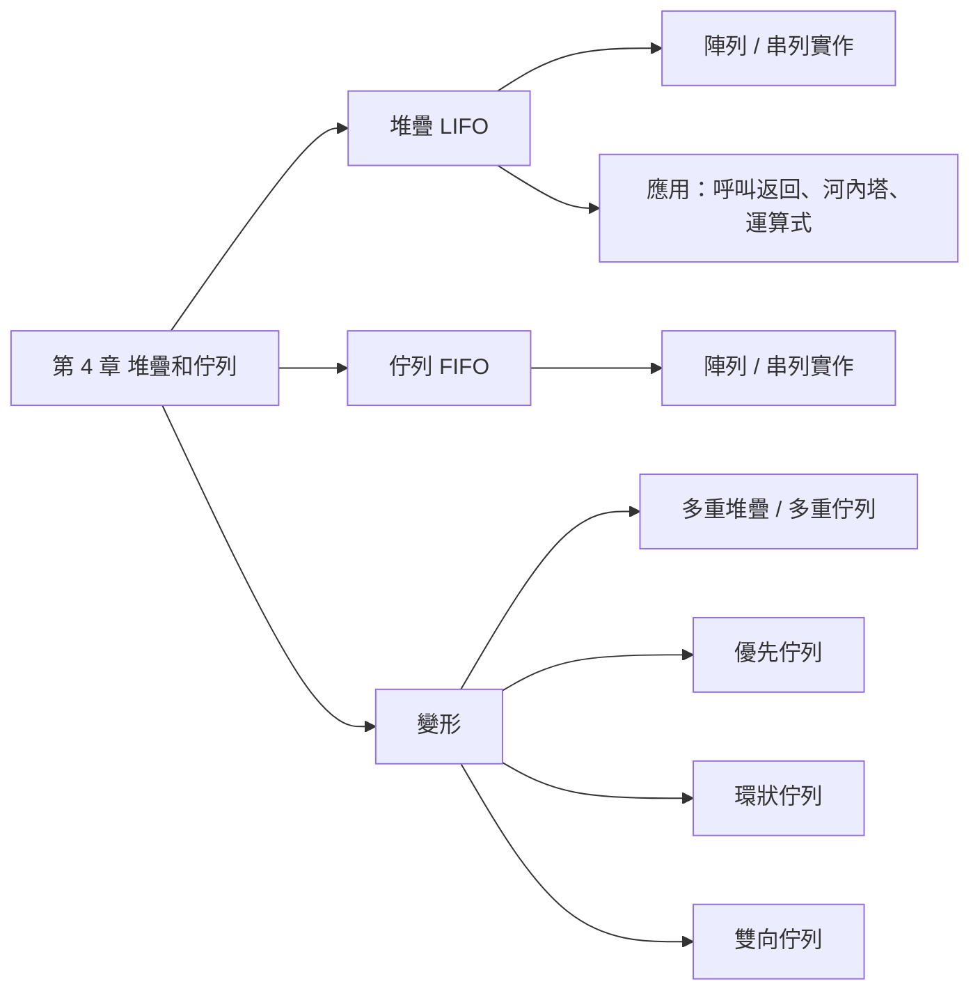
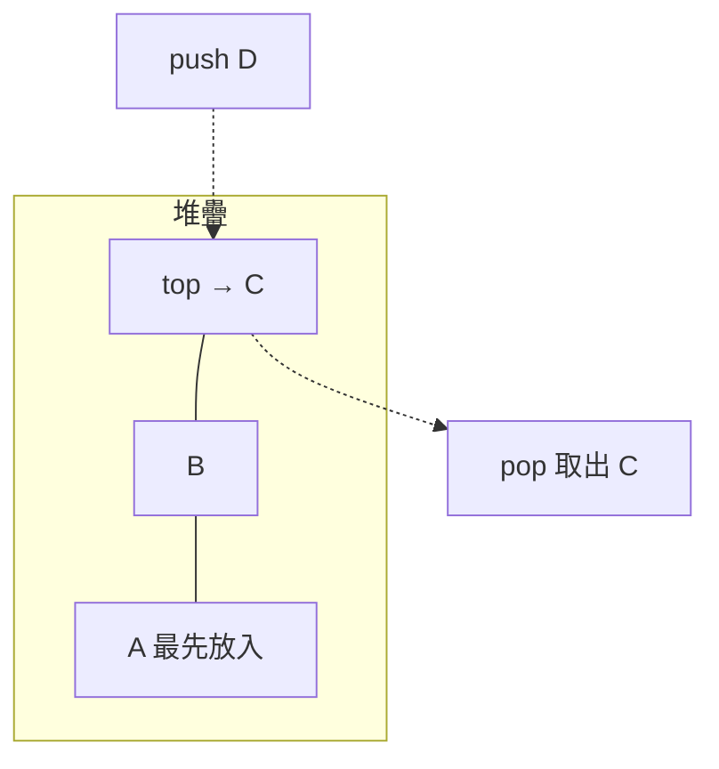
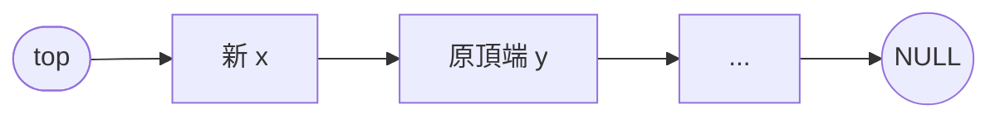
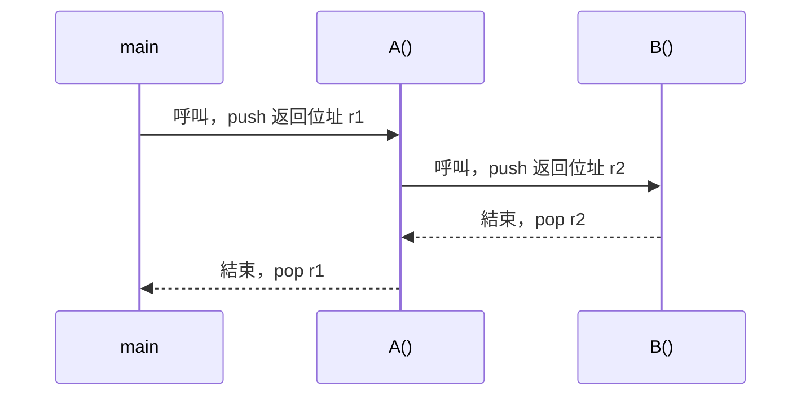
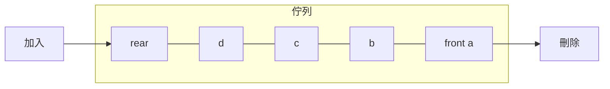
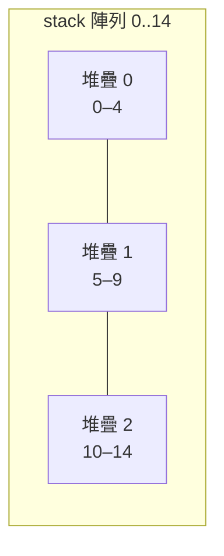
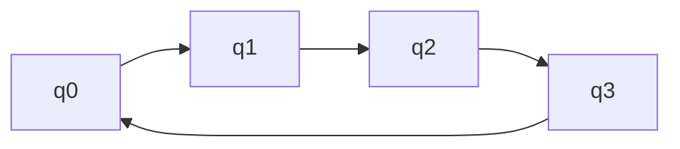

## 名詞表 {#glossary}

| 中文 | English | 描述 |
|---|---|---|
| 堆疊 | Stack | 只在頂端（top）加入刪除，後進先出 |
| 佇列 | Queue | 尾端（rear）加入、頭端（front）刪除，先進先出 |
| 推入 / 彈出 | Push / Pop | 堆疊的加入 / 刪除 |
| 滿溢 | Overflow | 容器已滿還要加入 |
| 運算元 / 運算子 | Operand / Operator | `a`、`b` / `+`、`*` |
| 中置 / 前置 / 後置 | Infix / Prefix / Postfix | 運算子在兩運算元之間 / 前 / 後 |
| 環狀佇列 | Circular Queue | 陣列頭尾相接，空位可重複使用 |
| 雙向佇列 | Deque | 兩端都能加入刪除 |
| 優先佇列 | Priority Queue | 依優先等級決定誰先出 |

## 本章地圖 {#ch4-map}



## 堆疊 {#stack}

只有一個出入口（**頂端 top**），加入（push）與刪除（pop）都在頂端，**後進先出 LIFO**（= 先進後出 FILO）。例：疊起來的餐盤。



基本操作：建立、push、pop、isFull、isEmpty、銷毀。

## 以陣列實作堆疊 {#stack-array}

宣告 `stack[n]`，`top` 指向頂端那筆資料。

| 操作 | 做法 |
|---|---|
| 初始 | `top = -1`（空） |
| 已滿 | `top == n-1` |
| 已空 | `top < 0` |
| push(x) | 未滿時 `top = top+1; stack[top] = x;` |
| pop() | 非空時 `x = stack[top]; top = top-1;` |

```c
void push(int x) { if (top == N-1) overflow(); else stack[++top] = x; }
int  pop(void)   { if (top < 0) empty();      else return stack[top--]; }
```

## 以鏈結串列實作堆疊 {#stack-linked}

`top` 指向第一個節點，空堆疊時 `top == NULL`。

- **push**：要一個新節點 `x` 存資料，`x->link = top; top = x;`
- **pop**：`x = top;` 輸出 `x->data`，`top = x->link;` 釋放 `x`。



## 副程式的呼叫和返回 {#call-return}

呼叫副程式時，把**返回位址**（與區域變數等）push 進堆疊；副程式結束時 pop 出來，回到呼叫處。最後被呼叫的最先返回，正好是 LIFO。遞迴函數也靠這個機制運作，見 [[ch5-recursion#how-recursion-works|遞迴函數的運作原理]]。



## 河內塔 {#hanoi}

$n$ 個大小不同的圓盤從 a 柱搬到 c 柱，規則：一次搬一個、任何時候都**上小下大**、可借用三根柱子。

$n$ 個圓盤的搬法：先把上面 $n-1$ 個搬到 b → 把第 $n$ 個搬到 c → 再把 $n-1$ 個從 b 搬到 c。搬動次數 $T(n) = 2T(n-1)+1 = 2^n-1$。

| $n=3$ 步驟 | 1 | 2 | 3 | 4 | 5 | 6 | 7 |
|---|---|---|---|---|---|---|---|
| 圓盤 | 1 | 2 | 1 | 3 | 1 | 2 | 1 |
| 搬動 | a→c | a→b | c→b | a→c | b→a | b→c | a→c |

遞迴程式見 [[ch5-recursion#recursive-hanoi|列印河內塔的搬移過程]]。

## 運算式的三種表示法 {#expression-notation}

運算式由**運算元**（a、b…）與**運算子**（+、−、*、/、^）組成。求值規則：括號優先 → 依運算子優先順序（^ > * / > + −）→ 同級由左至右。

| 表示法 | 格式 | 例 | 特性 |
|---|---|---|---|
| 前置 Prefix | 運算子 運算元 運算元 | `-+a*/b-cdef` | 無括號、不易閱讀 |
| 中置 Infix | 運算元 運算子 運算元 | `a+b/(c-d)*e-f` | 可有括號、最易閱讀 |
| 後置 Postfix | 運算元 運算元 運算子 | `abcd-/e*+f-` | 無括號、電腦好求值 |

## 括號法轉換 {#paren-method}

1. 依求值規則把每個運算加上完整括號。
2. **轉前置**：運算子移到它所屬的**左括號**位置；**轉後置**：運算子移到它所屬的**右括號**位置。
3. 刪掉剩下的括號。

以 `a+b/(c-d)*e-f` 為例，完整括號為 `((a+((b/(c-d))*e))-f)`：

| | 結果 |
|---|---|
| 前置 | `-+a*/b-cdef` |
| 後置 | `abcd-/e*+f-` |

## 用堆疊轉後置式 {#infix-to-postfix}

由左到右讀中置式每個元素 `x`：

| 讀到 | 動作 |
|---|---|
| 運算元 | 直接輸出 |
| `(` | push |
| `)` | 一直 pop 並輸出，直到彈出 `(`（括號不輸出） |
| 運算子 | 當堆疊頂端運算子的優先順序 **≥** `x`，就 pop 並輸出；最後把 `x` push |
| 讀完 | 把堆疊剩下的全部 pop 輸出 |

優先順序：`^` > `*` `/` > `+` `-` > `(`（`(` 在堆疊裡優先順序最低，不會被運算子彈出）。

### 例子：a+b/(c-d)*e-f {#ex-infix-to-postfix .fold}

| 讀入 | 動作 | 堆疊（左為底） | 輸出 |
|---|---|---|---|
| a | 輸出 | | a |
| + | push | + | a |
| b | 輸出 | + | ab |
| / | / 比 + 高，push | + / | ab |
| ( | push | + / ( | ab |
| c | 輸出 | + / ( | abc |
| − | 頂端是 (，push | + / ( − | abc |
| d | 輸出 | + / ( − | abcd |
| ) | pop −，丟掉 ( | + / | abcd− |
| * | / ≥ *，pop /；push * | + * | abcd−/ |
| e | 輸出 | + * | abcd−/e |
| − | pop *、pop +；push − | − | abcd−/e*+ |
| f | 輸出 | − | abcd−/e*+f |
| 結束 | pop − | | **abcd−/e*+f−** |

## 後置式求值 {#postfix-eval}

由左到右讀後置式：

- 運算元 → push
- 運算子 → pop 兩次，**先彈出的是右運算元**，計算「左 op 右」後把結果 push
- 讀完時堆疊裡剩下的就是答案

### 例子：abcd-/e*+ 求值 {#ex-postfix-eval .fold}

$a=1, b=4, c=3, d=1, e=2$

| 讀入 | 動作 | 堆疊（左為底） |
|---|---|---|
| a b c d | 依序 push | 1 4 3 1 |
| − | 3 − 1 = 2 | 1 4 2 |
| / | 4 / 2 = 2 | 1 2 |
| e | push | 1 2 2 |
| * | 2 × 2 = 4 | 1 4 |
| + | 1 + 4 = 5 | **5** |

## 佇列 {#queue}

有一個入口（**尾端 rear**）和一個出口（**頭端 front**），**先進先出 FIFO**（= 後進後出 LILO）。例：收費站車龍、售票口排隊。



應用：作業系統的工作排程（先送來的工作先處理）、優先佇列。

## 以陣列實作佇列 {#queue-array}

宣告 `queue[n]`。`front` 指向**第一筆資料的前一格**，`rear` 指向**最後一筆資料**。

| 操作 | 做法 |
|---|---|
| 初始 | `front = rear = -1` |
| 已滿 | `rear == n-1` |
| 已空 | `front == rear` |
| 加入 x | 未滿時 `rear = rear+1; queue[rear] = x;` |
| 刪除 | 非空時 `front = front+1; x = queue[front];` |

缺點：刪除後前面空出的位置**不能再用**。即使前面有空位，`rear == n-1` 就判定已滿。解法見 [[ch4-stack-queue#circular-queue|環狀佇列]]。

## 以鏈結串列實作佇列 {#queue-linked}

空佇列 `front = rear = NULL`。

- **加入**：新節點 `x` 存資料、`x->link = NULL`。若佇列空，`front = rear = x`；否則 `rear->link = x; rear = x;`
- **刪除**：`x = front;` 輸出 `x->data`，`front = x->link;` 釋放 `x`。

## 陣列與鏈結串列實作比較 {#array-vs-linked}

| | 陣列 | 鏈結串列 |
|---|---|---|
| 記憶體 | 宣告時一次配置（compile time） | 需要時才配置（run time） |
| 加入 / 刪除 | 快 | 要配置 / 歸還記憶體，較慢 |
| 優點 | 程式好寫、執行快 | 記憶體有效運用、不易滿溢 |
| 缺點 | 宣告太多浪費、太少滿溢；（佇列）刪除後空位不能再用 | 程式較難寫、較慢、鏈結斷裂資料流失 |

## 多重堆疊 {#multiple-stacks}

多個堆疊**共用一個陣列**，減少「有的滿了、有的很空」的浪費。第 $i$ 號堆疊佔 `b[i]+1` 到 `b[i+1]`：

- `b[i]`：第 $i$ 號堆疊底部的前一格；`t[i]`：第 $i$ 號堆疊頂端
- **空**：`t[i] == b[i]`
- **滿**：`t[i] == b[i+1]`

某個堆疊滿了而別處還有空間時，**重新分配**各堆疊的邊界（搬移資料）即可繼續使用。



## 多重佇列 {#multiple-queues}

多個佇列共用一個陣列。第 $i$ 號佇列範圍到 `b[i]` 為止：

- **空**：`f[i] == r[i]`
- **滿**：`r[i] == b[i]`

滿了就重新分配邊界，把空間挪給滿的佇列。

## 優先佇列 {#priority-queue}

資料分等級（例 A > B > C），高等級先出；同等級內先進先出。

**陣列實作**：A、B、C 三段連續排放，頭指標 `f` 指向整個佇列頭端，`r_a`、`r_b`、`r_c` 分別指向各級尾端（`r_a` 也是 B 級的頭端，`r_b` 也是 C 級的頭端）。

- 加入 B 級資料：後面的 C 級資料要整段**往後搬**一格，再放入並更新 `r_b`、`r_c`。
- 刪除：從最高等級的頭端刪，後面資料往前搬。

**鏈結串列實作**：每一級一條串列，用 `down` 鏈結把各級串起來，插入刪除只改指標，不必搬資料。

## 環狀佇列 {#circular-queue}

把陣列 `queue[n]` 看成頭尾相接的環，刪除後的空位可以再利用，不需搬資料。

| | 環狀佇列 | 一般佇列 |
|---|---|---|
| 初值 | `front = rear = n-1` | `front = rear = -1` |
| 最大容量 | **$n-1$** | $n$ |
| 已滿 | `front == (rear+1) % n` | `rear == n-1` |
| 已空 | `front == rear` | `front == rear` |
| 加入位置 | `rear = (rear+1) % n` | `rear = rear+1` |
| 刪除位置 | `front = (front+1) % n` | `front = front+1` |
| 只剩一個元素 | `rear == (front+1) % n` | `rear == front+1` |

**為什麼只能放 $n-1$ 個**：`front` 指向的那格永遠空著。若放滿 $n$ 個，`front == rear`，就和「空」無法區分。



### 例子：n = 4 的環狀佇列 {#ex-circular-queue .fold}

初值 `f = r = 3`。

| 操作 | f | r | 內容 q0 q1 q2 q3 |
|---|---|---|---|
| 加入 A | 3 | 0 | A _ _ _ |
| 加入 B | 3 | 1 | A B _ _ |
| 加入 C | 3 | 2 | A B C _ |
| 加入 D | — | — | `(2+1)%4 = 3 = f`，**已滿**（只放 3 個） |
| 刪除 → A | 0 | 2 | _ B C _ |
| 加入 D | 0 | 3 | _ B C D |
| 加入 E | — | — | `(3+1)%4 = 0 = f`，已滿 |

## 雙向佇列 {#deque}

用一個陣列放兩個佇列，左右兩端各自加入刪除，向中間成長：

- `f[0]`、`r[0]`：左邊佇列的頭、尾（從左往右長）
- `f[1]`、`r[1]`：右邊佇列的頭、尾（從右往左長）

| 狀態 | 條件 |
|---|---|
| 左邊空 | `f[0] == r[0]` |
| 右邊空 | `f[1] == r[1]` |
| 整個空 | 兩邊都空 |
| 滿溢 | `r[0] + 1 == r[1]`（兩個尾端相鄰） |


加入時先判斷是否滿溢，再移動對應那一邊的 `r`；刪除時先判斷那一邊是否為空，再移動那一邊的 `f`。
