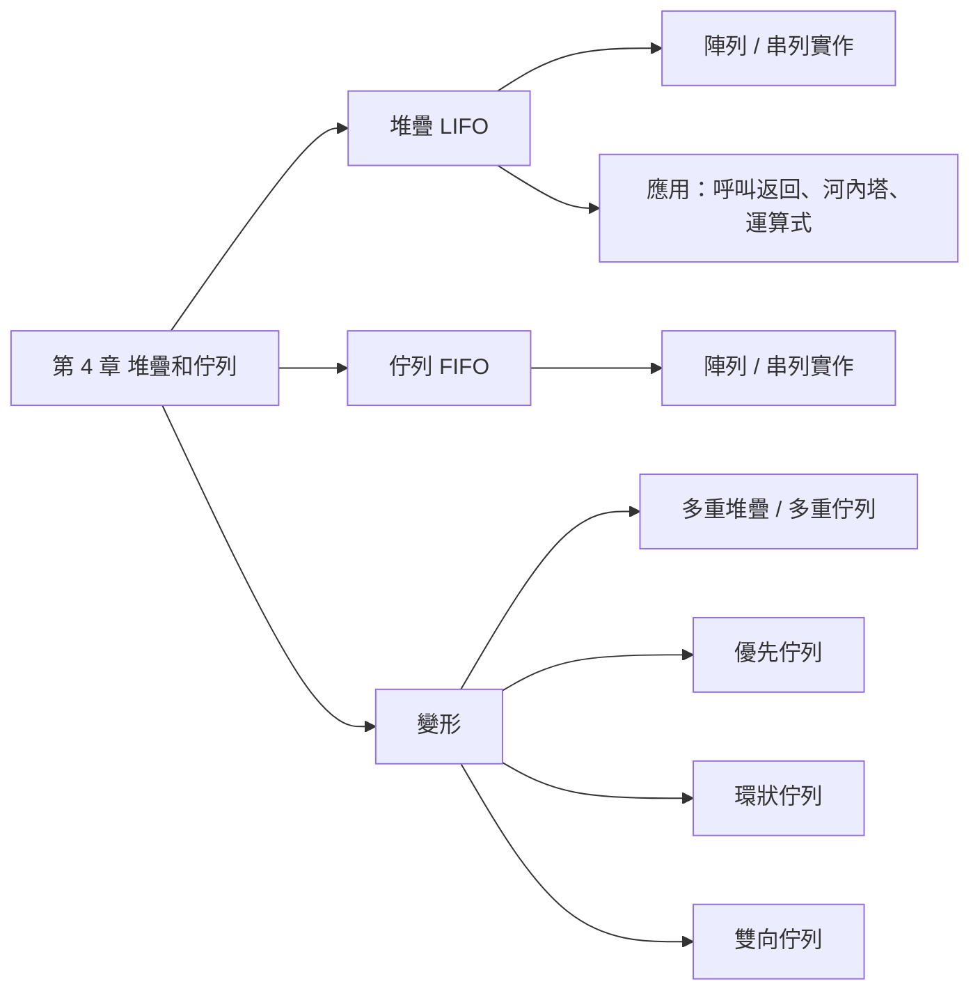
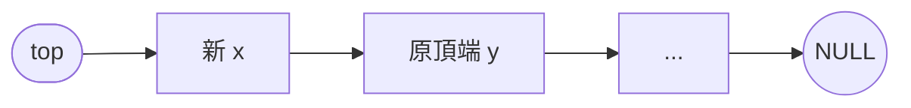
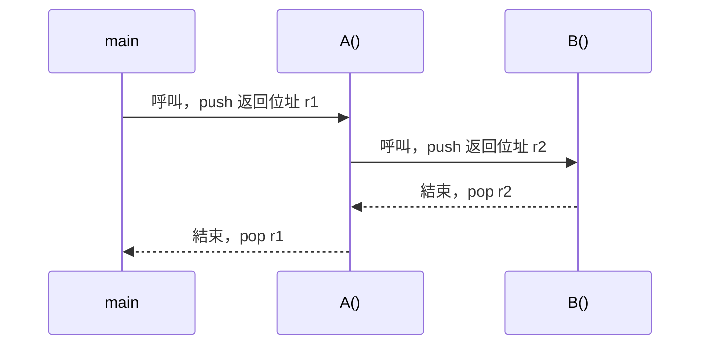
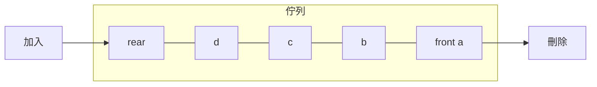
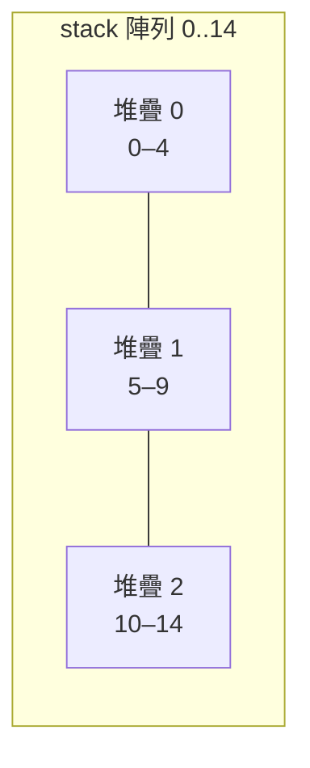
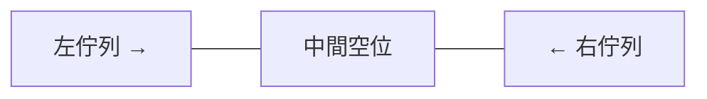

import StackQueuePlay from "./_StackQueuePlay.tsx";
import CircularQueue from "./_CircularQueue.tsx";
import ExprStack from "./_ExprStack.tsx";
import Hanoi from "./_Hanoi.tsx";

## 名詞表 {#glossary}

| 中文 | English | 描述 |
|---|---|---|
| 堆疊 | Stack | 只在頂端（top）加入刪除，後進先出 |
| 佇列 | Queue | 尾端（rear）加入、頭端（front）刪除，先進先出 |
| 推入 / 彈出 | Push / Pop | 堆疊的加入 / 刪除 |
| 滿溢 | Overflow | 容器已滿還要加入 |
| 運算元 / 運算子 | Operand / Operator | `a`、`b` / `+`、`*` |
| 中置 / 前置 / 後置 | Infix / Prefix / Postfix | 運算子在兩運算元之間 / 前 / 後 |
| 環狀佇列 | Circular Queue | 陣列頭尾相接，空位可重複使用 |
| 雙向佇列 | Deque | 兩端都能加入刪除 |
| 優先佇列 | Priority Queue | 依優先等級決定誰先出 |

## 本章地圖 {#ch4-map}

這章只有兩個主角：**堆疊**（像疊盤子，最後放的最先拿）和**佇列**（像排隊，先來的先走）。先學它們的規則和兩種做法（陣列、鏈結串列），再看堆疊最重要的應用：處理運算式。最後是幾種變形，其中**環狀佇列**最常考。



## 堆疊 {#stack}

**想像自助餐的餐盤**：洗好的盤子一個一個往上疊，拿的時候也只能從最上面拿。所以**最後放上去的，最先被拿走**。

這就是堆疊的規則：

- 只有一個出入口，叫**頂端 top**。
- 放進去叫 **push**，拿出來叫 **pop**，兩個動作都只能在頂端做。
- 規則叫**後進先出 LIFO**（Last In First Out），也可以說先進後出 FILO。

生活中的例子：瀏覽器的「上一頁」（最後看的頁面最先回去）、編輯器的「復原」（最後一個動作最先被復原）。

基本操作：建立、push、pop、isFull（滿了嗎）、isEmpty（空了嗎）、銷毀。

## 以陣列實作堆疊 {#stack-array}

用一個陣列 `stack[n]` 當容器，再用一個整數 `top` 記住「目前最上面那筆在第幾格」。

- 一開始沒有資料，`top = -1`（還沒指到任何格子）。
- **push**：`top` 先往上加 1，再把資料放進 `stack[top]`。
- **pop**：先取出 `stack[top]`，再把 `top` 減 1。

| 操作 | 做法 | 為什麼 |
|---|---|---|
| 初始 | `top = -1` | 第 0 格都還沒用 |
| 已滿 | `top == n-1` | 最後一格（索引 n−1）也用了 |
| 已空 | `top < 0` | 沒有任何一格有資料 |
| push(x) | 未滿時 `top = top+1; stack[top] = x;` | 先移再放 |
| pop() | 非空時 `x = stack[top]; top = top-1;` | 先拿再移 |

```c
void push(int x) { if (top == N-1) overflow(); else stack[++top] = x; }
int  pop(void)   { if (top < 0) empty();      else return stack[top--]; }
```

下面可以直接操作。切到「佇列」可以比較兩者取出的順序有什麼不同：

<StackQueuePlay />

## 以鏈結串列實作堆疊 {#stack-linked}

陣列要事先決定大小；如果不知道會放多少資料，可以改用**鏈結串列**：要放一筆就跟系統要一個節點，不會有「滿」的問題。

`top` 指向第一個節點，這個節點就是堆疊頂端。空堆疊時 `top == NULL`。

- **push**：要一個新節點 `x` 存資料，讓它指向原本的頂端，再把 `top` 改指向它：`x->link = top; top = x;`
- **pop**：記住頂端 `x = top;`，輸出 `x->data`，`top` 往下移 `top = x->link;`，最後釋放 `x`。



新節點永遠插在最前面、刪除也從最前面刪，所以只要改一兩個指標，不用走訪整個串列。

## 副程式的呼叫和返回 {#call-return}

程式呼叫函數時，電腦要記住「做完之後要回到哪一行」。假設 `main` 呼叫 `A`，`A` 又呼叫 `B`：

1. `main` 呼叫 `A` 時，把返回位址 r1 **push** 進堆疊。
2. `A` 呼叫 `B` 時，把返回位址 r2 **push** 進堆疊。
3. `B` 做完，**pop** 出 r2，回到 `A`。
4. `A` 做完，**pop** 出 r1，回到 `main`。

最後被呼叫的 `B` 最先結束，正好是後進先出，所以用堆疊最自然。除了返回位址，函數的參數和區域變數也一起放在堆疊上。遞迴函數就是靠這個機制運作，見 [[ch5-recursion#how-recursion-works|遞迴函數的運作原理]]。



## 河內塔 {#hanoi}

**題目**：$n$ 個大小不同的圓盤疊在 a 柱上（大的在下），要全部搬到 c 柱。規則：

- 一次只能搬一個（最上面那個）。
- 任何時候都不能大盤壓小盤。
- 三根柱子都可以暫放。

**關鍵想法**：想搬走最底下的大盤，上面的 $n-1$ 個一定要先讓開。所以拆成三步：

1. 把上面 $n-1$ 個從 a 搬到 **b**（借 c 當中繼）。
2. 把最大的第 $n$ 個從 a 搬到 **c**。
3. 把那 $n-1$ 個從 b 搬到 **c**（借 a 當中繼）。

第 1、3 步又是「搬 $n-1$ 個」的同一種問題，只是柱子換了，所以可以一直往下拆，拆到只剩 1 個就直接搬。

**要搬幾步**：搬 $n$ 個 = 搬兩次 $n-1$ 個 + 1 步，所以 1 個要 1 步、2 個要 3 步、3 個要 7 步、4 個要 15 步，規律是 $2^n-1$。

<Hanoi />

| $n=3$ 步驟 | 1 | 2 | 3 | 4 | 5 | 6 | 7 |
|---|---|---|---|---|---|---|---|
| 圓盤 | 1 | 2 | 1 | 3 | 1 | 2 | 1 |
| 搬動 | a→c | a→b | c→b | a→c | b→a | b→c | a→c |

遞迴程式見 [[ch5-recursion#recursive-hanoi|列印河內塔的搬移過程]]。

## 運算式的三種表示法 {#expression-notation}

我們平常寫 `a+b`，運算子 `+` 夾在兩個運算元中間，叫**中置式**。同一個算式還有兩種寫法：把運算子放前面（**前置式** `+ab`）或放後面（**後置式** `ab+`）。

為什麼要後置式？中置式要靠括號和「先乘除後加減」才知道先算哪個，電腦處理起來很麻煩。後置式**不需要括號**，只要從左讀到右、遇到運算子就拿前面兩個數來算，用一個堆疊就能求值。所以編譯器會先把中置式轉成後置式。

中置式的求值規則：括號優先 → 依運算子優先順序 → 同級由左至右。

| 優先順序值 | 運算子 |
|---|---|
| 8 | 正號、負號（前置） |
| 7 | `^` 次方 |
| 6 | `*` `/` |
| 5 | `+` `-` |
| 4 | 關係：`<` `<=` `!=` `=` `>=` `>` |
| 3 | `!`（not） |
| 2 | `&&`（and） |
| 1 | `\|\|`（or） |

口訣：**正負 > 次方 > 乘除 > 加減 > 比較 > 非 > 且 > 或**。

| 表示法 | 格式 | 例 | 特性 |
|---|---|---|---|
| 前置 Prefix | 運算子 運算元 運算元 | `-+a*/b-cdef` | 無括號、不易閱讀 |
| 中置 Infix | 運算元 運算子 運算元 | `a+b/(c-d)*e-f` | 可有括號、最易閱讀 |
| 後置 Postfix | 運算元 運算元 運算子 | `abcd-/e*+f-` | 無括號、電腦好求值 |

注意三種寫法中，**運算元 a、b、c… 的先後順序都一樣**，只有運算子的位置不同。

## 括號法轉換 {#paren-method}

**手算考試時最快的方法。** 中置式轉前置式或後置式都適用：

1. 依求值規則，把**每一個運算**都用括號包起來（一個運算子配一對括號）。
2. **轉前置**：每個運算子移到它那對括號的**左括號**位置；**轉後置**：移到**右括號**位置。
3. 把剩下的括號全部刪掉。

以 `a+b/(c-d)*e-f` 為例。先算 `c-d`，再 `/`，再 `*e`，再 `a+`，最後 `-f`，所以完整括號是：

```
( ( a + ( ( b / ( c - d ) ) * e ) ) - f )
```

| | 運算子移到 | 結果 |
|---|---|---|
| 前置 | 左括號 | `-+a*/b-cdef` |
| 後置 | 右括號 | `abcd-/e*+f-` |

## 用堆疊轉後置式 {#infix-to-postfix}

**這是電腦用的方法**，不用先加括號。核心想法：運算元直接輸出；運算子先放進堆疊「等一下」，等確定沒有更優先的運算要先做，才輸出。

由左到右讀中置式的每個字元：

| 讀到 | 動作 | 為什麼 |
|---|---|---|
| 運算元 | 直接輸出 | 運算元順序不會變 |
| `(` | push | 先記住括號的起點 |
| `)` | 一直 pop 並輸出，直到彈出 `(`（括號不輸出） | 括號裡的運算要先做完 |
| 運算子 | 堆疊頂端運算子的優先順序 **≥** 自己時就 pop 並輸出，最後把自己 push | 優先順序高的（或同級中較左的）要先算 |
| 讀完 | 把堆疊剩下的全部 pop 輸出 | 剩下的運算依序完成 |

優先順序：`^` 大於 `*` `/` 大於 `+` `-` 大於 `(`。`(` 在堆疊裡優先順序最低，所以不會被運算子彈出，只有 `)` 能把它清掉。

按「下一步」看每讀一個字元，堆疊和輸出怎麼變：

<ExprStack mode="infix" />

### 例子：a+b/(c-d)*e-f {#ex-infix-to-postfix .fold}

| 讀入 | 動作 | 堆疊（左為底） | 輸出 |
|---|---|---|---|
| a | 輸出 | | a |
| + | push | + | a |
| b | 輸出 | + | ab |
| / | / 比 + 高，push | + / | ab |
| ( | push | + / ( | ab |
| c | 輸出 | + / ( | abc |
| − | 頂端是 (，push | + / ( − | abc |
| d | 輸出 | + / ( − | abcd |
| ) | pop −，丟掉 ( | + / | abcd− |
| * | / ≥ *，pop /；push * | + * | abcd−/ |
| e | 輸出 | + * | abcd−/e |
| − | pop *、pop +；push − | − | abcd−/e*+ |
| f | 輸出 | − | abcd−/e*+f |
| 結束 | pop − | | **abcd−/e*+f−** |

## 後置式求值 {#postfix-eval}

後置式的好處是：**遇到運算子時，要算的兩個數一定剛好在堆疊最上面**。所以規則很簡單，由左到右讀：

- 讀到**運算元** → push。
- 讀到**運算子** → pop 兩次，計算，再把結果 push 回去。
- 讀完時，堆疊裡剩下的那個數就是答案。

**注意左右順序**：先 pop 出來的是**右**運算元，後 pop 出來的是**左**運算元。對 `+`、`*` 沒差，但 `-`、`/` 算反就錯。例如堆疊依序有 4、2，讀到 `/` 時，先出來 2（右）、再出來 4（左），算 4 / 2 = 2，不是 2 / 4。

<ExprStack mode="eval" />

### 例子：abcd-/e*+ 求值 {#ex-postfix-eval .fold}

$a=1, b=4, c=3, d=1, e=2$

| 讀入 | 動作 | 堆疊（左為底） |
|---|---|---|
| a b c d | 依序 push | 1 4 3 1 |
| − | 3 − 1 = 2 | 1 4 2 |
| / | 4 / 2 = 2 | 1 2 |
| e | push | 1 2 2 |
| * | 2 × 2 = 4 | 1 4 |
| + | 1 + 4 = 5 | **5** |

## 佇列 {#queue}

**想像排隊買便當**：新來的人排到隊伍**最後面**，買完的人從**最前面**離開。所以**先來的先走**。

這就是佇列的規則：

- 入口在**尾端 rear**，加入只能從這裡。
- 出口在**頭端 front**，刪除只能從這裡。
- 規則叫**先進先出 FIFO**（First In First Out），也可以說後進後出 LILO。

和堆疊最大的差別：堆疊只有一個口（進出同一端），佇列有兩個口（一端進、另一端出）。



應用：作業系統的工作排程（先送來的工作先處理）、印表機的列印順序、優先佇列。

## 以陣列實作佇列 {#queue-array}

用陣列 `queue[n]` 加兩個整數：

- `front`：指向**第一筆資料的前一格**（不是第一筆本身）。
- `rear`：指向**最後一筆資料**。

這樣設計的好處是「空」很好判斷：兩個指標重疊就代表中間沒有資料。

| 操作 | 做法 |
|---|---|
| 初始 | `front = rear = -1` |
| 已滿 | `rear == n-1` |
| 已空 | `front == rear` |
| 加入 x | 未滿時 `rear = rear+1; queue[rear] = x;` |
| 刪除 | 非空時 `front = front+1; x = queue[front];` |

**缺點**：`front` 和 `rear` 只會往右走。刪除後前面空出來的格子**不能再用**，只要 `rear` 走到最後一格就判定已滿，即使前面其實還有空位。在 [[ch4-stack-queue#stack-array|陣列堆疊]] 的互動圖切到「佇列」，加滿 6 個、刪掉幾個、再加入，就能看到這個問題。解法是 [[ch4-stack-queue#circular-queue|環狀佇列]]。

## 以鏈結串列實作佇列 {#queue-linked}

用鏈結串列就不用擔心空間浪費：要放就要一個新節點，刪掉就歸還。用兩個指標：`front` 指向第一個節點（刪除端），`rear` 指向最後一個節點（加入端）。空佇列時 `front = rear = NULL`。

- **加入**：新節點 `x` 存資料、`x->link = NULL`。佇列原本是空的，就讓 `front = rear = x`；否則接在最後面：`rear->link = x; rear = x;`
- **刪除**：記住第一個 `x = front;`，輸出 `x->data`，`front` 往後移 `front = x->link;`，釋放 `x`。

為什麼要多一個 `rear`？如果只有 `front`，每次加入都要從頭走到尾才能接上去；有了 `rear` 就能直接接。

## 陣列與鏈結串列實作比較 {#array-vs-linked}

堆疊和佇列都可以用陣列或鏈結串列做。差別來自兩者記憶體配置方式的不同：

| | 陣列 | 鏈結串列 |
|---|---|---|
| 記憶體 | 宣告時一次配置（compile time） | 需要時才配置（run time） |
| 加入 / 刪除 | 快 | 要配置 / 歸還記憶體，較慢 |
| 優點 | 程式好寫、執行快 | 記憶體有效運用、不易滿溢 |
| 缺點 | 宣告太多浪費、太少滿溢；（佇列）刪除後空位不能再用 | 程式較難寫、較慢、鏈結斷裂資料流失 |

**怎麼選**：資料量大致可預估、重視速度 → 陣列；資料量變化大、怕滿溢 → 鏈結串列。

## 多重堆疊 {#multiple-stacks}

**問題**：程式需要好幾個堆疊，各宣告一個陣列的話，常常有的堆疊滿了、有的還很空，空間浪費。

**做法**：讓多個堆疊**共用一個大陣列**，每個堆疊分一段。某個堆疊滿了，而其他段還有空位時，就**重新分配**各段的邊界（搬移資料），讓滿的那個多分一點。

每個堆疊用兩個指標記錄：

- `b[i]`：第 $i$ 號堆疊**底部的前一格**（這段的起點前一格）。
- `t[i]`：第 $i$ 號堆疊的**頂端**。
- 第 $i$ 號堆疊佔 `b[i]+1` 到 `b[i+1]` 這段。

| 狀態 | 條件 | 意思 |
|---|---|---|
| 空 | `t[i] == b[i]` | 頂端還在起點前一格，沒放東西 |
| 滿 | `t[i] == b[i+1]` | 頂端碰到下一個堆疊的邊界 |



## 多重佇列 {#multiple-queues}

和多重堆疊同一個想法：多個佇列**共用一個陣列**，每個佇列分一段，第 $i$ 號佇列的範圍到 `b[i]` 為止，用 `f[i]`、`r[i]` 記頭尾。

| 狀態 | 條件 |
|---|---|
| 空 | `f[i] == r[i]` |
| 滿 | `r[i] == b[i]`（尾端碰到這段的邊界） |

滿了就重新分配邊界，把其他段的空間挪給滿的佇列。

## 優先佇列 {#priority-queue}

**想像醫院急診**：不是先到先看，而是重症先看；同樣嚴重的才依到院順序。

優先佇列的規則：資料分等級（例 A 大於 B 大於 C），**高等級先出**；同等級內先進先出。

**陣列實作**：A、B、C 三段依序連續排放。頭指標 `f` 指向整個佇列的頭端，`r_a`、`r_b`、`r_c` 分別指向各級的尾端（`r_a` 同時也是 B 級的頭端前一格，`r_b` 也是 C 級的）。

- 加入 B 級資料：B 段的尾端在 C 段前面，所以 C 級資料要整段**往後搬**一格騰出位置，再放入並更新 `r_b`、`r_c`。例：A 段 0–2、B 段 3–7、C 段 c1 c2 在 8–9，加入 b6 → c2 搬到 9→10（`r_c = 10`）、c1 搬到 8→9，b6 放進 8（`r_b = 8`）。**要從最後面往前搬**，才不會蓋掉資料。
- 刪除：從最高等級的頭端刪，後面資料全部往前搬。例：刪除 B 級的 b1，b2…b5、c1、c2 都往左移一格。

缺點是常要搬資料。

**鏈結串列實作**：所有資料串成一條串列（a1→a2→a3→b1→…→c2），另外有 `front`、`rear_a`、`rear_b`、`rear_c` 四個指標節點橫向串在一起，每個用 `down` 鏈結指向該級的最後一筆。插入刪除只改指標，不必搬資料。

加入 B 級的 b6（接在 B 級最後面）：

1. 配置新節點 x，存入 b6。
2. 沿 `front` 找到 `rear_b`，令 y = `rear_b` 的 `down` 所指節點（b5）。
3. 令 z = y 的下一個節點（c1）。
4. x 指向 z，y 指向 x。
5. `rear_b` 的 `down` 改指向 x。

刪除 B 級的第一筆 b1（B 級的頭在 A 級尾巴之後）：

1. 沿 `front` 找到 `rear_a`，令 x = `rear_a` 的 `down` 所指節點（a3）。
2. 令 y = x 的下一個節點（b1，要刪的）。
3. 令 z = y 的下一個節點（b2）。
4. x 指向 z。
5. 把 y 歸還給記憶體。

## 環狀佇列 {#circular-queue}

**解決的問題**：一般陣列佇列刪除後前面的空位不能再用，`rear` 走到底就說滿了。

**做法**：把陣列 `queue[n]` 想成**頭尾相接的環**。`rear` 走到最後一格之後，下一步繞回第 0 格，就能用到前面空出來的位置，不用搬資料。

「繞回去」用**取餘數** `% n` 達成：$(n-1)+1$ 除以 $n$ 餘 0，就回到第 0 格。

| | 環狀佇列 | 一般佇列 |
|---|---|---|
| 初值 | `front = rear = n-1` | `front = rear = -1` |
| 最大容量 | **$n-1$** | $n$ |
| 已滿 | `front == (rear+1) % n` | `rear == n-1` |
| 已空 | `front == rear` | `front == rear` |
| 加入位置 | `rear = (rear+1) % n` | `rear = rear+1` |
| 刪除位置 | `front = (front+1) % n` | `front = front+1` |
| 只剩一個元素 | `rear == (front+1) % n` | `rear == front+1` |

**為什麼只能放 $n-1$ 個**：「空」的條件是 `front == rear`。如果放滿 $n$ 個，`rear` 繞一圈後也會追上 `front`，變成 `front == rear`，就和「空」分不出來了。所以規定 `front` 指的那格**永遠留空**，`rear` 的下一格是 `front` 時就算滿。

下圖按「加入」直到滿，再刪除一個、加入一個，看 `rear` 怎麼繞回開頭：

<CircularQueue />

### 例子：n = 4 的環狀佇列 {#ex-circular-queue .fold}

初值 `f = r = 3`。

| 操作 | f | r | 內容 q0 q1 q2 q3 |
|---|---|---|---|
| 加入 A | 3 | 0 | A _ _ _ |
| 加入 B | 3 | 1 | A B _ _ |
| 加入 C | 3 | 2 | A B C _ |
| 加入 D | — | — | `(2+1)%4 = 3 = f`，**已滿**（只放 3 個） |
| 刪除 → A | 0 | 2 | _ B C _ |
| 加入 D | 0 | 3 | _ B C D |
| 加入 E | — | — | `(3+1)%4 = 0 = f`，已滿 |

## 雙向佇列 {#deque}

**想法**：一個陣列裡放兩個佇列，一個從左邊往右長、一個從右邊往左長，兩個都往中間的空位擴張。這樣兩個佇列可以彈性分享中間的空間，只有兩邊碰頭時才算滿。

- `f[0]`、`r[0]`：左邊佇列的頭、尾（從左往右長）。
- `f[1]`、`r[1]`：右邊佇列的頭、尾（從右往左長）。

| 狀態 | 條件 |
|---|---|
| 左邊空 | `f[0] == r[0]` |
| 右邊空 | `f[1] == r[1]` |
| 整個空 | 兩邊都空 |
| 滿溢 | `r[0] + 1 == r[1]`（兩個尾端相鄰，中間沒空位了） |



加入時先判斷是否滿溢，再移動對應那一邊的 `r`；刪除時先判斷那一邊是否為空，再移動那一邊的 `f`。
