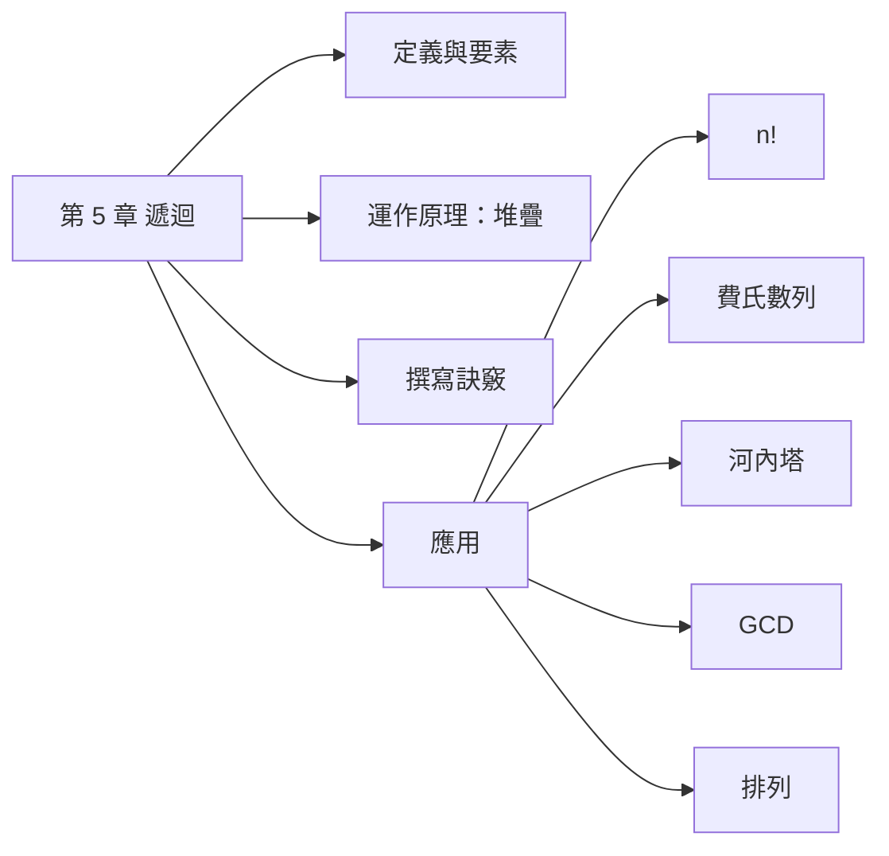
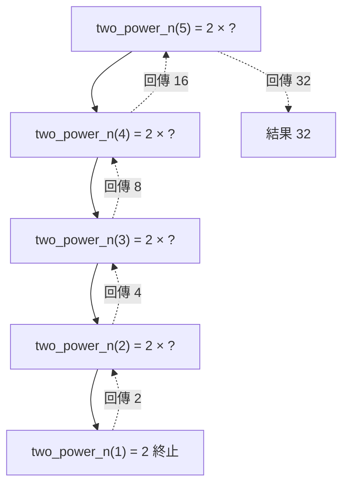
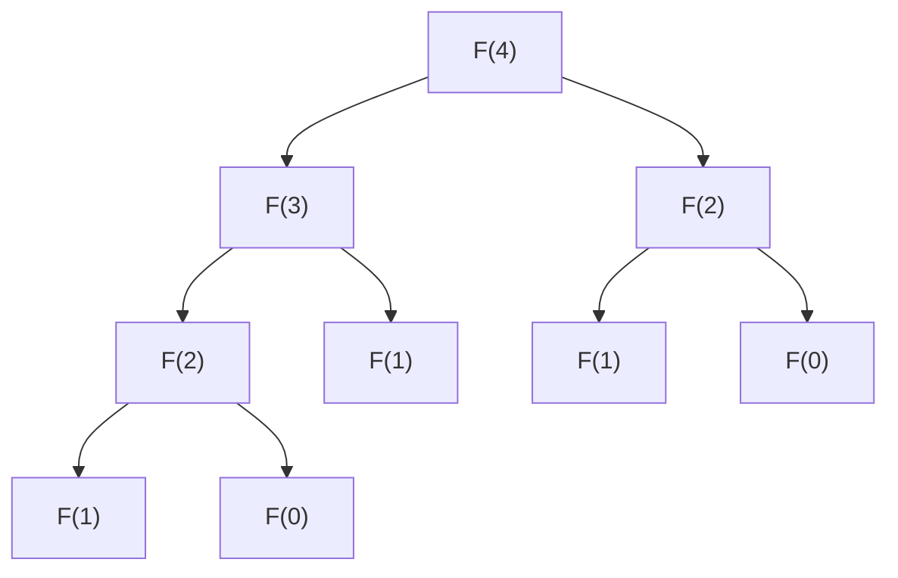

## 名詞表 {#glossary}

| 中文 | English | 描述 |
|---|---|---|
| 遞迴 | Recursion | 處理過程中又反覆執行同一處理程序 |
| 遞迴函數 | Recursive Function | 自己呼叫自己的函數 |
| 終止條件 | Base Case | 不再遞迴、直接回傳的情況 |
| 費氏數列 | Fibonacci Sequence | $F(n) = F(n-1)+F(n-2)$ |
| 輾轉相除法 | Euclidean Algorithm | 用餘數反覆相除求最大公因數 |

## 本章地圖 {#ch5-map}



## 遞迴的定義 {#recursion-definition}

一個處理程序在處理過程中又反覆執行**同一個**處理程序，稱為**遞迴**。寫成函數就是「自己呼叫自己」的**遞迴函數**。

遞迴函數有兩個要素：

1. **自己呼叫自己**，且每次的引數往終止條件靠近（例：$n \to n-1$）。
2. **終止條件**：到某個值時直接回傳、停止遞迴，否則會無限呼叫。

## 遞迴函數的運作原理 {#how-recursion-works}

$2^n = 2\times2^{n-1}$，所以 $2^5 = 2\times2^4 = 2\times(2\times2^3) = \cdots$

```c
long two_power_n(long n) {
    if (n == 0) return 1;
    if (n == 1) return 2;                     /* 終止條件 */
    return 2 * two_power_n(n - 1);            /* 呼叫自己，引數遞減 */
}
```

每次呼叫都把「還沒算完的 `2 *`」存進**堆疊**；到終止條件後，再一層層 pop 回來相乘：



所以處理遞迴呼叫與返回的資料結構是**堆疊**，見 [[ch4-stack-queue#call-return|副程式的呼叫和返回]]。

## 撰寫遞迴函數的訣竅 {#recursion-tips}

以 $n!$ 為例回答五個問題：

| 要考慮的問題 | $n!$ 的答案 |
|---|---|
| 1. 函數名稱？ | `factorial` |
| 2. 需要哪些引數？型態？ | `long n` |
| 3. 呼叫自己時帶入什麼？ | `n-1` |
| 4. 回傳值？怎麼在回傳時呼叫自己？ | $n > 1$ 時 `return n * factorial(n-1)` |
| 5. 終止條件？終止時回傳什麼？ | $n = 1$ 時 `return 1` |

## 計算 n 階乘 {#recursive-factorial}

$n! = n\times(n-1)! = n\times(n-1)\times(n-2)! = \cdots = n\times(n-1)\times\cdots\times2\times1$

```c
long factorial(long n) {
    if (n > 1) return n * factorial(n - 1);
    else       return 1;                     /* n == 1 */
}
```

## 費氏數列 {#recursive-fibonacci}

$$
F(n) = \begin{cases} 0 & n = 0 \\ 1 & n = 1 \\ F(n-1) + F(n-2) & n > 1 \end{cases}
$$

| $n$ | 0 | 1 | 2 | 3 | 4 | 5 | 6 | 7 | 8 | 9 | 10 | 11 | 12 |
|---|---|---|---|---|---|---|---|---|---|---|---|---|---|
| $F(n)$ | 0 | 1 | 1 | 2 | 3 | 5 | 8 | 13 | 21 | 34 | 55 | 89 | 144 |

```c
long fib(long n) {
    if (n == 0) return 0;
    if (n == 1) return 1;
    return fib(n - 1) + fib(n - 2);
}
```

一次呼叫分成兩次，同一個值會被重複計算（$F(2)$ 算了兩次），呼叫次數呈指數成長：



## 列印河內塔的搬移過程 {#recursive-hanoi}

把 $n$ 個圓盤從 source 經 intermediate 搬到 destination：

```c
void hanoi(int n, char src, char mid, char dst) {
    static int step = 0;
    if (n > 1) hanoi(n - 1, src, dst, mid);   /* 上面 n-1 個先移到中間柱 */
    printf("步驟 %d：將 %d 號圓盤從 %c 柱搬到 %c 柱\n", ++step, n, src, dst);
    if (n > 1) hanoi(n - 1, mid, src, dst);   /* 再把 n-1 個移到目的柱 */
}
```

呼叫 `hanoi(n, 'a', 'b', 'c')`，共 $2^n - 1$ 步。規則與 $n=3$ 的步驟表見 [[ch4-stack-queue#hanoi|河內塔]]。

## 輾轉相除法求 GCD {#recursive-gcd}

大數除以小數，若餘數為 0，除數就是 GCD；否則「除數變被除數、餘數變除數」重複。

$$
\gcd(a, b) = \begin{cases} b & a \bmod b = 0 \\ \gcd(b,\ a \bmod b) & \text{否則} \end{cases}
$$

| 被除數 | 除數 | 商 | 餘數 |
|---|---|---|---|
| 256 | 72 | 3 | 40 |
| 72 | 40 | 1 | 32 |
| 40 | 32 | 1 | 8 |
| 32 | 8 | 4 | **0** → $\gcd = 8$ |

```c
int gcd(int a, int b) {           /* 遞迴 */
    if (a % b == 0) return b;
    return gcd(b, a % b);
}

int gcd_nr(int a, int b) {        /* 非遞迴 */
    while (b != 0) { int r = a % b; a = b; b = r; }
    return a;
}
```

## n 筆資料的所有排列 {#recursive-permutation}

輪流讓每一筆資料放在第 1 個位置，剩下的 $n-1$ 筆再遞迴排列；只剩一筆時印出。共 $n!$ 種。

| 第 1 位 | 剩下兩筆的排列 |
|---|---|
| a | bc、cb |
| b | ac、ca |
| c | ba、ab |

```c
void perm(char d[], int k, int n) {      /* 排 d[k..n-1] */
    if (k == n - 1) { print(d, n); return; }
    for (int i = k; i < n; i++) {
        swap(&d[k], &d[i]);              /* 讓 d[i] 坐第 k 位 */
        perm(d, k + 1, n);
        swap(&d[k], &d[i]);              /* 換回來 */
    }
}
```

## 遞迴的優缺點 {#recursion-pros-cons}

| 優點 | 缺點 |
|---|---|
| 程式碼精簡，貼近數學定義 | 每次呼叫與返回都有額外負擔 |
| 適合本身就是遞迴定義的問題（樹、河內塔） | 佔用較多記憶體（堆疊），層數太深會堆疊溢位 |
| | 不一定比迴圈快（例：遞迴費氏數列重複計算） |

不是所有問題都適合遞迴，要看解題程序能否重複套用同一處理邏輯。語言支援：C、C++、Pascal、ALGOL、PL/I 支援遞迴；早期的 COBOL、FORTRAN、BASIC 不支援。
