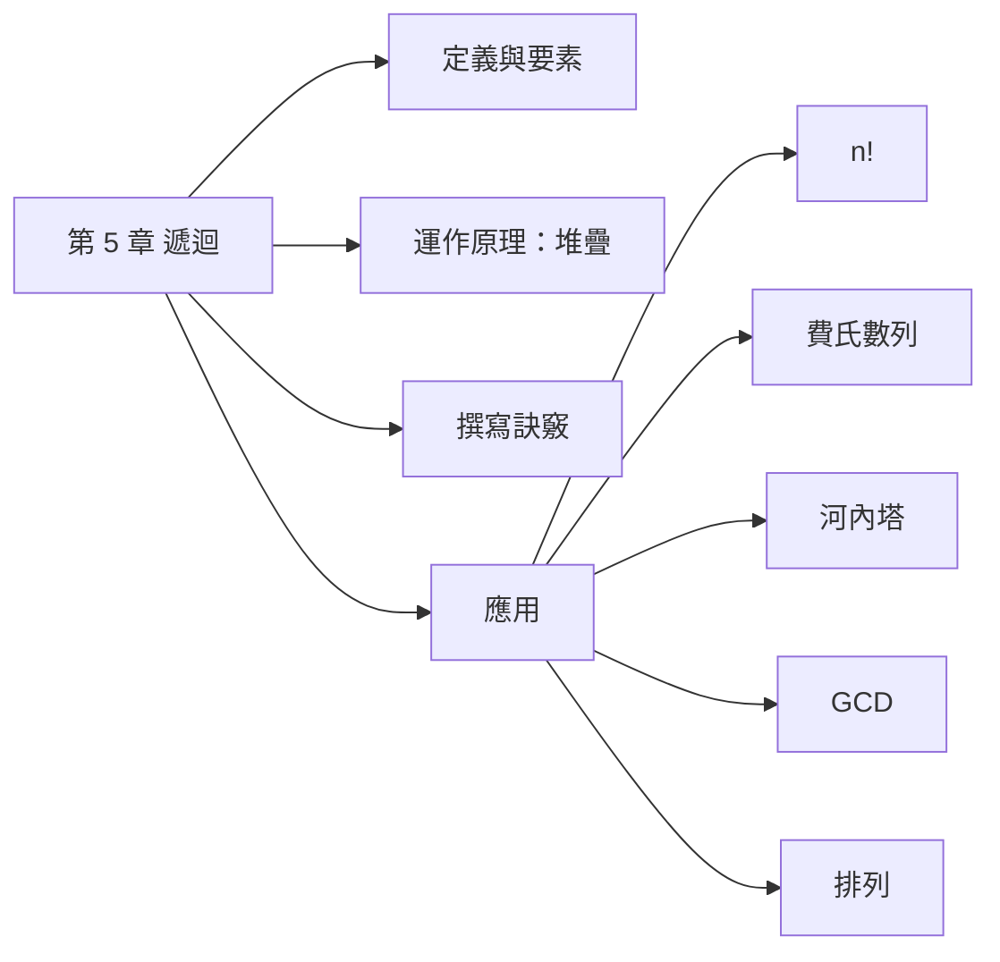

import CallStack from "./_components/CallStack.tsx";
import FibTree from "./_components/FibTree.tsx";
import Hanoi from "./_components/Hanoi.tsx";

## 名詞表 {#glossary}

| 中文 | English | 描述 |
|---|---|---|
| 遞迴 | Recursion | 處理過程中又反覆執行同一處理程序 |
| 遞迴函數 | Recursive Function | 自己呼叫自己的函數 |
| 終止條件 | Base Case | 不再遞迴、直接回傳的情況 |
| 費氏數列 | Fibonacci Sequence | 每一項等於前兩項的和：0, 1, 1, 2, 3, 5, 8… |
| 輾轉相除法 | Euclidean Algorithm | 用餘數反覆相除求最大公因數 |

## 本章地圖 {#ch5-map}

遞迴是「把大問題拆成**同一種**、但比較小的問題」的解題方法。這章先講遞迴的兩個要素和它背後靠堆疊運作的原理，再用五個經典例子練習怎麼寫，最後比較遞迴的優缺點。



## 遞迴的定義 {#recursion-definition}

**生活比喻**：電影院裡你想知道自己坐第幾排，但太暗看不到。你問前一排的人「你是第幾排？」，他也不知道，就再問他的前一排……一直問到第一排的人，他直接知道「我是第 1 排」。答案再一路往回傳：第 2 排、第 3 排……傳回到你。

這就是**遞迴**：一個處理程序在處理過程中，又反覆執行**同一個**處理程序。寫成函數就是「自己呼叫自己」的**遞迴函數**。

遞迴函數一定要有兩個要素：

1. **自己呼叫自己**，而且每次呼叫時問題要**變小**、往終點靠近（例：$n$ 變成 $n-1$）。就像每次都問「前一排」。
2. **終止條件**：問題小到可以直接回答時就回傳，不再呼叫自己。就像第一排的人直接知道答案。少了它，函數會無限呼叫下去，直到記憶體用完。

## 遞迴函數的運作原理 {#how-recursion-works}

以算 $2^n$ 為例。$2^5$ 就是 $2 \times 2^4$，而 $2^4$ 又是 $2 \times 2^3$……所以可以寫成遞迴：

```c
long two_power_n(long n) {
    if (n == 0) return 1;
    if (n == 1) return 2;                     /* 終止條件 */
    return 2 * two_power_n(n - 1);            /* 呼叫自己，引數遞減 */
}
```

**電腦怎麼記住「還沒算完」的部分？** 呼叫 `two_power_n(5)` 時要算 `2 * two_power_n(4)`，但 `two_power_n(4)` 還不知道，只好先把「`2 * ?`」這件做到一半的工作**存進堆疊**，去算 `two_power_n(4)`。一路往下存，直到碰到終止條件，再從堆疊**一層層拿回來**把乘法做完。

最後呼叫的最先算完，正好是後進先出，所以處理遞迴呼叫與返回的資料結構就是**堆疊**，和 [[ch4-stack-queue#call-return|副程式的呼叫和返回]] 是同一個機制。

按「下一步」看堆疊怎麼長高、又怎麼一層層消掉：

<CallStack />

## 撰寫遞迴函數的訣竅 {#recursion-tips}

寫遞迴時不要試著在腦中追蹤每一層，而是**相信**「比較小的問題，函數會自己算對」，只要想清楚這一層怎麼用它。依序回答五個問題，以 $n!$ 為例：

| 要考慮的問題 | $n!$ 的答案 |
|---|---|
| 1. 函數名稱？ | `factorial` |
| 2. 需要哪些引數？型態？ | `long n` |
| 3. 呼叫自己時帶入什麼？ | `n-1`（問題變小） |
| 4. 回傳值？怎麼在回傳時呼叫自己？ | $n > 1$ 時 `return n * factorial(n-1)` |
| 5. 終止條件？終止時回傳什麼？ | $n = 1$ 時 `return 1` |

第 4 題就是「假設 `factorial(n-1)` 已經算對了，我這層只要再乘上 $n$」。

## 計算 n 階乘 {#recursive-factorial}

$n!$ 是 $1$ 乘到 $n$。把最大的 $n$ 拿出來，剩下的 $1\times2\times\cdots\times(n-1)$ 正好是 $(n-1)!$，所以：

$$
n! = n \times (n-1)!
$$

這個式子「用比較小的自己來定義自己」，直接就能翻成遞迴程式。終止條件是 $1! = 1$。

```c
long factorial(long n) {
    if (n > 1) return n * factorial(n - 1);
    else       return 1;                     /* n == 1 */
}
```

例：`factorial(4)` 會依序呼叫 `factorial(3)`、`factorial(2)`、`factorial(1)`，再算回來 $1 \to 2 \to 6 \to 24$。在 [[ch5-recursion#how-recursion-works|遞迴函數的運作原理]] 的互動圖選「n!」可以一步步看。

## 費氏數列 {#recursive-fibonacci}

**規則**：前兩項是 0 和 1，之後**每一項都是前兩項的和**。

| $n$ | 0 | 1 | 2 | 3 | 4 | 5 | 6 | 7 | 8 | 9 | 10 | 11 | 12 |
|---|---|---|---|---|---|---|---|---|---|---|---|---|---|
| $F(n)$ | 0 | 1 | 1 | 2 | 3 | 5 | 8 | 13 | 21 | 34 | 55 | 89 | 144 |

寫成式子：

$$
F(n) = \begin{cases} 0 & n = 0 \\ 1 & n = 1 \\ F(n-1) + F(n-2) & n > 1 \end{cases}
$$

```c
long fib(long n) {
    if (n == 0) return 0;
    if (n == 1) return 1;
    return fib(n - 1) + fib(n - 2);
}
```

**問題**：一次呼叫會分成**兩次**呼叫，而且兩邊會重複算同樣的東西。例如算 `fib(5)` 時，`fib(3)` 在左右兩邊各算一次，`fib(2)` 更被算了 3 次。$n$ 越大，重複越嚴重，呼叫次數呈**指數成長**。

<FibTree />

所以費氏數列用遞迴寫雖然簡單，卻很慢；用迴圈從 $F(0)$、$F(1)$ 一路往上加，只要 $n$ 步。

## 列印河內塔的搬移過程 {#recursive-hanoi}

河內塔的規則：$n$ 個圓盤從 source 柱搬到 destination 柱，一次搬一個、大盤不能壓小盤，可借用 intermediate 柱。

它是遞迴的經典題，因為解法本身就是遞迴的：

1. 把上面 $n-1$ 個從 source 搬到 intermediate（這是「搬 $n-1$ 個」的小問題）。
2. 把第 $n$ 個（最大的）從 source 搬到 destination。
3. 把那 $n-1$ 個從 intermediate 搬到 destination（又是同一個小問題）。

終止條件：只剩 1 個圓盤時直接搬。

```c
void hanoi(int n, char src, char mid, char dst) {
    static int step = 0;
    if (n > 1) hanoi(n - 1, src, dst, mid);   /* 上面 n-1 個先移到中間柱 */
    printf("步驟 %d：將 %d 號圓盤從 %c 柱搬到 %c 柱\n", ++step, n, src, dst);
    if (n > 1) hanoi(n - 1, mid, src, dst);   /* 再把 n-1 個移到目的柱 */
}
```

注意第一次遞迴呼叫把 `dst` 和 `mid` 對調了：搬 $n-1$ 個時，目的地變成中間柱，原本的目的柱變成中繼。呼叫 `hanoi(n, 'a', 'b', 'c')` 共 $2^n - 1$ 步。

<Hanoi />

$n=3$ 的步驟表見 [[ch4-stack-queue#hanoi|河內塔]]。

## 輾轉相除法求 GCD {#recursive-gcd}

**目標**：找兩數的最大公因數（GCD）。

**做法**：大數除以小數。

- 餘數是 0 → 除數就是 GCD。
- 餘數不是 0 → 「除數變被除數、餘數變除數」，再除一次。

**為什麼可以這樣做**：能同時整除 $a$ 和 $b$ 的數，也一定能整除 $a$ 除以 $b$ 的餘數。所以 $\gcd(a, b)$ 和 $\gcd(b, \text{餘數})$ 是同一個答案，但數字變小了，這就是遞迴的「問題變小」。

例：求 256 和 72 的 GCD。

| 被除數 | 除數 | 商 | 餘數 |
|---|---|---|---|
| 256 | 72 | 3 | 40 |
| 72 | 40 | 1 | 32 |
| 40 | 32 | 1 | 8 |
| 32 | 8 | 4 | **0** → $\gcd = 8$ |

寫成式子：

$$
\gcd(a, b) = \begin{cases} b & a \bmod b = 0 \\ \gcd(b,\ a \bmod b) & \text{否則} \end{cases}
$$

```c
int gcd(int a, int b) {           /* 遞迴 */
    if (a % b == 0) return b;
    return gcd(b, a % b);
}

int gcd_nr(int a, int b) {        /* 非遞迴 */
    while (b != 0) { int r = a % b; a = b; b = r; }
    return a;
}
```

## n 筆資料的所有排列 {#recursive-permutation}

**想法**：要排 a、b、c 三個字，先決定誰坐第 1 個位置，剩下兩個字的排法就是「排 2 筆資料」的小問題。

- a 坐第 1 位 → 剩下 b、c 排列：bc、cb
- b 坐第 1 位 → 剩下 a、c 排列：ac、ca
- c 坐第 1 位 → 剩下 b、a 排列：ba、ab

輪流讓每一筆坐第 1 位，剩下的再遞迴排列；**只剩一筆時**就沒得選了，直接印出（終止條件）。共 $n!$ 種，3 筆就是 6 種。

| 第 1 位 | 剩下兩筆的排列 |
|---|---|
| a | bc、cb |
| b | ac、ca |
| c | ba、ab |

程式用「交換」讓 `d[i]` 坐到第 `k` 位，排完後再換回來，恢復原狀給下一輪用：

```c
void perm(char d[], int k, int n) {      /* 排 d[k..n-1] */
    if (k == n - 1) { print(d, n); return; }
    for (int i = k; i < n; i++) {
        swap(&d[k], &d[i]);              /* 讓 d[i] 坐第 k 位 */
        perm(d, k + 1, n);
        swap(&d[k], &d[i]);              /* 換回來 */
    }
}
```

## 遞迴的優缺點 {#recursion-pros-cons}

| 優點 | 缺點 |
|---|---|
| 程式碼精簡，貼近數學定義 | 每次呼叫與返回都有額外負擔 |
| 適合本身就是遞迴定義的問題（樹、河內塔） | 佔用較多記憶體（堆疊），層數太深會堆疊溢位 |
| | 不一定比迴圈快（例：遞迴費氏數列重複計算） |

**什麼時候用遞迴**：問題能拆成「同一種、但比較小」的子問題時（樹的走訪、河內塔、排列）。如果用迴圈一樣好寫（階乘、GCD），迴圈通常比較快、比較省記憶體。

語言支援：C、C++、Pascal、ALGOL、PL/I 支援遞迴；早期的 COBOL、FORTRAN、BASIC 不支援。
