題目來源：[[_pdf/習題解答-ch06(更新).pdf|習題解答 ch06]]。概念說明見 [[ch6-tree#ch6-map|第 6 章 樹狀結構]]。

## 樹的術語 {#q-terms}

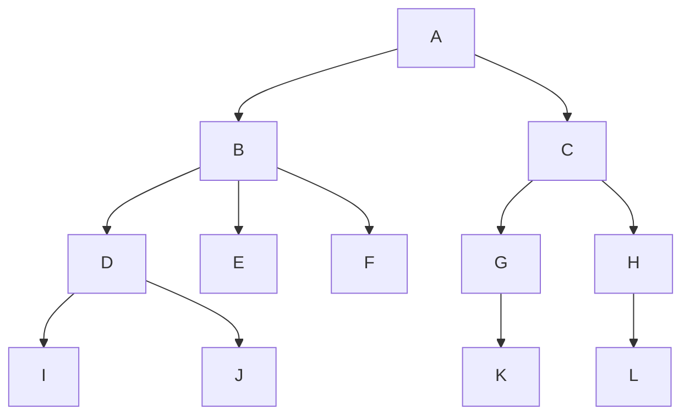

1. 樹葉與非終端節點各幾個？
2. 樹的分支度？
3. 樹的階度？
4. D 的兄弟？
5. L 的祖先？

### 詳解 {#q-terms-solution .fold}

1. 樹葉 6 個：E、F、I、J、K、L；非終端 6 個：A、B、C、D、G、H
2. **3**（B 有三個子節點）
3. **4**
4. **E、F**
5. **H、C、A**

見 [[ch6-tree#tree-basics|樹的基本概念]]。

## 左子右弟轉換 {#q-lcrs}

承上題，轉成左子右弟表示法（二元樹）。

### 詳解 {#q-lcrs-solution .fold}

最左子當左子樹、右邊兄弟當右子樹：

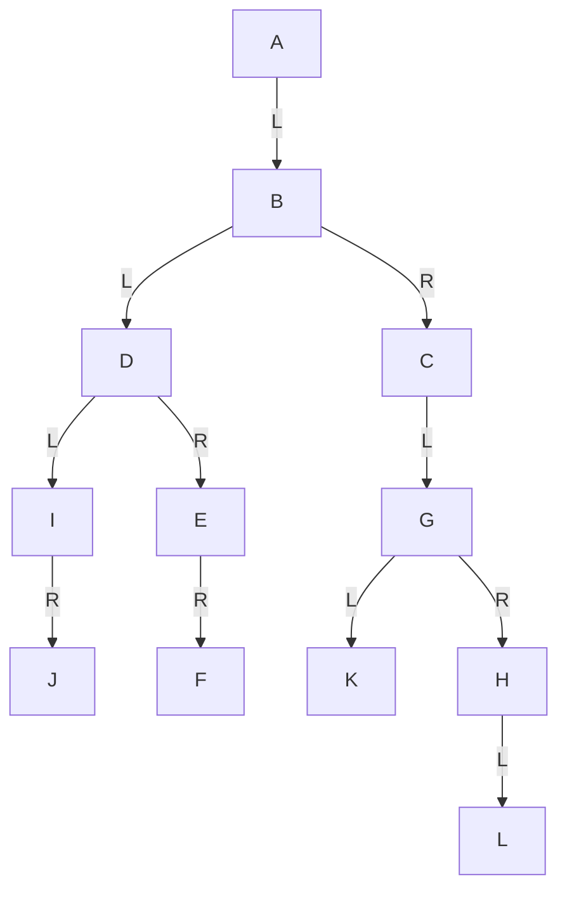

見 [[ch6-tree#left-child-right-sibling|左子右弟表示法]]。

## 二元樹的陣列表示 {#q-array-repr}

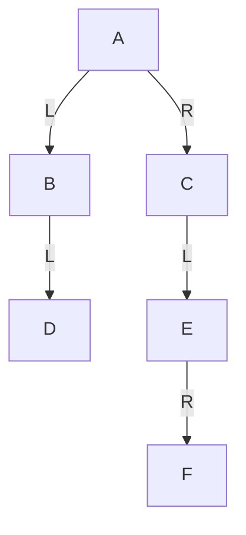

1. 用一維陣列表示。
2. 用二維陣列表示。

### 詳解 {#q-array-repr-solution .fold}

1. 依完滿二元樹編號（左子 $2i$、右子 $2i+1$）：

| 位置 | 1 | 2 | 3 | 4 | 5 | 6 | 7–12 | 13 | 14–15 |
|---|---|---|---|---|---|---|---|---|---|
| 節點 | A | B | C | D | | E | | F | |

E 在 6，F 是 E 的右子 → $2\times6+1 = 13$。深度 4 要 15 格只用 6 格，可見非完滿時很浪費。

2. 每個節點一列，填子節點的列號：

| 列 | 左子樹位置 | 資料 | 右子樹位置 |
|---|---|---|---|
| 1 | 2 | A | 3 |
| 2 | 4 | B | 0 |
| 3 | 5 | C | 0 |
| 4 | 0 | D | 0 |
| 5 | 0 | E | 6 |
| 6 | 0 | F | 0 |

（課本解答的位置欄填的是一維陣列編號，如 E 的右子填 13。）

## 最多節點數 {#q-max-nodes}

深度 $k$ 的二元樹最多幾個節點？深度 $k$ 的 $m$ 元樹呢？

### 詳解 {#q-max-nodes-solution .fold}

- 二元樹：$2^0+2^1+\cdots+2^{k-1} = $ **$2^k-1$**
- $m$ 元樹：$m^0+m^1+\cdots+m^{k-1} = $ **$\dfrac{m^k-1}{m-1}$**

## 追蹤（一） {#q-traversal-a}

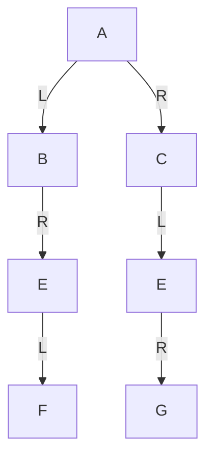

求前序、中序、後序。

### 詳解 {#q-traversal-a-solution .fold}

| 追蹤 | 結果 |
|---|---|
| 前序 | A B E F C E G |
| 中序 | B F E A E G C |
| 後序 | F E B G E C A |

## 追蹤（二） {#q-traversal-b}

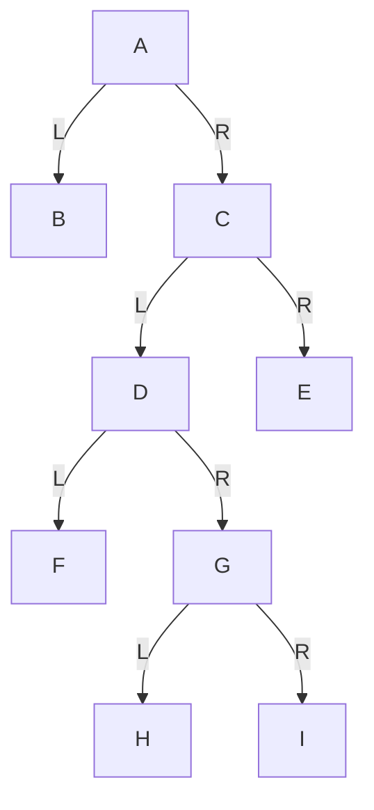

求前序、中序、後序。

### 詳解 {#q-traversal-b-solution .fold}

| 追蹤 | 結果 |
|---|---|
| 前序 | A B C D F G H I E |
| 中序 | B A F D H G I C E |
| 後序 | B F H I G D E C A |

見 [[ch6-tree#traversal|二元樹的追蹤]]。

## 由中序推所有可能的樹 {#q-inorder-trees}

三個節點 A、B、C 的二元樹，中序為 B、C、A，畫出所有可能。

### 詳解 {#q-inorder-trees-solution .fold}

三個節點的二元樹形狀共 5 種，依中序 B C A 填入，各得一棵：

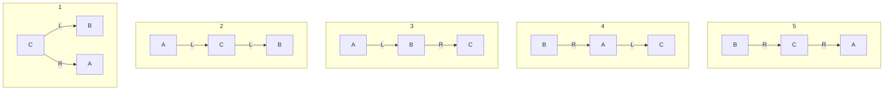

## 前序加中序重建 {#q-rebuild-pre-in}

前序 A B D E H C F I G，中序 D B H E A F I C G，畫出二元樹。

### 詳解 {#q-rebuild-pre-in-solution .fold}

1. 前序第一個 A 為樹根；中序中 A 左邊 {D B H E} 為左子樹、右邊 {F I C G} 為右子樹。
2. 左子樹前序 B D E H → 根 B；中序 D | B | H E → D 在左，{H E} 在右，前序 E H → E 為根、H 在 E 左邊。
3. 右子樹前序 C F I G → 根 C；中序 F I | C | G → {F I} 在左，前序 F I → F 為根、I 在 F 右邊；G 在右。

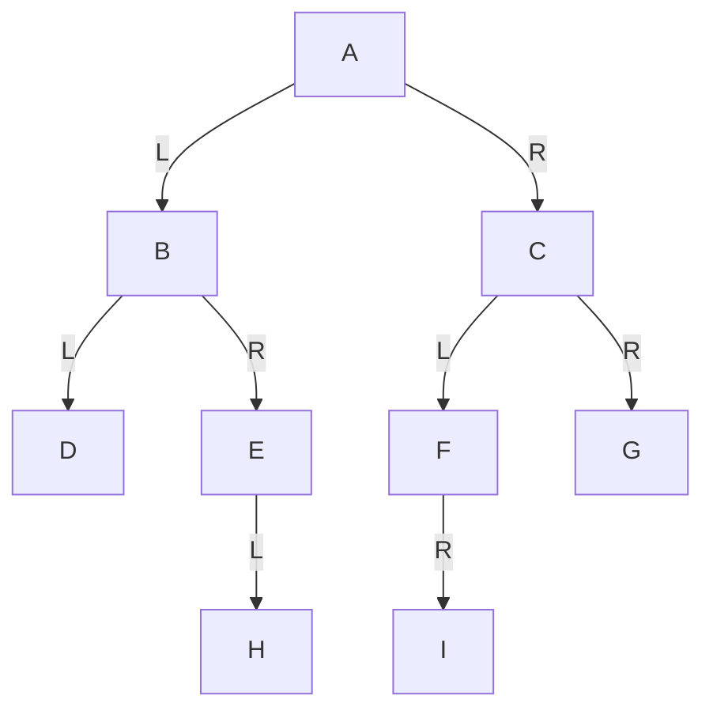

見 [[ch6-tree#rebuild-tree|由追蹤結果重建二元樹]]。

## 後序加中序重建 {#q-rebuild-post-in}

中序 D B E H A F C I G，後序 D H E B F I G C A，畫出二元樹。

### 詳解 {#q-rebuild-post-in-solution .fold}

1. 後序最後 A 為樹根；中序左 {D B E H}、右 {F C I G}。
2. 左子樹後序 D H E B → 根 B；中序 D | B | E H → D 在左；{E H} 後序 H E → E 為根、H 在 E 右邊。
3. 右子樹後序 F I G C → 根 C；中序 F | C | I G → F 在左；{I G} 後序 I G → G 為根、I 在 G 左邊。

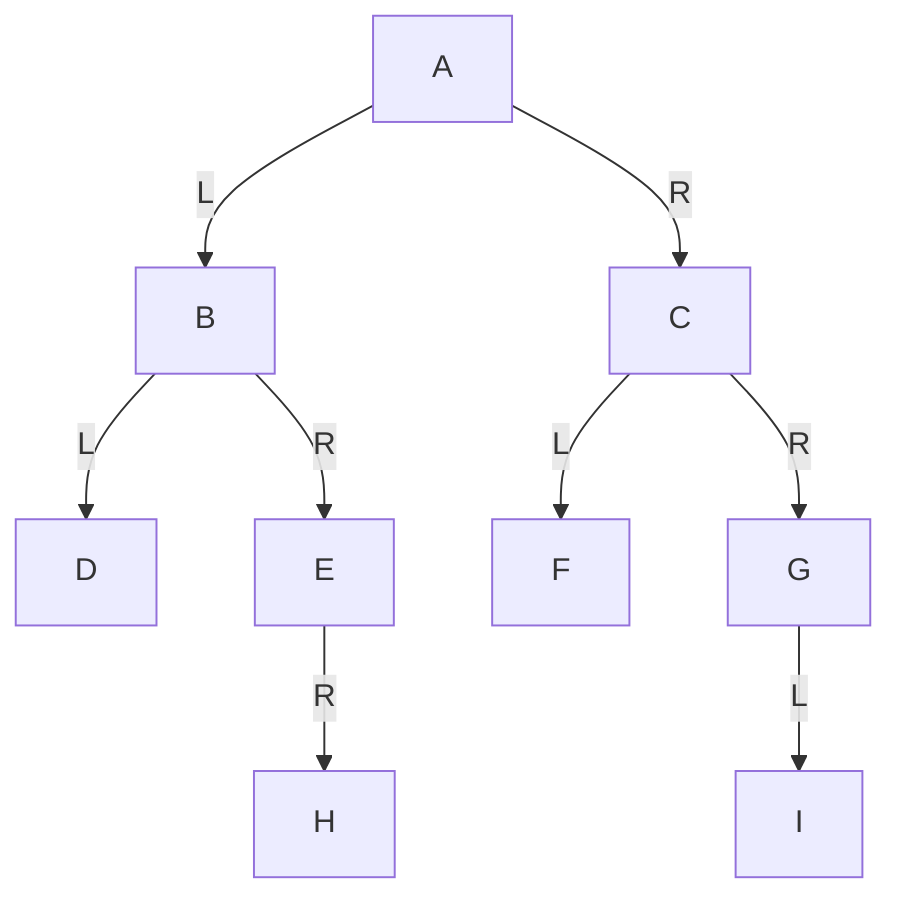

## 運算式樹 {#q-expression-tree}

將 `A*(B-C)/D+-E*F` 轉成二元樹（`-E` 為負號）。

### 詳解 {#q-expression-tree-solution .fold}

完整括號：`(((A*(B-C))/D)+((-E)*F))`，運算子為根、左右運算元為子樹；負號只有一個運算元。

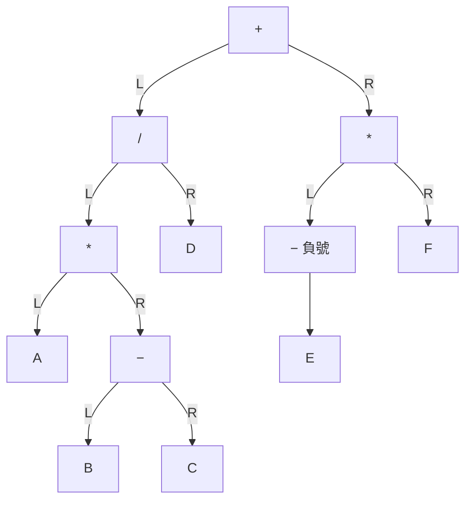

見 [[ch6-tree#expression-tree|運算式樹]]。

## 引線二元樹 {#q-threaded}

將下列二元樹轉成引線二元樹：A(左 B，右 C)，C(左 D，右 E)，D(左 F，右 G)，G(左 H，右 I)。

### 詳解 {#q-threaded-solution .fold}

中序：B A F D H G I C E。空的左鏈結指向中序前一個、空的右鏈結指向中序下一個，頭尾指向開頭節點：

| 節點 | 左引線 | 右引線 |
|---|---|---|
| B | 開頭節點 | A |
| F | A | D |
| H | D | G |
| I | G | C |
| E | C | 開頭節點 |

開頭節點的左鏈結指向 A，右鏈結指向自己。見 [[ch6-tree#threaded-binary-tree|引線二元樹]]。

## 追蹤的應用與引線樹優缺點 {#q-thread-pros-cons}

列舉二元樹追蹤的應用；相較於一般二元樹，引線二元樹有何優缺點？

### 詳解 {#q-thread-pros-cons-solution .fold}

追蹤的應用：運算式轉換、資料排序（二元搜尋樹中序）、資料搜尋。

引線二元樹：

- 優點：容易找中序的前一個與下一個節點；中序追蹤不需堆疊。
- 缺點：加入、刪除節點的成本較高（要改的鏈結與引線較多）。

## 建立二元搜尋樹 {#q-bst-build}

依序插入 42、9、11、71、61、78、28、99 建立二元搜尋樹，並寫出中序追蹤結果。

### 詳解 {#q-bst-build-solution .fold}

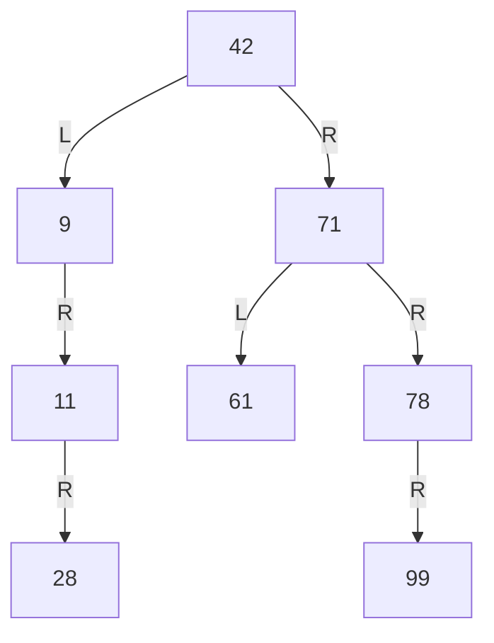

中序：**9, 11, 28, 42, 61, 71, 78, 99**（就是排序結果）。見 [[ch6-tree#bst|二元搜尋樹]]。

## 二元搜尋樹的刪除 {#q-bst-delete}

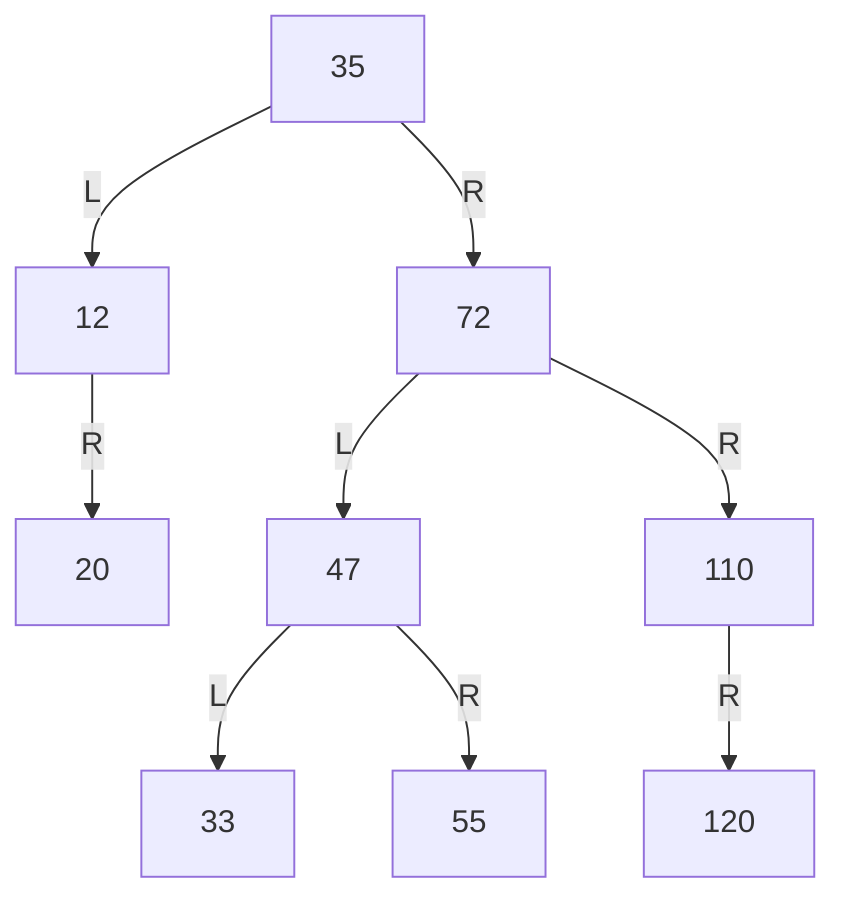

1. 刪除 12。
2. 接著刪除 35。

### 詳解 {#q-bst-delete-solution .fold}

1. 12 只有右子樹 → 35 的左鏈結改指 20。
2. 35 有兩個子樹 → 用中序後繼（右子樹最小）33 取代，33 原位置刪除。

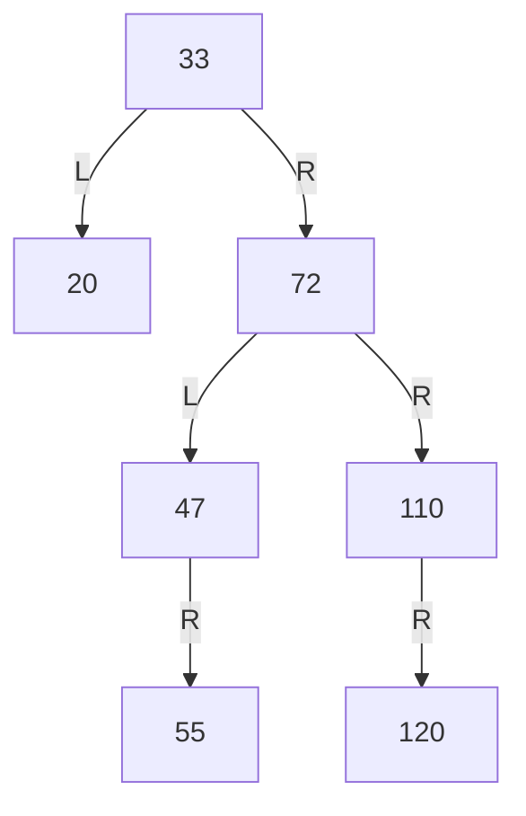

見 [[ch6-tree#bst-delete|二元搜尋樹的刪除]]。

## B 樹插入 {#q-btree-insert}

4 階 B 樹：樹根 [48, 120]；第二層 [24]、[55, 92]、[135, 210, 250]；[135, 210, 250] 的子節點為 [125]、[160, 188, 200]、[240]、[270]。插入 168。

### 詳解 {#q-btree-insert-solution .fold}

1. 168 放進 [160, 188, 200] → [160, 168, 188, 200]，超過 3 個鍵值 → 168 上送，分成 [160] 與 [188, 200]。
2. 父節點變 [135, 168, 210, 250]，也超過 → 168 再上送到樹根，分成 [135] 與 [210, 250]。
3. 樹根變 [48, 120, 168]，未超過，結束。

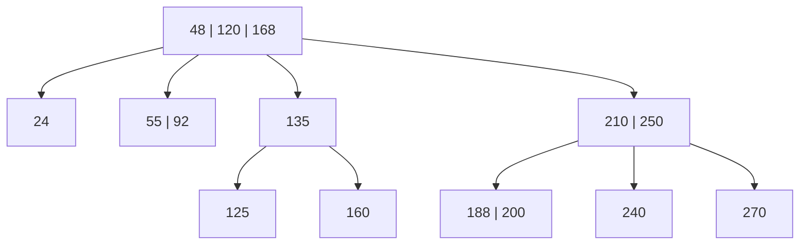

（[24]、[55, 92] 底下的樹葉不變，圖中省略。）見 [[ch6-tree#b-tree-insert|B 樹的插入]]。

## B 樹刪除 {#q-btree-delete}

4 階 B 樹：樹根 [48, 120]；[55, 92] 的子節點為 [52, 54]、[56, 72]、[96]。

1. 刪除 52。
2. 接著刪除 54。

### 詳解 {#q-btree-delete-solution .fold}

4 階 B 樹每個非根節點至少 $\lceil 4/2\rceil - 1 = 1$ 個鍵值。

1. [52, 54] 刪 52 後剩 [54]，仍有 1 個 → 直接刪除。
2. [54] 刪 54 後變空 → 右兄弟 [56, 72] 有多：父節點的分隔鍵值 55 下移、右兄弟最小的 56 上移。

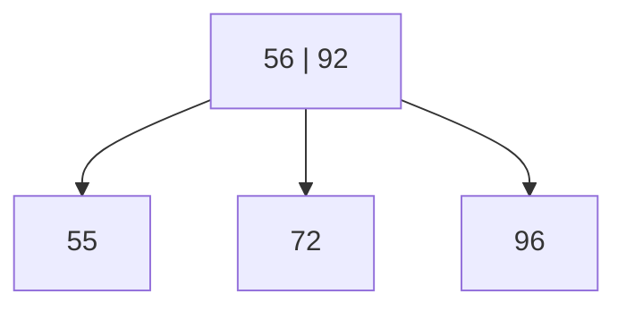

見 [[ch6-tree#b-tree-delete|B 樹的刪除]]。
