import { BTreeDeleteEx, BTreeInsertEx, BstTrace, ExprTreeEx, RebuildTree, ThreadedEx } from "./_TreeExercises.tsx";

題目來源：[[_pdf/習題解答-ch06(更新).pdf|習題解答 ch06]]。概念說明見 [[ch6-tree#ch6-map|第 6 章 樹狀結構]]。

## 樹的術語 {#q-terms}

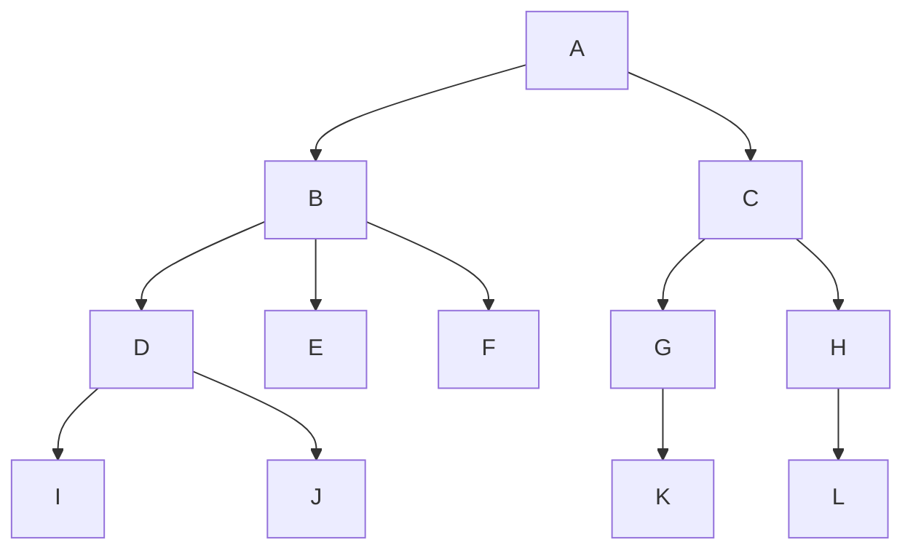

1. 樹葉與非終端節點各幾個？
2. 樹的分支度？
3. 樹的階度？
4. D 的兄弟？
5. L 的祖先？

### 詳解 {#q-terms-solution .fold}

1. **樹葉**是下面沒有東西的節點：E、F、I、J、K、L，共 **6** 個。其他的都是**非終端節點**：A、B、C、D、G、H，共 **6** 個。（檢查：6 + 6 = 12 個節點，全部數到了。）
2. **分支度**看哪個節點的子節點最多：B 有 D、E、F 三個 → **3**。
3. **階度**是總共幾層：A（第 1 層）→ B（2）→ D（3）→ I（4）→ **4**。
4. **兄弟**是同一個父節點的：D 的父節點是 B，B 的其他子節點是 **E、F**。
5. **祖先**是從父節點一路往上到樹根：L → **H、C、A**。

見 [[ch6-tree#tree-basics|樹的基本概念]]。

## 左子右弟轉換 {#q-lcrs}

把上一題「樹的術語」那棵樹轉成左子右弟表示法（二元樹）。

### 詳解 {#q-lcrs-solution .fold}

**規則**：每個節點的**左子**放「它最左邊的孩子」，**右子**放「它右邊的兄弟」。

逐個節點看：

| 節點 | 最左邊的孩子（→ 左子） | 右邊的兄弟（→ 右子） |
|---|---|---|
| A | B | 無 |
| B | D | C |
| C | G | 無 |
| D | I | E |
| E | 無 | F |
| G | K | H |
| H | L | 無 |
| I | 無 | J |

畫出來：

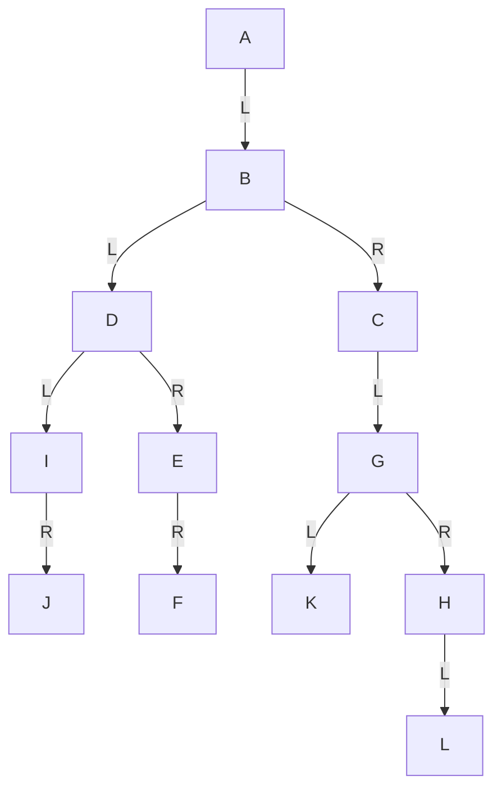

讀法：往左 = 下一代、往右 = 同一代的下一個。見 [[ch6-tree#left-child-right-sibling|左子右弟表示法]]。

## 二元樹的陣列表示 {#q-array-repr}

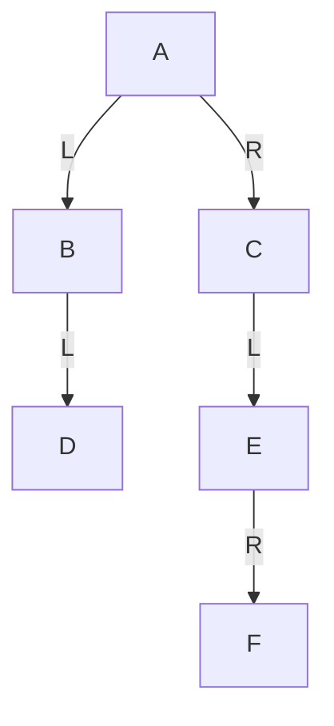

1. 用一維陣列表示。
2. 用二維陣列表示。

### 詳解 {#q-array-repr-solution .fold}

**1. 一維陣列**：樹根放第 1 格，節點 $i$ 的左子放 $2i$、右子放 $2i+1$。

- A 在 1
- B 是 A 的左子 → $2\times1 = 2$；C 是右子 → $2\times1+1 = 3$
- D 是 B 的左子 → $2\times2 = 4$
- E 是 C 的左子 → $2\times3 = 6$
- F 是 E 的右子 → $2\times6+1 = 13$

| 位置 | 1 | 2 | 3 | 4 | 5 | 6 | 7–12 | 13 | 14–15 |
|---|---|---|---|---|---|---|---|---|---|
| 節點 | A | B | C | D | | E | | F | |

深度 4 要準備 15 格，卻只存 6 個節點，樹不完滿時很浪費。

**2. 二維陣列**：每個節點佔一列，記（左子在第幾列, 資料, 右子在第幾列），沒有填 0。節點依 A、B、C、D、E、F 排在第 1 到 6 列：

| 列 | 左子樹位置 | 資料 | 右子樹位置 |
|---|---|---|---|
| 1 | 2 | A | 3 |
| 2 | 4 | B | 0 |
| 3 | 5 | C | 0 |
| 4 | 0 | D | 0 |
| 5 | 0 | E | 6 |
| 6 | 0 | F | 0 |

只要 6 列，不浪費。（課本解答的位置欄填的是一維陣列編號，例如 E 的右子填 13。）

見 [[ch6-tree#binary-tree-array|二元樹的一維陣列表示法]]。

## 最多節點數 {#q-max-nodes}

深度 $k$ 的二元樹最多幾個節點？深度 $k$ 的 $m$ 元樹呢？

### 詳解 {#q-max-nodes-solution .fold}

**思路**：每一層都塞滿時最多。每往下一層，節點數最多變成原本的 2 倍（$m$ 元樹是 $m$ 倍）。

**二元樹**：每層 1、2、4、…、$2^{k-1}$ 個，加起來 **$2^k-1$**。

例：深度 3 → $1 + 2 + 4 = 7 = 2^3 - 1$。

**$m$ 元樹**：每層 1、$m$、$m^2$、…、$m^{k-1}$ 個，加起來 **$\dfrac{m^k-1}{m-1}$**。

例：3 元樹深度 3 → $1 + 3 + 9 = 13 = \dfrac{27-1}{3-1}$。把 $m = 2$ 代入，就回到二元樹的 $2^k - 1$。

見 [[ch6-tree#binary-tree-properties|二元樹的性質]]。

## 追蹤（一） {#q-traversal-a}

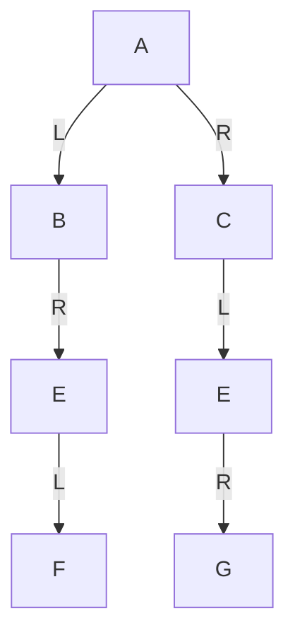

求前序、中序、後序。

### 詳解 {#q-traversal-a-solution .fold}

**手算技巧**：從樹根左邊出發，貼著樹的外圍逆時針繞一圈。經過節點**左側**時記下就是前序，經過**下方**是中序，經過**右側**是後序。

也可以用定義一層層拆（以前序 D→L→R 為例）：

1. 先 A，再做左子樹（以 B 為根）、再做右子樹（以 C 為根）。
2. 左子樹：B，B 沒有左子，做右子樹 E：E、F。→ B E F
3. 右子樹：C，做左子樹 E：E，E 沒有左子，做右子 G。→ C E G

| 追蹤 | 結果 |
|---|---|
| 前序 | A B E F C E G |
| 中序 | B F E A E G C |
| 後序 | F E B G E C A |

**檢查**：前序第一個、後序最後一個都是樹根 A。

## 追蹤（二） {#q-traversal-b}

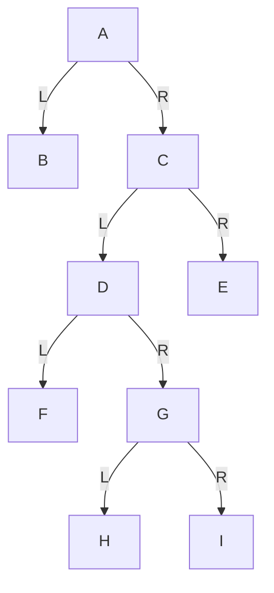

求前序、中序、後序。

### 詳解 {#q-traversal-b-solution .fold}

以中序（L→D→R）為例，一層層拆：

1. A 的左子樹只有 B → 先輸出 **B**，再輸出 **A**，再做右子樹 C。
2. C 的左子樹是 D：先做 D 的左子 **F**，再 **D**，再做 D 的右子樹 G。
3. G：先左子 **H**，再 **G**，再右子 **I**。
4. D 那邊做完了，輸出 **C**，再做 C 的右子 **E**。

| 追蹤 | 結果 |
|---|---|
| 前序 | A B C D F G H I E |
| 中序 | B A F D H G I C E |
| 後序 | B F H I G D E C A |

這棵樹可以在 [[ch6-tree#traversal|二元樹的追蹤]] 的互動圖（「一般樹」，多了一個 J）對照著看。

## 由中序推所有可能的樹 {#q-inorder-trees}

三個節點 A、B、C 的二元樹，中序為 B、C、A，畫出所有可能。

### 詳解 {#q-inorder-trees-solution .fold}

**思路**：只有中序不能決定一棵樹。三個節點的二元樹有 **5 種形狀**，每種形狀照中序（左 → 根 → 右）把 B、C、A 依序填進去，各得到一棵。

另一個想法：輪流讓 B、C、A 當樹根。

- **C 當樹根**：中序 B 在 C 左邊、A 在右邊 → 只有 1 種（圖 1）。
- **A 當樹根**：B、C 都在 A 左邊，B C 兩個節點排成左子樹有 2 種（圖 2、3）。
- **B 當樹根**：C、A 都在 B 右邊，同樣 2 種（圖 4、5）。

共 1 + 2 + 2 = 5 種：

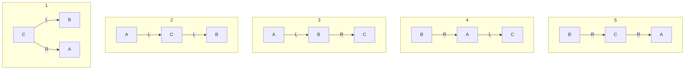

## 前序加中序重建 {#q-rebuild-pre-in}

前序 A B D E H C F I G，中序 D B H E A F I C G，畫出二元樹。

### 詳解 {#q-rebuild-pre-in-solution .fold}

**思路**：前序的**第一個**是樹根；在中序找到樹根，**左邊的全是左子樹、右邊的全是右子樹**。對兩邊重複同樣的事。

**第 1 輪：整棵樹**

- 前序第一個是 **A** → 樹根。
- 中序 `D B H E | A | F I C G` → 左子樹 \{D, B, H, E\}、右子樹 \{F, I, C, G\}。

**第 2 輪：左子樹 \{D, B, H, E\}**

- 前序中這四個依序是 B D E H，第一個 **B** 是根。
- 中序 `D | B | H E` → D 在 B 左邊，\{H, E\} 在 B 右邊。
- \{H, E\}：前序順序 E H → **E** 是根；中序 H E → H 在 E 左邊。

**第 3 輪：右子樹 \{F, I, C, G\}**

- 前序中依序是 C F I G，第一個 **C** 是根。
- 中序 `F I | C | G` → \{F, I\} 在 C 左邊，G 在右邊。
- \{F, I\}：前序 F I → **F** 是根；中序 F I → I 在 F 右邊。

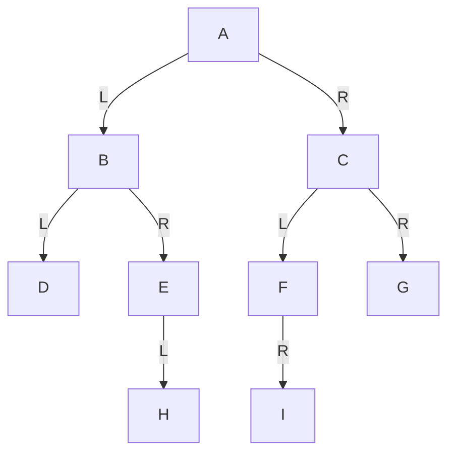

**逐步看**：每按一次處理一群節點，上面兩列標出這一輪的根和左右兩邊。

<RebuildTree kind="pre" other="A B D E H C F I G" inorder="D B H E A F I C G" />

**檢查**：對畫出來的樹再做一次前序和中序，要跟題目一樣。見 [[ch6-tree#rebuild-tree|由追蹤結果重建二元樹]]。

## 後序加中序重建 {#q-rebuild-post-in}

中序 D B E H A F C I G，後序 D H E B F I G C A，畫出二元樹。

### 詳解 {#q-rebuild-post-in-solution .fold}

**思路**：和前序版一樣，只是改看後序的**最後一個**當樹根。

**第 1 輪：整棵樹**

- 後序最後一個是 **A** → 樹根。
- 中序 `D B E H | A | F C I G` → 左子樹 \{D, B, E, H\}、右子樹 \{F, C, I, G\}。

**第 2 輪：左子樹 \{D, B, E, H\}**

- 後序中依序是 D H E B，最後一個 **B** 是根。
- 中序 `D | B | E H` → D 在左，\{E, H\} 在右。
- \{E, H\}：後序 H E → 最後的 **E** 是根；中序 E H → H 在 E 右邊。

**第 3 輪：右子樹 \{F, C, I, G\}**

- 後序中依序是 F I G C，最後一個 **C** 是根。
- 中序 `F | C | I G` → F 在左，\{I, G\} 在右。
- \{I, G\}：後序 I G → 最後的 **G** 是根；中序 I G → I 在 G 左邊。

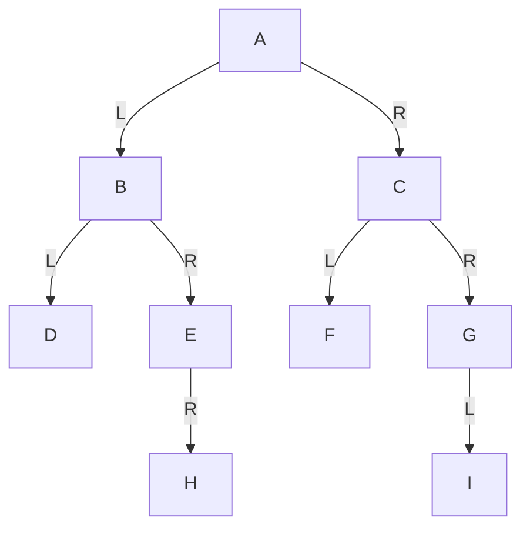

**逐步看**：

<RebuildTree kind="post" other="D H E B F I G C A" inorder="D B E H A F C I G" />

## 運算式樹 {#q-expression-tree}

將 `A*(B-C)/D+-E*F` 轉成二元樹（`-E` 為負號）。

### 詳解 {#q-expression-tree-solution .fold}

**思路**：最後才算的運算子當樹根，它的左右兩邊各自再變成子樹。

**步驟 1：決定計算順序，加上完整括號**

- 括號內 `B-C` 最先。
- 負號 `-E` 只作用在 E 上，先算。
- 左半 `A*(B-C)/D`：`*`、`/` 同級由左到右 → `((A*(B-C))/D)`。
- 右半 `(-E)*F`。
- 最後兩半用 `+` 相加：`(((A*(B-C))/D)+((-E)*F))`。

**步驟 2：由外往內畫**

- 最外層是 `+` → 樹根。左邊 `(A*(B-C))/D`、右邊 `(-E)*F`。
- 左邊最後算的是 `/`：左子 `A*(B-C)`、右子 D。
- `A*(B-C)`：`*` 的左子 A、右子 `B-C`（`−` 的左子 B、右子 C）。
- 右邊 `*`：左子是負號、右子 F。**負號只有一個運算元**，所以只有一個子節點 E。

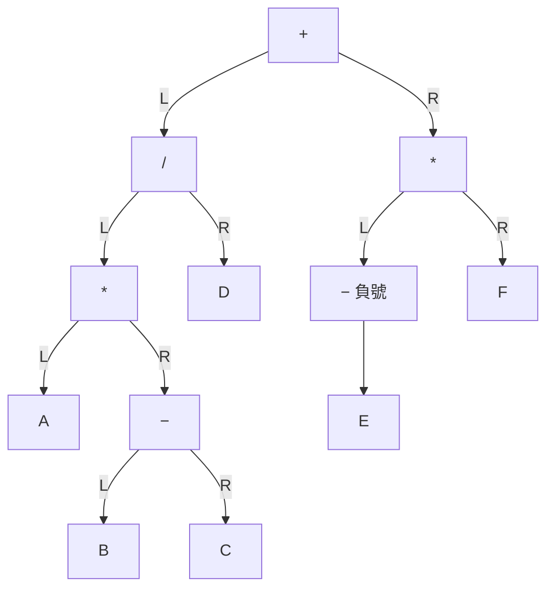

**逐步看**（由外往內拆）：

<ExprTreeEx />

見 [[ch6-tree#expression-tree|運算式樹]]。

## 引線二元樹 {#q-threaded}

將下列二元樹轉成引線二元樹：A(左 B，右 C)，C(左 D，右 E)，D(左 F，右 G)，G(左 H，右 I)。

### 詳解 {#q-threaded-solution .fold}

**思路**：先寫出中序。每個空的左指標指向「中序的前一個」，空的右指標指向「中序的下一個」，第一個和最後一個沒有鄰居的就指向開頭節點。

**步驟 1：中序**：B A F D H G I C E

**步驟 2：找出有空指標的節點**（沒有左子或沒有右子的）：B、F、H、I、E（都是樹葉，左右都空）。

**步驟 3：看它們在中序裡的左右鄰居**

| 節點 | 中序裡的位置 | 左引線（前一個） | 右引線（下一個） |
|---|---|---|---|
| B | 第 1 個 | 開頭節點（沒有前一個） | A |
| F | A 和 D 之間 | A | D |
| H | D 和 G 之間 | D | G |
| I | G 和 C 之間 | G | C |
| E | 最後一個 | C | 開頭節點（沒有下一個） |

開頭節點的左鏈結指向樹根 A，右鏈結指向自己。

**逐步看**：一次補一個節點的引線（虛線箭頭）。

<ThreadedEx tree="A(B,C(D(F,G(H,I)),E))" />

見 [[ch6-tree#threaded-binary-tree|引線二元樹]]。

## 追蹤的應用與引線樹優缺點 {#q-thread-pros-cons}

列舉二元樹追蹤的應用；相較於一般二元樹，引線二元樹有何優缺點？

### 詳解 {#q-thread-pros-cons-solution .fold}

**追蹤的應用**：

- 運算式轉換：運算式樹的前序、中序、後序就是前置、中置、後置式。
- 資料排序：二元搜尋樹的中序就是由小到大。
- 資料搜尋：走過每個節點找目標。

**引線二元樹**（把空指標拿來指向中序的前一個、後一個）：

- **優點**：找中序的前一個和下一個很容易，沿著引線走就到；中序追蹤不需要堆疊或遞迴。
- **缺點**：加入、刪除節點時，除了子樹指標還要維護引線和旗標，要改的東西比較多。

## 建立二元搜尋樹 {#q-bst-build}

依序插入 42、9、11、71、61、78、28、99 建立二元搜尋樹，並寫出中序追蹤結果。

### 詳解 {#q-bst-build-solution .fold}

**規則**：每個新數字從樹根開始比，**比較小往左、比較大往右**，走到空位就放下。

| 插入 | 比較過程 | 放在 |
|---|---|---|
| 42 | 樹是空的 | 樹根 |
| 9 | 9 小於 42 → 左 | 42 的左子 |
| 11 | 11 小於 42 → 左；11 大於 9 → 右 | 9 的右子 |
| 71 | 71 大於 42 → 右 | 42 的右子 |
| 61 | 大於 42 → 右；61 小於 71 → 左 | 71 的左子 |
| 78 | 大於 42 → 右；78 大於 71 → 右 | 71 的右子 |
| 28 | 小於 42 → 左；大於 9 → 右；大於 11 → 右 | 11 的右子 |
| 99 | 大於 42 → 右；大於 71 → 右；大於 78 → 右 | 78 的右子 |

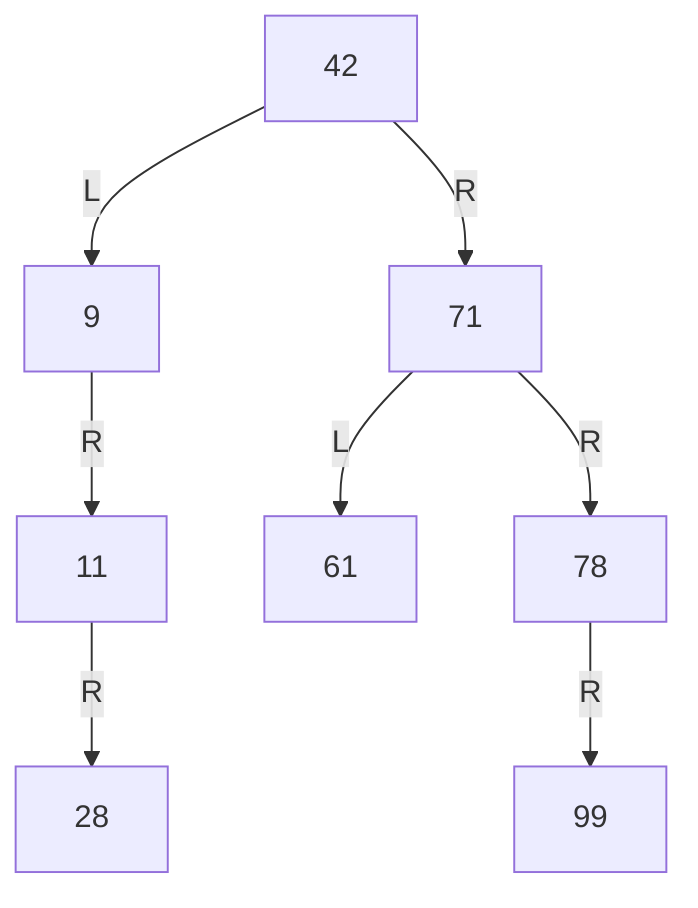

**逐步看**：每一步插入一個數字，淺色是比較過的節點。

<BstTrace insert={[42, 9, 11, 71, 61, 78, 28, 99]} />

中序：**9, 11, 28, 42, 61, 71, 78, 99**，剛好由小到大，可以拿來檢查樹有沒有畫錯。見 [[ch6-tree#bst|二元搜尋樹]]。

## 二元搜尋樹的刪除 {#q-bst-delete}

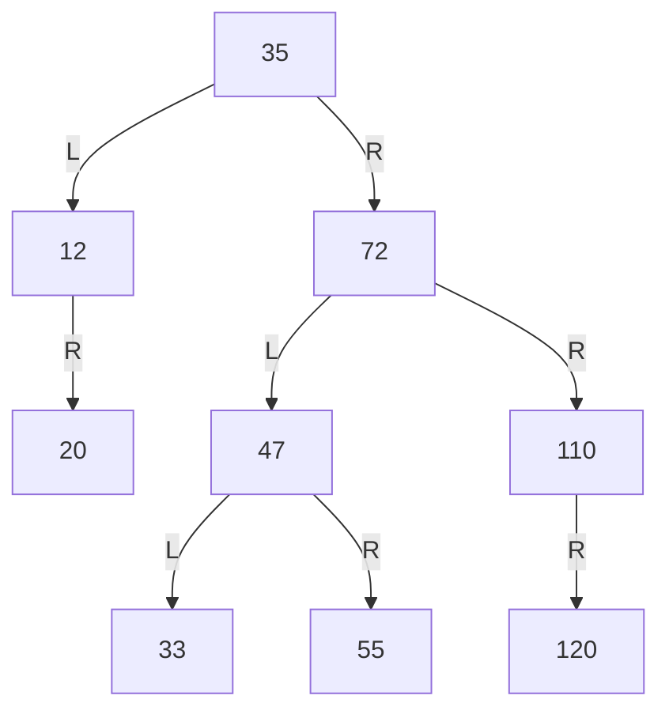

1. 刪除 12。
2. 接著刪除 35。

### 詳解 {#q-bst-delete-solution .fold}

**先看被刪節點有幾個子樹**，決定用哪種做法。

**1. 刪除 12**：12 只有一個子樹（右邊的 20）。直接讓 12 的父節點 35 改指向 20，20 頂替 12 的位置。20 比 35 小，放在 35 左邊仍然正確。

**2. 刪除 35**：35 有兩個子樹，不能直接拿掉。

1. 找**右子樹裡最小的**：進右子樹 72，一路往左走到底 → 72 → 47 → **33**。
2. 33 比左子樹全部大（大於 20）、比右子樹其他全部小，放在樹根剛好。
3. 用 33 取代 35，再把原本位置的 33 刪掉（33 是樹葉，直接刪）。

**注意**：題目的圖其實不是合法的二元搜尋樹：33 比 35 小，卻放在 35 的右子樹裡（課本原圖如此）。這裡照題目的圖操作，考試時照這個步驟寫即可。

**逐步看**：

<BstTrace start="35(12(,20),72(47(33,55),110(,120)))" remove={[12, 35]} />

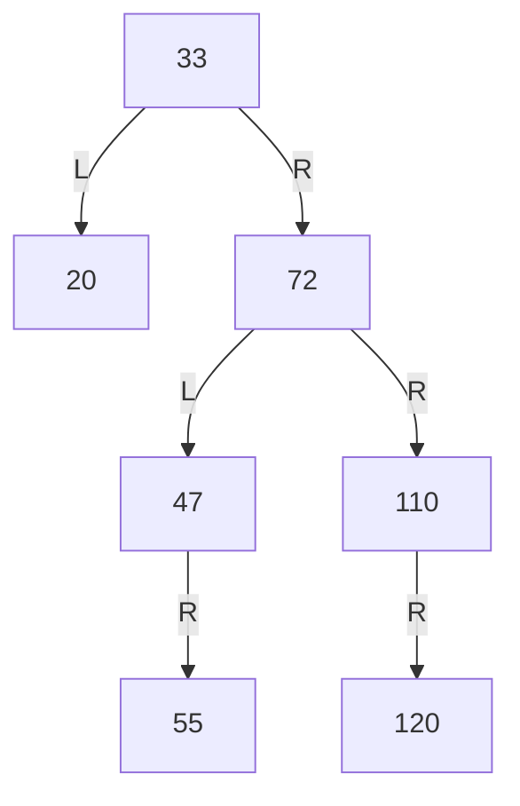

見 [[ch6-tree#bst-delete|二元搜尋樹的刪除]]。

## B 樹插入 {#q-btree-insert}

4 階 B 樹：樹根 [48, 120]；第二層 [24]、[55, 92]、[135, 210, 250]；[135, 210, 250] 的子節點為 [125]、[160, 188, 200]、[240]、[270]。插入 168。

### 詳解 {#q-btree-insert-solution .fold}

**規則**：4 階 B 樹每個節點最多 3 個鍵值。新鍵值先放進樹葉；超過 3 個就從中間切開，把**中間偏左的那個鍵值**往上送給父節點；父節點也超過就繼續往上切。

**步驟 1：找位置**。168 大於 120 → 走到 [135, 210, 250]；168 介於 135 和 210 之間 → 走到樹葉 [160, 188, 200]。

**步驟 2：放進樹葉**：[160, 168, 188, 200]，4 個太多。

- 切開：168 往上送，左邊 [160]、右邊 [188, 200]。

**步驟 3：父節點**收到 168：[135, 168, 210, 250]，4 個也太多。

- 切開：168 往上送，左邊 [135]、右邊 [210, 250]。
- 原本的子節點跟著分：[125]、[160] 歸左邊 [135]；[188, 200]、[240]、[270] 歸右邊 [210, 250]。

**步驟 4：樹根**收到 168：[48, 120, 168]，3 個沒超過，結束。

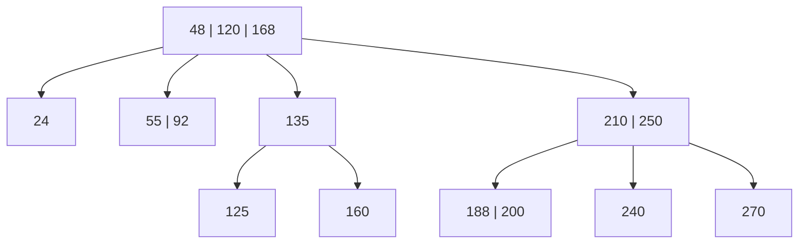

（[24]、[55, 92] 底下的樹葉不變，圖中省略。）

**逐步看**（虛線框 = 鍵值太多或太少）：

<BTreeInsertEx />
見 [[ch6-tree#b-tree-insert|B 樹的插入]]。

## B 樹刪除 {#q-btree-delete}

4 階 B 樹：樹根 [48, 120]；[55, 92] 的子節點為 [52, 54]、[56, 72]、[96]。

1. 刪除 52。
2. 接著刪除 54。

### 詳解 {#q-btree-delete-solution .fold}

**先算最少要幾個鍵值**：4 階 B 樹每個非樹根節點至少 $\lceil 4/2\rceil - 1 = 2 - 1 = 1$ 個。

**1. 刪除 52**：[52, 54] 刪掉 52 剩 [54]，還有 1 個，夠 → **直接刪除**。

**2. 刪除 54**：[54] 刪掉 54 變成空的，不夠了 → 看兄弟能不能借。

- 右兄弟 [56, 72] 有 2 個，借 1 個還剩 1 個，可以借。
- 不能直接把 56 搬過來，因為父節點的 55 是兩邊的分界（左邊要小於 55）。所以繞一圈：
  1. 父節點的分界 **55 下來**，放進空掉的節點 → [55]。
  2. 右兄弟最小的 **56 上去**，當新的分界 → 父節點變 [56, 92]。
  3. 右兄弟剩 [72]。

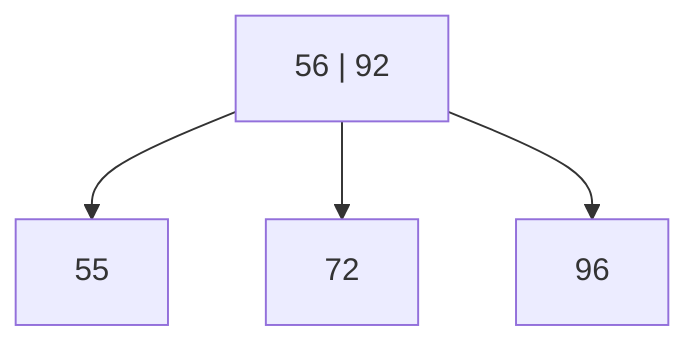

<BTreeDeleteEx />

**檢查**：55 小於 56、72 介於 56 和 92 之間、96 大於 92，左小右大仍然成立。見 [[ch6-tree#b-tree-delete|B 樹的刪除]]。
