## 名詞表 {#glossary}

| 中文 | English | 描述 |
|---|---|---|
| 樹根 | Root | 最上層、沒有父節點的節點 |
| 樹葉（終端節點） | Leaf / Terminal Node | 沒有子樹的節點 |
| 非終端節點 | Nonterminal Node | 至少有一個子樹的節點 |
| 分支度 | Degree | 節點的子樹個數；樹的分支度 = 所有節點分支度的最大值 |
| 階度 | Level | 樹根為第 1 階，往下每層 +1 |
| 高度（深度） | Height / Depth | 樹的最大階度 |
| 樹林 | Forest | 兩棵以上互斥的樹 |
| 追蹤 | Traversal | 依某順序拜訪所有節點 |
| 引線 | Thread | 把空鏈結改指向中序的前一個或後一個節點 |
| 平衡因子 | Balance Factor | 左子樹高度 − 右子樹高度 |

## 本章地圖 {#ch6-map}

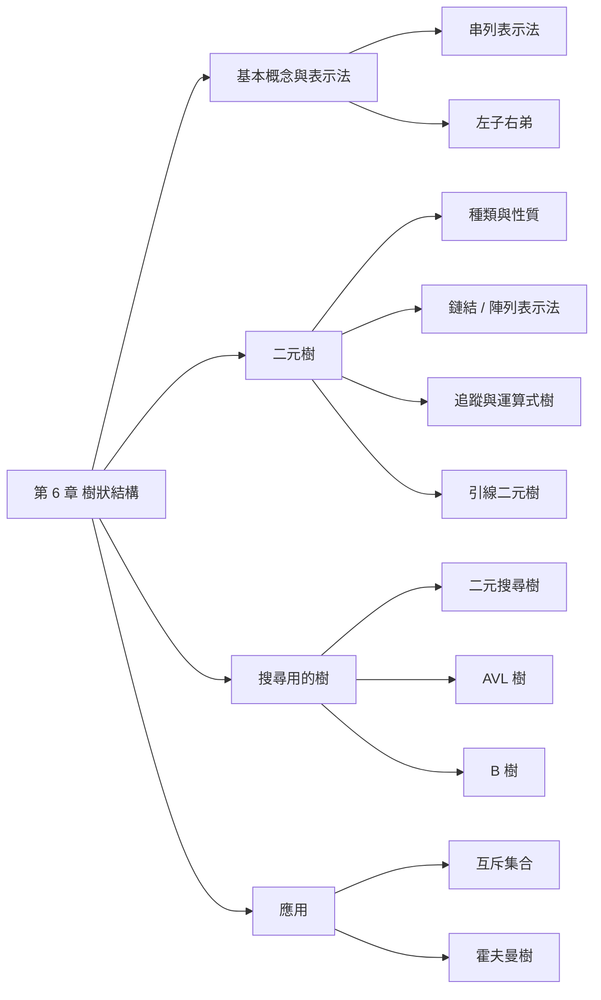

## 樹的基本概念 {#tree-basics}

**樹**是由一個**樹根**與 $N\ge0$ 個互斥**子樹**所組成的集合，能清楚表示資料之間上下、從屬的關係（檔案目錄、族譜、賽程表）。

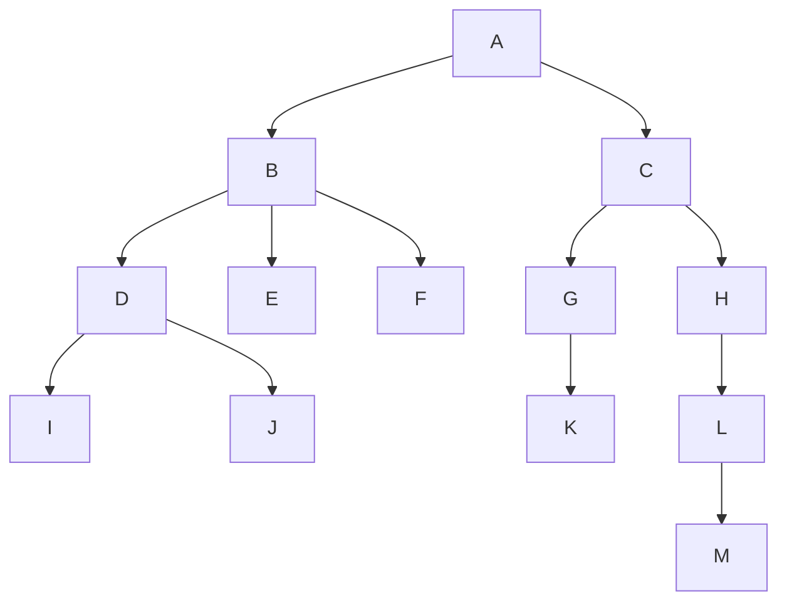

| 項目 | 本例 |
|---|---|
| 樹根 | A |
| 樹葉 | E、F、I、J、K、M（6 個） |
| 非終端節點 | A、B、C、D、G、H、L（7 個） |
| 樹的分支度 | 3（B 有 3 個子樹） |
| 階度（高度） | 5（A 第 1 階 … M 第 5 階） |
| D 的兄弟 | E、F（同一個父節點） |
| M 的祖先 | L、H、C、A（從父節點到樹根的路徑） |

## 樹的串列表示法 {#tree-list-repr}

**括號表示**：樹根後面接它的子樹群。上例為 `A(B(D(I,J),E,F),C(G(K),H(L(M))))`。

**鏈結表示**：每個節點放資料加 $d$ 個鏈結（$d$ 為樹的分支度）。

| 資料 | 子樹 1 | 子樹 2 | … | 子樹 $d$ |
|---|---|---|---|---|

缺點：浪費空間。$n$ 個節點共 $nd$ 個鏈結，只用到 $n-1$ 個，空鏈結有 $n(d-1)+1$ 個。

## 左子右弟表示法 {#left-child-right-sibling}

把任意樹轉成**二元樹**，每個節點只留兩個鏈結：

| data | left_most_child | right_sibling |
|---|---|---|

步驟：

1. 每個節點只保留連到**最左邊子節點**的鏈結。
2. 同一層的兄弟節點由左往右串起來。
3. 把兄弟鏈結當成**右子樹**、最左子鏈結當成**左子樹**（順時針轉 45 度）。

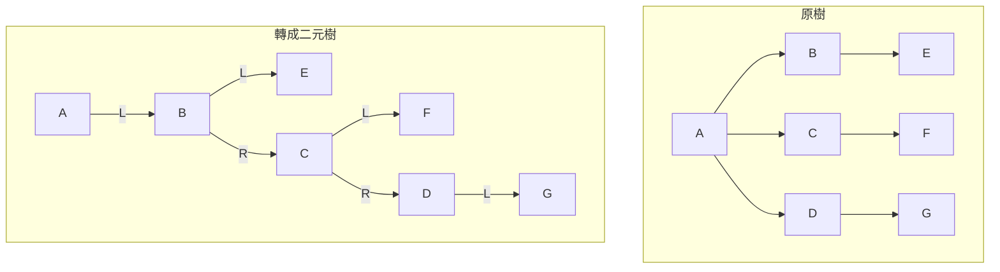

## 二元樹 {#binary-tree}

二元樹可以是**空樹**，或由樹根加上兩個互斥的**左子樹**和**右子樹**組成。每個節點分支度 ≤ 2，且**左右有別**（有序樹）。

一般樹與二元樹的差別：一般樹不能是空集合、子樹不分左右；二元樹可以為空、子樹分左右。

| 種類 | 定義 |
|---|---|
| 歪斜樹 Skewed | 所有節點都只有左子（或都只有右子） |
| 完滿二元樹 Full | 深度 $k$ 且節點數恰為 $2^k-1$：每個非終端節點都有兩個子節點、樹葉都在最底層 |
| 完整二元樹 Complete | 樹葉只在第 $k$ 或 $k-1$ 階；最底層節點從左往右排、中間不空（有右子必有左子） |

完整二元樹的節點數 ≤ 同深度完滿二元樹的節點數。

## 二元樹的性質 {#binary-tree-properties}

1. 第 $i$ 階最多 $2^{i-1}$ 個節點（$i\ge1$）。
2. 深度 $k$ 最多 $2^0+2^1+\cdots+2^{k-1} = 2^k-1$ 個節點（就是完滿二元樹）。
3. 樹葉數 $n_0$ = 分支度為 2 的節點數 $n_2$ + 1。

推導 3：節點數 $n = n_0+n_1+n_2$；除了樹根每個節點上方都有一條邊，邊數 $= n-1 = n_1 + 2n_2$。兩式相減得 $n_0 = n_2+1$。

推廣：深度 $k$ 的 $m$ 元樹最多 $\dfrac{m^k-1}{m-1}$ 個節點。

## 二元樹的鏈結表示法 {#binary-tree-linked}

| l_child | data | r_child |
|---|---|---|

```c
struct tnode {
    struct tnode *l_child;
    char data;
    struct tnode *r_child;
};
```

改變父子關係只要調整指標，插入刪除方便；缺點是樹葉的兩個鏈結都是空的，浪費空間。

## 二元樹的一維陣列表示法 {#binary-tree-array}

把二元樹看成完滿二元樹，由上到下、由左到右編號 1, 2, 3…，節點存在對應位置：

| 關係 | 位置 |
|---|---|
| 節點 $i$ 的左子 | $2i$ |
| 節點 $i$ 的右子 | $2i+1$ |
| 節點 $i$ 的父節點 | $\lfloor i/2\rfloor$ |

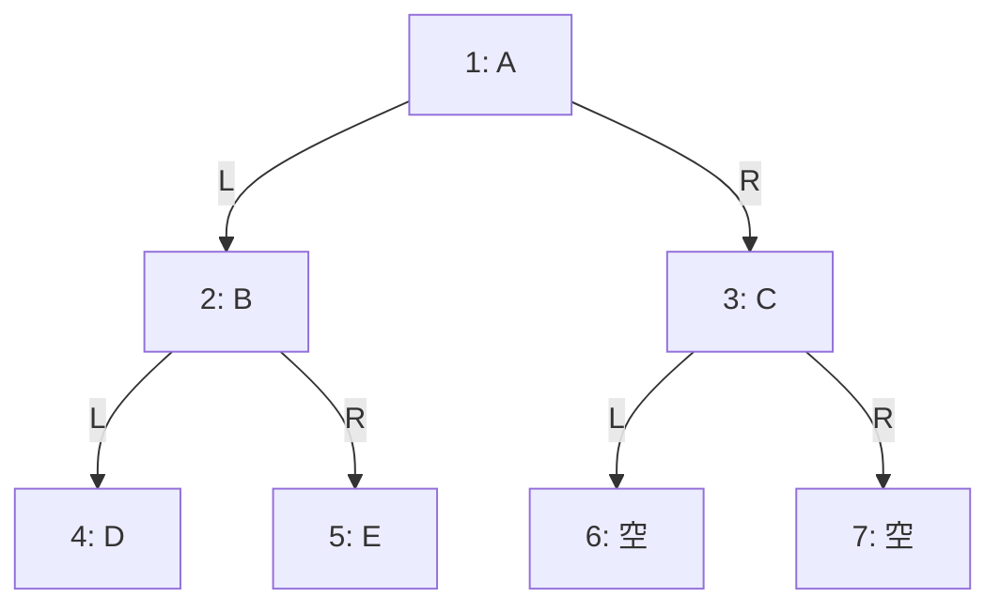

| 優點 | 缺點 |
|---|---|
| 接近完滿二元樹時很省空間 | 歪斜樹極浪費（深度 $k$ 要 $2^k-1$ 格卻只有 $k$ 個節點） |
| 用公式直接算父子位置 | 插入、刪除要搬大量資料 |

## 二元樹的二維陣列表示法 {#binary-tree-2d-array}

每個節點佔一列：(左子樹位置, 資料, 右子樹位置)，位置欄填子節點所在的**列號**，0 表示沒有。

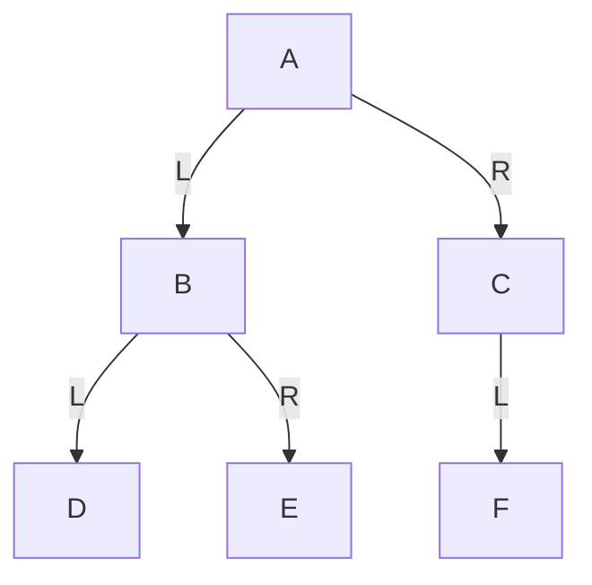

| 列 | 左子樹位置 | 資料 | 右子樹位置 |
|---|---|---|---|
| 1 | 2 | A | 3 |
| 2 | 4 | B | 5 |
| 3 | 6 | C | 0 |
| 4 | 0 | D | 0 |
| 5 | 0 | E | 0 |
| 6 | 0 | F | 0 |

## 二元樹的追蹤 {#traversal}

規定**先左後右**，依「資料 D」在什麼時候輸出分成三種：

| 追蹤 | 順序 | 記法 |
|---|---|---|
| 前序 Preorder | D → L → R | 先拜訪自己 |
| 中序 Inorder | L → D → R | 左子樹做完才拜訪自己 |
| 後序 Postorder | L → R → D | 兩個子樹都做完才拜訪自己 |

```c
void inorder(struct tnode *p) {
    if (p != NULL) {
        inorder(p->l_child);
        printf("%c ", p->data);     /* 這行放最前 = 前序，放最後 = 後序 */
        inorder(p->r_child);
    }
}
```

### 例子：三種追蹤 {#ex-traversal .fold}

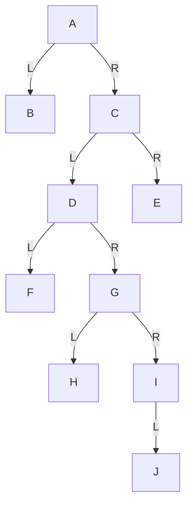

| 追蹤 | 結果 |
|---|---|
| 前序 | A B C D F G H I J E |
| 中序 | B A F D H G J I C E |
| 後序 | B F H J I G D E C A |

## 運算式樹 {#expression-tree}

把運算式轉成二元樹：**運算子當樹根，左運算元為左子樹、右運算元為右子樹**。做法：先加完整括號，由內而外把每個括號變成一棵子樹。

`((A-B)+(C*(D-E)/F))`：

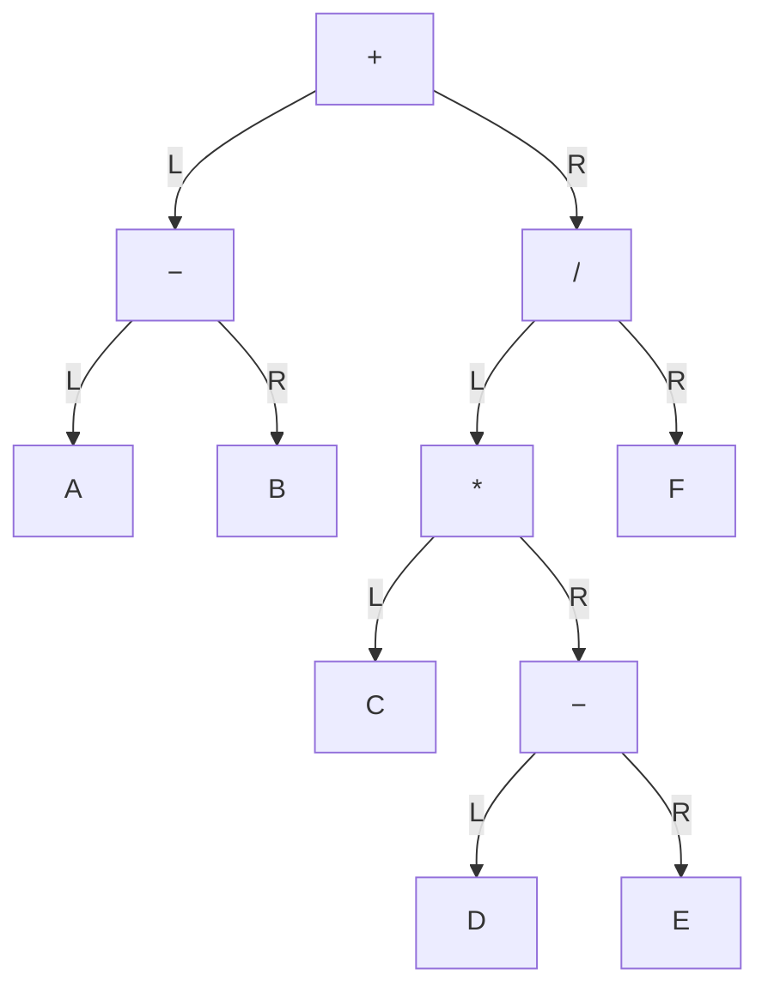

| 追蹤 | 結果 |
|---|---|
| 前序 → 前置式 | `+ - A B / * C - D E F` |
| 中序 → 中置式 | `A - B + C * D - E / F`（需補括號） |
| 後序 → 後置式 | `A B - C D E - * F / +` |

## 由追蹤結果重建二元樹 {#rebuild-tree}

**前序 + 中序**或**後序 + 中序**可以唯一決定一棵二元樹（只有前序 + 後序不行）。

1. 前序的**第一個**（或後序的**最後一個**）是樹根。
2. 在中序裡找到樹根，左邊是左子樹、右邊是右子樹。
3. 對左右子樹遞迴重複。

## 引線二元樹 {#threaded-binary-tree}

$n$ 個節點的二元樹有 $2n$ 個鏈結，只用到 $n-1$ 個，其餘 $n+1$ 個是空的。**引線**就是把這些空鏈結利用起來：

1. 加一個虛設的**開頭節點**，原樹當它的左子樹，它的右鏈結指向自己。
2. 空的**左**鏈結 → 指向**中序的前一個**節點（中序第一個節點指向開頭節點）。
3. 空的**右**鏈結 → 指向**中序的下一個**節點（中序最後一個節點指向開頭節點）。

節點加兩個旗標區分「真子樹」與「引線」：

| l_flag | l_child | data | r_child | r_flag |
|---|---|---|---|---|

旗標 1 表示一般鏈結、0 表示引線。

### 例子：引線怎麼接 {#ex-threads .fold}

沿用 [[ch6-tree#ex-traversal|三種追蹤]] 的樹，中序為 B A F D H G J I C E。

| 節點 | 左引線（中序前一個） | 右引線（中序下一個） |
|---|---|---|
| B | 開頭節點 | A |
| F | A | D |
| H | D | G |
| J | G | I |
| I | （有左子 J） | C |
| E | C | 開頭節點 |

## 引線二元樹的後繼與插入 {#thread-successor-insert}

找節點 $Y$ 的中序**後繼**：

```c
S = Y->r_child;
if (Y->r_flag == 0) return S;            /* 右邊是引線，直接就是後繼 */
while (S->l_flag == 1) S = S->l_child;   /* 否則到右子樹最左下 */
return S;
```

把新節點 $Y$ 插成 $X$ 的右子樹根：

1. `Y->r_child = X->r_child; Y->r_flag = X->r_flag;`（接手 X 原本的右鏈結或引線）
2. `Y->l_child = X; Y->l_flag = 0;`（左引線指回 X）
3. `X->r_child = Y; X->r_flag = 1;`
4. 若 Y 有右子樹：找 `Z = Successor(Y)`，`Z->l_child = Y`。

| 優點 | 缺點 |
|---|---|
| 容易找中序的前一個與下一個節點 | 插入、刪除要改的鏈結與引線較多 |
| 中序追蹤**不需堆疊**、不用遞迴 | 每個節點多兩個旗標 |

## 二元搜尋樹 {#bst}

每個節點的鍵值 **大於左子樹所有鍵值、小於或等於右子樹所有鍵值**，左右子樹也都是二元搜尋樹。**中序追蹤結果就是由小到大排序**。

建立：依序插入，每個新鍵值從樹根開始比較，小往左、大往右，走到空位放下。

依序插入 31, 76, 11, 47, 20, 55, 33, 120：

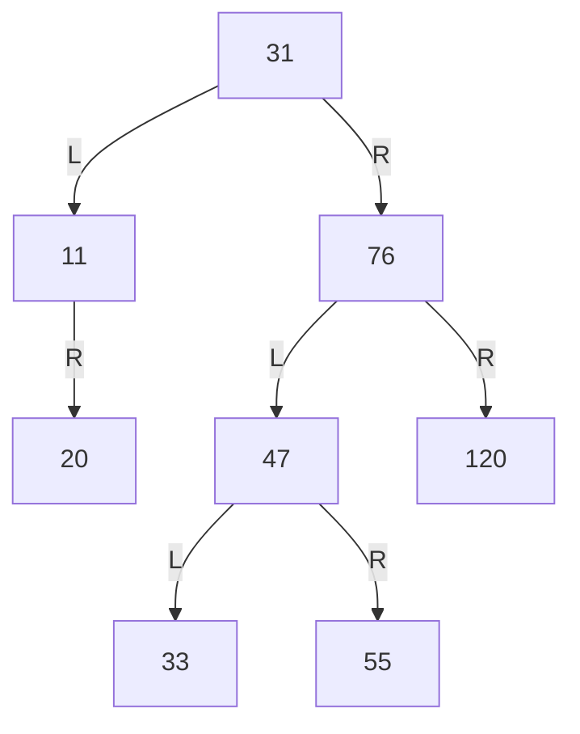

中序：11, 20, 31, 33, 47, 55, 76, 120。搜尋時間與樹高成正比，最好 $O(\log n)$，退化成歪斜樹時 $O(n)$。

## 二元搜尋樹的刪除 {#bst-delete}

| 被刪節點 | 做法 |
|---|---|
| 樹葉 | 直接刪除 |
| 只有一個子樹 | 父節點改指向那個子樹（例：刪 11 → 31 的左鏈結改指 20） |
| 有兩個子樹 | 用**中序後繼**（右子樹中最小的，即右子樹最左下）取代，再刪掉那個後繼節點 |

以上圖為例：刪 31 → 右子樹最小是 33，33 移到樹根；刪 76 → 右子樹最小是 120，120 移上來，左子樹仍是 47。

## AVL 樹 {#avl-tree}

**高度平衡二元樹**：是一棵二元搜尋樹，且每個節點的**平衡因子** $BF = h_L - h_R \in \{-1, 0, 1\}$。插入或刪除後若有節點 $|BF| = 2$，就要旋轉調整，讓樹保持矮胖。

調整時找**離新節點最近、$|BF|=2$ 的祖先** $A$，依新節點在 $A$ 的哪邊分四型：

| 型 | 新節點位置 | 調整 |
|---|---|---|
| LL | $A$ 的左子的**左**子樹 | 以 $A$ 右旋一次，左子變新根 |
| RR | $A$ 的右子的**右**子樹 | 以 $A$ 左旋一次，右子變新根 |
| LR | $A$ 的左子的**右**子樹 | 先左旋再右旋，左子的右子變新根 |
| RL | $A$ 的右子的**左**子樹 | 先右旋再左旋，右子的左子變新根 |

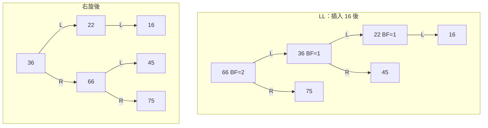

注意 LL 右旋時，原左子 36 的**右子樹 45** 改掛成 66 的左子樹。

### 例子：RR、LR、RL {#ex-avl-rotations .fold}

**RR**：36(24, 60(55, 88)) 插入 92 → 36 的 BF = −2，左旋：

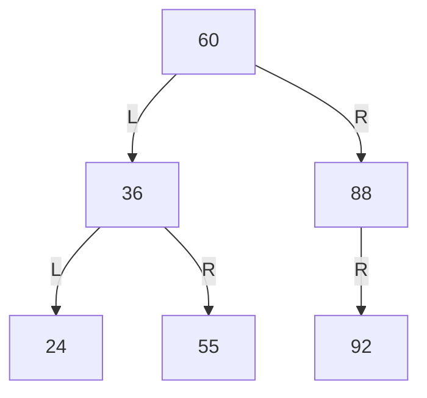

**LR（簡單）**：60 左子 36，插入 55（在 36 的右邊）→ 55 變新根，36 為左、60 為右。

**RL（簡單）**：36 右子 60，插入 55（在 60 的左邊）→ 55 變新根，36 為左、60 為右。

**LR（一般）**：88(60(46(22,55), 68(62,78)), 95(93,98)) 插入 64（在 62 的右）→ 88 的 BF = 2、60 的 BF = −1，屬 LR。68 變新根：68 的左子樹 62 改掛到 60 的右邊，右子樹 78 改掛到 88 的左邊：

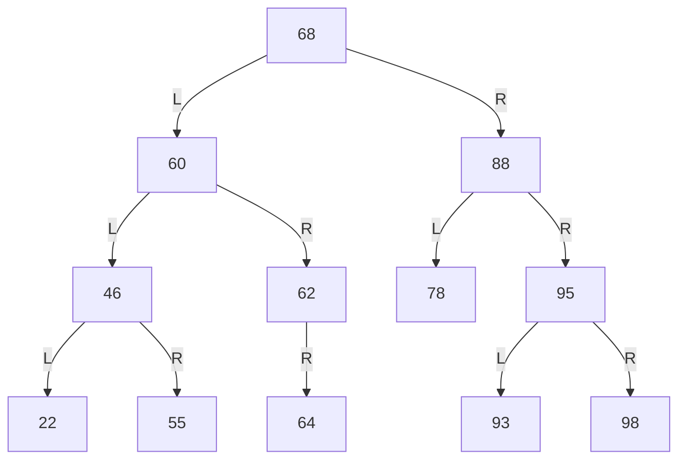

## 二元搜尋樹與 AVL 樹的用途 {#bst-vs-avl}

| | 二元搜尋樹 | AVL 樹 |
|---|---|---|
| 異動後 | 不保證矮胖，可能退化 | 永遠保持平衡 |
| 適合 | 固定不變的資料（程式語言保留字） | 常異動的動態資料（編譯器的符號表） |

## B 樹 {#b-tree}

**$m$ 階 B 樹**是多元搜尋樹，每個節點最多 $m-1$ 個鍵值、$m$ 個鏈結：

| $P_0$ | $K_1$ | $P_1$ | $K_2$ | … | $K_{m-1}$ | $P_{m-1}$ |
|---|---|---|---|---|---|---|

$P_{i-1}$ 指向的子樹鍵值都小於 $K_i$，$P_i$ 指向的子樹鍵值都大於 $K_i$。性質：

1. 樹根至少 2 個子節點（除非整棵樹只有樹根）。
2. 每個節點分支度 ≤ $m$，鍵值 ≤ $m-1$ 個。
3. 樹根以外的非終端節點至少 $\lceil m/2\rceil$ 個子節點（至少 $\lceil m/2\rceil - 1$ 個鍵值）。
4. **所有樹葉在同一層**。
5. 樹高只會在**樹根分裂**時增加。

4 階 B 樹每個節點有 2、3 或 4 個子節點，又叫 **2-3-4 樹**；3 階 B 樹又叫 **2-3 樹**。

## B 樹的插入 {#b-tree-insert}

找到該放的樹葉節點放進去；若鍵值數超過 $m-1$，就把節點**一分為二**，中間的鍵值往上送到父節點；父節點若也爆滿則繼續往上分裂，樹根分裂時樹高 +1。

4 階 B 樹插入 54：

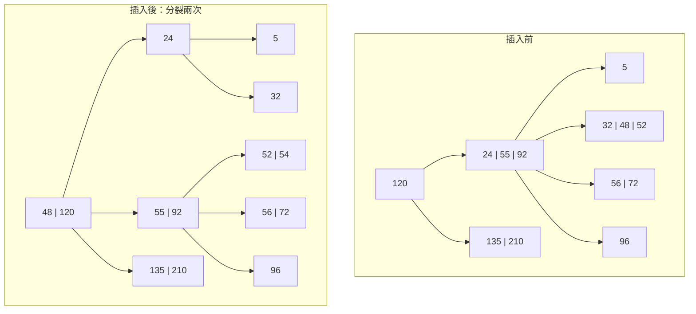

1. 54 放進 [32, 48, 52] → [32, 48, 52, 54] 超過 3 個，48 上送，分成 [32] 與 [52, 54]。
2. 父節點變 [24, 48, 55, 92] 也超過，48 再上送到樹根，分成 [24] 與 [55, 92]。

（右半邊 [135, 210] 的子樹 [125]、[160, 188]、[240] 不變，圖中省略。）

## B 樹的刪除 {#b-tree-delete}

令最少鍵值數 $N_K = \lceil m/2\rceil - 1$。

| 情況 | 做法 |
|---|---|
| 樹葉，刪後鍵值數 ≥ $N_K$ | 直接刪除 |
| 樹葉，刪後不足，**右兄弟有多的** | 父節點中夾在兩者之間的鍵值**下移**到本節點，右兄弟最小鍵值**上移**到父節點 |
| 樹葉，刪後不足，**左兄弟有多的** | 父節點的分隔鍵值下移，左兄弟最大鍵值上移 |
| 樹葉，兩邊兄弟都不夠 | 與兄弟**合併**，並把父節點的分隔鍵值拉下來；父節點不足時往上繼續處理 |
| 非終端節點 | 用**中序後繼**（右子樹最小鍵值）取代，再從樹葉刪除那個後繼，依上面規則處理 |

### 例子：3 階 B 樹連續刪除 {#ex-b-tree-delete .fold}

3 階：每節點 1–2 個鍵值，$N_K = 1$。

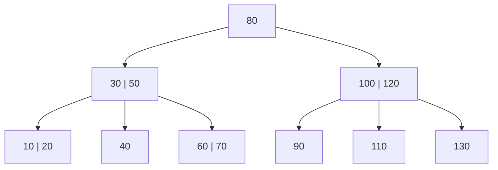

| 刪除 | 情況 | 結果 |
|---|---|---|
| 20 | 樹葉刪後仍有 [10] | 直接刪 |
| 40 | [40] 變空，右兄弟 [60, 70] 有多 | 50 下移、60 上移 → 父 [30, 60]，子 [10] [50] [70] |
| 90 | [90] 變空，右兄弟 [110] 不夠 | 合併：100 下移與 110 合成 [100, 110] → 父 [120]，子 [100, 110] [130] |
| 80 | 非終端（樹根） | 中序後繼 100 上來取代 → 根 [100]，右邊 [120] 的子 [110] [130] |

## 互斥集合 {#disjoint-sets}

**互斥集合**：任兩個集合交集為空。每個集合用一棵樹表示，整組就是一個**樹林**。

$S_1 = \{A,B,C,D\}$、$S_2 = \{E,F,G\}$、$S_3 = \{H,I,J,K\}$：

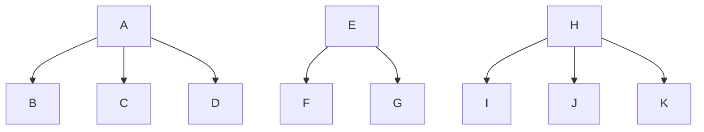

**聯集** `UNION(X, Y)`：把其中一棵樹的樹根接成另一棵樹根的子節點。$S_1 \cup S_2$ 可以讓 E 成為 A 的子節點，或讓 A 成為 E 的子節點，兩種都對。

## 霍夫曼樹 {#huffman}

**霍夫曼編碼**是無失真壓縮：出現頻率高的字元用短編碼、頻率低的用長編碼。

建樹步驟：

1. 每個字元一個樹葉節點，存它的出現頻率；所有樹葉放進集合 $L$。
2. 當 $L$ 不只一個節點：取出頻率**最低的兩個** $N_1$、$N_2$，產生新節點 $N$ 當它們的父節點，頻率 = 兩者相加，把 $N$ 放回 $L$。
3. 每個節點的兩條分支分別標 0、1，從樹根走到樹葉的 0/1 序列就是該字元的編碼。

例：h 1、y 1、a 2、p 4（共 8 次）：

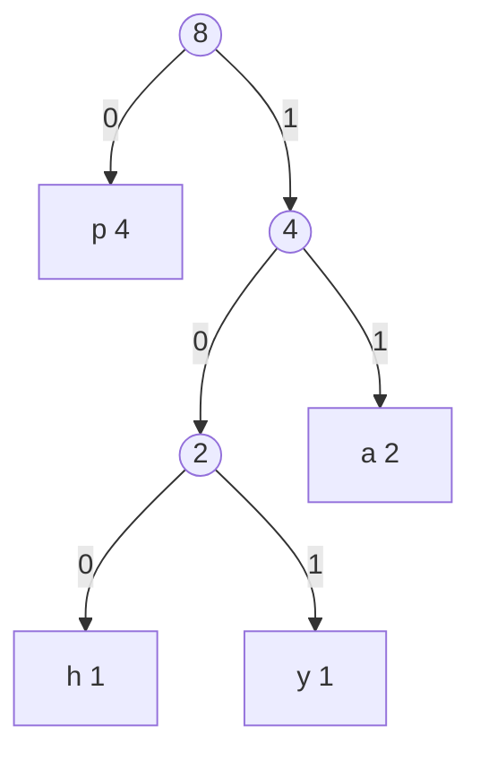

| 字元 | 頻率 | 編碼 | 長度 |
|---|---|---|---|
| p | 0.5 | 0 | 1 |
| a | 0.25 | 11 | 2 |
| h | 0.125 | 100 | 3 |
| y | 0.125 | 101 | 3 |

平均編碼長度 $= 0.5\times1 + 0.25\times2 + 0.125\times3\times2 = 1.75$ 位元。同頻率時合併順序可以不同，所以霍夫曼樹**不唯一**，但平均編碼長度相同（都是最短）。
