import TreeTraversal from "./_TreeTraversal.tsx";
import TreeArray from "./_TreeArray.tsx";
import BstPlay from "./_BstPlay.tsx";
import AvlRotate from "./_AvlRotate.tsx";
import Huffman from "./_Huffman.tsx";

## 代號意思表 {#symbol-table}

本章用到的符號。每個符號的詳細說明見對應區塊。

| 代號 | 意思 |
|---|---|
| $n$ | 節點總數 |
| $n_0$、$n_1$、$n_2$ | 分支度為 0（樹葉）、1、2 的節點個數 |
| $d$ | 樹的分支度（一個節點最多有幾個子樹） |
| $i$ | 階度（第幾層），或陣列表示法中節點的編號 |
| $k$ | 樹的深度（總共幾層） |
| $m$ | $m$ 元樹的分支數，或 $m$ 階 B 樹的階數 |
| $\lfloor x\rfloor$、$\lceil x\rceil$ | 無條件捨去、無條件進位 |
| $BF$ | 平衡因子 = 左子樹高度 − 右子樹高度 |
| $K_i$、$P_i$ | B 樹節點中的第 $i$ 個鍵值、第 $i$ 個指標 |
| $N_K$ | B 樹節點最少要有的鍵值數 |

## 名詞表 {#glossary}

| 中文 | English | 描述 |
|---|---|---|
| 樹根 | Root | 最上層、沒有父節點的節點 |
| 樹葉（終端節點） | Leaf / Terminal Node | 沒有子樹的節點 |
| 非終端節點 | Nonterminal Node | 至少有一個子樹的節點 |
| 分支度 | Degree | 節點的子樹個數；樹的分支度 = 所有節點分支度的最大值 |
| 階度 | Level | 樹根為第 1 階，往下每層 +1 |
| 高度（深度） | Height / Depth | 樹的最大階度 |
| 樹林 | Forest | 兩棵以上互斥的樹 |
| 追蹤 | Traversal | 依某順序拜訪所有節點 |
| 引線 | Thread | 把空鏈結改指向中序的前一個或後一個節點 |
| 平衡因子 | Balance Factor | 左子樹高度 − 右子樹高度 |

## 本章地圖 {#ch6-map}

前幾章的陣列、串列、堆疊、佇列都是「一條線」的結構。**樹**是第一個有「分岔」的結構，適合表示上下從屬關係（資料夾、族譜），也是快速搜尋的基礎。

這章的主線：先學術語 → 聚焦在每個節點最多兩個分岔的**二元樹** → 學會三種走訪（追蹤）→ 用二元樹做搜尋（**二元搜尋樹**），再加上自動保持平衡（**AVL 樹**）和一個節點放多個鍵值（**B 樹**）→ 最後兩個應用。

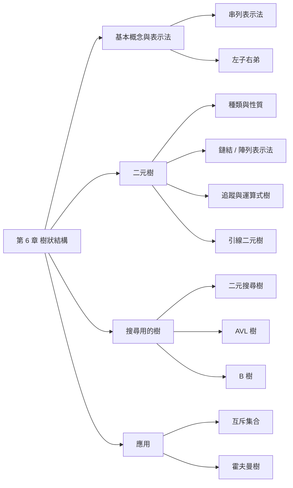

## 樹的基本概念 {#tree-basics}

**樹**就像倒過來的樹：最上面一個**樹根**，往下分岔出**子樹**，每個子樹又是一棵樹。電腦的資料夾、家族的族譜、比賽的賽程表都是樹。

正式定義：樹是由一個樹根與 0 個以上**互斥**（不相交）的子樹組成的集合。

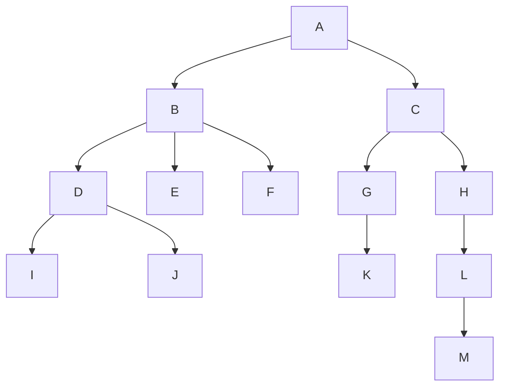

術語大多借用家族關係，看這棵樹記：

| 項目 | 意思 | 本例 |
|---|---|---|
| 樹根 | 最上面那個 | A |
| 樹葉 | 沒有子節點的（最底端） | E、F、I、J、K、M（6 個） |
| 非終端節點 | 不是樹葉的 | A、B、C、D、G、H、L（7 個） |
| 分支度 | 一個節點有幾個子節點；**樹的**分支度取最大的 | 樹的分支度 3（B 有 3 個子節點） |
| 階度 | 第幾層，樹根是第 1 層 | M 在第 5 層 |
| 高度 | 總共幾層 | 5 |
| 兄弟 | 同一個父節點的 | D 的兄弟是 E、F |
| 祖先 | 從父節點一路往上到樹根 | M 的祖先是 L、H、C、A |

## 樹的串列表示法 {#tree-list-repr}

**括號表示**：寫下樹根，後面用括號列出它的子樹，子樹再用同樣方法展開。[[ch6-tree#tree-basics|樹的基本概念]] 那棵樹寫成：

```
A(B(D(I,J),E,F),C(G(K),H(L(M))))
```

**鏈結表示**：每個節點放資料，再加 $d$ 個鏈結欄（$d$ 是樹的分支度），每欄指向一個子樹。

| 資料 | 子樹 1 | 子樹 2 | … | 子樹 $d$ |
|---|---|---|---|---|

**缺點是很浪費**：每個節點都要預留 $d$ 個鏈結欄，但大部分節點用不到那麼多。$n$ 個節點共有 $nd$ 個鏈結欄，可是除了樹根，每個節點只會被一條鏈結指到，所以只用到 $n-1$ 個，空的有 $nd-(n-1) = n(d-1)+1$ 個。

例：10 個節點、分支度 3 的樹，共 30 個鏈結欄，只用 9 個，空了 21 個。

## 左子右弟表示法 {#left-child-right-sibling}

**解決的問題**：一般樹每個節點的子節點數不一定，鏈結表示法很浪費。能不能讓每個節點**固定只用兩個鏈結**？

**想法**：每個節點只記兩件事：「我的**最左邊的孩子**是誰」和「我的**右邊那個兄弟**是誰」。要找其他孩子，就從最左邊的孩子沿著兄弟鏈結往右走。

| data | left_most_child | right_sibling |
|---|---|---|

轉換步驟：

1. 每個節點只保留連到**最左邊子節點**的線，其他往下的線拿掉。
2. 同一層的兄弟由左往右用線串起來。
3. 把「最左子」的線當成**左子樹**、「兄弟」的線當成**右子樹**（整個圖順時針轉 45 度），就變成二元樹。

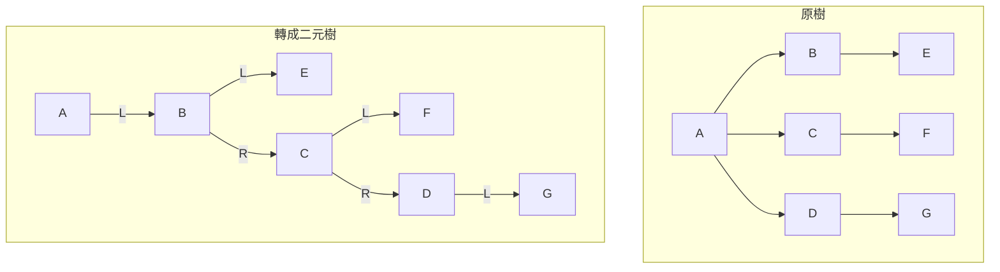

讀轉換後的二元樹：**往左走 = 往下一代，往右走 = 同一代的下一個兄弟**。所以 B 的右邊是 C、C 的右邊是 D，表示 B、C、D 是兄弟。

## 二元樹 {#binary-tree}

**二元樹**是每個節點**最多兩個子節點**的樹，而且分**左子**和**右子**（左右對調就是不同的樹）。它可以是**空樹**。

只有兩個分岔的好處是：每個節點固定兩個鏈結，表示和處理都很簡單；任何樹也都能用 [[ch6-tree#left-child-right-sibling|左子右弟表示法]] 轉成二元樹。

| | 一般樹 | 二元樹 |
|---|---|---|
| 可以是空的嗎 | 不行 | 可以 |
| 子樹分左右嗎 | 不分 | 分 |
| 每個節點的子節點 | 不限 | 最多 2 個 |

三種常見的形狀：

| 種類 | 長相 | 定義 |
|---|---|---|
| 歪斜樹 Skewed | 一路往同一邊斜下去 | 所有節點都只有左子（或都只有右子） |
| 完滿二元樹 Full | 每一層都塞滿 | 深度 $k$ 時節點數恰為 $2^k-1$ |
| 完整二元樹 Complete | 除了最底層都滿，最底層從左往右排、中間不空 | 有右子必有左子；樹葉只在最底兩層 |

完滿一定是完整，完整不一定是完滿。同深度下，完整二元樹的節點數 ≤ 完滿二元樹。

## 二元樹的性質 {#binary-tree-properties}

**每一層最多幾個節點**：第 1 層只有樹根 1 個，每往下一層，每個節點最多分出 2 個，所以數量最多翻倍：1、2、4、8…

- 第 $i$ 層最多 $2^{i-1}$ 個節點。
- 深度 $k$ 的樹最多 $1+2+4+\cdots+2^{k-1} = 2^k-1$ 個節點（每層都滿，就是完滿二元樹）。例：深度 3 最多 7 個。

**樹葉數和分岔節點數的關係**：

$$
n_0 = n_2 + 1
$$

樹葉數 = 有兩個子節點的節點數 + 1。例：完滿的深度 3 二元樹，有 4 片樹葉、3 個有兩個子節點的節點。直觀想法：從一個節點（是樹葉）開始，每把一片樹葉長成兩個子節點，樹葉數 −1 +2，淨多 1 片，同時多一個分支度 2 的節點；長成一個子節點則兩者都不變。

**推廣到 $m$ 元樹**：每個節點最多 $m$ 個子節點時，每層最多變成 $m$ 倍：1、$m$、$m^2$……所以深度 $k$ 的 $m$ 元樹最多 $1 + m + m^2 + \cdots + m^{k-1} = \dfrac{m^k-1}{m-1}$ 個節點。例：深度 3 的 3 元樹最多 $1 + 3 + 9 = 13$ 個。

### 為什麼 n0 = n2 + 1 {#leaf-count-proof .fold}

用兩種方法數節點數：

1. 依分支度分類：$n = n_0 + n_1 + n_2$。
2. 依邊數：除了樹根，每個節點上方都恰好有一條邊，所以邊數 $= n-1$；從上往下看，分支度 1 的節點貢獻 1 條邊、分支度 2 的貢獻 2 條，所以邊數 $= n_1 + 2n_2$。

得 $n - 1 = n_1 + 2n_2$，代入第 1 式：$n_0 + n_1 + n_2 - 1 = n_1 + 2n_2$，整理得 $n_0 = n_2 + 1$。

## 二元樹的鏈結表示法 {#binary-tree-linked}

每個節點三格：左子指標、資料、右子指標。

| l_child | data | r_child |
|---|---|---|

```c
struct tnode {
    struct tnode *l_child;
    char data;
    struct tnode *r_child;
};
```

優點：改變父子關係只要調整指標，插入刪除方便。缺點：樹葉的兩個指標都是空的，浪費空間（$n$ 個節點有 $n+1$ 個空指標，[[ch6-tree#threaded-binary-tree|引線二元樹]] 就是要利用它們）。

## 二元樹的一維陣列表示法 {#binary-tree-array}

**想法**：假裝這棵樹是完滿二元樹，由上到下、由左到右幫每個位置編號 1, 2, 3…，節點就存在陣列中對應編號的格子。

這樣編號有個好處：**不用存指標，用乘除法就能算出父子在哪**。

| 關係 | 位置 | 例：節點 3 |
|---|---|---|
| 左子 | $2i$ | 6 |
| 右子 | $2i+1$ | 7 |
| 父節點 | $\lfloor i/2\rfloor$（除以 2 捨去小數） | 1 |

點節點看它的父子在陣列第幾格，再切到「歪斜樹」看浪費的情形：

<TreeArray />

| 優點 | 缺點 |
|---|---|
| 接近完滿二元樹時很省空間 | 歪斜樹極浪費（深度 $k$ 要 $2^k-1$ 格卻只有 $k$ 個節點） |
| 用公式直接算父子位置 | 插入、刪除要搬大量資料 |

## 二元樹的二維陣列表示法 {#binary-tree-2d-array}

**想法**：用陣列模擬鏈結。每個節點佔一列，存（左子在第幾列, 資料, 右子在第幾列），0 表示沒有。等於把指標換成「列號」。

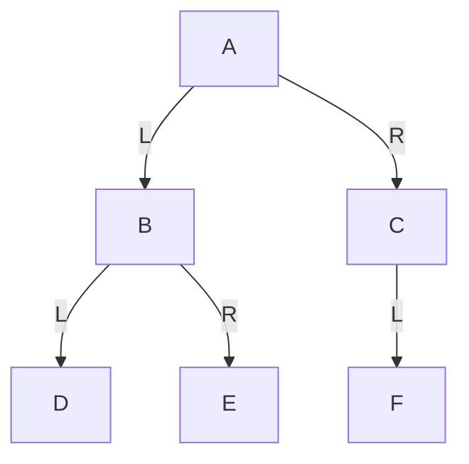

| 列 | 左子樹位置 | 資料 | 右子樹位置 |
|---|---|---|---|
| 1 | 2 | A | 3 |
| 2 | 4 | B | 5 |
| 3 | 6 | C | 0 |
| 4 | 0 | D | 0 |
| 5 | 0 | E | 0 |
| 6 | 0 | F | 0 |

讀法：第 1 列是 A，左子在第 2 列（B）、右子在第 3 列（C）。不管樹長什麼形狀，$n$ 個節點就只要 $n$ 列，不會像一維陣列那樣浪費。

## 二元樹的追蹤 {#traversal}

**追蹤**就是用固定順序把每個節點各拜訪一次。二元樹規定**先左後右**，三種追蹤的差別只在：**什麼時候輸出自己（D）**。

| 追蹤 | 順序 | 一句話 |
|---|---|---|
| 前序 Preorder | D → L → R | 一走到就先輸出自己 |
| 中序 Inorder | L → D → R | 左邊全部做完才輸出自己 |
| 後序 Postorder | L → R → D | 兩邊都做完才輸出自己 |

**口訣**：前、中、後指的是「D 在 L、R 的前面、中間、後面」。

**快速手算法**：沿著樹的外圍從樹根左邊出發，逆時針繞一圈（貼著每個節點走）。

- 前序：經過節點**左側**時輸出。
- 中序：經過節點**下方**時輸出。
- 後序：經過節點**右側**時輸出。

選一種順序按「下一步」，看每個節點在什麼時候被輸出：

<TreeTraversal />

程式三種只差 `printf` 放的位置：

```c
void inorder(struct tnode *p) {
    if (p != NULL) {
        inorder(p->l_child);
        printf("%c ", p->data);     /* 這行放最前 = 前序，放最後 = 後序 */
        inorder(p->r_child);
    }
}
```

### 例子：三種追蹤 {#ex-traversal .fold}

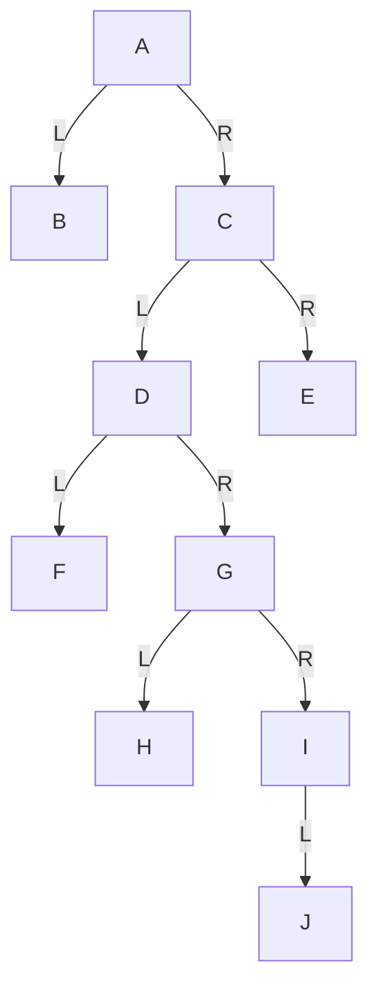

| 追蹤 | 結果 |
|---|---|
| 前序 | A B C D F G H I J E |
| 中序 | B A F D H G J I C E |
| 後序 | B F H J I G D E C A |

## 運算式樹 {#expression-tree}

運算式也能畫成二元樹：**運算子當節點，它的左運算元是左子樹、右運算元是右子樹**，運算元（A、B…）都是樹葉。越晚算的運算子越靠近樹根。

做法：先依計算順序加上完整括號，再由內而外把每對括號變成一棵小樹。

`((A-B)+(C*(D-E)/F))`：最後算的是 `+`，所以 `+` 是樹根。

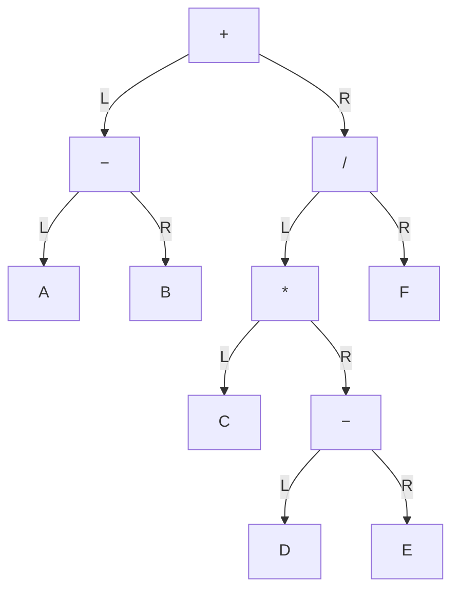

**用處**：對運算式樹做三種追蹤，正好得到三種運算式寫法（[[ch4-stack-queue#expression-notation|運算式的三種表示法]]）。在 [[ch6-tree#traversal|二元樹的追蹤]] 的互動圖選「運算式樹」可以一步步看。

| 追蹤 | 結果 |
|---|---|
| 前序 → 前置式 | `+ - A B / * C - D E F` |
| 中序 → 中置式 | `A - B + C * D - E / F`（需補括號） |
| 後序 → 後置式 | `A B - C D E - * F / +` |

## 由追蹤結果重建二元樹 {#rebuild-tree}

給兩種追蹤結果，能不能畫回原本的樹？

- **前序 + 中序**、**後序 + 中序**：可以，而且只有一種答案。
- 只有**前序 + 後序**：不行（分不出子節點在左還是右）。

**關鍵**：前序（或後序）告訴你**誰是樹根**，中序告訴你**哪些在左邊、哪些在右邊**。

1. 前序的**第一個**（或後序的**最後一個**）是樹根。
2. 在中序裡找到樹根，它左邊的全是左子樹、右邊的全是右子樹。
3. 對左右子樹各自重複，直到每邊只剩一個。

例：前序 A B D E C F，中序 D B E A F C。

1. 前序第一個 A 是樹根。中序以 A 切開：左邊 D B E、右邊 F C。
2. 左子樹的前序是 B D E，樹根 B；中序 D B E 以 B 切開：D 在左、E 在右。
3. 右子樹的前序是 C F，樹根 C；中序 F C：F 在 C 的左邊。

結果：A 的左子 B（左 D、右 E），右子 C（左 F）。

## 引線二元樹 {#threaded-binary-tree}

**問題**：$n$ 個節點的二元樹共有 $2n$ 個指標欄，但只有 $n-1$ 條真正的父子連線，剩下 $n+1$ 個指標都是空的。另外，中序追蹤要用遞迴（也就是堆疊），找「中序的下一個」很麻煩。

**想法**：把這些空指標拿來當「捷徑」，叫做**引線**：

- 空的**左**指標 → 改指向中序的**前一個**節點。
- 空的**右**指標 → 改指向中序的**下一個**節點。

這樣沿著引線就能直接找到中序的前後，中序追蹤不用堆疊。

細節：

1. 加一個虛設的**開頭節點**，原樹當它的左子樹，它的右指標指向自己。
2. 中序第一個節點的左引線、中序最後一個節點的右引線，都指向開頭節點（沒有前一個／下一個時有地方可指）。
3. 指標欄現在可能是真的子樹，也可能是引線，所以每個節點加兩個**旗標**區分：1 表示一般鏈結、0 表示引線。

| l_flag | l_child | data | r_child | r_flag |
|---|---|---|---|---|

### 例子：引線怎麼接 {#ex-threads .fold}

沿用 [[ch6-tree#ex-traversal|三種追蹤]] 的樹，中序為 B A F D H G J I C E。先寫出中序，每個空指標就看它在中序裡的左右鄰居。

| 節點 | 左引線（中序前一個） | 右引線（中序下一個） |
|---|---|---|
| B | 開頭節點 | A |
| F | A | D |
| H | D | G |
| J | G | I |
| I | （有左子 J） | C |
| E | C | 開頭節點 |

## 引線二元樹的後繼與插入 {#thread-successor-insert}

**找節點 Y 的中序下一個（後繼）**：

- Y 的右邊是**引線** → 引線指的就是答案。
- Y 的右邊是**真的右子樹** → 中序下一個是右子樹裡最先被輸出的，也就是**右子樹一路往左走到底**的那個。

```c
S = Y->r_child;
if (Y->r_flag == 0) return S;            /* 右邊是引線，直接就是後繼 */
while (S->l_flag == 1) S = S->l_child;   /* 否則到右子樹最左下 */
return S;
```

**把新節點 Y 插成 X 的右子樹根**：Y 接手 X 原本的右邊，X 的右邊改成 Y。

1. `Y->r_child = X->r_child; Y->r_flag = X->r_flag;`（Y 接手 X 原本的右鏈結或引線）
2. `Y->l_child = X; Y->l_flag = 0;`（Y 沒有左子，左引線指回中序前一個，也就是 X）
3. `X->r_child = Y; X->r_flag = 1;`（X 的右子變成 Y）
4. 若 Y 有右子樹：找 `Z = Successor(Y)`，原本指向 X 的左引線要改成指向 Y：`Z->l_child = Y`。

| 優點 | 缺點 |
|---|---|
| 容易找中序的前一個與下一個節點 | 插入、刪除要改的鏈結與引線較多 |
| 中序追蹤**不需堆疊**、不用遞迴 | 每個節點多兩個旗標 |

## 二元搜尋樹 {#bst}

**想法**：讓二元樹本身就排好序，搜尋時像猜數字遊戲，每比一次就能排除一半。

**規則**：每個節點的**左子樹全部比它小**，**右子樹全部大於或等於它**，左右子樹也都遵守同樣規則。

- **搜尋**：從樹根開始比，比較小往左、比較大往右，直到找到或走到空的地方（不存在）。
- **插入**：同樣一路比下去，走到空位就放下。
- **中序追蹤**（左 → 自己 → 右）的結果剛好**由小到大排序**。

按「插入下一個」看每個數字怎麼找到自己的位置，建好後再點數字試刪除：

<BstPlay />

依序插入 31, 76, 11, 47, 20, 55, 33, 120 的結果：

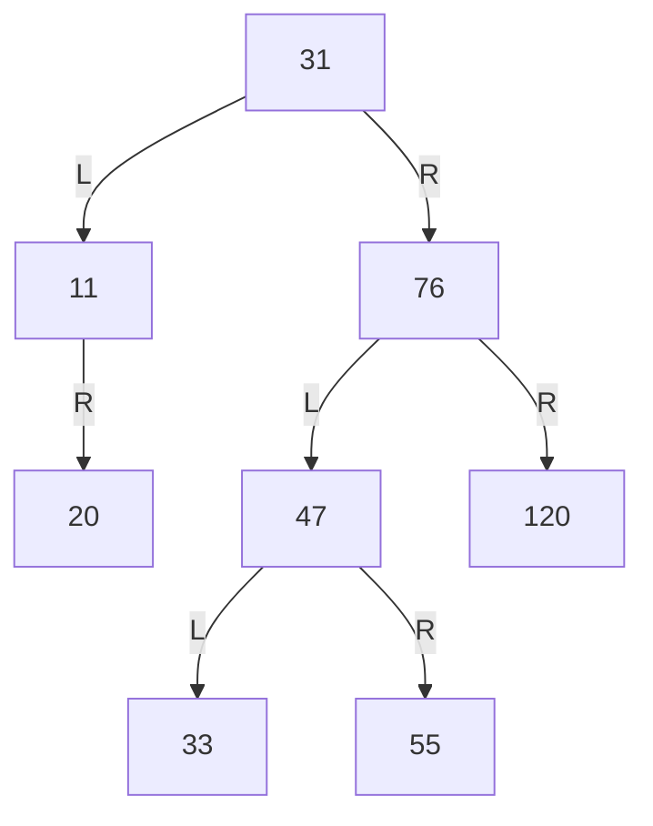

中序：11, 20, 31, 33, 47, 55, 76, 120。

**速度看樹高**：搜尋最多比較「樹高」次。樹長得矮胖時約 $\log_2 n$ 次（1000 筆約 10 次）；但如果依序插入已排好的資料（1, 2, 3, 4…），樹會一路往右斜成一條線，退化成要比 $n$ 次，跟循序搜尋一樣慢。這就是 [[ch6-tree#avl-tree|AVL 樹]] 要解決的問題。

## 二元搜尋樹的刪除 {#bst-delete}

刪掉一個節點後，樹仍要遵守「左小右大」。依被刪節點有幾個子樹分三種：

| 被刪節點 | 做法 | 為什麼 |
|---|---|---|
| 樹葉 | 直接刪除 | 沒有子樹要安置 |
| 只有一個子樹 | 父節點改指向那個子樹 | 那個子樹整串都在同一邊，接上去仍然左小右大 |
| 有兩個子樹 | 用**中序後繼**（右子樹中最小的）取代，再刪掉那個後繼 | 它比左子樹全部大、比右子樹其他全部小，放在這個位置剛好 |

「右子樹中最小的」怎麼找：進右子樹後**一路往左走到底**。

以 [[ch6-tree#bst|二元搜尋樹]] 那棵樹為例：

- 刪 11（只有右子樹 20）→ 31 的左指標改指 20。
- 刪 31（兩個子樹）→ 右子樹最小是 33，33 移到樹根。
- 刪 76（兩個子樹）→ 右子樹只有 120，120 移上來，左子樹仍是 47。

## AVL 樹 {#avl-tree}

**解決的問題**：二元搜尋樹可能長歪，搜尋變慢。**AVL 樹**在每次插入或刪除後檢查，一發現長歪就立刻「轉」回來，讓樹一直保持矮胖。

**怎麼判斷長歪**：每個節點算**平衡因子** $BF$ = 左子樹高度 − 右子樹高度。

- $BF$ 是 −1、0、1 → 左右差不多高，沒問題。
- $BF$ 是 2 或 −2 → 一邊比另一邊高了 2 層，**要調整**。

**調整方法**：找到離新節點最近、$|BF| = 2$ 的祖先，叫它 $A$。看新節點加在 $A$ 的哪個方向，分四型：

| 型 | 新節點在哪 | 調整 | 新的根 |
|---|---|---|---|
| LL | $A$ 的**左**子的**左**邊 | 右旋一次 | $A$ 的左子 |
| RR | $A$ 的**右**子的**右**邊 | 左旋一次 | $A$ 的右子 |
| LR | $A$ 的**左**子的**右**邊 | 先左旋再右旋 | $A$ 的左子的右子 |
| RL | $A$ 的**右**子的**左**邊 | 先右旋再左旋 | $A$ 的右子的左子 |

**萬用記法**：不管哪一型，看 $A$、它的子、它的孫（往新節點方向走兩步）這三個節點，**把大小排中間的那個拉上來當根**，小的放左、大的放右。原本掛在這三個節點底下的子樹，依大小找到新位置掛回去。

切換四種類型，比較旋轉前後（節點右上角是平衡因子）：

<AvlRotate />

LL 的例子（插入 16 後）：

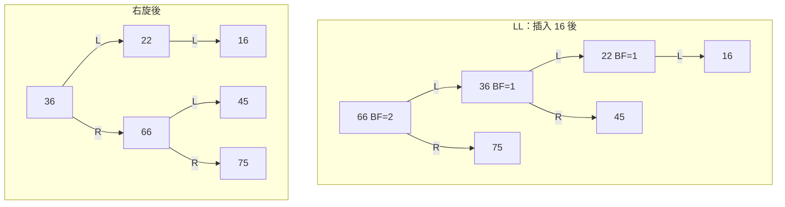

注意 LL 右旋時，原左子 36 的**右子樹 45** 改掛成 66 的左子樹（36 的右邊被 66 佔走了，45 介於 36 和 66 之間，放在 66 左邊剛好）。

### 例子：RR、LR、RL {#ex-avl-rotations .fold}

**RR**：36(24, 60(55, 88)) 插入 92 → 36 的 BF = −2，左旋：

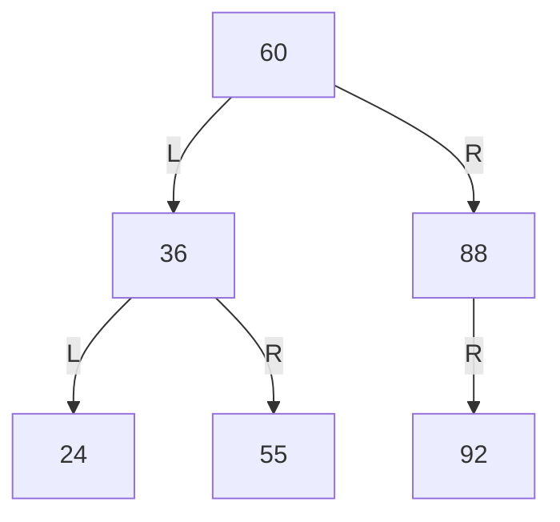

**LR（簡單）**：60 左子 36，插入 55（在 36 的右邊）→ 55 變新根，36 為左、60 為右。

**RL（簡單）**：36 右子 60，插入 55（在 60 的左邊）→ 55 變新根，36 為左、60 為右。

**LR（一般）**：88(60(46(22,55), 68(62,78)), 95(93,98)) 插入 64（在 62 的右）→ 88 的 BF = 2、60 的 BF = −1，屬 LR。68 變新根：68 的左子樹 62 改掛到 60 的右邊，右子樹 78 改掛到 88 的左邊：

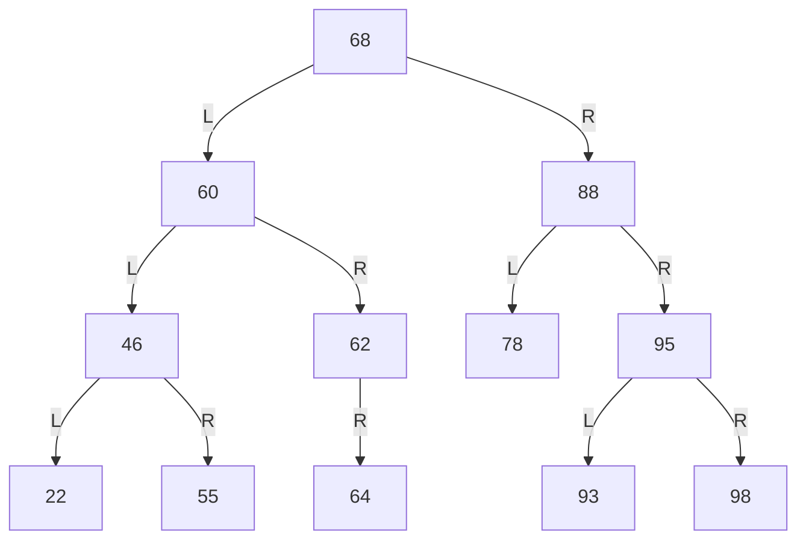

## 二元搜尋樹與 AVL 樹的用途 {#bst-vs-avl}

AVL 樹每次異動都要檢查和旋轉，比較費工；換來的是搜尋永遠快。所以要看資料會不會常變：

| | 二元搜尋樹 | AVL 樹 |
|---|---|---|
| 異動後 | 不保證矮胖，可能退化 | 永遠保持平衡 |
| 適合 | 固定不變的資料（程式語言保留字） | 常異動的動態資料（編譯器的符號表） |

## B 樹 {#b-tree}

**想法**：二元搜尋樹每個節點只放 1 個鍵值、分 2 岔。**B 樹**讓一個節點放**好幾個鍵值、分好幾岔**，樹就會更矮。資料放在硬碟上時，每走一層就要讀一次硬碟（很慢），樹越矮越好，所以資料庫和檔案系統常用 B 樹。

**$m$ 階 B 樹**：每個節點最多 $m-1$ 個鍵值、$m$ 個子節點。節點內的鍵值由小到大排，鍵值之間夾著指標：

| $P_0$ | $K_1$ | $P_1$ | $K_2$ | … | $K_{m-1}$ | $P_{m-1}$ |
|---|---|---|---|---|---|---|

讀法和二元搜尋樹一樣是「左小右大」：$K_i$ 左邊的指標 $P_{i-1}$ 指向比 $K_i$ 小的子樹，右邊的 $P_i$ 指向比 $K_i$ 大的子樹。例：節點 [24 | 55 | 92] 有 4 個子樹，分別放「小於 24」「24 到 55 之間」「55 到 92 之間」「大於 92」的鍵值。

規則：

1. 樹根至少 2 個子節點（除非整棵樹只有樹根）。
2. 每個節點最多 $m$ 個子節點、$m-1$ 個鍵值。
3. 樹根以外的非終端節點至少 $\lceil m/2\rceil$ 個子節點（至少 $\lceil m/2\rceil - 1$ 個鍵值），不能太空。
4. **所有樹葉都在同一層**，所以永遠是平衡的。
5. 樹只會在**樹根分裂**時長高一層。

| 階數 | 每個節點子節點數 | 鍵值數 | 別名 |
|---|---|---|---|
| 3 | 2 或 3 | 1 或 2 | 2-3 樹 |
| 4 | 2、3 或 4 | 1、2 或 3 | 2-3-4 樹 |

## B 樹的插入 {#b-tree-insert}

**規則**：新鍵值一律先放進該放的**樹葉**。放進去後如果鍵值太多（超過 $m-1$ 個），這個節點就**從中間切成兩半**，中間那個鍵值往上送進父節點。父節點如果也太滿，就再切、再往上送；連樹根都切開時，往上送的鍵值成為新樹根，樹長高一層。

所以 B 樹是**從底下往上長**的，這也是它所有樹葉永遠在同一層的原因。

4 階 B 樹（每個節點最多 3 個鍵值）插入 54：

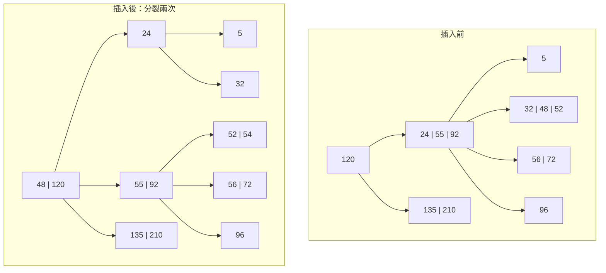

1. 54 介於 24 和 55 之間，放進樹葉 [32, 48, 52] → 變成 [32, 48, 52, 54]，4 個太多。從中間切：48 往上送，分成 [32] 與 [52, 54]。
2. 父節點收到 48 變成 [24, 48, 55, 92]，也太多。再切：48 往上送到樹根，分成 [24] 與 [55, 92]。
3. 樹根 [120] 收到 48 變成 [48, 120]，沒超過，結束。

（右半邊 [135, 210] 的子樹 [125]、[160, 188]、[240] 不變，圖中省略。）

## B 樹的刪除 {#b-tree-delete}

刪除的麻煩在於：節點不能太空。每個節點（樹根除外）最少要有 $N_K = \lceil m/2\rceil - 1$ 個鍵值，例如 3 階是 1 個、5 階是 2 個。

**刪除的思路**：先刪，不夠了就**跟兄弟借**；兄弟也沒得借，就**跟兄弟合併**。

| 情況 | 做法 |
|---|---|
| 樹葉，刪後鍵值數仍 ≥ $N_K$ | 直接刪除 |
| 樹葉，刪後不足，**右兄弟有多的** | 向右借：父節點中夾在兩者之間的鍵值**下移**到本節點，右兄弟最小的鍵值**上移**到父節點補位 |
| 樹葉，刪後不足，**左兄弟有多的** | 向左借：父節點的分隔鍵值下移，左兄弟最大的鍵值上移 |
| 樹葉，兩邊兄弟都不夠借 | **合併**：和兄弟合成一個節點，並把父節點中的分隔鍵值拉下來夾在中間；父節點因此不足時，往上繼續同樣處理 |
| 非終端節點 | 用**中序後繼**（右子樹最小鍵值）取代，再從樹葉刪除那個後繼，依上面規則處理 |

「借」的時候不能直接把兄弟的鍵值搬過來，因為父節點的鍵值是左右兩邊的分界；所以要繞一圈：父節點的分界值下來，兄弟的鍵值上去當新分界。

### 例子：3 階 B 樹連續刪除 {#ex-b-tree-delete .fold}

3 階：每節點 1–2 個鍵值，$N_K = 1$。

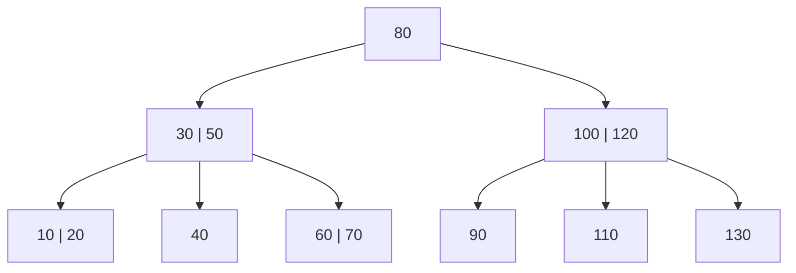

| 刪除 | 情況 | 結果 |
|---|---|---|
| 20 | 樹葉刪後仍有 [10] | 直接刪 |
| 40 | [40] 變空，右兄弟 [60, 70] 有多 | 50 下移、60 上移 → 父 [30, 60]，子 [10] [50] [70] |
| 90 | [90] 變空，右兄弟 [110] 不夠 | 合併：100 下移與 110 合成 [100, 110] → 父 [120]，子 [100, 110] [130] |
| 80 | 非終端（樹根） | 中序後繼 100 上來取代 → 根 [100]，右邊 [120] 的子 [110] [130] |

## 互斥集合 {#disjoint-sets}

**互斥集合**：任兩個集合都沒有共同元素。每個集合用一棵樹表示，整組就是一個**樹林**。樹根可以當作這個集合的「代表」：兩個元素往上找到同一個樹根，就屬於同一個集合。

$S_1 = \{A,B,C,D\}$、$S_2 = \{E,F,G\}$、$S_3 = \{H,I,J,K\}$：

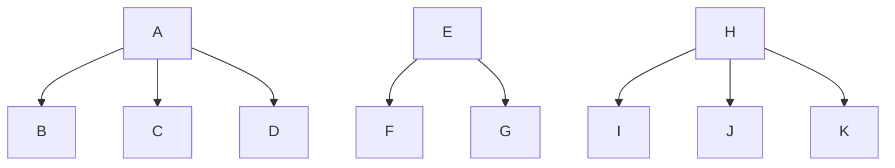

**聯集** `UNION(X, Y)`：把其中一棵樹的樹根接到另一棵樹根底下，當它的子節點即可，不用動其他節點。$S_1 \cup S_2$ 可以讓 E 成為 A 的子節點，或讓 A 成為 E 的子節點，兩種都對。

## 霍夫曼樹 {#huffman}

**問題**：每個字元用固定 8 位元存很浪費。如果某些字元特別常出現，給它們**短的編碼**、少見的字元給長的編碼，整體就能變短。這就是**霍夫曼編碼**，一種無失真壓縮（解壓後和原本完全一樣）。

**建樹步驟**：

1. 每個字元是一個樹葉，記著它的出現次數（頻率）。
2. 每次挑出**次數最少的兩個**，接到一個新節點底下，新節點的次數 = 兩者相加，放回去當成一個整體。
3. 重複到只剩一棵樹。
4. 每個節點的**右分支標 0、左分支標 1**（課本規則，考試照這個標），從樹根走到某個樹葉經過的 0/1 就是那個字元的編碼。

**為什麼這樣有效**：次數少的字元最先被合併，會被壓在樹的最底層（編碼長）；次數多的最後才合併，離樹根近（編碼短）。

例（課本）：h 出現 1 次、y 1 次、a 2 次、p 4 次，共 8 次：

<Huffman />

互動圖得到 p = 0、a = 10、h = 110、y = 111；課本的圖（下方）在同次數時左右擺法不同，得到 a = 11、h = 100、y = 101。兩種都對：同次數時左右可以互換，每個字元的編碼**長度**都一樣（p 1 位、a 2 位、h 和 y 3 位）。

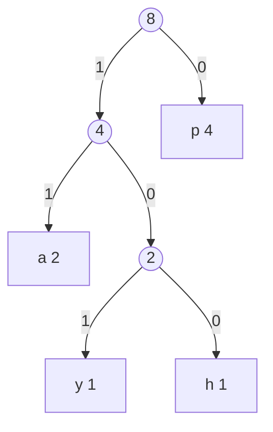

| 字元 | 頻率 | 編碼 | 長度 |
|---|---|---|---|
| p | 0.5 | 0 | 1 |
| a | 0.25 | 11 | 2 |
| h | 0.125 | 100 | 3 |
| y | 0.125 | 101 | 3 |

**平均編碼長度** = 每個字元的「頻率 × 編碼長度」加起來：$0.5\times1 + 0.25\times2 + 0.125\times3 + 0.125\times3 = 1.75$ 位元，比固定用 2 位元編 4 個字元還短。

同次數時合併順序、左右位置可以不同，所以霍夫曼樹**不唯一**，但每個字元的編碼長度和平均編碼長度相同（都是最短）。
