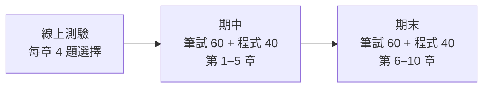
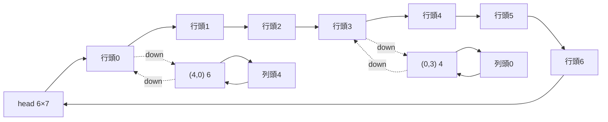
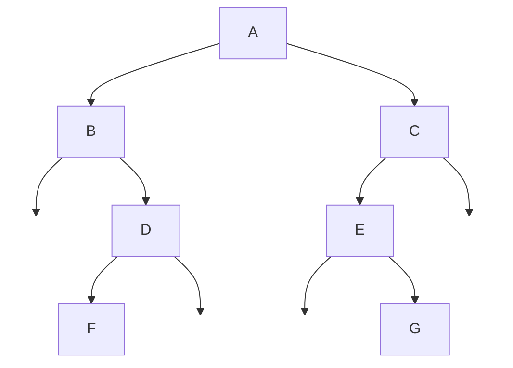
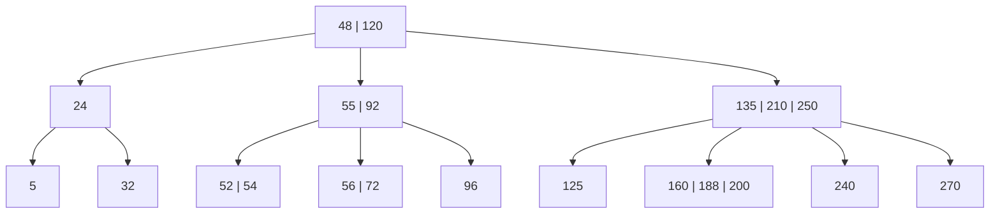
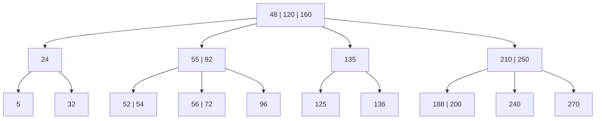
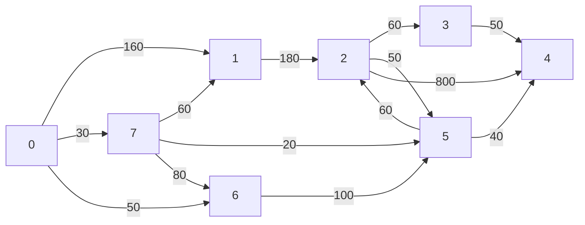
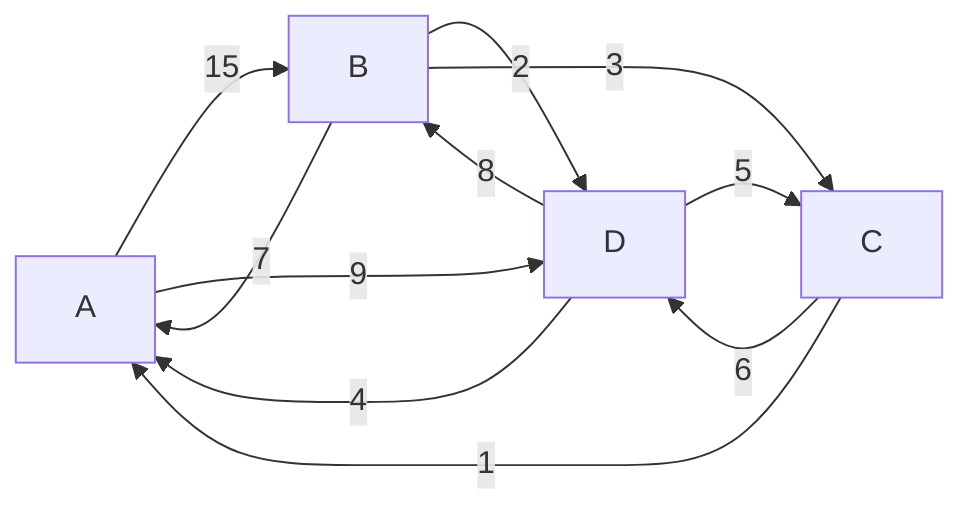

題目原檔在 `_material/資料結構(古東明)/考古題/`。每題詳解預設收起來，先自己算再打開。

## 考點分布 {#topic-map}

同一種題型常常換數字再考一次，表格列出每個考點出現在哪幾份考卷。

| 考點 | 出現在 | 概念 |
|---|---|---|
| 整數的四種表示法 | 2020 期中課堂 | [[ch1-intro#integer-representation|整數表示法]] |
| Big-O | 2020 期中遠端、線上測驗 ch1 | [[ch1-intro#time-complexity|時間複雜度]] |
| 二維陣列位址 | 線上測驗 ch2 | [[ch2-array#row-column-major|以列為主與以行為主]] |
| 稀疏矩陣（三行式／環狀串列） | 2020 期中課堂、2020 期中遠端 | [[ch2-array#sparse-matrix|稀疏矩陣]]、[[ch3-linked-list#sparse-circular|環狀串列表示]] |
| 中置／後置／前置互轉 | 2020 期中課堂、2020 期中遠端 | [[ch4-stack-queue#paren-method|括號法]] |
| 運算式求值 | 2020 期中課堂、2020 期中遠端 | [[ch4-stack-queue#postfix-eval|後置式求值]] |
| 遞迴追蹤／遞迴程式 | 2017 期中、2020 期中（筆試＋程式） | [[ch5-recursion#recursion-definition|遞迴的定義]] |
| 重建二元樹 | 2020 期末 | [[ch6-tree#rebuild-tree|由追蹤結果重建二元樹]] |
| B 樹插入 | 2020 期末 | [[ch6-tree#b-tree-insert|B 樹的插入]] |
| 最短路徑（Dijkstra、Floyd） | 2020 期末 | 第 7 章 |
| 排序（堆積、挑選、插入） | 2020 期末 | 第 8 章 |
| 搜尋（插補）、雜湊碰撞 | 2020 期末 | 第 9、10 章 |



## 線上測驗 第 1 章 {#quiz-ch1}

### 演算法與程式的敘述 {#quiz1-algorithm}

（複選）下列敘述哪些正確？

- A. 演算法是解決問題的方法，程式是用某種電腦語言表達的演算法，所以程式也是一個演算法。
- B. 執行中的程式稱為程序（Process）；程式是靜態的，程序是動態的，同時執行多份同一程式會產生不同的程序。
- C. 一個演算法可以沒有任何外來輸入。
- D. 一個演算法至少有一個輸出。

#### 答案 {#quiz1-algorithm-solution .fold}

**ABCD**（系統標示全對）。關鍵是 C、D：**輸入 0 個以上、輸出至少 1 個**，見 [[ch1-intro#algorithm-criteria|演算法的五個條件]]。原題 D 寫成「至少有一輸入(Output)」，括號才是本意。

### 矩陣相乘的時間複雜度 {#quiz1-matmul}

$A: M\times N$ 與 $B: N\times P$ 相乘，時間複雜度為？ A. $O(n^3)$　B. $O(MNP)$　C. $O(n^2)$　D. $O(MP)$

#### 答案 {#quiz1-matmul-solution .fold}

**B**。結果有 $M\times P$ 格，每格要做 $N$ 次乘加，共 $MNP$ 次。只有三個維度都等於 $n$ 時才是 $O(n^3)$。

### 遞迴函數的執行時間 {#quiz1-recursive-time}

```
Function X(N): if N < 3 then X := 1 else X(N-1) + X(N-3) + 1
```

X 的執行時間屬於？ A. 線性　B. 平方　C. 立方　D. 指數

#### 答案 {#quiz1-recursive-time-solution .fold}

**D 指數**。每次呼叫分出兩個遞迴呼叫，呼叫樹的節點數隨 $N$ 呈指數成長（跟[[ch5-recursion#recursive-fibonacci|費氏數列]]同理）。

### 指標取陣列第三個元素 {#quiz1-pointer}

`intarr[]` 是整數一維陣列，哪個運算式是**第三個元素的值**？ A. `*(intarr + 2)`　B. `*(intarr + 4)`　C. `intarr + 4`　D. `intarr + 2`

#### 答案 {#quiz1-pointer-solution .fold}

**A**。第三個元素索引是 2；`intarr + 2` 是它的**位址**，要再 `*` 取值。

## 線上測驗 第 2 章 {#quiz-ch2}

### 動態陣列 {#quiz2-dynamic-array}

Which best describes "dynamic array"? A. memory is dynamically allocated　B. data is dynamically sorted　C. capacity is dynamically resized　D. name can be dynamically changed

#### 答案 {#quiz2-dynamic-array-solution .fold}

**C**。動態陣列的重點是**容量可以隨需要變大變小**；只是用 `malloc` 配置記憶體而大小固定，不算。

### 以列為主的位址 {#quiz2-row-major}

`a[7][8]`，以列為主，每個元素 10 單位，起始位址 1000，求 `a[5][3]` 的位址。 A. 1310　B. 1350　C. 1430　D. 1450

#### 答案 {#quiz2-row-major-solution .fold}

**C**。前面有 5 整列 × 8 個 + 3 個 = 43 個元素：$1000 + 43 \times 10 = 1430$。見 [[ch2-array#row-column-major|以列為主與以行為主]]。

### 陣列敘述判斷 {#quiz2-statements}

（複選）何者為真？

- A. 多項式 $x^4+10x^3+3x^2+1$ 以一維陣列表示可以有兩種形式：(4,1,10,3,0,1) 或 (4,4,1,3,10,2,3,0,1)
- B. `c[7]` 表示陣列 c 第七個元素
- C. 在陣列中找出特定元素的值的過程稱為搜尋
- D. 陣列已排序時，二元搜尋比線性搜尋好

#### 答案 {#quiz2-statements-solution .fold}

**CD**。

- A 錯在第二種：課本是（項數, **係數, 指數**, …），應為 (4, 1,4, 10,3, 3,2, 1,0)；題目把指數放前面了。見 [[ch3-linked-list#poly-array|多項式的陣列表示法]]。
- B 錯：索引從 0 開始，`c[7]` 是第**八**個元素。

### 由兩個位址反推 {#quiz2-address-solve}

$A(5,3)$ 位址 5314，$A(8,5)$ 位址 5422，每個元素 4 bytes，求 $A(2,7)$。

#### 答案 {#quiz2-address-solve-solution .fold}

**5494**。兩者差 $5422-5314 = 108$ bytes = 27 個元素。

| 假設 | 方程式 | 結果 |
|---|---|---|
| 以列為主（每列 $n$ 個） | $3n + 2 = 27$ | $n = 25/3$ ✗ 不是整數 |
| 以行為主（每行 $m$ 個） | $2m + 3 = 27$ | $m = 12$ ✓ |

所以是以行為主、每行 12 個。$A(5,3) \to A(2,7)$：往後 4 行、往上 3 列，差 $4\times 12 - 3 = 45$ 個元素：$5314 + 45 \times 4 = 5494$。

做法同 [[ch2-array#ex-address-2d-solve|由已知位址反推]]。

## 線上測驗 第 3 章 {#quiz-ch3}

### 鏈結串列的錯誤敘述 {#quiz3-wrong}

關於鏈結串列，何者**錯**？ A. 不必占用連續記憶體　B. 比陣列浪費記憶體空間　C. 隨機存取功能比陣列弱　D. 插入或刪除時需移動大量資料

#### 答案 {#quiz3-wrong-solution .fold}

**D**。插入刪除只改指標，不搬資料；搬資料是**陣列**的缺點。B 對：每個節點多一個指標欄。見 [[ch3-linked-list#array-vs-list|陣列與鏈結串列]]。

### 不可重複串列的插入 {#quiz3-insert-worst}

不可有相同元素的鏈結串列有 $n$ 個元素，插入最差要讀幾個元素？ A. $n$　B. $n/2$　C. 1　D. $n/3$

#### 答案 {#quiz3-insert-worst-solution .fold}

**A**。插入前要確認沒有重複，最差得把 $n$ 個全部讀過。

### 鏈結串列的正確敘述 {#quiz3-right}

（複選）哪些正確？ A. 需要額外空間存指標　B. 有共同的子串列可以分享位址空間　C. 加入或刪除節點只需改指標　D. 可以隨意讀取第 i 個元素

#### 答案 {#quiz3-right-solution .fold}

**ABC**。D 錯：要從頭一個一個走，不能隨機存取。

### O(1) 取得頭尾 {#quiz3-head-tail}

只給一個串列指標，哪種結構能在 $O(1)$ 找到第一個與最後一個元素？ A. 環狀單向、無頭節點、指標指向最後一個節點　B. 環狀雙向、無頭節點、指標指向最後一個節點　C. A 和 B 都對

#### 答案 {#quiz3-head-tail-solution .fold}

**C**。指標指向最後一個 `last`，則第一個就是 `last->next`；單向、雙向都成立。見 [[ch3-linked-list#circular-list|環狀串列]]。

## 2017 秋 期中考 程式題 {#mid-2017-program}

兩題各 20 分，原題是照片：`_material/.../期中考/2017/2017.jpg`。

### 遞迴求 1×2 + 2×3 + … + (n−1)×n {#mid17-rsum}

撰寫遞迴函數 `int rsum(int n)` 計算 $1\times2 + 2\times3 + \cdots + (n-1)\times n$，輸入 $n$ 輸出結果。

#### 解答 {#mid17-rsum-solution .fold}

**遞迴關係**：$rsum(n) = rsum(n-1) + (n-1)n$，終止條件 $rsum(1) = 0$（沒有任何項）。

```c
#include <stdio.h>

int rsum(int n) {
    if (n <= 1) return 0;              /* 終止條件 */
    return rsum(n - 1) + (n - 1) * n;  /* 少一項的答案 + 最後一項 */
}

int main(void) {
    int n;
    scanf("%d", &n);
    printf("%d\n", rsum(n));           /* n=4 → 2+6+12 = 20 */
    return 0;
}
```

### 3×3 亂數陣列的行總和與對角線 {#mid17-matrix}

3×3 二維陣列，值用亂數產生、範圍 5～20。印出陣列，再算**每一行**（直行）的總和與**兩條對角線**的總和。

#### 解答 {#mid17-matrix-solution .fold}

- 5～20 共 16 個數：`rand() % 16 + 5`。
- 行總和：固定 `j`，跑 `i`。
- 主對角線 `a[i][i]`；副對角線 `a[i][2-i]`。

```c
#include <stdio.h>
#include <stdlib.h>
#include <time.h>

int main(void) {
    int a[3][3], i, j, sum;
    srand(time(NULL));
    for (i = 0; i < 3; i++)
        for (j = 0; j < 3; j++)
            a[i][j] = rand() % 16 + 5;

    for (i = 0; i < 3; i++) {
        for (j = 0; j < 3; j++) printf("%3d", a[i][j]);
        printf("\n");
    }
    for (j = 0; j < 3; j++) {                 /* 每一行 */
        for (sum = 0, i = 0; i < 3; i++) sum += a[i][j];
        printf("第 %d 行總和: %d\n", j + 1, sum);
    }
    for (sum = 0, i = 0; i < 3; i++) sum += a[i][i];
    printf("左上到右下: %d\n", sum);
    for (sum = 0, i = 0; i < 3; i++) sum += a[i][2 - i];
    printf("右上到左下: %d\n", sum);
    return 0;
}
```

## 2020 春 期中考 程式題 {#mid-2020-program}

遠端考，兩題各 20 分。

### 迴圈計算交錯級數 {#mid20-series}

輸入整數 $x$，以**迴圈**計算 $f(x) = x - \dfrac{x^2}{2} + \dfrac{x^3}{3} - \dfrac{x^4}{4} + \cdots - \dfrac{x^{10}}{10}$。

#### 解答 {#mid20-series-solution .fold}

第 $i$ 項是 $\dfrac{x^i}{i}$，奇數項加、偶數項減。用 `double` 存，避免整數除法把小數吃掉。

```c
#include <stdio.h>

int main(void) {
    int x, i;
    double term = 1, ans = 0;
    scanf("%d", &x);
    for (i = 1; i <= 10; i++) {
        term *= x;                       /* term = x^i */
        ans += (i % 2 ? 1 : -1) * term / i;
    }
    printf("f(%d) = %f\n", x, ans);
    return 0;
}
```

參考輸出：$f(2) \approx -64.8254$、$f(3) \approx -4311.25$、$f(4) \approx -82106.45$。

### 遞迴計算 g(n) {#mid20-recursive-g}

輸入 $n$，以**遞迴**計算 $g(n) = 1\times2 + 2\times3 + \cdots + (n-1)\times n$（用迴圈最多 10 分）。

#### 解答 {#mid20-recursive-g-solution .fold}

跟 [[#mid17-rsum|2017 的 rsum]] 同一題：$g(n) = g(n-1) + (n-1)n$，$g(1) = 0$。$n < 1$ 時提示輸入錯誤。

參考輸出：$g(3) = 8$、$g(4) = 20$、$g(10) = 330$。

## 2020 春 期中考 筆試（課堂考） {#mid-2020-written-local}

### 1101 的四種解讀 {#mid20l-integer}

二進位 $(1101)_2$ 分別以 a. 無號整數　b. 1 的補數　c. 2 的補數　d. 符號帶大小 表示時，十進位各是多少？（12%）

#### 解答 {#mid20l-integer-solution .fold}

| 表示法 | 做法 | 值 |
|---|---|---|
| 無號 | $8+4+1$ | **13** |
| 1 的補數 | 最高位 1 → 負；全部反轉 0010 = 2 | **−2** |
| 2 的補數 | 最高位 1 → 負；反轉加 1 = 0011 = 3 | **−3** |
| 符號帶大小 | 最高位是符號，其餘 101 = 5 | **−5** |

見 [[ch1-intro#integer-representation|整數表示法]]。

### 稀疏矩陣的三行式 {#mid20l-sparse-3tuple}

用三行式（3-tuple）表示下列稀疏矩陣：（10%）

$$
\begin{bmatrix}
0&0&0&4&0&0&0\\
0&2&0&0&0&0&0\\
0&0&5&0&0&0&0\\
0&0&0&0&0&0&3\\
6&0&0&0&0&0&0\\
0&0&0&0&0&7&0
\end{bmatrix}
$$

#### 解答 {#mid20l-sparse-3tuple-solution .fold}

第 0 列記（列數, 行數, 非零個數），之後依列由上到下列出每個非零元素：

| | 列 | 行 | 值 |
|---|---|---|---|
| 0 | 6 | 7 | 6 |
| 1 | 0 | 3 | 4 |
| 2 | 1 | 1 | 2 |
| 3 | 2 | 2 | 5 |
| 4 | 3 | 6 | 3 |
| 5 | 4 | 0 | 6 |
| 6 | 5 | 5 | 7 |

常見失分：漏掉第 4 列的 6（非零個數寫 6，卻只列 5 筆）。見 [[ch2-array#sparse-matrix|稀疏矩陣]]。

### 中置轉前置 {#mid20l-infix-prefix}

（14%）(1) `a/b-c^d+e`　(2) `a-b*(c+d)^e`

#### 解答 {#mid20l-infix-prefix-solution .fold}

括號法：依優先順序全部加括號 → 運算子移到**左括號**位置 → 去括號。

| | 全加括號 | 前置 |
|---|---|---|
| (1) | `(((a/b)-(c^d))+e)` | **`+-/ab^cde`** |
| (2) | `(a-(b*((c+d)^e)))` | **`-a*b^+cde`** |

見 [[ch4-stack-queue#paren-method|括號法轉換]]。

### 後置式求值 {#mid20l-postfix-eval}

（14%）(1) `ab^cd/-e+`，$a=2,b=3,c=10,d=5,e=1$　(2) `abcd+e^*-`，$a=100,b=4,c=3,d=2,e=2$

#### 解答 {#mid20l-postfix-eval-solution .fold}

由左往右掃，遇運算元 push、遇運算子 pop 兩個算完再 push。

| | 還原中置 | 代入 | 值 |
|---|---|---|---|
| (1) | $(a^b) - (c/d) + e$ | $8 - 2 + 1$ | **7** |
| (2) | $a - b \times (c+d)^e$ | $100 - 4 \times 5^2$ | **0** |

見 [[ch4-stack-queue#postfix-eval|後置式求值]]。

### 遞迴呼叫次數：mystery(5) {#mid20l-mystery}

（10%）求 `mystery(5)`：

```c
int mystery(int n) { return mysteryhelper(n, 10); }

int mysteryhelper(int n, int s) {
    if (n == 0) return s;
    else return mysteryhelper(n - 1, s) + mysteryhelper(n - 1, s);
}
```

#### 解答 {#mid20l-mystery-solution .fold}

**320**。每層呼叫兩次、$s$ 不變，所以 $h(n) = 2\,h(n-1)$，$h(0) = 10$：

$$h(5) = 2^5 \times 10 = 320$$

呼叫樹是一棵 5 層的完滿二元樹，共 $2^5 = 32$ 個 `(0,10)` 樹葉，每個回傳 10。

## 2020 春 期中考 筆試（遠端考） {#mid-2020-written-remote}

### 求和的 Big-O {#mid20r-bigo}

（12%）執行次數為 (1) $\sum_{1\le i\le n} i$　(2) $\sum_{1\le i\le n} i^2$，Big-O 各是多少？

#### 解答 {#mid20r-bigo-solution .fold}

| | 公式 | Big-O |
|---|---|---|
| (1) | $\dfrac{n(n+1)}{2}$ | $O(n^2)$ |
| (2) | $\dfrac{n(n+1)(2n+1)}{6}$ | $O(n^3)$ |

取最高次項、去掉係數。見 [[ch1-intro#time-complexity|時間複雜度]]。

### 稀疏矩陣的環狀串列 {#mid20r-sparse-circular}

（10%）用環狀串列表示[[#mid20l-sparse-3tuple|課堂考同一個 6×7 稀疏矩陣]]（非零：(0,3)=4、(1,1)=2、(2,2)=5、(3,6)=3、(4,0)=6、(5,5)=7）。

#### 解答 {#mid20r-sparse-circular-solution .fold}

節點格式 `down | row | col | right` 加 `data`。需要：

- 1 個總開頭節點（記矩陣大小 6×7），
- 6 個列開頭 + 7 個行開頭（開頭節點共 $1+6+7 = 14$ 個），
- 6 個元素節點。

這題每列、每行最多一個非零元素，所以每個元素的 `right` 繞回自己那列的列開頭、`down` 繞回自己那行的行開頭；第 4 行全為 0，行開頭的 `down` 指向自己。

| 元素 | right → | down → |
|---|---|---|
| (0,3) 4 | 列頭 0 | 行頭 3 |
| (1,1) 2 | 列頭 1 | 行頭 1 |
| (2,2) 5 | 列頭 2 | 行頭 2 |
| (3,6) 3 | 列頭 3 | 行頭 6 |
| (4,0) 6 | 列頭 4 | 行頭 0 |
| (5,5) 7 | 列頭 5 | 行頭 5 |



（圖只畫兩個元素示意，其餘四個同理。）見 [[ch3-linked-list#sparse-circular|用環狀串列表示稀疏矩陣]]，原手寫解答在 `遠距第2題答案.jpg`。

### 後置轉前置 {#mid20r-postfix-prefix}

（14%）(1) `ab^cd/-e+`　(2) `abcd+e^*-`

#### 解答 {#mid20r-postfix-prefix-solution .fold}

先還原成中置（加括號），再用括號法轉前置。

| | 中置 | 前置 |
|---|---|---|
| (1) | `((a^b)-(c/d))+e` | **`+-^ab/cde`** |
| (2) | `a-(b*((c+d)^e))` | **`-a*b^+cde`** |

注意 (1) 的中置是 $(a\,\hat{}\,b) - (c/d)$；原投影片解答把它誤寫成 $(a\,\hat{}\,b)/(c-d)$，但前置答案正確。

### 前置式求值 {#mid20r-prefix-eval}

（14%）(1) `- + 2 * 3 4 / 16 ^ 2 3`　(2) `- 5 * 4 ^ + 1 3 2`

#### 解答 {#mid20r-prefix-eval-solution .fold}

前置式**由右往左**掃：遇運算元 push；遇運算子 pop 兩個，**先 pop 的是左運算元**。

| | 中置 | 值 |
|---|---|---|
| (1) | $(2 + 3\times4) - 16/2^3$ | $14 - 2 =$ **12** |
| (2) | $5 - 4 \times (1+3)^2$ | $5 - 64 =$ **−59** |

### 遞迴定義函數 funct(10, 4096) {#mid20r-funct}

（10%）

$$
funct(a,b) =
\begin{cases}
b, & a = 0 \\
funct\!\left(a-1, \dfrac{b}{2}\right), & a > 0
\end{cases}
$$

求 $funct(10, 4096)$。

#### 解答 {#mid20r-funct-solution .fold}

**4**。每遞迴一次 $a$ 減 1、$b$ 減半，共 10 次：$4096 / 2^{10} = 4096/1024 = 4$。

## 2020 春 期末考 筆試 {#final-2020-written}

### 由中序與後序重建二元樹 {#f20-rebuild}

（10%）中序 `BFDAEGC`、後序 `FDBGECA`，畫出二元樹。

#### 解答 {#f20-rebuild-solution .fold}

後序**最後一個是樹根**，再到中序切左右。

| 子樹 | 後序最後 → 根 | 中序切開 |
|---|---|---|
| 全樹 | A | 左 `BFD`、右 `EGC` |
| 左 | B | 左無、右 `FD` |
| B 的右 | D | 左 `F`、右無 |
| 右 | C | 左 `EG`、右無 |
| C 的左 | E | 左無、右 `G` |



檢查：前序 A B D F C E G。見 [[ch6-tree#rebuild-tree|由追蹤結果重建二元樹]]。

### 4 階 B 樹插入 136 {#f20-btree}

（10%）給定 4 階 B 樹，加入 136，寫出過程。



#### 解答 {#f20-btree-solution .fold}

4 階：每節點最多 3 個鍵值，滿 4 個就分裂，**第 2 個**往上送（同課本慣例）。

1. 136 > 120 → 右子樹；135 < 136 < 210 → 樹葉 [160, 188, 200]，變成 [136, 160, 188, 200]，太多。分裂：**160** 上送，切成 [136] 與 [188, 200]。
2. 父節點變成 [135, 160, 210, 250]，太多。分裂：**160** 上送，切成 [135] 與 [210, 250]。
3. 樹根變成 [48, 120, 160]，3 個，結束。



見 [[ch6-tree#b-tree-insert|B 樹的插入]]。

### Dijkstra：頂點 0 到其餘頂點 {#f20-dijkstra}

（10%）列出有向圖的距離矩陣，並求頂點 0 到其餘各頂點的最短距離（寫出過程）。



#### 解答 {#f20-dijkstra-solution .fold}

**距離矩陣**（列 = 起點，∞ 表示沒有邊）：

| | 0 | 1 | 2 | 3 | 4 | 5 | 6 | 7 |
|---|---|---|---|---|---|---|---|---|
| 0 | ∞ | 160 | ∞ | ∞ | ∞ | ∞ | 50 | 30 |
| 1 | ∞ | ∞ | 180 | ∞ | ∞ | ∞ | ∞ | ∞ |
| 2 | ∞ | ∞ | ∞ | 60 | 800 | 50 | ∞ | ∞ |
| 3 | ∞ | ∞ | ∞ | ∞ | 50 | ∞ | ∞ | ∞ |
| 4 | ∞ | ∞ | ∞ | ∞ | ∞ | ∞ | ∞ | ∞ |
| 5 | ∞ | ∞ | 60 | ∞ | 40 | ∞ | ∞ | ∞ |
| 6 | ∞ | ∞ | ∞ | ∞ | ∞ | 100 | ∞ | ∞ |
| 7 | ∞ | 60 | ∞ | ∞ | ∞ | 20 | 80 | ∞ |

**步驟**：每次從未選頂點中挑 DIST 最小的 $u$，再用 $DIST[u] + cost[u][w]$ 更新其他頂點（平手選編號小的）。

| 步驟 | 選 u | 1 | 2 | 3 | 4 | 5 | 6 | 7 | 未選 |
|---|---|---|---|---|---|---|---|---|---|
| 0 | — | 160 | ∞ | ∞ | ∞ | ∞ | 50 | 30 | 1–7 |
| 1 | 7 | **90** | ∞ | ∞ | ∞ | **50** | 50 | 30 | 1–6 |
| 2 | 5 | 90 | **110** | ∞ | **90** | 50 | 50 | 30 | 1,2,3,4,6 |
| 3 | 6 | 90 | 110 | ∞ | 90 | 50 | 50 | 30 | 1,2,3,4 |
| 4 | 1 | 90 | 110 | ∞ | 90 | 50 | 50 | 30 | 2,3,4 |
| 5 | 4 | 90 | 110 | ∞ | 90 | 50 | 50 | 30 | 2,3 |
| 6 | 2 | 90 | 110 | **170** | 90 | 50 | 50 | 30 | 3 |
| 7 | 3 | 90 | 110 | 170 | 90 | 50 | 50 | 30 | — |

| 終點 | 路徑 | 距離 |
|---|---|---|
| 1 | 0→7→1 | 90 |
| 2 | 0→7→5→2 | 110 |
| 3 | 0→7→5→2→3 | 170 |
| 4 | 0→7→5→4 | 90 |
| 5 | 0→7→5 | 50 |
| 6 | 0→6 | 50 |
| 7 | 0→7 | 30 |

### Floyd：任兩頂點最短距離 {#f20-floyd}

（10%）求下圖任兩頂點間的最短距離（寫出過程）。



#### 解答 {#f20-floyd-solution .fold}

$A^k[i][j] = \min(A^{k-1}[i][j],\ A^{k-1}[i][k] + A^{k-1}[k][j])$：依序允許經過 A、B、C、D。粗體是這一輪變小的格子。

$A^{-1}$（原始）

| | A | B | C | D |
|---|---|---|---|---|
| A | 0 | 15 | ∞ | 9 |
| B | 7 | 0 | 3 | 2 |
| C | 1 | ∞ | 0 | 6 |
| D | 4 | 8 | 5 | 0 |

$A^{0}$（經過 A）：C→A→B = 1+15

| | A | B | C | D |
|---|---|---|---|---|
| A | 0 | 15 | ∞ | 9 |
| B | 7 | 0 | 3 | 2 |
| C | 1 | **16** | 0 | 6 |
| D | 4 | 8 | 5 | 0 |

$A^{1}$（經過 B）：A→B→C = 15+3

| | A | B | C | D |
|---|---|---|---|---|
| A | 0 | 15 | **18** | 9 |
| B | 7 | 0 | 3 | 2 |
| C | 1 | 16 | 0 | 6 |
| D | 4 | 8 | 5 | 0 |

$A^{2}$（經過 C）：B→C→A = 3+1

| | A | B | C | D |
|---|---|---|---|---|
| A | 0 | 15 | 18 | 9 |
| B | **4** | 0 | 3 | 2 |
| C | 1 | 16 | 0 | 6 |
| D | 4 | 8 | 5 | 0 |

$A^{3}$（經過 D）：A→D→C = 9+5、C→D→B = 6+8

| | A | B | C | D |
|---|---|---|---|---|
| A | 0 | 15 | **14** | 9 |
| B | 4 | 0 | 3 | 2 |
| C | 1 | **14** | 0 | 6 |
| D | 4 | 8 | 5 | 0 |

$A^3$ 就是答案。

### 堆積排序與挑選排序 {#f20-sorting}

（10%）資料 `92, 2, 91, 1, 8, 85, 3, 7`，用堆積排序與挑選排序排成**鍵值不遞減**，列出每回合結果。

#### 解答 {#f20-sorting-solution .fold}

**堆積排序**：先建**最大堆積**（從最後一個父節點往前調整），之後每回合把樹根（最大）和堆積最後一個交換、堆積縮小 1，再把新樹根往下調整。

建堆積：`92, 8, 91, 7, 2, 85, 3, 1`（1 與 7 交換、2 與 8 交換）

| 回合 | 堆積部分 | 已排好 |
|---|---|---|
| 1 | 91 8 85 7 2 1 3 | 92 |
| 2 | 85 8 3 7 2 1 | 91 92 |
| 3 | 8 7 3 1 2 | 85 91 92 |
| 4 | 7 2 3 1 | 8 85 91 92 |
| 5 | 3 2 1 | 7 8 85 91 92 |
| 6 | 2 1 | 3 7 8 85 91 92 |
| 7 | 1 | 2 3 7 8 85 91 92 |

**挑選排序**：第 $i$ 回合從剩下的找最小值，和第 $i$ 個交換。

| 回合 | 結果 | 動作 |
|---|---|---|
| 0 | 92 2 91 1 8 85 3 7 | 原始 |
| 1 | **1** 2 91 92 8 85 3 7 | 1 ↔ 92 |
| 2 | 1 **2** 91 92 8 85 3 7 | 2 已在位 |
| 3 | 1 2 **3** 92 8 85 91 7 | 3 ↔ 91 |
| 4 | 1 2 3 **7** 8 85 91 92 | 7 ↔ 92 |
| 5 | 1 2 3 7 **8** 85 91 92 | 已在位 |
| 6 | 1 2 3 7 8 **85** 91 92 | 已在位 |
| 7 | 1 2 3 7 8 85 **91** 92 | 已在位 |

### 雜湊碰撞的解決方法 {#f20-hash-collision}

（10%）列舉兩種解決雜湊函數鍵值碰撞的方法。

#### 解答 {#f20-hash-collision-solution .fold}

任選兩種（課本 10.3 節）：

| 方法 | 做法 |
|---|---|
| 循序定址法（線性探測） | 位置被佔就往下一格找，直到空位 |
| 二次式探勘定址法 | 依 $h \pm 1^2, h \pm 2^2, \ldots$ 跳著找空位 |
| 串列法（鏈結法） | 同一位置的鍵值串成鏈結串列 |
| 重複雜湊法 | 碰撞時改用第二個雜湊函數再算一次 |
| 亂數法 | 碰撞時用亂數產生下一個位置 |

## 2020 春 期末考 程式題 {#final-2020-program}

兩題各 20 分，都是把課本範例程式改寫。

### 插入排序改成不遞增 {#f20-insertion-desc}

把課本 8-23 頁範例程式 3【插入排序法】改成按「鍵值**不遞增**」排序（由大到小）。

#### 解答 {#f20-insertion-desc-solution .fold}

只要把「往後搬」的條件從 `d[j] > key` 改成 `d[j] < key`：前面比 key **小**的都往後搬。

```c
#include <stdio.h>
#define Size 8

void insertion_sort_desc(int d[], int n) {
    int i, j, key;
    for (i = 1; i < n; i++) {
        key = d[i];
        for (j = i - 1; j >= 0 && d[j] < key; j--)   /* 原本是 d[j] > key */
            d[j + 1] = d[j];
        d[j + 1] = key;
    }
}

int main(void) {
    int d[Size] = {21, 91, 1, 8, 85, 3, 91, 7}, i;
    insertion_sort_desc(d, Size);
    for (i = 0; i < Size; i++) printf("%d ", d[i]);   /* 91 91 85 21 8 7 3 1 */
    printf("\n");
    return 0;
}
```

### 插補搜尋改成由大到小 {#f20-interpolation-desc}

把課本 9-37 頁範例程式 4【插補搜尋法】改成陣列**由大到小**排序時也能正常搜尋：

```c
static int d[Size] = {789, 472, 391, 391, 387, 163, 157, 95, 91, 88, 87, 75, 35, 31, 9, 1};
```

#### 解答 {#f20-interpolation-desc-solution .fold}

插補位置公式本身不用改：

$$mid = low + \frac{(key - d[low])\,(high - low)}{d[high] - d[low]}$$

由大到小時分子、分母都是負的，商仍為正。要改的是：

1. **範圍判斷**：key 要在 $d[high] \le key \le d[low]$ 之間。
2. **縮小方向相反**：$key > d[mid]$ 表示 key 在**左邊**，改 `high = mid - 1`；反之 `low = mid + 1`。
3. 分母為 0（$d[low] = d[high]$）要另外處理。

```c
#include <stdio.h>
#define Size 16

int interpolation_search_desc(const int d[], int n, int key) {
    int low = 0, high = n - 1, mid;
    while (low <= high && key <= d[low] && key >= d[high]) {
        if (d[low] == d[high])                     /* 區間內全部相等 */
            return d[low] == key ? low : -1;
        mid = low + (key - d[low]) * (high - low) / (d[high] - d[low]);
        if (d[mid] == key) return mid;
        if (key > d[mid]) high = mid - 1;          /* 大的在左邊 */
        else              low  = mid + 1;
    }
    return -1;
}

int main(void) {
    static int d[Size] = {789, 472, 391, 391, 387, 163, 157, 95,
                          91, 88, 87, 75, 35, 31, 9, 1};
    int key, pos;
    while (scanf("%d", &key) == 1) {
        pos = interpolation_search_desc(d, Size, key);
        if (pos >= 0) printf("%d 在 d[%d]\n", key, pos);
        else          printf("找不到 %d\n", key);
    }
    return 0;
}
```
