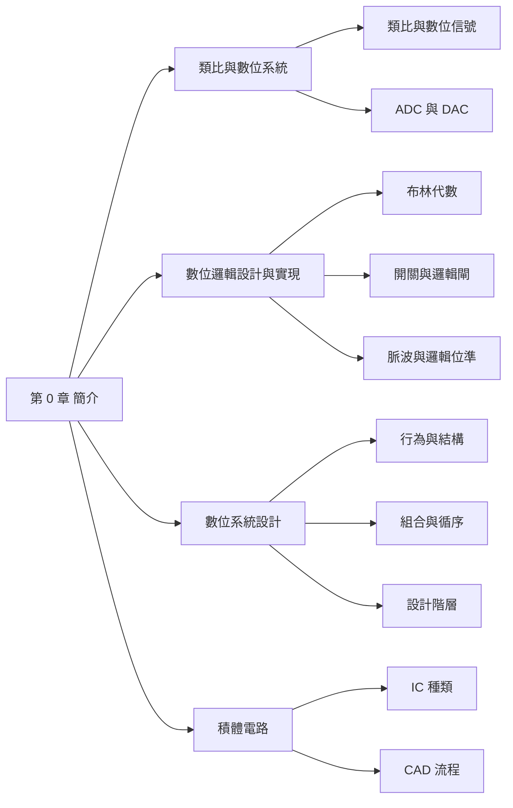

## 名詞表 {#glossary}

本章出現的名詞，詳細說明見對應區塊。

| 中文 | English | 描述 |
|---|---|---|
| 信號 | Signal | 隨時間變化、帶有資訊的物理量（聲音、影像…） |
| 類比 | Analog | 物理量的大小可以是連續範圍內的任意值 |
| 數位 | Digital | 物理量只取有限個離散值（數位邏輯中只有 0 與 1） |
| 換能器 | Transducer | 把非電氣的物理量轉成電氣信號（電壓、電流）的元件，例如麥克風 |
| 類比對數位轉換器 | ADC, Analog-to-Digital Converter | 取樣、量化，把類比信號轉成數位碼 |
| 數位對類比轉換器 | DAC, Digital-to-Analog Converter | 把數位碼轉回類比信號 |
| 解析度 | Resolution | 量化時相鄰兩個位準的間距 |
| 命題 | Statement / Proposition | 可以判斷真（T）或假（F）的敘述 |
| 布林代數 | Boolean Algebra | 只有兩個值、用 AND／OR／NOT 運算的代數系統 |
| 正常閉合 | Normally Closed, NC | 控制端沒動作時接通的開關 |
| 正常開路 | Normally Open, NO | 控制端沒動作時斷開的開關 |
| 邏輯閘 | Logic Gate | 實現基本邏輯運算的電子元件 |
| 正邏輯系統 | Positive Logic System | 高電位代表 1、低電位代表 0（本課程採用） |
| 負邏輯系統 | Negative Logic System | 高電位代表 0、低電位代表 1 |
| 組合邏輯 | Combinational Logic | 輸出只由「目前」的輸入決定 |
| 循序邏輯 | Sequential Logic | 輸出由目前輸入**與過去的狀態**共同決定 |
| 分析 | Analysis | 由電路（結構）求出它的功能（行為） |
| 合成 | Synthesis | 由功能（行為）設計出電路（結構） |
| 暫存器轉移層次 | RTL, Register-Transfer Level | 以暫存器、ALU 等模組描述系統的設計層次 |
| 現場可規劃邏輯元件 | Field Programmable Logic Device | 出廠後由使用者規劃功能的 IC，例如 FPGA |
| 電腦輔助設計 | CAD, Computer-Aided Design | 用軟體完成描述、模擬、合成與實現的設計流程 |

## 本章地圖 {#ch0-map}

第 0 章是整門課的概觀：數位系統是什麼、怎麼實現、怎麼設計、最後做成什麼樣的 IC。原始投影片：[[_pdf/chapter0dl-11.pdf|第 0 章投影片]]。



## 類比與數位信號 {#analog-digital}

**信號（signal）** 是帶有資訊的物理量，例如聲音、影像。依物理量大小的取值方式分成兩種：

| | 類比信號 analog | 數位信號 digital |
|---|---|---|
| 取值 | 連續範圍內的任意值 | 有限個離散值（數位邏輯中為 0、1） |
| 波形 | 平滑起伏 | 方波，只在幾個位準之間跳動 |
| 例子 | 麥克風輸出的電壓 | 電腦內部的位元 |

自然界的物理量大多是類比的。電子電路要處理它們，先用**換能器（transducer）**把物理量轉成**電氣信號**（電壓或電流）。

- **類比系統**：輸入類比信號、輸出類比信號（例如傳統擴音機）。
- **數位系統**：輸入、處理、輸出的都是數位信號。

## 類比與數位信號轉換 {#adc-dac}

用數位系統處理聲音時，前後要各接一個轉換器：


- **ADC（類比對數位轉換器）**：每隔固定時間 $\Delta\tau$ **取樣**一次並**保持**，再把電壓**量化**成最接近的位準，輸出對應的二進位碼。例如用 2 位元量化，四個位準 $V_1 \sim V_4$ 分別編成 00、01、10、11。
- **解析度（resolution）**：相鄰兩個量化位準的間距。位元數越多，位準越密，解析度越好，誤差越小。
- **DAC（數位對類比轉換器）**：把數位碼轉回對應的電壓。

## 數學的數字與算術的計數 {#number-vs-counting}

**數學（mathematics）** 談的是「數字系統」：自然數 $\mathbb{N}$、整數 $\mathbb{Z}$、有理數 $\mathbb{Q}$（$q/p$，$p\neq 0$）、實數 $\mathbb{R}$（$\pi$、$e$）、虛數（$a+bi$）。

**算術（arithmetic）** 談的是「計數系統」：用有限個符號數數，數完一輪就**進位**。

- 10 進位：0～9，接著進位成 10。
- 8 進位：0～7；2 進位：0、1。
- 1 進位：像在繩子上打結，有幾個結就是幾（$3+1$ 就是再打一個結）。

不同的**規則進位系統**之間可以用同一個公式互換：

$$
y = a_n x^n + a_{n-1}x^{n-1} + \cdots + a_1 x^1 + a_0
$$

把 $x$ 換成基底即可，例如 $(123)_9 = 1\times 9^2+2\times 9+3 = (102)_{10}$、$(111)_2 = (7)_{10}$。詳細的基底互換見 [[ch1-number-systems#base-conversion|第 1 章基底互換]]。

### 不規則進位系統 {#irregular-base .fold}

日期就是不規則進位：一個月有 28～31 天，借位時要看是哪個月。

- 9 月 3 日到中秋節（9 月 21 日）：$9/21 - 9/3 = 0$ 月 18 日。
- 7 月 7 日到中秋節：$9/21 - 7/7 = 2$ 月 14 日，但「2 個月」到底是幾天，要看 7、8 月各有幾天。

規則進位（每一位的基底固定）才有一致的運算方法，所以數位系統只用規則進位，而且用基底 2。

## 從電晶體到邏輯閘 {#transistor-to-gate}

電子計算的起點是**電晶體**：把它看成一個由控制端（基極 base）決定是否導通的開關，電流從集極（collector）流到射極（emitter）。

- 用二極體和電阻可以組成 AND、OR 閘（二極體邏輯）。
- 用電晶體可以組成 NOT 閘（反相器）。

1813～1864 年間，數學家 **George Boole** 提出布林邏輯運算系統，成為邏輯閘的數學基礎。電晶體與積體電路的細節見 [[ch3-digital-ic#ch3-map|第 3 章]]。

## 布林邏輯與命題 {#boolean-logic}

**數理邏輯（mathematical logic）** 處理**命題**（可以判斷真假的敘述）和它的**真假值**（truth value）。例如：

> **若**開關 $S_A$ 打開 **且** 開關 $S_B$ 打開，**則**電燈亮；**否則**電燈熄滅。

寫成邏輯表示式：$(S_A = T)\ \text{AND}\ (S_B = T) \rightarrow L = T$；只要 $(S_A = F)\ \text{OR}\ (S_B = F)$，就 $L = F$。

**布林代數**把 T／F 換成 1／0，用三個**邏輯運算子**：

| $x$ | $y$ | AND | OR |
|---|---|---|---|
| F | F | F | F |
| F | T | F | T |
| T | F | F | T |
| T | T | T | T |

NOT：$x=F$ 時為 T，$x=T$ 時為 F。布林代數的公理與定理見 [[ch2-switching-algebra#huntington|第 2 章]]。

## 開關電路 {#switch-circuits}

數位邏輯可以用兩種元件實現：**開關（switch）**與**邏輯閘（logic gate）**。

開關依「控制端沒動作時」的狀態分兩種：

- **正常閉合（NC）**：平常接通，控制端動作時斷開。
- **正常開路（NO）**：平常斷開，控制端動作時接通。

把開關組合起來就能做邏輯運算：

| 接法 | 何時接通 | 對應運算 |
|---|---|---|
| 串聯 $S_1 S_2$ | $S_1$ **且** $S_2$ 都 On | AND（**乘**） |
| 並聯 $S_1 \parallel S_2$ | $S_1$ **或** $S_2$ 任一 On | OR（**加**） |

「串聯是乘、並聯是加」是之後 CMOS 電路設計的核心觀念，見 [[ch3-digital-ic#switch-logic-design|開關邏輯設計原理]]。

### 例子：兩地控制一盞燈 {#ex-two-way-switch .fold}

樓梯上下各一個**單刀雙擲（SPDT）開關** $S_1$、$S_2$，兩條線交叉相接。燈的狀態：

| $S_1$ | $S_2$ | 燈 |
|---|---|---|
| Off | Off | Off |
| Off | On | On |
| On | Off | On |
| On | On | Off |

兩個開關狀態**不同**時燈亮，這就是 XOR（互斥或），也正是半加器的「和」$S$。任何一端撥一下都能改變燈的狀態。

### 例子：用開關做加法器 {#ex-switch-adder .fold}

在上面的電路再加一條「兩個開關都 On 才接通」的串聯路徑，就多了一個輸出 $C$：

| $x$ | $y$ | $C$ | $S$ |
|---|---|---|---|
| 0 | 0 | 0 | 0 |
| 0 | 1 | 0 | 1 |
| 1 | 0 | 0 | 1 |
| 1 | 1 | 1 | 0 |

$S$ 是 $x+y$ 的個位、$C$ 是進位，這就是一位元的加法器（半加器）。

## 基本邏輯閘 {#basic-gates}

| 閘 | 表示式 | 讀法 | 何時輸出 1 |
|---|---|---|---|
| AND | $x = A\cdot B$（或 $AB$） | x equals A AND B | $A$、$B$ 都是 1 |
| OR | $x = A + B$ | x equals A OR B | $A$、$B$ 至少一個是 1 |
| NOT（反相器 inverter） | $x = A'$ | x equals NOT A | $A$ 是 0；只有一個輸入 |

| $A$ | $B$ | $AB$ | $A+B$ | $A'$ |
|---|---|---|---|---|
| 0 | 0 | 0 | 0 | 1 |
| 0 | 1 | 0 | 1 | 1 |
| 1 | 0 | 0 | 1 | 0 |
| 1 | 1 | 1 | 1 | 0 |

更多邏輯閘（NAND、NOR、XOR、XNOR）見 [[ch2-switching-algebra#logic-operators|第 2 章邏輯運算子]]。

## 半加器 {#half-adder}

兩個一位元的二進位數相加，會得到和 $S$ 與進位 $C$：

$$
S = x'y + xy' = x \oplus y, \qquad C = xy
$$

用基本邏輯閘實現：兩個 NOT、兩個 AND 和一個 OR 組成 XOR 得到 $S$，另一個 AND 得到 $C$。把整個電路包成一個方塊，就是 **half_adder**。

多位元的加法是逐位相加再加上進位，例如：

$$
\begin{aligned}
(101)_2 &= 1\cdot 2^2 + 0\cdot 2^1 + 1\cdot 2^0 \\
+\ (010)_2 &= 0\cdot 2^2 + 1\cdot 2^1 + 0\cdot 2^0 \\
=\ (111)_2 &= 1\cdot 2^2 + 1\cdot 2^1 + 1\cdot 2^0
\end{aligned}
$$

## 積之和電路建構法 {#sop-algorithm}

**組合電路（combinational circuit）** 是一組邏輯閘：把一組二進位輸入轉成一組二進位輸出，而且**輸出只由目前的輸入決定**。任何組合電路都能用 AND、OR、NOT 組出來，方法是 **sum-of-products（積之和）演算法**：

1. 列出**真值表**。
2. 對每個輸出為 1 的列，用 AND 與 NOT 寫出一個**乘積子式**（該列輸入為 0 的變數取補數）。
3. 用 OR 把所有子式**合起來**。
4. 畫出電路圖。

這個方法一定做得出電路，但**不保證最佳**（用最少的閘）。如何化簡見 [[ch4-simplification#ch4-map|第 4 章交換函數化簡]]，SOP 的正式定義見 [[ch2-switching-algebra#sop-pos|SOP 與 POS]]。

## 脈波信號 {#pulse}

數位電路中的信號是**脈波**：在低電位與高電位之間切換。

- 理想脈波是方波；從低到高的邊緣叫**正緣**，從高到低叫**負緣**；$T$ 是週期、$D$ 是高電位持續時間。
- 實際脈波的邊緣是斜的：
  - **上升時間** $t_{rise}$：從 10% 上升到 90% 所需時間。
  - **下降時間** $t_{fall}$：從 90% 下降到 10% 所需時間。
  - **脈波寬度** $t_{pw}$：兩個 50% 點之間的時間。

## 邏輯位準 {#logic-levels}

邏輯閘用電壓高低表示 0 與 1：

- **正邏輯系統**：高電位＝1、低電位＝0。**本課程使用正邏輯**。
- **負邏輯系統**：高電位＝0、低電位＝1。

實際電路的電壓不會剛好是 0 V 或 $V_{CC}$，所以用範圍來定義：

- 輸出端：高於 $V_{OH}$ 是邏輯 1，低於 $V_{OL}$ 是邏輯 0，中間是**禁止區**。
- 輸入端：高於 $V_{IH}$ 判為 1，低於 $V_{IL}$ 判為 0，中間是**不確定區**。

輸出與輸入範圍的差距讓電路能容忍雜音，稱為**雜音邊界**（$NM_H$、$NM_L$），詳見 [[ch3-digital-ic#noise-margin|第 3 章雜音邊界]]。

## 行為與結構 {#behavior-structure}

描述一個數位系統有兩個角度：

- **結構（structure）**：系統由哪些**元件**組成（元件集合），以及元件之間怎麼**連接**（連線集合）。例如兩個開關 $S_A$、$S_B$ 串聯一顆燈泡；或一個 AND 閘接電阻和電晶體去驅動燈泡。
- **行為（behavior）**：系統**做什麼**，可以用真值表或時序圖描述。上面兩個電路結構不同，但行為一樣：$S_A$、$S_B$ 都 On 時燈才亮。

| $S_A$ | $S_B$ | 燈泡 |
|---|---|---|
| Off | Off | Off |
| Off | On | Off |
| On | Off | Off |
| On | On | On |

## 分析與合成 {#analysis-synthesis}

- **分析（analysis）**：給定結構，求出行為。
- **合成（synthesis）**：給定行為，設計出結構。

同一個行為可以有許多不同的實現方式，選擇時考慮三件事：

- **成本（cost）**
- **性能（performance）**
- **功率消耗（power dissipation）**

## 組合邏輯與循序邏輯 {#combinational-sequential}

| | 組合邏輯 | 循序邏輯 |
|---|---|---|
| 輸出由什麼決定 | 只有**目前**的輸入 | 目前的輸入**加上過去的狀態** |
| 記憶 | 沒有 | 有（正反器等記憶元件） |
| 時序圖特徵 | 輸入一變，輸出立刻跟著變 | 輸出可能要等到特定時刻（如時脈邊緣）才改變 |

本學期前四章都在處理組合邏輯。

## 設計階層 {#design-hierarchy}

一個**系統（system）**由**子系統（subsystem）**組成，子系統再往下拆，直到不能再拆的**基本元件（primitive）**；還能再拆的叫**非基本元件（non-primitive）**。這種一層包一層的組織就是**設計階層（design hierarchy）**。

數位系統常分成四個層次（由上而下）：

| 層次 | 描述單位 | 例子 |
|---|---|---|
| 系統層次 system level | 處理器、記憶體、I/O | μP、RAM、ROM |
| RTL 層次 register-transfer level | 暫存器、ALU、多工器 | 暫存器檔案 RF 接 ALU |
| 邏輯閘層次 gate level | 邏輯閘、正反器 | 用閘組成的全加器 FA |
| 電路層次 circuit level | 電晶體 | 用 MOS 電晶體組成的閘 |

## 由上而下與由下而上 {#top-down-bottom-up}

系統的設計方法：

- **由上而下（top-down）**：從系統規格開始，逐層拆成模組（RTL）、邏輯閘與正反器，最後到電晶體。
- **由下而上（bottom-up）**：從電晶體組成閘，閘組成模組，模組組成系統。

實務上常兩者並用：規劃時由上而下拆解，實作時由下而上組裝並驗證。

## 積體電路 {#ic}

**積體電路（IC）** 把大量電晶體做在同一塊晶片上。可依使用方式分三類：

- **傳統式積體電路**（conventional IC）：功能固定，例如 74 系列邏輯閘，見 [[ch3-digital-ic#ttl-not|TTL 邏輯閘]]。
- **微算機系統平台**（microcomputer system platform）：用軟體決定功能。
- **現場可規劃邏輯元件**（field programmable logic device）：出廠後由使用者規劃硬體功能，例如 **FPGA**。FPGA 由許多**可規劃邏輯方塊 PLB**（內含查表 LUT 與 D 型正反器）、水平與垂直繞線通道、**I/O 方塊**與開關矩陣 SM 組成。

發展里程碑：第一個電晶體與第一個積體電路、第一個積體電路 CPU（Intel 4004）、到現代的多核心 CPU（如 Intel Core i7）。課程使用的發展板例如 DE2-115 FPGA 發展板。

## CAD 設計流程 {#cad}

用 **CAD 工具**設計數位系統的流程：

1. **描述（description）**：用電路圖或硬體描述語言（例如 Verilog HDL）描述設計。
2. **模擬（simulation）**：用波形檢查功能是否正確（功能模擬），以及加上延遲後的時序（時序模擬）。
3. **合成與最佳化（synthesis and optimization）**：把描述轉成邏輯閘並化簡。
4. **實現（implementation）**：配置到實際元件，例如下載到 FPGA。

### 例子：半加器的 Verilog 描述 {#ex-half-adder-verilog .fold}

```verilog
module half_adder (
  input  x, y,
  output S, C);
  // instantiate primitive gates
  xor (S, x, y);
  and (C, x, y);
endmodule
```

模擬波形中，$S$ 在 $x$、$y$ 不同時為 1，$C$ 在兩者都為 1 時為 1。時序模擬會看到輸出比輸入晚一點才改變（閘延遲）。
