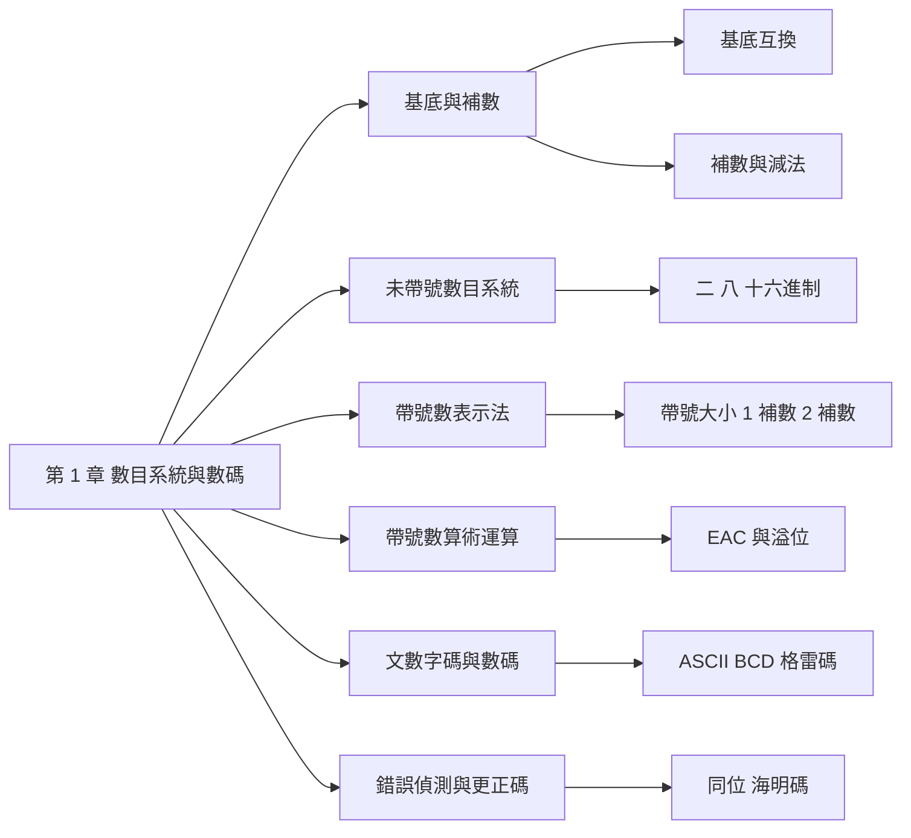

import BaseConverter from "./_BaseConverter.tsx";

## 名詞表 {#glossary}

本章出現的名詞，詳細說明見對應區塊。

| 中文 | English | 描述 |
|---|---|---|
| 基底 | Radix / Base | 每一位可用的符號個數 $b$，也是位權的底數 |
| 位權 | Weight | 第 $i$ 位代表的值 $b^i$ |
| 最高有效位 | MSB / MSD | 最左邊、位權最大的一位 |
| 最低有效位 | LSB / LSD | 最右邊、位權最小的一位 |
| 基底補數 | Radix Complement | $b^n - N$；二進制稱 2 補數、十進制稱 10 補數 |
| 基底減一補數 | Diminished Radix Complement | $b^n - b^{-m} - N$；二進制稱 1 補數、十進制稱 9 補數 |
| 未帶號數 | Unsigned Number | 只表示 0 與正數 |
| 帶號數 | Signed Number | 用最高位當符號位元，0 為正、$b-1$ 為負 |
| 帶號大小表示法 | Sign-Magnitude | 符號位元＋絕對值 |
| 端迴進位 | End-Around Carry, EAC | 1 補數加法中，最高位產生的進位要加回最低位 |
| 溢位 | Overflow | 運算結果超出可表示範圍 |
| 文數字碼 | Alphanumeric Code | 表示字母、數字與符號的編碼，例如 ASCII |
| BCD 碼 | Binary-Coded Decimal | 每個十進制數字用 4 位元表示，最常見的是 8421 碼 |
| 加三碼 | Excess-3 Code | 8421 碼再加 3 的非權位式碼 |
| 格雷碼 | Gray Code | 相鄰兩數只有一個位元不同的編碼 |
| 同位位元 | Parity Bit | 附加在碼語上，使 1 的個數為偶數（偶同位）或奇數（奇同位） |
| 海明碼 | Hamming Code | 加入多個同位位元，能找出並更正單一位元錯誤 |

## 本章地圖 {#ch1-map}

第 1 章是數位系統的「數字語言」：數字怎麼用二進位表示、負數怎麼表示、怎麼做加減法、以及非數值資料（字元、十進制數字）怎麼編碼。原始投影片：[[_pdf/chapter1dl-Part11.pdf|Part 1]]、[[_pdf/chapter1dl-Part22.pdf|Part 2]]、[[_pdf/chapter1dl-Part33.pdf|Part 3]]。

老師在大綱上標註：**數目基底與補數、未帶號數目系統、帶號數算術運算是重點（要熟悉）**；帶號數表示法、文數字碼與數碼、錯誤偵測與更正碼較次要。

## 數目的基底 {#radix}

一個基底為 $b$ 的數，整數部分有 $q$ 位、小數部分有 $p$ 位：

$$
N = (a_{q-1}a_{q-2}\cdots a_1 a_0 . a_{-1}a_{-2}\cdots a_{-p})_b
$$

它的值是每一位乘上**位權** $b^i$ 再相加：

$$
N = a_{q-1}b^{q-1} + \cdots + a_1 b^1 + a_0 b^0 + a_{-1}b^{-1} + \cdots + a_{-p}b^{-p} = \sum_{i=-p}^{q-1} a_i b^i
$$

其中每一位 $0 \le a_i \le b-1$。常用的基底：

| 十進制 | 二進制 | 八進制 | 十六進制 |
|---|---|---|---|
| 0 | 0 | 0 | 0 |
| 1 | 1 | 1 | 1 |
| 2 | 10 | 2 | 2 |
| 3 | 11 | 3 | 3 |
| 4 | 100 | 4 | 4 |
| 5 | 101 | 5 | 5 |
| 6 | 110 | 6 | 6 |
| 7 | 111 | 7 | 7 |
| 8 | 1000 | 10 | 8 |
| 9 | 1001 | 11 | 9 |
| 10 | 1010 | 12 | A |
| 11 | 1011 | 13 | B |
| 12 | 1100 | 14 | C |
| 13 | 1101 | 15 | D |
| 14 | 1110 | 16 | E |
| 15 | 1111 | 17 | F |
| 16 | 10000 | 20 | 10 |

十六進制用 A～F（或 a～f）表示 10～15。

### 例子：數目表示法 {#ex-positional .fold}

- $1101_2 = 1\times 2^3 + 1\times 2^2 + 0\times 2^1 + 1\times 2^0$
- $4347_8 = 4\times 8^3 + 3\times 8^2 + 4\times 8^1 + 7\times 8^0$
- $1742_{10} = 1\times 10^3 + 7\times 10^2 + 4\times 10^1 + 2\times 10^0$
- $18AB_{16} = 1\times 16^3 + 8\times 16^2 + A\times 16^1 + B\times 16^0$

## 基底互換 {#base-conversion}

基底互換分兩類：

1. **十進制與基底 $b$ 的互換**：基底 $b$ 轉十進制用位權展開；十進制轉基底 $b$ 用除法（整數）與乘法（小數）。
2. **基底 $b = 2^i$ 之間的互換**（二、八、十六進制）：直接把位元分組，不必經過十進制。

## 基底 b 轉十進制 {#to-decimal}

把每一位乘上位權再相加（位權展開）：

- $1101.11_2 = 1\times 2^3 + 1\times 2^2 + 0\times 2^1 + 1\times 2^0 + 1\times 2^{-1} + 1\times 2^{-2} = 13.75_{10}$
- $432.2_8 = 4\times 8^2 + 3\times 8^1 + 2\times 8^0 + 2\times 8^{-1} = 282.25_{10}$
- $1E2C.E_{16} = 1\times 16^3 + 14\times 16^2 + 2\times 16^1 + 12\times 16^0 + 14\times 16^{-1} = 7724.875_{10}$

### 例子：二、八、十六進制轉十進制 {#ex-to-decimal .fold}

- $110101.01101_2 = 32 + 16 + 4 + 1 + 0.25 + 0.125 + 0.03125 = 53.40625_{10}$
- $347_8 = 3\times 8^2 + 4\times 8 + 7 = 231_{10}$
- $157.43_8 = 1\times 8^2 + 5\times 8 + 7 + 4\times 8^{-1} + 3\times 8^{-2} = 111.546875_{10}$
- $24.7_8 = 2\times 8 + 4 + 7\div 8 = 20.875_{10}$
- $AED.BF_{16} = 10\times 256 + 14\times 16 + 13 + 11\times 0.0625 + 15\times 0.00390625 = 2797.74609375_{10}$

## 十進制轉基底 b {#from-decimal}

整數與小數部分分開處理。

**整數部分：連續除以 $b$，取餘數。** 因為

$$
\frac{N_{10}}{b} = \underbrace{a_{q-1}b^{q-2} + \cdots + a_1}_{Q_0} + \frac{a_0}{b}
$$

第一次除的餘數是 $a_0$（LSD），商 $Q_0$ 再除以 $b$ 得到 $a_1$……直到商為 0。**餘數由下往上讀**（最後一個是 MSD）。

**小數部分：連續乘以 $b$，取整數。** 因為

$$
b \times N_{10} = a_{-1} + a_{-2}b^{-1} + \cdots + a_{-p}b^{-p+1}
$$

乘積的整數部分就是 $a_{-1}$，剩下的小數再乘以 $b$ 得到 $a_{-2}$……直到小數為 0 或位數足夠。**整數由上往下讀**。

<BaseConverter initial="121.34375" base={2} />

### 例子：121.34375 轉二進制 {#ex-121-binary .fold}

| 整數部分 | 餘數 | | 小數部分 | 整數 |
|---|---|---|---|---|
| $121\div 2 = 60$ | 1（LSB） | | $0.34375\times 2 = 0.6875$ | 0 |
| $60\div 2 = 30$ | 0 | | $0.6875\times 2 = 1.375$ | 1 |
| $30\div 2 = 15$ | 0 | | $0.375\times 2 = 0.75$ | 0 |
| $15\div 2 = 7$ | 1 | | $0.75\times 2 = 1.5$ | 1 |
| $7\div 2 = 3$ | 1 | | $0.5\times 2 = 1.0$ | 1 |
| $3\div 2 = 1$ | 1 | | | |
| $1\div 2 = 0$ | 1（MSB） | | | |

所以 $121.34375_{10} = 1111001.01011_2$。小整數也可以直接拆成 2 的冪次：$13 = 8 + 4 + 1 = 1101_2$。

### 例子：266.38 轉八進制 {#ex-266-octal .fold}

整數：$266\div 8 = 33$ 餘 2，$33\div 8 = 4$ 餘 1，$4\div 8 = 0$ 餘 4，由下往上讀得 $412$。

小數：$0.38\times 8 = 3.04$（3），$0.04\times 8 = 0.32$（0），$0.32\times 8 = 2.56$（2），$0.56\times 8 = 4.48$（4）……小數不會結束，取到需要的位數為止。

$266.38_{10} \approx 412.3024_8$

### 例子：167.45 轉十六進制 {#ex-167-hex .fold}

整數：$167\div 16 = 10$ 餘 7（LSD），$10\div 16 = 0$ 餘 10＝A（MSD），得 $A7_{16}$。

小數：$0.45\times 16 = 7.2$（7），$0.2\times 16 = 3.2$（3），$0.2\times 16 = 3.2$（3）……從第二位開始 3 重複出現。

$167.45_{10} = A7.7\overline{3}_{16}$

## 二、八、十六進制互換 {#binary-octal-hex}

$8 = 2^3$、$16 = 2^4$，所以**一個八進制位恰好對應 3 個位元，一個十六進制位對應 4 個位元**。

- **二進制轉八（十六）進制**：從小數點開始，整數部分往左、小數部分往右，每 3（4）位一組，不足的補 0，每組換成一個數字。
- **八（十六）進制轉二進制**：每個數字展開成 3（4）位元。
- **八進制與十六進制互換**：先轉成二進制，再重新分組。

| 八進制 | 二進制 | | 十六進制 | 二進制 | | 十六進制 | 二進制 |
|---|---|---|---|---|---|---|---|
| 0 | 000 | | 0 | 0000 | | 8 | 1000 |
| 1 | 001 | | 1 | 0001 | | 9 | 1001 |
| 2 | 010 | | 2 | 0010 | | A | 1010 |
| 3 | 011 | | 3 | 0011 | | B | 1011 |
| 4 | 100 | | 4 | 0100 | | C | 1100 |
| 5 | 101 | | 5 | 0101 | | D | 1101 |
| 6 | 110 | | 6 | 0110 | | E | 1110 |
| 7 | 111 | | 7 | 0111 | | F | 1111 |

### 例子：分組互換 {#ex-grouping .fold}

- $110101_2 = 110\ 101 = 65_8$
- $11110010101.01111100110_2 = 011\ 110\ 010\ 101.011\ 111\ 001\ 100_2 = 3625.3714_8$
- $472_8 = 100\ 111\ 010_2$；$54.31_8 = 101\ 100.011\ 001_2$
- $0101\ 1101\ 1001.1011\ 0100\ 1110_2 = 5D9.B4E_{16}$
- $37C.B86_{16} = 0011\ 0111\ 1100.1011\ 1000\ 0110_2$
- $1E43.75_{16} = 0001\ 1110\ 0100\ 0011.0111\ 0101_2 = 001\ 111\ 001\ 000\ 011.011\ 101\ 010_2 = 17103.352_8$
- $7536.152_8 = 111\ 101\ 011\ 110.001\ 101\ 010_2 = 1111\ 0101\ 1110.0011\ 0101\ 0000_2 = F5E.350_{16}$

## 補數 {#complements}

對一個 $b$ 進制、整數 $n$ 位、小數 $m$ 位的正數 $N_b$：

| | 定義 | 二進制 | 十進制 |
|---|---|---|---|
| **基底補數** $b$'s complement | $b^n - N_b$ | 2 補數 | 10 補數 |
| **基底減一補數** $(b-1)$'s complement | $b^n - b^{-m} - N_b$ | 1 補數 | 9 補數 |

兩者只差最低位的 1：**基底補數 = 基底減一補數 + $b^{-m}$**。

- 基底減一補數最好算：**每一位用 $b-1$ 去減**（$\bar a_i = b - 1 - a_i$）。二進制的 1 補數就是**每個位元反相**。
- 基底補數 = 基底減一補數再在最低位加 1。二進制的 2 補數也可以這樣求：從右往左，第一個 1（含）以右照抄，其餘位元反相。

### 例子：基底補數 {#ex-radix-complement .fold}

| 數 | 補數 | 計算 | 備註 |
|---|---|---|---|
| $25250_{10}$ | 10 補數 | $10^5 - 25250 = 74750$ | $n=5$ |
| $0.2376_{10}$ | 10 補數 | $10^1 - 0.2376 = 9.7624$ | $n=1$ |
| $25.369_{10}$ | 10 補數 | $10^2 - 25.369 = 74.631$ | $n=2$ |
| $101100_2$ | 2 補數 | $2^6 - 101100_2 = 010100_2$ | $n=6$ |
| $0.0110_2$ | 2 補數 | $2^1 - 0.0110_2 = 1.1010_2$ | $n=1$ |

### 例子：基底減一補數 {#ex-diminished-complement .fold}

| 數 | 補數 | 計算 | 備註 |
|---|---|---|---|
| $25250_{10}$ | 9 補數 | $10^5 - 10^0 - 25250 = 74749$ | $n=5, m=0$ |
| $0.2376_{10}$ | 9 補數 | $10^1 - 10^{-4} - 0.2376 = 9.7623$ | $n=1, m=4$ |
| $25.369_{10}$ | 9 補數 | $10^2 - 10^{-3} - 25.369 = 74.630$ | $n=2, m=3$ |
| $101100_2$ | 1 補數 | $2^6 - 2^0 - 101100_2 = 010011_2$ | $n=6, m=0$ |
| $0.0110_2$ | 1 補數 | $2^1 - 2^{-4} - 0.0110_2 = 1.1001_2$ | $n=1, m=4$ |

## 用補數做減法 {#complement-subtraction}

$M - N$ 可以改成 $M +$（$N$ 的基底補數），只用加法器就能做減法：

1. 求 $N$ 的基底補數，與 $M$ 相加。
2. **有進位**發生：去掉進位，結果為正，就是答案。
3. **沒有進位**：結果為負，答案是「和」的基底補數再加上負號。

### 例子：十進制 10 補數減法 {#ex-decimal-subtraction .fold}

287 是 713 的 10 補數（$1000 - 713$）。

| 題目 | 加法 | 進位 | 結果 |
|---|---|---|---|
| $918 - 713$ | $918 + 287 = 1205$ | 有 | 去掉進位得 $205$ |
| $713 - 713$ | $713 + 287 = 1000$ | 有 | $0$ |
| $218 - 713$ | $218 + 287 = 505$ | 沒有 | $-(1000 - 505) = -495$ |

### 例子：二進制 2 補數減法 {#ex-binary-subtraction .fold}

1010 是 0110 的 2 補數。

| 題目 | 加法 | 進位 | 結果 |
|---|---|---|---|
| $1011 - 0110$ | $1011 + 1010 = 10101$ | 有 | $0101$（$+5$） |
| $0110 - 0110$ | $0110 + 1010 = 10000$ | 有 | $0000$（$0$） |
| $0011 - 0110$ | $0011 + 1010 = 1101$ | 沒有 | $-(0011) = -3$ |

## 帶號數表示法 {#signed-numbers}

帶號數用**最高位當符號位元**：0 表示正數，$b-1$（二進制就是 1）表示負數。

- **正數**：三種表示法都一樣，符號位元 0 加上數值，例如 $0319_{10} = +319$、$07EA_{16} = +2026$。
- **負數**：有三種表示法，差別在數值部分怎麼存：

| 表示法 | 負數 $-N$ 的寫法 | $-1011.011_2$ |
|---|---|---|
| 帶號大小 sign-magnitude | 符號位元 $b-1$，數值部分照抄 $\lvert N\rvert$ | $11011.011$ |
| 基底減一補數（1 補數） | 整個正數 $(0N)$ 取基底減一補數 | $10100.100$ |
| 基底補數（2 補數） | 整個正數 $(0N)$ 取基底補數 | $10100.101$ |

八進制的帶號大小例子：$+754_8$ 寫成 $0754_8$，$-754_8$ 寫成 $7754_8$（符號位元是 $b-1 = 7$）。

## 帶號數 4 位元對照表 {#signed-4bit-table}

| 十進制 | 帶號大小 | 1 補數 | 2 補數 | | 十進制 | 帶號大小 | 1 補數 | 2 補數 |
|---|---|---|---|---|---|---|---|---|
| +7 | 0111 | 0111 | 0111 | | −0 | 1000 | 1111 | （無） |
| +6 | 0110 | 0110 | 0110 | | −1 | 1001 | 1110 | 1111 |
| +5 | 0101 | 0101 | 0101 | | −2 | 1010 | 1101 | 1110 |
| +4 | 0100 | 0100 | 0100 | | −3 | 1011 | 1100 | 1101 |
| +3 | 0011 | 0011 | 0011 | | −4 | 1100 | 1011 | 1100 |
| +2 | 0010 | 0010 | 0010 | | −5 | 1101 | 1010 | 1011 |
| +1 | 0001 | 0001 | 0001 | | −6 | 1110 | 1001 | 1010 |
| +0 | 0000 | 0000 | 0000 | | −7 | 1111 | 1000 | 1001 |
| | | | | | −8 | （不可能） | （不可能） | 1000 |

2 補數的 0 只有一種寫法（0000），所以多出一個 $-8$。

## 表示範圍 {#signed-range}

$n$ 位元的帶號數：

| | 帶號大小 | 1 補數 | 2 補數 |
|---|---|---|---|
| 正數 | $0xyz$ | $0xyz$ | $0xyz$ |
| 負數 | $1xyz$ | $1x'y'z'$ | $1x'y'z' + 1$ |
| 表示範圍 | $-(2^{n-1}-1)$ 到 $2^{n-1}-1$ | $-(2^{n-1}-1)$ 到 $2^{n-1}-1$ | $-2^{n-1}$ 到 $2^{n-1}-1$ |
| 零（4 位元） | 0000（+0）、1000（−0） | 0000（+0）、1111（−0） | 0000 |

## 帶號大小的加法 {#sm-addition}

**同號**（同時正或同時負）：把 $\lvert A\rvert$ 與 $\lvert B\rvert$ 相加，結果的符號位元和 $A$（$B$）相同。

- $\lvert A\rvert = 100$、$\lvert B\rvert = 010$：$100 + 010 = 110$，正數時 $A + B = 0110$（+6）。
- $\lvert A\rvert = 010$、$\lvert B\rvert = 101$：$010 + 101 = 111$，負數時 $A + B = 1111$（−7）。

**異號**（一正一負）：先把其中一數的大小取 1 補數，再相加：

1. **有進位**（稱為**端迴進位 EAC**）：把 EAC 加到結果的最低有效位上，結果的符號位元和**未取補數者**相同。
2. **沒有進位**：結果要再取 1 補數，符號位元和**取補數者**相同。

### 例子：帶號大小異號相加 {#ex-sm-different-sign .fold}

$\lvert A\rvert = 111$、$\lvert B\rvert = 110$。

- 把 $\lvert B\rvert$ 取 1 補數得 $001$：$111 + 001 = 1000$，有 EAC，加回得 $000 + 1 = 001$，結果為 1，符號和 $A$ 相同。
- 把 $\lvert A\rvert$ 取 1 補數得 $000$：$000 + 110 = 110$，沒有 EAC，再取 1 補數得 $001$，符號和 $A$ 相同。

## 1 補數的加法 {#ones-complement-addition}

1 補數的加法把符號位元和數值一起相加，最高位產生的進位就是 EAC，**必須加回最低有效位**。

**A、B 皆為正數**：直接相加。結果符號位元為 1 表示**溢位**，結果錯誤；否則正確。

- $0011 + 0010 = 0101$（+3 + +2 = +5），沒有溢位，正確。
- $0110 + 0100 = 1010$（+6 + +4），符號位元變 1，溢位，結果錯誤（+10 超出 4 位元範圍）。

**A、B 皆為負數**：一定會產生 EAC（兩個符號位元 1 相加），加回最低位後：

- 結果符號位元是 1：正確。例：$1101 + 1011 = 1\,1000$，EAC 加回得 $1001$（−2 + −4 = −6）。
- 結果符號位元是 0：溢位，錯誤。例：$1000 + 1010 = 1\,0010$，EAC 加回得 $0011$（−7 + −5 = −12，超出範圍）。

**A、B 異號**：正數絕對值較大時有 EAC，負數絕對值較大時沒有 EAC。EAC 要加回最低位。**異號相加不會溢位**。

- $0100 + 1000 = 1100$（+4 + −7 = −3），沒有 EAC，正確。
- $0111 + 1100 = 1\,0011$，EAC 加回得 $0100$（+7 + −3 = +4），正確。
- $0101 + 1010 = 1111$（+5 + −5 = −0），正確。

## 2 補數的加法 {#twos-complement-addition}

2 補數的加法也是符號位元和數值一起相加，但**最高位產生的進位直接捨棄**（不必加回）。這是 2 補數最常用的原因。

**A、B 皆為正數**：規則和 1 補數相同，結果符號位元為 1 表示溢位。

**A、B 皆為負數**：產生的進位捨棄。結果符號位元為 1 正確；為 0 表示溢位。

- $1101 + 1100 = 1\,1001$，捨棄進位得 $1001$（−3 + −4 = −7），正確。
- $1100 + 1001 = 1\,0101$，捨棄進位得 $0101$，符號位元為 0，溢位（−4 + −7 = −11，超出範圍）。

**A、B 異號**：正數絕對值較大時有進位，捨棄即可；不會溢位。

- $0111 + 1100 = 1\,0011$，捨棄進位得 $0011$（+7 + −4 = +3）。
- $0110 + 1001 = 1111$（+6 + −7 = −1）。

## 溢位偵測 {#overflow}

把上面的規則整理後，2 補數加法有兩條更快的判斷法：

1. 把兩數相加。
2. 看**符號位元的進位輸入**與**進位輸出**：兩者**同時有或同時沒有**，結果正確；**只有一個**，就是溢位。

| 例子 | 符號位元進位輸入 | 進位輸出 | 判定 |
|---|---|---|---|
| $0111 + 1100$（+7 + −4） | 有 | 有 | 正確，得 0011 |
| $0110 + 1001$（+6 + −7） | 沒有 | 沒有 | 正確，得 1111 |
| $0011 + 0100$（+3 + +4） | 沒有 | 沒有 | 正確，得 0111 |
| $0101 + 0100$（+5 + +4） | 有 | 沒有 | **溢位**，1001 錯誤 |

另一種說法：**兩個同號數相加，結果卻變成異號，就是溢位**；異號數相加永遠不會溢位。

## 文數字碼 ASCII {#ascii}

**ASCII**（American Standard Code for Information Interchange）用 7 個位元表示 128 個字元：高 3 位（MSD，0～7）和低 4 位（LSD，0～F）組成表格。

| 高 3 位 | 內容 |
|---|---|
| 000、001 | 控制字元（NUL、LF 換行、CR 歸位、ESC…） |
| 010 | 空白 SP 與標點符號（`!`、`"`、`#`…） |
| 011 | 數字 0～9（$30_{16}$～$39_{16}$）與 `:`、`;` 等 |
| 100、101 | 大寫字母 A～Z（A = $41_{16}$） |
| 110、111 | 小寫字母 a～z（a = $61_{16}$），最後是 DEL |

記法：數字 $d$ 的 ASCII 是 $30_{16} + d$；大小寫字母相差 $20_{16}$（第 5 位元）。

## 十進制碼 {#decimal-codes}

用 4 個以上的位元表示一個十進制數字 0～9。分成兩類：

**權位式碼**：每個位元有固定的權重，數字 = 權重 × 位元的和。

| 十進制 | 8421（BCD） | 84−2−1 | 2421 | 642−3 |
|---|---|---|---|---|
| 0 | 0000 | 0000 | 0000 | 0000 |
| 1 | 0001 | 0111 | 0001 | 0101 |
| 2 | 0010 | 0110 | 0010 | 0010 |
| 3 | 0011 | 0101 | 0011 | 1001 |
| 4 | 0100 | 0100 | 0100 | 0100 |
| 5 | 0101 | 1011 | 1011 | 1011 |
| 6 | 0110 | 1010 | 1100 | 0110 |
| 7 | 0111 | 1001 | 1101 | 1101 |
| 8 | 1000 | 1000 | 1110 | 1010 |
| 9 | 1001 | 1111 | 1111 | 1111 |

例如 84−2−1 碼的 0111 = $0\cdot 8 + 1\cdot 4 + 1\cdot(-2) + 1\cdot(-1) = 1$。

**非權位式碼**：

| 十進制 | 加三碼 Excess-3 | 5 取 2 碼 2-out-of-5 |
|---|---|---|
| 0 | 0011 | 11000 |
| 1 | 0100 | 00011 |
| 2 | 0101 | 00101 |
| 3 | 0110 | 00110 |
| 4 | 0111 | 01001 |
| 5 | 1000 | 01010 |
| 6 | 1001 | 01100 |
| 7 | 1010 | 10001 |
| 8 | 1011 | 10010 |
| 9 | 1100 | 10100 |

- **加三碼**：8421 碼再加 3。
- **5 取 2 碼**：每個碼語剛好有兩個 1，收到不是兩個 1 的碼語就知道出錯了（常用於電信）。

## 格雷碼 {#gray-code}

**格雷碼**的特點：**相鄰兩個數只有一個位元不同**（連 15 回到 0 也是）。計數時一次只變一個位元，不會因為多個位元變化不同步而產生錯誤的中間值；第 4 章的卡諾圖也用格雷碼排列。

| 十進制 | 格雷碼 $g_3g_2g_1g_0$ | 二進制 $b_3b_2b_1b_0$ | | 十進制 | 格雷碼 | 二進制 |
|---|---|---|---|---|---|---|
| 0 | 0000 | 0000 | | 8 | 1100 | 1000 |
| 1 | 0001 | 0001 | | 9 | 1101 | 1001 |
| 2 | 0011 | 0010 | | 10 | 1111 | 1010 |
| 3 | 0010 | 0011 | | 11 | 1110 | 1011 |
| 4 | 0110 | 0100 | | 12 | 1010 | 1100 |
| 5 | 0111 | 0101 | | 13 | 1011 | 1101 |
| 6 | 0101 | 0110 | | 14 | 1001 | 1110 |
| 7 | 0100 | 0111 | | 15 | 1000 | 1111 |

### 格雷碼的反射特性 {#gray-reflection}

$n$ 位元的格雷碼可以由 $n-1$ 位元「反射」得到：

1. 把 $n-1$ 位元的格雷碼序列照抄一次，前面補 0。
2. 以最後一個碼為**反射軸**，把序列倒過來再寫一次，前面補 1。

例如 1 位元：0、1。2 位元：00、01 | 11、10。3 位元：000、001、011、010 | 110、111、101、100。所以格雷碼又叫**反射碼**。

## 二進碼與格雷碼互換 {#gray-conversion}

設 $n$ 位元二進碼 $b_{n-1}\cdots b_1b_0$ 對應格雷碼 $g_{n-1}\cdots g_1g_0$，$\oplus$ 是 XOR（$0\oplus 0 = 1\oplus 1 = 0$，$0\oplus 1 = 1\oplus 0 = 1$）。

**二進碼轉格雷碼**：最高位照抄，其餘每一位是**二進碼的相鄰兩位 XOR**：

$$
g_{n-1} = b_{n-1}, \qquad g_i = b_i \oplus b_{i+1} \quad (0 \le i \le n-2)
$$

**格雷碼轉二進碼**：最高位照抄，其餘每一位是**左邊剛算出的二進位 XOR 這一位的格雷碼**：

$$
b_{n-1} = g_{n-1}, \qquad b_i = b_{i+1} \oplus g_i \quad (0 \le i \le n-2)
$$

注意方向：轉格雷碼用的全是**二進碼**的位元；轉回二進碼要用**剛算出的二進位**，所以只能從左往右逐位算。

### 例子：二進碼與格雷碼互換 {#ex-gray-conversion .fold}

二進碼 101101 轉格雷碼：$g_5 = 1$，$g_4 = 1\oplus 0 = 1$，$g_3 = 0\oplus 1 = 1$，$g_2 = 1\oplus 1 = 0$，$g_1 = 1\oplus 0 = 1$，$g_0 = 0\oplus 1 = 1$，得 **111011**。

二進碼 101011 → 格雷碼 **111110**。

格雷碼 111011 轉二進碼：$b_5 = 1$，$b_4 = 1\oplus 1 = 0$，$b_3 = 0\oplus 1 = 1$，$b_2 = 1\oplus 0 = 1$，$b_1 = 1\oplus 1 = 0$，$b_0 = 0\oplus 1 = 1$，得 **101101**。

格雷碼 111110 → 二進碼 **101011**。

## 同位位元 {#parity}

在碼語上加一個**同位位元 P**，使包含 P 在內的 1 的總數符合規定：

- **偶同位（even parity）**：1 的總數為**偶數**。原碼語有奇數個 1 時 P = 1，否則 P = 0。
- **奇同位（odd parity）**：1 的總數為**奇數**。原碼語有偶數個 1 時 P = 1，否則 P = 0。

| 十進制 | 8421 | 奇同位 P8421 | 偶同位 P8421 |
|---|---|---|---|
| 0 | 0000 | 10000 | 00000 |
| 1 | 0001 | 00001 | 10001 |
| 2 | 0010 | 00010 | 10010 |
| 3 | 0011 | 10011 | 00011 |
| 4 | 0100 | 00100 | 10100 |
| 5 | 0101 | 10101 | 00101 |
| 6 | 0110 | 10110 | 00110 |
| 7 | 0111 | 00111 | 10111 |
| 8 | 1000 | 01000 | 11000 |
| 9 | 1001 | 11001 | 01001 |

應用：傳輸端用**同位產生器**算出 P 一起送出；經過網路、磁碟或記憶體後，接收端用**同位偵測器**檢查 1 的個數，不符合就表示錯誤。同位位元只能**偵測**奇數個位元錯誤，**不能指出**錯在哪一位。

## 海明碼 {#hamming}

**海明碼**放入多個同位位元，能指出錯誤位元的位置並更正它（單一位元錯誤）。BCD 的 4 個資料位元 $m_3m_2m_1m_0$ 加上 3 個同位位元 $p_2p_1p_0$，共 7 位：

| 位置 | 7 | 6 | 5 | 4 | 3 | 2 | 1 |
|---|---|---|---|---|---|---|---|
| 位元 | $m_3$ | $m_2$ | $m_1$ | $p_2$ | $m_0$ | $p_1$ | $p_0$ |

同位位元放在位置 1、2、4（2 的冪次），偶同位的規則：

- $p_0$：位置 **1、3、5、7** 建立偶同位。
- $p_1$：位置 **2、3、6、7** 建立偶同位。
- $p_2$：位置 **4、5、6、7** 建立偶同位。

（位置的二進制第 0 位為 1 的歸 $p_0$、第 1 位為 1 的歸 $p_1$、第 2 位為 1 的歸 $p_2$。）

**偵測與更正**：接收端對三組位置重新檢查偶同位，得到 $c_0, c_1, c_2$（符合為 0、不符合為 1）。$c_2c_1c_0$ 組成的二進位數就是**錯誤位元的位置**；全為 0 表示沒有錯。

| 十進制 | 7 $m_3$ | 6 $m_2$ | 5 $m_1$ | 4 $p_2$ | 3 $m_0$ | 2 $p_1$ | 1 $p_0$ |
|---|---|---|---|---|---|---|---|
| 0 | 0 | 0 | 0 | 0 | 0 | 0 | 0 |
| 1 | 0 | 0 | 0 | 0 | 1 | 1 | 1 |
| 2 | 0 | 0 | 1 | 1 | 0 | 0 | 1 |
| 3 | 0 | 0 | 1 | 1 | 1 | 1 | 0 |
| 4 | 0 | 1 | 0 | 1 | 0 | 1 | 0 |
| 5 | 0 | 1 | 0 | 1 | 1 | 0 | 1 |
| 6 | 0 | 1 | 1 | 0 | 0 | 1 | 1 |
| 7 | 0 | 1 | 1 | 0 | 1 | 0 | 0 |
| 8 | 1 | 0 | 0 | 1 | 0 | 1 | 1 |
| 9 | 1 | 0 | 0 | 1 | 1 | 0 | 0 |

### 例子：產生 0110（6）的海明碼 {#ex-hamming-encode .fold}

$m_3m_2m_1m_0 = 0110$，放進位置 7、6、5、3：

- 位置 1、3、5、7 = $p_0, 0, 1, 0$，要偶數個 1，所以 $p_0 = 1$。
- 位置 2、3、6、7 = $p_1, 0, 1, 0$，所以 $p_1 = 1$。
- 位置 4、5、6、7 = $p_2, 1, 1, 0$，已有兩個 1，所以 $p_2 = 0$。

海明碼（位置 7→1）為 **0110011**，與表中 6 那一列相同。

### 例子：偵測並更正錯誤 {#ex-hamming-decode .fold}

收到 **0111011**（位置 7→1）。

- 位置 1、3、5、7 = 1, 0, 1, 0：偶數個 1，$c_0 = 0$。
- 位置 2、3、6、7 = 1, 0, 1, 0：$c_1 = 0$。
- 位置 4、5、6、7 = 1, 1, 1, 0：奇數個 1，$c_2 = 1$。

$c_2c_1c_0 = 100_2 = 4$，**位置 4（$p_2$）錯了**，把它從 1 改回 0，得 0110011，也就是 6。
