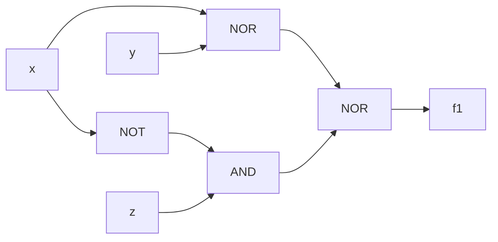
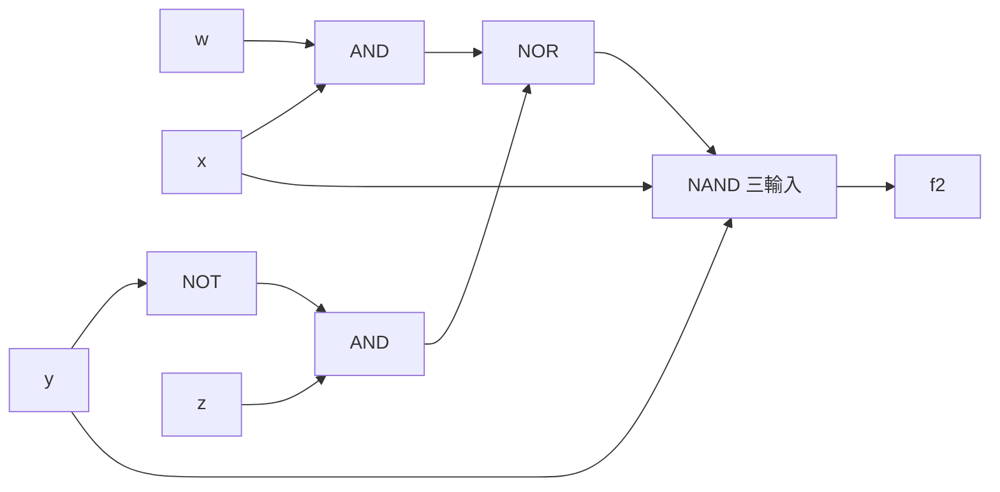

題目來源：[[_pdf/第2章程度考題(1).pdf|第 2 章程度考題]]。概念說明見 [[ch2-switching-algebra#ch2-map|第 2 章 交換代數]]。

## 對偶式 {#q-dual}

依對偶原理，求下列式子的對偶式：

1. $x + (y\cdot z) = (x + y)\cdot(x + z)$
2. $x + x' = 1$

### 詳解 {#q-dual-solution .fold}

$+$ 與 $\cdot$ 互換、0 與 1 互換，變數不變。見 [[ch2-switching-algebra#duality|對偶原理]]。

1. $x\cdot(y + z) = (x\cdot y) + (x\cdot z)$
2. $x\cdot x' = 0$

## 布林代數基本定理 {#q-theorems}

寫出 $+$ 與 $\cdot$ 的：

1. 等冪性定理
2. 邊界定理
3. 吸收律

### 詳解 {#q-theorems-solution .fold}

見 [[ch2-switching-algebra#basic-theorems|基本定理]]。

1. 等冪性：$x + x = x$；$x\cdot x = x$
2. 邊界定理：$x + 1 = 1$；$x\cdot 0 = 0$
3. 吸收律：$x + x\cdot y = x$；$x\cdot(x + y) = x$

## 證明交換等式 {#q-prove-identity}

證明 $xy' + y = x + y$。

### 詳解 {#q-prove-identity-solution .fold}

**代數運算**：

$$
xy' + y = xy' + y(x + x') = xy' + xy + x'y = (xy' + xy) + (xy + x'y) = x(y'+y) + (x+x')y = x + y
$$

**完全歸納法**：列真值表，$xy' + y$ 與 $x + y$ 在 $(x,y) = 00, 01, 10, 11$ 時都是 $0, 1, 1, 1$，所以相等。

另一個更快的做法：用分配律 $y + xy' = (y + x)(y + y') = (x + y)\cdot 1 = x + y$。詳見 [[ch2-switching-algebra#proving-identities|證明交換等式]]。

## 同一真值表比較交換函數 {#q-compare-functions}

在同一真值表內計算 $E(x,y,z) = xy' + xz + y'z$ 與 $F(x,y,z) = xy' + xz + x'y'z$。

### 詳解 {#q-compare-functions-solution .fold}

| $xyz$ | 000 | 001 | 010 | 011 | 100 | 101 | 110 | 111 |
|---|---|---|---|---|---|---|---|---|
| $E$ | 0 | 1 | 0 | 0 | 1 | 1 | 0 | 1 |
| $F$ | 0 | 1 | 0 | 0 | 1 | 1 | 0 | 1 |

兩者真值表完全相同，所以是**同一個交換函數**（不同的交換表式）。$E$ 中的 $y'z$ 涵蓋 001、101，$F$ 中的 $x'y'z$ 只涵蓋 001，但 101 已由 $xy'$ 涵蓋，所以結果一樣。

## 補數、和、積函數 {#q-complement-sum-product}

$f$ 與 $g$ 的真值表如下（$xyz$ 由 000 到 111）：$f = 0,1,0,0,1,1,0,0$；$g = 1,0,0,0,1,1,0,1$。求 $f'$、$f + g$、$f\cdot g$。

### 詳解 {#q-complement-sum-product-solution .fold}

逐列運算：

| $xyz$ | 000 | 001 | 010 | 011 | 100 | 101 | 110 | 111 |
|---|---|---|---|---|---|---|---|---|
| $f$ | 0 | 1 | 0 | 0 | 1 | 1 | 0 | 0 |
| $g$ | 1 | 0 | 0 | 0 | 1 | 1 | 0 | 1 |
| $f'$ | 1 | 0 | 1 | 1 | 0 | 0 | 1 | 1 |
| $f + g$ | 1 | 1 | 0 | 0 | 1 | 1 | 0 | 1 |
| $f\cdot g$ | 0 | 0 | 0 | 0 | 1 | 1 | 0 | 0 |

見 [[ch2-switching-algebra#complement-sum-product|補數、和、積函數]]。

## 邏輯運算子真值表 {#q-operator-tables}

填空：

1. 三變數 AND 與 OR 的真值表
2. NAND、NOR、XOR、XNOR（兩變數）的真值表
3. 三變數 NAND 與 NOR 的真值表
4. 三變數 XOR 與 XNOR（$x\oplus y$、$x\oplus y\oplus z$、$x\odot y$、$x\odot y\odot z$）的真值表

### 詳解 {#q-operator-tables-solution .fold}

1～3 題答案見 [[ch2-switching-algebra#logic-operators|邏輯運算子]] 與 [[ch2-switching-algebra#multi-input-operators|多變數的邏輯運算子]]。第 4 題（$xyz$ 由 000 到 111）：

| $xyz$ | 000 | 001 | 010 | 011 | 100 | 101 | 110 | 111 |
|---|---|---|---|---|---|---|---|---|
| $x\oplus y$ | 0 | 0 | 1 | 1 | 1 | 1 | 0 | 0 |
| $x\oplus y\oplus z$ | 0 | 1 | 1 | 0 | 1 | 0 | 0 | 1 |
| $x\odot y$ | 1 | 1 | 0 | 0 | 0 | 0 | 1 | 1 |
| $x\odot y\odot z$ | 0 | 1 | 1 | 0 | 1 | 0 | 0 | 1 |

注意：$x\odot y\odot z$ 與 $x\oplus y\oplus z$ 相同（1 的個數為奇數時為 1）。

## 函數完全運算集合 {#q-functionally-complete}

1. 證明 $\{f\}$ 是函數完全運算集合，其中 $f(x,y,z) = xy'z + x'z'$。
2. 證明 $\{f, 1, 0\}$ 是函數完全運算集合，其中 $f(x,y,z) = x'y + xz$。

### 詳解 {#q-functionally-complete-solution .fold}

程序：先做出 NOT，再做出 AND 或 OR。見 [[ch2-switching-algebra#functionally-complete|函數完全運算集合]]。

**第 1 題**（集合裡沒有常數，只能把變數接在一起）：

- NOT：$f(x, x, x) = x\,x'\,x + x'x' = 0 + x' = x'$
- OR：$f(x', y', x') = x'\,(y')'\,x' + (x')'(x')' = x'y + x = x + y$

其中 $x'$、$y'$ 用上面的 NOT 產生。能做出 $\{\text{OR}, \text{NOT}\}$，所以 $\{f\}$ 是函數完全集合。

**第 2 題**（可以用常數 0、1）：

- NOT：$f(x, 1, 0) = x'\cdot 1 + x\cdot 0 = x'$
- AND：$f(x, 0, y) = x'\cdot 0 + x\cdot y = xy$

能做出 $\{\text{AND}, \text{NOT}\}$，所以 $\{f, 1, 0\}$ 是函數完全集合。（這個 $f$ 其實是二對一多工器：$x = 0$ 選 $y$，$x = 1$ 選 $z$。）

## SOP 與 POS 互換 {#q-sop-pos}

1. 將 $f(x,y,z) = xy + y'z + xz$ 表示為 POS 形式。
2. 將 $f(x,y,z) = (x + y')(x + z)(y + z')$ 表示為 SOP 形式。

### 詳解 {#q-sop-pos-solution .fold}

**第 1 題**：用 $A + BC = (A + B)(A + C)$ 反覆分配。

$$
f = (xy + y'z + x)(xy + y'z + z) = (x + y'z)(xy + z) = (x + y')(x + z)(x + z)(y + z) = (x + y')(x + z)(y + z)
$$

其中 $(x+z)$ 是共識項，可再化簡為 $(x + y')(y + z)$。詳見 [[ch2-switching-algebra#ex-sop-to-pos|例子：把 SOP 改寫成 POS]]。

**第 2 題**：先把前兩項相乘，$(x + y')(x + z) = x + y'z$，再乘第三項：

$$
f = (x + y'z)(y + z') = xy + xz' + y'zy + y'zz' = xy + xz'
$$

（$y'y = 0$、$zz' = 0$。）驗算：$x = 0$ 時三項中 $y'$ 與 $z$ 必須同為 1，但 $(y + z')$ 就變成 0，所以 $f$ 只在 $x = 1$ 且 $(y + z') = 1$ 時為 1，即 $x(y + z')$。

## 最小項與最大項 {#q-minterm-maxterm}

求四變數 $(w,x,y,z)$ 組合 $1011_2$ 的最小項和最大項。

### 詳解 {#q-minterm-maxterm-solution .fold}

$1011_2 = 11$。

- 最小項：值為 0 的變數取補數，**$m_{11} = w\,x'\,y\,z$**
- 最大項：值為 1 的變數取補數，**$M_{11} = w' + x + y' + z'$**

兩者互為補數：$m_{11}' = M_{11}$。見 [[ch2-switching-algebra#minterm-maxterm|最小項與最大項]]。

## 由真值表求標準式 {#q-canonical-from-table}

真值表：$f(0) = 1, f(1) = 0, f(2) = 0, f(3) = 1, f(4) = 0, f(5) = 1, f(6) = 1, f(7) = 0$。求標準 SOP 和 POS。

### 詳解 {#q-canonical-from-table-solution .fold}

- 標準 SOP（$f = 1$ 的列）：$f = \Sigma(0,3,5,6) = x'y'z' + x'yz + xy'z + xyz'$
- 標準 POS（$f = 0$ 的列）：$f = \Pi(1,2,4,7) = (x+y+z')(x+y'+z)(x'+y+z)(x'+y'+z')$

（這個函數其實是 $(x\oplus y\oplus z)'$：輸入有偶數個 1 時為 1。）見 [[ch2-switching-algebra#canonical-form|標準式]]。

## Shannon 展開驗證 {#q-shannon}

設 $f(x,y,z) = xy + y'z + xz$，求 $x'f(0,y,z) + x f(1,y,z)$。

### 詳解 {#q-shannon-solution .fold}

- $f(0,y,z) = 0 + y'z + 0 = y'z$
- $f(1,y,z) = y + y'z + z = y + z$（$y + y'z = y + z$）

$$
x'f(0,y,z) + xf(1,y,z) = x'y'z + x(y + z) = x'y'z + xy + xz
$$

驗算它等於原式：原式的 $y'z = xy'z + x'y'z$，其中 $xy'z$ 已被 $xz$ 涵蓋，所以兩者相同。

## 用展開定理求標準式 {#q-canonical-by-expansion}

用展開定理求 $f(x,y,z) = x'(y' + z)$ 的標準 SOP 和 POS。

### 詳解 {#q-canonical-by-expansion-solution .fold}

$\alpha_i = f(i)$：$f(0) = 1\cdot(1 + 0) = 1$，$f(1) = 1\cdot(1+1) = 1$，$f(2) = 1\cdot(0 + 0) = 0$，$f(3) = 1\cdot(0 + 1) = 1$，$x = 1$ 時 $f = 0$。

- 標準 SOP：$f = \Sigma(0,1,3) = x'y'z' + x'y'z + x'yz$
- 標準 POS：$f = \Pi(2,4,5,6,7) = (x+y'+z)(x'+y+z)(x'+y+z')(x'+y'+z)(x'+y'+z')$

## 求標準 SOP {#q-canonical-sop}

將 $f(x,y,z) = x + y'z' + yz$ 表示為標準 SOP。

### 詳解 {#q-canonical-sop-solution .fold}

每個乘積項補上缺少的變數 $(v + v')$：

$$
\begin{aligned}
f &= x(y + y')(z + z') + (x + x')y'z' + (x + x')yz \\
&= xyz + xyz' + xy'z + xy'z' + xy'z' + x'y'z' + xyz + x'yz \\
&= x'y'z' + x'yz + xy'z' + xy'z + xyz' + xyz \\
&= \Sigma(0, 3, 4, 5, 6, 7)
\end{aligned}
$$

見 [[ch2-switching-algebra#to-canonical-sop|求標準 SOP]]。

## 求標準 POS {#q-canonical-pos}

將 $f(x,y,z) = x(y' + z')$ 表示為標準 POS。

### 詳解 {#q-canonical-pos-solution .fold}

每個和項補上缺少的變數 $vv'$，再用分配律展開：

$$
\begin{aligned}
f &= (x + yy' + zz')(xx' + y' + z') \\
&= (x+y+z)(x+y+z')(x+y'+z)(x+y'+z')\cdot(x+y'+z')(x'+y'+z') \\
&= (x+y+z)(x+y+z')(x+y'+z)(x+y'+z')(x'+y'+z') \\
&= \Pi(0, 1, 2, 3, 7)
\end{aligned}
$$

驗算：$f = 1$ 只在 $x = 1$ 且 $y, z$ 不全為 1，即 4、5、6；其餘 0、1、2、3、7 為 0。見 [[ch2-switching-algebra#to-canonical-pos|求標準 POS]]。

## 標準式下的補數函數 {#q-complement-function}

$f(x,y,z) = \Sigma(0,2,3,4) = \Pi(1,5,6,7)$，求 $f'$ 的兩種標準式。

### 詳解 {#q-complement-function-solution .fold}

取沒出現的編號：

$$
f' = \Sigma(1,5,6,7) = \Pi(0,2,3,4)
$$

見 [[ch2-switching-algebra#complement-function|求補數函數]]。

## 標準式下的對偶函數 {#q-dual-function}

$f(x,y,z) = \Sigma(0,2,3,4) = \Pi(1,5,6,7)$，求 $f^d$ 的兩種標準式。

### 詳解 {#q-dual-function-solution .fold}

$f^d(x,y,z) = [f(x',y',z')]'$：$f^d$ 在編號 $i$ 為 1 ⇔ $f$ 在編號 $7 - i$ 為 0。

$f$ 為 0 的編號是 $\{1,5,6,7\}$，換成 $7 - j$ 得 $\{6,2,1,0\}$：

$$
f^d = \Sigma(0,1,2,6) = m_0 + m_1 + m_2 + m_6 = \Pi(3,4,5,7) = M_3 M_4 M_5 M_7
$$

見 [[ch2-switching-algebra#dual-function|對偶函數]]。

## 基本邏輯閘填空 {#q-gate-tables}

1. 填出 AND、OR、NOT、BUF 的函數與真值表。
2. 填出 NAND、NOR、XOR、XNOR 的函數與真值表。
3. 填出用 NAND 實現 NOT，用 NOR 實現 AND、OR 的電路與函數。

### 詳解 {#q-gate-tables-solution .fold}

1、2 題見 [[ch2-switching-algebra#basic-gates|基本邏輯閘]]。第 3 題：

- NAND 做 NOT：兩輸入接在一起，$f = (xx)' = x'$。
- NOR 做 AND：$x$、$y$ 先各自經過一個輸入接在一起的 NOR（變成 $x'$、$y'$），再送進一個 NOR：$f = [(x+x)' + (y+y)']' = xy$。
- NOR 做 OR：NOR 之後再接一個當 NOT 用的 NOR：$f = [(x+y)']' = x + y$。

見 [[ch2-switching-algebra#implementation|交換函數的執行]]。

## 邏輯閘的基本應用 {#q-gate-applications}

列出邏輯閘的 3 種基本應用。

### 詳解 {#q-gate-applications-solution .fold}

1. **控制閘**（AND、OR）：AND 在 $c = 1$ 時讓 $x$ 通過、$c = 0$ 時輸出 0；OR 在 $c = 0$ 時讓 $x$ 通過、$c = 1$ 時輸出 1。
2. **反相控制閘**（NAND、NOR）：NAND 在 $c = 1$ 時輸出 $x'$、$c = 0$ 時輸出 1；NOR 在 $c = 0$ 時輸出 $x'$、$c = 1$ 時輸出 0。
3. **控制補數閘**（XOR、XNOR）：XOR 在 $c = 0$ 時輸出 $x$、$c = 1$ 時輸出 $x'$；XNOR 相反。

見 [[ch2-switching-algebra#gate-applications|邏輯閘的基本應用]]。

## 畫出邏輯閘方塊圖 {#q-draw-circuit}

1. 畫出 $f_1(x,y,z) = [(x + y)' + x'z]'$ 的邏輯閘方塊圖。
2. 畫出 $f_2(w,x,y,z) = [(wx + y'z)'\,xy]'$ 的邏輯閘方塊圖。

### 詳解 {#q-draw-circuit-solution .fold}

由內往外，每一層運算對應一個閘。

**第 1 題**：$(x+y)'$ 是一個 NOR；$x'z$ 是一個 NOT 加一個 AND；兩者相加後再取補數是一個 NOR。

化簡：$f_1 = (x + y)(x'z)' = (x + y)(x + z') = x + yz'$。

**第 2 題**：$wx$ 與 $y'z$ 各是一個 AND（$y'$ 由 NOT 產生）；兩者相加再取補數是一個 NOR；它與 $x$、$y$ 相乘再取補數是一個三輸入 NAND。

化簡：$f_2 = (wx + y'z) + x' + y' = w + x' + y'$（$x' + wx = x' + w$，且 $y'z$ 被 $y'$ 吸收）。
