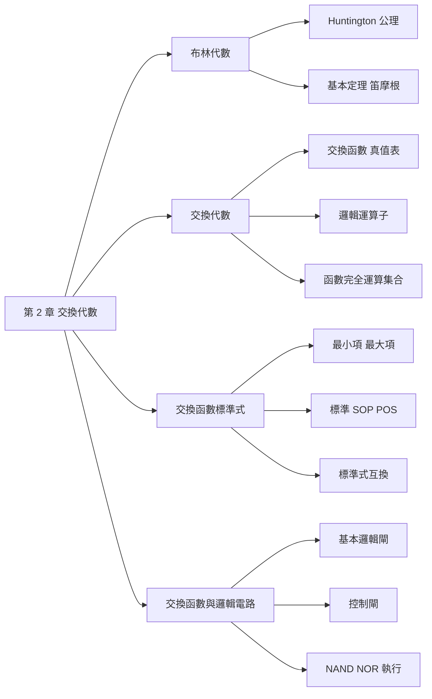
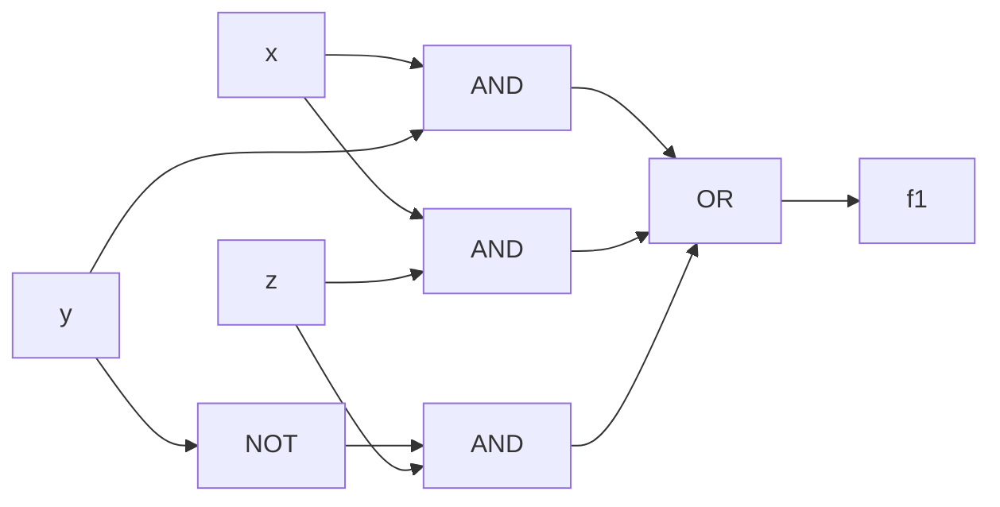

## 名詞表 {#glossary}

本章出現的名詞，詳細說明見對應區塊。

| 中文 | English | 描述 |
|---|---|---|
| 布林代數 | Boolean Algebra | 滿足 Huntington 六條公理的代數系統 |
| 交換代數 | Switching Algebra | 只有兩個元素 $\{0, 1\}$ 的布林代數，數位電路的數學基礎 |
| 對偶原理 | Duality Principle | 把 $+$ 與 $\cdot$ 互換、0 與 1 互換，等式仍成立 |
| 笛摩根定理 | DeMorgan's Theorem | $(x+y)' = x'y'$，$(xy)' = x'+y'$ |
| 完全歸納法 | Perfect Induction | 列出所有輸入組合（真值表）來證明等式 |
| 交換函數 | Switching Function | 輸入、輸出都只有 0、1 的函數 |
| 字母變數 | Literal | 一個變數或它的補數，例如 $x$、$x'$ |
| 函數完全運算集合 | Functionally Complete Set | 能表示任何交換函數的運算子集合 |
| 積之和 | SOP, Sum of Products | 用 OR 把多個乘積項（AND）連起來 |
| 和之積 | POS, Product of Sums | 用 AND 把多個和項（OR）連起來 |
| 最小項 | Minterm $m_i$ | 包含所有變數的乘積項，只在一個輸入組合為 1 |
| 最大項 | Maxterm $M_i$ | 包含所有變數的和項，只在一個輸入組合為 0 |
| 標準式 | Canonical Form | 只由最小項組成的 SOP，或只由最大項組成的 POS |
| 對偶函數 | Dual Function $f^d$ | 把 $f$ 的 $+$ 與 $\cdot$、0 與 1 互換所得的函數 |
| 通用邏輯閘 | Universal Logic Gate | 單獨就能實現任何交換函數的閘：NAND、NOR |

## 本章地圖 {#ch2-map}

第 2 章建立數位電路的數學工具：先用公理定義布林代數，再限定成只有 0、1 的交換代數，最後把交換函數寫成標準形式並用邏輯閘實現。原始投影片：[[_pdf/chapter2dl-Part11.pdf|Part 1]]、[[_pdf/chapter2dl-Part22.pdf|Part 2]]。

## Huntington 公理 {#huntington}

**布林代數**是一個集合 $B$ 加上兩個二元運算子 $+$（OR）、$\cdot$（AND），滿足以下六條公理（Huntington 假設）：

1. **至少兩個元素**：$B$ 至少包含兩個不相等的元素 $x \neq y$。
2. **封閉性**：對任意 $x, y \in B$，$x + y \in B$ 且 $x \cdot y \in B$。
3. **交換律**：$x + y = y + x$；$x \cdot y = y \cdot x$。
4. **單位元素**：存在 $0$ 使 $x + 0 = x$；存在 $1$ 使 $x \cdot 1 = x$。
5. **分配律**：$x + (y \cdot z) = (x + y)\cdot(x + z)$；$x \cdot (y + z) = x\cdot y + x\cdot z$。
6. **補數元素**：每個 $x$ 都有補數 $x'$，使 $x + x' = 1$ 且 $x \cdot x' = 0$。

注意第 5 條的第一式 $x + yz = (x+y)(x+z)$：**OR 對 AND 也能分配**，這在一般代數不成立，化簡時很常用。

## 對偶原理 {#duality}

每條公理都成對出現：把一式中的 **$+$ 與 $\cdot$ 互換、0 與 1 互換**，就得到另一式。

$$
x + (y\cdot z) = (x+y)\cdot(x+z) \quad\Longleftrightarrow\quad x\cdot(y+z) = (x\cdot y)+(x\cdot z)
$$

$$
x + x' = 1 \quad\Longleftrightarrow\quad x\cdot x' = 0
$$

所以**任何由公理證出的等式，它的對偶式也一定成立**，定理只要證一半。注意變數本身**不**取補數。

## 基本定理 {#basic-theorems}

以下對任意 $x, y, z \in B$ 都成立，左右兩欄互為對偶：

| 定理 | (a) | (b) |
|---|---|---|
| 等冪性 Idempotent | $x + x = x$ | $x \cdot x = x$ |
| 邊界定理 Boundedness | $x + 1 = 1$ | $x \cdot 0 = 0$ |
| 補數的唯一性 | 每個 $x$ 的補數 $x'$ 唯一 | $0' = 1$、$1' = 0$ |
| 累乘性 Involution | $(x')' = x$ | |
| 吸收律 Absorption | $x + x\cdot y = x$ | $x\cdot(x + y) = x$ |
| 結合律 Associative | $x + (y + z) = (x + y) + z$ | $x(yz) = (xy)z$ |
| 笛摩根定理 DeMorgan | $(x + y)' = x'\cdot y'$ | $(x\cdot y)' = x' + y'$ |

### 證明：等冪性 {#proof-idempotent .fold}

$$
\begin{aligned}
x + x &= (x + x)\cdot 1 &&\text{單位元素} \\
&= (x + x)(x + x') &&\text{補數元素} \\
&= x + x x' &&\text{分配律} \\
&= x + 0 = x &&\text{補數元素、單位元素}
\end{aligned}
$$

$x \cdot x = x$ 由對偶原理得到。

### 證明：吸收律 {#proof-absorption .fold}

$$
x + xy = x\cdot 1 + x\cdot y = x(1 + y) = x\cdot 1 = x
$$

（用到單位元素、分配律、邊界定理。）$x(x+y) = x$ 由對偶原理得到。

## 笛摩根定理 {#demorgan}

$$
(x + y)' = x'\,y' \qquad (x\,y)' = x' + y'
$$

口訣：**整串取補數時，每個變數取補數，$+$ 和 $\cdot$ 互換**。可以推廣到多個變數：$(x_1 + x_2 + \cdots + x_n)' = x_1' x_2' \cdots x_n'$。

笛摩根定理是求補數函數、做 SOP／POS 互換、用 NAND／NOR 實現電路的核心工具。

## 交換代數 {#switching-algebra}

**交換代數**是只有兩個元素 $B = \{0, 1\}$ 的布林代數：當 $x \neq 0$ 時 $x$ 必為 1，當 $x \neq 1$ 時 $x$ 必為 0。三個運算子定義為：

| $\cdot$ | 0 | 1 |
|---|---|---|
| **0** | 0 | 0 |
| **1** | 0 | 1 |

| $+$ | 0 | 1 |
|---|---|---|
| **0** | 0 | 1 |
| **1** | 1 | 1 |

NOT：$0' = 1$，$1' = 0$。補數也常寫成 $\bar{x}$。

## 證明交換等式 {#proving-identities}

證明兩個交換表式相等有兩種方法，以 $xy' + y = x + y$ 為例：

**(a) 代數運算**：用公理與定理一步步化簡。

$$
\begin{aligned}
xy' + y &= xy' + y(x + x') \\
&= xy' + xy + x'y \\
&= (xy' + xy) + (xy + x'y) &&\text{等冪性：} xy = xy + xy \\
&= x(y' + y) + (x + x')y \\
&= x\cdot 1 + 1\cdot y = x + y
\end{aligned}
$$

**(b) 完全歸納法**：列出所有輸入組合，比較兩邊的值。

| $x$ | $y$ | $y'$ | $xy'$ | $xy' + y$ | $x + y$ |
|---|---|---|---|---|---|
| 0 | 0 | 1 | 0 | 0 | 0 |
| 0 | 1 | 0 | 0 | 1 | 1 |
| 1 | 0 | 1 | 1 | 1 | 1 |
| 1 | 1 | 0 | 0 | 1 | 1 |

兩欄完全相同，所以等式成立。交換代數只有 0、1 兩個值，所以完全歸納法一定可行。

## 交換表式 {#switching-expressions}

**交換表式**的遞迴定義：

1. 任何交換變數或常數 0、1 是交換表式。
2. 若 $E_1$、$E_2$ 是交換表式，則 $E_1'$、$E_2'$、$E_1 + E_2$、$E_1\cdot E_2$ 也是。
3. 除此之外的組合都不是交換表式。

例如 $f_1 = [(xy)' + (x+z)]'$、$f_2 = xy' + xz + yz$、$f_3 = x'y(x + y'z) + x'z$ 都是交換表式。

## 交換函數 {#switching-functions}

**交換函數**把每一個輸入組合對應到 0 或 1，可以用真值表完整描述。**同一個交換函數可以有很多不同的交換表式**，例如：

$$
E(x,y,z) = xy' + xz + y'z \qquad F(x,y,z) = xy' + xz + x'y'z
$$

| $x$ | $y$ | $z$ | $E$ | $F$ |
|---|---|---|---|---|
| 0 | 0 | 0 | 0 | 0 |
| 0 | 0 | 1 | 1 | 1 |
| 0 | 1 | 0 | 0 | 0 |
| 0 | 1 | 1 | 0 | 0 |
| 1 | 0 | 0 | 1 | 1 |
| 1 | 0 | 1 | 1 | 1 |
| 1 | 1 | 0 | 0 | 0 |
| 1 | 1 | 1 | 1 | 1 |

真值表相同，所以 $E$ 和 $F$ 是同一個交換函數。

## 補數、和、積函數 {#complement-sum-product}

兩個交換函數 $f$、$g$ 可以逐列運算：

- **補數函數** $f'$：$f$ 為 0 的列是 1。
- **和函數** $f + g$：$f$、$g$ 任一為 1 的列是 1。
- **積函數** $f\cdot g$：$f$、$g$ 都為 1 的列才是 1。

| $x$ | $y$ | $z$ | $f$ | $g$ | $f'$ | $f + g$ | $f\cdot g$ |
|---|---|---|---|---|---|---|---|
| 0 | 0 | 0 | 0 | 1 | 1 | 1 | 0 |
| 0 | 0 | 1 | 1 | 0 | 0 | 1 | 0 |
| 0 | 1 | 0 | 0 | 0 | 1 | 0 | 0 |
| 0 | 1 | 1 | 0 | 0 | 1 | 0 | 0 |
| 1 | 0 | 0 | 1 | 1 | 0 | 1 | 1 |
| 1 | 0 | 1 | 1 | 1 | 0 | 1 | 1 |
| 1 | 1 | 0 | 0 | 0 | 1 | 0 | 0 |
| 1 | 1 | 1 | 0 | 1 | 1 | 1 | 0 |

## 邏輯運算子 {#logic-operators}

除了 AND、OR、NOT，交換代數還常用四個運算子：

| $x$ | $y$ | NAND $(xy)'$ | NOR $(x+y)'$ | XOR $x\oplus y$ | XNOR $x\odot y$ |
|---|---|---|---|---|---|
| 0 | 0 | 1 | 1 | 0 | 1 |
| 0 | 1 | 1 | 0 | 1 | 0 |
| 1 | 0 | 1 | 0 | 1 | 0 |
| 1 | 1 | 0 | 0 | 0 | 1 |

- **NAND**：AND 再反相，只有全為 1 時輸出 0。
- **NOR**：OR 再反相，只有全為 0 時輸出 1。
- **XOR（互斥或）**：$x\oplus y = x'y + xy'$，兩輸入**不同**時為 1。
- **XNOR（同值）**：$x\odot y = x'y' + xy = (x\oplus y)'$，兩輸入**相同**時為 1。

## 多變數的邏輯運算子 {#multi-input-operators}

三個變數時：

| $x$ | $y$ | $z$ | $xyz$ | $x+y+z$ | $(xyz)'$ | $(x+y+z)'$ | $x\oplus y\oplus z$ | $x\odot y\odot z$ |
|---|---|---|---|---|---|---|---|---|
| 0 | 0 | 0 | 0 | 0 | 1 | 1 | 0 | 0 |
| 0 | 0 | 1 | 0 | 1 | 1 | 0 | 1 | 1 |
| 0 | 1 | 0 | 0 | 1 | 1 | 0 | 1 | 1 |
| 0 | 1 | 1 | 0 | 1 | 1 | 0 | 0 | 0 |
| 1 | 0 | 0 | 0 | 1 | 1 | 0 | 1 | 1 |
| 1 | 0 | 1 | 0 | 1 | 1 | 0 | 0 | 0 |
| 1 | 1 | 0 | 0 | 1 | 1 | 0 | 0 | 0 |
| 1 | 1 | 1 | 1 | 1 | 0 | 0 | 1 | 1 |

- 多變數 AND 只有全 1 為 1；OR 只有全 0 為 0；NAND、NOR 是它們的反相。
- **多變數 XOR 是「奇數個 1」偵測**：1 的個數為奇數時輸出 1（同位產生器就是用 XOR 做的，見 [[ch1-number-systems#parity|同位位元]]）。
- 三變數 XNOR $x\odot y\odot z$ 與三變數 XOR **相同**（奇數個變數時兩者一樣）；兩變數時 XNOR 才是 XOR 的反相。

## 函數完全運算集合 {#functionally-complete}

如果**任何交換函數都能只用某個集合裡的運算子表示**，這個集合就是**函數完全（運算）集合**（functionally complete 或 universal）。

- $\{\text{AND}, \text{OR}, \text{NOT}\}$：所有交換函數本來就是用這三個運算子定義的。
- $\{\text{AND}, \text{NOT}\}$：由笛摩根定理 $x + y = (x'y')'$，OR 可以用 AND 與 NOT 取代。
- $\{\text{OR}, \text{NOT}\}$：同理 $xy = (x' + y')'$。
- $\{\text{NAND}\}$、$\{\text{NOR}\}$：單一運算子就足夠。

**判斷一個集合是否函數完全的程序：**

1. 檢查 NOT 能不能用這個集合實現。不能，就不是函數完全集合。
2. 再檢查 AND **或** OR 能不能用這個集合（加上剛做出的 NOT）實現。可以，就是函數完全集合。

### 例子：NAND 與 NOR 是函數完全集合 {#ex-nand-nor-complete .fold}

**$\{\text{NOR}\}$**：能產生 $\{\text{OR}, \text{NOT}\}$。

- NOT：$(x + x)' = x'$
- OR：$[(x + y)']' = x + y$（NOR 之後再接一個當 NOT 用的 NOR）

**$\{\text{NAND}\}$**：能產生 $\{\text{AND}, \text{NOT}\}$。

- NOT：$(x\cdot x)' = x'$
- AND：$[(x\cdot y)']' = x\cdot y$

## SOP 與 POS {#sop-pos}

同一個交換函數可以寫成許多交換表式。其中兩種形式最重要：

- **SOP（積之和）**：只由**乘積項**用 OR 連起來，例如 $f(x,y,z) = xy + yz + xz$。
- **POS（和之積）**：只由**和項**用 AND 連起來，例如 $f(x,y,z) = (x + y')(x + z)(y + z')$。

SOP 與 POS 可以互換：用分配律展開 POS 就得到 SOP；對 SOP 用 OR 對 AND 的分配律 $x + yz = (x+y)(x+z)$ 就得到 POS。同一個函數通常有好幾種 SOP 和 POS，但**標準式**是唯一的（見 [[#canonical-form|標準式]]）。

### 例子：把 SOP 改寫成 POS {#ex-sop-to-pos .fold}

將 $f(x,y,z) = xy + y'z + xz$ 寫成 POS：

$$
\begin{aligned}
f &= xy + y'z + xz \\
&= (xy + y'z + x)(xy + y'z + z) &&\text{把 } xz \text{ 當成 } x\cdot z \text{ 用分配律} \\
&= (y'z + x)(xy + z) &&\text{吸收律} \\
&= (y' + x)(z + x)(x + z)(y + z) &&\text{分配律} \\
&= (x + y')(x + z)(y + z)
\end{aligned}
$$

其中 $(x + z)$ 其實是多餘的（共識項），最簡的 POS 是 $(x + y')(y + z)$，兩者是同一個函數。

## 最小項與最大項 {#minterm-maxterm}

$n$ 個變數的每一個二進位組合 $i$，都對應一個最小項 $m_i$ 和一個最大項 $M_i$：

- **最小項** $m_i$：所有變數的**乘積**；該組合中值為 **0 的變數取補數**、值為 1 的取原變數。$m_i$ 只在輸入等於 $i$ 時為 1。
- **最大項** $M_i$：所有變數的**和**；該組合中值為 **1 的變數取補數**、值為 0 的取原變數。$M_i$ 只在輸入等於 $i$ 時為 0。

| 十進制 | $x$ | $y$ | $z$ | 最小項 | | 最大項 | |
|---|---|---|---|---|---|---|---|
| 0 | 0 | 0 | 0 | $x'y'z'$ | $m_0$ | $x + y + z$ | $M_0$ |
| 1 | 0 | 0 | 1 | $x'y'z$ | $m_1$ | $x + y + z'$ | $M_1$ |
| 2 | 0 | 1 | 0 | $x'yz'$ | $m_2$ | $x + y' + z$ | $M_2$ |
| 3 | 0 | 1 | 1 | $x'yz$ | $m_3$ | $x + y' + z'$ | $M_3$ |
| 4 | 1 | 0 | 0 | $xy'z'$ | $m_4$ | $x' + y + z$ | $M_4$ |
| 5 | 1 | 0 | 1 | $xy'z$ | $m_5$ | $x' + y + z'$ | $M_5$ |
| 6 | 1 | 1 | 0 | $xyz'$ | $m_6$ | $x' + y' + z$ | $M_6$ |
| 7 | 1 | 1 | 1 | $xyz$ | $m_7$ | $x' + y' + z'$ | $M_7$ |

## 最小項與最大項的關係 {#minterm-maxterm-relation}

最小項與最大項**互為補數**：$m_i' = M_i$，$M_i' = m_i$（笛摩根定理）。

$n$ 個變數下：

1. $m_i\, m_j = 0$（$i \neq j$）；$m_i\, m_i = m_i$。不同的最小項不會同時為 1。
2. $M_i + M_j = 1$（$i \neq j$）；$M_i + M_i = M_i$。不同的最大項不會同時為 0。
3. $m_i = M_i'$ 且 $M_i = m_i'$。

## Shannon 展開定理 {#shannon}

任何 $n$ 變數交換函數都能對某一個變數 $x_i$ 展開：

$$
f(x_{n-1}, \ldots, x_i, \ldots, x_0) = x_i\cdot f(\ldots, 1, \ldots) + x_i'\cdot f(\ldots, 0, \ldots)
$$

$$
f(x_{n-1}, \ldots, x_i, \ldots, x_0) = [x_i + f(\ldots, 0, \ldots)]\cdot[x_i' + f(\ldots, 1, \ldots)]
$$

意思是：把 $x_i = 1$ 和 $x_i = 0$ 兩種情況分開寫，再用 $x_i$、$x_i'$ 選擇。對所有變數反覆展開，就得到下面的標準式。

### 例子：Shannon 展開 {#ex-shannon .fold}

$f(x,y,z) = xy + y'z + xz$ 對 $x$ 展開：

- $f(0,y,z) = y'z$
- $f(1,y,z) = y + y'z + z = y + z$

所以 $f = x'\,y'z + x(y + z)$。

## 標準式 {#canonical-form}

**標準式定理**：任何 $n$ 變數交換函數都可以寫成以下兩種標準式，而且**兩種都是唯一的**：

$$
\text{標準 SOP：}\quad f = \sum_{i=0}^{2^n-1} \alpha_i\, m_i \qquad\qquad \text{標準 POS：}\quad f = \prod_{i=0}^{2^n-1} (\beta_i + M_i)
$$

其中 $\alpha_i = \beta_i = f(i)$，也就是真值表第 $i$ 列的值。

- 標準 SOP：**把真值表中 $f = 1$ 的列的最小項加起來**，簡寫成 $f = \Sigma(\ldots)$。
- 標準 POS：**把 $f = 0$ 的列的最大項乘起來**，簡寫成 $f = \Pi(\ldots)$。

| 十進制 | $x\,y\,z$ | $f$ | | 十進制 | $x\,y\,z$ | $f$ |
|---|---|---|---|---|---|---|
| 0 | 000 | 1 | | 4 | 100 | 0 |
| 1 | 001 | 0 | | 5 | 101 | 1 |
| 2 | 010 | 0 | | 6 | 110 | 1 |
| 3 | 011 | 1 | | 7 | 111 | 0 |

$$
f = m_0 + m_3 + m_5 + m_6 = x'y'z' + x'yz + xy'z + xyz' = \Sigma(0,3,5,6)
$$

$$
f = M_1 M_2 M_4 M_7 = (x+y+z')(x+y'+z)(x'+y+z)(x'+y'+z') = \Pi(1,2,4,7)
$$

### 例子：用展開定理求標準式 {#ex-canonical-by-expansion .fold}

$f(x,y,z) = x'(y' + z)$，逐一代入求 $\alpha_i = f(i)$：

| $i$ | 0 | 1 | 2 | 3 | 4 | 5 | 6 | 7 |
|---|---|---|---|---|---|---|---|---|
| $f(i)$ | $1(1+0)=1$ | $1(1+1)=1$ | $1(0+0)=0$ | $1(0+1)=1$ | 0 | 0 | 0 | 0 |

標準 SOP：$f = m_0 + m_1 + m_3 = x'y'z' + x'y'z + x'yz$。

標準 POS（$\beta_i = \alpha_i$，$\beta_i = 1$ 的項 $1 + M_i = 1$ 消失）：$f = M_2 M_4 M_5 M_6 M_7 = (x+y'+z)(x'+y+z)(x'+y+z')(x'+y'+z)(x'+y'+z')$。

## 求標準 SOP {#to-canonical-sop}

由任意 SOP 求標準 SOP 的程序：

1. 逐一檢查每個乘積項，若已是最小項就保留。
2. 不是最小項的乘積項，缺哪個變數 $x_i$，就乘上 $(x_i + x_i')$。
3. 用分配律展開，並消去重複的項。

### 例子：標準 SOP {#ex-canonical-sop .fold}

將 $f(x,y,z) = x'y + z + xy'$ 表示為標準 SOP：

$$
\begin{aligned}
f &= x'y(z + z') + (x + x')(y + y')z + xy'(z + z') \\
&= x'yz + x'yz' + xyz + xy'z + x'yz + x'y'z + xy'z + xy'z' \\
&= x'yz + x'yz' + xyz + xy'z + x'y'z + xy'z' \\
&= \Sigma(1, 2, 3, 4, 5, 7)
\end{aligned}
$$

## 求標準 POS {#to-canonical-pos}

由任意 POS 求標準 POS 的程序：

1. 逐一檢查每個和項，若已是最大項就保留。
2. 不是最大項的和項，缺哪個變數 $x_i$，就加上 $x_i x_i'$。
3. 用分配律 $A + x_i x_i' = (A + x_i)(A + x_i')$ 展開，並消去重複的項。

### 例子：標準 POS {#ex-canonical-pos .fold}

將 $f(x,y,z) = x(y' + z)$ 表示為標準 POS：

$$
\begin{aligned}
f &= (x + yy' + zz')(xx' + y' + z) \\
&= (x + y + z)(x + y + z')(x + y' + z)(x + y' + z')(x + y' + z)(x' + y' + z) \\
&= (x + y + z)(x + y + z')(x + y' + z)(x + y' + z')(x' + y' + z) \\
&= \Pi(0, 1, 2, 3, 6)
\end{aligned}
$$

## 標準式互換 {#canonical-conversion}

同一個函數的標準 SOP 與標準 POS 可以直接互換：**Σ 裡沒出現的編號，就是 Π 裡的編號**。

原理：先求補數函數 $f'$，再把 $f'$ 取補數，最後用笛摩根定理：

$$
\begin{aligned}
f(x,y,z) &= \Sigma(0,3,5,6) \\
f'(x,y,z) &= \Sigma(1,2,4,7) &&\text{求補數函數：取沒出現的項} \\
f &= [m_1 + m_2 + m_4 + m_7]' = m_1' m_2' m_4' m_7' &&\text{取補數，笛摩根} \\
&= M_1 M_2 M_4 M_7 = \Pi(1,2,4,7)
\end{aligned}
$$

所以 $\Sigma(0,3,5,6) = \Pi(1,2,4,7)$。

## 求補數函數 {#complement-function}

$f$ 以標準式表示時，補數函數 $f'$ 一樣用編號互補求得：

- $f = \Sigma(\text{集合 } S)$ → $f' = \Sigma(\text{不在 } S \text{ 的編號}) = \Pi(S)$
- $f = \Pi(\text{集合 } S)$ → $f' = \Pi(\text{不在 } S \text{ 的編號}) = \Sigma(S)$

推導（方法一）：

$$
f' = \Big[\sum \alpha_i m_i\Big]' = \prod(\alpha_i' + m_i') = \prod(\alpha_i' + M_i)
\qquad
f' = \Big[\prod(\beta_i + M_i)\Big]' = \sum \beta_i' M_i' = \sum \beta_i' m_i
$$

### 例子：標準式下的補數函數 {#ex-complement-function .fold}

$f(x,y,z) = \Sigma(0,2,3,4) = \Pi(1,5,6,7)$。

- SOP 中 $\alpha_1 = \alpha_5 = \alpha_6 = \alpha_7 = 0$，所以 $f' = \Pi(\alpha_i' + M_i) = M_0 M_2 M_3 M_4 = \Pi(0,2,3,4)$。
- POS 中 $\beta_1 = \beta_5 = \beta_6 = \beta_7 = 0$，所以 $f' = \Sigma \beta_i' m_i = m_1 + m_5 + m_6 + m_7 = \Sigma(1,5,6,7)$。

## 對偶函數 {#dual-function}

**對偶函數** $f^d$：把 $f$ 中的 $+$ 與 $\cdot$ 互換、0 與 1 互換（變數不變）。它和補數函數的關係是：

$$
f^d(x_{n-1}, \ldots, x_0) = [f(x_{n-1}', \ldots, x_0')]'
$$

也就是說，**把 $f^d$ 的所有變數取補數，就得到 $f'$**（方法二）。

用編號求 $f^d$（$n$ 變數）：先求 $f'$ 的編號集合，再把每個編號 $j$ 換成 $(2^n - 1) - j$。

### 例子：標準式下的對偶函數 {#ex-dual-function .fold}

$f(x,y,z) = \Sigma(0,2,3,4) = \Pi(1,5,6,7)$。

$f' = \Sigma(1,5,6,7)$，把每個編號換成 $7 - j$：$\{6, 2, 1, 0\}$。所以

$$
f^d = \Sigma(0,1,2,6) = m_0 + m_1 + m_2 + m_6 = \Pi(3,4,5,7) = M_3 M_4 M_5 M_7
$$

## 基本邏輯閘 {#basic-gates}

| 閘 | 函數 | 真值表輸出（$xy$ = 00, 01, 10, 11） |
|---|---|---|
| AND | $f = xy$ | 0, 0, 0, 1 |
| OR | $f = x + y$ | 0, 1, 1, 1 |
| NAND | $f = (xy)'$ | 1, 1, 1, 0 |
| NOR | $f = (x + y)'$ | 1, 0, 0, 0 |
| XOR | $f = x\oplus y$ | 0, 1, 1, 0 |
| XNOR | $f = (x\oplus y)'$ | 1, 0, 0, 1 |

| 閘 | 函數 | 真值表輸出（$x$ = 0, 1） |
|---|---|---|
| NOT（反相器） | $f = x'$ | 1, 0 |
| BUF（緩衝器） | $f = x$ | 0, 1 |

電路符號：AND 是 D 字形；OR 是彎月形；輸出端加小圓圈表示反相（NAND、NOR、XNOR）；XOR 在 OR 的輸入側多一條弧線；NOT 與 BUF 是三角形，NOT 輸出端有小圓圈。

## 邏輯閘的基本應用 {#gate-applications}

把一個輸入當成**控制端 $c$**，另一個當資料輸入 $x$，邏輯閘就變成可以控制信號通過與否的開關：

| 應用 | 閘 | $c = 0$ | $c = 1$ |
|---|---|---|---|
| 控制閘 controlled gate | AND | $f = 0$ | $f = x$ |
| | OR | $f = x$ | $f = 1$ |
| 反相控制閘 inverted controlled gate | NAND | $f = 1$ | $f = x'$ |
| | NOR | $f = x'$ | $f = 0$ |
| 控制補數閘 controlled inverter | XOR | $f = x$ | $f = x'$ |
| | XNOR | $f = x'$ | $f = x$ |

記法：AND 遇 0 輸出 0、遇 1 讓 $x$ 通過；OR 遇 1 輸出 1、遇 0 讓 $x$ 通過；XOR 遇 1 就把 $x$ 反相。

## 交換函數的執行 {#implementation}

一個交換函數可以用兩種基本元件執行：

1. **開關**：早期是繼電器（relay），現在是 CMOS 傳輸閘或 MOS 電晶體，見 [[ch3-digital-ic#switch-logic-design|開關邏輯設計原理]]。
2. **基本邏輯閘**：AND、OR、NOT 等的組合。

因為 NAND 與 NOR 都是函數完全集合，**只用 NAND 閘或只用 NOR 閘就能執行任何交換函數**，所以它們稱為**通用邏輯閘（universal logic gate）**：

| 基本閘 | 用 NAND 執行 | 用 NOR 執行 |
|---|---|---|
| NOT | $f = (xx)' = x'$ | $f = (x + x)' = x'$ |
| AND | $f = [(xy)']' = xy$ | $f = [(x+x)' + (y+y)']' = (x' + y')' = xy$ |
| OR | $f = [(xx)'(yy)']' = (x'y')' = x + y$ | $f = [(x+y)']' = x + y$ |

- NAND 做 AND：NAND 後面接一個當 NOT 用的 NAND。
- NAND 做 OR：兩個輸入先各自用 NAND 反相，再送進一個 NAND（笛摩根）。
- NOR 的情形剛好對偶。

### 例子：用基本閘執行交換函數 {#ex-gate-implementation .fold}

**$f_1(x,y,z) = xy + xz + y'z$**（SOP → 兩層 AND-OR）：三個 AND 閘分別產生 $xy$、$xz$、$y'z$（$y'$ 由一個 NOT 產生），再送進一個三輸入 OR 閘。

**$f_2(x,y,z) = (x+y)(x'+z)(y+z)$**（POS → 兩層 OR-AND）：三個 OR 閘分別產生 $x+y$、$x'+z$、$y+z$（$x'$ 由一個 NOT 產生），再送進一個三輸入 AND 閘。

