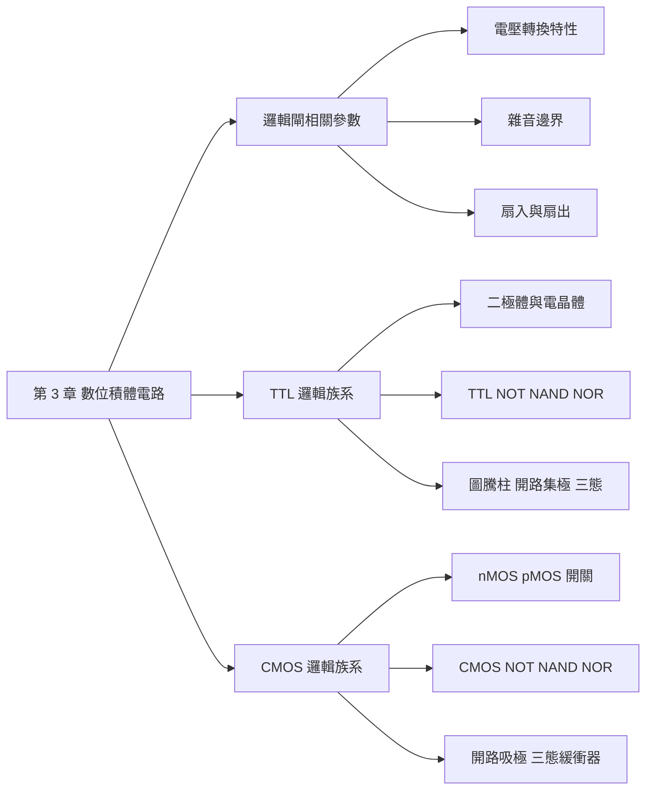

## 名詞表 {#glossary}

本章出現的名詞，詳細說明見對應區塊。

| 中文 | English | 描述 |
|---|---|---|
| 電壓轉換特性 | Voltage Transfer Characteristic, VTC | 輸出電壓 $V_{OUT}$ 隨輸入電壓 $V_{IN}$ 變化的曲線 |
| 雜音邊界 | Noise Margin | 輸出位準與輸入判斷門檻的差距，代表可容忍的雜音大小 |
| 扇入 | Fan-in | 一個邏輯閘的輸入端數目，由電路結構決定 |
| 扇出 | Fan-out | 一個邏輯閘輸出端最多能推動的同類輸入端數目 |
| TTL | Transistor-Transistor Logic | 以雙極性電晶體（BJT）為主的邏輯族系，例如 74LS 系列 |
| CMOS | Complementary MOS | 以 nMOS 與 pMOS 互補組成的邏輯族系 |
| 截止模式 | Cut-off Mode | 電晶體兩個接面都反向偏壓，不導通 |
| 活動模式 | Active Mode | BE 順偏、BC 逆偏，用於放大 |
| 飽和模式 | Saturation Mode | 兩個接面都順向偏壓，CE 間近似短路 |
| 蕭特基二極體 | Schottky Diode | 切入電壓約 0.3～0.5 V 的二極體，防止電晶體進入飽和 |
| 圖騰柱輸出級 | Totem-pole Output | 上下兩個電晶體堆疊、一個導通一個截止的輸出級 |
| 開路集極 | Open Collector, OC | TTL 輸出只有下拉電晶體，需外接提升電阻 |
| 開路吸極 | Open Drain, OD | CMOS 版本的開路輸出 |
| 線接 AND | Wired-AND | 多個開路輸出直接接在一起，形成 AND 功能 |
| 三態輸出 | Tri-state Output | 除了 0、1 之外還有高阻抗狀態的輸出 |
| 高阻抗 | High Impedance, Hi-Z | 輸出端既不接 $V_{CC}$ 也不接地，等於斷開 |
| 傳輸閘 | Transmission Gate, TG | nMOS 與 pMOS 並聯組成的雙向開關 |

## 本章地圖 {#ch3-map}

第 3 章從電路層次看邏輯閘：先定義衡量邏輯閘好壞的參數，再看兩大邏輯族系 TTL 與 CMOS 怎麼用電晶體做出邏輯閘。原始投影片：[[_pdf/chapter3dl-Part11.pdf|Part 1]]（參數與 TTL）、[[_pdf/chapter3dl-Part22.pdf|Part 2]]（CMOS）。

## 電壓轉換特性 {#vtc}

以反相器（NOT 閘）為例，把輸入電壓 $V_{IN}$ 從 0 慢慢升到 $V_{DD}$，記錄輸出電壓 $V_{OUT}$，得到**電壓轉換特性**曲線：

- $V_{IN}$ 很低時，$V_{OUT}$ 維持在高電位（邏輯 1）。
- $V_{IN}$ 升到某個範圍時，$V_{OUT}$ 快速下降（轉換區）。
- $V_{IN}$ 夠高時，$V_{OUT}$ 維持在低電位（邏輯 0）。

曲線上**斜率為 −1 的兩點**定義了輸入門檻 $V_{IL}$ 與 $V_{IH}$；兩者之間是**禁止區**，正常操作時輸入不應停在這裡。

**傳播延遲**：輸入與輸出波形各自在 $\frac{1}{2}(V_{OL} + V_{OH})$（50%）處量時間差；輸出由高變低的延遲記為 $t_{pHL}$，由低變高記為 $t_{pLH}$。

## 電壓參數 {#voltage-parameters}

| 參數 | 名稱 | 意義 |
|---|---|---|
| $V_{IH}$ | high-level input voltage | 輸入端能被判為邏輯 1 的**最低**電壓 |
| $V_{IL}$ | low-level input voltage | 輸入端能被判為邏輯 0 的**最高**電壓 |
| $V_{OH}$ | high-level output voltage | 輸出邏輯 1 時保證的**最低**電壓 |
| $V_{OL}$ | low-level output voltage | 輸出邏輯 0 時保證的**最高**電壓 |

## 電流參數 {#current-parameters}

| 參數 | 名稱 | 意義 |
|---|---|---|
| $I_{IH}$ | high-level input current | 輸入為高電位時流入輸入端的電流 |
| $I_{IL}$ | low-level input current | 輸入為低電位時流入輸入端的電流 |
| $I_{OH}$ | high-level output current | 輸出為高電位時流入輸出端的電流 |
| $I_{OL}$ | low-level output current | 輸出為低電位時流入輸出端的電流 |

**符號慣例：流入元件為正，流出為負。** 所以輸出高電位時電流從輸出端流出，$I_{OH}$ 為負；輸入低電位時電流從輸入端流出，$I_{IL}$ 也為負。例如 74LS 系列：$I_{OL} = 8$ mA、$I_{OH} = -0.4$ mA、$I_{IL} = -0.4$ mA、$I_{IH} = 20\ \mu$A。

**輸出電流與輸出電壓的關係**：輸出端可以等效成電壓源 $V_{OH}$ 串一個輸出電阻 $R_{OUT}$。輸出電流 $I_{OUT}$ 越大，$R_{OUT}$ 上的壓降越大，$V_{OUT}$ 就越低。所以輸出能提供的電流有上限：超過 $I_{OH}$，輸出電壓就會低於保證的 $V_{OH}$。這就是扇出受限的原因。

## 雜音邊界 {#noise-margin}

一個閘的輸出接到下一個閘的輸入，中間的導線可能疊加雜音。只要雜音不讓電壓越過輸入門檻，邏輯值就不會錯：

$$
NM_H = V_{OH} - V_{IH} \qquad\qquad NM_L = V_{IL} - V_{OL}
$$

- **高電位雜音邊界** $NM_H$：輸出 1 時，最多能容忍多少**向下**的雜音。
- **低電位雜音邊界** $NM_L$：輸出 0 時，最多能容忍多少**向上**的雜音。

雜音邊界越大，電路越不怕干擾。輸出端 $V_{OL}$～$V_{OH}$ 之間是**禁止區**（輸出不該出現的電壓），輸入端 $V_{IL}$～$V_{IH}$ 之間是**不確定區**。

## 扇入與扇出 {#fan-in-fan-out}

- **扇入（fan-in）**：一個邏輯閘的**輸入端數目**，由閘本身的電路結構決定，是固定值。
- **扇出（fan-out）**：一個邏輯閘的輸出端，在不超出規格的情況下**最多能推動幾個**邏輯閘輸入端。

扇出由電流參數決定。輸出低電位時，每個負載輸入流出 $\lvert I_{IL}\rvert$，全部流進驅動閘，總和不能超過 $I_{OL}$；輸出高電位時同理：

$$
N_L = -\frac{I_{OL}}{I_{IL}} \qquad\qquad N_H = -\frac{I_{OH}}{I_{IH}}
$$

**扇出 = $\min(N_L, N_H)$**，非整數時無條件捨去。（負號讓結果為正，因為 $I_{IL}$、$I_{OH}$ 是負值。）

### 例子：相同系列的扇出 {#ex-fanout-same .fold}

TTL 74LS 推動 74LS：$I_{OL} = 8$ mA，$I_{OH} = -0.4$ mA，$I_{IL} = -0.4$ mA，$I_{IH} = 20\ \mu$A。

$$
N_L = -\frac{8}{-0.4} = 20 \qquad N_H = -\frac{-0.4\text{ mA}}{20\ \mu\text{A}} = 20
$$

扇出為 **20**。

### 例子：不同系列的扇出 {#ex-fanout-mixed .fold}

一個 74LS 閘推動 74F 閘。74LS：$I_{OL} = 8$ mA、$I_{OH} = -0.4$ mA；74F：$I_{IL} = -0.6$ mA、$I_{IH} = 20\ \mu$A。

$$
N_L = -\frac{8}{-0.6} = 13.3 \qquad N_H = -\frac{-0.4\text{ mA}}{20\ \mu\text{A}} = 20
$$

扇出取較小者並捨去小數：**13** 個。注意要用**驅動閘的輸出電流**除以**負載閘的輸入電流**。

## 二極體 {#diode}

二極體由 p 型與 n 型半導體組成，有陽極 A（p 側）與陰極 K（n 側）。

- **理想二極體**：順向（A 高於 K）就導通、電阻為 0；逆向就截止。切入電壓為 0。
- **實際二極體**：順向電壓要超過約 0.6 V 才開始導通，且導通時兩端電阻不是 0。

實際電路中把導通的二極體等效成一個電壓源加上電阻 $R_f$（轉換特性曲線順向斜率的倒數，約 20～50 Ω）。本章使用的數值：

| 狀態 | 電壓 |
|---|---|
| 切入電壓 | 0.6 V |
| 導通電壓 | 0.7 V |
| 深度導通電壓 | 0.8 V |

使用二極體時通常要串一個適當的外加電阻，限制電流在它能承受的範圍內，避免過熱燒毀。

## 二極體 AND 閘 {#diode-and}

兩個二極體 $D_1$、$D_2$ 的陰極分別接輸入 $x$、$y$，陽極一起接到輸出 $f$，並經電阻 $R$（限流電阻）接到 $+V = 5$ V。

- 任一輸入為低電位（0～2 V）：該二極體導通，把輸出拉到 $V_{low} + 0.7$ V，輸出為低電位。
- 兩個輸入都是高電位（3～5 V）：輸出 $V_{high} = \min(V_{high} + 0.7, 5)$ V，輸出為高電位。

只有兩個輸入都高時輸出才高，所以是 AND 閘。缺點是每經過一級電壓就抬高 0.7 V，不能多級串接，所以實際 TTL 要加電晶體。

## 雙極性電晶體 {#bjt}

雙極性電晶體（BJT）有三端：基極 B、集極 C、射極 E。可以看成兩個背對背的二極體：

- **NPN**：B 為 p 型，C、E 為 n 型；電流 $I_b$ 由 B 流入、$I_c$ 由 C 流入、$I_e = I_b + I_c$ 由 E 流出。
- **PNP**：方向相反。

依 BE 與 BC 兩個接面的偏壓，電晶體分成三種工作模式：

| 模式 | BE 接面 | BC 接面 | 行為 |
|---|---|---|---|
| 截止 cut-off | 逆偏 | 逆偏 | $I_b = I_c = I_e = 0$，像斷開的開關 |
| 活動 active | 順偏 | 逆偏 | $I_c = \beta_F I_b$，用於放大 |
| 飽和 saturation | 順偏 | 順偏 | CE 間近似短路，像接通的開關 |

## 電晶體的開關模式 {#bjt-switch}

數位電路中電晶體只工作在**截止**和**飽和**兩種模式，當成開關使用：

- **截止**（$V_{BE} < 0.6$ V）：$I_b = 0$、$I_c = 0$，C 與 E 之間斷開。
- **飽和**（$V_{BE} \ge 0.8$ V）：$V_{BE(sat)} \approx 0.8$ V，$V_{CE(sat)} \approx 0.1$～$0.3$ V，C 與 E 之間只剩很小的飽和電阻 $R_{CE(sat)}$，近似短路。

從截止切換到飽和（或反過來）時，一定會經過活動模式。

## 蕭特基電晶體 {#schottky}

電晶體一旦進入飽和，基極會累積電荷，要切回截止時得先把電荷清掉，速度變慢。

解法：在基極與集極之間並接一個**蕭特基二極體**（切入電壓約 0.3～0.5 V，低於一般 pn 二極體的 0.6 V）。當 $V_{BE}$ 增加時，BC 之間的電壓被蕭特基二極體箝位，不會再增加到讓 BC 接面導通，所以**電晶體保持在活動模式**，不進入深度飽和，切換速度變快。

- 未加蕭特基二極體：$V_{BC} = 0.7$ V、$V_{CE(sat)} = 0.1$ V。
- 加入後：$V_{BC} = 0.45$ V、$V_{CE} = 0.35$ V。

這樣的組合稱為**蕭特基電晶體**，74LS（low-power Schottky）系列就是用它。

## 標準 TTL NOT 閘 {#ttl-not}

標準 TTL 邏輯閘分成三級：

| 級 | 元件 | 功能 |
|---|---|---|
| 輸入級 | 電晶體 $Q_1$（加上箝位二極體） | 提供邏輯功能；箝位二極體防止負雜音（箝位在 −0.7 V） |
| 分相器 phase splitter | 電晶體 $Q_2$ | 由射極與集極提供兩個相位相反的信號 |
| 輸出級 | 電晶體 $Q_3$、$Q_4$（加二極體 $D_1$） | **圖騰柱輸出**，提供低阻抗的輸出推動 |

電壓轉換特性上有三個轉折點：

1. **BP1**：$V_{IN}$ 增加使 $V_{C1} = V_{B2} = 0.7$ V，$Q_2$ 開始導通（此時 $V_{IN} \approx 0.6$ V）。
2. **BP2**：$Q_3$ 開始導通。$Q_2$ 仍在活動模式，$V_{OUT} = V_{C2} - 2V_{BE(on)} = 3.9 - 1.4 = 2.5$ V；$V_{IN} = 2V_{BE(on)} - V_{CE1(sat)} = 1.4 - 0.1 = 1.3$ V。
3. **BP3**：$Q_3$ 進入飽和，$V_{OUT} = V_{CE3(sat)} = 0.1$ V；$V_{IN} = V_{BE2(sat)} + V_{BE3(sat)} - V_{CE1(sat)} = 1.6 - 0.1 = 1.5$ V。這時的 $V_{IN}$ 與 $V_{OUT}$ 就是 $V_{IH}$ 與 $V_{OL}$。

### Q1 的反向工作模式 {#ttl-not-q1-reverse .fold}

- $1.5\text{ V} < V_{IN} < 2.3$ V：$Q_1$ 的基極被箝位在 $V_{BC1(on)} + V_{BE2(sat)} + V_{BE3(sat)} = 0.7 + 0.8 + 0.8 = 2.3$ V，$Q_1$ 工作在**反向飽和模式**（兩個接面都順偏，但輸入電流流向射極，射極與集極角色互換）。
- $V_{IN} \ge 2.3$ V：$Q_1$ 進入**反向活動模式**（BC 順偏、BE 逆偏）。

## TTL NAND 閘 {#ttl-nand}

把 NOT 閘的輸入電晶體 $Q_1$ 換成**多射極電晶體**（兩個射極分別接 $x$、$y$），其餘電路和 NOT 閘相同，就成為 NAND 閘：

- $x = y = 1$：$Q_1$ 反向工作，$Q_2$、$Q_3$ 飽和，$V_{OUT} = V_{OL}$。
- $x$ 或 $y$ 為 0：$Q_1$ 飽和，$Q_2$、$Q_3$ 截止，$V_{OUT} = V_{OH}$。

| $x$ | $y$ | $V_{OUT}$ |
|---|---|---|
| $\le V_{IL}$ | $\le V_{IL}$ | $\ge V_{OH}$ |
| $\le V_{IL}$ | $\ge V_{IH}$ | $\ge V_{OH}$ |
| $\ge V_{IH}$ | $\le V_{IL}$ | $\ge V_{OH}$ |
| $\ge V_{IH}$ | $\ge V_{IH}$ | $\le V_{OL}$ |

$f = (xy)'$。

## TTL NOR 閘 {#ttl-nor}

兩組輸入電晶體（$Q_1$、$Q_5$）各自推動一個分相器（$Q_2$、$Q_6$），兩個分相器**並聯**後接到同一個圖騰柱輸出級：

- $x = y = 0$：$Q_1$、$Q_5$ 飽和，$Q_2$、$Q_6$、$Q_3$ 截止，$Q_4$ 與 $D_1$ 導通，$V_{OUT} = V_{OH}$。
- $x$ 或 $y$ 為 1：對應的 $Q_1$（或 $Q_5$）反向工作，$Q_2$（或 $Q_6$）與 $Q_3$ 飽和，$V_{OUT} = V_{OL}$。

$f = (x + y)'$。

## 圖騰柱輸出級 {#totem-pole}

TTL 標準輸出級由 $Q_4$（上）與 $Q_3$（下）兩個電晶體上下堆疊而成，稱為**圖騰柱輸出級**：

- 輸出高電位：$Q_4$ 導通、$Q_3$ 截止，輸出經 $Q_4$ 連到 $V_{CC}$（主動提升）。
- 輸出低電位：$Q_3$ 導通、$Q_4$ 截止，輸出經 $Q_3$ 連到地（主動下拉）。

兩種狀態下輸出阻抗都很低，所以切換快、推動能力強。但**兩個圖騰柱輸出不能直接接在一起**：一個輸出高、一個輸出低時，會從 $V_{CC}$ 經兩個導通的電晶體直接短路到地。

## 開路集極輸出級 {#open-collector}

**開路集極（OC）** 輸出級只保留下拉電晶體 $Q_3$，拿掉上方的提升電晶體，所以 $Q_3$ 的集極「開路」，使用時**必須在輸出端外接提升電阻 $R_L$** 到電源 $V_C$。

以 74LS09（OC AND 閘）為例：

- $x$、$y$ 皆為高電位：$Q_2$ 導通，$Q_6$ 與 $Q_3$ 截止，輸出經 $R_L$ 拉到 $V_C$，為高電位。
- $x$、$y$ 至少一個為低電位：$D_1$、$D_2$ 至少一個導通，$Q_2$ 截止，$Q_6$ 與 $Q_3$ 導通，$V_{OUT} = V_{CE3(on)} \approx 0.3$ V，為低電位。

電路符號是在閘內標 OC，或在輸出端畫菱形記號。兩個主要應用：

1. **推動較高的外部負載**：$V_C$ 可以接比 5 V 更高的電壓（例如推動繼電器、LED）。
2. **實現線接 AND**。

## 線接 AND {#wired-and}

把幾個**開路**輸出直接接在一起、共用一個提升電阻 $R_L$：只要任何一個輸出的下拉電晶體導通，整條線就被拉到低電位；只有全部都不拉低時，線才是高電位。這等於把各輸出 **AND** 起來，不需要額外的 AND 閘。

- 兩個 TTL 74LS09（OC AND）輸出線接：$f = (wx)(yz)$。
- 兩個 CMOS 開路吸極 NAND 輸出線接：$f = (wx)'(yz)'$。

只有開路輸出（OC、OD）可以這樣接，圖騰柱輸出不行（會短路，見 [[#totem-pole|圖騰柱輸出級]]）。

## TTL 三態輸出級 {#tristate-ttl}

**三態輸出邏輯閘**除了高電位（1）與低電位（0），還有第三種狀態：**輸出級的兩個電晶體（$Q_{3D}$、$Q_{4D}$）同時截止**，輸出端等於斷開，稱為**高阻抗狀態**（Hi-Z）。

以 74LS125 為例：一部分電路是**控制電路**，其餘是非反相緩衝器。

- 致能端 $E$ 為低電位（$\le V_{IL}$）：控制電路的反相器輸出高電位，相關電晶體與蕭特基二極體截止，電路正常工作，$f = x$。
- $E$ 為高電位：兩個輸出電晶體被強迫截止，輸出為高阻抗。

三態輸出讓多個元件可以共用同一條匯流排（bus），同一時間只致能其中一個，見 [[#tristate-applications|三態邏輯閘的應用]]。

## CMOS 基本原理 {#cmos-principle}

CMOS 邏輯閘的主要優點：在不考慮漏電流時，**不論輸出邏輯 0 或 1，都不消耗靜態功率**，只有在轉態期間才消耗功率。因此 CMOS 成為 VLSI 電路的主流技術。

**nMOS 電晶體**有閘極 G、源極 S、汲極 D 與基板 B（p 型）。當閘極與源極之間加上大於 0 V 的電壓 $V_{GS}$，p 型基板中的電子被吸到閘極下方（中間有一層氧化矽絕緣，電子過不去），在基板表面聚集。$V_{GS}$ 夠大時，表面的電子濃度與原本的電洞濃度相當，形成一層 n 型電子層，稱為 **n 通道（channel）**，把源極與汲極連成低電阻路徑。**pMOS** 則是 n 型基板、p 型通道，極性相反。

## nMOS 與 pMOS 開關 {#mos-switch}

把 MOS 電晶體當成由閘極控制的開關：

| | nMOS | pMOS |
|---|---|---|
| $G = 1$（$V_{DD}$） | 導通 | 截止 |
| $G = 0$（0 V） | 截止 | 導通 |
| 傳遞得好的信號 | **0**（放電到 0 V） | **1**（充電到 $V_{DD}$） |
| 傳遞不好的信號 | 1：$V_{OUT}$ 只能充到 $V_{DD} - V_{Tn}$ | 0：$V_{OUT}$ 只能放到 $\lvert V_{Tp}\rvert$ |

- nMOS 傳 1 時，$V_{OUT}$ 上升到 $V_{DD} - V_{Tn}$ 時 $V_{GS}$ 小於臨界電壓，電晶體截止，所以充不滿。
- pMOS 傳 0 時，$V_{OUT}$ 從 $V_{DD}$ 放電到 $\lvert V_{Tp}\rvert$ 時就截止，放不乾淨。

所以 CMOS 電路**用 pMOS 接 $V_{DD}$（負責輸出 1）、用 nMOS 接地（負責輸出 0）**。

## 串聯與並聯開關 {#series-parallel}

和 [[ch0-intro#switch-circuits|第 0 章的開關電路]] 一樣，串聯是 AND、並聯是 OR：

| 接法 | nMOS（$S = 1$ 導通） | pMOS（$S = 0$ 導通） |
|---|---|---|
| 串聯 | $S_1$ **and** $S_2 = V_{OH}$ 時導通 | $\overline{S_1}$ **and** $\overline{S_2}$，即 $S_1$、$S_2$ 都為 $V_{OL}$ 時導通 |
| 並聯 | $S_1$ **or** $S_2 = V_{OH}$ 時導通 | $\overline{S_1}$ **or** $\overline{S_2}$，即任一為 $V_{OL}$ 時導通 |

例如兩個 nMOS 串聯，只有 $S_1 = S_2 = 1$ 時 a、b 之間接通；兩個 pMOS 並聯，$S_1$、$S_2$ 任一為 0 就接通（只有都為 1 時斷開）。

## 開關邏輯設計原理 {#switch-logic-design}

用開關設計邏輯電路的兩條基本規則：

1. **輸出端 $f$（信號匯流點）必須始終連接到 1 或 0**（不能浮接）。
2. **輸出端 $f$ 不能同時連接到 1 與 0**（不能短路）。

CMOS 的做法是 **$f/f'$ 樣式設計**：

- 用 **pMOS** 組成 $f$ 函數的開關網路接在 $V_{DD}$ 與輸出之間：$f = 1$ 時把輸出提升到 $V_{DD}$。pMOS 傳 1 不會衰減。
- 用 **nMOS** 組成 $f'$ 函數的開關網路接在輸出與地之間：$f' = 1$ 時把輸出拉到 0 V。nMOS 傳 0 不會衰減。

因為 $f$ 與 $f'$ 恰好一個為 1，兩條規則自動滿足。由笛摩根定理，**pMOS 網路與 nMOS 網路的結構互為對偶**：一邊串聯，另一邊就並聯。

## CMOS NOT 閘 {#cmos-not}

一個 pMOS $Q_p$ 接 $V_{DD}$、一個 nMOS $Q_n$ 接地，兩者閘極接在一起當輸入 $x$，汲極接在一起當輸出：

- $x = 0$：$Q_p$ 導通、$Q_n$ 截止，$f = V_{DD}$（1）。
- $x = 1$：$Q_p$ 截止、$Q_n$ 導通，$f = 0$。

$f = x'$。CMOS 反相器的轉換區很陡，而且穩態時總有一個電晶體截止，所以 $V_{OH} \approx V_{DD}$、$V_{OL} \approx 0$ V，雜音邊界大。

## CMOS NAND 閘 {#cmos-nand}

兩輸入 NAND：$f = (xy)' = x' + y'$，$f' = xy$。

- $f = x' + y'$ 是 OR 運算 → **兩個 pMOS 並聯**接 $V_{DD}$。
- $f' = xy$ 是 AND 運算 → **兩個 nMOS 串聯**接地。

| $x$ | $y$ | $f$ |
|---|---|---|
| $\le V_{IL}$ | $\le V_{IL}$ | $\ge V_{OH}$ |
| $\le V_{IL}$ | $\ge V_{IH}$ | $\ge V_{OH}$ |
| $\ge V_{IH}$ | $\le V_{IL}$ | $\ge V_{OH}$ |
| $\ge V_{IH}$ | $\ge V_{IH}$ | $\le V_{OL}$ |

## CMOS NOR 閘 {#cmos-nor}

兩輸入 NOR：$f = (x + y)' = x'y'$，$f' = x + y$。

- $f = x'y'$ 是 AND 運算 → **兩個 pMOS 串聯**接 $V_{DD}$。
- $f' = x + y$ 是 OR 運算 → **兩個 nMOS 並聯**接地。

| $x$ | $y$ | $f$ |
|---|---|---|
| $\le V_{IL}$ | $\le V_{IL}$ | $\ge V_{OH}$ |
| $\le V_{IL}$ | $\ge V_{IH}$ | $\le V_{OL}$ |
| $\ge V_{IH}$ | $\le V_{IL}$ | $\le V_{OL}$ |
| $\ge V_{IH}$ | $\ge V_{IH}$ | $\le V_{OL}$ |

記法：**NAND 的 nMOS 串聯、NOR 的 nMOS 並聯；pMOS 永遠和 nMOS 相反。**

## 傳輸閘 {#transmission-gate}

**傳輸閘（TG）** 由一個 nMOS 與一個 pMOS **並聯**組成，兩者閘極接互補的控制信號 $C$ 與 $C'$：

- $C = 1$（$C' = 0$）：兩個電晶體都導通，A、B 兩端接通，信號可以**雙向**傳遞。
- $C = 0$：兩個都截止，A、B 斷開。

nMOS 負責把 0 傳好、pMOS 負責把 1 傳好，並聯後 0 和 1 都能完整傳遞，補足單一 MOS 開關的缺點（見 [[#mos-switch|nMOS 與 pMOS 開關]]）。電路符號是兩個相對的三角形，上下標 $C$ 與 $C'$。

## CMOS 輸出級電路 {#cmos-output-stages}

邏輯閘的輸出級結構決定它能提供的負載電流（所以輸出級又稱**功率推動器**）。CMOS 除了一般基本邏輯閘的**圖騰柱輸出級**，還有兩種輸出級：

- **圖騰柱輸出級**：pMOS 導通時輸出提升為 $V_{DD}$（$V_{OH}$），nMOS 導通時輸出拉到地（$V_{OL}$）。兩個圖騰柱輸出接在一起時，若一個輸出 1、另一個輸出 0，會有大電流 $I$ 從 $V_{DD}$ 經 pMOS、nMOS 流到地。
- **開路吸極輸出（OD）**：只保留 nMOS 下拉網路，輸出端要外接提升電阻。兩個 nMOS 串聯時，$f = V_{OL}$ 只在兩者都導通時發生，其餘狀態為開路（由提升電阻拉高），所以是 NAND。應用和 TTL 開路集極相同：推動較高的外部負載、實現線接 AND（見 [[#wired-and|線接 AND]]）。
- **三態輸出**：見下節。

## CMOS 三態輸出閘 {#tristate-cmos}

基本三態輸出邏輯閘：輸出級是一個 pMOS $Q_p$ 與一個 nMOS $Q_n$，分別由一個 NAND 閘與一個 NOR 閘控制，兩者都受致能信號 $E$ 控制：

- $E$ 致能：NAND 與 NOR 把 $x$ 反相後送到 $Q_p$、$Q_n$，輸出 $f = x$。
- $E$ 除能：NAND 輸出 1 使 $Q_p$ 截止，NOR 輸出 0 使 $Q_n$ 截止，輸出為高阻抗。

符號是緩衝器三角形加一條致能線 $E$。

## 三態緩衝器的類型 {#tristate-buffers}

三態邏輯閘有兩種類型（**反相緩衝器**＝NOT 閘、**非反相緩衝器**），控制端也有兩種型式（**高電位致能**／啟動 active high、**低電位致能**），組合起來共四種：

| 類型 | 致能時 | 除能時 |
|---|---|---|
| 低電位致能緩衝器 | $E = 0$：$f = x$ | $f$ = 高阻抗 |
| 高電位致能緩衝器 | $E = 1$：$f = x$ | $f$ = 高阻抗 |
| 低電位致能 NOT 閘 | $E = 0$：$f = x'$ | $f$ = 高阻抗 |
| 高電位致能 NOT 閘 | $E = 1$：$f = x'$ | $f$ = 高阻抗 |

符號上，致能線接處有小圓圈表示低電位致能；三角形輸出有小圓圈表示反相。

## 三態邏輯閘的應用 {#tristate-applications}

**雙向匯流排（方向控制 $D$）**：A、B 之間接兩個方向相反的三態緩衝器，一個低電位致能、一個高電位致能，共用控制信號 $D$：

- $D = 0$：$B \leftarrow A$（A 的資料送到 B）。
- $D = 1$：$A \leftarrow B$。

**資料選擇電路（來源選擇 $S$）**：$x$、$y$ 各經一個三態緩衝器接到同一個輸出 $f$，一個低電位致能、一個高電位致能：

- $S = 0$：$f = x$。
- $S = 1$：$f = y$。

這其實就是二對一多工器。因為任何時刻只有一個緩衝器被致能，輸出不會發生衝突。
