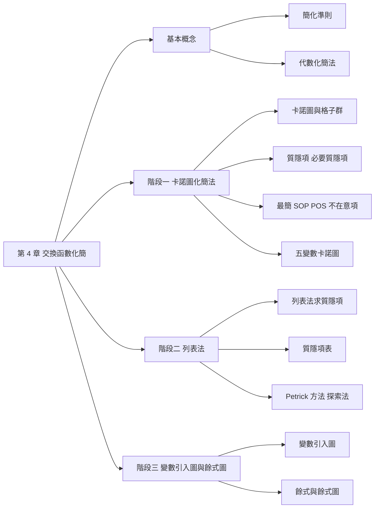

import KMap from "./_KMap.tsx";

## 名詞表 {#glossary}

本章出現的名詞，詳細說明見對應區塊。

| 中文 | English | 描述 |
|---|---|---|
| 最簡式 | Minimal Expression | 依簡化準則，字母變數數目與乘積項數目都最少的表示式 |
| 卡諾圖 | Karnaugh Map | 把真值表排成方格、相鄰格子只差一個變數的圖 |
| 1-格子 / 0-格子 | 1-cell / 0-cell | 卡諾圖中值為 1 / 0 的格子 |
| 相鄰 | Adjacency | 兩個格子對應的二進位組合只差一個位元 |
| 格子群 | Cluster / Subcube | $2^m$ 個彼此相鄰的格子圈成的一群 |
| 隱含項 | Implicant | 任何一個格子群對應的乘積項 |
| 質隱項 | Prime Implicant, PI | 不被其他更大格子群包含的隱含項 |
| 必要質隱項 | Essential Prime Implicant, EPI | 包含至少一個「沒有被其他質隱項包含」的最小項的質隱項 |
| 循環質隱項圖 | Cyclic Prime-Implicant Map | 每個最小項都被兩個以上質隱項包含，沒有必要質隱項 |
| 不在意項 | Don't-care Term, $\phi$ | 函數值可以當 0 也可以當 1 的輸入組合 |
| 未完全指定交換函數 | Incompletely Specified Function | 含有不在意項的交換函數 |
| 列表法 | Tabulation Method（Quine-McCluskey） | 用表格系統化合併最小項、求出所有質隱項 |
| 指標 | Index | 最小項二進位表示中 1 的個數 |
| 質隱項表 | Prime-Implicant Chart | 列出質隱項與最小項包含關係的表 |
| Petrick 方法 | Petrick's Method | 把「每個最小項都要被包含」寫成 POS 再展開，找出所有最簡式 |
| 探索法 | Heuristic Method | 反覆消去被包含列與包含行來簡化質隱項表 |
| 變數引入圖 | Variable-Entered Map, VEM | 格子裡可以填入變數或交換表式的卡諾圖 |
| 餘式 | Residue | 把部分變數固定後，交換函數剩下的部分 |

## 本章地圖 {#ch4-map}

第 4 章的目標是把交換函數化成**最簡式**，讓電路用最少的閘與輸入。共有三個階段的方法：卡諾圖（直觀，適合 4、5 個變數以內）、列表法（系統化，適合程式）、變數引入圖（縮小卡諾圖）。原始投影片：[[_pdf/chapter4dl-11.pdf|第 4 章投影片]]。

## 簡化準則 {#simplification-criteria}

什麼叫「比較簡單」？依序比較：

1. 出現的**變數數目**最少。
2. 在 SOP（或 POS）表式中，出現的**字母變數數目**最少。
3. 在 SOP（或 POS）表式中，**乘積項（或和項）的數目**最少（假設沒有其他具有相同數目乘積項但字母變數較少的表式存在）。

本章以第三個準則為所有化簡方法的標準：設 $q_f$ 為 $f$ 的字母變數數目、$p_f$ 為 $f$ 的乘積項數目。對同一函數的兩個表式 $f$ 與 $g$，當 $q_g \le q_f$ 而且 $p_g \le p_f$ 時，若沒有其他更簡的表式，則 $g$ 為**最簡式**。

### 例子：比較兩個表式 {#ex-criteria .fold}

$f(w,x,y,z) = \Sigma(2,6,7,13,15)$ 的兩個表式：

$$
f = w'x'yz' + w'xyz' + w'xyz + wxy'z + wxyz \qquad g = w'yz' + w'xy + wxz
$$

$q_f = 20$、$p_f = 5$；$q_g = 9$、$p_g = 3$。因為 $q_f > q_g$ 且 $p_f > p_g$，所以 $g$ 比 $f$ 簡化。

## 代數化簡法 {#algebraic-simplification}

用 [[ch2-switching-algebra#basic-theorems|第 2 章的定理]] 反覆合併。最核心的一步是**相鄰合併**：

$$
xy + xy' = x(y + y') = x
$$

兩個乘積項只差一個變數（一個是原變數、一個是補數）時，可以合併並消去那個變數。必要時用**等冪性** $m = m + m$ 把同一個最小項複製一份，和不同的項各合併一次。

### 例子：代數化簡 {#ex-algebraic .fold}

$f(x,y,z) = \Sigma(0,2,3,4,5,7)$：

$$
\begin{aligned}
f &= x'y'z' + x'yz' + x'yz + xy'z' + xy'z + xyz \\
&= (m_0 + m_2) + (m_0 + m_4) + (m_3 + m_7) + (m_5 + m_7) \quad\text{（重複利用 } m_0\text{、}m_7\text{）}\\
&= x'z'(y' + y) + y'z'(x' + x) + yz(x' + x) + xz(y' + y) \\
&= x'z' + y'z' + yz + xz
\end{aligned}
$$

這個結果還不是最簡（只要三項就夠，見 [[#ex-cyclic|循環質隱項圖]]）。代數法很難判斷「已經最簡」，所以需要卡諾圖。

## 卡諾圖 {#kmap}

**卡諾圖**把 $n$ 變數真值表的 $2^n$ 列排成方格，每一格對應一個最小項（或最大項）。關鍵是欄與列的標號依**格雷碼順序** 00、01、11、10 排列（見 [[ch1-number-systems#gray-code|格雷碼]]），所以：

- **幾何上相鄰的格子，對應的組合只差一個變數**。
- 最左欄與最右欄相鄰，最上列與最下列也相鄰（地圖的邊緣會繞回來）。

### 兩個變數卡諾圖 {#kmap-2}

欄為 $x$、列為 $y$：

| $y$ \ $x$ | 0 | 1 |
|---|---|---|
| **0** | $m_0$ | $m_2$ |
| **1** | $m_1$ | $m_3$ |

例如 $f(x,y) = \Sigma(1,3) = m_1 + m_3$：第二列都是 1；$f(x,y) = \Pi(1,2) = M_1 M_2$：$m_1$、$m_2$ 為 0。

### 三個變數卡諾圖 {#kmap-3}

欄為 $xy$（00、01、11、10）、列為 $z$：

| $z$ \ $xy$ | 00 | 01 | 11 | 10 |
|---|---|---|---|---|
| **0** | $m_0$ | $m_2$ | $m_6$ | $m_4$ |
| **1** | $m_1$ | $m_3$ | $m_7$ | $m_5$ |

注意第 3、4 欄是 11、10，所以格子編號是 0、2、6、4 而不是 0、2、4、6。

### 四個變數卡諾圖 {#kmap-4}

欄為 $wx$、列為 $yz$，兩者都依格雷碼排列：

| $yz$ \ $wx$ | 00 | 01 | 11 | 10 |
|---|---|---|---|---|
| **00** | $m_0$ | $m_4$ | $m_{12}$ | $m_8$ |
| **01** | $m_1$ | $m_5$ | $m_{13}$ | $m_9$ |
| **11** | $m_3$ | $m_7$ | $m_{15}$ | $m_{11}$ |
| **10** | $m_2$ | $m_6$ | $m_{14}$ | $m_{10}$ |

畫標準 SOP 時在 Σ 的格子填 1、其餘填 0；畫標準 POS 時在 Π 的格子填 0。

## 卡諾圖上的和與積函數 {#kmap-sum-product}

若 $f_1 = \sum \alpha_i m_i$、$f_2 = \sum \beta_i m_i$，則

$$
f_1\cdot f_2 = \sum(\alpha_i\cdot\beta_i)\, m_i \qquad f_1 + f_2 = \sum(\alpha_i + \beta_i)\, m_i
$$

（積函數成立是因為 $i \ne j$ 時 $m_i m_j = 0$。）所以在卡諾圖上：**積函數 = 兩張圖逐格 AND，和函數 = 逐格 OR**。

## 格子群與相鄰 {#adjacency}

在卡諾圖中，值為 1 的格子稱為 **1-格子**，值為 0 的稱為 **0-格子**。

- 兩個格子的二進位組合只有一個位元不同，稱為**相鄰**。兩個相鄰的 1-格子（0-格子）對應的最小項（最大項）之間有**一個變數是多餘的**，可以消去。
- 四個 1-格子彼此相鄰（每一個都和另外兩個相鄰），可以消去兩個變數。
- 一般而言，$2^m$ 個 1-格子（0-格子）相鄰時，可以消去 $m$ 個變數，化簡成一個 $n - m$ 個變數的乘積項（和項）。

圈起來的一群格子叫**格子群**，大小必須是 1、2、4、8……（2 的冪次），形狀是矩形（含繞邊）。

### 例子：讀出格子群的乘積項 {#ex-read-cluster .fold}

$f(w,x,y,z) = \Sigma(2,3,4,5,12,13,14)$：

- 格子群 {12, 13, 4, 5}：$w$ 會變、$z$ 會變，固定 $x = 1$、$y = 0$，得 $xy'$。
- 格子群 {2, 3}：$w = 0, x = 0, y = 1$ 固定，得 $w'x'y$。
- 格子群 {12, 14}：$w = 1, x = 1, z = 0$ 固定，得 $wxz'$。

讀法：**群內值不變的變數保留（1 取原變數、0 取補數），會變的變數消去**。

## 卡諾圖化簡程序 {#kmap-procedure}

1. 依想要的最簡式是 SOP 或 POS，選擇圈 **1-格子**或 **0-格子**。
2. 先圈起所有**只能**包含單一格子的格子群（孤立的格子），然後圈起能形成兩個格子、但不能形成更多格子的格子群。
3. 接著圈起能組成四個、但不能形成較多格子的格子群；然後是八個……依此類推。
4. 形成最簡表示式時，在每一個格子至少被一個格子群包含的前提下，**盡量選取最大的格子群，而且格子群的數目最少**；將這些格子群集合後，即為所求。

<KMap vars={["w", "x", "y", "z"]} ones={[2, 3, 4, 5, 12, 13, 14]} />

### 例子：三變數卡諾圖化簡 {#ex-kmap-3var .fold}

- $f_1(x,y,z) = \Sigma(1,3,4,5)$：圈 {1, 3} 消去 $y$ 得 $x'z$；圈 {4, 5} 消去 $z$ 得 $xy'$。$f_1 = x'z + xy'$。
- $f_2(x,y,z) = \Sigma(2,3,6,7)$：四個格子 {2, 3, 6, 7} 一起圈，消去 $x$、$z$，$f_2 = y$。
- $f(x,y,z) = \Sigma(0,2,4,5,6)$：第一列 {0, 2, 6, 4} 圈成一群（繞邊相鄰）得 $z'$；{4, 5} 得 $xy'$。$f = z' + xy'$。

## 隱含項、質隱項與必要質隱項 {#prime-implicants}

- **隱含項（implicant）**：卡諾圖上任何格子群都是交換函數 $f$ 的隱含項。
- **質隱項（prime implicant）**：任何**不被其他較大的隱含項（格子群）所包含**的隱含項。
- **必要質隱項（essential prime implicant）**：一個質隱項所包含的最小項中，**至少有一個不被其他質隱項包含**時，該質隱項就是必要質隱項。

交換函數中的每一個最小項都必須包含於最簡式中，所以**所有必要質隱項都必須包含在最簡式中**。但必要質隱項的集合往往不能包含所有最小項，因此求最簡式的方法是：**先選取必要質隱項，再選取可以包含未被必要質隱項包含之最小項的最小質隱項集合**。

## 求最簡 SOP {#minimal-sop}

1. 決定**所有必要質隱項**，並且包含在最簡式中。
2. 由質隱項集合中刪除所有被必要質隱項包含的最小項。
3. 若步驟 1 得到的結果已包含 $f$ 的所有最小項，即為最簡式；否則適當地選取質隱項，使 $f$ 的所有最小項都被包含，並且質隱項的數目最少。

### 例子：有兩組最簡式 {#ex-two-minimal .fold}

$f(w,x,y,z) = \Sigma(7,8,12,13,15)$。

- 質隱項：$wy'z'$（8, 12）、$wxy'$（12, 13）、$wxz$（13, 15）、$xyz$（7, 15）。
- 必要質隱項：$wy'z'$（只有它包含 $m_8$）、$xyz$（只有它包含 $m_7$）。
- 剩下 $m_{13}$ 沒被包含，可以用 $wxy'$ 或 $wxz$，二者擇一。

$$
f = wy'z' + xyz + \begin{cases} wxz \\ wxy' \end{cases}
$$

<KMap vars={["w", "x", "y", "z"]} ones={[7, 8, 12, 13, 15]} />

### 例子：循環質隱項圖 {#ex-cyclic .fold}

$f(x,y,z) = \Sigma(1,2,3,4,5,6)$：每個最小項都被兩個質隱項包含，所以**沒有必要質隱項**，這種卡諾圖稱為**循環質隱項圖**（cyclic prime-implicant map）。最簡式有兩個：

$$
f = xz' + x'y + y'z \qquad\text{或}\qquad f = yz' + xy' + x'z
$$

$\Sigma(0,2,3,4,5,7)$ 也是循環質隱項圖：質隱項 $x'z'$、$y'z'$、$x'y$、$yz$、$xy'$、$xz$ 圍成一圈，最簡式為 $x'z' + yz + xy'$ 或 $y'z' + x'y + xz$。

## 求最簡 POS {#minimal-pos}

求最簡 POS 有兩種等價的做法：

1. **直接圈 0-格子**：每個 0-格子群讀成一個**和項**——值不變的變數保留，**0 取原變數、1 取補數**（和最大項的規則相同）。
2. 先圈 0-格子求出 $f'$ 的最簡 SOP，再用笛摩根定理取補數。

### 例子：最簡 SOP 與最簡 POS {#ex-sop-vs-pos .fold}

$f(w,x,y,z) = \Sigma(5,6,7,9,10,11,13,14,15)$。

- **SOP（圈 1）**：$wz$、$xz$、$wy$、$xy$，$f = wz + xz + wy + xy$。
- **POS（圈 0）**：0-格子是第一列 $yz = 00$（{0, 4, 12, 8}）與第一欄 $wx = 00$（{0, 1, 3, 2}）。第一列得 $(y + z)$，第一欄得 $(w + x)$，所以 $f = (w + x)(y + z)$。

POS 只要兩個 OR 閘加一個 AND 閘，比 SOP（四個 AND 加一個 OR）簡單很多。**同一個函數的最簡 SOP 與最簡 POS 複雜度可能差很多**，兩者都要試。

<KMap vars={["w", "x", "y", "z"]} ones={[5, 6, 7, 9, 10, 11, 13, 14, 15]} pos />

## 不在意項 {#dont-care}

前面討論的交換函數，在所有輸入組合下的值都指定為 0 或 1，稱為**完全指定交換函數**。有些交換函數中，某些輸入組合因為某種原因**不可能發生**，或即使發生了交換函數的值是 0 或 1 都無所謂，這種函數稱為**未完全指定交換函數**，那些輸入組合稱為**不在意項**（don't care term）。

- 卡諾圖中不在意項以 $\phi$ 表示（0 與 1 重疊的結果，表示其值可以為 1 或 0），寫成 $\Sigma_\phi(\ldots)$ 或 $\Pi_\phi(\ldots)$。
- 化簡時，$\phi$ 格子要當 0 還是 1，**視能不能讓格子群更大而定**。
- **只由不在意項形成的格子群不能成為質隱項**（沒有必要包含它們）。

實務意義：例如 BCD 碼只用 0000～1001，1010～1111 永遠不會出現，就可以當成不在意項來化簡電路。

### 例子：含不在意項的化簡 {#ex-dont-care .fold}

**例一**：$f(w,x,y,z) = \Sigma(1,3,7,8,9,12,13,15) + \Sigma_\phi(4,5,10,11,14)$。

把 $\phi$ 適當當成 1，右半邊 {8, 9, 12, 13, 10, 11, 14, 15} 八格圈成 $w$，第二、三列 {1, 3, 5, 7, 9, 11, 13, 15} 八格圈成 $z$：

$$
f = w + z
$$

**例二**：$f(w,x,y,z) = \Pi(1,2,3,4,9)\cdot\Pi_\phi(10,11,12,13,14,15)$，求最簡 POS。

圈 0-格子（$\phi$ 可當 0）：{1, 3, 9, 11} 得 $(x + z')$，{2, 3, 10, 11} 得 $(x + y')$，{4, 12} 得 $(x' + y + z)$：

$$
f = (x + z')(x + y')(x' + y + z)
$$

<KMap vars={["w", "x", "y", "z"]} ones={[1, 3, 7, 8, 9, 12, 13, 15]} dc={[4, 5, 10, 11, 14]} />

## 五個變數卡諾圖 {#kmap-5}

五個變數的卡諾圖可以視為**兩個四變數卡諾圖並列**：一個為 $v = 0$、另一個為 $v = 1$。

- 每一張四變數圖內，相鄰規則和一般四變數卡諾圖相同。
- 兩張圖中**位置相同的格子也相鄰**（只差 $v$）。

所以每一格除了和自己圖中的四個格子相鄰外，也和另一張圖中對應的格子相鄰，每一格都與其他五個格子相鄰。$v = 0$ 圖的格子編號是 0～15，$v = 1$ 圖是 16～31。

### 例子：五變數卡諾圖化簡 {#ex-kmap-5var .fold}

$f(v,w,x,y,z) = \Sigma(0,3,4,5,11,12,13,15,19,20,21,27,28,29,31)$：

- $xy'$：兩張圖中 $xy = 10$ 的格子 {4, 5, 12, 13, 20, 21, 28, 29}，八格，消去 $v, w, z$。
- $x'yz$：{3, 11, 19, 27}，兩張圖中同位置的兩格各一組。
- $v'w'y'z'$：{0, 4}，只在 $v = 0$ 圖中。
- 剩下 $m_{15}$、$m_{31}$：用 $wyz$（{11, 15, 27, 31}）或 $wxz$（{13, 15, 29, 31}）。

$$
f = xy' + x'yz + v'w'y'z' + \begin{cases} wyz \\ wxz \end{cases}
$$

## 列表法 {#tabulation}

卡諾圖超過五個變數就很難用。**列表法**（Quine-McCluskey 法）用表格系統化地重複「相鄰合併」，求出所有質隱項，適合寫成程式。

**列表法的質隱項求取程序：**

1. 把所有最小項（含不在意項）依二進位表示中 **1 的個數**（稱為**指標 index**）分組，並依指標由小而大排列。
2. 依序比較指標值為 $i$ 與 $i + 1$ 兩組中的各項，**只差一個位元**的兩項合併成一項，該位元記為 `-`，被合併的兩項打勾 ✓。
3. 對合併出來的新表重複步驟 2（`-` 的位置必須相同才能合併），直到不能再合併為止。
4. 所有**沒有打勾**的項就是質隱項。

### 例子：列表法求質隱項 {#ex-tabulation .fold}

$f(x,y,z) = \Sigma(0,1,2,4,5,7)$。

| 步驟 1 | 指標 | 項 | 二進制 |
|---|---|---|---|
| | 0 | 0 | 000 ✓ |
| | 1 | 1, 2, 4 | 001 ✓、010 ✓、100 ✓ |
| | 2 | 5 | 101 ✓ |
| | 3 | 7 | 111 ✓ |

| 步驟 2 | 項 | 二進制 |
|---|---|---|
| | (0,1) | 00- ✓ |
| | (0,2) | 0-0 ← |
| | (0,4) | -00 ✓ |
| | (1,5) | -01 ✓ |
| | (4,5) | 10- ✓ |
| | (5,7) | 1-1 ← |

| 步驟 3 | 項 | 二進制 |
|---|---|---|
| | (0,1,4,5) | -0- ← |

沒打勾的（←）是質隱項：$0\text{-}0 = x'z'$、$1\text{-}1 = xz$、$\text{-}0\text{-} = y'$。

### 例子：含不在意項的列表法 {#ex-tabulation-dc .fold}

$f(w,x,y,z) = \Sigma(2,6,7,8,13) + \Sigma_\phi(0,5,9,12,15)$，不在意項也一起參與合併。

- 步驟 2 中無法再合併的：(0,2) `00-0` = $w'x'z'$、(0,8) `-000` = $x'y'z'$、(2,6) `0-10` = $w'yz'$、(6,7) `011-` = $w'xy$。
- 步驟 3：(8,9,12,13) `1-0-` = $wy'$、(5,7,13,15) `-1-1` = $xz$。

共六個質隱項。

## 質隱項表 {#prime-implicant-chart}

求出質隱項後，用**質隱項表**選出最簡式：

- 表格最上方由左而右依序寫下交換函數 $f$ 的所有最小項（**不含不在意項**）；最左邊由上而下寫下所有質隱項。
- 每個質隱項所在的列中，在它包含的最小項位置記上 ×。
- 若一個最小項僅被一個質隱項包含，將該記號圈起來（⊗）：**有 ⊗ 的質隱項就是必要質隱項**，標上 *。

**由質隱項表求最簡式的程序：**

1. **找出必要質隱項**：選取一個必要質隱項後，將它包含的所有最小項上方都加上檢查符號 ✓，表示它們已經被包含。
2. 找出能**以最少數目**包含其餘（未打 ✓）最小項的質隱項子集合，直到所有最小項都被包含為止。

### 例子：所有質隱項都是必要質隱項 {#ex-pi-chart-1 .fold}

$f(x,y,z) = \Sigma(0,1,2,4,5,7)$，質隱項 $xz$、$x'z'$、$y'$：

| 質隱項 | 0 | 1 | 2 | 4 | 5 | 7 |
|---|---|---|---|---|---|---|
| \*$xz$ | | | | | × | ⊗ |
| \*$x'z'$ | × | | ⊗ | × | | |
| \*$y'$ | × | ⊗ | | × | × | |

三個都是必要質隱項，而且已包含所有最小項：$f = y' + x'z' + xz$。

### 例子：需要再選質隱項 {#ex-pi-chart-2 .fold}

$f(w,x,y,z) = \Sigma(0,1,2,5,7,8,9,10,15)$，質隱項：$A = x'y'$（0,1,8,9）、$B = x'z'$（0,2,8,10）、$C = w'y'z$（1,5）、$D = w'xz$（5,7）、$E = xyz$（7,15）。

- 必要質隱項：$A$（唯一包含 9）、$B$（唯一包含 2、10）、$E$（唯一包含 15）。
- 剩下 $m_5$：$C$ 或 $D$ 都可以。

$$
f = x'y' + x'z' + xyz + \begin{cases} w'y'z \\ w'xz \end{cases}
$$

## Petrick 方法 {#petrick}

**Petrick 方法原理**：把包含一個最小項的質隱項視為一個交換變數，當它被選取時值為 1，不被選取時為 0。依據此原理，質隱項表中**每一個最小項行**中，可以求取包含該最小項的所有質隱項之和（OR）項，此和項表示該最小項可以由一個或多個質隱項包含。由於每一個最小項均必須包含於最簡式中，因此**質隱項函數** $p$ 定義為包含每一個最小項行的質隱項 OR 後的和項之積（AND），其結果為一個 POS 交換表式。

**使用 Petrick 方法的最簡式求取程序：**

1. 寫出 $p$ 交換表式：$p$ 表式等於包含每一個最小項行的質隱項 OR 後的和項之積，其結果為一個 POS 交換表式。
2. 使用分配律將 $p$ 交換表式展開並且表示為 SOP 形式，並使用累乘性與吸收律化簡該 SOP 表式。結果的 SOP 表式中的每一個乘積項代表一個不重覆表式。
3. 由步驟 2 得到的 SOP 表式中，依據簡化準則，選出一個質隱項數目最少而且在每一個質隱項中字母變數最少的乘積項，即為所求的最簡式。

### 例子：Petrick 方法 {#ex-petrick .fold}

$f(w,x,y,z) = \Sigma(2,6,7,8,13) + \Sigma_\phi(0,5,9,12,15)$，質隱項：$A = xz$、$B = wy'$、$C = w'xy$、$D = w'yz'$、$E = x'y'z'$、$F = w'x'z'$。

| 質隱項 | 2 | 6 | 7 | 8 | 13 |
|---|---|---|---|---|---|
| $A = xz$ | | | × | | × |
| $B = wy'$ | | | | × | × |
| $C = w'xy$ | | × | × | | |
| $D = w'yz'$ | × | × | | | |
| $E = x'y'z'$ | | | | × | |
| $F = w'x'z'$ | × | | | | |

$$
\begin{aligned}
p &= (D + F)(C + D)(A + C)(B + E)(A + B) \\
&= (D + CF)(A + C)(B + AE) \\
&= (AD + CD + CF)(B + AE) \\
&= ABD + BCD + BCF + AED + ACDE + ACEF
\end{aligned}
$$

（$(D+F)(C+D) = D + CF$、$(A+C)(B+E)(A+B)$ 先算 $(B+E)(A+B) = B + AE$。）乘積項中質隱項最少的是三項：$ABD$、$BCD$、$BCF$、$AED$。依字母變數數目，$ABD$ 最少（$2 + 2 + 3 = 7$ 個），所以

$$
f(w,x,y,z) = A + B + D = xz + wy' + w'yz'
$$

## 探索法 {#heuristic}

**探索法**為一個重複地使用一些簡化質隱項表的規則：**消去被包含列**（covered row）與**消去包含行**（covering column），以簡化質隱項表的大小，然後由此簡化質隱項表中獲取最簡式。

- **消去被包含列**：在一個質隱項表中，若一個列（即質隱項）$p_j$ 所包含的最小項均被另一個列 $p_i$ 所包含時，稱為 $p_i$ 包含 $p_j$。若 $p_i$ 包含 $p_j$ 而且 $p_i$ 的字母變數數目並不較 $p_j$ 為多時，可以消去 $p_j$，而該質隱項表中至少仍然保留一個最簡式。
- **消去包含行**：在質隱項表中，若一個行 $c_j$ 中的每一個出現記號（×）的地方，$c_i$ 也均有此記號（×）時，稱為 $c_i$ 包含 $c_j$。若 $c_i$ 包含 $c_j$，則可以消去 $c_i$，而不會影響最簡式的求得。事實上，消去包含行的求行，並不會影響原來交換函數中的所有最簡式的求得，因為最簡式中的質隱項依然保留於簡化的質隱項表中。

注意：**當消去一列時，是消去被包含的列；當消去一行時，是消去包含的行**。在實際簡化一個質隱項表時，常常需要重覆地使用消去被包含列與消去包含行的簡化步驟。

**使用探索法的最簡式求取程序：**

1. 找出必要質隱項：由質隱項表中找出必要質隱項（標示為 *），將它們列入最簡式的集合中，並將它們所包含的最小項由質隱項表中移除。
2. 簡化質隱項表：使用消去被包含列與消去包含行的規則簡化步驟 1 所得的質隱項表。
3. 重複執行上述步驟，直到簡化的質隱項表為空集合為止。注意在簡化的質隱項表中的第二、第三等必要質隱項依序標示為 **、***、等。

### 例子：探索法 {#ex-heuristic .fold}

$f(w,x,y,z) = \Sigma(2,5,6,8,15) + \Sigma_\phi(0,7,9,12,13)$，質隱項 $A = xz$、$B = wy'$、$C = w'xy$、$D = w'yz'$、$E = x'y'z'$、$F = w'x'z'$。

| 質隱項 | 2 | 5 | 6 | 8 | 15 |
|---|---|---|---|---|---|
| \*$A = xz$ | | ⊗ | | | ⊗ |
| $B = wy'$ | | | | × | |
| $C = w'xy$ | | | × | | |
| $D = w'yz'$ | × | | × | | |
| $E = x'y'z'$ | | | | × | |
| $F = w'x'z'$ | × | | | | |

1. $A$ 是必要質隱項（唯一包含 5、15），移除 5、15 兩行。
2. 剩下的表中：$C$ 被 $D$ 包含（$C$ 只有 6，$D$ 有 2、6），消去 $C$；$F$ 被 $D$ 包含，消去 $F$；$E$ 被 $B$ 包含（都只有 8，字母數 $B$ 較少），消去 $E$。
3. 現在 $B$ 是唯一包含 8 的列、$D$ 是唯一包含 2、6 的列，都是**第二必要質隱項**（**）。

$$
f = A + B + D = xz + wy' + w'yz'
$$

## 變數引入圖 {#vem}

**變數引入圖（VEM）**：當一個卡諾圖中的格子的值不是常數 0 或 1，而是一個**外部變數或是交換表式**時，稱為變數引入圖。外部變數或是交換表式則稱為**引入圖變數或表式**（map-entered variable or expression）。

變數引入圖通常有兩種功用：

1. 在某些應用中，直接將一個外部變數或是交換表式填入卡諾圖中時較填入常數 0 或是 1 為方便。
2. **可以降低使用的卡諾圖實際大小**。例如可以使用四個變數的卡諾圖化簡五個或是六個變數的交換函數。

**變數引入圖法化簡程序：**

1. 將所有外部變數視為 0，求出結果的最簡式。
2. 取一個外部字母變數（注意 $x$ 與 $x'$ 當作兩個不同的字母變數）或是交換表式（若有時），並將其它外部字母變數或是交換表式（若有時）設定為 0，而所有 1-格子當作不在意項，求出結果的最簡式。重複上述步驟，直到所有外部字母變數或是交換表式（若有時）皆處理過為止。
3. 將步驟 1 與 2 所得到的最簡式 OR 後，即為所求。

### 例子：變數引入圖化簡 {#ex-vem .fold}

三變數 VEM（欄 $xy$、列 $z$）：$m_0 = B'$、$m_1 = 1$、$m_2 = 0$、$m_3 = B$、$m_4 = A$、$m_5 = 1$、$m_6 = 0$、$m_7 = \phi$。

| $z$ \ $xy$ | 00 | 01 | 11 | 10 |
|---|---|---|---|---|
| **0** | $B'$ | 0 | 0 | $A$ |
| **1** | 1 | $B$ | $\phi$ | 1 |

1. **所有外部變數設為 0**：1-格子 {1, 5}、$\phi$ {7}，得 $y'z$。
2. **考慮 $A$**（$A$ 格當 1，其他外部變數當 0，原 1-格子當 $\phi$）：{4, 5} 得 $xy'$ → $Axy'$。
3. **考慮 $B$**：$m_3$ 當 1，{1, 3, 5, 7} 得 $z$ → $Bz$。
4. **考慮 $B'$**：$m_0$ 當 1，{0, 1} 得 $x'y'$ → $B'x'y'$。

$$
f = y'z + Axy' + Bz + B'x'y'
$$

## 交換函數的餘式 {#residue}

一般而言，對應於一個 $m$ 個變數引入圖的交換函數 $f$ 可以表示為：

$$
f(x_{n-1}, \ldots, x_1, x_0) = \sum_{i=0}^{2^m - 1} E_i\, m_i
$$

其中 $E_i$ 為 $(x_{n-1}, \ldots, x_m)$ 的交換函數，而 $m_i$ 為 $m$ 個變數中的第 $i$ 個最小項。即交換函數 $f$ 只在 $E_i$ 與 $m_i$ 同時為 1 時才為 1。若 $n = m$，則 $E_i$ 的值不是 0 就是 1，因而該變數引入圖退化為 $n$ 個變數的卡諾圖。這其實就是對 $m$ 個變數反覆使用 [[ch2-switching-algebra#shannon|Shannon 展開定理]]。

**定義（交換函數的餘式）**：設 $X = \{x_{n-1}, \ldots, x_1, x_0\}$ 而且 $Y = \{y_{m-1}, \ldots, y_1, y_0\}$ 為 $X$ 的一個子集合，交換函數 $f(X)$ 的餘式 $f_Y(X)$ 定義為將交換函數 $f(X)$ 中，**所有對應於 $Y$ 中非補數形式的字母變數均設定為 1，而所有對應於 $Y$ 中補數形式的字母變數均設定為 0** 後，所得到的交換函數。

### 例子：求交換函數的餘式 {#ex-residue .fold}

$f(u,v,w,x,y,z) = uvw + x'y'z'$。

- 在 $ux'z$ 下的餘式：設 $u = 1$、$x = 0$、$z = 1$，得 $f_{ux'z} = 1\cdot v\cdot w + 1\cdot y'\cdot 0 = vw$。
- 在 $vy'z'$ 下的餘式：設 $v = 1$、$y = 0$、$z = 0$，得 $f_{vy'z'} = u\cdot 1\cdot w + x'\cdot 1\cdot 1 = uw + x'$。

## 餘式圖 {#residue-map}

對於一個 $n$ 個變數的交換函數 $f(x_{n-1}, \ldots, x_0)$ 而言，它在 $m$ 個變數 $Y = \{x_{m-1}, \ldots, x_0\}$ 下的**餘式圖**，一共有 $2^m$ 行與 $2^{n-m}$ 列，其中每一行相當於變數 $(x_{m-1}, \ldots, x_0)$ 的一個二進制組合，而每一列則相當於變數 $(x_{n-1}, \ldots, x_m)$ 的一個二進制組合，行與列的交點則置入相當於 $n$ 個變數的二進制組合的等效十進制值。$2^{n-m}$ 列的二進制組合通常以格雷碼方式排列，以方便求餘式時的化簡。

**餘式圖求餘式程序：**

1. 由左而右依序檢查餘式圖中的每一行。若一行中所有格子均未加圈，則該行的餘式為 0；若一行中至少有一個格子加圈，而其餘格子亦加圈或是加星號，則該行的餘式為 1。
2. 若一行中所有格子均加星號，則該行的餘式為 $\phi$。
3. 若一行中僅有部分格子加圈，則該行的餘式為變數（不屬於 $Y$ 集合的變數）的函數。在該行中的星號格子可以用來幫助化簡。

（加圈 = 該最小項為 1；加星號 = 不在意項。）

### 例子：用餘式圖求餘式 {#ex-residue-map .fold}

$f(w,x,y,z) = w'x'y + w'xy + w'xy'z + wxyz + (wx'y)$，其中 $(wx'y)$ 為不在意項。在 $(w,x,y)$ 下求餘式：

最小項為 2、3、6、7、5、15，不在意項為 10、11。餘式圖的行是 $wxy$，列是 $z$，每一行的兩格是 $2i$（$z = 0$）與 $2i + 1$（$z = 1$）：

| $wxy$ | 000 | 001 | 010 | 011 | 100 | 101 | 110 | 111 |
|---|---|---|---|---|---|---|---|---|
| $z = 0$ | 0 | ②| 4 | ⑥ | 8 | 10* | 12 | 14 |
| $z = 1$ | 1 | ③ | ⑤ | ⑦ | 9 | 11* | 13 | ⑮ |
| 餘式 | 0 | 1 | $z$ | 1 | 0 | $\phi$ | 0 | $z$ |

把這些餘式填入三變數 $(w,x,y)$ 的變數引入圖化簡：

1. $z$ 設為 0：1-格子 {1, 3}、$\phi$ {5}，得 $w'y$。
2. 考慮 $z$：$z$ 格 {2, 7} 當 1，{1, 3, 5} 當 $\phi$：{2, 3} 得 $w'x$、{1, 3, 5, 7} 得 $y$ → $z(w'x + y)$。

$$
f = w'y + w'xz + yz
$$
