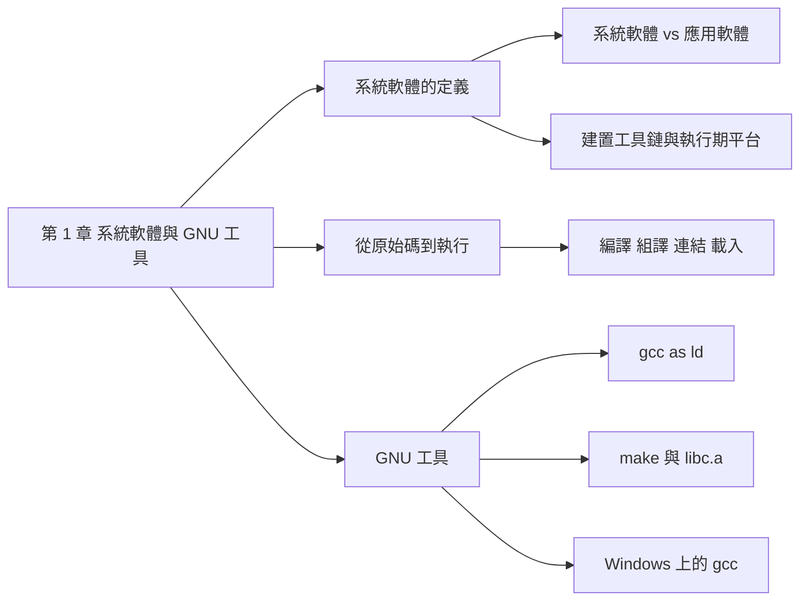
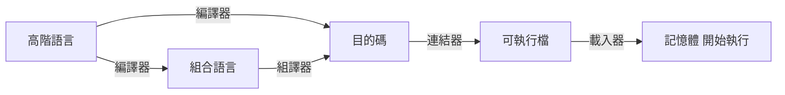
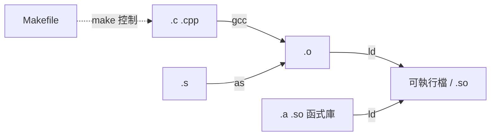

## 名詞表 {#glossary}

本章出現的名詞，詳細說明見對應區塊。

| 中文 | English | 描述 |
|---|---|---|
| 系統軟體 | System Software | 給程式設計師使用、管理硬體並提供基礎服務的軟體集合 |
| 應用軟體 | Application Software | 給一般大眾使用的軟體 |
| 系統程式 | System Program | 系統軟體中的一個具體可執行成品，例如 `gcc`、`ld`、`bash` |
| 系統程式設計 | System Programming | 直接使用系統呼叫與低階機制來開發系統層軟體 |
| 系統呼叫 | System Call | 程式向作業系統核心請求服務的介面 |
| 建置工具鏈 | Build Toolchain | 把原始碼變成可執行檔的工具：編譯器、組譯器、連結器、建置工具 |
| 執行期平台 | Runtime Platform | 程式執行時依賴的 OS 核心、libc、動態載入器、驅動程式 |
| 應用程式二進位介面 | ABI, Application Binary Interface | 呼叫慣例、暫存器約定等二進位層級的規範 |
| 編譯器 | Compiler | 把高階語言轉成組合語言或目的碼 |
| 組譯器 | Assembler | 把組合語言轉成目的碼 |
| 目的檔 | Object File | 編譯或組譯後的機器碼，尚未連結（`.o`、`.obj`） |
| 連結器 | Linker | 把多個目的檔與函式庫合併成可執行檔 |
| 載入器 | Loader | 把可執行檔載入記憶體並開始執行 |
| 靜態函式庫 | Static Library | 用 `ar` 打包的目的檔集合（`.a`） |
| 動態函式庫 | Shared Library | 執行期才載入連結的函式庫（`.so`） |

## 本章地圖 {#ch1-map}

第 1 章先釐清「系統軟體」在說什麼，再認識把 C 程式變成可執行檔的 GNU 工具鏈。原始投影片：[[_pdf/S00-Syllabus.pdf|課程大綱]]、[[_pdf/S01-Intro.pdf|S01 簡介]]。



## 課程資訊 {#course-info}

- **授課**：李建緯老師（雲科大資工系 智慧感知與系統整合實驗室）。
- **目標**：系統軟體的理論與系統程式的實務，包括組譯器、連結器、虛擬機器及作業系統，學習設計與實作系統程式。
- **教科書**：陳鍾誠《系統程式》（旗標）；參考書 Leland L. Beck, *System Software: An Introduction to Systems Programming*。工具使用 MSYS2、Arm GNU Toolchain、QEMU。
- **評量**：出席、小考、隨堂練習與作業 40%，期中考 30%，期末考 30%。
- **繳交規定**：隨堂練習在下週上課日晚上 12 點前繳交，不補交；一律交 markdown 檔，圖片存在同一資料夾並用相對路徑嵌入，整個壓縮成 zip；Tronclass 上的檔案要留到成績公告。

## 系統軟體與應用軟體 {#system-vs-application}

- **系統軟體**：設計給**程式設計師**使用的軟體。
- **應用軟體**：設計給**一般大眾**使用的軟體。

## 系統軟體、系統程式與系統程式設計 {#software-program-programming}

三個名詞很像，指的是不同層次：

| 名詞 | 是什麼 | 例子 |
|---|---|---|
| 系統軟體（System Software） | 電腦底層的基礎設施與工具**集合**，管理硬體並提供基礎服務與介面 | OS 核心、裝置驅動、檔案系統、標準函式庫、動態載入器、Shell、虛擬機／容器工具、編譯器、組譯器、連結器 |
| 系統程式（System Program） | 上述集合中**一個具體的可執行成品** | `bash`、`ld.so`、`readelf`、`gcc`、`as`、`ld`、`systemd`、`strace` |
| 系統程式設計（System Programming） | 一種**開發活動**：直接使用作業系統的系統呼叫與低階機制來建構系統層軟體 | 行程管理、執行緒、記憶體管理、File I/O、驅動程式 |

系統程式設計常見的作業系統主題：行程管理、執行緒、行程通訊、並行控制、記憶體管理、檔案輸出入（File I/O）、驅動程式。

## 建置工具鏈與執行期平台 {#toolchain-vs-runtime}

系統軟體可以分成兩大類：

| 分類 | 成員 | 功能 | 關鍵 |
|---|---|---|---|
| **建置工具鏈**（Build Toolchain） | 編譯器（gcc／clang）、組譯器（as）、連結器（ld／lld）、建置工具（Make／CMake） | 把原始碼翻譯成目的碼，再連結成可執行檔或動態函式庫 | 遵守 ABI（呼叫慣例、暫存器約定）、產生正確的目標格式（ELF）、處理重定位 |
| **執行期平台**（Runtime Platform） | OS 核心、標準函式庫（libc）、動態載入器（ld.so）、驅動程式 | 提供系統呼叫與高層 API、管理資源、載入與連結執行期相依 | 系統呼叫介面、檔案系統、排程、記憶體管理、動態連結 |

## 從原始碼到執行的元件 {#program-pipeline}

一支程式從撰寫到執行，會經過這些系統程式與檔案：

1. **高階語言（HLL）**：C、C++ 等，程式編寫的起點。
2. **編譯器（Compiler）**：把高階語言轉成組合語言或機器碼。產生組合語言時還要交給組譯器；直接產生機器碼時就得到目的檔。
3. **組合語言（Assembly Language）**：編譯器的可能輸出。
4. **組譯器（Assembler）**：把組合語言轉成機器碼，產生目的檔。
5. **目的檔（Object File）**：已是機器碼，但**尚未連結**。
6. **連結器（Linker）**：把多個目的檔連結成一個完整的可執行檔。
7. **可執行檔（Executable File）**：已經可以被載入執行。
8. **載入器（Loader）**：把可執行檔載入記憶體並分配資源，準備執行。
9. **記憶體／處理器**：程式最終執行的地方。

## 執行路徑 {#execution-path}



編譯器可以先產生組合語言再交給組譯器，也可以直接產生目的碼；兩條路最後都到目的碼，再經連結、載入才執行。

## 機器語言、組合語言與高階語言 {#language-levels}

- **機器語言**：CPU 直接執行的二進位指令，人很難閱讀。
- **組合語言**：用助憶符號（例如 `LD`、`ADD`）一對一表示機器指令；每種處理器（CPU0、IA32、Arm…）的組合語言都不同。
- **高階語言**：例如 C，一行敘述通常對應好幾條組合語言指令，而且不綁定特定處理器。

C 的 `A = B + C - D;` 在 CPU0 組合語言要先把 B、C、D 載入暫存器、相加減、再存回 A，見 [[ch3-assembly#arithmetic|組合語言中的算術運算]]。

## C 語言與 UNIX {#c-and-unix}

- C 語言在 1972 年由貝爾實驗室發展，作者 Ken Thompson 與 Dennis Ritchie（合稱 K&R）。
- K&R 用 C 設計出 UNIX 作業系統。
- C 特別適合撰寫作業系統等低階程式，是當今系統程式的主要語言。
- C 可以做**記憶體映射輸出入**，因此特別適合撰寫嵌入式系統程式。

## GNU 計畫 {#gnu}

- **GNU** 是 *GNU's Not Unix* 的遞迴縮寫，表示 GNU 雖然像 Unix，但不是 Unix。
- 由 Richard Stallman 在 1983 年發起，目標是做出完全自由的類 Unix 作業系統。
- 催生了 GNU 工具鏈等大量自由軟體，是現代 Linux 發行版（Linux／GNU 系統）的重要組成。

## GCC 編譯器 {#gcc}

**GCC（GNU Compiler Collection）** 是開源的編譯器套件，最初只編譯 C，現在也支援 C++、Fortran、Ada、Objective-C、Go。

| | 檔案 |
|---|---|
| 輸入 | 原始碼 `.c`、`.cpp`；標頭檔 `.h` |
| 輸出 | 目的檔 `.o`／`.obj`；加 `-S` 時輸出組合語言 `.s`；直接編譯並連結時輸出可執行檔（`a.out` 或自訂檔名） |

```sh
gcc -c main.c          # 只編譯，產生目的檔 main.o
gcc -o output main.c   # 編譯並連結，產生可執行檔 output
gcc -S main.c          # 產生組合語言 main.s
```

## as 組譯器 {#gnu-as}

**as（GNU Assembler）** 是 GCC 工具鏈中的組譯器：把組合語言（`.s`，手寫或由 GCC 產生）轉成目的檔（`.o`／`.obj`）。

```sh
as program.s -o program.o
```

## ld 連結器 {#gnu-ld}

**ld（GNU Linker）** 的主要工作：

- **符號解析**：解決跨檔案的函式呼叫、全域變數引用。
- **目的檔合併**：把多個目的檔合成一個可執行檔，處理位址分配。
- **函式庫連結**：連結靜態函式庫（`.a`）或動態函式庫（`.so`）。

| | 檔案 |
|---|---|
| 輸入 | 目的檔 `.o`、靜態函式庫 `.a`、動態函式庫 `.so` |
| 輸出 | 可執行檔（無固定副檔名，如 `a.out`）、或動態函式庫 `.so` |

```sh
ld file1.o file2.o -o output
```

## Make 建置工具 {#gnu-make}

**GNU Make** 依照 **Makefile** 裡定義的編譯規則與檔案相依關係，自動且依正確順序呼叫 GCC 等工具建置專案。

- 輸入：Makefile、專案的原始碼檔。
- 輸出：目的檔、可執行檔，以及大型專案的中間檔。

```sh
make         # 依 Makefile 建置整個專案
make clean   # 執行 Makefile 中定義的清理規則，刪除編譯產生的檔案
```

## 靜態函式庫 libc.a {#libc}

`printf.c`、`putc.c`、`kprintf.c` 等常用函式先各自編譯成目的檔，再用 **`ar`** 工具打包成靜態函式庫 `libc.a`。程式要用 `printf` 時不必重新編譯它，連結時引用預先建好的函式庫即可。

## GNU 工具整體流程 {#gnu-workflow}

1. `gcc` 把 C／C++ 原始碼編譯成目的檔（`.o`）。
2. 有組合語言時，`as` 把 `.s` 組譯成目的檔。
3. `ld` 把多個目的檔與函式庫連結成可執行檔或動態函式庫。
4. `make` 依 Makefile 自動管理上述整個流程。



## 在哪裡使用 GNU 工具 {#where-gnu}

- **Linux**：預設就有 GNU 工具。
- **Windows**：MSYS2（本課程採用，見 [[ch3-msys2#msys2|MSYS2]]）、WSL、Git for Windows，或 Dev-C++ 內附的 MinGW。

## 在 Windows 設定 Dev-C++ 的 gcc {#devcpp-path .fold}

舊作法（第 3 章改用 MSYS2）：

1. 找到 Dev-C++ 裡的 `bin` 資料夾並複製路徑，例如 `C:\Program Files (x86)\Dev-Cpp\MinGW64\bin` 或 `C:\Dev-Cpp\bin`。
2. 本機 → 右鍵「內容」→ 進階系統設定 → 進階 → 環境變數。
3. 系統變數 → `Path` → 新增，貼上第 1 步的路徑。
4. 開新的命令列視窗，執行 `gcc --version` 確認。

之後可以在命令列用 `gcc` 編譯 C 程式、用 `gcc -S` 產生組合語言、把 `gcc` 當組譯器使用（`gcc -c x.s`），或一次組譯並連結（`gcc -o x x.s`）。

## 隨堂練習：命令列編譯 {#ch1-practice .fold}

1. 之前寫 C 程式用的是哪個作業系統、哪個 IDE？（Dev-C++、Code::Blocks、VS、Xcode、VS Code…）
2. IDE 背後實際呼叫的是哪個編譯器？（MinGW gcc、TDM-GCC、MSVC `cl.exe`、Clang、Linux gcc…）
3. 用命令列呼叫編譯器編譯範例程式，截圖作答。
