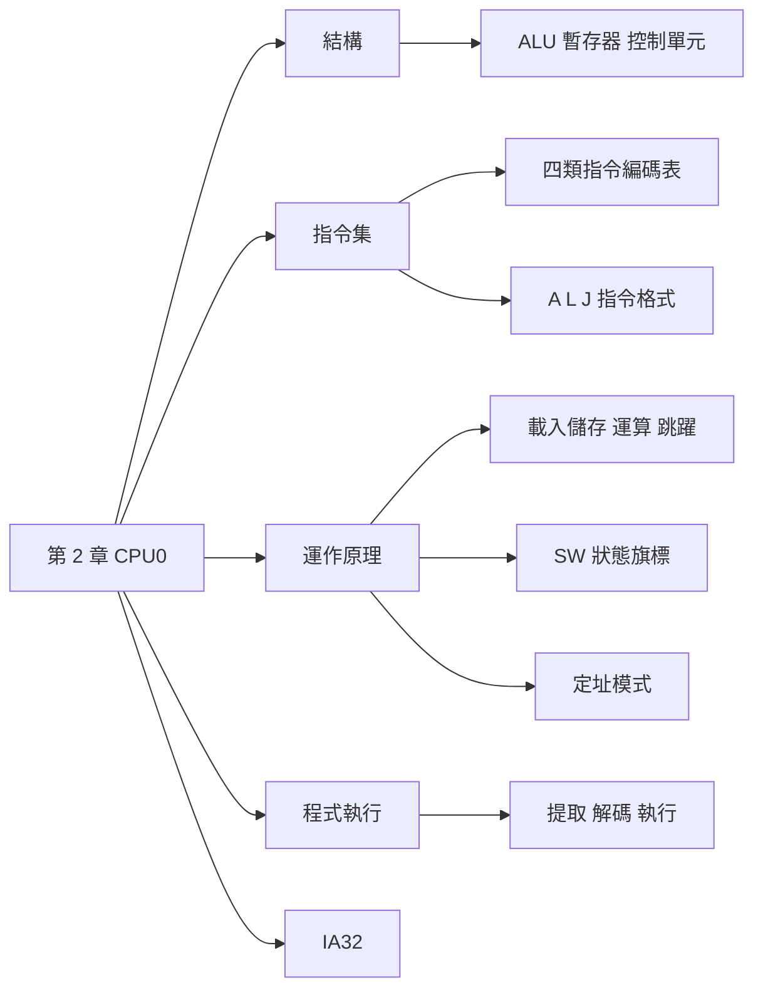

import Cpu0Codec from "./_Cpu0Codec.tsx";

## 名詞表 {#glossary}

本章出現的名詞，詳細說明見對應區塊。

| 中文 | English | 描述 |
|---|---|---|
| 算術邏輯單元 | ALU, Arithmetic Logic Unit | 執行算術、邏輯、移位與旋轉運算 |
| 暫存器 | Register | CPU 內部的高速儲存單元 |
| 控制單元 | Control Unit | 解讀指令並控制資料流與跳躍 |
| 狀態暫存器 | SW, Status Word | CPU0 的 R12，存放 NZCV 等旗標 |
| 堆疊指標 | SP, Stack Pointer | CPU0 的 R13，指向堆疊頂端 |
| 連結暫存器 | LR, Link Register | CPU0 的 R14，保存副程式的返回位址 |
| 程式計數器 | PC, Program Counter | CPU0 的 R15，保存下一條指令的位址 |
| 指令暫存器 | IR, Instruction Register | 存放目前正在執行的指令 |
| 記憶體位址暫存器 | MAR, Memory Address Register | 存放要讀寫的記憶體位址 |
| 記憶體資料暫存器 | MDR, Memory Data Register | 存放讀出或待寫入的資料 |
| 運算碼 | OP, Opcode | 指令的 31–24 位元，決定是哪個指令 |
| 立即值 | Immediate | 直接寫在指令裡的常數（Cx） |
| 字組 | Word | 32 位元 = 4 bytes |
| 精簡指令集 | RISC, Reduced Instruction Set Computer | 只有少數指令能存取記憶體的設計 |
| 定址模式 | Addressing Mode | 指令計算運算元位址的方式 |
| 中斷 | Interrupt | 非同步事件打斷程式，轉去執行中斷服務程式 |
| 陷阱 | Trap | 同步的軟體觸發事件，例如 SWI、除以零 |

## 本章地圖 {#ch2-map}

第 2 章用一顆教學用的簡易 32 位元處理器 CPU0（來自陳鍾誠《系統程式》）說明處理器怎麼運作：先看結構與暫存器，再看指令集與指令格式，然後逐類看指令的執行、定址模式與一個程式怎麼一條條被執行，最後對照真實的 IA32。原始投影片：[[_pdf/S02-CPU0_Arch-ISA-01.pdf|Part 1]]（結構與指令集）、[[_pdf/S02-CPU0_Arch-ISA-02.pdf|Part 2]]（運作原理）、[[_pdf/S02-CPU0_Arch-ISA-03.pdf|Part 3]]（定址模式、程式執行、IA32）。



## 電腦的基本結構 {#computer-structure}

電腦的五大組成元件：

$$
\text{Computer} = \text{CPU} + \text{BUS} + \text{Memory} + \text{Input} + \text{Output}
$$

這是**馮紐曼架構**：程式和資料都放在記憶體裡，CPU 經由匯流排（位址、資料、控制匯流排）一條條取出指令執行。

## CPU0 處理器 {#cpu0}

CPU0 是陳鍾誠為說明系統程式原理而設計的**簡易 32 位元處理器**。設計重點是簡單、容易理解，幾乎不考慮成本與速度；商業處理器還要考慮成本、速度與相容性，因此複雜得多。

$$
\text{CPU0} = \text{ALU} + \text{暫存器} + \text{控制單元}
$$

- **ALU**：執行二進制算術（加、減…）、邏輯運算（AND、OR、XOR…）以及移位、旋轉等位元操作，是 CPU 的「計算核心」。
- **控制單元**：根據指令暫存器 IR 中的運算碼決定 ALU 做什麼運算、資料往哪裡傳，並依狀態暫存器的旗標決定是否跳躍。

## CPU0 的暫存器 {#cpu0-registers}

CPU0 有 16 個 32 位元暫存器 R0～R15：

| 暫存器 | 用途 |
|---|---|
| R0 | **唯讀**，值固定為 0，常用來代表零 |
| R1～R11 | 一般用途 |
| R12（SW） | **狀態暫存器**，記錄進位、溢位等旗標，供條件跳躍判斷，見 [[#status-word\|狀態暫存器 SW]] |
| R13（SP） | **堆疊指標**，指向堆疊頂端，用於函式呼叫中的區域變數與返回位址 |
| R14（LR） | **連結暫存器**，保存副程式的返回位址 |
| R15（PC） | **程式計數器**，保存下一條要執行的指令位址 |

R1～R15 共 15 個可存取的暫存器，其中 R12～R15 有特殊用途。另外還有三個程式看不到的內部暫存器：

- **IR**（指令暫存器）：存放目前正在執行的指令。
- **MAR**（記憶體位址暫存器）：存放要讀寫的記憶體位址。
- **MDR**（記憶體資料暫存器）：存放從記憶體讀出、或準備寫入的資料。

## CPU0 的執行流程 {#cpu0-cycle}

每條指令都經過：

1. **取指令（Fetch）**：從記憶體讀出 PC 所指的指令，放進 IR。
2. **解碼（Decode）**：控制單元依 IR 的運算碼解讀指令，設定 ALU 與其他元件的動作。
3. **執行（Execute）**：ALU 執行運算，依結果更新暫存器或旗標。
4. **存回結果**：把結果寫回指定的暫存器或記憶體。

細節與例子見 [[#fetch-decode-execute|指令的三大執行階段]]。

## CPU0 的指令分類 {#instruction-categories}

CPU0 的指令分成四大類：

| 類別 | 指令 |
|---|---|
| 載入儲存 | `LD`、`ST`、`LDB`、`STB`、`LDR`、`STR`、`LBR`、`SBR`、`LDI` |
| 運算 | `CMP`、`MOV`、`ADD`、`SUB`、`MUL`、`DIV`、`AND`、`OR`、`XOR`、`ROL`、`ROR`、`SHL`、`SHR` |
| 跳躍 | `JEQ`、`JNE`、`JLT`、`JGT`、`JLE`、`JGE`、`JMP`、`SWI`、`CALL`、`RET` |
| 堆疊 | `PUSH`、`POP`、`PUSHB`、`POPB` |

CPU0 是 **RISC**：只有載入儲存類的指令能讀寫記憶體，運算都在暫存器之間進行。

## 載入儲存指令編碼表 {#load-store-table}

**記憶體存取（暫存器 + 常數）**：位址為 $Rb + Cx$，適合存取陣列元素、全域變數。

| 指令 | OP | 格式 | 說明 | 語法 | 對應 C |
|---|---|---|---|---|---|
| LD | 00 | L | 載入 word | `LD Ra, [Rb+Cx]` | `Ra = mem[Rb+Cx];` |
| ST | 01 | L | 儲存 word | `ST Ra, [Rb+Cx]` | `mem[Rb+Cx] = Ra;` |
| LDB | 02 | L | 載入 byte | `LDB Ra, [Rb+Cx]` | `Ra = (byte)mem[Rb+Cx];` |
| STB | 03 | L | 儲存 byte | `STB Ra, [Rb+Cx]` | `mem[Rb+Cx] = (byte)Ra;` |

**暫存器位址版（暫存器 + 暫存器）**：位址為 $Rb + Rc$，常用於指標運算、結構存取。名字結尾的 R 代表「用暫存器算位址」。

| 指令 | OP | 格式 | 說明 | 語法 | 對應 C |
|---|---|---|---|---|---|
| LDR | 04 | A | 載入 word（暫存器版） | `LDR Ra, [Rb+Rc]` | `Ra = mem[Rb+Rc];` |
| STR | 05 | A | 儲存 word（暫存器版） | `STR Ra, [Rb+Rc]` | `mem[Rb+Rc] = Ra;` |
| LBR | 06 | A | 載入 byte（暫存器版） | `LBR Ra, [Rb+Rc]` | `Ra = (byte)mem[Rb+Rc];` |
| SBR | 07 | A | 儲存 byte（暫存器版） | `SBR Ra, [Rb+Rc]` | `mem[Rb+Rc] = (byte)Ra;` |

**立即載入**：不讀記憶體，直接把 $Rb + Cx$ 放進 Ra，用來設定初值或常數運算。

| 指令 | OP | 格式 | 說明 | 語法 | 對應 C |
|---|---|---|---|---|---|
| LDI | 08 | L | 立即載入 | `LDI Ra, Rb+Cx` | `Ra = Rb + Cx;` |

## 運算指令編碼表 {#arithmetic-table}

| 指令 | OP | 格式 | 說明 | 語法 | 對應 C |
|---|---|---|---|---|---|
| CMP | 10 | A | 比較，設定 SW 旗標 | `CMP Ra, Rb` | `SW ← Ra >=< Rb` |
| MOV | 12 | A | 暫存器間移動 | `MOV Ra, Rb` | `Ra = Rb;` |
| ADD | 13 | A | 加法 | `ADD Ra, Rb, Rc` | `Ra = Rb + Rc;` |
| SUB | 14 | A | 減法 | `SUB Ra, Rb, Rc` | `Ra = Rb - Rc;` |
| MUL | 15 | A | 乘法 | `MUL Ra, Rb, Rc` | `Ra = Rb * Rc;` |
| DIV | 16 | A | 除法 | `DIV Ra, Rb, Rc` | `Ra = Rb / Rc;` |
| AND | 18 | A | 位元 AND | `AND Ra, Rb, Rc` | `Ra = Rb & Rc;` |
| OR | 19 | A | 位元 OR | `OR Ra, Rb, Rc` | `Ra = Rb \| Rc;` |
| XOR | 1A | A | 位元 XOR | `XOR Ra, Rb, Rc` | `Ra = Rb ^ Rc;` |
| ROL | 1C | A | 向左旋轉 | `ROL Ra, Rb, Cx` | `Ra = rol(Rb, Cx);` |
| ROR | 1D | A | 向右旋轉 | `ROR Ra, Rb, Cx` | `Ra = ror(Rb, Cx);` |
| SHL | 1E | A | 向左移位 | `SHL Ra, Rb, Cx` | `Ra = Rb << Cx;` |
| SHR | 1F | A | 向右移位 | `SHR Ra, Rb, Cx` | `Ra = Rb >> Cx;` |

運算一律**目標在前**：`ADD R1, R2, R3` 是 `R1 = R2 + R3`。

## 跳躍指令編碼表 {#jump-table}

| 指令 | OP | 格式 | 說明 | 語法 | 語義 | 對應 C |
|---|---|---|---|---|---|---|
| JEQ | 20 | J | 相等就跳 | `JEQ Cx` | 若 SW(=)，PC ← PC + Cx | `if (a==b)` |
| JNE | 21 | J | 不相等就跳 | `JNE Cx` | 若 SW(≠)，PC ← PC + Cx | `if (a!=b)` |
| JLT | 22 | J | 小於就跳 | `JLT Cx` | 若 SW($<$)，PC ← PC + Cx | `if (a<b)` |
| JGT | 23 | J | 大於就跳 | `JGT Cx` | 若 SW($>$)，PC ← PC + Cx | `if (a>b)` |
| JLE | 24 | J | 小於等於就跳 | `JLE Cx` | 若 SW(≤)，PC ← PC + Cx | `if (a<=b)` |
| JGE | 25 | J | 大於等於就跳 | `JGE Cx` | 若 SW(≥)，PC ← PC + Cx | `if (a>=b)` |
| JMP | 26 | J | 無條件跳躍 | `JMP Cx` | PC ← PC + Cx | `goto label` |
| SWI | 2A | J | 軟體中斷 | `SWI Cx` | LR ← PC；PC ← Cx | 系統呼叫 |
| CALL | 2B | J | 呼叫副程式 | `CALL Cx` | LR ← PC；PC ← PC + Cx | `function()` |
| RET | 2C | J | 返回 | `RET` | PC ← LR | `return` |

條件跳躍依 [[#status-word|SW 的旗標]]決定是否跳，跳躍目標一律是**相對於 PC** 的位移，見 [[#jump-instructions|跳躍指令]]。

## 堆疊指令編碼表 {#stack-table}

| 指令 | OP | 格式 | 說明 | 語法 | 語義 |
|---|---|---|---|---|---|
| PUSH | 30 | A | 推入 word | `PUSH Ra` | SP −= 4；[SP] = Ra |
| POP | 31 | A | 彈出 word | `POP Ra` | Ra = [SP]；SP += 4 |
| PUSHB | 32 | A | 推入 byte | `PUSHB Ra` | SP −= 1；[SP] = (byte)Ra |
| POPB | 33 | A | 彈出 byte | `POPB Ra` | Ra = (byte)[SP]；SP += 1 |

堆疊**往低位址長**：推入時 SP 先減再寫，彈出時先讀再加。多層副程式呼叫用它保存 LR，見 [[ch3-assembly#nested-call|多層次副程式呼叫]]。

## 指令格式 {#instruction-formats}

CPU0 的指令都是 **32 位元**，前 8 位元（31–24）是運算碼 OP，其餘依格式分配：

| 格式 | 31–24 | 23–20 | 19–16 | 15–12 | 其餘 | 用途 |
|---|---|---|---|---|---|---|
| **A 型**（Arithmetic） | OP | Ra | Rb | Rc | Cx：11–0（12 位元） | 算術、邏輯、移位 |
| **L 型**（Load & Store） | OP | Ra | Rb | — | Cx：15–0（16 位元） | 記憶體載入儲存 |
| **J 型**（Jump） | OP | — | — | — | Cx：23–0（24 位元） | 跳躍、流程控制 |

- 暫存器欄位都是 **4 位元**，剛好是一個十六進位數字，所以 R1 就寫成 `1`、R15 寫成 `F`。
- Cx 一律用 **2 補數**表示，可以是負數。
- **例外**：`LDR`、`STR`、`LBR`、`SBR` 雖然是載入儲存指令，但有三個暫存器參數，只能編成 **A 型**。

各型能表示的 Cx 範圍：

$$
\text{A 型：} -2^{11} \sim 2^{11}-1 \qquad \text{L 型：} -2^{15} \sim 2^{15}-1 = -32768 \sim 32767 \qquad \text{J 型：} -2^{23} \sim 2^{23}-1
$$

## 指令編碼 {#instruction-encoding}

把各欄位依格式填進 32 位元，再寫成 8 個十六進位數字（每個暫存器欄位一個數字）：

| 指令 | 格式 | OP | 欄位 | 機器碼 |
|---|---|---|---|---|
| `ADD R1, R2, R3` | A | 13 | Ra=1、Rb=2、Rc=3、Cx=000 | `13123000` |
| `LD R1, [R2+4]` | L | 00 | Ra=1、Rb=2、Cx=0004 | `00120004` |
| `LDI R3, 10` | L | 08 | Ra=3、Rb=0、Cx=000A | `0830000A` |
| `JMP 100` | J | 26 | Cx=000064（100 = 0x64） | `26000064` |

以 `ADD R1, R2, R3` 為例，二進位是 `0001 0011  0001  0010  0011  0000 0000 0000`。

輸入一行指令看它的欄位與機器碼，或反過來輸入 8 位十六進位機器碼解碼。跳躍指令填入指令位址，會算出跳躍目標（PC + 4 + Cx）：

<Cpu0Codec initial="ADD R1, R2, R3" />

投影片的編碼範例用的是「假設」的運算碼（ADD 假設為 1A、`LDR R1, [R2+4]` 假設為 24、JMP 假設為 3F），所以結果是 `1A123…`、`24120004`、`3F000064`，跟編碼表不一致。編碼的**方法**相同，實際的運算碼以編碼表為準；as0 組譯器的真實輸出見 [[ch4-assembler#arraysum-trace|ArraySum 的組譯過程]]。

## 載入與儲存的執行 {#load-store-exec}

- **Byte** 是 8 位元；在 32 位元 CPU 中 **word** 是 32 位元（4 bytes），內部匯流排一次傳一個 word。
- CPU0 有 8 個記憶體存取指令：`LD`、`ST`（word）、`LDB`、`STB`（byte）、`LDR`、`STR`、`LBR`、`SBR`（暫存器位址版）。

`LD R1, [0x28]` 的執行流程：

1. CPU 取出指令。
2. 解碼，識別出記憶體位址 0x28。
3. 讀出位址 0x28 的一個 word，寫入 R1。

`ST R1, [0x32]` 方向相反：把 R1 的 word 寫入位址 0x32。`LDB`／`STB` 只搬一個 byte，適合字元或旗標位元組。

位址也可以由暫存器算：`LD R1, [R2+300]` 讀位址 R2 + 300；`LDR R1, [R2+R3]` 讀位址 R2 + R3。

## MOV 指令的執行 {#mov-exec}

`MOV Rd, Rs` 把來源暫存器 Rs 的值複製到目標暫存器 Rd，Rs 不變。

例：R2 = 0x00000002，執行 `MOV R1, R2` 後 R1 = 0x00000002，R2 仍是 0x00000002。

## 算術指令的執行 {#arithmetic-exec}

`ADD Rd, Rs1, Rs2`（Rd = Rs1 + Rs2）：從 Rs1、Rs2 讀出數值，ALU 相加，結果寫入 Rd。`SUB` 流程相同，ALU 改做減法。

- `ADD R1, R2, R3`，R2 = 2、R3 = 3 → R1 = 5。
- `SUB R1, R2, R3`，R2 = 3、R3 = 1 → R1 = 2。

## 邏輯指令的執行 {#logic-exec}

`AND`、`OR`、`XOR` 對兩個暫存器逐位元運算，結果寫入目標暫存器。

- `XOR R1, R2, R3`，R2 = 0x02、R3 = 0x03 → R1 = 0x01。
- R2 = 0xF4、R3 = 0xB5：

$$
\begin{aligned}
&\texttt{1111 0100} \quad (\text{F4})\\
\oplus\ &\texttt{1011 0101} \quad (\text{B5})\\
=\ &\texttt{0100 0001} \quad (\text{41})
\end{aligned}
$$

## 移位指令的執行 {#shift-exec}

`SHL Rd, Rs, #imm` 把 Rs 左移 imm 位存入 Rd；`SHR` 右移。`#imm` 是**立即數**，表示移幾位。另有旋轉指令 `ROL`、`ROR`：移出去的位元從另一端補回來。

左移 n 位等於乘以 $2^n$：

- `SHL R1, R2, 4`，R2 = 0x02 → 0x20（2 × 16 = 32）。
- R2 = 0x41 = `0100 0001` → `0100 0001 0000` = **0x410**（擴大 $2^4 = 16$ 倍）。

陣列索引乘以 4 就是用 `SHL R5, R1, 2`，見 [[ch3-assembly#int-array-copy|整數陣列的複製]]。

## CMP 比較指令 {#cmp}

`CMP Ra, Rb` 讓 ALU 計算 **Ra − Rb**，但**不把結果存入任何暫存器**，只依結果更新狀態暫存器 SW 的旗標，給後面的條件跳躍使用。

執行 `CMP Ra, Rb` 後，N、Z 旗標就能表示大小關係：

| 比較結果 | N | Z |
|---|---|---|
| $Ra > Rb$ | 0 | 0 |
| $Ra < Rb$ | 1 | 0 |
| Ra = Rb | 0 | 1 |

例：R1 = 1、R2 = 2，`CMP R1, R2` 計算 1 − 2 = −1 → N = 1（負數）、Z = 0（不為零）、V = 0（沒有溢位）。

投影片在這個例子寫 C = 1「因為沒有借位」，但 1 − 2 其實需要借位；依「沒有借位時 C = 1」的定義，C 應為 0。

## 狀態暫存器 SW {#status-word}

SW（R12）的位元配置：

| 位元 | 31 | 30 | 29 | 28 | 27–8 | 7 | 6 | 5–1 | 0 |
|---|---|---|---|---|---|---|---|---|---|
| 欄位 | N | Z | C | V | 保留 | I | T | 保留 | M |

**條件旗標（Condition Code）**：

- **N（Negative）**：結果為負數時設為 1。
- **Z（Zero）**：結果為 0 時設為 1。
- **C（Carry）**：沒有借位時設為 1。
- **V（Overflow）**：發生溢位時設為 1。

因為 NZCV 在最高 4 位元，SW 的十六進位第一個數字就是 NZCV：`SW = 0x80000000` → `1000` → N = 1；`SW = 0x40000000` → `0100` → Z = 1。

**中斷控制旗標**：

- **I（Interrupt）**：I = 0 時 CPU0 不回應任何中斷。
- **T（Trap）**：T = 0 時只禁止軟體中斷（SWI），不影響硬體中斷。

**模式位元 M**：M = 0 是使用者模式（User Mode），M = 1 是特權模式（Super Mode）。

### 中斷與陷阱 {#interrupt-trap .fold}

- **中斷（Interrupt）**：來自處理器外部或內部的**非同步**事件，打斷目前的程式，轉去執行中斷服務程式（ISR）。
  - 硬體中斷：I/O 裝置（鍵盤、計時器、網路卡）要求服務。
  - 軟體中斷：程式主動執行 `SWI`、`INT` 等指令要求系統服務。
- **陷阱（Trap）**：**同步**的軟體觸發事件，執行到特定指令或條件時產生，強制 CPU 進入陷阱服務程式。
  - 來源：系統呼叫、`SWI` 指令；例外（非法指令、除以零等算術錯誤）。

詳細內容在作業系統課程。

### 使用者模式與特權模式 {#user-super-mode .fold}

- **User Mode**：給應用程式用的受限模式。不能存取敏感硬體（中斷控制器、直接 I/O、MMU 設定），不能改處理器控制暫存器（中斷旗標、模式旗標）；使用受限指令會產生 Trap 交給作業系統。目的是保護核心，避免單一程式讓整個系統當掉。Windows／Linux／Android 的一般程式都在 User Mode 執行。
- **Super Mode（Kernel Mode）**：給作業系統核心用的完全權限模式。可直接存取硬體、修改 I、T、M 等控制位元、執行所有指令，用來做排程、記憶體管理、檔案系統。Linux kernel、Windows NT 核心就在這個模式執行。

## 跳躍指令 {#jump-instructions}

跳躍指令藉由改變 PC 來改變執行流程：

- **無條件跳躍** `JMP`：一定跳。
- **條件跳躍** `JEQ`、`JNE`、`JGT`、`JLT`、`JGE`、`JLE`：依 SW 的旗標決定，通常接在 `CMP` 後面。

CPU0 採**相對跳躍**：目標位址 = **PC + Cx**。這裡的 PC 是**已經指向下一條指令**的值，因為提取指令時 PC 就加了 4。

各條件跳躍成立時的旗標（依 CMP 的 N、Z 判斷）：

| 指令 | 成立條件 |
|---|---|
| JEQ | Z = 1 |
| JNE | Z = 0 |
| JGT | N = 0 且 Z = 0 |
| JLT | N = 1 |
| JGE | N = 0（或 Z = 1） |
| JLE | N = 1 或 Z = 1 |

### 例子：JMP 0x30 {#ex-jmp .fold}

`JMP 0x30` 位於 0x28。提取後 PC 由 0x28 變成 0x2C，所以目標 = 0x2C + 0x30 = **0x5C**，程式從 0x5C 繼續執行。

### 例子：JLE 與 JEQ 0x30 {#ex-jle-jeq .fold}

指令位於 0x28，提取後 PC = 0x2C：

- `JLE 0x30`，SW = 0x80000000 → NZCV = `1000`，N = 1 → 小於成立，跳到 0x2C + 0x30 = 0x5C。
- `JEQ 0x30`，SW = 0x40000000 → NZCV = `0100`，Z = 1 → 相等成立，跳到 0x5C；若 Z = 0，就繼續執行下一條（0x2C）。

## 絕對跳躍與相對跳躍 {#absolute-relative-jump}

| 方式 | 目標位址 | `JMP 0x30`（PC = 0x2C） |
|---|---|---|
| 絕對跳躍（Absolute） | 指令中的位址本身 | 跳到 0x30 |
| 相對跳躍（Relative） | 目前 PC + 偏移量 | 跳到 0x2C + 0x30 = 0x5C |

**相對跳躍的範圍**：J 型的 Cx 是 24 位元 2 補數，可跳 $-2^{23} \sim 2^{23}-1$ bytes，約 **±8MB**。要跳更遠，就把完整的 32 位元目標位址存成一個變數，再用載入指令直接載入 PC（R15）：

```asm
    LD   R15, far      ; PC = far 變數的內容 = 遠方的目標位址
far: WORD target       ; 存放 32 位元的目標位址
```

## 定址模式 {#addressing-modes}

CPU0 存取資料的四種定址模式：

| 模式 | 位址怎麼來 | 例子 | 適用 |
|---|---|---|---|
| 立即載入法（Immediate） | 不讀記憶體，常數直接進暫存器 | `LDI R1, 100`、`LDI R2, R1+50` | 設初值、常數運算 |
| 相對定址法（Relative） | 基底暫存器 + 指令中的常數偏移 | `LD R1, [R2+100]`、`ST R1, [R3+200]` | 結構欄位、表格中位置固定的元素 |
| 索引定址法（Indexed） | 基底暫存器 + 索引暫存器 | `LDR R1, [R2+R3]`、`STR R4, [R2+R5]` | 陣列、多維資料、迴圈中變動的位置 |
| 絕對定址法（Absolute） | 指令中的常數就是位址（Rb = R0） | `LD R1, [R0+0x10]` | 固定位址的變數 |

- **立即載入**最快，減少記憶體存取，但常數受 Cx 位元數限制，不能載入太大的數。
- **相對定址**能動態計算位址，但多一次位址計算。組譯器把變數編成「相對於 PC」也是這種模式，見 [[ch4-assembler#pc-relative|相對於 PC 定址]]。

### 相對定址與索引定址的差別 {#relative-vs-indexed}

兩者都用來存取結構化資料，差別在**偏移量從哪裡來**：

- **相對定址**的偏移量是寫在指令裡的**常數**，組譯時就固定了，範圍受 16 位元 Cx 限制。適合偏移固定的情況，例如結構的第 3 個欄位永遠在基底 + 8。
- **索引定址**的偏移量放在**暫存器**裡，執行時可以改變。適合迴圈中逐一走訪陣列，例如 `a[i]` 的 i 每圈加 1。

### 例子：用索引定址存取 int 陣列 {#ex-indexed-array .fold}

`int a[100]` 的基底位址在 R2、索引 i 在 R3。每個 int 佔 4 bytes，所以 `a[i]` 的位址是 R2 + R3 × 4。

投影片寫成 `LDR R1, [R2+R3*4]`，但 CPU0 的 `LDR` 只能是兩個暫存器相加，無法在指令裡乘 4。實際要先移位：

```asm
SHL R5, R3, 2        ; R5 = i * 4
LDR R1, [R2+R5]      ; R1 = a[i]
```

## 程式的循序執行 {#sequential-execution}

指令從記憶體**一個接一個**被提取執行，每執行一條 PC 加 4，直到遇到跳躍指令才改變順序。

以加總迴圈為例（程式從位址 0x0000 開始）：

| 位址 | 機器碼 | 程式 |
|---|---|---|
| 0000 | `001F0028` | `LD R1, SUM` |
| 0004 | `002F0020` | `LD R2, I` |
| 0008 | `0830000A` | `LDI R3, 10` |
| 000C | `08400001` | `LDI R4, 1` |
| 0010 | `10230000` | `FOR: CMP R2, R3` |
| 0014 | `2300000C` | `JGT EXIT` |
| 0018 | `13121000` | `ADD R1, R2, R1` |
| 001C | `13242000` | `ADD R2, R4, R2` |
| 0020 | `26FFFFEC` | `JMP FOR` |
| 0024 | `2C000000` | `EXIT: RET` |
| 0028 | `00000000` | `I: RESW 1` |
| 002C | `00000000` | `SUM: WORD 0` |

執行到 0x20 的 `JMP FOR` 時跳回 0x10 的 `CMP R2, R3`；位移 `FFFFEC` = −0x14，0x24 − 0x14 = 0x10。

## 指令的三大執行階段 {#fetch-decode-execute}

**(a) 提取（Fetch）**：從 PC 指定的位址取出指令放入 IR，PC 自動加 4（32 位元處理器一條指令 4 bytes）。細部動作：

1. CPU 把 PC 送到**位址匯流排**。
2. 設定**控制線**，要求讀取該位址的記憶體。
3. 記憶體把指令放到**資料匯流排**。
4. CPU 取得指令碼，放入 IR。

**(b) 解碼（Decode）**：控制單元解析指令的操作類型、運算元，決定 ALU 的動作與資料流方向。

**(c) 執行（Execute）**：ALU 依解碼結果運算，結果送回暫存器。

例：PC = 0x18，取出 `13121000`（`ADD R1, R2, R1`）放進 IR，PC 變 0x1C；解碼後 R1、R2 送進 ALU 相加，結果寫回 R1。

## IA32 處理器 {#ia32}

IA32 是 Intel x86 家族的 32 位元處理器，是 IBM PC 的核心（與匯流排、南北橋、記憶體、顯示裝置組成個人電腦）。它複雜的主因是**向後相容**：必須同時支援新的 32 位元模式與舊的 16 位元模式及舊指令。

## IA32 的暫存器 {#ia32-registers}

| 類別 | 暫存器 | 用途 | 對應 CPU0 |
|---|---|---|---|
| 通用 | EAX | 累加器，算術邏輯運算結果 | — |
| 通用 | EBX | 基底，位址計算 | — |
| 通用 | ECX | 計數器，迴圈（`LOOP`）次數 | — |
| 通用 | EDX | 資料，與 EAX 搭配做乘除法與大數 | — |
| 堆疊 | EBP | 基底指標，堆疊框架的基底 | — |
| 堆疊 | ESP | 堆疊指標，指向堆疊頂端 | SP（R13） |
| 指標 | ESI、EDI | 來源／目的指標，字串操作 | — |
| 狀態 | EFLAGS | 進位、溢位、符號、零旗標（另有輔助進位、同位） | SW（R12） |
| 指令 | EIP | 下一條指令的位址 | PC（R15） |
| 區段 | CS、SS、DS、ES、FS、GS | 程式碼段、堆疊段、資料段、延伸段 | — |

## 80286 的區段定址 {#segment-addressing}

80286 時代 x86 是 16 位元，AX、BX 等暫存器只能定址 $2^{16}$ = 64K。為了突破限制，採用「**區段 + 位移**」：

$$
\text{實際位址} = \text{區段位址} \times 16 + \text{位移}
$$

區段位址乘以 16 等於左移 4 位，16 位元的區段變成 20 位元，加上 16 位元的位移後可以表示 **20 位元**的位址，所以能定址 $2^{20}$ = **1MB**。

## 80386 的 32 位元擴展 {#ia32-extension}

- 80386 變成 32 位元，暫存器擴展成 EAX、EBX、ECX、EDX 等。
- 為了相容 80286，保留 16 位元的名稱：EAX 的低 16 位元是 AX，AX 又分成高位元組 AH 與低位元組 AL，可以分別做 8、16、32 位元運算。
- **浮點**：80386 的 FPU 是外加晶片，80486 起整合進 CPU，有 ST0～ST7 八個浮點暫存器。
- **多媒體**：Pentium II 加入 8 個 64 位元 MMX 暫存器；Pentium III 加入 8 個 XMM 暫存器，支援 SIMD（單指令多資料）平行運算。
