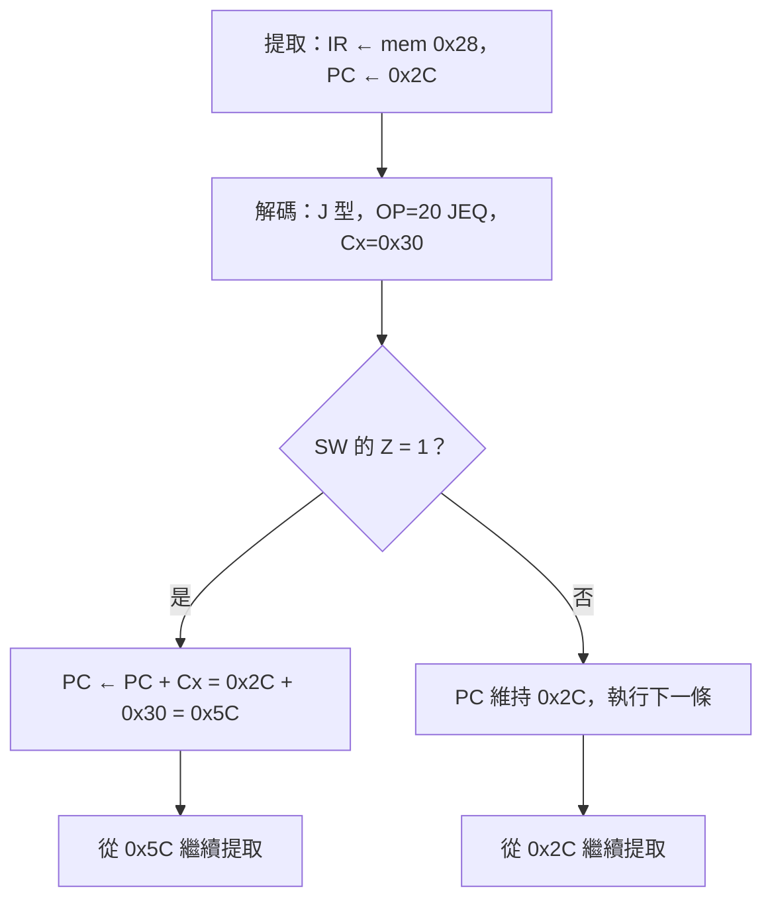

題目來源：[[_pdf/ch02習題.pdf|第二章習題]]。概念說明見 [[ch2-cpu0-arch#ch2-map|第 2 章 CPU0 處理器架構與指令集]]。

## CPU0 的暫存器 {#q-registers}

（2.1）請問 CPU0 有哪些暫存器？並說明這些暫存器的功能。

### 詳解 {#q-registers-solution .fold}

CPU0 有 16 個 32 位元暫存器 R0～R15：

| 暫存器 | 功能 |
|---|---|
| R0 | 唯讀，值固定為 0 |
| R1～R11 | 一般用途，存放運算資料 |
| R12（SW） | 狀態暫存器：NZCV 條件旗標、中斷旗標 I／T、模式位元 M |
| R13（SP） | 堆疊指標：指向堆疊頂端 |
| R14（LR） | 連結暫存器：保存副程式的返回位址 |
| R15（PC） | 程式計數器：下一條要執行的指令位址 |

另有程式看不到的內部暫存器：IR（目前執行的指令）、MAR（要存取的記憶體位址）、MDR（讀出或待寫入的資料）。見 [[ch2-cpu0-arch#cpu0-registers|CPU0 的暫存器]]。

## 條件跳躍成立時的旗標 {#q-jump-flags}

（2.3-1）當以下條件跳躍指令成立時，狀態暫存器的條件旗標為何？以 (N, Z, C, V) 表示：JEQ、JNE、JGT、JLT、JLE。

### 詳解 {#q-jump-flags-solution .fold}

條件跳躍接在 `CMP Ra, Rb` 之後，依 N、Z 判斷（C、V 不影響，以 × 表示）：

| 指令 | 成立條件 | (N, Z, C, V) |
|---|---|---|
| JEQ | Ra = Rb | (0, 1, ×, ×) |
| JNE | Ra ≠ Rb | (×, 0, ×, ×) |
| JGT | Ra > Rb | (0, 0, ×, ×) |
| JLT | Ra < Rb | (1, 0, ×, ×) |
| JLE | Ra ≤ Rb | (1, 0, ×, ×) 或 (0, 1, ×, ×)，即 N = 1 或 Z = 1 |

依據：CMP 計算 Ra − Rb，大於時 N = 0、Z = 0；小於時 N = 1、Z = 0；相等時 N = 0、Z = 1。見 [[ch2-cpu0-arch#cmp|CMP 比較指令]]。

## JEQ 的執行流程 {#q-jeq-flow}

（2.3-2）畫出 `JEQ 0x30` 的執行流程：比較結果相等（Z = 1）時跳躍；不相等時繼續執行下一條指令。

### 詳解 {#q-jeq-flow-solution .fold}

假設 `JEQ 0x30` 位於 0x28：



例如 SW = 0x40000000，最高 4 位元 NZCV = `0100`，Z = 1，所以跳到 0x5C。見 [[ch2-cpu0-arch#ex-jle-jeq|例子：JLE 與 JEQ 0x30]]。

## 超出相對跳躍範圍 {#q-far-jump}

（2.3-3）JMP 的位址常數是 24 位元 2 補數，合法跳躍範圍限制在 PC − $2^{23}$ 到 PC + $2^{23}$ 之間。若想跳的位址不在範圍內，可以怎麼做？

### 詳解 {#q-far-jump-solution .fold}

不要用相對跳躍，改成**直接把 32 位元的目標位址載入 PC（R15）**。因為 PC 也是一個暫存器，載入指令可以直接寫它：

```asm
    LD   R15, far      ; 把 far 中存放的 32 位元位址載入 PC，等於跳過去
far: WORD target       ; 遠方的目標位址
```

或先把目標位址放進一般暫存器，再 `MOV R15, R1`。32 位元的位址可以涵蓋整個 4GB 的定址空間。見 [[ch2-cpu0-arch#absolute-relative-jump|絕對跳躍與相對跳躍]]。

## 相對定址與索引定址 {#q-relative-vs-indexed}

（2.3-4）相對定址法與索引定址法都適用於存取結構化資料，二者的差別是什麼？請舉例說明其差異與適用條件。

### 詳解 {#q-relative-vs-indexed-solution .fold}

差別在**偏移量的來源**：

| | 相對定址 | 索引定址 |
|---|---|---|
| 位址 | 基底暫存器 + **指令中的常數** | 基底暫存器 + **索引暫存器** |
| 指令 | `LD R1, [R2+8]`（L 型） | `LDR R1, [R2+R3]`（A 型） |
| 偏移何時決定 | 組譯時就固定 | 執行時才計算，可以改變 |
| 範圍 | 受 16 位元 Cx 限制（−32768～32767） | 暫存器 32 位元 |
| 適用 | 偏移固定：結構的某個欄位、表格中固定位置 | 偏移變動：迴圈走訪陣列 `a[i]` |

例：

- 結構 `struct { int id; int age; int score; } s;`，基底在 R2，讀 `s.score` 永遠是 `LD R1, [R2+8]`——偏移 8 是常數，用相對定址。
- 迴圈複製 `b[i] = a[i]`，每圈 i 加 1，偏移 i×4 一直在變，所以先 `SHL R5, R1, 2` 算出偏移，再 `LDR R6, [R3+R5]`——用索引定址。

見 [[ch2-cpu0-arch#relative-vs-indexed|相對定址與索引定址的差別]]。

## CPU0 的定址方式 {#q-addressing-modes}

（2.3-5）請問 CPU0 當中有哪些定址方式？並以範例加以說明。

### 詳解 {#q-addressing-modes-solution .fold}

| 定址方式 | 範例 | 說明 |
|---|---|---|
| 立即載入法 | `LDI R1, 100` | 常數 100 直接載入 R1，不讀記憶體 |
| 立即載入法 | `LDI R2, R1+50` | R2 = R1 + 50 |
| 相對定址法 | `LD R1, [R2+100]` | 讀位址 R2 + 100 的 word |
| 相對定址法 | `ST R1, [R3+200]` | 把 R1 寫到位址 R3 + 200 |
| 索引定址法 | `LDR R1, [R2+R3]` | 讀位址 R2 + R3 的 word |
| 索引定址法 | `STR R4, [R2+R5]` | 把 R4 寫到位址 R2 + R5 |
| 絕對定址法 | `LD R1, [R0+0x10]` | R0 = 0，所以 Cx 就是絕對位址 0x10 |

組譯器實際把變數編成 `LD R1, [R15+(B−PC)]`，是以 PC 為基底的相對定址。見 [[ch2-cpu0-arch#addressing-modes|定址模式]]。

## PC = 00000014 時的提取與執行 {#q-fetch-execute}

（2.4-1）依據題目附圖（加總迴圈程式，R1 = 00000001、R2 = 00000002），假如目前 PC = 00000014，指令將如何提取與執行？請分別依提取階段與執行階段說明。

| 位址 | 機器碼 | 程式 |
|---|---|---|
| 0010 | `10230000` | `FOR: CMP R2, R3` |
| 0014 | `2300000C` | `JGT EXIT` |
| 0018 | `13121000` | `ADD R1, R2, R1` |
| 0024 | `2C000000` | `EXIT: RET` |

### 詳解 {#q-fetch-execute-solution .fold}

**提取階段**

1. CPU 把 PC = 00000014 送上**位址匯流排**。
2. 設定**控制匯流排**為讀取。
3. 記憶體把位址 0x14 的內容 `2300000C` 放上**資料匯流排**。
4. CPU 把 `2300000C` 放入 IR，PC 加 4 變成 **00000018**。

**解碼階段**：OP = 0x23 → `JGT`，J 型，Cx = 0x00000C。

**執行階段**：檢查 SW。上一條 `CMP R2, R3` 比較 i = R2 = 2 與 R3 = 10，2 < 10，所以 N = 1、Z = 0，「大於」不成立：

- **不跳躍**，PC 維持 0x18，下一輪提取 `ADD R1, R2, R1`，迴圈繼續。
- 若條件成立（i > 10），PC ← PC + Cx = 0x18 + 0x0C = **0x24**，跳到 `EXIT: RET`。

注意 Cx 是加在**已經加 4 之後**的 PC（0x18）上，不是指令本身的位址 0x14。見 [[ch2-cpu0-arch#fetch-decode-execute|指令的三大執行階段]]。

## 80286 的區段＋位移 {#q-segment}

（2.5-1）為什麼 80286 採用「區段＋位移」的組合方式，就可以定址到 1MB 的記憶體空間？

### 詳解 {#q-segment-solution .fold}

16 位元暫存器只能表示 $2^{16}$ = 64K 個位址。區段＋位移的計算是：

$$
\text{實際位址} = \text{區段} \times 16 + \text{位移}
$$

乘以 16 等於左移 4 位元，16 位元的區段值變成 20 位元，再加上 16 位元的位移，結果是 **20 位元**的位址，可以表示 $2^{20}$ = **1MB** 的空間。例如區段 0xF000、位移 0x1234 → 0xF0000 + 0x1234 = 0xF1234。見 [[ch2-cpu0-arch#segment-addressing|80286 的區段定址]]。
