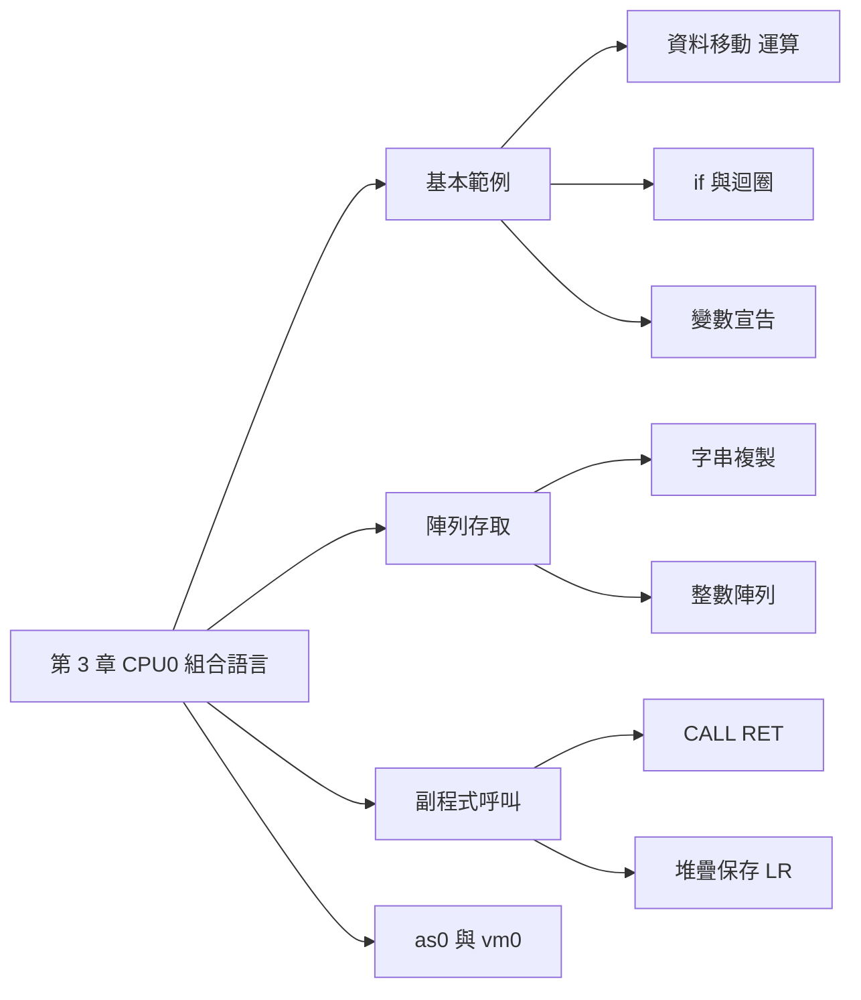

## 名詞表 {#glossary}

本章出現的名詞，詳細說明見對應區塊。

| 中文 | English | 描述 |
|---|---|---|
| 標記 | Label | 以 `名稱:` 標示一個位址，給跳躍或變數使用 |
| 保留字組 | RESW, Reserve Word | 保留 n 個 word 的空間，不給初值 |
| 保留位元組 | RESB, Reserve Byte | 保留 n 個 byte 的空間，不給初值 |
| 字組定義 | WORD | 定義 word 並給初值 |
| 位元組定義 | BYTE | 定義 byte 或字串並給初值 |
| 空字元 | Null Character `'\0'` | C 字串的結束符號 |
| 指標 | Pointer | 存放記憶體位址的變數 |
| 副程式 | Subroutine | 可重複呼叫的程式區塊（函式） |
| 返回位址 | Return Address | 副程式結束後要回到的位址，存在 LR |
| 堆疊框架 | Stack Frame | 每一層呼叫在堆疊上的活動紀錄 |
| 後進先出 | LIFO, Last In First Out | 堆疊的存取順序 |
| 組譯器 as0 | CPU0 Assembler | 把 `.asm0` 組譯成 `.obj0` 的工具 |
| 虛擬機 vm0 | CPU0 Virtual Machine | 執行 `.obj0` 的 CPU0 模擬器 |

## 本章地圖 {#ch3-asm-map}

本章把 C 語言常見的結構——指定、運算式、if、迴圈、陣列、函式呼叫——逐一翻成 CPU0 組合語言，最後用 as0／vm0 實際組譯與執行。指令的編碼與語義見 [[ch2-cpu0-arch#ch2-map|第 2 章]]。原始投影片：[[_pdf/S03_03-CPU0_Assembly_Lang.pdf|S03_03 組合語言]]、[[_pdf/S03_03-CPU0_Assembly_Lang-補充C指標.pdf|補充：C 指標]]、[[_pdf/S03_04-CPU0_Toolchain.pdf|S03_04 CPU0 Toolchain]]。



## 目標在前的寫法 {#destination-first}

CPU0 組合語言一律把**目標放在最前面**，跟 C 的指定敘述同方向：

| 組合語言 | C 語言 |
|---|---|
| `ADD R1, R2, R3` | `R1 = R2 + R3;` |
| `MOV R1, R2` | `R1 = R2;` |

`;` 之後是註解。

## 資料移動 {#data-movement}

- **暫存器之間**：`MOV`，對應 C 的指定，例如 `MOV R1, R2` 就是 `R1 = R2`。
- **記憶體 → 暫存器**：`LD`（載入）。
- **暫存器 → 記憶體**：`ST`（儲存）。

CPU0 不能直接把記憶體搬到記憶體，所以 C 的 `A = B` 要經過暫存器：

| 組合語言 | C（對照版） | C（簡化版） |
|---|---|---|
| `LD R1, B` | `R1 = B;` | `A = B;` |
| `ST R1, A` | `A = R1;` | |

## 算術運算 {#arithmetic}

運算都在暫存器裡進行，所以要先把記憶體中的變數載入暫存器。C 的 `A = B + C - D`：

```asm
LD   R2, B          ; R2 = B
LD   R3, C          ; R3 = C
LD   R4, D          ; R4 = D
ADD  R1, R2, R3     ; R1 = R2 + R3
SUB  R1, R1, R4     ; R1 = R1 - R4
ST   R1, A          ; A = R1
```

## 模擬 if 判斷 {#if-statement}

組合語言沒有 if，用 **CMP 比較 + 條件跳躍**模擬。C 的程式：

```c
if (A > B)
    C = A;
else
    C = B;
return;
```

對應的組合語言（範例 3.5）：

```asm
    LD   R1, A       ; R1 = A
    LD   R2, B       ; R2 = B
    CMP  R1, R2      ; 比較 A 與 B
    JGT  IF          ; 若 A > B，跳到 IF
    ST   R2, C       ; 否則 C = B
    JMP  EXIT        ; 跳過 IF 區塊
IF:
    ST   R1, C       ; C = A
EXIT:
    RET
```

條件成立時跳**到** then 區塊，不成立時往下執行 else 區塊，最後用 `JMP EXIT` 跳過 then 區塊。寫成 C 的 goto 版就是：`if (R1 > R2) goto IF; C = R2; goto EXIT; IF: C = R1; EXIT: return;`。

## 模擬迴圈 {#loop}

組合語言也沒有迴圈指令，用**向後跳**模擬。無窮迴圈：

```asm
LOOP:
    ADD R1, R1, R2   ; R1 = R1 + R2
    JMP LOOP         ; 跳回 LOOP
```

等於 C 的 `while (1) { R1 = R1 + R2; }`。加上 CMP 與條件跳躍，就能在條件成立時跳出迴圈。

## for 迴圈：1 加到 10 {#for-loop}

```c
int sum = 0;
int i;
for (i = 1; i <= 10; i++)
    sum += i;
```

範例 3.7：

```asm
    LD   R1, sum     ; R1 = sum
    LD   R2, i       ; R2 = i
    LDI  R3, 10      ; R3 = 10
    LDI  R4, 1       ; R4 = 1
FOR:
    CMP  R2, R3      ; 比較 i 與 10
    JGT  EXIT        ; 若 i > 10，跳出迴圈
    ADD  R1, R2, R1  ; sum += i
    ADD  R2, R4, R2  ; i++
    JMP  FOR         ; 回到 FOR
EXIT: RET
i:    RESW 1
sum:  WORD 0
```

迴圈的結構：**迴圈頂端檢查條件**（`CMP` + `JGT EXIT`），**迴圈底端跳回頂端**（`JMP FOR`）。

這個程式有一個 bug：`i` 用 `RESW 1` 宣告，沒有初值，見 [[#uninitialized-variable|未初始化變數的問題]]。

## 宣告變數 {#data-directives}

| 指令 | 作用 | 例子 |
|---|---|---|
| `RESW n` | 保留 n 個 word（每個 4 bytes），**不初始化** | `i: RESW 1` |
| `RESB n` | 保留 n 個 byte，**不初始化** | `buffer: RESB 10` |
| `WORD v` | 定義 word 並給初值，可以多個 | `sum: WORD 0`、`a: WORD 3, 7, 4` |
| `BYTE v` | 定義 byte 並給初值，也可以是字串 | `charVar: BYTE 65`（`'A'`）、`b: BYTE "Hello !", 0` |

這些不是 CPU 指令，是給組譯器看的**資料定義**，組譯時決定佔多少空間。`WORD a` 的初值是標記 `a` 的位址，等於 C 的 `int *aptr = a;`。

## 字串的記憶體配置 {#string-layout}

`char b[] = "Hello!";` 的每個字元佔 **1 byte**、連續存放，最後自動加上 `'\0'` 標示結束。起始位址 0x1000 時：

| 位址 | 0x1000 | 0x1001 | 0x1002 | 0x1003 | 0x1004 | 0x1005 | 0x1006 |
|---|---|---|---|---|---|---|---|
| 內容 | `'H'` | `'e'` | `'l'` | `'l'` | `'o'` | `'!'` | `'\0'` |

C 有兩種走訪方式，結果相同：

```c
char *ptr = b;                       // 指標法：以位址遞增
while (*ptr != '\0') { putchar(*ptr); ptr++; }

for (int i = 0; b[i] != '\0'; i++)   // 索引法：以索引遞增
    putchar(b[i]);
```

## C 指標 {#c-pointer}

**指標**是存放**記憶體位址**的變數，像門牌地址。

```c
int a = 100;
int *p = &a;
```

| 寫法 | 意義 | 值（假設 a 在 0x1000） |
|---|---|---|
| `a` | 一般變數 | 100 |
| `p` | 指標，存放 a 的位址 | 0x1000 |
| `&a` | **取位址** | 0x1000 |
| `*p` | **取內容**：p 指向的值 | 100 |

陣列名稱在運算式中會**退化成位址**：`char *ptr = b;` 等價於 `char *ptr = &b[0];`。所以 `ptr = b` 正確，`*ptr = 'A'` 會改掉第一個字元，但 `*ptr = b` 是型別錯誤（把位址放進字元）。

## 指標的遞增量 {#pointer-arithmetic}

`ptr++` 等於 `ptr = ptr + 1`，**「+1」是往下一個元素**，實際加的 byte 數由指標型別決定：

| 型別 | 元素大小 | `ptr++` 位移 |
|---|---|---|
| `char *` | 1 byte | +1 |
| `int *` | 4 bytes | +4 |
| `double *` | 8 bytes | +8 |

所以 `arr[i]` 會被編譯成 `*(arr + i)`，也就是起始位址加 `i * sizeof(int)` bytes。

**常見陷阱**：

- 字串必須以 `'\0'` 結尾，否則會越界。
- `int *` 每次 +4，不是 +1。
- `char *s = "Hello";` 指向唯讀區，不能修改；要修改請用 `char s[] = "Hello";`。
- UTF-8 的中文字是多個 byte，指標和索引都只走 byte，不等於一個中文字。

## 字串複製：指標版 {#strcpy-pointer}

範例 3.8：

```c
char a[10];
char b[] = "Hello !";
char *aptr = a, *bptr = b;
while (1) {
    *aptr = *bptr;
    aptr++;
    bptr++;
    if (*bptr == '\0') break;
}
```

```asm
    LD   R1, i        ; 索引變數（此版沒用到）
    LD   R2, aptr     ; R2 = 目標字串 a 的位址
    LD   R3, bptr     ; R3 = 來源字串 b 的位址
    LDI  R7, 1        ; 步長 1（char 佔 1 byte）
while:
    LDB  R4, [R3]     ; R4 = *bptr
    STB  R4, [R2]     ; *aptr = R4
    ADD  R2, R2, R7   ; aptr++
    ADD  R3, R3, R7   ; bptr++
    CMP  R4, R0       ; R4 是 '\0' 嗎？（R0 恆為 0）
    JEQ  endw         ; 是就結束
    JMP  while
endw:
    RET
a:    RESB 10
b:    BYTE "Hello !", 0
aptr: WORD a
bptr: WORD b
i:    WORD 0
```

要點：字元用 **`LDB`／`STB`**（byte 版）搬；指標每次加 1；`CMP R4, R0` 利用 R0 恆為 0 來判斷 `'\0'`。

## 字串複製：索引版 {#strcpy-index}

範例 3.9：

```c
char a[10];
char b[] = "Hello!";
int i = 0;
while (1) {
    a[i] = b[i];
    if (b[i] == '\0') break;
    i++;
}
```

```asm
    LD   R1, i            ; R1 = i = 0
    LD   R2, aptr         ; R2 = a 的位址
    LD   R3, bptr         ; R3 = b 的位址
    LDI  R7, 1
while:
    LBR  R4, [R3+R1]      ; R4 = b[i]
    SBR  R4, [R2+R1]      ; a[i] = R4
    CMP  R4, R0           ; 是 '\0' 嗎？
    JEQ  endw
    ADD  R1, R1, R7       ; i++
    JMP  while
endw:
    RET
a:    RESB 10
b:    BYTE "Hello !", 0
aptr: WORD a
bptr: WORD b
i:    WORD 0
```

指標版移動的是**位址**（R2、R3 遞增），索引版位址不動、移動的是**索引**（R1 遞增），並改用暫存器位址版的 **`LBR`／`SBR`**（[[ch2-cpu0-arch#relative-vs-indexed|索引定址]]）。

### 投影片範例的問題 {#strcpy-issues .fold}

- 指標版 C 程式在 `bptr++` 之後才檢查 `*bptr == '\0'`，結束符號本身不會被複製；組合語言版則是先複製再檢查，會連 `'\0'` 一起複製。
- 組合語言的註解把 R2、R3 寫成「來源」、「目標」，實際上 `aptr` 指向目標 a、`bptr` 指向來源 b。
- C 對照版把 `aptr`、`bptr` 宣告成 `int *`，但它們指向 char 陣列，應為 `char *`。
- 索引版的 C 對照版寫 `if (R4 != R0) goto endw;`，與組合語言的 `JEQ`（相等才跳）相反，應為 `==`。

## 整數陣列的記憶體配置 {#int-array-layout}

`int arr[] = {1, 2, 3, 4, 5};`，int 佔 **4 bytes**，所以相鄰元素的位址差 4：

| 索引 | `arr[i]` 位址 | 若為 `char arr[]` |
|---|---|---|
| 0 | 0x1000 | 0x1000 |
| 1 | 0x1004 | 0x1001 |
| 2 | 0x1008 | 0x1002 |

| 比較 | 整數陣列 `int arr[]` | 字元陣列 `char arr[]` |
|---|---|---|
| 元素大小 | 通常 4 bytes（依平台） | 1 byte |
| 位址間隔 | `sizeof(int)` | 1 byte |
| `ptr + 1` | 下一個整數 | 下一個字元 |

組合語言沒有型別，**位址要自己乘以元素大小**。

## 整數陣列的複製 {#int-array-copy}

範例 3.10，C 的 `for (i = 0; i < 100; i++) b[i] = a[i];`：

```asm
    LD   R2, aptr       ; R2 = a 的位址
    LD   R3, bptr       ; R3 = b 的位址
    LDI  R8, 1          ; 索引增量
    LDI  R9, 100        ; 陣列長度
FOR:
    SHL  R5, R1, 2      ; R5 = i * 4（位元組偏移）
    LDR  R6, [R5+R3]    ; R6 = 從 R3 陣列讀
    STR  R6, [R5+R2]    ; 寫到 R2 陣列
    ADD  R1, R1, R8     ; i++
    CMP  R1, R9         ; 比較 i 與 100
    JLE  FOR            ; i <= 100 就繼續
    RET
a:    RESW 100
b:    RESW 100
aptr: WORD a
bptr: WORD b
i:    RESW 1
```

關鍵是 **`SHL R5, R1, 2`**：左移 2 位 = 乘以 4 = `i * sizeof(int)`，算出第 i 個元素的 byte 偏移，再用 `LDR`／`STR` 存取。

### 投影片範例的問題 {#int-copy-issues .fold}

- R1（i）從沒被載入或設為 0，而且 `i` 是 `RESW 1` 沒有初值。應在迴圈前加 `LDI R1, 0`。
- `JLE FOR` 在 i ≤ 100 時繼續，會執行 i = 0～100 共 **101 次**，最後一次越界。對應 `i < 100` 應改用 `JLT FOR`。
- `LDR` 從 R3（b）讀、`STR` 寫到 R2（a），是把 b 複製到 a，與 C 的 `b[i] = a[i]` 方向相反；C 對照版還把寫入寫成 `[R5+R3]`。
- C 對照版把陣列宣告成 `char a[100]`，與 `RESW 100`（int 陣列）不符。

## 副程式呼叫 {#subroutine}

**副程式呼叫**讓程式暫時跳到另一個程式區塊，執行完再回來，可以重複利用程式碼、分離邏輯、提升可讀性與維護性。嵌入式系統、OS 核心、驅動程式中，硬體操作（設備初始化、資料傳輸）大量使用副程式。

| 呼叫方式 | 參數傳遞 |
|---|---|
| 單層次呼叫 | 使用暫存器 |
| 多層次呼叫 | 使用堆疊 |

## CALL 與 RET {#call-ret}

**`CALL f`** 的執行過程：

1. 提取 CALL 時 PC 先加 4，指向 CALL 的下一條指令。
2. 把這個 PC 值存入 **LR**（返回位址）。
3. PC 設為副程式的入口，跳過去執行。

**`RET`** 把 LR 複製回 PC，回到主程式中 CALL 的下一條指令繼續執行。

$$
\texttt{CALL}:\ LR \leftarrow PC;\ PC \leftarrow PC + Cx \qquad \texttt{RET}:\ PC \leftarrow LR
$$

單層次呼叫（主程式 → 副程式 → 返回，沒有巢狀）只要 CALL 與 RET 就夠了。

## 多層次副程式呼叫 {#nested-call}

副程式裡再呼叫副程式（巢狀，例如遞迴）時，**第二個 CALL 會覆蓋 LR**，上一層的返回位址就遺失了。所以呼叫下一層之前，要先用 **`PUSH LR`** 把 LR 存進堆疊，回來後 **`POP LR`** 還原再 `RET`。

| 階段 | 動作 | 堆疊內容 | 說明 |
|---|---|---|---|
| 1 | 主程式 CALL f1 | （空） | LR = 回主程式的位址 |
| 2 | f1 在呼叫前 PUSH LR | LR(f1) | 保存回主程式的位址 |
| 3 | f1 CALL f2 | LR(f1) | LR 被覆蓋成回 f1 的位址 |
| 4 | f2 執行完 RET | LR(f1) | 回到 f1 |
| 5 | f1 POP LR 後 RET | （空） | 還原 LR，回到主程式 |

返回順序是**後進先出（LIFO）**，正好是堆疊的特性。用堆疊的好處：

- 避免上下層副程式使用相同暫存器而互相覆蓋。
- LR 存在堆疊，不會被下一層 CALL 覆寫。
- 每層呼叫都有獨立的**活動紀錄（Stack Frame）**，方便遞迴與模組化。

### 例子：用堆疊傳參數的兩層呼叫 {#ex-nested-call .fold}

```c
int main() { int x = 1; int y; y = f1(x); return 1; }
int f1(int t) { int b = f2(&t); return b + b; }
int f2(int *p) { int r = *p + 5; return r; }
```

```asm
    LD   R2, x        ; R2 = x
    PUSH R2           ; 參數 x 推入堆疊
    CALL f1
    ST   R1, y        ; y = f1 的回傳值（放在 R1）
    RET
x:  WORD 1
y:  RESW 1
f1:
    POP  R2           ; 取出參數 t
    PUSH LR           ; 要再呼叫 f2，先保存 LR
    ST   R2, t
    LD   R3, pt       ; R3 = &t
    PUSH R3           ; 參數 &t 推入堆疊
    CALL f2
    ST   R1, b        ; b = f2 的回傳值
    ADD  R1, R1, R1   ; 回傳 b + b
    POP  LR           ; 還原 LR
    RET
t:  RESW 1
b:  RESW 1
pt: WORD t
f2:
    POP  R2           ; R2 = p
    LD   R3, [R2]     ; R3 = *p
    LDI  R4, 5
    ADD  R1, R3, R4   ; r = *p + 5
    ST   R1, r
    RET               ; f2 是最內層，不必保存 LR
r:  RESW 1
```

執行結果：f2 回傳 1 + 5 = 6，f1 回傳 6 + 6 = 12，所以 y = 12。約定：**參數用堆疊傳、回傳值放 R1**。

補充：主程式本身也執行了 `CALL f1`，LR 已被覆蓋，最後的 `RET` 會跳回 `ST R1, y` 而不是真正結束；若要正確返回，主程式也該先 `PUSH LR`、結束前 `POP LR`。

## as0 與 vm0 {#as0-vm0}

CPU0 的工具：**as0** 組譯器把組合語言 `.asm0` 組譯成目的檔 `.obj0`，**vm0** 虛擬機執行 `.obj0`。在 MSYS2 中：

```sh
./as0 loadim.asm0 loadim.obj0     # 組譯
./vm0 loadim.obj0                 # 執行
```

以 `loadim.asm0` 為例：

```asm
LDI   R1, 5
LDI   R2, 10
RET
```

as0 會印出原始碼、PASS1（位址與符號表）、PASS2（每行的目的碼）與存入目的檔的十六進位碼，內容見 [[ch4-assembler#as0-output|as0 的輸出]]。vm0 每執行一條指令印出一行 PC、IR、SW 與被改變的暫存器，最後傾印全部暫存器。

## 未初始化變數的問題 {#uninitialized-variable}

[[#for-loop|範例 3.7]] 的 `i` 只用 `RESW 1` 保留空間，**RESW 不給初值**，所以 `LD R2, i` 讀到的值可能是任意數，結果不正確。兩種修正：

**方法一：宣告時給初值**

```asm
i:    WORD 1        ; 初始化 i 為 1
sum:  WORD 0
```

**方法二：執行時先設定**

```asm
    LDI  R2, 1      ; R2 = 1
    ST   R2, i      ; i = 1
    LD   R1, sum
    LD   R2, i
    ...
```

## 陣列加總 {#array-sum}

C 程式：

```c
int a[] = {3, 7, 4};
int *aptr = a;
int sum = 0;
for (int i = 3; i > 0; i--) {
    sum += *aptr;
    aptr += 1;          // int 佔 4 bytes，位址實際加 4
}
return sum;
```

CPU0 組合語言（`ArraySum.asm0`）：

```asm
    LDI  R1, 0        ; R1 = sum = 0
    LD   R2, aptr     ; R2 = aptr（a 的位址）
    LDI  R3, 3        ; R3 = i = 3
    LDI  R4, 4        ; R4 = 4（int 大小）
    LDI  R9, 1        ; R9 = 1
FOR:
    LD   R5, [R2]     ; R5 = *aptr
    ADD  R1, R1, R5   ; sum += *aptr
    ADD  R2, R2, R4   ; aptr 加 4 bytes
    SUB  R3, R3, R9   ; i--
    CMP  R3, R0       ; i != 0 ？
    JNE  FOR          ;   是就繼續
    ST   R1, sum      ; sum = R1
    LD   R8, sum      ; R8 = sum（方便在 vm0 看結果）
    RET
a:    WORD 3, 7, 4
aptr: WORD a
sum:  WORD 0
```

這次迴圈用**倒數**（i 從 3 減到 0），所以比較對象是 R0。

## 陣列加總的 vm0 執行 {#array-sum-vm0}

vm0 的每一行是「執行完這條指令後」的 PC、IR、SW 與被改變的暫存器。節錄第一圈與結束：

| PC | IR | SW | 改變 | 說明 |
|---|---|---|---|---|
| 00000008 | `002F003C` | 00000000 | R2 = 0x38 | `LD R2, aptr`：a 位於 0x38 |
| 00000018 | `00520000` | 00000000 | R5 = 3 | `LD R5, [R2]`：讀 a[0] |
| 0000001C | `13115000` | 00000000 | R1 = 3 | sum = 3 |
| 00000020 | `13224000` | 00000000 | R2 = 0x3C | 指標移到 a[1] |
| 00000024 | `14339000` | 00000000 | R3 = 2 | i = 2 |
| 00000028 | `10309000` | 00000000 | R12 = 0 | `CMP R3, R0`：2 ≠ 0，Z = 0 |
| 00000014 | `21FFFFE8` | 00000000 | R15 = 0x14 | `JNE` 成立，跳回 FOR |
| … | | | | 第二圈 R1 = 10，第三圈 R1 = 14 |
| 00000028 | `10309000` | 40000000 | R12 = 0x40000000 | i = 0，Z = 1 |
| 0000002C | `21FFFFE8` | 40000000 | R15 = 0x2C | `JNE` 不成立，往下執行 |
| 00000030 | `011F0018` | 40000000 | R1 = 14 | `ST R1, sum` |
| 00000034 | `008F0014` | 40000000 | R8 = 14 | `LD R8, sum` |
| 00000038 | `2C000000` | 40000000 | | `RET`，vm0 執行到最外層的 RET 就停止（此時 LR 為初值 0xFFFFFFFF） |

最後 R1 = R8 = **14** = 3 + 7 + 4。CMP 結果為 0 時 SW = 0x40000000，正是 [[ch2-cpu0-arch#status-word|SW]] 的 Z 位元（bit 30）。
