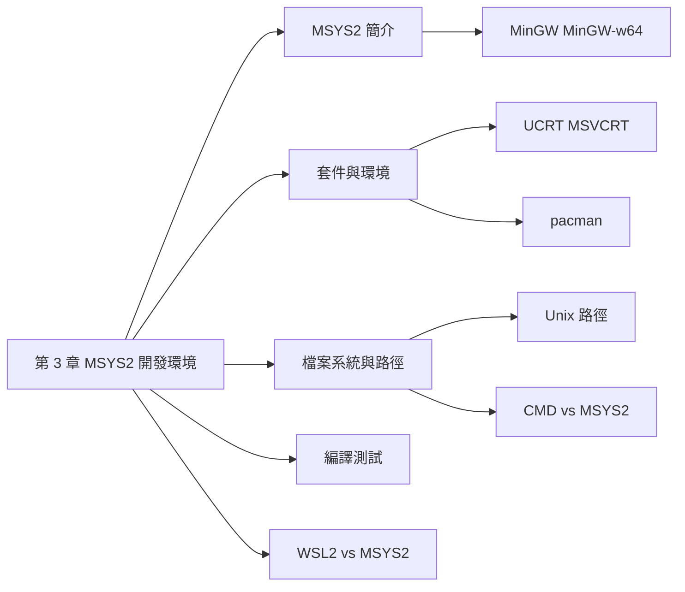

## 名詞表 {#glossary}

本章出現的名詞，詳細說明見對應區塊。

| 中文 | English | 描述 |
|---|---|---|
| MinGW | Minimalist GNU for Windows | GNU 工具鏈的 Windows 移植版，只能產生 32 位元程式 |
| MinGW-w64 | MinGW for Win64 | MinGW 的分支，可產生 32 與 64 位元 Windows 程式 |
| MSYS2 | Minimal SYStem 2 | 以 Cygwin 為基礎、提供 Unix-like 環境與 pacman 的 Windows 開發平台 |
| 套件管理器 | Package Manager | 安裝、更新、移除軟體與相依套件的工具；MSYS2 用 pacman |
| C 執行期函式庫 | C Runtime | 程式執行時使用的標準 C 函式庫；Windows 有 UCRT 與 MSVCRT |
| UCRT | Universal C Runtime | Windows 10 以後內建的標準 C Runtime |
| MSVCRT | Microsoft Visual C Runtime | Windows 95 以來的舊 C Runtime，相容性廣 |
| 絕對路徑 | Absolute Path | 從根目錄 `/` 開始的完整路徑 |
| 相對路徑 | Relative Path | 從目前工作目錄開始的路徑 |
| WSL2 | Windows Subsystem for Linux 2 | 以輕量虛擬機執行完整 Linux 核心的 Windows 子系統 |

## 本章地圖 {#ch3-map}

第 3 章前半準備開發環境：在 Windows 上用 MSYS2 取得 GNU 工具鏈，學會 pacman 與 Unix 風格的路徑，再比較 WSL2 與 MSYS2。後半的 CPU0 組合語言見 [[ch3-assembly#ch3-asm-map|第 3 章 CPU0 組合語言]]。原始投影片：[[_pdf/S03_01-MSYS2.pdf|S03_01 MSYS2]]、[[_pdf/S03_02-WSL2-MSYS2.pdf|S03_02 WSL2 vs MSYS2]]。



## MinGW 與 MinGW-w64 {#mingw}

**MinGW**（Minimalist GNU for Windows）是 GNU 工具鏈在 Windows 上的移植版。

| 版本 | 能產生的程式 |
|---|---|
| MinGW | 只有 32 位元 Windows 程式（Win32 API） |
| MinGW-w64 | 從 MinGW 分支出來的新版，可產生 32 位元（Win32）與 64 位元（Win64）程式，支援更多 API、C++ 標準與執行期 |

## MSYS2 {#msys2}

MSYS2 讓 Windows 有類似 Linux 的開發環境：

- **Unix-like 環境**：`bash`、`ls`、`grep` 等常見命令與工具。
- **MinGW-w64 編譯器**：用 `gcc` 或 `clang` 產生**原生 Windows** 程式。
- **Pacman 套件管理器**：安裝、更新、移除套件並處理相依性。

主要組成就是這三者：MSYS2 Shell、MinGW-w64、Pacman。適合在 Windows 上做跨平台開發、編譯 Windows 原生程式，或使用 Git、Python、Node.js 等開源工具。

| 特性 | MSYS2 | 傳統 Windows 開發環境 |
|---|---|---|
| 套件管理 | pacman | 手動下載安裝 |
| 終端工具 | Linux 類命令列 | 只有 cmd、PowerShell |
| 編譯器 | 支援 MinGW、Clang | 多需單獨安裝 |

## x86_64 與 i686 {#x86-64-i686}

| 項目 | x86_64 | i686 |
|---|---|---|
| 位元寬度 | 64 位元 | 32 位元 |
| 記憶體上限 | 超過 4GB（理論上 TB 級） | 約 4GB |
| 相容性 | 可執行 64 與 32 位元程式 | 只能執行 32 位元程式 |
| 用途 | 現代 PC、伺服器 | 舊系統、輕量環境 |
| 意義 | x86 的 64 位元延伸 | 第六代 32 位元 x86 CPU |

## UCRT 與 MSVCRT {#ucrt-msvcrt}

MSYS2 的 gcc 依使用的 C Runtime 分成兩類，各有 64 位元（x86_64）與 32 位元（i686）版本：

| | UCRT（Universal C Runtime） | MSVCRT（Microsoft C Runtime） |
|---|---|---|
| 來源 | Windows 10 以後內建、隨更新分發 | Windows 95 以來的標準 C Runtime |
| 適合 | Windows 10 以上的現代程式 | 需要支援 Windows 7、8 等舊版的程式 |
| gcc 套件 | `mingw-w64-ucrt-x86_64-gcc`、`mingw-w64-ucrt-i686-gcc` | `mingw-w64-x86_64-gcc`、`mingw-w64-i686-gcc` |

另外還有 SEH（Structured Exception Handling，64 位元）與 DWARF（32 位元）兩種例外處理方式的版本。SEH 是微軟對 C／C++ 的擴充，用來處理硬體錯誤等例外情況。

## MSYS2 的環境與套件前綴 {#msys2-environments}

MSYS2 有好幾個終端環境，每個環境要安裝**對應前綴**的套件：

| 環境 | 套件前綴 |
|---|---|
| MSYS | （無） |
| MINGW64 | `mingw-w64-x86_64-` |
| UCRT64 | `mingw-w64-ucrt-x86_64-` |
| CLANG64 | `mingw-w64-clang-x86_64-` |
| MINGW32 | `mingw-w64-i686-` |
| CLANG32 | `mingw-w64-clang-i686-` |
| CLANGARM64 | `mingw-w64-clang-aarch64-` |

MSYS2 預設的終端程式是 **Mintty**。本課程的 Arm 實驗使用 MINGW64，見 [[ch5-arm-toolchain#msys2-runtime|MSYS2 環境與 QEMU 版本]]。

## pacman 常用指令 {#pacman}

| 指令 | 作用 |
|---|---|
| `pacman -Ss <名稱>` | 搜尋套件（名稱可只打一部分），已安裝的會標 `[installed]` |
| `pacman -Qs <名稱>` | 只搜尋已安裝的套件 |
| `pacman -S <套件>` | 安裝 |
| `pacman -R <套件>` | 移除 |
| `pacman -Syu` | 更新套件資料庫並升級所有套件 |
| `pacman -Qi <套件>` | 顯示套件資訊，`Depends On` 欄是相依套件 |
| `pactree <套件>` | 以樹狀圖顯示相依關係 |

## 安裝 MSYS2 與 gcc {#install-msys2}

1. 從 `https://www.msys2.org/` 下載安裝程式（需要 64 位元 Windows 10 以上），執行並按 Finish。
2. 安裝完會開啟 UCRT64 終端。安裝 gcc：

   ```sh
   pacman -S mingw-w64-ucrt-x86_64-gcc
   ```

3. 按 Enter 確認安裝，完成後重開終端，`gcc --version` 確認。
4. 更新系統：`pacman -Syu`，依提示重開視窗後再執行 `pacman -Sy`。
5. （選用）要在 Windows CMD 使用，把對應的 `bin` 資料夾（例如 `C:\msys64\mingw64\bin`）加入 Windows 環境變數 `Path`，再用 `gcc -v` 確認。

## 安裝完整工具鏈 {#install-toolchain}

只裝 gcc 不夠時，可以安裝整組工具鏈（gcc、binutils、gdb、make 等）：

```sh
pacman -S --needed base-devel mingw-w64-x86_64-toolchain
```

- `--needed`：只安裝尚未安裝的套件，已存在的跳過。
- `base-devel`：開發基本工具集合（make、binutils、patch 等）。
- 工具鏈群組有四種：`mingw-w64-ucrt-i686-toolchain`、`mingw-w64-ucrt-x86_64-toolchain`、`mingw-w64-i686-toolchain`、`mingw-w64-x86_64-toolchain`。安裝時會列出群組成員讓你選，直接按 Enter 是全選。

## Unix 路徑格式 {#unix-path}

- **絕對路徑**：從根目錄 `/` 開始，例如 `/home/user/Documents/file.txt`。
- **相對路徑**：從目前目錄開始，不以 `/` 開頭，例如 `./Documents/file.txt`。

| 符號 | 意義 | 例子 |
|---|---|---|
| `.` | 目前目錄 | `./file.txt` |
| `..` | 上層目錄 | `../file.txt` |
| `~` | 使用者家目錄 | `~/Documents` |

路徑有空格時，用 `\` 跳脫或加引號：`/home/user/My\ Documents/file.txt` 或 `"/home/user/My Documents/file.txt"`。

## MSYS2 的檔案系統 {#msys2-filesystem}

MSYS2 有像 Unix 的目錄結構（`/home`、`/usr`、`/bin`），實際上存放在安裝根目錄（預設 `C:\msys64`）底下：

| MSYS2 路徑 | 實際的 Windows 路徑 |
|---|---|
| `/home/user` | `C:\msys64\home\user` |
| `/usr/bin` | `C:\msys64\usr\bin` |
| `/c/` | `C:\` |
| `/d/` | `D:\` |

所以 Windows 的 `C:\Users\YourName\Documents\file.txt` 在 MSYS2 寫成 `/c/Users/YourName/Documents/file.txt`。

## CMD 與 MSYS2 的差異 {#cmd-vs-msys2}

| 項目 | Windows CMD | MSYS2 |
|---|---|---|
| 路徑分隔 | `\`，例如 `C:\Users\YourName` | `/`，例如 `/c/Users/YourName` |
| PATH 分隔 | `;` | `:` |
| 設定 PATH | `set PATH=C:\Program Files\Tool;C:\Windows\System32` | `export PATH=/usr/local/bin:/usr/bin:/c/Program\ Files/Tool` |
| 常用命令 | `dir`、`copy`、`move`、`del` | `ls`、`cp`、`mv`、`rm` |
| 檔名大小寫 | 不區分 | **區分**（`File.txt` 與 `file.txt` 是不同檔案） |
| 腳本 | `.bat`、`.cmd` 批次檔 | `.sh` Shell 腳本 |

- 直接把 Windows 路徑貼進 MSYS2 可能出錯，例如 `\n` 會被當成換行。
- 用 `cygpath` 手動轉換：

  ```sh
  cygpath -u "C:\\Program Files"   # Windows → Unix：/c/Program Files
  cygpath -m /mingw64/bin          # Unix → Windows：C:/msys64/mingw64/bin
  cd $(cygpath -u "C:\Users\YourName\Documents")
  ```

- 要避免 MSYS2 自動轉換某些變數，可設定環境變數 `MSYS2_ENV_CONV_EXCL`。

最常用的 Unix 命令：`ls`、`cd`、`pwd`、`cp`、`mv`、`rm`、`mkdir`、`cat`、`echo`、`chmod`。

## 在 MSYS2 編譯 C 程式 {#msys2-compile}

1. 用 `nano hello.c` 撰寫程式（Ctrl + X，再按 Y 存檔離開），檔案在家目錄 `/home/user`：

   ```c
   #include <stdio.h>
   int main() {
       printf("Hello, World!\n");
       return 0;
   }
   ```

2. 編譯：`gcc hello.c -o hello`。
3. 執行：`./hello`。Unix 格式要用 `./` 表示目前目錄。

檔案放在其他地方時，先 `cd /c/Users/YourName/Documents/` 再編譯。

## 在 CMD 編譯 C 程式 {#cmd-compile .fold}

1. 先把 MSYS2 的 `bin` 加入 Windows 環境變數 `Path`。
2. 用任何編輯器寫好 `hello.c`。
3. 開 CMD，`cd C:\path\to\your\c\program`，執行 `gcc hello.c -o hello.exe`。
4. 直接輸入 `hello.exe` 執行。

## 確認與移除 MSYS2 {#msys2-uninstall .fold}

來自補充講義〈是否已安裝確認與移除指南〉（未收錄於 `_pdf/`）。

**確認是否已安裝**（PowerShell）：

```powershell
Test-Path C:\msys64                                  # True：安裝資料夾存在
where.exe pacman                                     # 顯示 C:\msys64\...：可經由 PATH 呼叫
$env:Path -split ';' | Select-String -Pattern 'msys|mingw'   # PATH 中的 MSYS2 項目
```

也可以檢查 `C:\msys64`（舊版 `C:\msys32`）裡有沒有 `usr`、`mingw64`、`ucrt64`、`home`、`msys2.exe` 等。MSYS2 也可能只是解壓縮安裝，所以「應用程式清單裡找不到」不代表沒有安裝。

**完整移除**：

1. 關閉所有 MSYS2 視窗，確認工作管理員沒有 `bash.exe`、`mintty.exe`、`pacman.exe`、`msys2.exe`。
2. 設定 → 應用程式 → 已安裝的應用程式 → MSYS2 → 解除安裝。
3. 刪除 `C:\msys64`（或 `C:\msys32`）；檔案被占用時先重開機。
4. 從使用者與系統的 `Path` 刪除 `C:\msys64\usr\bin`、`C:\msys64\mingw64\bin`、`C:\msys64\ucrt64\bin` 等項目。**只刪確定指向 MSYS2 的**，其他 MinGW 可能屬於 Qt、STM32、ESP-IDF 等工具。
5. 開新的 PowerShell，`where.exe pacman` 顯示 `INFO: Could not find files...`、`Test-Path C:\msys64` 為 False 就清乾淨了。

## 隨堂練習：MSYS2 編譯 {#msys2-practice .fold}

在 MSYS2 環境下用 GNU gcc 編譯範例程式，截圖作答，需包含：整個 MSYS2 畫面並寫出是哪一個 MSYS2 shell、gcc 的版本（指令與結果）、從下指令到編譯結果的完整過程。

## WSL2 與 MSYS2 {#wsl2-vs-msys2}

| 面向 | WSL2 | MSYS2 |
|---|---|---|
| 是什麼 | 微軟官方的 Linux 子系統（2019 年，WSL1 的重大改版） | 以 Cygwin 為基礎、為 Windows 打造的開發工具集 |
| 架構 | **輕量虛擬機**，執行完整 Linux 核心，純正 Linux 環境 | **POSIX 模擬層**，把 Unix 工具改寫成 Windows 版，不需虛擬化 |
| 效能 | Linux 磁區內極佳；存取 Windows 檔案較慢 | 與 Windows 檔案系統整合佳；模擬 POSIX 犧牲部分效能 |
| 套件 | apt、dnf 等原生套件管理，套件豐富 | pacman，套件需特別改寫，選擇較少 |
| 安裝 | 開啟 WSL 功能、安裝核心與發行版；需 Hyper-V 與 BIOS 虛擬化 | 單一安裝程式，無特殊需求 |
| 資源 | 約 1GB 安裝；執行時 1–2GB 記憶體 | 約 500MB 安裝；執行時 200–500MB |
| 其他 | 支援 Docker、GPU 運算、多個發行版、圖形介面，與 VS Code 整合佳 | Windows 原生體驗、啟動快、容易與現有工具整合 |

## 選擇 WSL2 或 MSYS2 {#choose-environment}

- **選 WSL2**：需要完整 Linux 環境或 Linux 系統呼叫、Docker 容器開發、跨平台專案、GPU 運算，而且系統資源充足、重視開發體驗。
- **選 MSYS2**：主要在 Windows 開發、編譯 Windows 原生程式、只需要基本 UNIX 工具、系統資源有限、重視啟動速度與 Windows 整合。

本課程使用 MSYS2。
