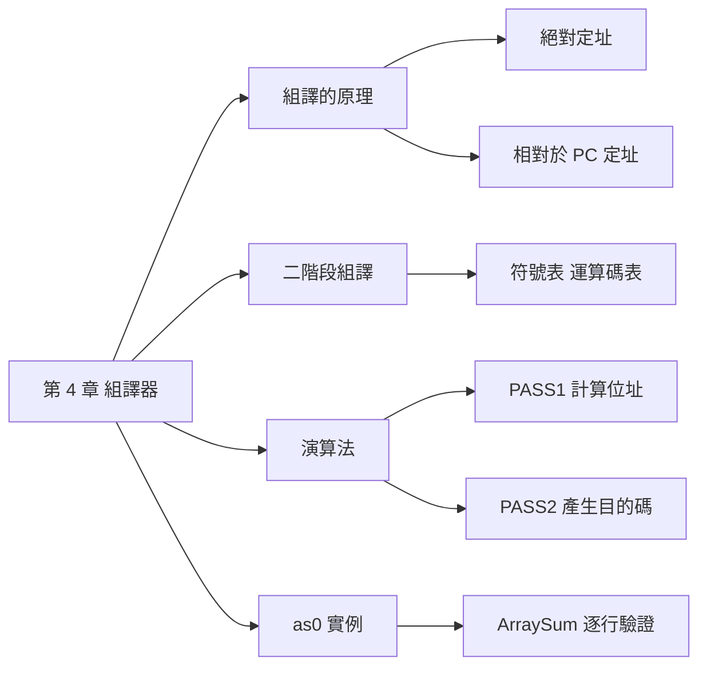

## 名詞表 {#glossary}

本章出現的名詞，詳細說明見對應區塊。

| 中文 | English | 描述 |
|---|---|---|
| 組譯器 | Assembler | 把組合語言轉成目的檔（或執行檔）的程式 |
| 目的碼 | Object Code | 組譯後的機器碼 |
| 映像檔 | Image File | 最簡單的目的檔：直接是記憶體內容的機器碼 |
| 絕對定址 | Absolute Addressing | 指令中直接放變數的位址 |
| 相對於 PC 定址 | PC-relative Addressing | 指令中放「變數位址 − PC」的位移 |
| 二階段組譯 | Two-pass Assembly | 先算位址建符號表，再產生目的碼 |
| 運算碼表 | Op Table | 指令名稱與運算碼、格式的對照表 |
| 符號表 | Symbol Table | 標記（變數、標籤）與位址的對照表 |
| 位置計數器 | Location Counter | 組譯時記錄目前位址的變數（演算法中的 `address`） |

## 本章地圖 {#ch4-map}

第 4 章說明組譯器怎麼把 [[ch3-assembly#ch3-asm-map|CPU0 組合語言]]變成機器碼：先看一行指令怎麼編碼，發現變數位址必須先知道，因此需要兩階段；再看兩階段的演算法，最後用 as0 的真實輸出驗證。原始投影片：[[_pdf/S04-CPU0_Assembler.pdf|S04 組譯器]]。



## 組譯器 {#assembler}

**組譯器**把人看得懂的組合語言指令，轉成電腦可執行的機器碼：

$$
\text{組合語言} \xrightarrow{\text{組譯器}} \text{目的檔（或執行檔）}
$$

本章的範例程式（範例 4.2，`Ex4_1.asm0`）：

| 位址 | 程式 |
|---|---|
| 0000 | `LD R1, B` |
| 0004 | `ST R1, A` |
| 0008 | `RET` |
| 000C | `A: RESW 1` |
| 0010 | `B: WORD 29` |

等於 C 的 `A = B;`，B 的初值是 29。

## 絕對定址的組譯 {#absolute-encoding}

`LD R1, B` 是 L 型指令，可以把它看成 `LD R1, [R0+B]`：Rb 用恆為 0 的 R0，Cx 直接放 B 的位址 0x0010。

| 欄位 | OP | Ra | Rb | Cx |
|---|---|---|---|---|
| `LD R1, [R0+B]` | 00 | 1 | 0 | 0010 |

所以目的碼是 `00100010`。整個程式的絕對定址版目的碼：

| 位址 | 程式 | 目的碼（絕對定址版） |
|---|---|---|
| 0000 | `LD R1, B` | `00100010` |
| 0004 | `ST R1, A` | `0110000C` |
| 0008 | `RET` | `2C000000` |
| 000C | `A: RESW 1` | `00000000` |
| 0010 | `B: WORD 29` | `0000001D` |

## 絕對定址的缺點 {#absolute-limit}

L 型的 Cx 只有 **16 位元**、而且是 2 補數：

$$
\text{最小值} = -2^{16-1} = -32768 \qquad \text{最大值} = 2^{16-1} - 1 = 32767
$$

絕對位址不可能是負數，只剩 0～32767 可用，所以**所有變數都必須放在 0～32K 的範圍內**，這相當不合理。

## 相對於 PC 定址 {#pc-relative}

改用 **R15（PC）當基底**，Cx 放「變數位址 − PC」的**位移**：

$$
\texttt{LD R1, B} \;\Rightarrow\; \texttt{LD R1, [R15 + (B - PC)]}
$$

執行 `LD R1, B`（位於 0x0000）時 PC 已經指向下一條 0x0004，所以：

$$
Cx = B - PC = \texttt{0x0010} - \texttt{0x0004} = \texttt{0x000C}
$$

| 欄位 | OP | Ra | Rb | Cx |
|---|---|---|---|---|
| `LD R1, [R15+(B−PC)]` | 00 | 1 | F | 000C |

目的碼 `001F000C`。同理 `ST R1, A` 位於 0x0004，PC = 0x0008，Cx = 0x000C − 0x0008 = 0x0004，目的碼 `011F0004`。

這樣只要變數離指令在 ±32K 以內，程式放在記憶體的哪裡都能正確存取。**規則：Cx = 目標位址 − (指令位址 + 4)**，跳躍指令的 Cx 也是這樣算。

## 二階段組譯的必要性 {#why-two-pass}

組譯 `LD R1, B` 時要填 Cx，就必須知道 B 的位址；但 B 定義在程式的**後面**，讀到第一行時還不知道。因此組譯器分兩階段：

1. **第一階段（PASS1）**：掃描整個程式，計算每一行的位址，把所有標記（變數、標籤）與位址記入**符號表**。
2. **第二階段（PASS2）**：依符號表把每一行轉成機器碼。

## 組譯步驟 {#assembly-steps}

| 步驟 | 做什麼 | 例子 |
|---|---|---|
| (1) 運算碼轉換 | 指令名稱 → 機器碼 | `LD` → 00、`ST` → 01 |
| (2) 參數轉換 | 暫存器 → 代號、符號 → 位址 | R1 → 1、A → 000C、B → 0010 |
| (3) 資料轉換 | 資料常數 → 機器碼 | `WORD 29` → 0000001D |
| (4) 目的碼產生 | 依指令格式組合，輸出到目的檔 | `001F000C` |

## 映像檔 {#image-file}

**映像檔**是最簡單的目的碼：把每一行的機器碼依位址接起來，就是程式載入後的記憶體內容。範例 4.2 的映像檔（相對定址版），檔名可以是 `Ex4_1.obj0` 或 `Ex4_1.img`：

```text
001F000C 011F0004 2C000000 00000000 0000001D
```

## 運算碼表與符號表 {#assembler-tables}

組譯器的兩個核心資料結構，通常都用**雜湊表**實作：

| 資料表 | 存什麼 | 何時建立 | 用途 |
|---|---|---|---|
| **運算碼表**（Op Table） | 指令名稱 → 運算碼、格式 | 固定，組譯器內建 | 判斷是不是合法指令、取得 OP |
| **符號表**（Symbol Table） | 標記 → 位址 | PASS1 建立 | PASS2 把符號換成位址 |

範例 4.2 的符號表：A → 0x000C、B → 0x0010。

## 第一階段：計算位址 {#pass1}

PASS1 逐行讀程式，維護目前位址 `address`，建立符號表：

```text
Algorithm AssemblerPass1
Input  AssemblyFile
Output SymbolTable
  SymbolTable = new Table()
  file = open(AssemblyFile)
  while not file.end
    line = readLine(file)
    if line is comment: continue                 // 註解跳過
    label = label(line)
    if label is not null
      if symbolTable.search(label) is not null
        report error                             // 標記重複定義
      else
        symbolTable.add(label, address)          // 記下標記的位址
    op = operator(line)
    if opTable.search(op) is not null
      address += 4                               // 一般指令
    else if op is 'BYTE'
      address += 1 * length(parameters)
    else if op is 'WORD'
      address += 4 * length(parameters)
    else if op is 'RESB'
      address += parameter 1
    else if op is 'RESW'
      address += 4 * parameter 1
    else
      report error                               // 指令拼錯
  end while
End Algorithm
```

每行佔多少空間：

| 內容 | 位址增加 |
|---|---|
| 一般指令 | 4 |
| `BYTE` | 1 × 參數個數（字串則為字元數） |
| `WORD` | 4 × 參數個數 |
| `RESB n` | n |
| `RESW n` | 4 × n |

PASS1 會檢查兩種錯誤：**標記重複定義**、**指令不存在**（拼寫錯誤）。

## 第二階段：產生目的碼 {#pass2}

PASS2 再讀一次程式，依符號表產生目的碼：

```text
Algorithm AssemblerPass2
Input  AssemblyFile, SymbolTable
Output ObjFile
  file = open(AssemblyFile)
  while not file.end
    line = readLine(file)
    (op, parameter) = parse(line)
    opRecord = opTable.search(op)
    if opRecord is not null
      objCode = translateInstruction(parameter, address, opRecord)
      address += length(objCode)
    else if op is 'WORD' or 'BYTE'
      objCode = translateData(line)              // 資料轉成機器碼
      address += length(objCode)
    else if op is 'RESB'
      address += parameter[1]
    else if op is 'RESW'
      address += 4 * parameter[1]
    output objCode to ObjFile
  end while
End Algorithm
```

一般指令交給 `translateInstruction`；`WORD`／`BYTE` 把資料轉成位元值（例如 `WORD 29` → `0000001D`）；`RESB`／`RESW` 只推進位址。

## 指令轉換函數 {#translate-instruction}

`translateInstruction` 依指令格式組出目的碼：

```text
Algorithm TranslateInstruction
Input  parameter, pc, opRecord
Output objCode
  if opRecord.type is L
    Ra = parameter[1]
    if parameter[3] is Constant
      Rb = 0;  Cx = toInteger(parameter[2])     // 常數：絕對值
    else if parameter[3] is Variable
      Cx = address(Variable) - pc               // 變數：相對於 PC 的位移
      Rb = parameter[2]
    objCode = opCode + id(Ra) + id(Rb) + hex(Cx)
  else if type is A
    Ra = parameter[1];  Rb = parameter[2]
    if parameter[3] is Register: Rc = parameter[3]
    else if parameter[3] is Constant: Cx = toInteger(parameter[3])
    objCode = opCode + id(Ra) + id(Rb) + id(Rc) + hex(Cx)
  else if type is J
    Cx = parameter[1]
    objCode = opCode + hex(Cx)
  return objCode
End Algorithm
```

| 格式 | 參數 | 組法 |
|---|---|---|
| L 型 | 常數 | Rb = 0，Cx = 常數 |
| L 型 | 變數 | Rb = R15（PC），Cx = 變數位址 − pc |
| A 型 | 第三個參數是暫存器 | 填 Rc |
| A 型 | 第三個參數是常數 | 填 Cx（例如 `SHL R5, R1, 2`） |
| J 型 | 標籤 | Cx = 標籤位址 − pc |

這裡的 `pc` 是**下一條指令的位址**（目前位址 + 4）。投影片的 J 型寫成 `Cx = parameter[1]`，但 as0 實際上對標籤同樣計算相對於 PC 的位移，見 [[#arraysum-trace|ArraySum 的組譯過程]]中 `JNE FOR` 的驗證。

## as0 的輸出 {#as0-output}

用 as0 組譯 [[ch3-assembly#array-sum|陣列加總程式]]：

```sh
./as0 ArraySum.asm0 ArraySum.obj0
```

as0 依序印出四段：

1. `Assemble`：原始程式。
2. `PASS1`：每行的位址、指令、格式與運算碼（目的碼欄還是 `(NULL)`）。
3. `SYMBOL TABLE`：符號表。
4. `PASS2`：補上每行的目的碼，最後存入目的檔。

格式欄的代號：`L`／`A`／`J` 是指令格式，`D F2` 是資料定義（WORD），`FF` 是只有標籤的空行。

## ArraySum 的組譯過程 {#arraysum-trace}

PASS1 結果與符號表：

| 位址 | 程式 | 格式 OP |
|---|---|---|
| 0000 | `LDI R1, 0` | L 08 |
| 0004 | `LD R2, APTR` | L 00 |
| 0008 | `LDI R3, 3` | L 08 |
| 000C | `LDI R4, 4` | L 08 |
| 0010 | `LDI R9, 1` | L 08 |
| 0014 | `FOR:` | FF |
| 0014 | `LD R5, [R2]` | L 00 |
| 0018 | `ADD R1,R1,R5` | A 13 |
| 001C | `ADD R2, R2, R4` | A 13 |
| 0020 | `SUB R3, R3, R9` | A 14 |
| 0024 | `CMP R3, R0` | A 10 |
| 0028 | `JNE FOR` | J 21 |
| 002C | `ST R1, SUM` | L 01 |
| 0030 | `LD R8, SUM` | L 00 |
| 0034 | `RET` | J 2C |
| 0038 | `A: WORD 3, 7, 4` | D（12 bytes） |
| 0044 | `APTR: WORD A` | D |
| 0048 | `SUM: WORD 0` | D |

符號表：FOR = 0014、A = 0038、APTR = 0044、SUM = 0048。`FOR:` 單獨一行不佔空間，所以和下一行同為 0014；`WORD 3, 7, 4` 有 3 個參數，佔 12 bytes，所以下一個 APTR 在 0x38 + 12 = 0x44。

PASS2 的目的碼與驗算：

| 位址 | 程式 | 目的碼 | 怎麼來的 |
|---|---|---|---|
| 0000 | `LDI R1, 0` | `08100000` | 常數：Rb = 0、Cx = 0 |
| 0004 | `LD R2, APTR` | `002F003C` | Rb = F，Cx = 0x44 − 0x08 = 0x3C |
| 0014 | `LD R5, [R2]` | `00520000` | Ra = 5、Rb = 2、Cx = 0 |
| 0018 | `ADD R1,R1,R5` | `13115000` | A 型：Ra = 1、Rb = 1、Rc = 5 |
| 0024 | `CMP R3, R0` | `10309000` | Ra = 3、Rb = 0 |
| 0028 | `JNE FOR` | `21FFFFE8` | Cx = 0x14 − 0x2C = −0x18 = FFFFE8（24 位元 2 補數） |
| 002C | `ST R1, SUM` | `011F0018` | Cx = 0x48 − 0x30 = 0x18 |
| 0030 | `LD R8, SUM` | `008F0014` | Cx = 0x48 − 0x34 = 0x14 |
| 0034 | `RET` | `2C000000` | |
| 0038 | `A: WORD 3, 7, 4` | `00000003 00000007 00000004` | |
| 0044 | `APTR: WORD A` | `00000038` | A 的位址 |
| 0048 | `SUM: WORD 0` | `00000000` | |

`CMP R3, R0` 目的碼中的 `9` 落在 Rc 欄位，和上一行 `SUB R3, R3, R9` 的 Rc 相同，看起來是 as0 沒有清掉前一行留下的欄位值；CMP 只用 Ra、Rb，不影響執行結果。

存入 `ArraySum.obj0` 的就是 PASS2 目的碼依序接起來的十六進位字串：

```text
08100000 002F003C 08300003 08400004 08900001 00520000 13115000 13224000
14339000 10309000 21FFFFE8 011F0018 008F0014 2C000000 00000003 00000007
00000004 00000038 00000000
```

vm0 的執行結果見 [[ch3-assembly#array-sum-vm0|陣列加總的 vm0 執行]]。
