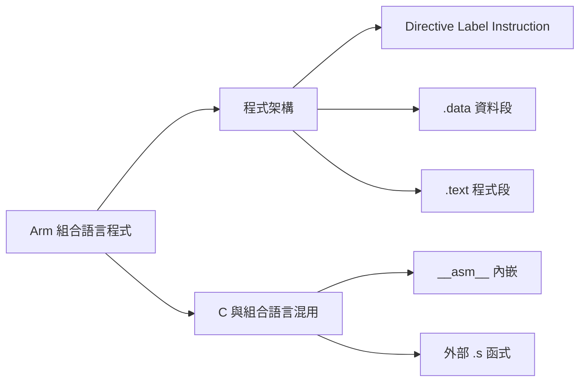

## 名詞表 {#glossary}

本章出現的名詞，詳細說明見對應區塊。

| 中文 | English | 描述 |
|---|---|---|
| 組譯器指示 | Directive | 以 `.` 開頭、給組譯器／連結器的指示，例如 `.text`、`.word` |
| 標籤／符號 | Label／Symbol | 以 `名稱:` 為位置命名 |
| 機器指令 | Instruction | 會被編成機器碼、由 CPU 執行的指令 |
| 區段 | Section | 目的檔中的程式或資料區塊，例如 `.text`、`.data` |
| 進入點 | Entry Point | 程式開始執行的位址，由連結器設定 |
| 裸機 | Bare-metal | 沒有作業系統、程式直接在硬體上執行 |
| 內嵌組合語言 | Inline Assembly | 用 `__asm__` 把組合語言寫在 C 函式裡 |
| 運算元限制 | Operand Constraint | 告訴 GCC 運算元要放在哪種位置，例如 `"r"` |
| 副作用宣告 | Clobber | 告訴 GCC 這段組合語言還改了什麼，例如 `"cc"` |
| 記憶體對映輸入輸出 | MMIO | 用存取記憶體位址的方式操作硬體暫存器 |

## 本章地圖 {#ch5-asm-map}

上一篇認識了 [[ch5-arm-cpu#ch5-map|Arm 處理器]]的指令；本篇看一份 GNU Assembler（AArch32／A32）的 `.s` 檔怎麼組織，以及 C 與組合語言如何互相呼叫。實際編譯執行見 [[ch5-arm-toolchain#ch5-tool-map|Arm 工具鏈]]。原始投影片：[[_pdf/S05_01-ARM-CPU-02.pdf|S05_01 Arm CPU-02]]。



## 一份 .s 裡的三種內容 {#source-elements}

```asm
.global _start          @ Directive：告知組譯器/連結器符號資訊
.data                   @ Directive：切換到資料區段
num1: .word 10          @ Label + Directive：定義資料及其名稱
.text                   @ Directive：切換到程式碼區段
_start:                 @ Label：為後續指令指定位置
    MOV R0, #10         @ Instruction：由 CPU 執行
```

| 類型 | 對誰產生作用 | 在 ELF 中的表現 |
|---|---|---|
| Directive | Assembler／Linker | 建立區段、符號、資料 |
| Label | Assembler／Linker | 對應位置或符號名稱 |
| Instruction | CPU | 編成機器碼，執行時改變狀態 |

**程式區段**：`.text` 放指令；`.data` 放可寫的已初始化資料；`.rodata` 放唯讀常數；`.bss` 放未初始化資料（通常只記錄所需空間）。`.text`、`.data` 同時是區段名稱，也是切換區段的 Directive。Arm 的註解用 `@`。

## 組譯器指示與符號 {#directives}

| 指示 | 作用 |
|---|---|
| `.text`、`.data` | 切換目前輸出到哪個區段 |
| `.global <label>` | 宣告全域符號，讓連結器看得到 |
| `.equ <name>, <value>` | 組譯時定義符號常數，常用於硬體暫存器位址，例如 `.equ UART0, 0x101f1000` |
| `.extern <symbol>` | 宣告由其他檔案提供的符號（GNU as 沒寫也會對未定義符號建立外部參照） |
| `.align 2` | 下一個位置對齊到 $2^2$ = 4 bytes |
| `.syntax unified` | 使用統一的 ARM／Thumb 語法 |

`_start:` 是標籤，不是 CPU 認得的指令；`B .` 表示跳到目前位址（停在原地）。

## _start 不等於 CPU 從這裡執行 {#entry-point}

`.global _start` 只是讓連結器看得見 `_start`，**不會直接設定 ELF Entry Point**。同一段程式經過三個層次：

| 層次 | 工作 |
|---|---|
| Assembler | 為 `_start` 建立符號，把指令轉成目的檔 |
| Linker | 依連結設定決定區段位置與 ELF Entry Point |
| Loader／啟動流程 | 把可執行映像載入記憶體並開始執行 |

可以用 `readelf -h` 看 Entry point address、`readelf -s` 看符號表，兩者不要混為一談。

## 資料段 {#data-section}

以 `.data` 或 `.section .data` 開始，定義程式需要的常數與變數。最終位址與初始化方式由 Linker Script 與啟動流程決定。

| 指示 | 作用 |
|---|---|
| `.word <value>` | 32 位元整數 |
| `.byte <value>` | 8 位元整數 |
| `.ascii "<string>"` | ASCII 字串，**不會**自動加 Null 結尾 |
| `.asciz "<string>"` | ASCII 字串，**自動**加 Null 結尾（C 風格） |

```asm
.data
num1:  .word 10                 @ 32-bit 整數
char1: .byte 65                 @ ASCII 'A'
msg:   .asciz "Hello, Arm!\n"   @ C-style 字串
```

對照 CPU0：`.word` 相當於 `WORD`，`.byte` 相當於 `BYTE`（見 [[ch3-assembly#data-directives|宣告變數]]）。

## 程式段 {#text-section}

以 `.text` 或 `.section .text` 開始，包含核心指令。最終可能放在 ROM、Flash 或可執行 RAM，由連結設定與平台決定。

典型流程：設定暫存器並載入資料 → 運算 → 條件分支或迴圈。程式怎麼結束取決於執行環境：本課程的 Bare-metal／QEMU 範例通常**停在無窮迴圈**，不會「回到作業系統」。

常見標籤（命名習慣，不是保留字）：`_start` 程式進入點、`main` 主要邏輯、`loop` 迴圈起點、`end` 結尾區域（不會自動結束程式）、`function_name:` 函式入口。

## 完整範例：num1 加 5 {#num1-example}

```asm
.syntax unified
.global _start
.data
.align 2
num1: .word 10          @ 變數 num1 = 10
.text
_start:
    LDR R0, =num1       @ R0 = num1 的位址
    LDR R1, [R0]        @ R1 = num1
    ADD R1, R1, #5      @ R1 = R1 + 5
    STR R1, [R0]        @ 寫回 num1
stop:
    B stop              @ Bare-metal：停在這裡
```

| 步驟 | R0 | R1 | 記憶體 num1 |
|---|---|---|---|
| 起始 | 未指定 | 未指定 | 10 |
| `LDR R0, =num1` | &num1 | 不變 | 10 |
| `LDR R1, [R0]` | &num1 | 10 | 10 |
| `ADD R1, R1, #5` | &num1 | 15 | **10** |
| `STR R1, [R0]` | &num1 | 15 | **15** |

`ADD` 只改暫存器，到 `STR` 才真正改變 num1。可用 GDB 的 `info registers r0 r1` 與 `x/wd <位址>` 驗證（見 [[ch5-arm-toolchain#gdb-commands|GDB 常用指令]]）。

## C 語言嵌入組合語言 {#inline-asm}

在 C 中嵌入組合語言的理由：使用特殊指令或精確控制硬體、處理特殊運算、嵌入式系統的特殊硬體指令。但**不保證比編譯器產生的程式碼快**；一般 MMIO 也可以用 C 的 `volatile` 處理，不一定要手寫組合語言。

GCC 提供 `__asm__`（或 `asm`）：

- **Basic Asm**：`__asm__("nop");`，不指定 C 變數的輸入輸出。
- **Extended Asm**：告訴 GCC 如何傳遞運算元與處理副作用：

```c
__asm__ ("assembly instructions"
         : output_operands    /* 輸出 */
         : input_operands     /* 輸入 */
         : clobbers);         /* 其他副作用 */
```

## Extended Asm 加法範例 {#inline-asm-add}

```c
#include <stdio.h>

int add_numbers(int a, int b) {
    int result;
    __asm__ (
        "ADD %[res], %[val1], %[val2]\n"
        : [res] "=r" (result)
        : [val1] "r" (a), [val2] "r" (b)
    );
    return result;
}

int main() {
    printf("5 + 10 = %d\n", add_numbers(5, 10));
    return 0;
}
```

- `%[res]`、`%[val1]`、`%[val2]` 是具名運算元，GCC 會換成實際配置的暫存器。
- `[res] "=r" (result)`：`=` 表示唯寫輸出，`r` 讓 GCC 配置一個通用暫存器，結果交回 C 變數 `result`。
- `[val1] "r" (a)`：輸入運算元；`r` 是由編譯器挑選暫存器，**不代表固定用 R0**。

## Constraint 與 Clobber {#asm-constraints}

| 標記 | 告訴 GCC 的事情 | 注意 |
|---|---|---|
| `"r" (x)` | 需要一個可讀取的通用暫存器輸入 | 不保證用 R0 |
| `"=r" (y)` | 指令會寫入這個輸出暫存器 | 舊值不用保留 |
| `"+r" (x)` | 同一運算元既讀又寫 | 常用於原地更新 |
| `"=&r" (y)` | 唯寫輸出，且是 **Early-clobber** | 輸出在所有輸入讀完前就被寫入時要用，避免與輸入共用暫存器 |
| `"cc"` | 這段指令會改變條件旗標 | 例如用了 `ADDS` |
| `"memory"` | 存取了沒列在運算元中的記憶體 | 不等於 CPU 的硬體記憶體屏障 |

Constraint 寫不完整時，最佳化後的程式可能行為錯誤。

```c
unsigned inc(unsigned value) {
    __asm__ ("adds %[v], %[v], #1"
             : [v] "+r" (value)   // 讀寫同一個運算元
             :
             : "cc");             // ADDS 會更新 NZCV
    return value;
}
```

### 例子：用 LSL 乘以 2 {#ex-lsl-times-two .fold}

```c
int multiply_by_two(int num) {
    int result;
    __asm__ (
        "LSL %[res], %[val], #1\n"
        : [res] "=r" (result)
        : [val] "r" (num)
    );
    return result;
}
// multiply_by_two(7) == 14
```

7 左移 1 位得 14。但不要推論對任意 `signed int` 都等於 C 的 `num * 2`：有號溢位與負數的語意要另外討論；觀察位元運算時用 `unsigned int` 較清楚。這個例子是說明指令如何運作，不是證明手寫 Inline ASM 比較快。

## 使用外部組合語言函式 {#external-asm}

把組合語言寫在獨立的 `.s` 檔，C 程式用 `extern` 宣告後呼叫。好處是程式碼分離、方便除錯與維護。

**add.s**（遵循 AAPCS32）：

```asm
.syntax unified
.text
.global add_numbers
.type add_numbers, %function
add_numbers:
    ADD R0, R0, R1      @ R0、R1 傳入，結果放 R0
    BX  LR              @ Leaf function：返回 Caller
.size add_numbers, .-add_numbers   @ ELF 符號的函式大小
```

**main.c**：

```c
#include <stdio.h>
extern int add_numbers(int a, int b);

int main() {
    int sum = add_numbers(5, 10);
    printf("5 + 10 = %d\n", sum);
    return 0;
}
```

**編譯與連結**：

```sh
arm-none-eabi-gcc -mcpu=arm926ej-s -marm \
  -o program.elf main.c add.s syscalls.c \
  -specs=nosys.specs -lc -lgcc
```

`-mcpu=arm926ej-s -marm` 明定 Armv5TE／A32 目標。C 端的 `BL add_numbers` 設定 LR，參數 5、10 依 [[ch5-arm-cpu#aapcs32|AAPCS32]] 放進 R0、R1，結果留在 R0，`BX LR` 返回；`add_numbers` 不呼叫其他函式，是不必保存 LR 的 Leaf Function。

## 外部 .s 與 Inline Assembly 的選擇 {#asm-choice}

| 需求 | 外部 `.s` | Inline `__asm__` |
|---|---|---|
| 完整函式、獨立測試 | 較合適 | 可行，但不易獨立重用 |
| 少量特殊指令嵌入 C | 需要額外的呼叫介面 | 較方便 |
| 暫存器與參數處理 | 遵守 AAPCS32 呼叫慣例 | 由 GCC Constraint 與 Clobber 協調 |
| 除錯 | 可反組譯並逐步追蹤 | 也可追蹤，但要理解編譯器產生的周邊指令 |
