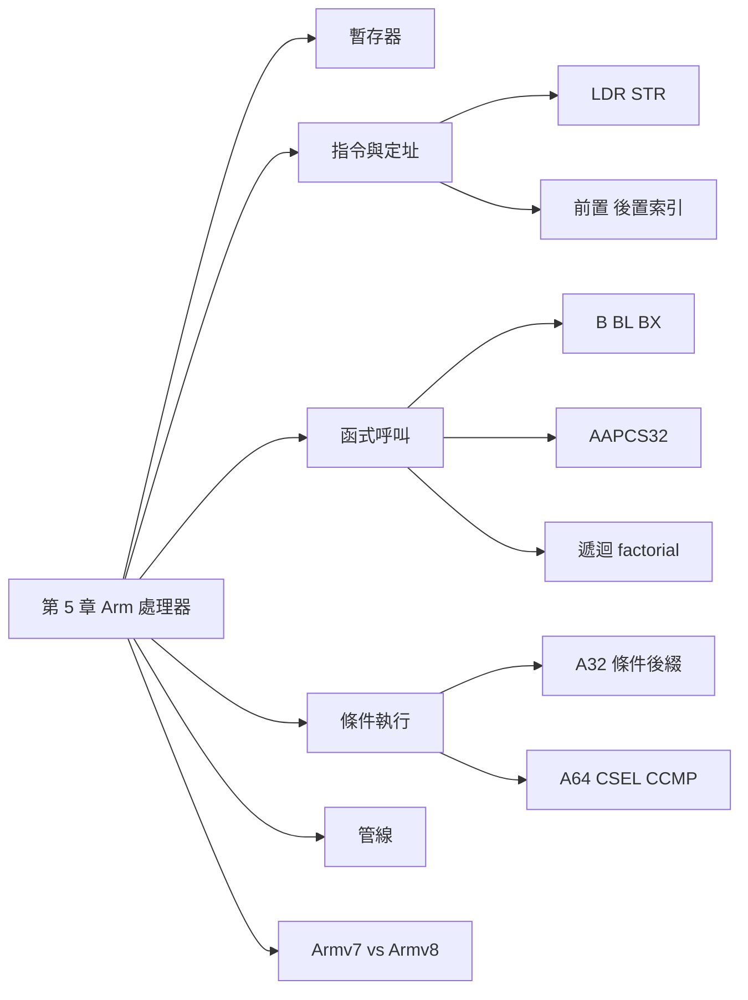

## 名詞表 {#glossary}

本章出現的名詞，詳細說明見對應區塊。

| 中文 | English | 描述 |
|---|---|---|
| 精簡指令集 | RISC | Arm 架構的設計理念 |
| 執行狀態 | AArch32／AArch64 | 32 位元與 64 位元的執行模型 |
| 指令集 | A32／T32／A64 | 傳統 Arm 32-bit、Thumb、AArch64 的指令集 |
| 程式狀態暫存器 | CPSR, Current Program Status Register | 條件旗標、處理器模式、執行狀態 |
| 儲存的程式狀態暫存器 | SPSR, Saved Program Status Register | 例外返回時用來恢復狀態 |
| 有效位址 | Effective Address | 載入儲存實際存取的位址 |
| 前置索引 | Pre-indexed | `[R1, #4]!`：用新位址並寫回基底 |
| 後置索引 | Post-indexed | `[R1], #4`：用舊位址，之後更新基底 |
| 呼叫標準 | AAPCS32 | Arm 32 位元的函式呼叫慣例 |
| 呼叫者／被呼叫者 | Caller／Callee | 發出呼叫的函式／被呼叫的函式 |
| 葉函式 | Leaf Function | 不再呼叫其他函式的函式 |
| 條件選擇 | CSEL, Conditional Select | A64 依條件二選一，不需分支 |
| 條件比較 | CCMP, Conditional Compare | A64 條件成立才比較，否則設定備用旗標 |
| 管線 | Pipeline | 把指令處理拆成階段，讓多條指令重疊 |
| 吞吐量 | Throughput | 單位時間完成的指令數 |
| 資料危障 | Data Hazard | 指令讀取前一條尚未產生的結果 |
| 超純量 | Superscalar | 單一核心每週期可發射多條指令 |
| 亂序執行 | Out-of-order, OoO | 就緒的獨立指令可以先執行 |
| 分支預測 | Branch Prediction | 分支結果未定時先預測取指方向 |

## 本章地圖 {#ch5-map}

第 5 章從教學用的 CPU0 轉到真實的 Arm 處理器：先看 AArch32 的暫存器與指令，再看比 CPU0 靈活得多的定址模式、函式呼叫慣例與條件執行，最後看管線與 Armv7／Armv8 的差別。Arm 組合語言程式架構見 [[ch5-arm-asm#ch5-asm-map|Arm 組合語言程式]]，工具鏈見 [[ch5-arm-toolchain#ch5-tool-map|Arm 工具鏈]]。原始投影片：[[_pdf/S05_01-ARM-CPU-01.pdf|S05_01 Arm CPU-01]]。



## Arm 架構的層次 {#arm-layers}

**Arm** 是以 RISC 理念發展的處理器架構，兼顧效能與能源效率（歷史名稱 Advanced RISC Machines），用於行動裝置、嵌入式、IoT、電腦與伺服器。先分清三個層次：

| 層次 | 例子 |
|---|---|
| 架構版本 | Armv7、Armv8 |
| 指令集 | A32（傳統 Arm 32-bit）、T32（Thumb）、A64（AArch64） |
| 核心或系列 | Cortex、ARM926EJ-S |

產品型號不等於架構版本：ARM7TDMI 是 Armv4T，ARM926EJ-S 是 Armv5TE，都早於 Armv7。

## AArch32 的暫存器 {#arm-registers}

| 暫存器 | 用途（依 AAPCS32） |
|---|---|
| R0～R3 | 傳遞前四個參數、部分返回值與暫時資料；跨呼叫**不保證**保留 |
| R4～R8、R10～R11 | 被呼叫函式若使用，返回前**必須恢復**原值 |
| R9 | 由平台 ABI 規定用途 |
| R12（IP） | 暫時用途，連結器也可能使用 |
| R13（SP） | 堆疊指標，記錄堆疊頂端 |
| R14（LR） | 連結暫存器，`BL` 呼叫時自動存入返回位址 |
| R15（PC） | 程式計數器；當作來源運算元時讀到的值**不一定**等於目前指令位址，見 [[#pc-plus-8\|A32 讀取 PC]] |

R0～R12 共 13 個一般用途暫存器。與 CPU0 對照：CPU0 的 R13～R15 同樣是 SP、LR、PC，但 CPU0 的 R0 恆為 0，Arm 的 R0 是一般暫存器。

## 程式狀態暫存器 {#arm-psr}

以 AArch32 的 A-profile／R-profile 為例：

- **CPSR**：記錄條件旗標、處理器模式、執行狀態。
- **SPSR**：部分例外模式才有，例外返回時恢復先前狀態。

Cortex-M 使用 xPSR，AArch64 則用 PSTATE 表示處理器狀態。

## NZCV 條件旗標 {#arm-nzcv}

- **N**：結果的最高位元（負數）；有號比較要配合 V 判斷。
- **Z**：結果為 0 時為 1。
- **C**：加法進位；**減法時 C = 1 表示沒有借位**。
- **V**：有號運算結果超出範圍時為 1。

`CMP`、`ADDS`、`SUBS` 等會更新旗標；一般的 `ADD`、`SUB`（不加 S）不一定更新。

## 資料處理指令 {#arm-data-processing}

| 指令 | 意義 | 範例 |
|---|---|---|
| ADD | 加法 | `ADD R0, R1, R2`：R0 = R1 + R2 |
| SUB | 減法 | `SUB R0, R1, R2`：R0 = R1 − R2 |
| MOV | 賦值 | `MOV R0, #10`：R0 = 10 |
| MUL | 乘法 | `MUL R0, R1, R2`：R0 = R1 × R2 |
| AND | 位元 AND | `AND R0, R1, R2` |
| ORR | 位元 OR | `ORR R0, R1, R2` |
| EOR | 位元 XOR | `EOR R0, R1, R2` |

立即值前面加 `#`。和 CPU0 一樣是目標在前。

## 載入與儲存 {#arm-ldr-str}

- `LDR R0, [R1]`：把 R1 指向的記憶體內容載入 R0。
- `STR R0, [R1]`：把 R0 存到 R1 指向的位址。

**位址與資料是兩回事**。假設 `num1` 位於 0x2000、內容是 10：

| 指令 | 結果 | 意義 |
|---|---|---|
| `LDR R0, =num1` | R0 = 0x2000 | 組譯器處理的「載入位址」虛擬指令 |
| `LDR R1, [R0]` | R1 = 10 | 從位址 0x2000 讀資料 |
| `ADD R1, R1, #5` | R1 = 15 | 在暫存器中運算 |
| `STR R1, [R0]` | Mem[0x2000] = 15 | 寫回記憶體 |

R0 存的是**位址**、R1 存的是**值**；`ADD` 本身不改記憶體。實際位址以 ELF 與 Linker Script 為準。

## 定址模式 {#arm-addressing}

`LDR`／`STR` 先算出**有效位址**再存取。判斷時問兩個問題：**本次存取哪個位址？基底暫存器 R1 會不會被更新？**

| 模式 | 寫法 | 本次使用的位址 | R1 寫回？ | 判讀 |
|---|---|---|---|---|
| Offset（立即數） | `[R1, #4]` | 舊 R1 + 4 | 否 | 偏移在 `[]` 內，沒有 `!` |
| Offset（暫存器） | `[R1, R2]` | 舊 R1 + R2 | 否 | R2 是 **byte** 偏移，不會自動乘元素大小 |
| Pre-indexed | `[R1, #4]!` | 舊 R1 + 4 | 是 | `!`：把有效位址寫回 R1 |
| Post-indexed | `[R1], #4` | 舊 R1 | 是 | `#4` 在 `]` 外：先用舊址，再更新 R1 |

以 R1 = 0x1000 開始：`[R1, #4]` 讀 0x1004、R1 仍為 0x1000；`[R1, #4]!` 讀 0x1004、R1 變 0x1004；`[R1], #4` 讀 0x1000、R1 變 0x1004。

這是指令語意，不代表硬體微操作的時間順序。

## 陣列索引與 LSL #2 {#arm-lsl-index}

R1 是 `int32_t` 陣列基底、R2 是第幾個元素時，要乘以 4 bytes：

```asm
LDR R0, [R1, R2, LSL #2]    @ R0 = arr[R2]，位址 = R1 + R2 × 4
```

`[R1, R2]` 只把 R2 當 byte 偏移。Arm 可以在定址中直接移位，CPU0 則要另外用 `SHL`（見 [[ch3-assembly#int-array-copy|整數陣列的複製]]）。

## 前置索引的使用時機 {#arm-pre-indexed}

**逐欄位掃描資料結構**：R1 起初指向第一個 32 位元欄位前方 4 bytes：

```asm
LDR R0, [R1, #4]!    @ 指到欄位 1 並讀取
LDR R2, [R1, #4]!    @ 指到欄位 2 並讀取
LDR R3, [R1, #4]!    @ 指到欄位 3 並讀取
```

每一條等於 `ADD R1, R1, #4` 加 `LDR R0, [R1]`，前置索引把位址更新與存取合成一條（是否較快看 CPU 實作）。

### 例子：解析 IPv4 標頭 {#ex-ipv4-header .fold}

R1 = 0x1000 指向 IPv4 Header 起點。要讀 offset 0（Version／IHL）、2～3（Total Length）、12（Source IP 第一個 byte），用 `LDRB` 每次讀 1 byte：

```asm
LDRB R0, [R1]         @ 讀 offset 0；R1 不變
LDRB R2, [R1, #2]!    @ R1 = 0x1002；讀 Total Length 高 byte
LDRB R3, [R1, #1]!    @ R1 = 0x1003；讀 Total Length 低 byte
LDRB R4, [R1, #9]!    @ R1 = 0x100C；讀 Source IP 第一個 byte
```

| 第幾條 | R1 執行前 | 增加 | 讀取位址 | R1 執行後 |
|---|---|---|---|---|
| 1 | 0x1000 | 0 | 0x1000 | 0x1000 |
| 2 | 0x1000 | +2 | 0x1002 | 0x1002 |
| 3 | 0x1002 | +1 | 0x1003 | 0x1003 |
| 4 | 0x1003 | +9 | 0x100C | 0x100C |

偏移是相對**目前的 R1**，不是一直相對 Header 起點；R1 已在 offset 3，到 offset 12 還差 9。

讀到 R0 = 0x45、R2 = 0x00、R3 = 0x3C、R4 = 0xC0 後解讀：

```asm
MOV R5, R0, LSR #4        @ 高 4 bits：Version = 4（IPv4）
AND R6, R0, #0xF          @ 低 4 bits：IHL = 5 → 標頭 5 × 4 = 20 bytes
ORR R2, R3, R2, LSL #8    @ (高 byte << 8) | 低 byte = 0x003C = 60 bytes
```

Total Length 依 Network Byte Order（big-endian）合併；R4 = 0xC0（192）只是來源 IP 的第一個 byte。定址模式回答「從哪裡讀」，`LSR`、`AND`、`ORR` 與位元組序回答「讀出的值代表什麼」。

## 後置索引的使用時機 {#arm-post-indexed}

「讀完才遞增」的情境，對應 C 的 `x = *p++;`（p 為 `uint32_t *`）：

```asm
LDR R0, [R1], #4     @ 讀原位置，再把 R1 加 4
```

適合逐筆走訪 buffer：影像逐像素處理（每像素 4 bytes）、32 位元音訊 sample、感測器資料流。元素不是 4 bytes 時，增量與指令（`LDRB`、`LDRH`）也要跟著改。

## 分支指令 {#arm-branch}

| 指令 | 作用 | 用途 |
|---|---|---|
| `B label` | 無條件跳躍，PC ← label，**不保存**返回位址 | 迴圈、if/else、裸機的無窮迴圈 |
| `BL sub` | 跳到 sub，並把返回位址存入 **LR** | 函式呼叫 |
| `BX Rm` | 跳到暫存器指定的位址，依 bit 0 選擇 ARM／Thumb 狀態 | `BX LR` 函式返回、間接跳躍 |
| `BLX Rm` | 跳到暫存器位址並設定 LR | 經由函式指標呼叫 |

```asm
loop:
    ADD R0, R0, #1
    B   loop          @ 無條件跳回 loop
```

`BL` 對應 CPU0 的 `CALL`，`BX LR` 對應 `RET`。A32 與 T32 對「讀取 PC」的定義不同，不能概括成 LR = PC + 4；典型 A32 `BL` 保存的是 BL 下一條指令的返回位址。

## BX 與 ARM／Thumb 切換 {#arm-bx}

`BX` 依目標值的 **bit 0** 決定跳躍後的指令集狀態：

| 目標暫存器值 | bit 0 | 跳躍後狀態 | 實際取指位址 |
|---|---|---|---|
| 0x8000 | 0 | ARM | 0x8000 |
| 0x8001 | 1 | Thumb | 0x8000 |

bit 0 只是狀態標記，不代表 Thumb 指令從奇數位址開始；這也不是特權模式或 AArch32／AArch64 的切換。

| 指令 | 目標來源 | 更新 LR？ | 典型用途 |
|---|---|---|---|
| `BX LR` | LR | 否 | 函式返回 |
| `BX R3` | R3 | 否 | 間接跳躍、尾端跳躍 |
| `BLX R3` | R3 | 是 | 透過函式指標呼叫 |

### 例子：函式指標呼叫 {#ex-function-pointer .fold}

```c
extern int add_numbers(int a, int b);
int demo(void) {
    int (*operation)(int, int) = add_numbers;
    return operation(5, 3);
}
```

```asm
MOV R0, #5             @ 第 1 個參數
MOV R1, #3             @ 第 2 個參數
LDR R3, =add_numbers   @ 函式位址放入 R3
BLX R3                 @ 間接呼叫，並設定 LR
```

## 完整的呼叫與返回 {#arm-call-return}

Caller 傳兩個整數給 Callee `add`，取得返回值：

```asm
    MOV R0, #3        @ 第 1 個參數 a = 3
    MOV R1, #5        @ 第 2 個參數 b = 5
    BL  add           @ LR ← resume，跳到 add
resume:
    B   finished      @ 此時 R0 = 8；避免往下執行到 add
add:
    ADD R0, R0, R1    @ R0 = 3 + 5
    BX  LR            @ 依 LR 返回 resume
finished:
    B   finished      @ Bare-metal：停在這裡
```

| 步驟 | 指令 | 結果 |
|---|---|---|
| 傳入參數 | `MOV R0, #3`、`MOV R1, #5` | R0 = 3、R1 = 5 |
| 呼叫 | `BL add` | LR ← resume，轉到 add |
| 運算 | `ADD R0, R0, R1` | R0 = 8，LR 不變 |
| 返回 | `BX LR` | 回到 resume，Caller 取得 R0 = 8 |

`add` 不再呼叫其他函式，也沒改到需要保存的暫存器，所以不必 PUSH／POP。

## AAPCS32 呼叫標準 {#aapcs32}

`BL`／`BX` 解決「跳到哪裡、怎麼返回」；**AAPCS32** 進一步規定參數與返回值放哪裡、誰負責保存哪些暫存器。它是 Caller 與 Callee 共同遵守的**契約**，不是新的 CPU 指令。

| 暫存器 | 用途 | 誰負責保留原值 |
|---|---|---|
| R0～R3 | 參數、返回值、暫存 | **Caller**：呼叫後還要用，就自己先保存 |
| R4～R8、R10～R11 | 函式區域資料 | **Callee**：若修改，返回前恢復 |
| R9 | 平台暫存器 | 依平台 ABI |
| R12（IP） | 暫時資料、連結器輔助 | 不保證保留 |
| R13（SP） | 堆疊指標 | Callee 返回時恢復堆疊狀態 |
| R14（LR） | 返回位址 | 會被其他 BL 覆寫時，先保存 |

**對齊**：SP 一般至少 4-byte 對齊；在公開函式介面必須 **8-byte 對齊**（SP mod 8 = 0）。

## Caller 與 Callee 的工作 {#caller-callee}

**Caller**：

1. 第 1～4 個 32 位元整數參數放 **R0～R3**，然後 `BL`。
2. R0～R3、R12 不保證跨呼叫保留，之後還要用就先保存（不是每次都要 PUSH）。
3. 超過暫存器數量的參數放在堆疊，並確保 SP 8-byte 對齊。

**Callee**：接收參數 → 必要時保存狀態 → 運算 → 返回值放 **R0** → 恢復狀態並返回。

```asm
PUSH {R4, LR}    @ 要用 R4、還會再呼叫別人時，成對保存（8 bytes）
@ ...運算，必要時呼叫其他函式...
POP  {R4, LR}    @ 還原
BX   LR          @ 返回 Caller
```

有了共同規則，C 與組合語言模組只要符合相同的架構與 ABI 就能互相呼叫，見 [[ch5-arm-asm#external-asm|使用外部組合語言函式]]。

## Leaf 與 Non-leaf 函式 {#leaf-nonleaf}

- **Leaf Function**：函式內**不再呼叫**其他函式；沒改到要保存的暫存器時，直接 `BX LR` 返回。
- **Non-leaf Function**：函式內會呼叫其他函式或遞迴；新的 `BL` 會覆寫 LR，所以要先保存原返回位址。

區別在「有沒有再呼叫其他函式」，不是有沒有用堆疊。

```asm
add:                  @ int add(int a, int b) { return a + b; }
    ADD R0, R0, R1
    BX  LR            @ Leaf：不必保存 LR
```

這跟 CPU0 [[ch3-assembly#nested-call|多層次副程式呼叫]]要 `PUSH LR` 是同一個道理。

## 遞迴 factorial {#arm-factorial}

假設輸入 0～12（結果放得進 32 位元有號整數），並涵蓋 0! = 1：

```asm
factorial:
    PUSH {R4, LR}       @ 保存本層 R4、LR（8 bytes）
    MOV  R4, R0         @ R4 記住本層的 n
    CMP  R0, #1
    BGT  recurse        @ n > 1 才遞迴
    MOV  R0, #1         @ n = 0 或 1：結果為 1
    B    done
recurse:
    SUB  R0, R0, #1
    BL   factorial      @ 遞迴：會覆寫 LR
    MUL  R0, R4, R0     @ R0 = n × factorial(n-1)
done:
    POP  {R4, LR}       @ 還原本層的 R4 與 LR
    BX   LR             @ 返回上一層
```

每進一層 `PUSH {R4, LR}` 使 SP 減 8 bytes，存下自己的 n 與返回位址；回程逐層 `POP` 還原再 `BX LR`。工具鏈實驗裡的 `functions.s` 版本對 n = 0 會回傳 0，見 [[ch5-arm-toolchain#functions-s|functions.s]]。

## 條件執行：A32、T32 與 A64 {#arm-conditional}

| 指令集 | 條件控制方式 | 典型指令 |
|---|---|---|
| A32（AArch32） | 多數一般指令可直接加**條件後綴** | `MOVEQ`、`ADDNE`、`BGT` |
| T32（AArch32） | 條件分支；支援 Thumb-2 的核心可用 `IT` | `BEQ`、`IT EQ` |
| A64（AArch64） | 不用廣泛的條件後綴，改用**專用條件指令** | `B.EQ`、`CSEL`、`CCMP` |

AArch32、AArch64 是執行狀態；A32、T32、A64 是指令集。Armv8-A 不等於只有 A64。

## A32 的條件碼 {#a32-condition-codes}

| 後綴 | 條件 | 範例 |
|---|---|---|
| EQ（Equal） | Z = 1 | `MOVEQ R0, #1`：相等才移入 1 |
| NE（Not Equal） | Z = 0 | `ADDNE R1, R1, #1`：不相等才加 1 |
| GT（有號大於） | Z = 0 且 N = V | `BGT label` |
| HI（無號大於） | C = 1 且 Z = 0 | `BHI label` |

後綴決定**檢查哪個條件**，旗標來自前面的 `CMP` 或運算。不用分支的 if：

```asm
@ if (x == 0) y = y + 1;   R0 = x，R1 = y
CMP   R0, #0          @ 更新 NZCV
ADDEQ R1, R1, #1      @ 只有 Z = 1 才執行
```

這是 A32 語法，不能寫成 A64 的 `ADDEQ X1, X1, #1`。

## 有號與無號比較 {#signed-unsigned}

同一組位元有兩種解讀：32 位元的 0xFFFFFFFF，有號是 −1，無號是 4,294,967,295。`CMP` 不知道 C 變數的型別，**選用的條件碼**決定怎麼解讀：

```asm
MVN R0, #0            @ R0 = 0xFFFFFFFF
MOV R1, #1
CMP R0, R1            @ N=1、Z=0、C=1、V=0
BGT signed_greater    @ 有號：−1 > 1？不成立（N≠V）
BHI unsigned_higher   @ 無號：4294967295 > 1？成立（C=1 且 Z=0）
```

有號比較用 GT、LT、GE、LE；無號比較用 HI、LO 等。

## A64 的條件指令 {#a64-conditional}

A64 不能把 EQ、NE 加在多數一般指令後面（`ADDEQ X0, X1, X2` 是錯的），改用三類專用指令：

| 類型 | 用途 | 例子 |
|---|---|---|
| `B.cond` | 條件成立才跳 | `B.EQ label`、`B.GT label` |
| `CSEL` | 不跳躍，從兩個來源選一個 | `CSEL X2, X0, X1, GT` |
| `CCMP`／`CCMN` | 依先前條件，選擇比較或設定替代旗標 | `CCMP W0, #0, #0, EQ` |

`result = (x > 0) ? x : fallback;` 的兩種寫法：

| A32（R0=x、R1=fallback、R2=result） | A64（W0、W1、W2） |
|---|---|
| `CMP R0, #0` | `CMP W0, #0` |
| `MOVGT R2, R0` | `CSEL W2, W0, W1, GT` |
| `MOVLE R2, R1` | （不需另一條） |

W 是 AArch64 暫存器的 32 位元視圖。A64 指令仍是 32 位元編碼；這些指令不能在本課程的 ARM926EJ-S 環境執行。

## CCMP 串接兩個比較 {#a64-ccmp}

目標：`if (a == 0 && b == 0)` 才跳到 `both_zero`（W0 = a、W1 = b）：

```asm
CMP  W0, #0             // ① 比較 a 與 0
CCMP W1, #0, #0, EQ     // ② 若 ① 為 EQ 才比較 b；否則 NZCV ← 0000
B.EQ both_zero          // ③ 最後 Z = 1 才跳
```

`CCMP W1, #0, #0, EQ` 的四個運算元：W1 是要檢查的 b；第一個 `#0` 是條件成立時拿來比的值；第二個 `#0` 是條件不成立時直接寫入的 NZCV（0000）；EQ 是條件。

| a | b | CCMP 做什麼 | 最後 Z | B.EQ |
|---|---|---|---|---|
| 0 | 0 | 比較 b = 0 | 1 | 跳 |
| 0 | 5 | 比較 b ≠ 0 | 0 | 不跳 |
| 5 | 0 | 不比較，NZCV ← 0000 | 0 | 不跳 |
| 5 | 5 | 不比較，NZCV ← 0000 | 0 | 不跳 |

替代值選 0000 是為了讓 Z = 0，第一個條件失敗時整個 `&&` 就判為假。CCMP 本身不跳躍，可以在兩次比較之間省掉一條條件分支。

## 為什麼 A64 改用專用條件指令 {#why-a64-conditional .fold}

- A32 的廣泛條件後綴能讓短判斷不用分支，但佔用指令編碼空間、增加設計限制。
- A64 改用 `B.cond`、`CSEL`、`CCMP` 處理條件，不是「取消條件執行」。
- 分支與條件選擇哪個有效率，仍取決於微架構、分支預測、編譯器與工作負載。

## 管線 {#pipeline}

**Pipeline** 把指令處理拆成多個階段，讓不同指令在同一個時鐘週期使用不同階段的硬體。

- **Clock Cycle**：同步管線的時間節奏。
- **Pipeline Depth**：一條指令經過的階段數，**不是**核心數，也**不等於**每週期完成的指令數。

以下都先假設每階段 1 cycle、沒有停頓（Stall）或清除（Flush）。

## 三階段管線 {#three-stage-pipeline}

早期 Arm（例如 ARM7TDMI，Armv4T）把指令分成三階段：

1. **Fetch**：取指令。
2. **Decode**：判斷操作與需要的暫存器。
3. **Execute**：讀運算元、運算或存取資料、寫回結果。

I1 在 Execute 時，I2 可以 Decode、I3 可以 Fetch。5 條指令：

$$
\text{不重疊：} 5 \times 3 = 15 \text{ cycles} \qquad \text{三階段管線：} 3 + (5 - 1) = 7 \text{ cycles}
$$

管線填滿後，理想上**每個 cycle 完成一條**，不是一個 cycle 完成三條。

**時脈由最慢的階段決定**：若 Fetch 0.5 ns、Decode 0.7 ns、Execute 0.8 ns，時鐘週期至少要容納最慢的 Execute，還要加上管線暫存器與時序裕量。

## A32 讀取 PC 為 +8 {#pc-plus-8}

```asm
0x1000: ADD R0, PC, #0    @ 把 PC 的讀值存入 R0
0x1004: ADD R1, R1, #1
0x1008: SUB R2, R2, #1
```

| 問題 | 位址 |
|---|---|
| 目前執行哪一條？ | 0x1000 |
| 沒有分支時下一條？ | 0x1004 |
| 第一條把 PC 當來源時讀到多少？ | **0x1008** |

執行後 R0 = 0x1008，但 CPU 並沒有跳過 0x1004。原因來自早期三階段管線：0x1000 在 Execute 時，0x1004 在 Decode、0x1008 在 Fetch，而 PC 指向取指中的指令，所以讀到的值超前兩條指令 = **目前位址 + 8**。

這已成為 A32 的**架構規則**，不會依現代處理器的實際管線級數改變。T32 一般讀到目前位址 + 4。對照 CPU0：CPU0 跳躍時用的 PC 是 + 4（見 [[ch4-assembler#pc-relative|相對於 PC 定址]]）。

## 五階段管線 {#five-stage-pipeline}

經典 RISC 的教學模型：

1. **IF**：取指。
2. **ID**：解碼與準備運算元。
3. **EX**：ALU 運算或計算有效位址。
4. **MEM**：需要時存取資料記憶體。
5. **WB**：寫回結果。

$$
\text{不重疊：} 5 \times 5 = 25 \text{ cycles} \qquad \text{五階段管線：} 5 + (5 - 1) = 9 \text{ cycles}
$$

一般化：k 階段、n 條指令，理想管線需要 $k + (n - 1)$ cycles。管線改善的是**吞吐量**，單條指令仍要經過所有階段。三階段的 Execute 被五階段拆成 EX、MEM、WB；不是所有 Arm 核心都是五階段（ARM926EJ-S 是五階段）。

## Load-Use Hazard {#load-use-hazard}

```asm
LDR R1, [R0]      @ I1：從記憶體載入 R1
ADD R2, R1, #1    @ I2：立刻要用 R1 的新值
```

I2 要讀 I1 還沒完成的結果，形成 **RAW**（Read After Write）資料相依。即使有 **Forwarding**（資料轉送），在理想化五階段管線中仍要插入 1 個 **Bubble**（停頓週期）。

**資料危障**要靠 Forwarding、Scheduling（重排指令）、Stall 處理，管線變深不會自動消除它。

## 深管線、多發射與核心數 {#pipeline-dimensions}

| 設計面向 | 核心問題 | 不能誤解為 |
|---|---|---|
| Pipeline Depth | 一條指令被切成幾個階段？ | 5 階段就能每 cycle 完成 5 條 |
| Issue Width | 一個核心每週期最多發射幾條？ | 2-wide 一定每 cycle 完成 2 條 |
| Core Count | 有幾個核心各自執行？ | 4 核讓一條循序程式快 4 倍 |
| Out-of-order | 就緒的獨立指令能否先執行？ | 必須深管線才有 OoO |

- **深管線**：把長組合邏輯拆短，有機會提高時脈；代價是更多管線暫存器與功耗，單條指令延遲與相依等待可能增加。
- **Superscalar／Multiple-issue**：核心有足夠硬體時每週期發射多條指令，與管線深度無關。
- 粗略估算：整體完成指令率 ≈ 時脈頻率 × 每核心 IPC × 核心數，實際受相依性、記憶體與工作負載限制。

沒有「管線越深就一定越快」的定律。

## 分支預測 {#branch-prediction}

條件分支（例如 `B.EQ`）的結果還沒確定時，CPU 若停下來等就會空轉。**分支預測**先猜下一個取指的方向：

- 猜對：減少等待，管線持續運作。
- 猜錯（Branch Misprediction）：**Flush** 錯誤路徑上尚未提交的工作，從正確位置重新取指。深管線可能讓錯誤路徑累積更多工作、恢復成本更高。

A64 的 `CSEL`、`CCMP` 可以把某些條件邏輯寫成不需要分支的形式。

## Armv7 與 Armv8 {#armv7-vs-armv8}

| 比較項目 | Armv7-A（AArch32） | Armv8-A（以 AArch64 為主） |
|---|---|---|
| 執行狀態 | AArch32：32 位元 | AArch64：64 位元；部分核心另支援 AArch32 |
| 指令集 | A32（固定 32-bit 編碼）、T32（16／32-bit） | A64（**仍是固定 32-bit 編碼**）；支援 AArch32 時可用 A32／T32 |
| 整數暫存器 | R0～R12；R13 = SP、R14 = LR、R15 = PC | X0～X30（64 位元），W0～W30 為 32 位元視圖；另有 SP；**PC 不是一般暫存器** |
| 條件旗標 | CPSR.NZCV；A32 指令可加條件後綴 | PSTATE.NZCV；用 `B.cond`、`CSEL`、`CCMP` |
| 特權與例外 | User、Supervisor、IRQ、FIQ 等處理器模式 | EL0～EL3 例外層級 |
| 呼叫慣例 | AAPCS32：參數 R0～R3 | AAPCS64：參數 X0～X7 |

Armv8 的其他變化：X30 是 LR 的別名；**XZR／WZR** 是零暫存器，讀取恆為 0；PC 不能被 `MOV` 等指令直接存取。「64 位元執行狀態」不代表每條指令 64 位元長。

## 同架構不同核心 {#arm-cores-pipeline}

| 架構 | 核心 | Pipeline | 執行方式 |
|---|---|---|---|
| Armv7-A | Cortex-A7 | 8 階段 | In-order；部分指令可雙發射 |
| Armv7-A | Cortex-A15 | 15 階段以上 | Out-of-order；超純量 |
| Armv8-A | Cortex-A53 | 8 階段 | In-order；有限度雙發射 |
| Armv8-A | Cortex-A72 | 15 階段以上 | Out-of-order；超純量 |

同一個架構版本也有不同深度與執行方式；**管線深度、多發射、亂序執行屬於微架構**，要查具體核心規格，不能由架構版本推定。In-order 也不代表單發射。

## 架構、核心與晶片 {#arm-product-levels}

| 層級 | 是什麼 | 例子 |
|---|---|---|
| 架構（Architecture） | 定義 ISA 與暫存器規範的「規格書」 | Armv7、Armv8 |
| 核心（Core） | Arm 依架構設計的處理器 IP（矽智財） | Cortex-A、Cortex-R、Cortex-M |
| 晶片（SoC） | 授權核心 IP 或取得架構授權自行設計，再整合記憶體控制器、GPU、NPU | Apple M1、Snapdragon 8 Gen 2 |

**Cortex 產品線**：

- **Cortex-A**（Application）：行動裝置、通用運算，可執行 Linux、Android。
- **Cortex-R**（Real-time）：需要即時性、可預測延遲的控制系統。
- **Cortex-M**（Microcontroller）：低功耗、低成本微控制器，支援 T32 子集。

## 銜接工具鏈 {#arm-to-toolchain .fold}

- 後續組合語言範例採 **AArch32**：R0～R15、LDR／STR、BL／BX、AAPCS32。
- **AArch64**（X0～X30、A64、CSEL／CCMP）用於架構比較，不是 VersatilePB 實驗的指令集。
- Pipeline 屬於微架構；QEMU／GDB 單步觀察的是暫存器、記憶體等架構狀態，不是每一級硬體管線。
- 實驗平台：Windows／MSYS2 → `arm-none-eabi` → QEMU `versatilepb`（預設 ARM926EJ-S，Armv5TE）→ GDB，見 [[ch5-arm-toolchain#ch5-tool-map|Arm 工具鏈]]。
