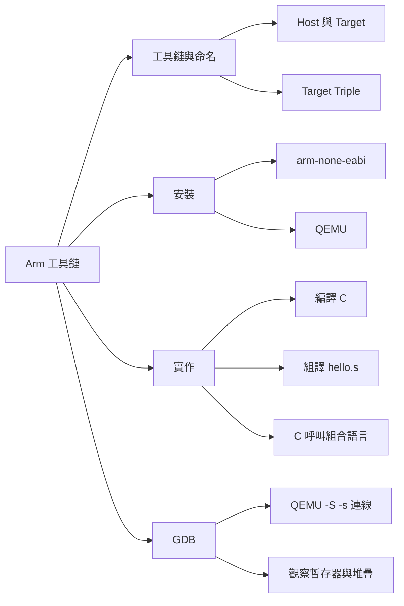

## 名詞表 {#glossary}

本章出現的名詞，詳細說明見對應區塊。

| 中文 | English | 描述 |
|---|---|---|
| 交叉工具鏈 | Cross Toolchain | 在一種平台上編譯出給另一種架構執行的程式 |
| 主機 | Host | 執行編譯工具的平台，例如 Windows／MSYS2 |
| 目標 | Target | 編譯出的程式要執行的平台，例如 Arm 晶片 |
| 目標三元組 | Target Triple | 描述目標架構、作業系統與 ABI 的名稱，例如 `arm-none-eabi` |
| 嵌入式 ABI | EABI, Embedded ABI | 嵌入式、無作業系統環境的二進位介面 |
| 硬體浮點 | Hard-float（hf） | 用硬體 FPU 傳遞浮點參數的 ABI |
| 模擬器 | QEMU, Quick Emulator | 開源的硬體模擬與虛擬化工具 |
| 除錯器 | GDB, GNU Debugger | GNU 工具鏈的程式除錯工具 |
| 中斷點 | Breakpoint | 讓程式停在指定位置的標記 |
| 遠端除錯 | Remote Debugging | GDB 透過網路連到 GDB Server（如 QEMU）除錯 |

## 本章地圖 {#ch5-tool-map}

把 [[ch5-arm-asm#ch5-asm-map|Arm 組合語言程式]]實際編譯、在 QEMU 模擬的 Arm 板子上執行，並用 GDB 觀察暫存器。原始投影片：[[_pdf/S05_02-MSYS2-ARM-toolchain-01.pdf|Part 1]]（工具鏈、QEMU、實作）、[[_pdf/S05_02-MSYS2-ARM-toolchain-02.pdf|Part 2]]（GDB）。



## Arm GNU Toolchain {#arm-gnu-toolchain}

**Arm GNU Toolchain** 是 Arm 官方維護的開源工具集，涵蓋嵌入式開發從編譯、連結到除錯的流程，包含 GCC、連結器、組譯器與 GDB，支援 AArch32 與 AArch64。支援哪些核心要看各版本的發行說明。

## 交叉工具鏈與 Host／Target {#cross-toolchain}

**交叉工具鏈**在一個主機平台（**Host**，例如 Windows 或 Linux 開發機）上，編譯出跑在另一種架構或作業系統（**Target**，例如 Arm 晶片）上的執行檔。許多嵌入式裝置資源有限、無法自己編譯，所以在效能好的開發機上交叉編譯是標準流程。

**不要把兩種架構搞混**：Windows／MSYS2 是 Host，`arm-none-eabi` 是 Target。下載檔名中的 `mingw-w64-i686` 只表示**工具程式本身**是在 Windows 上執行的 32 位元版本，不代表它產生 x86 程式碼。

## Target Triple {#target-triple}

交叉工具鏈常用 **Target Triple**（實際上是 Target Tuple）描述目標：

$$
\text{目標架構}\ [-\text{供應商}]\ [-\text{作業系統／環境}]\ [-\text{ABI}]
$$

欄位可合併或省略，不是固定四段。

| 欄位 | 值 | 意義 |
|---|---|---|
| 架構 | `arm` | 32 位元（AArch32），常用於 Cortex-M |
| 架構 | `aarch64` | 64 位元（AArch64），用於 Cortex-A 等 |
| 作業系統 | `none` | 無作業系統（Bare Metal）或輕量 RTOS |
| 作業系統 | `linux` | Linux 目標，C 函式庫依工具鏈而定（常見 glibc） |
| ABI | `eabi` | 嵌入式 ABI |
| ABI | `gnueabihf` | 支援硬體浮點的 Linux ABI |

## 依目標挑選工具鏈 {#choose-target}

| 目標 | Target Triple | 典型應用 |
|---|---|---|
| 32 位元 Bare Metal | `arm-none-eabi` | STM32、Raspberry Pi Pico（Cortex-M）、FreeRTOS |
| 32 位元 Linux | `arm-linux-gnueabihf` | 32 位元嵌入式 Linux；hf 須與目標 FPU 及 ABI 相容 |
| 64 位元 Bare Metal | `aarch64-none-elf` | 64 位元 Bootloader、無 OS 的高階應用 |
| 64 位元 Linux | `aarch64-linux-gnu` | Arm 伺服器、樹莓派 64 位元系統 |

## 依主機挑選工具鏈 {#choose-host}

官方下載檔名格式：

$$
\texttt{arm-gnu-toolchain-}\langle\text{版本}\rangle\texttt{-}\langle\text{Host OS／Arch}\rangle\texttt{-}\langle\text{Target Triple}\rangle
$$

例如 `arm-gnu-toolchain-13.3.rel1-mingw-w64-i686-arm-none-eabi`：版本 13.3.rel1、Host 是 Windows 32 位元、Target 是 `arm-none-eabi`。Host 版本只決定工具在你電腦上怎麼跑，它產生的程式一律是給 Arm 用的。

| Host | 可選的 Host 欄位 | 備註 |
|---|---|---|
| Windows | `mingw-w64-i686` | 官方目前沒有 x86_64 版；32 位元工具可在 64 位元 Windows 執行。也可從 MSYS2 安裝（只有 `arm-none-eabi`） |
| Linux x86_64 | `x86_64` | 不要誤用 AArch64 Host 的 `...-aarch64-arm-none-eabi` |
| Linux AArch64 | `aarch64` | 在 Arm 電腦上執行的工具 |
| macOS Intel | `darwin-x86_64` | |
| macOS Apple silicon | `darwin-arm64` | |

### 例子：Raspberry Pi 的工具鏈選擇 {#ex-raspberry-pi .fold}

- **Raspberry Pi Pico**（Cortex-M0+，32 位元 Bare-metal），在 Windows 開發：`arm-gnu-toolchain-13.3.rel1-mingw-w64-i686-arm-none-eabi`。
- **Raspberry Pi 4**：無作業系統開發用 `aarch64-none-elf`；Linux 應用開發用 AArch64 Linux Target（如 `aarch64-linux-gnu`）。檔名中的 `x86_64` 是 Linux x86_64 Host，不是 Windows 安裝包；實際組合以官方清單為準。

## 課程的開發環境 {#course-environment}

本課程：**Windows 11／MSYS2 MINGW64**＋**Arm GNU Toolchain 13.3.rel1**（Windows i686 Host、`arm-none-eabi` Target）。模擬機型是 **QEMU `versatilepb`**（ARM926EJ-S，Armv5TE），不是 Raspberry Pi Pico。實際開發還要依需求搭配 SDK、IDE（如 VS Code）與擴充套件。

## 安裝工具鏈並設定 PATH {#install-arm-toolchain}

1. 從 Arm Developer 網站下載 `arm-gnu-toolchain-13.3.rel1-mingw-w64-i686-arm-none-eabi.exe` 並安裝，記下安裝路徑的 `bin` 資料夾。
2. 在 MSYS2 MINGW64 終端編輯家目錄的 `.bashrc`（`/home/user`，即 `C:\msys64\home\user`；用 `ls -a` 才看得到 `.` 開頭的隱藏檔）：

   ```sh
   nano .bashrc
   ```

   加入（依實際安裝路徑修改）：

   ```sh
   export PATH="$PATH:/C/Program Files (x86)/Arm GNU Toolchain arm-none-eabi/13.3 rel1/bin"
   ```

3. 讓設定生效並驗證：

   ```sh
   source ~/.bashrc
   arm-none-eabi-gcc --version
   # arm-none-eabi-gcc.exe (Arm GNU Toolchain 13.3.Rel1 (Build arm-13.24)) 13.3.1 20240614
   ```

## QEMU {#qemu}

**QEMU** 是開源的模擬器與虛擬化工具：

- **模擬器**：在不同架構間執行程式，例如在 x86 主機上模擬 Arm 系統。
- **虛擬化**：Host／Guest 架構相容時可結合 KVM 加速；本課程在 Windows 模擬 Arm，不屬於 KVM 情境。
- **應用**：嵌入式初期測試與除錯（減少實體硬體需求，支援 GPIO、UART 等外設模擬）、跨平台測試。

在 MSYS2 MINGW64 安裝：

```sh
pacman -Syu                        # 先更新套件，避免相容性問題
pacman -S mingw-w64-x86_64-qemu    # 安裝 QEMU
qemu-system-arm --version          # QEMU emulator version 9.1.1
```

MSYS2 已公告逐步停用 MINGW64 套件建置，新環境建議評估 UCRT64（套件 `mingw-w64-ucrt-x86_64-qemu`）；兩者的 QEMU 路徑可能不同。

## MSYS2 環境與 QEMU 版本 {#msys2-runtime}

| 終端 | C Runtime | 套件前綴 |
|---|---|---|
| MINGW64 | MSVCRT | `mingw-w64-x86_64-`、`mingw-w64-i686-` |
| UCRT64 | UCRT | `mingw-w64-ucrt-x86_64-`、`mingw-w64-ucrt-i686-` |

兩者都是 64 位元環境，也能執行 32 位元程式。QEMU 這類**在 Windows 上執行**的程式要裝對應環境的版本，在不同終端混用套件可能遇到 DLL 搜尋路徑或執行環境衝突。

但 **Toolchain 的目標架構與開發環境無關**：`arm-none-eabi` 產生的二進位檔是給 Arm 的，不論在 UCRT64 或 MINGW64 都一樣。環境的比較見 [[ch3-msys2#ucrt-msvcrt|UCRT 與 MSVCRT]]。

## 裸機沒有系統呼叫 {#bare-metal-syscalls}

`arm-none-eabi` 是**無作業系統**開發，沒有標準系統呼叫可用：

- `printf()` 透過 C 函式庫呼叫底層的 `_write()`；`malloc()` 可能透過 `_sbrk()` 取得 Heap 空間。`printf`／`malloc` 本身不是系統呼叫。
- 課程提供的 **`syscalls.c`** 實作了 `_close`、`_fstat`、`_isatty`、`_lseek`、`_read`、`_getpid`、`_kill`、`_write`、`_sbrk` 等；其中 `_write()` 把字元寫到 versatilepb 的 **UART0（0x101F1000）**，所以 `printf()` 能顯示在 QEMU 終端。這是針對此模擬板的簡化支援程式，不是裸機內建的標準輸出。

## 實作一：編譯 C 程式 {#lab-c}

`main.c`（與 `syscalls.c` 放在同一資料夾）：

```c
#include <stdio.h>
int main() {
    int i;
    for (i = 0; i < 10; i++) {
        printf("Loop iteration: %d\n", i);
    }
    printf("Program finished.\n");
    return 0;
}
```

編譯：

```sh
arm-none-eabi-gcc -o main.elf main.c syscalls.c -specs=nosys.specs -lc -lgcc
```

- `-o main.elf`：輸出 ELF 格式的可執行檔。
- `-specs=nosys.specs`：使用適合 Bare-metal／Newlib 的連結規格，通常納入 libnosys 的系統呼叫 stub。它不會禁用 C 函式庫，實際用哪個 `_write`／`_sbrk` 由符號解析與連結順序決定；本課程用 `syscalls.c` 的 UART 版。可用 `arm-none-eabi-nm main.elf | grep "_write\|_sbrk"` 檢查符號。
- `-lc -lgcc`：連結 C 函式庫與 GCC 支援函式庫。

執行：

```sh
timeout 1s qemu-system-arm -M versatilepb -m 128M -kernel main.elf -nographic
```

| 選項 | 意義 |
|---|---|
| `timeout 1s` | 1 秒後強制結束，避免模擬器卡住 |
| `-M versatilepb` | 模擬 Versatile Platform Board（含 UART 等基本外設） |
| `-m 128M` | 模擬 128 MB 記憶體 |
| `-kernel main.elf` | 依此板機的開機流程載入執行檔 |
| `-nographic` | 不用圖形介面，輸出直接顯示在命令列 |

輸出 `Loop iteration: 0` 到 `Loop iteration: 9`，最後 `Program finished.`。

## 編譯、連結與載入的分工 {#build-load-stages}

| 階段 | 工具 | 產物 |
|---|---|---|
| 編譯／組譯 | `arm-none-eabi-gcc`、`arm-none-eabi-as` | 目的檔 `.o` |
| 連結 | `arm-none-eabi-ld`（或由 gcc 呼叫） | ELF 可執行檔，記錄 Entry Point |
| 載入 | QEMU 依板機設定 | 程式在模擬的記憶體中執行 |

GDB 可以觀察真正開始執行的位置。這三者的區別見 [[ch5-arm-asm#entry-point|_start 不等於 CPU 從這裡執行]]。

## 實作二：組譯 hello.s {#lab-hello-asm}

裸機直接操作 versatilepb 的 **PL011 UART0**（0x101F1000）輸出字串：

```asm
.section .data
msg:
.asciz "Hello, World!\n"

.section .text
.global _start
.equ UART0, 0x101f1000      // UART0 的基底位址

_start:
    ldr r1, =msg            // r1 = 字串位址
    bl  print_string        // 呼叫輸出函式
    b   .                   // 停在這裡

print_string:
    ldrb r2, [r1], #1       // 讀一個字元，r1 再加 1（後置索引）
    cmp  r2, #0             // 字串結尾？
    beq  end_string
wait_uart:
    ldr  r3, =UART0
    ldr  r4, [r3, #0x18]    // 讀 UARTFR（Flag Register）
    tst  r4, #0x20          // TXFF（傳送 FIFO 滿）= 1 就等待
    bne  wait_uart
    str  r2, [r3, #0x00]    // 字元寫入 UARTDR（Data Register）
    b    print_string       // 下一個字元
end_string:
    bx   lr                 // 返回
```

組譯、連結與執行：

```sh
arm-none-eabi-as -o hello.o hello.s
arm-none-eabi-ld -Ttext=0x10000 -o hello.elf hello.o
timeout 1s qemu-system-arm -M versatilepb -m 128M -nographic -kernel hello.elf
# Hello, World!
```

- `arm-none-eabi-as`：把 `.s` 組譯成目的檔 `.o`。
- `arm-none-eabi-ld`：把目的檔連結成 `.elf`。`-Ttext=0x10000` 設定 `.text` 區段的位址為 0x10000，**不等於**指定 Entry Point；這裡靠預設慣例解析 `_start`，要明確指定可加 `-e _start`。
- 檢查：`readelf -h hello.elf` 看 Entry Point、`readelf -S hello.elf` 看區段位址、`nm hello.elf` 看 `_start` 符號（都加 `arm-none-eabi-` 前綴）。

這段程式用到了 [[ch5-arm-cpu#arm-post-indexed|後置索引]] `ldrb r2, [r1], #1` 逐字走訪字串，以及 `.equ` 定義硬體位址。原講義的註解用 `//`；A32 較一致的行內註解是 `@`。

## 實作三：C 呼叫組合語言 {#lab-c-asm}

檔案：`main.c`、`functions.s`、`syscalls.c`。

```sh
arm-none-eabi-gcc -o main.elf main.c syscalls.c functions.s -specs=nosys.specs -lc -lgcc
timeout 1s qemu-system-arm -M versatilepb -m 128M -nographic -kernel main.elf
```

`main.c`：

```c
#include <stdio.h>
extern int add_numbers(int a, int b);
extern int factorial(int n);
extern void swap_numbers(int *a, int *b);

int main() {
    printf("3 + 7 = %d\n", add_numbers(3, 7));
    printf("5! = %d\n", factorial(5));
    int x = 10, y = 20;
    printf("Before swap: x = %d, y = %d\n", x, y);
    swap_numbers(&x, &y);
    printf("After swap: x = %d, y = %d\n", x, y);
    return 0;
}
```

輸出：

```text
3 + 7 = 10
5! = 120
Before swap: x = 10, y = 20
After swap: x = 20, y = 10
```

## functions.s {#functions-s}

```asm
.global add_numbers
.global factorial
.global swap_numbers
.section .text

@ add_numbers：r0 = a, r1 = b，回傳 r0 = a + b
add_numbers:
    add r0, r0, r1
    bx  lr

@ factorial：r0 = n，回傳 r0 = n!
factorial:
    push {r4, lr}       @ 保存本層 R4 與 LR（8 bytes）
    mov  r4, r0         @ 保存 n
    cmp  r0, #1
    ble  fact_end       @ n <= 1 就直接回傳 n
    sub  r0, r0, #1
    bl   factorial      @ 遞迴
    mul  r0, r4, r0     @ n × factorial(n-1)
fact_end:
    pop  {r4, lr}
    bx   lr

@ swap_numbers：r0 = &a, r1 = &b
swap_numbers:
    ldr r2, [r0]        @ r2 = *a
    ldr r3, [r1]        @ r3 = *b
    str r2, [r1]        @ *b = r2
    str r3, [r0]        @ *a = r3
    bx  lr
```

- `add_numbers`、`swap_numbers` 是 Leaf Function，直接 `bx lr`。
- `swap_numbers` 收到的是**指標**（位址），要先 `ldr` 取值再 `str` 交叉寫回。
- 這個 `factorial` 在 n ≤ 1 時回傳 n 本身，所以 **n = 0 會回傳 0**，不是數學上的 0! = 1；課程只用 1 ≤ n ≤ 12。處理 0! 的版本見 [[ch5-arm-cpu#arm-factorial|遞迴 factorial]]。

## GDB {#gdb}

**GDB**（GNU Debugger）是 GNU 工具鏈的除錯器。`arm-none-eabi-gdb` 能解析 AArch32 的 ARM（A32）／Thumb 指令與 ARM926EJ-S 的暫存器。

- 支援 AArch32 指令集（其他架構要確認 GDB 與 QEMU 目標相容）。
- 交叉除錯：在 x86 主機上用 Arm GDB 除錯 Arm 目標。
- 遠端除錯：搭配 GDB Server。
- 硬體除錯：支援 J-Link、OpenOCD 等工具。

## GDB 常用指令 {#gdb-commands}

| 指令 | 縮寫 | 功能 |
|---|---|---|
| `break <位置>` | `b` | 在函式、行號或位址設中斷點 |
| `continue` | `c` | 繼續執行到下一個中斷點 |
| `next` | `n` | 執行一行原始碼，**不進入**函式 |
| `step` | `s` | 執行一行原始碼，**進入**函式 |
| `stepi` | `si` | 執行**一條機器指令**，組合語言除錯必備 |
| `print <變數>` | `p` | 顯示變數的值（結構、陣列可分層顯示） |
| `x/<格式> <位址>` | | 依格式顯示記憶體內容 |
| `info registers` | `i r` | 顯示暫存器（Arm 的 r0 是返回值） |
| `info locals` | | 顯示目前函式的區域變數 |
| `info frame` | | 顯示目前的堆疊框架 |
| `backtrace` | `bt` | 顯示函式呼叫鏈 |
| `delete <編號>` | `d` | 刪除中斷點（先用 `info breakpoints` 查編號） |
| `list <位置>` | `l` | 列出原始碼 |
| `watch <運算式>` | | 運算式的值改變時自動暫停 |
| `disassemble <函式>` | `disas` | 反組譯函式 |
| `display /i $pc` | | 每次停下都顯示 PC 所在的指令 |
| `quit` | `q` | 離開 GDB |

`run`（`r`）用於本機啟動程式；本課程用 QEMU 遠端連線，主要用 `continue`／`stepi`，不能假設 `run` 能重新啟動遠端目標。

## 暫存器的值與指標 {#gdb-register-vs-pointer}

- `info registers r0`：看 R0 **本身的數值**，適用整數參數。
- `x/wx $r0`：把 R0 **當成位址**，讀那個位址的記憶體，只適用 R0 存放有效指標的情況（例如 `swap_numbers`）。

在 `add_numbers` 中 R0 = 3 是整數，`x/xw $r0` 讀到的是位址 0x3 附近的記憶體，沒有意義。`x/4wx $sp` 則是以十六進位顯示 SP 指向的四個 32 位元 word。

## 用 QEMU 啟動遠端除錯 {#gdb-remote}

1. 加 `-g` 編譯，加入除錯資訊：

   ```sh
   arm-none-eabi-gcc -g -o main.elf main.c syscalls.c -specs=nosys.specs -lc -lgcc
   ```

   可用 `arm-none-eabi-readelf -S main.elf` 確認有 `.debug_*` 區段。

2. 啟動 QEMU 並開 GDB Server：

   ```sh
   timeout 600s qemu-system-arm -M versatilepb -m 128M -nographic -kernel main.elf -S -s
   ```

   - `-S`：啟動後立刻暫停 CPU，等 GDB 連線。
   - `-s`：建立 GDB stub，預設 TCP 1234（可用 `-gdb tcp::PORT` 指定）。擔心被其他主機連線時應限制監聽介面或用防火牆。

3. 開**另一個終端**，到同一資料夾：

   ```sh
   arm-none-eabi-gdb main.elf
   (gdb) target remote :1234
   # Remote debugging using :1234
   # 0x000081dc in _start ()
   ```

連上後程式停在 `_start`，再設中斷點、`continue`。

### 例子：追蹤 C 迴圈 {#ex-gdb-loop .fold}

```text
(gdb) b main
Breakpoint 1 at 0x8298: file main.c, line 5.
(gdb) c
Breakpoint 1, main () at main.c:5
5          for (i = 0; i < 10; i++) {
(gdb) p i
$1 = 0
(gdb) s
6              printf("Loop iteration: %d\n", i);
(gdb) s
5          for (i = 0; i < 10; i++) {
...
(gdb) p i
$4 = 3
```

每次 `s` 執行一行原始碼，QEMU 終端同步印出 `Loop iteration: 0`、`1`、`2`…。

## 觀察 add_numbers 的暫存器 {#gdb-add-numbers}

以 [[#lab-c-asm|實作三：C 呼叫組合語言]]的程式為例（`add_numbers(3, 7)`），`b add_numbers` 後 `c`：

```text
Breakpoint 1, 0x00008588 in add_numbers ()
(gdb) i r r0 r1
r0             0x3                 3
r1             0x7                 7
(gdb) si
0x0000858c in add_numbers ()
(gdb) i r r0 r1
r0             0xa                 10
r1             0x7                 7
(gdb) display /i $pc
=> 0x858c <add_numbers+4>:      bx      lr
```

進入時 R0 = 3、R1 = 7（參數 a、b），執行 `add` 後 R0 = 10（返回值），下一條是 `bx lr`。此時 LR = 0x82A4，就是 main 中 `bl add_numbers` 的下一條指令。

若 GDB 顯示 `(No debugging symbols found in main.elf)`，表示載入的 ELF 沒有 `-g` 資訊；先確認 GDB 讀的是 QEMU 端同一次建置的 `main.elf`。

## 追蹤遞迴 factorial {#gdb-factorial}

`b factorial` 停在 `<factorial+8>`（`cmp` 之前），表示本層的 `push {r4, lr}` 與 `mov r4, r0` **已經執行**：

| 停下時 | r0 | r4 | sp | lr |
|---|---|---|---|---|
| factorial(5) | 5 | 5 | 0x7AFE0 | 0x82BC（回 main） |
| factorial(4) | 4 | 4 | 0x7AFD8 | 0x85A8（回 factorial） |

每深一層 SP 減少 **8 bytes**（`push {r4, lr}` 存了兩個 word），LR 變成 factorial 內 `bl factorial` 的下一條（`mul` 的位址 0x85A8）。回程時每層 `pop` 還原自己的 R4 與 LR，逐層返回。

反組譯：

```text
(gdb) disas factorial
  0x00008590 <+0>:     push    {r4, lr}
  0x00008594 <+4>:     mov     r4, r0
  0x00008598 <+8>:     cmp     r0, #1
  0x0000859c <+12>:    ble     0x85ac <fact_end>
  0x000085a0 <+16>:    sub     r0, r0, #1
  0x000085a4 <+20>:    bl      0x8590 <factorial>
  0x000085a8 <+24>:    mul     r0, r4, r0
  ...（後面還有 fact_end 的 pop {r4, lr} 與 bx lr）
```

0x85A8 正是遞迴層看到的 LR。`swap_numbers` 中斷時 R0 = 0x7AFEC、R1 = 0x7AFE8，是 main 堆疊上 x、y 的位址，這時才適合用 `x/wx $r0` 看記憶體。
